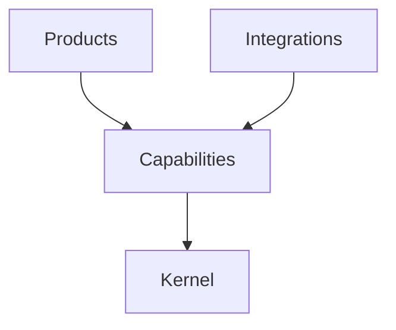
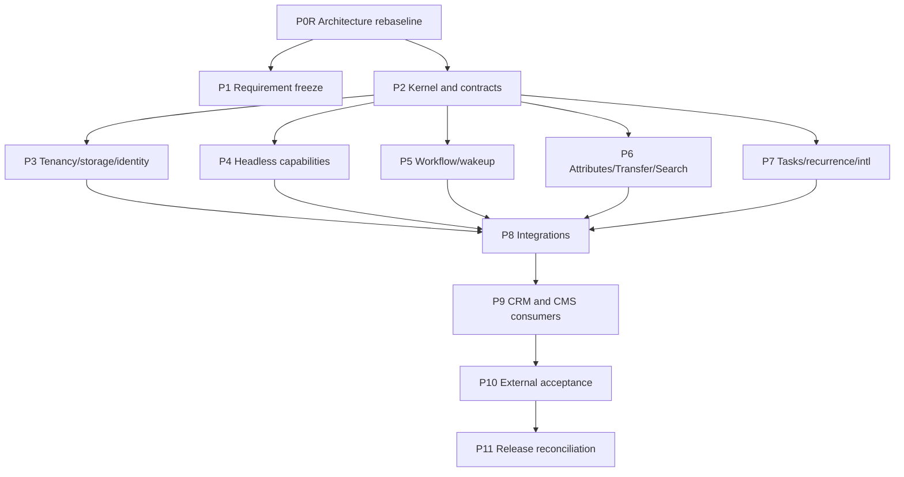

Вы правы: предыдущий ответ **не был записан в репозиторий** — commit `bfc05d0` является merge-коммитом PR #16 и не содержит моего аудита. [Сам commit](https://github.com/axiomasoft/corex/commit/bfc05d060e3961a5881640b7f828503440bb2902)

Ниже содержимое Markdown-файла. Его следует сохранить как `docs/audits/corex-architecture-audit-bfc05d0.md`. **Никакого нового commit в `main` сейчас не создано.**

***

# Архитектурный аудит CoreX

**Репозиторий:** `axiomasoft/corex`  
**Проверяемая ревизия:** `bfc05d060e3961a5881640b7f828503440bb2902`  
**Дата аудита:** 17 сентября 2026 года  
**Назначение CoreX:** универсальное Laravel-ядро для CRM, CMS и других долгоживущих продуктов.

## Статус документа

Этот документ является архитектурным аудитом проверенной ревизии, а не подтверждением готовности CoreX к стабильному релизу.

Проверяемый commit — merge-коммит PR #16 с сообщением `Codex/instruction layers f9`; в нём нет файла архитектурного аудита.[Сам commit](https://github.com/axiomasoft/corex/commit/bfc05d060e3961a5881640b7f828503440bb2902)

В монорепозитории находятся 20 каталогов пакетов:

- `api`
- `attributes`
- `auth`
- `core`
- `crm`
- `import-export`
- `intl`
- `intl-search`
- `media`
- `modules`
- `notifications`
- `panels`
- `recurrence`
- `search`
- `search-meilisearch`
- `tasks`
- `tasks-workflow`
- `tenancy`
- `wakeup`
- `workflow`

[Состав packages на проверяемой ревизии](https://github.com/axiomasoft/corex/tree/bfc05d060e3961a5881640b7f828503440bb2902/packages)

## Итоговый вердикт

CoreX содержит хорошие заготовки для платформенного ядра:

- типизированные contracts;
- opaque identifiers;
- optimistic concurrency;
- idempotency tokens;
- изоляцию optional search adapter;
- отдельные пакеты для инфраструктурных возможностей;
- планы с формализованными gates и acceptance criteria.

Однако CoreX пока нельзя считать устойчивым универсальным ядром. Основная проблема — не стиль отдельных методов, а отсутствие полностью соблюдаемой архитектурной иерархии пакетов.

Самые опасные дефекты:

1. `core` содержит прямую PHP-зависимость от `CoreX\Tenancy\TenantContext`, но `corex/core` не объявляет зависимость от `corex/tenancy`.
2. Общий `DataScope` смешивает tenant context, физическую connection identity, actor identity, restore epoch и callback авторизации.
3. `attributes` не привязан напрямую к Laravel model/table на уровне public contract, но concrete stores жёстко привязаны к физическим именам системных таблиц.
4. `attributes` обязательно зависит от `modules`, из-за чего универсальная capability становится частью CoreX module runtime.
5. В package API смешаны contracts и DTO из namespace `Support`.
6. Root test runner не запускает тесты всех 20 пакетов.
7. Root project устанавливает CRM и integration bridges как часть основной композиции.
8. `intl-search` владеет собственной прикладной функциональностью и SQL reader, хотя позиционируется как optional glue.
9. Каталоги `Internal` и `Support` используются вместо предметных названий.
10. План детализирован сильнее, чем стабилизирована dependency model.

Перед продолжением реализации P3–P11 следует провести architecture rebaseline и исправить P0-дефекты. Добавление новых возможностей поверх текущих границ повысит стоимость будущего исправления.

## Карта приоритетов

| Приоритет | Находка | Воздействие |
|---|---|---|
| P0 | Undeclared dependency `core -> tenancy` | Нарушение Composer isolation и направления зависимостей |
| P0 | `DataScope` объединяет несколько независимых контекстов | Непереносимый API, проблемы очередей и долговременных процессов |
| P0 | Нет формальной классификации пакетов | Product и integrations смешиваются с reusable capabilities |
| P0 | Не определён и не заморожен public API | Высокий риск случайного legacy API |
| P1 | Жёсткие таблицы в attribute stores | Невозможно менять schema naming и storage layout без изменения реализации |
| P1 | `attributes -> modules` обязательно | Attribute engine нельзя использовать независимо |
| P1 | Только восемь пакетов в `test:packages` | Ложноположительный зелёный CI |
| P1 | `intl-search` превращается в самостоятельный компонент | Комбинаторный рост bridge-пакетов |
| P1 | Runtime-доступ к глобальному config | Скрытые зависимости, сложные unit tests и Octane-риск |
| P1 | `Internal`/`Support` скрывают ответственность классов | Ухудшение навигации и API ownership |
| P2 | Название `import-export` | Неудачный package identity, хотя внутренний язык уже использует Transfer |
| P2 | Root runtime включает CRM и bridges | Нельзя доказать независимую устанавливаемость kernel |
| P2 | Нет полной compatibility matrix | Не доказаны минимальные версии и standalone installation |

## Сильные стороны

### Opaque RecordRef

Публичный `AttributeStore` принимает `RecordRef`, а не Eloquent model:

```php
interface AttributeStore
{
    public function read(
        DataScope $scope,
        RecordRef $record,
        FieldSelection $fields,
    ): ValueBag;

    public function write(
        DataScope $scope,
        RecordRef $record,
        ValuePatch $patch,
        WriteToken $token,
    ): WriteResult;

    public function loadMany(
        DataScope $scope,
        RecordSelection $records,
        FieldSelection $fields,
    ): ValueBatch;
}
```

[`AttributeStore.php`](https://github.com/axiomasoft/corex/blob/bfc05d060e3961a5881640b7f828503440bb2902/packages/attributes/src/Contracts/AttributeStore.php)

`RecordRef` содержит opaque `entity` и `id`, причём entity проверяется как зарегистрированный handle, а не как PHP class или table name:

```php
final readonly class RecordRef
{
    public function __construct(
        public string $entity,
        public string $id,
    ) {
        // ...
    }
}
```

[`RecordRef.php`](https://github.com/axiomasoft/corex/blob/bfc05d060e3961a5881640b7f828503440bb2902/packages/core/src/Support/Data/RecordRef.php)

Это исправляет первоначальное предположение о прямой привязке public API attributes к таблице Laravel-модели. На уровне контракта такая привязка отсутствует.

Проблема расположена ниже: в конфигурации entity registry и concrete storage implementations.

### Идемпотентность

`JsonbAttributeStore` и `EavAttributeStore` используют:

- `operation_key`;
- `payload_hash`;
- expected record version;
- `lockForUpdate()`;
- транзакцию;
- replay result;
- conflict exceptions.

[`JsonbAttributeStore.php`](https://github.com/axiomasoft/corex/blob/bfc05d060e3961a5881640b7f828503440bb2902/packages/attributes/src/Internal/Engine/JsonbAttributeStore.php)

[`EavAttributeStore.php`](https://github.com/axiomasoft/corex/blob/bfc05d060e3961a5881640b7f828503440bb2902/packages/attributes/src/Internal/Engine/EavAttributeStore.php)

Это хорошая основа для CRM/CMS, где повторная доставка команд и конкурирующие изменения неизбежны.

### Отделение Meilisearch SDK

`corex/search` не зависит от Meilisearch SDK, а `corex/search-meilisearch` подключает SDK отдельно:

```json
{
    "require": {
        "corex/search": "@dev",
        "meilisearch/meilisearch-php": "1.16.1"
    }
}
```

[`search-meilisearch/composer.json`](https://github.com/axiomasoft/corex/blob/bfc05d060e3961a5881640b7f828503440bb2902/packages/search-meilisearch/composer.json)

Разделение Composer-пакетов здесь технически обосновано: приложение без Meilisearch не должно устанавливать его SDK. Laravel Scout также реализует search как driver-based subsystem и позволяет регистрировать дополнительные engines. [laravel](https://laravel.com/framework/docs/12.x/scout)

Проблема не в самом разделении, а в именовании, расположении и отсутствии общей политики integrations.

## P0: Core зависит от Tenancy

### Дефект

`DataScope`, физически находящийся в `corex/core`, импортирует класс из `CoreX\Tenancy`:

```php
namespace CoreX\Support\Data;

use Closure;
use CoreX\Tenancy\TenantContext;

final readonly class DataScope
{
    public function __construct(
        public TenantContext $context,
        public string $connectionIdentity,
        public string $actorId,
        public Closure $authorize,
        public string $restoreEpoch,
    ) {}
}
```

[`DataScope.php`](https://github.com/axiomasoft/corex/blob/bfc05d060e3961a5881640b7f828503440bb2902/packages/core/src/Support/Data/DataScope.php)

При этом `packages/core/composer.json` не требует `corex/tenancy`:

```json
{
    "require": {
        "php": "^8.3",
        "brick/money": "^0.9 || ^0.10",
        "illuminate/config": "^12.0|^13.0",
        "illuminate/container": "^12.0|^13.0",
        "illuminate/contracts": "^12.0|^13.0",
        "illuminate/database": "^12.0|^13.0",
        "illuminate/filesystem": "^12.0|^13.0",
        "illuminate/http": "^12.0|^13.0",
        "illuminate/support": "^12.0|^13.0"
    }
}
```

[`core/composer.json`](https://github.com/axiomasoft/corex/blob/bfc05d060e3961a5881640b7f828503440bb2902/packages/core/composer.json)

### Почему это P0

Это одновременно:

- undeclared Composer dependency;
- нарушение package isolation;
- обратная зависимость kernel от capability;
- препятствие standalone-установке `corex/core`;
- потенциальная ошибка при загрузке `DataScope` без установленного tenancy package;
- скрытое доказательство того, что root monorepo маскирует некорректные package boundaries.

Root-проект устанавливает и `corex/core`, и `corex/tenancy`, поэтому дефект может не проявляться в монорепозитории.

### Исправление

`core` не должен знать `TenantContext`.

Минимальный вариант:

```php
namespace CoreX\Data;

final readonly class OperationContext
{
    public function __construct(
        public ScopeId $scope,
        public ActorId $actor,
        public ConnectionId $connection,
        public RestoreEpoch $restoreEpoch,
    ) {}
}
```

Tenancy adapter:

```php
namespace CoreX\Tenancy\Data;

final class TenantOperationContextFactory
{
    public function create(TenantContext $tenant, Principal $principal): OperationContext
    {
        return new OperationContext(
            scope: ScopeId::fromString($tenant->tenantId()),
            actor: ActorId::fromString($principal->id()),
            connection: ConnectionId::fromString($tenant->connectionIdentity()),
            restoreEpoch: RestoreEpoch::fromString($tenant->restoreEpoch()),
        );
    }
}
```

Предпочтительнее полностью разделить:

```php
final readonly class AccessContext
{
    public function __construct(
        public ActorId $actor,
        public ScopeId $scope,
    ) {}
}

final readonly class StorageContext
{
    public function __construct(
        public ConnectionId $connection,
        public RestoreEpoch $restoreEpoch,
    ) {}
}
```

Тогда storage API не получает tenant object, а authorization API не получает физическую connection identity.

### Acceptance criteria

- `grep -R "CoreX\\\\Tenancy" packages/core/src` ничего не находит.
- `composer install` внутри standalone fixture для `corex/core` завершается без `corex/tenancy`.
- Все классы `corex/core` загружаются через Composer classmap.
- `corex/core` tests запускаются в окружении без tenancy provider.
- Архитектурный тест запрещает `CoreX\Tenancy` внутри `packages/core/src`.

## P0: DataScope перегружен

### Текущий состав

`DataScope` объединяет пять разных концепций:

| Поле | Реальная ответственность |
|---|---|
| `TenantContext` | tenancy/session context |
| `connectionIdentity` | physical storage routing |
| `actorId` | security principal |
| `Closure $authorize` | authorization policy |
| `restoreEpoch` | backup/restore safety |

[`DataScope.php`](https://github.com/axiomasoft/corex/blob/bfc05d060e3961a5881640b7f828503440bb2902/packages/core/src/Support/Data/DataScope.php)

### Последствия

1. **Нельзя сериализовать.** Closure не должен пересекать queue/workflow boundary.
2. **Нельзя переиспользовать вне tenancy.** Даже локальный single-tenant проект должен создавать `TenantContext`.
3. **Storage получает authorization behavior.** Нарушается разделение policy и mechanism.
4. **Авторизация передаётся callback-функцией.** Контракт не выражает тип решения, reason code или audit context.
5. **Restore epoch присутствует во всех операциях.** Неочевидно, является ли это storage fence, backup generation или tenant generation.
6. **API сложно эволюционировать.** Добавление нового context aspect расширяет центральный god DTO.

### Рекомендуемый API

```php
interface AttributeReader
{
    public function read(
        StorageContext $storage,
        SubjectRef $subject,
        FieldSelection $fields,
        AccessContext $access,
    ): ValueBag;
}
```

Или orchestration layer:

```php
final class ReadAttributes
{
    public function __construct(
        private AttributeValueStore $store,
        private AttributeAuthorizer $authorizer,
    ) {}

    public function execute(ReadAttributesCommand $command): ValueBag
    {
        $decision = $this->authorizer->authorize(
            $command->access,
            $command->subject,
            $command->fields,
        );

        $decision->ensureAllowed();

        return $this->store->read(
            $command->storage,
            $command->subject,
            $command->fields,
        );
    }
}
```

Storage port после этого не знает об авторизации:

```php
interface AttributeValueStore
{
    public function read(
        StorageContext $context,
        SubjectRef $subject,
        FieldSelection $fields,
    ): ValueBag;
}
```

### Authorization contract

```php
interface AttributeAuthorizer
{
    public function authorize(
        AccessContext $context,
        SubjectRef $subject,
        FieldSelection $fields,
        AttributeAction $action,
    ): AccessDecision;
}
```

```php
final readonly class AccessDecision
{
    public function __construct(
        public bool $allowed,
        public string $reason,
        public array $metadata = [],
    ) {}
}
```

Такое решение:

- сериализуемо;
- тестируемо;
- пригодно для audit log;
- не передаёт Closure через инфраструктурные границы;
- не заставляет persistence layer выполнять policy logic.

## Attributes

### Реальная привязка

Публичный attributes API не принимает Eloquent model и не использует table name как identity. В `RecordRef` используется opaque logical entity.[`RecordRef.php`](https://github.com/axiomasoft/corex/blob/bfc05d060e3961a5881640b7f828503440bb2902/packages/core/src/Support/Data/RecordRef.php)

Однако оба storage engine жёстко кодируют таблицы:

```php
return $this->connection->table('sys_attribute_documents');
```

```php
return $this->connection->table('sys_attribute_write_tokens');
```

[`JsonbAttributeStore.php`](https://github.com/axiomasoft/corex/blob/bfc05d060e3961a5881640b7f828503440bb2902/packages/attributes/src/Internal/Engine/JsonbAttributeStore.php)

EAV implementation жёстко использует:

- `sys_attribute_eav_values`;
- `sys_attribute_eav_records`;
- `sys_attribute_write_tokens`.

[`EavAttributeStore.php`](https://github.com/axiomasoft/corex/blob/bfc05d060e3961a5881640b7f828503440bb2902/packages/attributes/src/Internal/Engine/EavAttributeStore.php)

### Оценка

Это не «привязка к таблице модели Laravel», а **привязка storage adapter к фиксированной internal schema**.

Для внутреннего final adapter это допустимо. Для extensible platform требуется возможность:

- задавать prefix;
- переопределять имена таблиц;
- использовать отдельную schema PostgreSQL;
- выбирать connection;
- иметь custom store;
- заменять registry-backed field catalogue;
- устанавливать пакет без `corex/modules`.

### Обязательная зависимость от Modules

`attributes/composer.json` требует:

```json
{
    "corex/core": "@dev",
    "corex/modules": "@dev"
}
```

[`attributes/composer.json`](https://github.com/axiomasoft/corex/blob/bfc05d060e3961a5881640b7f828503440bb2902/packages/attributes/composer.json)

`AttributesServiceProvider` строит `RegistryFieldCatalogue` только при наличии `EntityRegistry` и `ModuleRegistry`:

```php
if (
    $app->bound(EntityRegistry::class)
    && $app->bound(ModuleRegistry::class)
) {
    return new RegistryFieldCatalogue(...);
}

return $app->make(UnavailableAttributes::class);
```

[`AttributesServiceProvider.php`](https://github.com/axiomasoft/corex/blob/bfc05d060e3961a5881640b7f828503440bb2902/packages/attributes/src/AttributesServiceProvider.php)

Следовательно, attributes пока не универсальная capability. Она является capability, встроенной в CoreX module registry.

### Целевая декомпозиция

```text
corex/attributes
    ├── contracts
    ├── immutable value objects
    ├── schema definitions
    ├── validation
    └── no dependency on corex/modules

corex/attributes-database
    ├── JSON document store
    ├── EAV store
    ├── PostgreSQL filtering
    └── migrations

corex/attributes-modules
    ├── ModuleFieldCatalogue
    ├── EntityRegistry integration
    └── module lifecycle hooks
```

Если три Composer-пакета считаются излишними, можно сохранить один package, но dependency на modules должна стать optional:

```json
{
    "require": {
        "corex/core": "^1.0"
    },
    "suggest": {
        "corex/modules": "Provides module-registry-backed attribute definitions"
    }
}
```

### Новые contracts

```php
interface AttributeSubject
{
    public function reference(): SubjectRef;
}
```

```php
final readonly class SubjectRef
{
    public function __construct(
        public SubjectType $type,
        public SubjectId $id,
    ) {}
}
```

```php
interface AttributeDefinitionRepository
{
    public function definitions(
        SubjectType $subject,
        FieldSelection $selection,
    ): AttributeSchema;
}
```

```php
interface AttributeValueStore
{
    public function read(
        StorageContext $context,
        SubjectRef $subject,
        FieldSelection $fields,
    ): ValueBag;

    public function write(
        StorageContext $context,
        SubjectRef $subject,
        ValuePatch $patch,
        ConcurrencyToken $token,
    ): WriteResult;
}
```

### Table map

```php
final readonly class AttributeTableMap
{
    public function __construct(
        public string $documents,
        public string $eavRecords,
        public string $eavValues,
        public string $writeTokens,
    ) {}
}
```

```php
$this->app->singleton(
    AttributeTableMap::class,
    fn (): AttributeTableMap => new AttributeTableMap(
        documents: config(
            'corex-attributes.tables.documents',
            'corex_attribute_documents',
        ),
        eavRecords: config(
            'corex-attributes.tables.eav_records',
            'corex_attribute_records',
        ),
        eavValues: config(
            'corex-attributes.tables.eav_values',
            'corex_attribute_values',
        ),
        writeTokens: config(
            'corex-attributes.tables.write_tokens',
            'corex_attribute_write_tokens',
        ),
    ),
);
```

Concrete store получает map через constructor и больше не читает config.

### Semantics удаления

Текущий `ValuePatch`/store flow должен явно различать:

- field отсутствует;
- field установлен в `null`;
- field удалён;
- field сброшен к default;
- field скрыт политикой;
- field неизвестен текущей schema version.

Нельзя кодировать удаление только значением `null`. Для CRM/CMS `null` часто является допустимым business value.

Рекомендуемый patch:

```php
final readonly class ValuePatch
{
    /**
     * @param array<string, mixed> $set
     * @param list<string> $remove
     */
    public function __construct(
        public array $set,
        public array $remove,
        public SchemaVersion $schemaVersion,
    ) {}
}
```

### Schema evolution

Необходимы:

- stable `field_id`, не равный mutable field name;
- human-readable key;
- schema revision;
- field type revision;
- compatibility rules;
- migration state;
- backfill status;
- index status;
- deprecation state;
- aliases старых field keys;
- explicit transformation policy.

Изменение `string -> integer` не должно происходить заменой одной записи definition. Это migration:

```text
draft -> validation -> backfill -> dual-read -> switch -> cleanup
```

### EAV и JSONB

| Критерий | JSONB | EAV |
|---|---|---|
| Чтение объекта | Простое и быстрое | Требуется сборка строк |
| Частичное обновление | Возможна перезапись документа | Естественный update отдельного поля |
| Фильтрация | GIN/expression indexes | Индексы по field/value |
| Типизация | Требует schema validation | Требует typed columns или encoded value |
| Уникальные constraints | Сложные expression indexes | Возможны составные индексы |
| Schema evolution | Гибкая | Гибкая |
| Analytics | Сложнее | Может быть дорого из-за joins |
| Write amplification | Документ целиком | По изменённым полям |

CoreX не должен выбирать один engine глобально навсегда. Engine следует выбирать по subject type или attribute set:

```php
interface AttributeStoreResolver
{
    public function for(SubjectType $subject): AttributeValueStore;
}
```

## Service provider attributes

### Положительная часть

Выбор concrete implementation выполняется в service provider, то есть в composition root:

```php
$this->app->scoped(AttributeStore::class, function (Application $app) {
    // Driver resolution
});
```

[`AttributesServiceProvider.php`](https://github.com/axiomasoft/corex/blob/bfc05d060e3961a5881640b7f828503440bb2902/packages/attributes/src/AttributesServiceProvider.php)

Laravel определяет service providers как основную точку связывания пакета с container и регистрации package resources. [laravel](https://laravel.com/docs/12.x/packages)

### Недостатки

В provider одновременно находятся:

- проверка availability;
- чтение нескольких config keys;
- driver selection;
- проверка наличия `db`;
- сборка storage;
- fallback semantics;
- сборка catalogue;
- optional integration с modules.

Это ещё допустимый объём, но модель плохо расширяется: третий storage driver потребует изменения provider.

### Driver registry

```php
interface AttributeStoreFactory
{
    public function create(AttributeStoreConfig $config): AttributeValueStore;
}
```

```php
final class AttributeStoreManager
{
    /** @var array<string, AttributeStoreFactory> */
    private array $factories = [];

    public function extend(string $name, AttributeStoreFactory $factory): void
    {
        $this->factories[$name] = $factory;
    }

    public function store(string $name): AttributeValueStore
    {
        // ...
    }
}
```

Это повторяет проверенный driver model Laravel Scout, где engines регистрируются через manager extension point. [laravel](https://laravel.com/framework/docs/12.x/scout)

## Namespace-аудит

### Текущая структура Attributes

```text
src/
  AttributesServiceProvider.php
  Contracts/
  Internal/
    Engine/
    Registry/
    exceptions...
  Support/
    FieldSelection.php
    FieldSnapshot.php
    FilterNode.php
    FilterPlan.php
    RecordSelection.php
    Validation.php
    ValueBag.php
    ValueBatch.php
    ValuePatch.php
    WriteResult.php
```

[`attributes/src`](https://github.com/axiomasoft/corex/tree/bfc05d060e3961a5881640b7f828503440bb2902/packages/attributes/src)

### Проблема Support

`Support` содержит не вспомогательные детали, а важные части public API:

- `FieldSelection`;
- `ValueBag`;
- `ValuePatch`;
- `WriteResult`;
- `FilterPlan`.

Они импортируются public contracts, поэтому фактически являются публичными contract types.

Название `Support` скрывает этот статус и создаёт риск случайного накопления несвязанных классов.

### Проблема Internal

`Internal` содержит:

- storage adapters;
- catalogue implementation;
- domain exceptions;
- worker;
- validator;
- filter;
- schema operations.

Это классы разных ролей. Namespace сообщает только «не публично», но не сообщает ответственность.

### Предлагаемая структура

```text
src/
  Contracts/
    AttributeReader.php
    AttributeWriter.php
    AttributeFilter.php
    AttributeDefinitionRepository.php
    AttributeAuthorizer.php

  Data/
    FieldSelection.php
    RecordSelection.php
    ValueBag.php
    ValueBatch.php
    ValuePatch.php
    WriteResult.php

  Schema/
    AttributeDefinition.php
    AttributeSchema.php
    FieldType.php
    SchemaVersion.php
    SchemaOperation.php

  Filtering/
    FilterNode.php
    FilterPlan.php
    StructuralAttributeFilter.php

  Storage/
    Database/
      JsonDocumentStore.php
      EavAttributeStore.php
      AttributeTableMap.php
      ScopeConnectionGuard.php

  Registry/
    ModuleAttributeDefinitionRepository.php

  Validation/
    AttributeValueValidator.php

  Exceptions/
    InvalidAttributeValue.php
    OperationKeyConflict.php
    ScopeDenied.php
    AttributesUnavailable.php
    UnsupportedAttributeCapability.php
    RecordVersionConflict.php

  Laravel/
    AttributesServiceProvider.php
    AttributeStoreManager.php
```

### Переименование исключений

| Сейчас | Предлагается |
|---|---|
| `KeyConflict` | `OperationKeyConflict` |
| `VersionConflict` | `RecordVersionConflict` |
| `UnavailableAttributes` | `AttributesUnavailable` или `NullAttributeService` |
| `ScopeDenied` | `AttributeAccessDenied` |
| `InvalidAttributeValue` | Оставить |
| `UnsupportedAttributeCapability` | `UnsupportedAttributeOperation` |

`KeyConflict` и `VersionConflict` слишком общие для package-level exception API.

### Internal как механизм API

Namespace `Internal` не предотвращает использование класса потребителями. PHP не имеет package-private visibility.

Если backward compatibility важна, нужны:

- `@internal` annotations;
- documented public API;
- API snapshot;
- backward compatibility checker;
- architecture tests, запрещающие импорт `Internal` из других пакетов.

## Import/Export

### Рекомендованное имя

Пакет следует переименовать в **Transfer**:

```text
Composer:  corex/transfer
Namespace: CoreX\Transfer
Folder:    packages/transfer
Provider:  TransferServiceProvider
Config:    corex-transfer.php
```

Выбор подтверждается собственным языком пакета. Уже существуют:

- `TransferRunner`;
- `TransferSource`;
- `Internal/Transfer`.

[`import-export Contracts`](https://github.com/axiomasoft/corex/tree/bfc05d060e3961a5881640b7f828503440bb2902/packages/import-export/src/Contracts)

[`import-export Internal`](https://github.com/axiomasoft/corex/tree/bfc05d060e3961a5881640b7f828503440bb2902/packages/import-export/src/Internal)

Следовательно, `Transfer` не искусственный новый термин: он уже является центральным понятием реализации.

### Naming map

| Сейчас | После rename |
|---|---|
| `corex/import-export` | `corex/transfer` |
| `CoreX\ImportExport` | `CoreX\Transfer` |
| `ImportExportServiceProvider` | `TransferServiceProvider` |
| `ExportSource` | `ExportSource` или `TransferSource` |
| `ImportTarget` | `ImportTarget` или `TransferSink` |
| `RecordMapper` | `RecordTransformer` |
| `TransferRunner` | `TransferRunner` |
| `Internal\Transfer` | `Execution` или `Pipeline` |
| `Internal\Codecs` | `Format` или `Codec` |
| `Internal\Export` | `Export` |

### Source/Sink

Если пакет должен быть нейтральным относительно направления:

```php
interface TransferSource
{
    public function read(Checkpoint $checkpoint): TransferPage;
}

interface TransferSink
{
    public function write(TransferBatch $batch): BatchReceipt;
}
```

Import/export превращаются в configured use cases:

```php
final class ImportTransfer
{
    public function __construct(
        public TransferSource $source,
        public TransferSink $application,
    ) {}
}
```

```php
final class ExportTransfer
{
    public function __construct(
        public TransferSource $application,
        public TransferSink $destination,
    ) {}
}
```

Это лучше поддерживает:

- CSV import;
- CSV export;
- CRM-to-CRM migration;
- API synchronization;
- archive restore;
- object storage;
- streaming;
- resume/checkpoint;
- dry run.

### Migration strategy

Пока пакет не выпущен стабильно:

1. Переименовать directory.
2. Переименовать Composer package.
3. Переименовать namespace.
4. Обновить path repository.
5. Обновить PLAN1 P6.
6. Не создавать permanent compatibility layer.

Если package уже используется:

```json
{
    "replace": {
        "corex/import-export": "self.version"
    }
}
```

В старом namespace можно временно оставить aliases с `@deprecated`, но только на один major release.

## Search и Meilisearch

### Что оставить раздельно

`corex/search-meilisearch` оправдан как отдельный **Composer distribution unit**, потому что только он требует `meilisearch/meilisearch-php`.[`search-meilisearch/composer.json`](https://github.com/axiomasoft/corex/blob/bfc05d060e3961a5881640b7f828503440bb2902/packages/search-meilisearch/composer.json)

Не следует переносить SDK в базовый `corex/search`.

### Что изменить

Пакет следует трактовать как integration adapter, а не capability:

```text
packages/
  capabilities/
    search/

  integrations/
    search/
      meilisearch/
```

Composer name можно сохранить:

```text
corex/search-meilisearch
```

Namespace лучше изменить:

```text
CoreX\Search\Meilisearch
```

Вместо:

```text
CoreX\SearchMeilisearch
```

Это показывает, что Meilisearch — adapter внутри search subsystem.

### Версия SDK

Сейчас SDK зафиксирован строго:

```json
"meilisearch/meilisearch-php": "1.16.1"
```

[`search-meilisearch/composer.json`](https://github.com/axiomasoft/corex/blob/bfc05d060e3961a5881640b7f828503440bb2902/packages/search-meilisearch/composer.json)

Для reusable library точный patch pin может создавать Composer-конфликты у потребителей. Если API совместим, предпочтительно:

```json
"meilisearch/meilisearch-php": "^1.16"
```

Точный pin допустим в root application lockfile, но не всегда оправдан в библиотечном manifest.

Перед ослаблением constraint необходимо проверить фактически используемый SDK API и compatibility policy Meilisearch.

## Intl/Search

### Текущее состояние

`corex/intl-search` требует одновременно:

```json
{
    "corex/core": "@dev",
    "corex/intl": "@dev",
    "corex/search": "@dev"
}
```

[`intl-search/composer.json`](https://github.com/axiomasoft/corex/blob/bfc05d060e3961a5881640b7f828503440bb2902/packages/intl-search/composer.json)

Пакет содержит:

- `LocalizedFieldProjector`;
- `LocalizedSearchHydrator`;
- `LocalizedSearchSchema`;
- `SqlSavedViewLabelReader`;
- `TranslationRevision`;
- собственный public contract `SavedViewLabelReader`.

[`intl-search/src`](https://github.com/axiomasoft/corex/tree/bfc05d060e3961a5881640b7f828503440bb2902/packages/intl-search/src)

### Оценка

Это уже не «glue» в строгом смысле.

Bridge не должен становиться владельцем:

- saved view label access;
- SQL persistence;
- translation revision model;
- search schema;
- hydration policy.

Особенно подозрителен `SqlSavedViewLabelReader`: bridge между intl и search начинает знать SQL-хранилище saved views.

### Рекомендуемое распределение

| Компонент | Владелец |
|---|---|
| `LocalizedFieldProjector` | `search` либо `search-intl` integration |
| `LocalizedSearchHydrator` | `search` application layer |
| `LocalizedSearchSchema` | `search` schema layer |
| `TranslationRevision` | `intl` |
| `SavedViewLabelReader` | пакет-владелец saved views |
| `SqlSavedViewLabelReader` | database adapter saved views |

### Вариант A: слить с Search

Если любой нормальный CoreX search обязан понимать locale:

```text
corex/search
  Search/
    Localization/
      LocalizedFieldProjector
      LocalizedSearchHydrator
      LocalizedSearchSchema
```

Search должен зависеть не от `corex/intl`, а от маленького контракта:

```php
interface LocaleResolver
{
    public function current(): Locale;
}
```

Adapter к `corex/intl` регистрируется при наличии пакета.

### Вариант B: оставить bridge

Если localization действительно опциональна:

```text
Composer:  corex/search-intl
Namespace: CoreX\Search\Intl
Folder:    packages/integrations/search-intl
```

Правила:

- не содержит SQL repositories;
- не определяет contracts saved views;
- не владеет translation revision;
- содержит только adapters между public APIs;
- удаляется без изменения `intl` и `search`;
- не импортируется базовыми пакетами.

Название `search-intl` лучше `intl-search`, потому что владельцем расширяемого поведения является Search, а Intl выступает источником locale/translation data.

## Bridge-пакеты

В репозитории уже присутствуют:

- `tasks-workflow`;
- `intl-search`;
- `search-meilisearch`.

Без политики это приводит к комбинаторному росту:

```text
attributes-search
media-workflow
notifications-wakeup
intl-panels
crm-search
cms-search
tasks-notifications
```

### Bridge policy

Bridge package разрешён только когда выполняются все условия:

1. Оба базовых пакета полезны независимо.
2. Интеграция optional.
3. Интеграция требует зависимостей, которые нельзя переносить в base package.
4. Bridge зависит только от public API обоих пакетов.
5. Base packages не зависят от bridge.
6. Bridge не владеет domain data.
7. Bridge не владеет таблицами, кроме собственной integration state.
8. Удаление bridge не препятствует загрузке base packages.
9. Bridge содержит contract tests.
10. Название показывает владельца extension point.

### Naming rule

```text
<host>-<adapter>
```

Примеры:

```text
search-meilisearch
search-intl
workflow-tasks
notifications-ses
storage-s3
```

`host` — пакет, предоставляющий extension point. Второй сегмент — adapter/provider.

## Root composition

### CRM в require

Root `composer.json` включает:

```json
{
    "corex/core": "@dev",
    "flex/crm": "@dev",
    "corex/tasks": "@dev",
    "corex/modules": "@dev",
    "corex/tasks-workflow": "@dev",
    "corex/intl": "@dev",
    "corex/intl-search": "@dev"
}
```

[`composer.json`](https://github.com/axiomasoft/corex/blob/bfc05d060e3961a5881640b7f828503440bb2902/composer.json)

Для development monorepo это удобно, но такая root composition маскирует undeclared package dependencies: класс из другого пакета доступен даже тогда, когда текущий package его не требует.

### Рекомендация

Разделить:

```text
composer.json
fixtures/kernel/composer.json
fixtures/capabilities/composer.json
fixtures/crm/composer.json
fixtures/cms/composer.json
fixtures/full-stack/composer.json
```

`fixtures/kernel` устанавливает только `corex/core`.

`fixtures/crm` устанавливает публично необходимые packages так, как это будет делать реальный consumer.

`fixtures/cms` должен стать вторым независимым потребителем. Без него универсальность contracts проверяется только CRM-сценариями.

## Тестовый контур

### Неполный test:packages

Root script:

```json
"test:packages": "for p in api auth crm tasks tenancy wakeup notifications recurrence; do composer --working-dir=packages/$p test || exit 1; done"
```

[`composer.json`](https://github.com/axiomasoft/corex/blob/bfc05d060e3961a5881640b7f828503440bb2902/composer.json)

Он запускает только восемь пакетов из двадцати.

Не включены, среди прочих:

- `attributes`;
- `core`;
- `import-export`;
- `intl`;
- `intl-search`;
- `media`;
- `modules`;
- `panels`;
- `search`;
- `search-meilisearch`;
- `tasks-workflow`;
- `workflow`.

Root `vendor/bin/pest` может находить часть тестов через root configuration/autoload, но это не эквивалент package-local test command и не проверяет самостоятельную установку manifest.

### Исправление

Создать `scripts/for-each-package.php`:

```php
<?php

declare(strict_types=1);

$command = $argv [laravel](https://laravel.com/framework/docs/12.x/scout) ?? 'test';

$manifests = glob(__DIR__.'/../packages/*/composer.json') ?: [];
sort($manifests);

foreach ($manifests as $manifest) {
    $package = dirname($manifest);
    $name = basename($package);

    fwrite(STDOUT, "\n== {$name}: {$command} ==\n");

    passthru(
        sprintf(
            'composer --working-dir=%s %s',
            escapeshellarg($package),
            escapeshellarg($command),
        ),
        $exitCode,
    );

    if ($exitCode !== 0) {
        exit($exitCode);
    }
}
```

Root scripts:

```json
{
    "test:packages": "php scripts/for-each-package.php test",
    "analyse:packages": "php scripts/for-each-package.php analyse",
    "lint:packages": "php scripts/for-each-package.php lint:check"
}
```

### Матрица

Spatie package skeleton тестирует несколько Laravel/PHP combinations, `prefer-lowest` и `prefer-stable`. Symfony рекомендует отдельно проверять нижнюю границу зависимостей и все поддерживаемые major versions. [ru.symfony.com](https://ru.symfony.com.ua/doc/current/bundles/best_practices.html)

Для каждого release package:

```text
PHP:
- 8.3
- 8.4
- 8.5 при заявленной поддержке

Laravel:
- 12
- 13

Dependencies:
- prefer-lowest
- prefer-stable

Database:
- PostgreSQL minimum supported
- PostgreSQL current
```

### Необходимые типы тестов

- Unit tests без container.
- Contract tests для всех реализаций одного port.
- Package tests через Testbench.
- PostgreSQL integration tests.
- Meilisearch integration tests.
- Queue retry tests.
- Concurrency tests.
- Pristine consumer installation.
- Upgrade tests.
- Migration rollback/forward tests.
- Octane/long-running worker reset tests.
- Restore epoch tests.
- Public API backward compatibility tests.

### Attribute contract tests

Один test suite должен применяться к обоим stores:

```php
abstract class AttributeStoreContract
{
    abstract protected function store(): AttributeValueStore;

    public function test_write_then_read(): void {}
    public function test_replay_is_idempotent(): void {}
    public function test_conflicting_operation_key_fails(): void {}
    public function test_stale_version_fails(): void {}
    public function test_null_differs_from_remove(): void {}
    public function test_empty_selection_is_stable(): void {}
    public function test_batch_preserves_input_order(): void {}
    public function test_unknown_fields_fail_consistently(): void {}
}
```

## Global config

GitHub code search находит `config()` во многих production classes, включая:

- `DirectGrantLookup`;
- `DefaultScopeResolver`;
- `AccountLifecycle`;
- `ConversionCoordinator`;
- `SqlMediaLibrary`;
- `SqlSavedViewRepository`;
- middleware tenancy;
- database managers;
- role matrix classes.

[Поиск config в packages](https://github.com/search?q=repo%3Aaxiomasoft%2Fcorex+path%3Apackages+config%28&type=code)

### Правило

`config()` разрешён:

- в service provider;
- в config factory;
- в Artisan command bootstrap;
- в framework adapter на самой внешней границе.

`config()` нежелателен:

- в domain service;
- repository;
- lifecycle service;
- value object;
- policy;
- workflow/activity;
- reusable middleware logic;
- storage engine.

### Options objects

```php
final readonly class MediaOptions
{
    public function __construct(
        public string $disk,
        public int $maxUploadBytes,
        public array $allowedPurposes,
    ) {}
}
```

```php
$this->app->singleton(
    MediaOptions::class,
    fn (): MediaOptions => new MediaOptions(
        disk: (string) config('corex-media.disk'),
        maxUploadBytes: (int) config('corex-media.max_upload_bytes'),
        allowedPurposes: (array) config(
            'corex-media.allowed_purposes',
            [],
        ),
    ),
);
```

Преимущества:

- dependencies видны в constructor;
- unit tests не требуют global config repository;
- значения валидируются один раз;
- проще поддержать Octane;
- проще документировать package configuration;
- invalid config обнаруживается при bootstrap.

Spatie package tools полезен для единообразной регистрации package config и migrations, но не заменяет типизированную внутреннюю конфигурацию. [github](https://github.com/spatie/laravel-package-tools/blob/main/README.md)

## Long-running workers

CoreX ориентируется на:

- queues;
- workflow;
- wakeup;
- notifications;
- потенциальный Octane;
- durable processes.

Поэтому нельзя предполагать модель «один PHP process — один HTTP request».

### Опасные состояния

- singleton с текущим tenant;
- singleton с текущим actor;
- mutable registries;
- static caches;
- callbacks, замкнувшие request objects;
- cached config-derived model names;
- cached authorization decisions;
- current locale без reset;
- current impersonation без reset.

Spatie отдельно предусматривает Octane reset listener для permission cache, поскольку stale state может пересекать request boundaries. [spatie](https://spatie.be/docs/laravel-permission/v8/advanced-usage/cache)

### Требование CoreX

Каждый contextual service должен быть одним из:

- immutable singleton без request state;
- scoped binding;
- explicit context argument;
- resettable service, зарегистрированный в worker reset lifecycle.

Необходим architecture test, запрещающий:

```text
static $currentTenant
static $currentUser
static $currentLocale
```

## Public API

### Проблема

Наличие `Contracts` не означает, что только они являются public API.

Например, `AttributeStore` в сигнатурах экспортирует classes из `Support`:

```php
use CoreX\Attributes\Support\FieldSelection;
use CoreX\Attributes\Support\ValueBag;
use CoreX\Attributes\Support\ValuePatch;
```

Следовательно, эти classes автоматически входят в public API.[`AttributeStore.php`](https://github.com/axiomasoft/corex/blob/bfc05d060e3961a5881640b7f828503440bb2902/packages/attributes/src/Contracts/AttributeStore.php)

### Политика API

Public:

- contracts;
- command/query DTO;
- immutable values;
- documented exceptions;
- service provider;
- documented extension registries;
- explicitly supported Laravel integration types.

Internal:

- concrete SQL repositories;
- query builders;
- workers;
- compiler internals;
- migration helpers;
- framework-specific glue;
- implementation exceptions, не обещанные consumer.

### Инструменты контроля

- `@api` для поддерживаемых symbols.
- `@internal` для implementation.
- API surface snapshot.
- Roave Backward Compatibility Check или эквивалент.
- PHPStan запрет межпакетных импортов `Internal`.
- SemVer release policy.
- Migration guide для каждого breaking change.

## Папки

### Не делать единый шаблон

Одинаковая структура для всех пакетов создаст пустые и бессмысленные слои.

Применять три профиля.

### Маленький пакет

```text
src/
  Contracts/
  Data/
  Exceptions/
  Laravel/
```

### Средняя capability

```text
src/
  Contracts/
  Data/
  Operations/
  Persistence/
  Exceptions/
  Laravel/
```

### Сложная capability

```text
src/
  Domain/
  Application/
  Infrastructure/
  Laravel/
```

### Naming principles

| Суффикс | Когда использовать |
|---|---|
| `Manager` | Управляет набором drivers/resources или lifecycle |
| `Coordinator` | Оркестрирует несколько collaborators |
| `Registry` | Хранит набор definitions/handlers |
| `Resolver` | Выбирает один результат из context |
| `Factory` | Создаёт объект/adapter |
| `Repository` | Collection-like persistence abstraction |
| `Store` | Низкоуровневое чтение/запись |
| `Reader` | Только чтение конкретного projection |
| `Writer` | Только запись |
| `Compiler` | Детерминированно преобразует definition |
| `Projector` | Строит projection/read model |
| `Hydrator` | Восстанавливает объект/DTO из external data |
| `Handler` | Обрабатывает конкретную command/message |
| `Service` | Только при отсутствии точного domain term |

Symfony для reusable bundles также рекомендует короткие описательные имена и минимальную лишнюю глубину каталогов. [symfony](https://symfony.com/doc/current/bundles/best_practices.html)

## Целевая топология

```text
packages/
  kernel/
    core/

  capabilities/
    api/
    attributes/
    auth/
    intl/
    media/
    modules/
    notifications/
    panels/
    recurrence/
    search/
    tasks/
    tenancy/
    transfer/
    wakeup/
    workflow/

  integrations/
    search/
      meilisearch/
      intl/
    workflow/
      tasks/

  products/
    crm/
    cms/
```

Физическое перемещение можно отложить. Важнее сначала закрепить dependency rules.

### Dependency direction



Запрещено:

```text
Kernel -> Capability
Kernel -> Integration
Kernel -> Product

Capability -> Product
Capability A -> Integration A-B
Product CRM -> Product CMS
```

Допустимо:

```text
Integration A-B -> Capability A
Integration A-B -> Capability B
Product -> Integration
Product -> Capability
```

## Kernel

`corex/core` сейчас описан как пакет, содержащий:

- base model;
- optional multi-tenancy;
- entity registry;
- settings;
- audit log;
- money.

[`core/composer.json`](https://github.com/axiomasoft/corex/blob/bfc05d060e3961a5881640b7f828503440bb2902/packages/core/composer.json)

Для kernel это слишком широкий scope.

### Что оставить

- opaque identifiers;
- clock contract;
- operation/context primitives;
- idempotency primitives;
- transaction/outbox contracts;
- package/module metadata contracts, если действительно универсальны;
- базовые typed results/errors.

### Что вынести

| Возможность | Пакет |
|---|---|
| Multi-tenancy | `corex/tenancy` |
| Settings | `corex/settings` либо modules capability |
| Audit log | `corex/audit` |
| Money | `corex/money` или отдельная utility capability |
| Entity registry | `corex/modules` либо `corex/entities` |
| Saved views | `corex/views`/`corex/panels` |
| Laravel base model | `corex/eloquent` либо Laravel adapter |

Сверхмаленькое ядро уменьшает blast radius и делает его пригодным для CLI, workers и non-Eloquent consumers.

## Bitrix без болячек

CoreX может использовать сильные стороны Bitrix:

- модульность;
- entity metadata;
- configurable fields;
- CMS + CRM на одном фундаменте;
- административные extension points;
- event-driven extensions;
- installable capabilities.

Но необходимо запретить типичные источники деградации.

### Архитектурная конституция

1. Пакет не читает чужие таблицы напрямую.
2. У каждой таблицы ровно один owning package.
3. Cross-package read выполняется через contract или replicated projection.
4. Domain package не зависит от UI/admin package.
5. Модуль не выполняет произвольный installation PHP script.
6. Migrations декларативны и принадлежат package.
7. Нет глобального mutable current user/tenant/module.
8. Нет строковых событий без versioned payload contract.
9. Нет универсального service locator внутри domain code.
10. EAV не используется для системных инвариантов.
11. Dynamic fields не заменяют нормальную schema.
12. Permissions проверяются server-side.
13. Search index не является source of truth.
14. Внешние вызовы не выполняются внутри DB transaction.
15. Для внешних событий используются outbox/inbox.
16. Queue handlers идемпотентны.
17. Удаление optional integration не ломает загрузку приложения.
18. CMS и CRM не импортируют concrete models друг друга.
19. Consumer может заменить adapter без fork package.
20. Public API меняется только по SemVer.

### Данные между CRM и CMS

Не создавать общие god entities вроде:

```text
b_element
b_property
b_relation
```

Вместо этого:

- CRM владеет contact/company/deal.
- CMS владеет page/content/block.
- Attributes предоставляет custom fields.
- Media предоставляет attachments.
- Workflow предоставляет orchestration.
- Search индексирует projections.
- Modules предоставляет declarations.
- Integrations связывают capabilities.
- Cross-product references используют opaque references.

## Open-source benchmark

### Laravel package development

Laravel считает service provider точкой подключения package к container и package resources. [laravel](https://laravel.com/docs/12.x/packages)

Применение к CoreX:

- providers остаются composition roots;
- business logic не переносится в providers;
- package discovery используется только для регистрации;
- отсутствие optional service не должно ломать bootstrap.

### Spatie package tools

Spatie `laravel-package-tools` стандартизирует регистрацию config, migrations и других package resources. [github](https://github.com/spatie/laravel-package-tools/blob/main/README.md)

Применение:

- можно унифицировать service provider boilerplate;
- не следует наследовать package architecture целиком;
- contracts, options и adapters остаются собственными;
- package-tools не должен стать обязательной зависимостью kernel, если экономия мала.

### Spatie package skeleton

Spatie проверяет разные Laravel versions, PHP versions, `prefer-lowest` и `prefer-stable`. [github](https://github.com/spatie/package-skeleton-laravel/blob/main/.github/workflows/run-tests.yml)

Применение:

- compatibility matrix для каждого release package;
- отдельный package manifest test;
- lowest dependency testing;
- Windows не обязателен для PostgreSQL-specific CoreX, но platform-neutral utilities желательно проверять.

### Spatie Media Library

Spatie Media Library сознательно интегрируется с Eloquent и позволяет заменить media model через configuration. [spatie](https://spatie.be/docs/laravel-medialibrary/v11/advanced-usage/using-your-own-model)

Урок для CoreX:

- Eloquent coupling допустим, когда он является заявленной границей package;
- model class и filesystem behavior должны быть configurable;
- CoreX Media, если претендует на более универсальный уровень, должен иметь headless contracts и отдельный Eloquent adapter.

### Laravel Scout

Scout предоставляет driver-based search и custom engine registration. [laravel](https://laravel.com/framework/docs/12.x/scout)

Урок:

- base search contracts отдельно;
- engines подключаются через registry;
- Meilisearch SDK остаётся optional;
- index settings принадлежат engine adapter;
- search result hydration не должна делать index source of truth.

### Symfony reusable bundles

Symfony подчёркивает configurable и extendable reusable bundles, версионирование и явное определение services. [symfony](https://symfony.com/doc/current/bundles/best_practices.html)

Урок:

- package должен быть рассчитан на расширение без редактирования исходников;
- конфигурация namespaced;
- public services ограничены;
- package resources не конфликтуют с приложением;
- заявленные версии проверяются CI.

### nWidart Laravel Modules

nWidart описывает module как Laravel package с собственными controllers, models и views. [github](https://github.com/nwidart/laravel-modules)

Урок:

- полезен для application modularity;
- недостаточен для строгой Composer isolation;
- наличие module directory не гарантирует правильного dependency direction;
- CoreX нужны дополнительные architecture tests.

### Bagisto

Bagisto использует десятки Laravel packages в thin application shell; packages поставляют routes, migrations, resources и providers. [devdocs.bagisto](https://devdocs.bagisto.com/architecture/overview.html)

Полезные идеи:

- thin product shell;
- self-contained package resources;
- единообразные package structures;
- отдельные contracts/models/providers.

Риски, которые не следует копировать безоговорочно:

- чрезмерное количество package-to-package model relationships;
- central Core package как склад общих функций;
- repository abstraction поверх каждого Eloquent model;
- model proxy complexity;
- обязательная связка UI/admin/backend внутри domain package.

### October CMS

October CMS позволяет plugins регистрировать Laravel providers и package configuration. [docs.octobercms](https://docs.octobercms.com/3.x/extend/resources/using-laravel-packages.html)

Урок:

- CMS extension model должен быть отдельным верхним слоем;
- CoreX capabilities не должны знать plugin UI;
- plugin registration metadata не должна давать unrestricted runtime access.

## План

Текущий PLAN1 содержит 11 фаз, 52 requirements и 365 acceptance inputs, а также отдельные decisions, research и validation artifacts.[`plans/.../index.md`](https://github.com/axiomasoft/corex/blob/bfc05d060e3961a5881640b7f828503440bb2902/plans/2026.09.15-%E2%84%961-COREX-FLEXCRM-REMAINING/index.md)

Это ценная работа, но плану не хватает отдельной фазы исправления package graph.

### Не удалять существующий план

Не следует переписывать PLAN1 с нуля. Нужно добавить blocking amendment:

```text
P0R — Architecture Rebaseline
```

P0R должен быть predecessor для affected subsets P2–P9.

### P0R deliverables

1. Composer dependency graph.
2. Namespace import graph.
3. Таблица undeclared dependencies.
4. Таблица cyclic dependencies.
5. Public API inventory.
6. Table ownership catalogue.
7. Migration ownership catalogue.
8. Framework global inventory.
9. Config access inventory.
10. Long-running state inventory.
11. Integration package policy.
12. Package classification.
13. Attributes redesign decision.
14. Transfer rename decision.
15. Search/Intl package decision.
16. Updated roadmap.
17. ADR set.
18. Migration sequence.
19. Compatibility test matrix.
20. Pristine consumer fixtures.

### P0R exit criteria

```text
G-PACKAGE-GRAPH
- Нет undeclared PHP dependencies.
- Нет Composer cycles.
- Нет kernel -> capability imports.
- Нет capability -> product imports.

G-PUBLIC-API
- Public symbols перечислены.
- Internal symbols помечены.
- API snapshot создан.
- Межпакетные импорты Internal запрещены.

G-DATA-OWNERSHIP
- Каждая таблица имеет owning package.
- Чужие таблицы не читаются напрямую.
- Cross-package projections документированы.

G-INSTALLATION
- Kernel устанавливается отдельно.
- Каждая capability устанавливается отдельно.
- CRM устанавливается как consumer.
- CMS fixture устанавливается как второй consumer.

G-WORKERS
- Contextual services scoped/resettable.
- Нет Closure в serializable commands.
- Tenant/actor/locale state очищается.
```

### Исправленный порядок



### Изменения P6

Текущий P6 объединяет data extension, import/export и search.[`roadmap.md`](https://github.com/axiomasoft/corex/blob/bfc05d060e3961a5881640b7f828503440bb2902/plans/2026.09.15-%E2%84%961-COREX-FLEXCRM-REMAINING/roadmap.md)

Разделить design gates:

```text
P6A Attributes
P6B Transfer
P6C Search contracts
P6D Search adapters
P6E Search/Intl integration
```

Они могут оставаться под общей фазой P6, но должны иметь независимые acceptance receipts.

### Два потребителя

P9 должен проверять:

```text
Consumer A: FlexCRM
Consumer B: минимальная CoreX CMS
```

CMS необязательно должна быть готовым продуктом. Достаточен reference fixture:

- content type;
- page;
- dynamic attributes;
- media;
- localization;
- search projection;
- workflow publication;
- permissions;
- tenancy optional.

Если одни и те же contracts подходят CRM и CMS без специальных ветвлений, универсальность существенно лучше доказана.

## ADR

Необходимы следующие решения.

### ADR-001 Package taxonomy

Зафиксировать:

- kernel;
- capability;
- integration;
- product;
- development fixture.

### ADR-002 Dependency direction

Запретить обратные и undeclared dependencies.

### ADR-003 Context decomposition

Заменить `DataScope` на отдельные access/storage/execution contexts.

### ADR-004 Attribute identity

Зафиксировать opaque subject type, не связанный автоматически с table/model class.

### ADR-005 Attribute storage

Определить JSONB/EAV adapter contracts, table maps и schema evolution.

### ADR-006 Transfer naming

Переименовать `import-export` в `transfer`.

### ADR-007 Search adapters

Оставить Meilisearch отдельным distribution package, но классифицировать как integration.

### ADR-008 Search localization

Выбрать `search-intl` bridge или встроенный search localization extension.

### ADR-009 Public API

Определить supported symbols, `@internal`, SemVer и BC tooling.

### ADR-010 Table ownership

Каждая таблица принадлежит одному package.

### ADR-011 Long-running state

Определить scoped/resettable services и worker lifecycle.

### ADR-012 Product consumers

CRM и CMS являются consumers, а не частями kernel.

## Порядок исправлений

### Этап 1: немедленно

- Удалить `CoreX\Tenancy\TenantContext` из `corex/core`.
- Добавить test standalone-install `corex/core`.
- Создать package dependency architecture test.
- Исправить `test:packages`.
- Заморозить добавление новых cross-package DTO в `core`.
- Принять ADR package taxonomy.

### Этап 2: Attributes

- Вынести authorization callback из `DataScope`.
- Ввести `AttributeAuthorizer`.
- Ввести `AttributeTableMap`.
- Сделать `modules` integration optional.
- Разделить `null` и remove.
- Ввести schema version.
- Создать общий store contract suite.
- Переименовать `Support` и `Internal`.

### Этап 3: Naming

- `import-export -> transfer`.
- `CoreX\SearchMeilisearch -> CoreX\Search\Meilisearch`.
- `intl-search -> search-intl` либо merge в search.
- Разместить bridge implementations в integrations.

### Этап 4: Root fixtures

- Kernel fixture.
- Attributes fixture.
- Full capability fixture.
- CRM consumer fixture.
- CMS consumer fixture.
- Meilisearch integration fixture.

### Этап 5: Release engineering

- `prefer-lowest`.
- Laravel 12/13 matrix.
- PostgreSQL version matrix.
- BC checker.
- API snapshots.
- migration upgrade tests.
- packaged archive install tests.
- signed/tagged release process.

## Definition of Done

CoreX 1.0 не должен выпускаться, пока не выполнены условия:

- `corex/core` устанавливается независимо.
- Нет undeclared dependency.
- Нет циклов package graph.
- Kernel не зависит от tenancy, CRM, CMS или integrations.
- Все 20 package manifests проходят standalone validation.
- Все package test scripts запускаются root CI.
- Public API перечислен и проверяется автоматически.
- Attributes не требует Eloquent model как subject.
- Attributes не требует modules для базовой работы.
- Table names и connection configurable через typed options.
- Значения `null`, missing и removed различаются.
- Meilisearch остаётся optional.
- Search работает без Meilisearch.
- Intl работает без Search.
- Search работает без Intl.
- Bridge packages удаляемы.
- CRM устанавливается как внешний consumer.
- CMS reference consumer использует те же contracts.
- Context objects сериализуемы там, где пересекают queue/workflow boundary.
- Long-running workers не переносят tenant/actor/locale state.
- Cross-package database access регулируется ownership policy.
- Upgrade предыдущей поддерживаемой версии проверяется автоматически.
- Security и data isolation tests выполняются на PostgreSQL.
- План содержит P0R architecture gate.

## Решение по готовности

**Текущий статус: NO-GO для объявления CoreX стабильным универсальным ядром.**

**Статус для продолжения контролируемой разработки: GO с обязательным P0R.**

Главный блокирующий дефект — зависимость `corex/core` от `CoreX\Tenancy\TenantContext` при отсутствии Composer dependency. Это необходимо исправить до дальнейшей стабилизации contracts.

Следующим по важности является разложение `DataScope`: storage, authorization, tenancy и restore fencing не должны передаваться единым объектом с Closure.

После этих исправлений следует переработать Attributes, переименовать `import-export` в `transfer`, формализовать integrations и добавить CRM/CMS как два независимых consumer-теста.