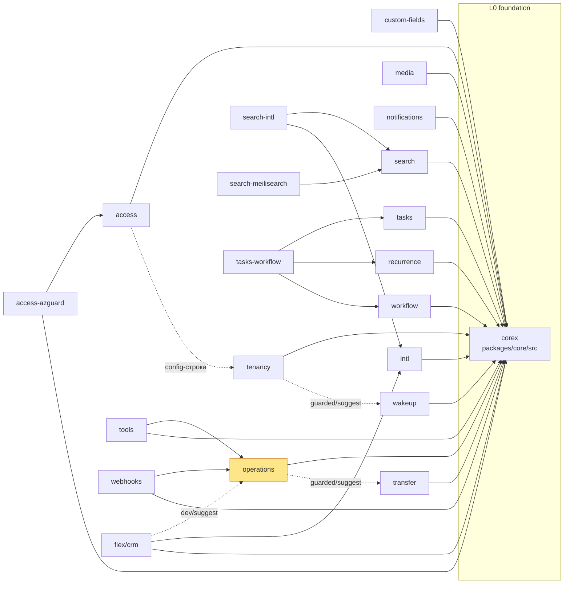

# Аудит ядра CoreX: hardening и изоляция пакетов (2026-10-08)

> Ветка: `improve/core-hardening-1` (от `509d6191`, после закрытия PLAN3). `main` не трогался, истории не переписывались, PR не создавался.
> Статус документа: финальная версия ветки (раунд 4: один `Principal` в ядре, bc-check и dod-check удалены, гейты не зависят от `plans/`).

## 0. Кратко

- **SEC-01 (ключ Perplexity в логах).** Ключ, по словам владельца, неактивен. Во всех файлах HEAD он заменён на `pplx-<REDACTED>`, два лишних лога удалены, гейт `composer secret-scan` (gitleaks: история + staged + worktree) ловит новые ключи (P-01). В истории git ключ остаётся. Чистка (`git filter-repo` + force-push) — **ручной шаг Дмитрия**, процедура описана в P-01, я её не выполнял.
- **HEAD был красным.** Pint падал на 63 архивных файлах, `composer test` валил ProviderSizeTest, а pg-lane давал регрессию из `509d6191` (TypeError под `Event::fake()`). В ветке всё зелёное, кроме per-commit проверки anti-weakening (§6) и двух CI-only проверок, красных ещё до ветки (`release-quality`, `unused-public`, §6).
- **Архитектура в целом здоровая.** Нет ни одного ребра «пакет → чужой Internal», нет циклов, гейты R1–R6 реально работают.
  - `tenancy → wakeup` теперь идёт через контракты ядра: allowlist сократился с 7 до 4 записей (P-03).
  - Изоляция workspace в access стала fail-closed: tenancy поставляет scope через контракт ядра, а ошибка конфигурации ловится на boot (P-04).
  - `operations` больше не хаб для продуктов: контракт handler'а (4 типа) переехал в ядро `CoreX\Invocation`, старые имена — deprecated `class_alias` до 2.0. У `flex/crm` нет prod-зависимости от operations, ребро запрещено гейтом. `tools`/`webhooks` задокументированы как расширения operations (P-02, решение владельца). Открыто `operations → transfer`.
- **Решения владельца этого раунда:** гибрид P-02 реализован; громкий boot-отказ P-04 принят; `dod-release` убран из CI вместо перевыпуска receipts P17 (P-12); служебные файлы агентов сняты с учёта (F-24).
- **Исправлено после ревью владельца:** первая версия P-02 завела в ядре второй `Principal` рядом с access. Теперь в ядре **одно** понятие — `CoreX\Context\Contracts\Principal` + `Context\Enums\PrincipalType`; имена access и operations — его deprecated-алиасы (F-25, P-02). Других дублей ветка не вводила (проверено, P-02).
- **Идемпотентность: scope ключа теперь (тип, id) субъекта** (F-28, решение владельца). Раньше агент `5` с тем же Idempotency-Key получал сохранённый ответ пользователя `5` (утечка между субъектами) или отказ conflict/in_progress.
- **Релизная машинерия отвязана от `plans/`** (F-29, решение владельца: оставить и отвязать). Frozen-входы и receipts скопированы байт-в-байт в `release/1.0/` и `release/remaining-cohort-20260915/`, скрипты перенаправлены. В worktree без `plans/` DoD даёт тот же результат, что старый код с планами (25 green / 2 stale). Исключение — `publish_exact.py`: его полномочие и есть контракт плана.
- **bc-check удалён целиком** (решение владельца, F-26), `composer dod-check` тоже (F-27). Полный прогон гейтов шёл **в одноразовом worktree без `plans/`**: ни один composer-гейт и ни один job `ci.yml` от планов не зависит (§6).
- **Нужно обсудить (сводка):**
  - (1) чистка истории (P-01);
  - (2) anti-weakening: санкционированного исключения для golden в гейте нет, без переписывания истории или правки гейта красное не снять (§6);
  - (3) ✅ релизная машинерия отвязана от `plans/` (F-29, P-12). Открыто: `publish_exact.py` (одноразовый plan-run P5.3, без плана не имеет смысла: удалить вместе с планами?), ссылки на `plans/` в документах (`docs/rejected-optimizations.md`, `message-policy.md`, `api-policy.md`, `references.md`, `packages/operations/README.md`) и `scripts/quality/facts-guard.py` (не CI) повиснут после удаления планов;
  - (4) P-02: PHPStan не предупреждает об использовании deprecated-alias; `PrincipalType` ⊂ `Audit\Enums\ActorType` по значениям — оставлены раздельными понятиями (P-02).

## 1. Методика и baseline

Проверки до и после (локально: PHP 8.5, PostgreSQL 17 на `:5434`):

| Проверка | Baseline (`509d6191`) | Ветка |
|---|---|---|
| `composer lint:check` (Pint) | ❌ 63 файла (архив PLAN3) | ✅ |
| `composer audit` | ✅ advisories нет | ✅ |
| PHPStan (23 конфига, level max, bleedingEdge, strict) | ✅, baseline пуст, inline-ignore 0 | ✅ |
| `analyse:tests-lint` | ⚠️ нужен `packages/access/vendor` | ✅ |
| Root tests | ❌ 1496/1499; suite TasksWorkflow не запускался | ✅ 1504/1504, TasksWorkflowPackage 33/33 |
| pg-lane (`--group=pg`) | не запускался в CI-окружении | ✅ 250/250 (на HEAD: 2 падения ModuleLifecycleTest + 1 env) |
| WebhooksPackage | — | ✅ 292/292 |
| Composer-гейты (16 шт.) | — | ✅ |
| gitleaks (вся история) | 1 реальная утечка | ✅ гейт `secret-scan` (известные находки в baseline; история — P-01) |

Полный финальный прогон всех composer-скриптов см. в §6.

## 2. Исправлено в ветке

Формат: проблема → доказательство → почему важно → решение → трудоёмкость/риск. Каждый пункт — отдельный conventional-коммит.

### F-01. Pint красный на HEAD (`e2b2e628`)
- **Проблема.** `509d6191` перенёс PLAN3 в `plans/archive/…`, а исключения в `pint.json` остались со старыми путями.
- **Доказательство.** `pint.json` (`notPath`); `composer lint:check` → 63 файла.
- **Решение.** Паттерны принимают `(?:archive\/)?` и `^audits\/.*\.php$`. Архивные артефакты — это неизменяемая provenance, форматировать их нельзя.
- **Трудоёмкость/риск:** XS / нулевой.

### F-02. ProviderSizeTest (S1/S3) сломан ремонтом аудита (`4021f7e7`)
- **Проблема.** `509d6191` добавил в `TasksWorkflowServiceProvider` биндинги сверх ratchet S1 и многострочные замыкания (S3). В `DatabaseRegistrar` тоже появилось многострочное замыкание.
- **Решение.**
  - Биндинги вынесены в `@internal` `Internal/MaterializationBindings` (по образцу уже существующего `CompletionBindings`), фабрика `WakeupHandlerDefinition` перенесена в `TasksWorkflowOptions`.
  - Ratchet ужесточён с 3 до 1.
  - В `DatabaseRegistrar` тело транзакции вынесено в `claimModuleMigrations()`.
  - Публичный API не изменился: вариант с `#[Spi]`-классом php-api-гейт отверг (API-STALE), поэтому `@internal`.
- **Трудоёмкость/риск:** S / низкий. Покрыто TasksWorkflowPackage 33/33.

### F-03. Устаревшие в PHP 8.5 `curl_close()`/`imagedestroy()` (`aa747899`)
- **Доказательство.** `packages/webhooks/src/Internal/CurlWebhookTransport.php` (`finally { curl_close }`), `packages/media/src/Internal/GdThumbnailDriver.php`. Начиная с PHP 8.0 это no-op, в 8.5 они deprecated: https://www.php.net/manual/en/migration85.deprecated.php, https://wiki.php.net/rfc/deprecations_php_8_5.
- **Почему важно.** Политика пакета — PHP 8.4–8.5. Deprecation-шум в 8.5 при `failOnDeprecation` роняет тесты потребителей.
- **Решение.** Вызовы удалены, ресурсы освобождает GC. Из тестов webhooks убран namespaced-фейк `curl_close`.
- **Трудоёмкость/риск:** XS / нулевой (webhooks 286/286, media 21/21).

### F-04. `declare(strict_types=1)` в конфиге search-intl (`416ecc50`)
- Это единственный PHP-файл пакетов без strict_types (`packages/search-intl/config/corex-search-intl.php`). Трудоёмкость/риск: XS / нулевой.

### F-05. Тесты дампили окружение (причина SEC-01) (`3d2e7f08`)
- **Проблема.** `expect($a)->toBe($b)` на объектах контейнера при падении экспортирует `Application` → server bag → `$_ENV`, включая все секреты разработчика. Эти логи затем коммитились как артефакты валидации.
- **Доказательство.** `tests/Feature/ResidentLifecycleTest.php:56,66-67`, `packages/tenancy/tests/Concerns/AssertsContainerBindings.php`.
- **Решение.** Идентичность сравнивается через `spl_object_id()`, и при падении в лог попадают два числа и сообщение.
- **Трудоёмкость/риск:** XS / нулевой. Системные меры описаны в P-01.

### F-06. LayerTest с захардкоженным списком пакетов (`46ded581`)
- **Проблема.** `tests/Arch/LayerTest.php` держал руками составленный список foundation-неймспейсов, поэтому новый пакет молча выпадал из проверки слоёв.
- **Решение.**
  - Список строится из `packages/*/composer.json` (имя `axiomasoft/*` → PSR-4 префиксы).
  - Добавлен тест-страж «discovery видит монорепо (≥21 пакет, включая core)».
  - Rule 2b собирает regex из тех же префиксов.
  - Negative proof: подсаженный импорт и литерал `flex` дают красный тест.
- **Трудоёмкость/риск:** S / низкий.

### F-07. Регрессия `509d6191`: TypeError под `Event::fake()` (`c1d268b0`)
- **Проблема.** `ModuleMigrationClaims` требует конкретный `Illuminate\Events\Dispatcher`, а после `Event::fake()` контейнер отдаёт `EventFake`. В результате `enable()` падает с TypeError.
- **Доказательство.**
  - `packages/core/src/Modules/Internal/Lifecycle/DatabaseModuleLifecycle.php:632`.
  - На HEAD pg-lane падают `ModuleLifecycleTest` AC-5 и rollback-тест.
  - Тонкость: `EventFake::listen()` проксирует вызов, а `forget()` — no-op. Если просто ослабить тип, слушатели claim-механизма будут копиться.
- **Решение.** Принимаем контракт `Illuminate\Contracts\Events\Dispatcher`, разворачиваем `EventFake->dispatcher`, иначе бросаем `LogicException`. `DatabaseRegistrar` передаёт контракт. Новый тест проверяет, что после `enable()` под фейком на реальном диспетчере не осталось лишних слушателей `MigrationStarted`. Без фикса он красный.
- **Трудоёмкость/риск:** S / низкий. pg-lane 250/250.

### F-08. PackageGraphTest портил отслеживаемый артефакт (`001ef66c`, `bbc28fb1`, `a7145c85`)
- **Проблема.**
  - Probe-тесты перезаписывали или удаляли `artifacts/P12-package-graph/report.json` (см. `tests/Arch/PackageGraphTest.php:88` до фикса).
  - Probe с «испорченным» `DigestTick.php` восстанавливался без `finally`, поэтому любое исключение оставляло импорт wakeup в исходниках notifications.
- **Решение.** Гейт читает `PACKAGE_GRAPH_REPORT` (по умолчанию путь прежний), тест направляет его во временный файл и восстанавливает probes в `finally`. Артефакт пересобран отдельным коммитом. Probes по-прежнему пишут в `packages/*/src` (см. P-08).
- **Трудоёмкость/риск:** XS / нулевой (12/12; md5 артефакта до и после прогона совпадает).

### F-09. Lifecycle молча обнулял версии модулей при битом `installed.json` (`fe1ba091`)
- **Проблема.** `LifecycleRegistrar::moduleWiring()` делал `json_decode` без `JSON_THROW_ON_ERROR`. При битом манифесте все `codeVersions` падали в fallback `0.0.0` (`DatabaseModuleLifecycle.php:645`). `ModuleDiscovery` и `InstalledPackages` в той же ситуации бросают исключение. Если реестр закеширован, discovery на рантайме не выполняется, и fail-open оставался незамеченным.
- **Доказательство.** `packages/core/src/Modules/Laravel/LifecycleRegistrar.php:87` (до фикса).
- **Решение.** Добавлен `JSON_THROW_ON_ERROR`. Отсутствие файла по-прежнему допустимо (testbench). Тест покрывает happy path и битый манифест, без фикса он красный.
- **Трудоёмкость/риск:** XS / низкий: деплой с битым vendor теперь падает громко, и это сделано намеренно.

### F-10. `composer refactor:check` красный на тестах из `509d6191` (`78442894`)
- **Доказательство.** Rector dry-run → 4 файла: `LifecycleRemediationTest.php`, `MaterializationSchedulingTest.php`, `MaterializationTest.php`, `ToolInvocationTest.php` (readonly-анонимные классы, `resolve()`, `Sleep::usleep`).
- **Решение.** Применены правила проекта. Проверил, что `Sleep::fake()` в наборе нигде не вызывается: MAT-16 по-прежнему реально спит 1.1 с и тестирует исчерпание wall-time. 48/48, pg 7/7.
- **Трудоёмкость/риск:** XS / нулевой.

### F-11. Shadow-зависимости в тестах (`799d9982`)
- **Доказательство.** `composer deps:analyse`:
  - `mockery/mockery` в `packages/notifications/tests/Digest/WakeupBridgeTest.php:225`;
  - `phpunit/phpunit` в `packages/tasks-workflow/tests/Feature/MaterializationSchedulingTest.php:92`;
  - `psr/clock` в `packages/tools/tests/Feature/ToolInvocationTest.php:371`.
- **Почему важно.** Каждый пакет должен ставиться и тестироваться отдельно (split-репозитории). Не объявленная зависимость ломает `composer test` в standalone-установке.
- **Решение.** Зависимости добавлены в `require-dev` с версиями, как у соседних пакетов. В lock обновлены метаданные path-пакетов, `plugin-api-version` оставлен прежним, чтобы не шуметь в диффе.
- **Трудоёмкость/риск:** XS / нулевой.

### F-12. Golden-baseline устарел после `509d6191` (`b1b32d8a`, `123f1195`)
- **Доказательство.** `composer golden` → `GoldenTest.php:55`: в снимке нет `ModuleMigrationClaims`, seam `moduleMigrations`, digest-wiring notifications.
- **Решение.** Снимок перегенерирован через `GOLDEN_UPDATE=1`. Дифф затрагивает только `@internal`-типы.
- **Нужно обсудить:** golden фиксирует и `Internal`-классы, поэтому любой внутренний рефакторинг требует перегенерации. Возможно, стоит фиксировать только `#[Api]`/`#[Spi]`, ведь Internal уже охраняет php-api-гейт.

### F-13. Мёртвая классификация curl-ошибок (`c9602f18`)
- `CurlWebhookTransport::curlErrorCode()` (бывш. `:153`): все ветки `match`, включая `default`, возвращали `NetworkFailure`. Заменено на прямое значение. Трудоёмкость/риск: XS / нулевой.

### F-14. Две копии валидатора DNS-имени webhook (`123f1195`)
- **Доказательство.** Байт-в-байт одинаковые `isCanonicalDnsName()` в `packages/webhooks/src/Data/WebhookDestination.php:65` и `packages/webhooks/src/Internal/WebhookUrlPolicy.php:136`.
- **Почему важно.** Это SSRF-критичная проверка: исправление, внесённое только в одну копию, тихо оставило бы второй вход открытым.
- **Решение.** Остаётся одна копия в `WebhookUrlPolicy`, `WebhookDestination` её вызывает. Data → Internal внутри пакета уже практикуется (`custom-fields/src/Data/*`). Webhooks 292/292.
- **Трудоёмкость/риск:** XS / низкий.

### F-15. Discovery молча игнорировал невалидный `extra.corex.module` (`0b1d3719`)
- **Проблема.** `docs/architecture/taxonomy.md` требует, чтобы читатель отличал **отсутствие** блока (состояние) от **невалидного** блока (ошибка). `ModuleDiscovery` пропускал любое нестроковое значение `module`, и модуль из стороннего пакета с опечаткой в манифесте просто исчезал из реестра.
- **Доказательство.** `packages/core/src/Modules/Internal/Discovery/ModuleDiscovery.php:~78` (до фикса: `if (is_string($class))`).
- **Решение.** Отсутствующий `module` по-прежнему означает немодульный пакет (так устроены custom-fields, search, transfer и др.). Присутствующий, но нестроковый `module` даёт `InvalidManifestException`, как и класс, не являющийся `ModuleDefinition`. Добавлен dataset-тест (absent / пустая строка / массив), без фикса он красный.
- **Трудоёмкость/риск:** XS / низкий. Новый public API не появился: используется существующая фабрика исключения.

### F-16. `mutation:inventory` красный на `509d6191` (`d0a106be`)
- **Доказательство.** `Mutation RED: Unassigned source: …/ModuleMigrationClaims.php`; кроме того, в zero-ledger устарел хэш `packages/tools/src/Contracts/ToolExecutionGuard.php`. Проверено в отдельном worktree на `509d6191`.
- **Решение.** Инвентарь перегенерирован (`--write-inventory`), в дифф попали только 2 новых файла и 1 хэш. Сама мутация не запускалась (D133). Трудоёмкость/риск: XS / нулевой.

### F-17. SEC-01: ключ в HEAD-логах и гейт secret-scan (`b2c6f70a`, `4716a6f0`)
- 17 логов отредактированы (`pplx-<REDACTED>`), 2 лога без ссылок удалены, добавлены gitleaks-гейт, конфиг, baseline и CI-job. Подробности и процедура чистки истории — в P-01.

### F-18. Scheduling SPI: `DueWakeupSweeper`/`WakeupScheduleHint` в ядре (`9b6bdc13`, `d8628527`)
- Перенос с deprecated-алиасами, tenancy больше не знает wakeup. Обоснование — в P-03.

### F-19. Fail-closed workspace scope (`362b6184`, `be566830`)
- Контракт ядра `WorkspaceScopeProvider`, tenancy его биндит, access падает на boot при битом override. Обоснование — в P-04.

### F-20. `dod-check` на JSON-планах (`e06eb3e4`)
- Резолв владельцев и receipts из JSON-раскладки, плюс тесты. Остаток — в P-12.

### F-21. Строка REBASELINE задним числом (`126dbdd7`)
- Golden-изменения `b1b32d8a`/`123f1195` получили запись в `tests/Golden/REBASELINE.md`, но в отдельном, более позднем коммите (подробнее — §6, anti-weakening).

### F-22. Контракт handler'а операций в ядре (`a4c95919`, `33661d69`, `74542209`, `3f834a37`, `861530cd`)
- 4 типа в `CoreX\Invocation`, deprecated-алиасы в operations, `flex/crm` без prod-зависимости от operations. Обоснование — в P-02.

### F-23. `dod-release` убран из CI (`a265289d`)
- Job с `composer dod-check` удалён из `.github/workflows/distribution-proof.yml`: проверка привязана к планам, которые скоро удалят из репо. Подробнее — P-12.

### F-24. Служебные файлы агентов сняты с учёта (`8e25505c`, `3c10d310`)
- `git rm --cached` + `.gitignore`: 10 логов `.grok/state/*.tools.jsonl`, `CLAUDE.md.bak`, 6 симлинков `.agents/skills/*` на `/home/vostrikov/...` (на чужой машине битые), `.claude/auto-approve.env.ini`. Перед этим проверил rg по `scripts/`, `.github/`, `docs/`, `tests/`, `composer.json`: ни гейты, ни документация на них не ссылаются (единственное совпадение — синтетический `.codex/state/session.tools.jsonl` во временном каталоге теста `scripts/distribution/tests/test_audit_roots.py`, от реальных файлов он не зависит). Настоящие каталоги `.agents/skills/ecosystem-*`, `.agents/plugins/**` и остальные `.claude/*` оставлены. Файлы остаются в истории git; там же лежали логи с ключом (P-01), так что чистка истории их тоже касается.

### F-25. Один `Principal` в ядре (`708bad9c`)
- `CoreX\Context\Contracts\Principal` (`principalType()`, `principalId()`) и `CoreX\Context\Enums\PrincipalType` вместо пары `Invocation\Principal` (`id()`) + `Access\Contracts\Principal`. Обоснование — в P-02.

### F-26. Roave bc-check удалён (`ef9190db`)
- Удалены `composer bc-check`, `scripts/bc-check.sh`, `scripts/bc/**` (accepted-base, `approved-deltas.json` и его привязка к решениям из `plans/`, классификатор, хелперы), job `backward-compatibility` в `ci.yml`, `tests/Arch/PhpApiBcTest.php`, dev-зависимость `roave/backward-compatibility-check` вместе с ставшими лишними транзитивными пакетами (BetterReflection, `composer/composer`, `php-standard-library/*` и др.; ни один не используется кодом репо, проверено rg). Из `phpstan-extensions.neon` убран include `vendor/composer/composer/phpstan/rules.neon`: это правила для собственного кода Composer, они приходили только транзитивно. `release_preflight.py` больше не требует bc-check. rsync упоминался только внутри `bc-check.sh` и ушёл вместе с ним.
- Документация: `semver-policy.md`, `constitution.md` (API-005/API-008), ADR, корневой CHANGELOG. Публичную поверхность по-прежнему охраняют `composer php-api` (snapshots), golden php-surface + строка REBASELINE в том же коммите и CHANGELOG пакетов.
- **Почему так (решение владельца):** 1.0 не опубликован, а допуск поломок держался на sha256 решений из `plans/`, которые удаляются. Без bc-check история BC-обещаний держится на php-api/golden/CHANGELOG. *Риск:* сломать сигнатуру `stable`-SPI теперь можно без красного гейта, если обновить snapshot и REBASELINE. Это видно в ревью диффа snapshot, но автоматически не блокируется. После публикации 1.0 стоит вернуть BC-дифф против тега релиза (без решений из планов).
- DoD: манифест `scripts/dod-1.0.json` проверяет, что цели команд существуют, поэтому DOD-22 переведён на `php scripts/php-api.php --strict --check` (`e81e52b3`; слот сохранён, потому что ID должны идти подряд), классификатор вывода Roave и его тест удалены.

### F-27. `composer dod-check` удалён (`72a05af4`)
- Скрипт читал `plans/…/artifacts/P17/release-cohort.json`; его CI-job уже убран в `a265289d`. `scripts/dod-1.0.py` остаётся только как часть ручной релизной машинерии (её судьба — в P-12).

### F-28. Idempotency scope включает тип субъекта (`64e31e3c`)
- **Было.** `IdempotencyScope` хранил только `principalId`; хэш канонического scope — ключ сохранённого исхода. Id уникален только внутри типа (user `5`, agent `5`, api_key `5`), поэтому разные субъекты с одинаковым id делили один scope: повтор того же ключа агентом отдавал **сохранённый ответ пользователя** (утечка данных между субъектами, эффект агента молча не исполнялся) либо отказ `idempotency_conflict`/`in_progress` легитимному запросу. Ключ выбирает клиент, то есть субъект другого типа мог зондировать чужие исходы.
- **Сделано.** `IdempotencyScope` получил `PrincipalType $principalType` (перед `principalId`), `toArray()` — `principal_type` (значение enum); `OperationFingerprint::scope()` передаёт `principalType()`. Сохранённые хэши scope меняются: ключи, записанные до изменения, не реплеятся (допустимо, продукт не запущен). CHANGELOG operations, php-api, golden + строка REBASELINE в том же коммите.
- **Регрессия:** `IdempotentInvocationTest::test_same_id_under_different_principal_types_never_replays_across_principals` — до фикса красный (агент получил `replayed=true`, handler вызван 1 раз), после — зелёный. Гейты: lint, analyse (+tests-lint), refactor, test, test:pg, test:arch ✅; `unused-public` = baseline (357).

### F-29. Релизная машинерия отвязана от `plans/` (`574003ee`, `227b6b06`, `de8e976e`, `20d4d4dd`, `5829bf27`)
- **Решение владельца:** `scripts/distribution/*`, `scripts/dod-1.0.py`, workflow `distribution-proof`/`remaining-cohort-proof` оставить, но отвязать от планов; `plans/` не удалять.
- **Куда.** Новый корень `release/` (README описывает раскладку и правило «никаких ссылок обратно в `plans/`»):
  - `release/1.0/` ← `plans/2026.09.19-№1-COREX-PLATFORM-HARDENING`: `artifacts/P17/{release-cohort,profile-matrix}.json`, `findings/P17-*.json`, вход DOD-17 (`knowledge/findings-P16-profile-a-receipts.json`, `decisions/D107.json`), freshness-вход DOD-01 (`scripts/architecture/src/Scorecard.php`), `owners.json`.
  - `release/remaining-cohort-20260915/` ← `plans/archive/2026.09.15-№1-COREX-FLEXCRM-REMAINING`: печати P1–P8, контракты P2, `findings/P9-*.md`, `research/P9-cohort-design.md`, `decisions/D*.md`, `delivery/remaining-cohort-20260915/evidence` (2,4 МБ из 112 МБ плана; `artifacts/`, bundles, phases не входы).
- **Почему так.**
  - *Копия, а не move:* `plans/` остаётся байт-в-байт (инструменты планов хэшируют свои findings); старые копии уйдут вместе с планами.
  - *Та же относительная раскладка:* относительные пути внутри receipts, `relative_to(...)` в скриптах и digest'ы freshness-входов остаются валидными, диф скриптов сводится к смене корня.
  - *`owners.json` вместо phase-спек:* владелец строки DoD — ссылка на происхождение, а не живой документ. Индекс фиксирует 178 id фаз с заголовком и sha256 спеки на момент заморозки (`corex-dod-owners/1`); `P99.1` по-прежнему не резолвится.
  - *Не `docs/`:* это машиночитаемые входы скриптов с привязанными digest'ами, а не документация; `artifacts/` занят генерируемыми отчётами гейтов.
- **Скрипты.** `dod-1.0.py` (`RELEASE_DIR`, резолв владельцев по индексу), `dod-1.0.json` + перегенерированный `docs/architecture/dod-1.0.md`, `test_dod_1_0.py`; `release_preflight.py` (`PLAN` → `RELEASE`), `upgrade-proof.py`, `profile-proof.py`, `verify_{api,async}_clients.py`, `verify_equipment_consumer.py`, `verify_extension_fixtures.py`; `remaining-cohort-*.py` (9 файлов: `PLAN` → `RECORD`, `plan_path()` → `record_path()`, маркеры `PLAN-CLOSE-CI` не тронуты).
- **Гейты.** `.gitleaks.toml`: `release/` добавлен в allowlist generic-key/digest рядом с `plans|audits|delivery` (дайджесты `openapi.json` в receipts клиентов). `scripts/rename-completeness.json`: `release/` исключён как `plans/`/`audits/` (1378 старых имён пакетов в замороженных доказательствах; переписать нельзя — сломаются digest'ы).
- **Проверка в одноразовом worktree без `plans/`:** `test_dod_1_0` 19/19 ✅; `dod-1.0.py render --check`, `map`, `explain` ✅; `dod-1.0.py check --profile release` — **25 green / 2 stale, построчно идентично** старому коду на `64e31e3c` с планами (stale DOD-01/DOD-21 известны, P-12); `scripts/distribution/tests` — те же 4 failures / 9 errors, что и с планами до изменений (все из-за отсутствующего git-ignored `/delivery/` и дрейфа profile-matrix, к планам не относятся); `remaining-cohort-intake.py --verify-producer-seals` ✅; все 26 переназначенных входных путей существуют. Без планов до изменения `test_dod_1_0` падал 15/19.
- **Не отвязано:** `publish_exact.py` — одноразовый `task:plan-run` P5.3 плана `2026.09.12-№2` (bundle плана, route evidence, грант D17 как полномочие). Его путь (`plans/2026.09.12-…`, без `archive/`) сломан уже сейчас. Варианта без плана нет; предлагаю удалить вместе с планами, сохранив `GitHubTransport`, если он нужен тестам `publish_guard`.

## 3. Архитектура и изоляция

### 3.1. Граф зависимостей (по коду, `use` + FQCN, без Laravel)



Сплошная линия — `require`; пунктир — опциональное ребро (allowlist в `scripts/package-graph-gate.json`, guard `interface_exists`) или dev/suggest. Жёлтым выделен operations: до P-02 это был второй хаб, теперь от него зависят только его расширения (`tools`, `webhooks`). `flex/crm` реализует контракт ядра `CoreX\Invocation`, ребро `tenancy → wakeup` убрано (P-03), строка-класс в access убрана (P-04).

### 3.2. Что подтверждено (гипотезы проверены)

| Гипотеза | Результат | Как проверял |
|---|---|---|
| Пакеты не лезут в чужие `Internal` | ✅ 0 рёбер | `package-graph-gate` R2 + собственный граф (`/workspace/corex-work/graph.py`) |
| Нет циклов | ✅ | граф выше |
| Ядро не знает о пакетах | ✅ (в `src` упоминание Tenancy есть только в docblock и в строке FORBIDDEN `DurablePayloadTypeChecker.php:22`) | rg по `packages/core/src` |
| Гейты реально ловят нарушения | ✅ | negative probes (R1/R2/R3/R4/R5) в PackageGraphTest, мой planted-импорт в LayerTest |
| Новый пакет подключается без правки ядра | ✅ в целом: `type: corex-module` + `extra.corex.module`, PackageRegistrar, теги SPI | `ModuleDiscovery`, `InstalledPackages` |
| Все общаются **только** через ядро | ❌ частично | см. V-01…V-04 |

### 3.3. Нарушения целевой модели «всё через ядро»

- **V-01. `operations` — второй хаб.**
  - `tools` → operations (19 символов, например `packages/tools/src/Internal/GuardedToolInvoker.php`, 12 импортов).
  - `webhooks` → operations (17 символов, `packages/webhooks/src/Internal/WebhookManagement.php`, 12 импортов; `WebhookReplay.php`, 10).
  - `flex/crm` → operations (`products/flex-crm/src/Company/Api/ShowCompanyOperation.php:7-8`).
  - Заменить operations, не трогая этих потребителей, нельзя. Решение — P-02. ✅ Для продукта устранено: `flex/crm` импортирует только `CoreX\Invocation`, prod-ребро запрещено гейтом. `tools`/`webhooks` остаются расширениями operations (осознанно).
- **V-02. `tenancy → wakeup`** — ✅ устранено (P-03). Было: `packages/tenancy/src/TenancyServiceProvider.php:101` и три записи allowlist. Интеграция корректная, но знание о соседе лежит в пакете, а не в ядре, хотя в ядре уже есть Scheduling SPI (`DueWakeupSource`/`WakeupScheduler`). Решение — P-03.
- **V-03. `operations → transfer`** (`packages/operations/src/Bulk/Data/BulkTransferSession.php`, `Bulk/Internal/TransferBulkExecutor.php`). Публичный DTO operations ссылается на типы опционального пакета. Решение — P-03.
- **V-04. `access` знает класс Tenancy по строке** — ✅ устранено (P-04). Было: Это `packages/access/config/corex-access.php:42` (`'workspace_scope_class' => 'CoreX\\Tenancy\\Laravel\\Scopes\\WorkspaceScope'`). Гейты такую связь не видят. Решение — P-04.
- **V-05. Модуль Database ядра импортирует `Modules\Internal\Lifecycle`** (`packages/core/src/Database/Laravel/DatabaseRegistrar.php:20-21`). Это связь внутри ядра, но она пересекает границу «Internal» соседнего модуля. Решение — P-07.

## 4. Предложения (серьёзные доработки)

Приоритет: 🔴 сделать сейчас, 🟠 следующий план, 🟡 по возможности. Трудоёмкость: XS < 1 ч, S ≈ 0.5 дня, M ≈ 1–3 дня, L > 3 дней.

### P-01 🔴 SEC-01: утечка ключа Perplexity в закоммиченных логах — ✅ исправлено в HEAD (`b2c6f70a`, `4716a6f0`); чистка истории — ручной шаг владельца
- **Проблема.** Значение `PERPLEXITY_API_KEY` из окружения владельца (`pplx-<REDACTED>`) попало в 19 закоммиченных логов `plans/archive/2026.09.27-№1-COREX-KERNEL/artifacts/**`. По словам владельца, ключ уже неактивен, но из репозитория его всё равно нужно убрать.
- **Доказательство.** gitleaks по всей истории: 1 уникальный секрет в 19 срабатываниях, коммиты `d4603a82` (2026-10-03) … `1eb2a3d7` (2026-10-07). Остальные срабатывания ложные: hex-хэши, тестовые `whsec_…`, плейсхолдер intl.
- **Причина.** Упавший `toBe()` экспортировал `Application` вместе с env (исправлено в F-05), а раннеры mutation/validation пишут сырой stdout в артефакты.
- **Сделано.**
  1. `b2c6f70a`: в 17 логах, на которые ссылаются receipts как на evidence, строка с ключом заменена на `pplx-<REDACTED>`. Два лога ни одна запись не упоминала, их я удалил (`P08-ci-repair/mutation-all.log`, `P08.2-execution/validation/073-mutation-all-final3/output.log`). Записанные sha256 этих 17 логов теперь не совпадают с файлами. Это осознанно: архив PLAN3 закрыт, ни один гейт его хэши не перепроверяет. Остальные env-дампы содержат только тестовый `PGSQL_PASSWORD` по умолчанию и id сессий, других секретов в них нет.
  2. `4716a6f0`: гейт `composer secret-scan` (`scripts/secret-scan-gate.sh`) устроен так же, как остальные `scripts/*-gate.sh`:
     - gitleaks версии ≥ 8.25 делает три прохода: вся история, `--pre-commit --staged` и `--pre-commit` (рабочее дерево). Флаги `--redact` и `--verbose` выводят находки уже без значения.
     - Shallow-клон, отсутствующий или старый бинарь — ошибка: exit 2, fail-closed.
     - `.gitleaks.toml` расширяет дефолтные правила. Allowlist узкий: правило `generic-api-key` для доказательных путей (`plans|audits|delivery|.agents`, `tests/`); 64-hex sha256 только в этих путях (условие AND); один зарегистрированный плейсхолдер intl.
     - `.gitleaksignore` — baseline из fingerprint'ов: 19 исторических SEC-01 и 3 ложных срабатывания в `scripts/distribution/remaining-cohort-private.py`.
     - Отдельный CI-job `secret-scan` использует `fetch-depth: 0` и gitleaks 8.28.0 со сверкой sha256.
     - Негативная проба: подложенный фейковый `pplx-…` валит и staged-, и unstaged-проход.
  3. Фильтр окружения в раннерах (`ALLOWED_ENV`) **не делал**. После F-05 тесты env не печатают, а гейт ловит любой новый ключ до коммита. Остаётся как 🟡-рекомендация.
- **Ручной шаг для Дмитрия: чистка истории (я её не выполнял).** Ключ всё ещё лежит в старых коммитах, начиная с `d4603a82`.
  ```bash
  # 0. Остановить мержи/пуши на время операции; предупредить всех, у кого есть клоны.
  git clone --mirror https://github.com/axiomasoft/corex.git corex-purge.git && cd corex-purge.git
  # 1. Файл замен по шаблону — само значение ключа никуда не пишется (ключ: pplx- + 48 символов [A-Za-z0-9]).
  printf 'regex:pplx-[A-Za-z0-9]{48}==>pplx-<REDACTED>\n' > ../pplx-replacements.txt
  # 2. Переписать все ветки и теги (https://github.com/newren/git-filter-repo).
  git filter-repo --replace-text ../pplx-replacements.txt
  # 3. Проверить, что утечки больше нет.
  gitleaks git --no-banner --redact --config <рабочая копия>/.gitleaks.toml .   # ожидается: no leaks found (без .gitleaksignore)
  # 4. Force-push всех веток и тегов (filter-repo снимает remote — вернуть его).
  git remote add origin https://github.com/axiomasoft/corex.git
  git push --force --all origin && git push --force --tags origin
  ```
  - **Последствия force-push.** Меняются SHA всех коммитов начиная с `d4603a82` (2026-10-03) во всех ветках, включая `main` и эту ветку. Ссылки на эти SHA в `tests/Golden/REBASELINE.md`, в этом аудите и в журналах `plans/**` станут висячими. Закреплённые базы гейтов не затронуты, я проверил: `BC_CHECK_BASE`/`approved-deltas` `76f8bdde` и `source_commit` release-cohort `7ab84348` старше утечки. Подписи коммитов и открытые PR на переписанные ветки станут недействительны.
  - **Все клоны нужно пересоздать** (`git clone` заново, а не `pull`), иначе старый объект вернётся следующим пушем. Это касается CI-кэшей, форков и `packages/*`-зеркал, если они собираются из этой истории.
  - **GitHub.** Старые коммиты остаются доступны по SHA, пока GitHub не выполнит GC, и видны в PR/кэшированных представлениях. Нужно обратиться в GitHub Support с просьбой удалить cached views и dangling-коммиты (https://docs.github.com/en/authentication/keeping-your-account-and-data-secure/removing-sensitive-data-from-a-repository).
  - **После чистки** удалить 19 записей SEC-01 из `.gitleaksignore`: они станут неактуальными (fingerprint содержит старые SHA).
- **Трудоёмкость/риск:** редакция и гейт — сделано. Чистка истории — S по времени, но высокий операционный риск (координация всех клонов).

### P-02 🟠 `operations` — фактический второй хаб: платформенная ступень или контракты в ядре — ✅ реализован гибрид (решение владельца; `a4c95919`, `33661d69`, `74542209`, `3f834a37`)
- **Проблема.** `tools`, `webhooks` и `flex/crm` импортируют `CoreX\Operations\…` напрямую (V-01). Доктрина это разрешает (`taxonomy.md`: capability «вправе быть нужен продукту и другим возможностям»; R5 пропускает ребро capability → capability). Но это расходится с целью «всё через ядро»: operations нельзя заменить или убрать, не трогая потребителей, а каждый новый продуктовый handler добавляет ещё одну жёсткую связь.
- **Доказательство (замеры по `use`, без тестов).**
  - `products/flex-crm`: 7 handler'ов, и они импортируют **только** `Definition\Contracts\OperationHandler` и `Invocation\Contracts\RequestContext`. Из контекста не используют ни `metadata()`, ни `principal()`.
  - `tools`: 19 разных символов operations, `webhooks`: 17. Это Validation (`JsonCanonical`, `JsonObject`, `SchemaHandle`…), Errors (`ApiError`, `OperationsErrorCode`), Pagination, OpenApi, Invocation. По сути это расширения operations, а не просто потребители контракта.
  - Всего 34 класса реализуют `OperationHandler`.
  - Замыкание интерфейса handler'а невелико. `OperationHandler::handle(RequestContext, array, array): array`; `RequestContext` = `tenant(): TenantContext` (ядро) + `principal(): Operations\Authorization\Contracts\Principal` (`id(): string`) + `metadata(): InvocationMetadata` (`final readonly` Data, `#[Api]`). Итого 4 типа.
- **Вариант A — объявить operations платформенной ступенью.**
  - Как: новый `package-type: platform` между `foundation` (0) и `capability` в `scripts/package-graph-gate.php` (`VALID_PACKAGE_TYPES`, ранги R5) и в `taxonomy.md`. Плюс правило: capability и product могут зависеть от platform, platform от capability не может.
  - Плюсы: XS, нулевой BC-риск, граф становится честным. «Через ядро» читается как «через платформенный слой (ядро + operations)».
  - Минусы: цель владельца не достигается, а лишь переопределяется. Продуктовый модуль по-прежнему нельзя поставить без API-слоя, хотя его handler'ам от operations нужны только 2 интерфейса. Появляется вторая «почти-ядро»-ступень, которую придётся охранять так же строго, как ядро: правило ступеней с исключением.
- **Вариант B — перенести в ядро контракт handler'а (OperationHandler/RequestContext).**
  - Как: в ядро под новым неймспейсом, например `CoreX\Invocation\Contracts\{OperationHandler, RequestContext, Principal}` и `CoreX\Invocation\Data\InvocationMetadata`. Неймспейс `CoreX\Operations\` занять нельзя: им владеет пакет (R3). Реализация, диспетчер, валидация и OpenAPI остаются в operations.
  - **Важная разница со Scheduling (P-03).** Схема «старый интерфейс `extends` новый» здесь **не работает**: `RequestContext` стоит в позиции параметра `handle()`. Если `Operations\…\OperationHandler extends Core\OperationHandler`, то 34 существующих реализации с параметром `Operations\RequestContext` сужают тип параметра, а это фатальная ошибка LSP при загрузке класса. BC даёт только настоящий `class_alias` старых имён на новые (один и тот же тип) в autoload-файле operations, `@deprecated` и удаление в 2.0. `InvocationMetadata` — `final` Data, поэтому тоже только через alias.
  - Плюсы:
    - Продуктовые модули (CRM/CMS) зависят от ядра и ставятся без operations. Handler'ы — пассивная регистрация, как `DueWakeupSource` у notifications.
    - Повторяет принятый путь D01/D96 (контракты в ядре, движок в пакете).
    - Стоимость растёт с каждым новым handler'ом, поэтому делать дешевле сейчас.
  - Минусы и риски:
    - M–L по объёму: php-api, golden, rename-map, approved-delta для operations, CHANGELOG. Импорты 34 реализаций можно мигрировать постепенно: благодаря alias это не обязательно.
    - `class_alias` — новый для репо BC-механизм: api-policy описывает deprecated-типы, но не alias. Нужно решение и правило в `php-api.php`.
    - В ядре появляется второй `Principal` рядом с `Access\Contracts\Principal`. Придётся решить, сливать их или держать узкий `id()`-контракт.
    - `tools`/`webhooks` всё равно останутся на operations: тянуть в ядро Validation/Errors/Pagination означало бы раздуть ядро до API-фреймворка.
- **Рекомендация: гибрид — B в узком объёме для продуктов, A по смыслу для `tools`/`webhooks`.**
  1. В следующем плане перенести в ядро ровно 4 типа: `OperationHandler`, `RequestContext`, `Principal(id)`, `InvocationMetadata` через `class_alias` + `@deprecated` до 2.0, с отдельным D-решением про alias-механизм. Из замеров следует, что этого достаточно, чтобы `flex/crm` (и будущие CRM/CMS) перестали зависеть от operations.
  2. `tools` и `webhooks` явно задокументировать в `taxonomy.md` как «расширения operations» (ребро capability → operations легально и ожидаемо). Новую ступень `platform` **не вводить**: после п.1 единственными зависимыми останутся два пакета, которые по смыслу являются расширениями, и ради них отдельный ранг не нужен.
  - Обоснование: цель «ядро — единая точка» важна прежде всего для продуктов, их будет больше всего. Для инфраструктурных расширений API-слоя прямая зависимость честнее, чем перенос половины operations в ядро. Вариант A в чистом виде фиксирует текущее положение и не останавливает рост связности.
- **Решение владельца (2026-10-08):** реализовать гибрид, BC через `class_alias` (deprecated). Записано как принятое решение `docs/architecture/decisions/2026-10-08-invocation-kernel-contract.md` (вне `plans/`, потому что планы скоро удалят).
- **Сделано.**
  - Ядро (`a4c95919`): модуль `Invocation` — `Contracts\OperationHandler` (`#[Spi(Implement)]`), `Contracts\RequestContext`, `Data\InvocationMetadata` (`final readonly`, `#[Api]`); `Principal` — см. «Исправление: один Principal» ниже (`708bad9c`). Модуль зарегистрирован в `scripts/module-layout.json`, `scripts/ownership-map.json` и в `CoreZoneTest` (разрешённые зависимости: Foundation, TenancyContracts).
  - operations (`33661d69`): 4 старых файла удалены. `src/Invocation/Internal/deprecated-aliases.php` делает `class_alias(новое, старое)`. Файл лежит в Internal-bridge модуля (иначе module-layout R0/R3) и грузится через composer `autoload.files`, то есть до любого обращения к классу и при authoritative classmap. В архив релиза он попадает (release policy включает `src/`).
  - Все 92 файла operations/tools/webhooks/flex-crm (src + тесты), корневой `OperationContractTest` и README operations переведены на новые имена.
  - Тест `DeprecatedInvocationAliasesTest`: reflection старых имён даёт ядерные имена, а handler на старых именах проходит через dispatch, типизированный ядром.
  - `flex/crm` (`74542209`): `axiomasoft/corex-operations` перенесён в `require-dev` + `suggest`. В `scripts/package-graph-gate.json` добавлено запрещённое ребро `flex/crm → axiomasoft/corex-operations` (проверяется и по импортам src, и по prod `require`, R6).
  - Документация (`3f834a37` + CHANGELOG/README в `33661d69`): `taxonomy.md` — `tools`/`webhooks` как расширения operations, без нового ранга; `core-zones.md` — единственное исключение из D32; README tools/webhooks — «an operations extension»; CHANGELOG core/operations/tools/webhooks/flex-crm (deprecated-имена с заменой и сроком удаления, по api-policy).
  - Перегенерировано: php-api core/operations/tools, `public-api.md`, golden php-surface (строка REBASELINE в том же коммите), mutation inventory. Пин `dynamic_adapters` в `tests/fixtures/public-error-contract.php` обновлён: `DefaultOperationInvoker.php` изменился только в двух `use`.
  - bc-check (пока существовал): Roave не видит `class_alias` и показывал старые классы как удалённые. Все новые строки касались только перенесённых типов (проверено скриптом), они были одобрены поимённо и привязаны к ADR; на коммитах `33661d69` и `708bad9c` bc-check был зелёным. Затем владелец удалил bc-check целиком (F-26).
- **Обоснование решения.**
  - *Почему так:* замеры показали, что продуктовым handler'ам нужны ровно 2 интерфейса (их замыкание — 4 типа). Перенос этих 4 типов отвязывает все будущие продукты от API-рантайма при минимальном росте ядра. Сам рантайм (диспетчер, валидация, OpenAPI) остаётся в operations.
  - *Почему `class_alias`, а не `extends` (как в P-03):* `RequestContext` — тип параметра `handle()`. Подынтерфейс сузил бы параметр у 34 реализаций, а это фатальная ошибка LSP. Alias делает старое и новое имя одним типом, поэтому совместимы и старые, и новые сигнатуры в любой комбинации.
  - *Почему `autoload.files`, а не ленивый autoloader:* при `--classmap-authoritative` composer не вызывает fallback-загрузчики, и ленивый alias не сработал бы. Eager-загрузка стоит 4 вызова `class_alias` на процесс.
  - *Почему новый неймспейс `CoreX\Invocation`:* `CoreX\Operations\` принадлежит пакету (R3), ядро занять его не может.
  - *Альтернативы:*
    - (1) Вариант A (ступень `platform`). Отвергнут владельцем: цель «продукт через ядро» не достигается.
    - (2) Ломающий перенос без alias (pre-1.0). Отвергнут: operations — `stable`, api-policy требует deprecation-окна.
    - (3) Перенести в ядро и Validation/Errors/Pagination, чтобы отвязать tools/webhooks. Отвергнут: ядро превратилось бы в API-фреймворк, а tools/webhooks по смыслу — расширения operations.
    - (4) Новая ступень только для tools/webhooks. Отвергнута: два пакета не оправдывают ранг с исключениями.
  - *Компромиссы:* D32 запрещал `class_alias`. Исключение узкое (3 типа контракта handler'а + `Principal`/`PrincipalType`), записано в ADR и в `core-zones.md`; новые alias по-прежнему запрещены.
  - *Риски:*
    - PHPStan не выдаёт deprecation-предупреждение для alias. Сигнал о депрекации дают только CHANGELOG и решение. При желании можно добавить правило в `php-api.php`/PHPStan, запрещающее импорт старых имён в репо (сейчас их и так 0).
    - До 2.0 два имени одного типа: в stack trace и reflection всегда видно ядерное имя, это может удивить авторов внешних handler'ов.
    - Хост, у которого operations стоял только транзитивно через `flex/crm`, после обновления должен поставить operations явно, иначе CRM API не поднимется. Это описано в CHANGELOG flex-crm и в `suggest` (владелец: действий не требуется).
- **Исправление: один Principal (`708bad9c`, после ревью владельца).**
  - *Что было не так.* Первая версия переноса сделала ядерным типом principal из operations (`CoreX\Invocation\Contracts\Principal`, `id()`), хотя рядом уже было устоявшееся понятие access (`CoreX\Access\Contracts\Principal`: `principalType(): PrincipalType`, `principalId()`). Два понятия «аутентифицированный субъект» существовали и до ветки (в двух пакетах), но перенос закрепил дубль в ядре. Это моя ошибка: я ограничил объём замыканием handler'а и не сверил его с соседними понятиями.
  - *Исследование.*
    - Access-principal реализует `PrincipalIdentity` (Authenticatable). На нём работают `AccessChecker` (`allowed/scopeFor/canOnRecord`), `ScopeResolver`, `DirectGrantLookup`, `ScopePredicate`, access-azguard, seeders и pg-тесты. Identity в access — пара (type, id): morph-тип, grants, CHECK-ограничения.
    - Operations-principal (`id()`) в репо реализуют только тестовые fixtures (`IdentityFixture`, анонимные классы); в проде его поставляет хостовый `PrincipalResolver`. Используется как `principal()->id()` в fingerprint идемпотентности, budget actor и handler'ах.
    - Ядро уже владеет соседними понятиями: `Audit\Enums\ActorType` (user/agent/api_key/system/support), `CurrentActor`, `IdentityPasswordRehasher`, impersonation. Слой: ядро не может зависеть от access, значит единственный источник истины может жить только в ядре.
  - *Варианты.*
    - (A) **Выбран.** Одно ядерное понятие в форме access: `CoreX\Context\Contracts\Principal` + `CoreX\Context\Enums\PrincipalType` (модуль Context: «кто и где исполняется»; Invocation зависит от него законно, зона TenancyContracts). `RequestContext::principal()` возвращает его. Имена access — `class_alias` того же типа (методы совпадают, BC полный). Старое имя operations — тоже alias; `id()` → `principalId()` (+`principalType()`).
    - (B) Ядерный `Principal { id() }`, от которого `extends` access-интерфейс. Отвергнут: остаются два типа; `id()` неоднозначен между user/agent/api_key; параметры `AccessChecker` пришлось бы расширять, ломая LSP у реализаторов.
    - (C) `RequestContext` без principal (`principalId(): string`). Отвергнут: handler теряет тип субъекта, а access всё равно нужен ядерный principal.
    - (D) `principalType(): ActorType` вместо `PrincipalType`. Отвергнут: actor включает `system`/`support`, которые не держат ролей и не аутентифицируются; это разные понятия (actor аудита против субъекта). Отношение «PrincipalType ⊂ ActorType по значениям» записано в docblock.
    - (E) Адаптер access→operations у хоста (статус-кво). Отвергнут: два источника истины и обязательная склейка в каждом хосте.
  - *Почему (A):* одно понятие, форма с полной идентичностью (type, id), ноль изменений для access (тот же тип под старым именем), `PrincipalIdentity` сразу годится как caller операции без адаптера. Единственная поломка — `id()` → `principalId()` у deprecated-имени operations; она неизбежна при слиянии двух форм и допустима, потому что пакет не опубликован. В репо исправлены вызовы в 13 файлах и 3 реализации.
  - *Компромиссы и риски:* ещё 2 alias (D32-исключение расширено и задокументировано); fingerprint идемпотентности строился по `principalId()` без типа; по решению владельца тип добавлен (F-28, `64e31e3c`).
  - Тесты: `DeprecatedPrincipalAliasesTest` (access: alias = ядерный тип, `PrincipalIdentity` — ядерный principal), `DeprecatedInvocationAliasesTest` (operations). Пакетные suites: access 76 + pg 111, access-azguard 49, operations 195, tools 123, webhooks 286, flex-crm 56. Golden + REBASELINE в том же коммите.
- **Проверка на другие дубли, введённые веткой** (rg по именам и по смыслу):
  - `RequestContext`: один ядерный; `Tools\Contracts\ToolRequestContext extends RequestContext` — расширение, не дубль; `RequestContextProvider` в operations — провайдер, а не второе понятие.
  - `InvocationMetadata`: ближайший сосед — `Observability\Data\OperationContext` (account/workspace/actor/correlation/attempt долгой операции для логов и трейсов). Пересечение только в `correlationId`; назначение разное (HTTP-метаданные вызова: requestId, version, method, accept). Не дубль.
  - `OperationHandler`: других handler-интерфейсов с той же сигнатурой нет (wakeup/workflow handlers — свои контракты).
  - `WorkspaceScopeProvider`: единственный; `EffectiveWorkspaceScope` (access Internal) — резолвер, `TenancyWorkspaceScopeProvider` — реализация.
  - `DueWakeupSweeper`/`WakeupScheduleHint`: ядерные плюс deprecated-подынтерфейсы в wakeup (`extends`), удаляются в 2.0. Намеренно, не дубль.
- **Трудоёмкость/риск:** сделано (M–L); остаточный риск низкий: alias покрыты тестами.

### P-03 🟠 Довести перенос Scheduling SPI: убрать `tenancy → wakeup` и `operations → transfer` — ✅ часть `tenancy → wakeup` исправлена (`9b6bdc13`, `d8628527`); `operations → transfer` открыто
- **Проблема.** PLAN3 перенёс в ядро 10 контрактов планирования, но `DueWakeupSweeper` и `WakeupScheduleHint` остались в wakeup. Из-за этого tenancy оставался единственным пакетом, который знал wakeup напрямую: 3 записи allowlist, guard `interface_exists`, строка класса в `WakeupRegistrar`.
- **Проверка «генеричности» (критерий из задачи).** Обе сигнатуры используют только типы ядра: `sweep(TenantContext, int): Scheduling\Data\SweepResult`, `nextDue(TenantContext): ?DateTimeImmutable`, `scheduled(TenantContext, DateTimeImmutable): void`. Слово «wakeup» уже является словарём ядра (`Scheduling\Contracts\WakeupScheduler`, `DueWakeupSource`, `Data\WakeupRequest`). Ни одного типа wakeup в контракте нет, значит интерфейсы генеричны.
- **Сделано.**
  - Ядро: `CoreX\Scheduling\Contracts\DueWakeupSweeper` и `WakeupScheduleHint` (с `TAG = 'corex.wakeup.hints'`), оба `#[Spi(Implement)]`.
  - wakeup: старые `CoreX\Wakeup\Contracts\*` — `@deprecated` (удаление в 2.0) интерфейсы, которые `extends` ядерные и сохраняют `#[Spi]`. Это прецедент api-policy. Контейнер биндит ядерный тип, плюс `alias` на старое имя. `SweepRunner` реализует deprecated-имя, поэтому подходит под оба типа.
  - tenancy импортирует только `CoreX\Scheduling`. Константа-строка удалена, `WakeupRegistrar` регистрируется при `wakeup.driver=root_registry` без guard'а, `TenancyConfigSection` проверяет `app()->bound(DueWakeupSweeper::class)`. Все 3 записи allowlist `tenancy → wakeup` в `scripts/package-graph-gate.json` удалены (7 → 4).
  - Тест BC-алиасов, CHANGELOG core/wakeup/tenancy, README wakeup, php-api, golden (строка в REBASELINE), mutation inventory.
  - bc-check: дельта wakeup — тот же одобренный D96/D100-набор. В `d8628527` поменялся только путь объявления двух строк `sweep()` (теперь он указывает на унаследованный ядерный интерфейс), описания и типы изменений идентичны.
- **Обоснование решения.**
  - *Почему перенос:* контракт целиком сформулирован в типах ядра, ядро уже владеет словарём wakeup. Оставив его в пакете, мы сохранили бы последнюю прямую связь capability → capability в планировании, guard-код и allowlist, то есть именно то, что гейты должны запрещать.
  - *Альтернативы:*
    - (1) Оставить в wakeup и задокументировать (D96: «у них один реализатор»). Отвергнуто: число реализаторов не важно, важна сторона потребителя, а потребитель (tenancy) — другой пакет.
    - (2) Переименовать при переносе (`WakeupSweeper`). Отвергнуто: лишняя BC-поверхность без выигрыша.
    - (3) Ломающий перенос без alias'ов (pre-1.0). Отвергнуто: api-policy для `stable` требует deprecation-окна, а решения на ломающую дельту нет.
  - *Компромиссы:* до 2.0 живут два имени. Старое имя `extends` новое, поэтому реализация старого подходит под новый тип, но объект, реализующий **только** ядерный интерфейс, не пройдёт type-hint старого имени. Внутри репо таких мест нет, `SweepRunner` реализует deprecated-имя.
  - *Риски / изменение поведения:* раньше при `root_registry` без установленного wakeup интеграция tenancy **молча не регистрировалась**. Теперь она регистрируется всегда, config report показывает отсутствие бэкенда, а первое использование падает явно. Это осознанный переход к fail-closed. Записано в CHANGELOG tenancy.
- **Открыто: `operations → transfer`.** `BulkTransferSession` (публичный Data operations) называет типы опционального пакета. Предложение прежнее: порт `BulkTransferPort` в operations (или в ядре), адаптер в transfer как bridge. Не делал: это не входило в подтверждённый объём (пункты 3 и 4).
- **Трудоёмкость/риск:** сделано (M); `operations → transfer` — S–M / средний.

### P-04 🔴 Access регистрировал тенантный scope по строке из конфига: тихий fail-open — ✅ исправлено (`362b6184`)
- **Проблема.** WorkspaceScope (изоляция данных по workspace) на модели навешивает access. Класс брался строкой из `packages/access/config/corex-access.php:42`, а `WorkspaceScopeWiring::wire()` при отсутствии класса **молча выходил**. Опечатка или устаревшее имя после переименования неймспейсов отключали изоляцию workspace без единой ошибки. Это класс OWASP A01 Broken Access Control.
- **Сделано (минимально, BC-safe).**
  - Ядро: `CoreX\Context\Laravel\WorkspaceScopeProvider` (`#[Spi(Implement)]`, `scopeClass(): class-string<Scope<Model>>`). Неймспейс `Laravel` и тег `@corex-model-extension` нужны по правилу API-MODEL-SPI (R4b): контракт ссылается на Eloquent.
  - tenancy: `WorkspaceRegistrar` биндит провайдер на `Internal\TenancyWorkspaceScopeProvider` (→ `WorkspaceScope::class`).
  - access: один внутренний resolver `EffectiveWorkspaceScope` (singleton), из которого берут класс и `WorkspaceScopeWiring` (boot), и `ScopePredicate::applyAccount()`. Порядок:
    1. `workspace_scope_class` задан → класс **обязан существовать**, иначе `InvalidArgumentException` на boot;
    2. иначе берётся провайдер ядра (tenancy);
    3. иначе **явно** scope нет (boxed, AC-28).
  - Дефолт `workspace_scope_class` теперь `null`, так что строки с именем класса tenancy в access больше нет. `configuration-classes.json`: validation `use-site` → `boot`.
  - Тесты (`EffectiveWorkspaceScopeTest`, реальный `AccessIntegrationRegistrar::boot()`):
    - несуществующий класс → исключение на boot, scope не навешен;
    - провайдер (tenancy) забинжен → scope навешен на `WorkspaceScoped`-модель;
    - нет tenancy и override → `class === null`, глобальных scope нет.
  - В tenancy: тест биндинга провайдера на `WorkspaceScope`.
  - Старый тест «несуществующий класс → тихий skip» удалён, потому что именно это поведение и было дефектом.
  - Pg-тест D109 переведён на `EffectiveWorkspaceScope`.
- **Обоснование решения.**
  - *Почему так:* scope поставляет его владелец (tenancy) через контракт ядра, поэтому access ничего не знает о tenancy, а гейты видят связь как обычный SPI. Ошибка конфигурации обнаруживается на старте процесса, до первого запроса, а не никогда.
  - *Альтернативы:*
    - (1) Удалить ключ и `AuthOptions::$workspaceScopeClass`. Отвергнуто: `AuthOptions` — публичный SPI-call, его форма зафиксирована в одобренной exact-дельте bc-check. Любое изменение формы требует нового D-решения, а пользы для безопасности не добавляет.
    - (2) Провайдер возвращает экземпляр `Scope`, а не класс. Отвергнуто: `ScopePredicate` снимает scope по имени (`withoutGlobalScope($class)`), а инстанцирование через контейнер уже есть.
    - (3) Только `RuntimeConfigCheck`-предупреждение. Отвергнуто: это остаётся fail-open, пока кто-то не прочитает отчёт.
    - (4) Хранить строку, но проверять `class_exists` на boot. Отвергнуто: access по-прежнему знал бы имя класса tenancy.
  - *Компромиссы:* override через конфиг сохранён (кастомный scope хоста), но с fail-closed-проверкой. Провайдер проверяется типом интерфейса, а не `class_exists`.
  - *Риски:* хост, который **опубликовал** старый конфиг с дефолтной строкой и **не** ставит tenancy, теперь получит исключение на boot. Раньше это был тихий skip. Лечится удалением ключа или `null`, описано в CHANGELOG access. **Решение владельца (2026-10-08): поломка конфига принята**, громкий отказ остаётся.
- **Трудоёмкость/риск:** сделано (M); на момент коммита bc-check: дельты access/core/tenancy exact decision-bound (позже bc-check удалён, F-26).

### P-05 🟠 Три читателя `installed.json` с разной семантикой
- **Доказательство.**
  - `ModuleDiscovery.php:54-61`: нет файла → `[]`, битый файл → JsonException.
  - `InstalledPackages.php:83-90`: то же.
  - `LifecycleRegistrar.php:80-90`: в HEAD битый файл молча проглатывался (исправлено F-09).
  - `RegistryRegistrar.php:39` — собственная константа пути.
  - Разбор `packages` против плоского формата скопирован трижды.
- **Решение.** Один `@internal` `InstalledManifest::packages(string $path): list<array<string,mixed>>` в `Modules/Internal/Compiler`, которым пользуются все три. Для версий есть `Composer\InstalledVersions` (https://getcomposer.org/doc/07-runtime.md), но `extra` он не отдаёт, поэтому для `extra.corex` чтение файла всё равно нужно.
- **Трудоёмкость/риск:** S / низкий.

### P-06 🟡 Ядро занимает весь префикс `CoreX\`
- **Доказательство.** `packages/core/composer.json:74-76` (`"CoreX\\": "src/"`). Любой `CoreX\Foo\Bar` из другого пакета, которого нет на диске, Composer сначала ищет в `packages/core/src/Foo/Bar.php`. Коллизию имён (например, ядро заведёт `src/Search/`) гейты ловят (R3, ownership), но автозагрузчик — нет.
- **Решение.** Нужно обсудить. Перечислить модули ядра явно (`"CoreX\\Context\\": "src/Context/"` и т.д.) — это ~20 строк и PSR-4 без «жадного» корня. Как ratchet достаточно одного теста, сверяющего список с `ls src/`.
- **Трудоёмкость/риск:** S / низкий (classmap-optimized автозагрузка не меняется).

### P-07 🟡 Модуль Database ядра лезет в `Modules\Internal\Lifecycle`
- **Доказательство.** `packages/core/src/Database/Laravel/DatabaseRegistrar.php:20-21` (`DatabaseRecordsRegistrar`, `ModuleMigrationClaims`). Это внутри ядра, но CoreZoneTest следит за зонами, и такое ребро размывает границу модулей ядра.
- **Решение.** Передавать claim-механику через контракт `Modules\Contracts\RecordsRegistrar`, который уже есть, плюс узкий `@internal` фасад `ModuleSchemaOwnership::claim(...)` в Modules. Либо явно задокументировать исключение в CoreZoneTest.
- **Трудоёмкость/риск:** S / низкий.

### P-08 🟡 PackageGraphTest всё ещё пишет пробы в `packages/*/src`
- **Доказательство.** `tests/Arch/PackageGraphTest.php` (probes в `packages/core/src/Config/GroupUseProbe.php`, `packages/search/src/Internal/…`). После F-08 отчёт уже не портится, но параллельный прогон (`--parallel`) или падение процесса оставляют файлы в исходниках, а другие гейты, запущенные одновременно, видят мусор (проверено: мой фоновый прогон гейтов пришлось сериализовать).
- **Решение.** `package-graph-gate.php --root=<tmpdir>`: тест копирует (rsync) минимальный срез монорепо во временную папку и сажает пробы туда.
- **Трудоёмкость/риск:** S / низкий.

### P-09 🟡 Документация версий расходится с composer
- **Доказательство.** `packages/core/PACKAGE.md:8` заявляет «Laravel 12–13 / Illuminate `^12.0|^13.0`», тогда как `packages/core/composer.json:25-32` требует `^13.0`. Кроме того, ядро требует и `laravel/framework`, и отдельные `illuminate/*`. Framework действительно нужен (используются `Illuminate\Foundation`, `Http`, `Bus`, `Filesystem`), поэтому `illuminate/*` избыточны. В `core/composer.json:53` указан `phpunit/phpunit: ^12.0`, хотя фактически стоит 13.3.
- **Решение.** Привести PACKAGE.md к `^13.0` (P4.4 там описан как исторический proof), удалить дубли `illuminate/*` (Нужно обсудить: возможно, они оставлены для будущего отказа от framework).
- **Трудоёмкость/риск:** XS / нулевой.

### P-10 🟡 Departments в L0
- Решено в D29. Только для обсуждения: оргструктура ближе к L1/продукту, чем к ядру. **Нужно обсудить**, ничего не менял.

### P-11 🟡 Захардкоженные списки в гейтах
- LayerTest исправлен (F-06). В других скриптах (`scripts/*-gate.php`) стоит пройтись тем же приёмом: список пакетов брать из `packages/*/composer.json`, а не держать вручную. Тест-страж «discovery видит ≥ N пакетов» защищает от «зелёного на пустом множестве» (этот класс дефектов в репо уже ловили, D84/D93).
- **Трудоёмкость/риск:** S / нулевой.

### P-12 🟡 `composer dod-check` сломан миграцией планов в JSON — ✅ исправлено (`e06eb3e4`); CI-job `dod-release` удалён (`a265289d`); релизная машинерия отвязана от `plans/` (F-29)
- **Было.** `dod-1.0: DOD-01: unresolved owner P1.2`: `scripts/dod-1.0.py` искал `phases/<P>/<owner>.md`, которые `5889f7b5` удалил. Падало ещё до проверки критериев, на `509d6191` тоже.
- **Сделано.**
  - Владелец резолвится в `phases/<P>/<owner>.json`, причём `id` в JSON должен совпадать с владельцем (строже, чем прежняя проверка «файл существует»).
  - Прозаические receipts читаются и из JSON-документов плана (`$schema` `…:plan:document:`, текст секций). Поэтому DOD-17 указывает на `knowledge/findings-P16-profile-a-receipts.json` и `decisions/D107.json`: прежние `.md` тоже удалены миграцией. Критерий D107 («no-move» + «attributes profile B + P10.8 span evidence | pass (D107)») не менялся.
  - `docs/architecture/dod-1.0.md` перегенерирован.
  - Тесты (`scripts/tests/test_dod_1_0.py`): резолв владельца (есть/нет), unresolved owner валит манифест, `receipt_text` читает только plan-документы. Тест scorecard сделан герметичным к свежести живого дерева: его предмет — «FAIL продюсера не протекает в DOD-01», а свежесть проверяет сам `dod-check`. 20/20 ✅.
- **Реальные оставшиеся провалы `dod-check` (не чинил: это перевыпуск receipts P17, а не код).**
  - `DOD-01 stale: freshness input drift: scripts/package-docs-gate.php`: скрипт менялся после выпуска receipt (`f8b98250`, P09.4, уже на `main`).
  - `DOD-21 stale: stale candidate digest`: `P17-upgrade-receipt.json` привязан к другому дайджесту release-cohort.
  - Остальные 19 из 21 строки профиля `ci` зелёные.
- **Решение владельца (2026-10-08): receipts P17 не перевыпускать, `dod-check` убрать из CI**, потому что планы скоро удалят из репо.
  - Сделано (`a265289d`): удалён job `dod-release` из `.github/workflows/distribution-proof.yml` (последний job файла, от него никто не зависел через `needs`).
  - Затем (решение владельца об удалении bc-check и независимости гейтов от планов): удалён `composer dod-check` (`72a05af4`); DOD-22 переведён с удалённого `bc-check.sh` на php-api check (`e81e52b3`). Привязка «approved delta → решение в `plans/`» исчезла вместе с bc-check (F-26).
  - **Проверено:** полный прогон composer-гейтов и CI-команд `ci.yml` прошёл с перемещённым в сторону `plans/` (§6).
  - **Решение владельца: машинерию оставить и отвязать от `plans/`** — сделано (F-29): frozen-входы и receipts в `release/`, скрипты перенаправлены, в worktree без `plans/` результат DoD идентичен прежнему. Не отвязан только `publish_exact.py` (plan-run, полномочие = контракт плана); `scripts/quality/facts-guard.py` (не CI) читает архив плана KERNEL.
  - Комментарии со ссылками на `plans/` в `scripts/anti-weakening-allowances.txt`, `coverage-min-floor.txt`, `rename-completeness.json` (`generated_by`) — только текст; гейты эти пути не читают.

## 5. Не удалось проверить

- **Live CI.** Гейты гонялись локально (PHP 8.5.x, PG 17 на `:5434`). Матрица PHP 8.4 × Laravel 13 не прогонялась (раньше 8.4-профиль поднимал bc-check, теперь он удалён).
- **Мутационное тестирование** отложено решением владельца D133, не запускал.
- **Meilisearch-адаптер** против живого Meilisearch не проверял, только unit/contract-тесты пакета.
- **Пакетные `composer test` для всех 21 пакета в standalone-режиме:** проверены media, access, tasks-workflow и webhooks (через root suites). Остальные идут через root suites.
- **Чистка истории** — ручной шаг владельца (P-01). Ключ, по словам владельца, уже неактивен; сам я это не проверял.
- **Корректность D-решений по существу** (D29 Departments, D96 Scheduling): проверял только соответствие кода решениям, не сами решения.

## 6. Финальный прогон (HEAD ветки)

Полный прогон шёл на `72a05af4` **в одноразовом git worktree без каталога `plans/`** (основное дерево не трогалось; vendor-каталоги скопированы). Это одновременно финальный прогон и доказательство, что гейты от планов не зависят. PHP 8.5, PG 17 на `:5434`. bc-check и dod-check удалены (F-26, F-27).

| Скрипт | Baseline `509d6191` | Ветка (без `plans/`) |
|---|---|---|
| lint:check, analyse (23 конфига), analyse:tests-lint, refactor:check, deps:analyse | ❌ lint, refactor, deps | ✅ все |
| golden | ❌ | ✅ |
| test (root) | ❌ 1496/1499 | ✅ 1498/1498 + TasksWorkflow 33/33 (−8 тестов — удалённый `PhpApiBcTest`) |
| test:pg | ❌ 247/249 (+1 env) | ✅ 250/250 |
| test:arch | ✅ (портил `artifacts/`) | ✅ 145/145 |
| пакетные suites (P-02 + Principal) | — | ✅ access 76 + pg 111, access-azguard 49, operations 195 (5 skip), tools 123, webhooks 286 (6 skip), flex-crm 56 |
| package-graph, package-docs, module-layout, error-registry, table-(write-)ownership, naming, rename-completeness, config-composition, runtime-globals, config-cache-check, configuration-reference, contract-guard, api-contract, manifests:check, ownership-gate, quality:ceilings, php-api, schema-gate, mutation:inventory, secret-scan | — | ✅ все |
| mutation:self-test | — | ✅ в основном дереве (40/40); в worktree 2 ошибки только из-за скопированного vendor (абсолютная ссылка `testbench-core/laravel/vendor`), к коду и планам не относится |
| CI-only: `test_audit_roots`, `test_octane_proof` | — | ✅ |
| CI-only: `release-quality.php --stage=all` | ❌ (те же 3 строки named-args в `SqlTaskRecurrenceMaterializer.php`) | ❌ без изменений, **до ветки** |
| CI-only: `unused-public.php --check` | ❌ (на `3c10d310`: 357 строк) | ❌ 357 строк = baseline, **красный до ветки**; 6 строк, внесённых веткой (5 `ENTRYPOINT-STALE` + 1 `UNUSED-PUBLIC`), исправлены в `2a6e994f` (обновлены source-hash; диф с baseline пуст) |
| anti-weakening-gate | — | ❌ только per-commit golden: `b1b32d8a`, `123f1195`. Остальные golden-коммиты ветки несут строку REBASELINE в том же коммите. Счётчики тестов не падают: sqlite 1404 → 1412, pg 668 → 669 |

- **Нужно обсудить (CI-only красные до ветки):** `release-quality` и `unused-public` были красными ещё на baseline, в мой composer-набор гейтов они не входили, и раньше я их не прогонял. `unused-public` хранит source-hash и «root evidence» в `scripts/quality/public-entrypoints.json`, режима перезаписи нет, поэтому 179+ устаревших записей нужно разбирать вручную. Мои 6 строк исправлены (`2a6e994f`), остальные не трогал: это отдельная чистка.
- **Anti-weakening: санкционированного исключения нет, исправить без переписывания истории нельзя.** Что проверил:
  - Единственный механизм исключений гейта — `scripts/anti-weakening-allowances.txt`. Он покрывает только уменьшение числа тестов (`<base-sha> <lane> <отрицательная дельта> <D#>`), к golden не применяется.
  - Проверка golden (`check_golden_rebaseline`) для каждого коммита из `merge-base..HEAD`, меняющего `tests/Golden/baseline`, ищет добавленную строку `| YYYY-…` в `REBASELINE.md` **в диффе того же коммита**. Комментарий в гейте прямо запрещает обходной путь: «A historical initial entry in the remote-base diff must not authorize unrelated future changes». Поэтому поздняя строка (`126dbdd7`) по замыслу засчитаться не может.
  - Других allowlist/override (env, конфиг, ссылка на sha в REBASELINE) в гейте нет.
- **Итог:** оставил красным, гейт не ослаблял. Варианты для владельца: (а) **squash-merge** ветки в main — в итоговом коммите и golden, и строки REBASELINE, гейт на main зелёный (рекомендую, это ничего не меняет в инструментах); (б) расширить гейт SHA-привязанным подтверждением (например, строка REBASELINE с полем `covers: <sha>`, допустимая только для коммитов из той же ветки). Это ослабление контроля, нужно решение владельца. **Нужно обсудить.**
- `artifacts/P12-package-graph/report.json` после прогона гейтов меняется только в `generated_at` (побочный эффект `package-graph-gate`). Я его откатывал и не коммитил.

## 7. Журнал коммитов ветки

| Коммит | Суть | Пункт |
|---|---|---|
| `e2b2e628` | Pint: исключения для архивных путей | F-01 |
| `4021f7e7` | provider-size gate (MaterializationBindings) | F-02 |
| `aa747899` | PHP 8.5 deprecations | F-03 |
| `416ecc50` | strict_types в конфиге search-intl | F-04 |
| `3d2e7f08` | тесты больше не дампят env | F-05 / P-01 |
| `46ded581` | LayerTest из composer-манифестов | F-06 |
| `c1d268b0` | регрессия EventFake | F-07 |
| `001ef66c`, `bbc28fb1`, `a7145c85` | PackageGraphTest не трогает артефакт | F-08 |
| `fe1ba091` | fail-closed на битом installed.json | F-09 |
| `78442894` | rector на тестах `509d6191` | F-10 |
| `0b1d3719` | невалидный `extra.corex.module` | F-15 |
| `799d9982` | shadow dev-зависимости | F-11 |
| `b1b32d8a` | golden | F-12 |
| `c9602f18` | мёртвый errno-map | F-13 |
| `123f1195` | одна проверка DNS-имени | F-14 |
| `d0a106be` | mutation inventory | F-16 |
| `b2c6f70a` | редакция ключа в логах архива, удаление 2 логов | F-17 / P-01 |
| `4716a6f0` | gitleaks-гейт `secret-scan` + CI-job | F-17 / P-01 |
| `126dbdd7` | строка REBASELINE для golden-изменений ветки | F-21 |
| `9b6bdc13` | `DueWakeupSweeper`/`WakeupScheduleHint` в ядро | F-18 / P-03 |
| `d8628527` | путь одобренной BC-дельты wakeup | F-18 / P-03 |
| `e06eb3e4` | dod-check на JSON-планах | F-20 / P-12 |
| `362b6184` | fail-closed workspace scope | F-19 / P-04 |
| `be566830` | отчёт package-graph | F-19 |
| `e83e80d4` | rector в тесте workspace scope | F-19 |
| `191638ab` | устаревший ignore deps-analyser в tenancy | F-18 |
| `aa30c7a8`, `635882d1`, `fd472d38`, `e88f211e` | аудит | — |
| `a265289d` | CI: удалён job `dod-release` | F-23 / P-12 |
| `8e25505c` | сняты с учёта логи агентов и `CLAUDE.md.bak` | F-24 |
| `3c10d310` | сняты с учёта симлинки `.agents/skills` и `.claude/auto-approve.env.ini` | F-24 |
| `a4c95919` | ядро: модуль `CoreX\Invocation` (4 типа) | F-22 / P-02 |
| `33661d69` | operations: перенос в ядро, deprecated `class_alias`, потребители, bc-дельта + решение | F-22 / P-02 |
| `74542209` | flex-crm: operations → require-dev/suggest, запрещённое ребро | F-22 / P-02 |
| `3f834a37` | docs: расширения operations, исключение из D32 | F-22 / P-02 |
| `861530cd` | pint в тесте алиасов | F-22 |
| `571b25e1` | аудит | — |
| `708bad9c` | один `Principal` в ядре (`CoreX\Context`), алиасы access/operations | F-25 / P-02 |
| `ef9190db` | удалён Roave bc-check целиком | F-26 |
| `e81e52b3` | DOD-22 → php-api check | F-26 |
| `72a05af4` | удалён `composer dod-check` | F-27 / P-12 |
| `2a6e994f` | unused-public: обновлены source-hash 6 записей ветки | §6 |
| `64e31e3c` | idempotency scope: + тип субъекта (безопасность) | F-28 / P-02 |
| `574003ee` | `release/1.0`: frozen P17-доказательства вне `plans/` | F-29 / P-12 |
| `227b6b06` | DoD и дистрибутивные скрипты 1.0 → `release/1.0` | F-29 / P-12 |
| `de8e976e` | `release/remaining-cohort-20260915`: запись когорты вне `plans/` | F-29 / P-12 |
| `20d4d4dd` | `remaining-cohort-*.py` → `release/` | F-29 / P-12 |
| `5829bf27` | rename-completeness: исключить `release/` | F-29 |
| (этот) | аудит | — |

## Ссылки

- PHP 8.5 deprecations: https://www.php.net/manual/en/migration85.deprecated.php, https://wiki.php.net/rfc/deprecations_php_8_5
- Слои и правила зависимостей (deptrac concepts; здесь их роль выполняет `package-graph-gate`): https://github.com/qossmic/deptrac/blob/HEAD/docs/concepts.md
- Границы модульного монолита в Laravel: https://shezz77.com/blog/modular-monolith-boundaries-laravel/, https://wendelladriel.com/blog/modular-monoliths-creating-real-boundaries-before-reaching-for-microservices
- Порты и адаптеры (для P-02/P-03/P-04): https://alistair.cockburn.us/hexagonal-architecture/
- Composer runtime API (`InstalledVersions`): https://getcomposer.org/doc/07-runtime.md
- gitleaks baseline: https://github.com/gitleaks/gitleaks
- Удаление секретов из истории: https://docs.github.com/en/authentication/keeping-your-account-and-data-secure/removing-sensitive-data-from-a-repository
- OWASP A01 Broken Access Control (к P-04): https://owasp.org/Top10/A01_2021-Broken_Access_Control/
