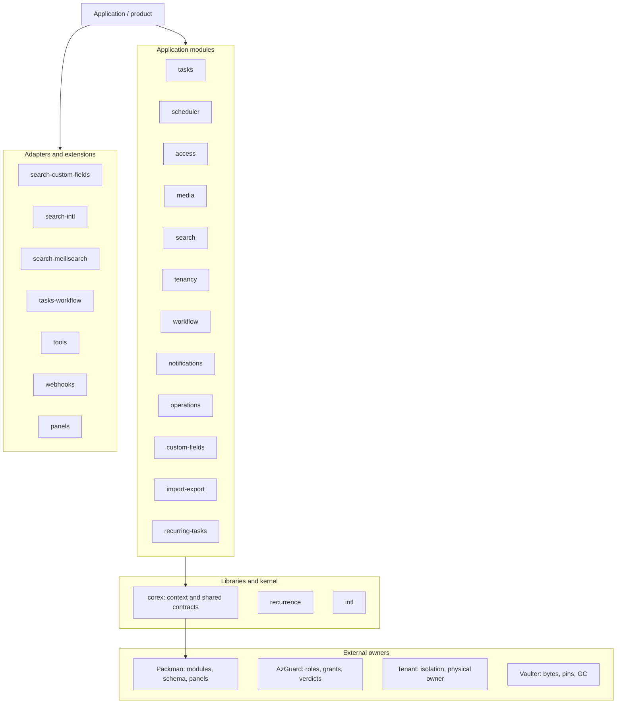

# Architecture

CoreX is a set of Laravel packages. Each Composer package is an ownership
boundary for its code, public contracts, configuration and tables. A product
(for example `flex/crm` in `products/flex-crm`) composes the packages it needs
and supplies authorization, data sources and integrations.

## Layers

- **Kernel** (`axiomasoft/corex`, `packages/core`): context, identity, data
  scope, errors, configuration, time, the base model, storage ports, settings,
  audit, messaging with inbox and outbox, feature flags and departments. It
  depends on no other CoreX package. Its zones are listed in
  [core zones](architecture/core-zones.md).
- **Modules** own a business capability and its tables (`tsk_*` for tasks,
  `aut_*` for access, and so on). They depend on the kernel and on each other
  only through public contracts.
- **Adapters** connect two modules or a module and an external engine, for
  example `search-meilisearch` or `tasks-workflow`. They are optional: a host
  installs them only when it needs the combination.

The full dependency graph, allowed edges and package purposes are in the
[package map](architecture/package-map.md); `composer package-graph-gate`
enforces them.

## Context and work scopes

Every write runs inside a verified `TenantContext` and a `DataScope`:

1. `TenantContextResolver::current()` returns the trusted account, workspace
   and principal for the request or job.
2. `DataScopeFactory` turns that context into a `DataScope` bound to the
   physical database binding of the account.
3. `WorkScopeRunner::run($scope, $work)` executes the work against the owner
   connection. A stale binding (for example after a restore) throws
   `ScopeStale` instead of writing to the wrong incarnation.

Tenancy is optional. Without `axiomasoft/corex-tenancy` the host provides a
single-account context; with it, accounts and workspaces map onto the external
Tenant runtime and its PostgreSQL adapter.

## Schema

Packages never publish migrations. They declare schema sets that Packman Schema
installs per scope (`tenant`, `central`, `dedicated`) and that
`ModuleLifecycle` applies when a module is enabled. Table ownership is declared
in [table ownership](architecture/table-ownership.md) and checked by
`composer table-ownership-gate` and `composer table-write-ownership-gate`.

## Public surface

Supported symbols carry Packman attributes:

| Attribute | Meaning for other packages |
| --- | --- |
| `#[Api]` | May be called, read or caught |
| `#[Spi(kind: SpiKind::Implement)]` | May be implemented by the host or an adapter |
| `#[Spi(kind: SpiKind::Call)]` | May be called by an adapter |
| `#[Internal]` | Must not be imported outside the owning package |

Each package snapshots its surface in `resources/contracts/php-api.json`;
`composer php-api` and `scripts/contract-guard.sh` reject an unannounced
change. Compatibility rules are in the [SemVer policy](architecture/semver-policy.md).

## Errors

Failures are typed: each package owns a backed enum of error codes and
contributes problem definitions to a registry compiled at boot. See
[Errors](errors.md).

## Messaging

Domain facts go through the transactional outbox and are relayed after commit;
consumers deduplicate through the inbox. Envelope, naming and versioning rules
are in the [message policy](architecture/message-policy.md).

## Further reading

The normative layer (invariants, enforcement, exceptions) is indexed in
[`architecture/README.md`](architecture/README.md).
