# CoreX package map

CoreX packages are Laravel components that can be used independently of FlexCRM, FlexCMS or another product. A Composer package owns its code, public contracts, configuration and tables. The product selects packages and supplies its authorization rules, data sources and integrations.

## Platform and application kernel

`axiomasoft/packman`, `axiomasoft/packman-modules` and `axiomasoft/packman-schema` own module discovery and compilation, the module lifecycle, and execution of declared schema sets. CoreX supplies adapters for its context, feature flags and audit, and coordinates lifecycle admission and owner references through public Packman contracts. `axiomasoft/packman-panels` owns panels, saved views and their tables. `corex-panels` registers that engine and supplies trusted context.

`axiomasoft/corex` provides context, identity, data scope, errors, configuration, time, the base model, storage ports, settings, audit, messaging/outbox, feature flags and departments. This application kernel is independent of the other CoreX packages.

`CoreX\Foundation` connects the CoreX context to Packman. Module definitions and lifecycle use `Packman\Modules`. Schema declarations use `Packman\Schema`.

```mermaid
flowchart TB
    subgraph platform[External owners]
        packman[Packman: modules, schema, panels]
        azguard[AzGuard: roles, grants, verdicts]
        tenant[Tenant: isolation and physical ownership]
        vaulter[Vaulter: bytes, pins, garbage collection]
        chatom[Chatom: messages and channels]
    end
    subgraph libraries[Libraries and application kernel]
        core[corex: context and shared contracts]
        recurrence[recurrence: occurrence calculation]
        intl[intl: locales, money, reference data]
    end
    subgraph modules[Application modules and executors]
        tasks[tasks]
        recurring[recurring-tasks]
        scheduler[scheduler]
        exchange[import-export]
        operations[operations]
        search[search]
        access[access]
        media[media]
        fields[custom-fields]
        notifications[notifications]
        tenancy[tenancy]
        workflow[workflow]
    end
    subgraph adapters[Adapters and extensions]
        searchfields[search-custom-fields]
        tasksworkflow[tasks-workflow]
        searchintl[search-intl]
        meili[search-meilisearch]
        tools[tools]
        webhooks[webhooks]
        panels[panels: context for Packman Panels]
    end
    product[Application or product] --> modules
    product --> adapters
    modules --> core
    core --> packman
    recurring --> tasks
    recurring --> recurrence
    tasksworkflow --> tasks
    tasksworkflow --> workflow
    searchfields --> search
    searchfields --> fields
    searchintl --> search
    searchintl --> intl
    meili --> search
    tools --> operations
    webhooks --> operations
    panels --> core
    panels --> packman
    access --> azguard
    tenancy --> tenant
    media --> vaulter
    product --> chatom
```

An arrow points toward a dependency. The diagram shows component roles. Each Composer manifest gives the full set of required dependencies. Applications can consume the kernel scheduling contracts independently of the `scheduler` executor. A host that enables a feature must provide its required port.

## Package responsibilities

The kernel is `axiomasoft/corex`. Other Composer names use `axiomasoft/corex-<name>`.

| Name | PHP namespace | Responsibility |
| --- | --- | --- |
| `corex` | `CoreX` | Shared application contracts and Packman integration |
| `access` | `CoreX\Access` | Authorization and record visibility in the current CoreX context |
| `custom-fields` | `CoreX\CustomFields` | Typed custom fields, persistence, filters and schema operations |
| `intl` | `CoreX\Intl` | Locales, translations, formatting, currencies and geographical reference data |
| `media` | `CoreX\Media` | Private references and attachments, policies and conversions. Vaulter owns the bytes and garbage collection. |
| `notifications` | `CoreX\Notifications` | Notification intents, inbox, delivery, preferences and digests |
| `operations` | `CoreX\Operations` | Execution of declared operations, HTTP, OpenAPI, idempotency, cost and bulk admission |
| `panels` | `CoreX\Panels` | Trusted CoreX context for Packman Panels and saved views |
| `recurrence` | `CoreX\Recurrence` | Bounded computation of occurrences from recurrence rules |
| `recurring-tasks` | `CoreX\RecurringTasks` | Idempotent task creation from occurrences and durable progress tracking |
| `scheduler` | `CoreX\Scheduler` | Durable execution of one-time work at a specified UTC instant |
| `search` | `CoreX\Search` | Search queries, result visibility and the search provider port |
| `search-custom-fields` | `CoreX\SearchCustomFields` | Typed field projections and propagation of committed changes to Search |
| `search-intl` | `CoreX\SearchIntl` | Localized search projections |
| `search-meilisearch` | `CoreX\SearchMeilisearch` | Meilisearch implementation of the search provider |
| `tasks` | `CoreX\Tasks` | Tasks, projects, stages, planning and time tracking |
| `tasks-workflow` | `CoreX\TasksWorkflow` | Captures the first task completion for Workflow inside the Tasks transaction |
| `tenancy` | `CoreX\Tenancy` | Accounts, workspace membership and Tenant integration. Physical operations use the resource owner's ports. |
| `tools` | `CoreX\Tools` | Declared tool calls backed by operations, schema validation and MCP projection |
| `import-export` | `CoreX\ImportExport` | Import and export of application records, checkpoints and sealed manifests |
| `webhooks` | `CoreX\Webhooks` | Outgoing webhook subscriptions, signing, delivery and replay |
| `workflow` | `CoreX\Workflow` | Durable intent and a port for a separately selected workflow engine |

The Composer type `packman-module` identifies lifecycle participants. An adapter depends on the packages that own the contracts it connects. Those owners remain independent of the adapter.

## Boundaries between packages

- `recurrence` calculates dates. `recurring-tasks` turns occurrences into tasks. `scheduler` executes deferred work. `workflow` records intent for an external engine.
- `import-export` transfers selected application records. The host owns database backups, restoration, physical tenant migration and media backups. The restore epoch fences out stale work after a restore.
- `intl` covers localization, money, exchange rates and geography. The name `localization` would apply to a separate component limited to locales and translations.
- `operations` executes declared operations independently of transport. HTTP and OpenAPI expose that contract. Tool calls use the same handler and admission rules. The name `api` would omit those other entry points.
- `tools` safely invokes declared tools. MCP is one projection of that responsibility.
- `custom-fields` represents user-defined fields on application entities. The term `attributes` already refers to PHP API/SPI attributes.
- `panels` supplies trusted context. Packman Panels owns descriptors, admission and saved views. The UI framework or host owns rendering and the surrounding shell.
- `access` installs its authorization engine through Composer. Applications call CoreX contracts to check permissions and restrict queries.

Explicitly register `CoreX\Operations\OperationsServiceProvider` to enable Operations. It exposes neutral `BulkExecutor` and `BulkOwner` contracts. ImportExport owns the source, sink, checkpoints and export publication. Equipment registers Operations and a scoped host adapter implementing both ports. Other declared operations work without the transfer adapter. Laravel discovers `CoreX\Recurrence\RecurrenceServiceProvider` for the standalone computation library.

## Naming and extension rules

1. Use the same capability name for the directory, Composer suffix, configuration key and provider. For example, `packages/import-export`, `axiomasoft/corex-import-export`, `corex-import-export` and `CoreX\ImportExport\ImportExportServiceProvider` all refer to the same package.
2. Form the namespace from the PascalCase package name. Use `<PackageName>ServiceProvider` for the provider. The kernel uses `CoreServiceProvider`.
3. Name submodules for their domain responsibility. Each `Internal` namespace belongs to one Composer package. Applications and neighboring packages may import only supported public types.
4. The public API must support the complete operation, including creation, resumption, reading results and handling errors. Supply an entry point for the stock engine so consumers can use it without implementing a port or writing to another owner's tables.
5. Extract a library when it has an independent responsibility and use case. Moving a few DTOs alone does not reduce coupling.
6. Coordinate package renames across Composer, PSR-4, config, providers, commands, manifest identities, tests, documentation and contract snapshots. A physical table rename requires a separate schema decision.

API/SPI attributes determine whether individual types are public. Package graph, table ownership and public surface checks enforce additional boundaries.

## Public API examples

Applications resolve executable services through exported DI contracts, pass typed inputs and receive typed results. The application boundary supplies trusted tenant, principal and scope. HTTP request fields cannot select a connection or executable class. Prefer named arguments for calls with multiple parameters.

| Contract family | Example | Implementation or integration |
| --- | --- | --- |
| Module declaration | `ModuleManifest::make('vendor/notes')` | Packman `ModuleDefinition` and the [CoreX modules guide](../../packages/core/docs/modules/README.md) |
| Computation | `$expander->expand(set: $set, window: $window, limits: $limits)` | `CoreX\Recurrence\Contracts\RecurrenceExpander` |
| Domain command | `$createTask->handle($draft)` | `CoreX\Tasks\Task\Contracts\CreateTaskCommand`. See [Tasks](../../packages/tasks/README.md). |
| Durable scheduling | `$scheduler->schedule($request)` | `CoreX\Scheduling\Contracts\WakeupScheduler`. See [Scheduler](../../packages/scheduler/README.md). |
| Import/export | `$factory->openImport(scope: $scope, transfer: $ref, source: $source, mapper: $mapper, target: $target, mapping: $mapping, conflicts: $rule)` | `CoreX\ImportExport\Contracts\ImportExportFactory`. See [ImportExport](../../packages/import-export/README.md). |
| Transport adapter | `Api::operation(id: 'notes.create', ...)` | Packman declaration and CoreX `OperationHandler`. See [Operations](../../packages/operations/README.md). |
| UI integration | `PanelContexts::forUser($requestContext)` | Trusted CoreX context for [Packman Panels](../../packages/panels/README.md) |
| Execution isolation | `$tenancy->runFor($account, $workspace, $callback)` | CoreX `TenancyManager` and the Tenant runtime. See [Tenancy](../../packages/tenancy/README.md). |

Durable operations support creation, reopening and reading results through the public API. An import factory, for example, returns a session with a runner, token and result reader. Callers can resume work directly through that session. Hosts implement policy, source and target ports where they own a domain decision.

## External engines and adapters

The Composer manifests and public engine contracts identify the current owners. Earlier designs kept Tenant and ModuleLoader embedded and used `axioma-studio/azguard-core` and earlier Vaulter names. The current integrations use `axiomasoft/tenant`, Packman, `axiomasoft/azguard` and `axiomasoft/vaulter-*`.

| Owner | What CoreX adapts | Public contract | Integration |
| --- | --- | --- | --- |
| Packman | Module context, audit, feature flags and lifecycle participation | `Packman\Modules`, `Packman\Schema`, `Packman\Panels` | Packman supplies the module loader and schema executor. |
| AzGuard 2 | Principal, account, workspace and CoreX entity activity | `PanelAccess::decide()`, `Visibility::visibleTo()`, `AccessRequest` | `corex-access` calls the engine's public contracts. |
| Tenant | Account and workspace to verified isolation selection, account lifecycle to resource owner | `TenantRuntime`, `Selection`, `ContextState`, and for physical hosting, `PostgresLifecycle` and `ResourceBindings` | `corex-tenancy` uses the external runtime with host-provided mapping and resource adapters. |
| Chatom | Entities to conversation spaces/channels, host visibility, tenant keys, search and notification events | `Spaces`, `Channels`, `Messages`, `Spaces\Contracts\TenantContext`, `SearchProjectionSink` | The host wires the integration through the [Chatom recipe](chatom-host-composition.md). |
| Vaulter | Entity attachments and references to blobs/documents, policy, context and retention by the reference owner | `BlobStore`, `BlobPins`, `FileOperations`, `DocumentType`, `PermissionDriver` | `corex-media` uses BlobStore and BlobPins in a shared VaulterDatabase transaction. |

A `corex-chatom-forum` adapter is appropriate when CoreX mounts public `axiomasoft/chatom-forum` as a module. Chatom owns message bodies and tables. A single integration covers this responsibility without separate `messenger`, `chat` and `chatom` packages.

The CoreX outbox delivers domain events and integration facts. Chatom stores user messages, participants, channels and read state. A chat table cannot replace the domain outbox. The bridge reads the active Tenant context via Chatom's `TenantContext::current()` and preserves the existing isolation. It projects Chatom events into CoreX Search and Notifications idempotently through public ports.

CoreX Media owns references, attachment purpose, policies and conversion jobs. Vaulter owns content-addressed bytes, deduplication, pins and garbage collection. Drive/Documents adds a file tree, revisions and collaborative editing. `TenantStorage` remains a filesystem port for other consumers. Media stores its files through Vaulter.

`corex-media` writes the owner reference and calls `BlobPins::pin()` in one `VaulterDatabase` transaction. CoreX and Vaulter must share the same Laravel Connection. A mismatch is rejected before I/O. Lock the owner row first, then the blob. Conversion publication follows the same protocol after checking the claim and version. Purge removes the original and conversion pins together with their references. Vaulter handles physical garbage collection and its grace period. Deduplication uses the trusted account ID. CoreX writes through Vaulter's contracts and stores no independent paths to the bytes. See the [Media integration guide](../../packages/media/README.md).
