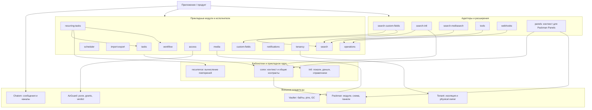

# Карта пакетов CoreX

CoreX — набор прикладных Laravel-компонентов. Каждый пакет должен решать понятную задачу
без FlexCRM, FlexCMS или другого продукта. Composer-пакет является границей владения
кодом, публичными контрактами, конфигурацией и таблицами. Продукт собирает нужные пакеты
и задаёт авторизацию, источники данных и интеграции.

## Общая платформа и прикладное ядро

`axiomasoft/packman`, `axiomasoft/packman-modules` и `axiomasoft/packman-schema` владеют
обнаружением и компиляцией модулей, lifecycle и исполнением объявленных наборов схемы.
CoreX использует их контракты и предоставляет адаптеры своего контекста, feature flags
и аудита. Второй loader, module registry или schema migrator в CoreX не создаётся.
`axiomasoft/packman-panels` владеет панелями и saved views, включая их таблицы;
`corex-panels` только регистрирует этот движок и адаптирует доверенный контекст.

`axiomasoft/corex` содержит общие для прикладных пакетов контекст, идентичность,
область данных, ошибки, конфигурацию, время, базовую модель, storage-порты,
settings, audit, messaging/outbox, feature flags и departments. Это прикладное ядро,
а не универсальная библиотека PHP. Оно не зависит от других пакетов CoreX.

`CoreX\Foundation` соединяет контекст CoreX с Packman. Определения и lifecycle модулей
используют `Packman\Modules`; декларации схемы — `Packman\Schema`.

Стрелка обозначает направление зависимости. Схема показывает роли компонентов;
полный список обязательных зависимостей определяется Composer-манифестами.
Доступ к scheduling-контрактам ядра не требует установки исполнителя `scheduler`.
При включённой функции хост обязан предоставить реализацию соответствующего порта.

## Имена и ответственность

Для строк таблицы, кроме `corex`, Composer-имя имеет вид `axiomasoft/corex-<имя>`.

| Имя | PHP namespace | Ответственность |
|---|---|---|
| `corex` | `CoreX` | Общие прикладные контракты и адаптация Packman |
| `access` | `CoreX\Access` | Проверка доступа и видимости записей по контексту CoreX |
| `custom-fields` | `CoreX\CustomFields` | Типизированные пользовательские поля, хранение, фильтры и операции их схемы |
| `intl` | `CoreX\Intl` | Локали, переводы, форматирование, валюты и географические справочники |
| `media` | `CoreX\Media` | Приватные ссылки и связи, policy и преобразования; байты и GC — Vaulter |
| `notifications` | `CoreX\Notifications` | Notification intents, inbox, доставки, предпочтения и дайджесты |
| `operations` | `CoreX\Operations` | Исполнение объявленных операций, HTTP, OpenAPI, idempotency, cost и bulk admission |
| `panels` | `CoreX\Panels` | Адаптация доверенного контекста для Packman Panels и saved views |
| `recurrence` | `CoreX\Recurrence` | Ограниченное вычисление occurrence по правилам повторения |
| `recurring-tasks` | `CoreX\RecurringTasks` | Идемпотентное создание задач из occurrence и сохранение прогресса |
| `scheduler` | `CoreX\Scheduler` | Долговечное исполнение одноразовой работы в заданный UTC instant |
| `search` | `CoreX\Search` | Поисковые запросы, policy-проверка результатов и порт поискового провайдера |
| `search-custom-fields` | `CoreX\SearchCustomFields` | Типизированная проекция полей и передача совершённых изменений в Search |
| `search-intl` | `CoreX\SearchIntl` | Локализованная поисковая проекция |
| `search-meilisearch` | `CoreX\SearchMeilisearch` | Реализация поискового провайдера через Meilisearch |
| `tasks` | `CoreX\Tasks` | Задачи, проекты, стадии, планирование и учёт времени |
| `tenancy` | `CoreX\Tenancy` | Аккаунты, workspace membership и адаптация Tenant; физические операции через порты владельца |
| `tools` | `CoreX\Tools` | Объявленные tool-вызовы поверх операций, schema validation и MCP projection |
| `import-export` | `CoreX\ImportExport` | Импорт и экспорт прикладных записей, checkpoints и sealed manifests |
| `webhooks` | `CoreX\Webhooks` | Подписки, подпись, доставка и replay исходящих webhook-событий |
| `workflow` | `CoreX\Workflow` | Durable intent и порт отдельно выбранного workflow engine |

Тип Composer `packman-module` обозначает участие в lifecycle, а не отдельный архитектурный
слой. Адаптер зависит от владельцев соединяемых контрактов; владелец не зависит от адаптера.

## Различия, которые должны оставаться явными

- `recurrence` вычисляет даты. `recurring-tasks` превращает occurrence в задачи.
  `scheduler` исполняет отложенную работу. `workflow` фиксирует intent для внешнего движка.
- `import-export` переносит выбранные прикладные записи. Backup, восстановление базы,
  перенос физической tenant-базы и резервирование media относятся к инфраструктуре хоста.
  Restore epoch является защитой от устаревшей работы после восстановления, а не backup API.
- `intl` шире локализации: пакет содержит деньги, курсы и географию. Имя `localization`
  допустимо только для отдельно выделенной ответственности локалей и переводов.
- `operations` обозначает объявленную исполняемую операцию независимо от транспорта.
  HTTP API и OpenAPI являются проекциями этого контракта; tool-вызовы используют тот же
  обработчик и правила допуска. Имя `api` скрывало бы эту общую ответственность.
- `tools` отвечает за безопасный вызов объявленных инструментов. MCP является одной
  проекцией, поэтому весь пакет не называется `mcp`.
- `custom-fields` прямо обозначает пользовательские поля прикладных сущностей.
  Слово `attributes` также используется для PHP-атрибутов API/SPI и создавало бы неоднозначность.
- `panels` адаптирует доверенный контекст CoreX. Дескрипторы, admission и saved views
  принадлежат Packman Panels. Rendering и оболочка принадлежат UI-фреймворку или хосту.
- `access` устанавливает движок авторизации как зависимость Composer. Приложение
  вызывает контракты CoreX для проверки прав и ограничения выборок.

## Правила расширения и именования

1. Каталог, Composer suffix, config key и provider обозначают одну функцию:
   `packages/import-export`, `axiomasoft/corex-import-export`, `corex-import-export`,
   `CoreX\ImportExport\ImportExportServiceProvider`.
2. Namespace использует PascalCase из имени пакета. Провайдер называется
   `<PackageName>ServiceProvider`; `corex` использует `CoreServiceProvider`.
3. Подмодули именуются по предметной ответственности. `Internal` принадлежит одному
   Composer-пакету; приложение и соседние пакеты его не импортируют.
4. Публичный API должен позволять выполнить полный сценарий без записи в чужие таблицы:
   создать операцию, продолжить её, прочитать результат и обработать ошибку.
   Реализация порта потребителем не заменяет доступный публичный вход в штатный движок.
5. Новую библиотеку выделяют при независимой ответственности и сценарии использования.
   Вынос нескольких DTO в отдельный пакет сам по себе не уменьшает связанность.
6. Изменение имени требует согласованного обновления Composer, PSR-4, config, provider,
   команд, manifest identity, тестов, документации и контрактных снимков. Физические
   таблицы переименовываются только отдельным решением об их схеме.

Публичность конкретных типов задают атрибуты API/SPI, а не сам namespace.
Проверки графа, владения таблицами и публичной поверхности дополняют эту карту.

## Стиль публичного API

Приложение получает исполняемые сервисы через экспортированные контракты DI, передаёт
типизированные входные значения и читает типизированный результат. Доверенный tenant,
principal и scope формируются на границе приложения; поля HTTP-запроса не выбирают
соединение или исполняемый класс. При вызове с несколькими параметрами предпочтительны
именованные аргументы.

| Семейство | Пример входа | Где находится полная композиция |
|---|---|---|
| Объявления модулей | `ModuleManifest::make('vendor/notes')` | Packman `ModuleDefinition`; [модули CoreX](../../packages/core/docs/modules/README.md) |
| Вычислительная библиотека | `$expander->expand(set: $set, window: $window, limits: $limits)` | `CoreX\Recurrence\Contracts\RecurrenceExpander` |
| Предметная команда | `$createTask->handle($draft)` | `CoreX\Tasks\Task\Contracts\CreateTaskCommand`; [tasks](../../packages/tasks/README.md) |
| Durable scheduling | `$scheduler->schedule($request)` | `CoreX\Scheduling\Contracts\WakeupScheduler`; [scheduler](../../packages/scheduler/README.md) |
| Импорт/экспорт | `$factory->openImport(scope: $scope, transfer: $ref, source: $source, mapper: $mapper, target: $target, mapping: $mapping, conflicts: $rule)` | `CoreX\ImportExport\Contracts\ImportExportFactory`; [import-export](../../packages/import-export/README.md) |
| Transport adapter | `Api::operation(id: 'notes.create', ...)` | Packman declaration и CoreX `OperationHandler`; [operations](../../packages/operations/README.md) |
| UI integration | `PanelContexts::forUser($requestContext)` | CoreX trusted context → Packman Panels; [panels](../../packages/panels/README.md) |
| Изоляция исполнения | `$tenancy->runFor($account, $workspace, $callback)` | CoreX `TenancyManager` → Tenant runtime; [tenancy](../../packages/tenancy/README.md) |

Для durable-сценария библиотека предоставляет создание, повторное открытие и чтение результата
через поддерживаемый API. Например, import factory возвращает сессию с runner, token и result
reader: для продолжения не требуется конструировать внутренний executor или вставлять строки
в его таблицы. Policy/source/target порты реализуются хостом там, где ему принадлежит предметное
решение; внутреннюю механику пакета он повторно не реализует.

## Соседние движки и адаптеры

Владельцы подтверждены текущими Composer-манифестами и публичными контрактами соседних
репозиториев. Исторические заметки Brain с `KEEP_EMBEDDED` для Tenant/ModuleLoader,
`axioma-studio/azguard-core` и прежними именами Vaulter описывают предыдущую архитектуру.
В текущем коде это `axiomasoft/tenant`, Packman, `axiomasoft/azguard` и `axiomasoft/vaulter-*`.
Правки этой карты не синхронизируют Brain и не меняют соседние репозитории.

| Владелец | Что адаптирует CoreX | Подтверждённая публичная граница | Состояние |
|---|---|---|---|
| Packman | Контекст, аудит и feature flags модулей; участие пакетов в lifecycle | `Packman\Modules`, `Packman\Schema`, `Packman\Panels` | Используется; второго loader/schema executor нет |
| AzGuard 2 | Principal/account/workspace, активность CoreX entity | `PanelAccess::decide()`, `Visibility::visibleTo()`, `AccessRequest` | `corex-access` вызывает публичные контракты движка |
| Tenant | Account/workspace → verified isolation selection; account lifecycle → resource owner | `TenantRuntime`, `Selection`, `ContextState`; `PostgresLifecycle`, `ResourceBindings` для physical host | `corex-tenancy` использует внешний runtime; host mapper и resource adapters обязательны |
| Chatom | Entity → conversation space/channel, host visibility, tenant key, события в поиске/уведомлениях | `Spaces`, `Channels`, `Messages`, `Spaces\Contracts\TenantContext`, `SearchProjectionSink` | Host composition через [Chatom recipe](chatom-host-composition.md); отдельный пустой bridge-пакет не нужен |
| Vaulter | Entity attachment/reference → blob/document, policy/context, удержание байтов владельцем ссылки | `BlobStore`, `BlobPins`, `FileOperations`, `DocumentType`, `PermissionDriver` | `corex-media` использует BlobStore/BlobPins и общий VaulterDatabase transaction; отдельный wrapper-пакет не нужен |

`corex-chatom-forum` допустим, если CoreX монтирует публичный `axiomasoft/chatom-forum`
как свой модуль; он не владеет телом сообщения или таблицами Chatom. Не нужны параллельные
`messenger`, `chat` и `chatom` пакеты с одинаковыми обязанностями.

CoreX messaging/outbox и Chatom messages имеют разное назначение. Первое доставляет
доменные события и интеграционные факты; второе хранит пользовательские сообщения,
участников, каналы и прочтения. Domain outbox нельзя заменять таблицей чата. Мост читает
уже активный Tenant context через Chatom's `TenantContext::current()` и не переключает
изоляцию. Доменные события Chatom превращаются в CoreX search/notification проекции
идемпотентно через публичные порты, без запросов в чужие таблицы.

CoreX media хранит прикладные ссылки, purpose, policy и задания преобразования. Vaulter
владеет CAS байтами, dedup, pins и сборкой мусора; Drive/Documents добавляют файловое дерево,
ревизии и совместное редактирование. `TenantStorage` остаётся filesystem-портом для других
потребителей, но media не использует его для хранения файлов.

`corex-media` записывает owner reference и `BlobPins::pin()` одной транзакцией
`VaulterDatabase`. CoreX и Vaulter обязаны использовать один и тот же Laravel Connection;
несовпадение отклоняется до I/O. Порядок блокировок: owner row → blob. Конверсии публикуются
после проверки claim/version тем же протоколом. Purge снимает pins оригинала и конверсий
вместе с удалением ссылок; физический GC и его grace period остаются у Vaulter. Scope dedup
строится из trusted account id. CoreX не пишет Vaulter tables и не хранит собственные пути
к байтам. [Media API и установка](../../packages/media/README.md) описывают host composition.
