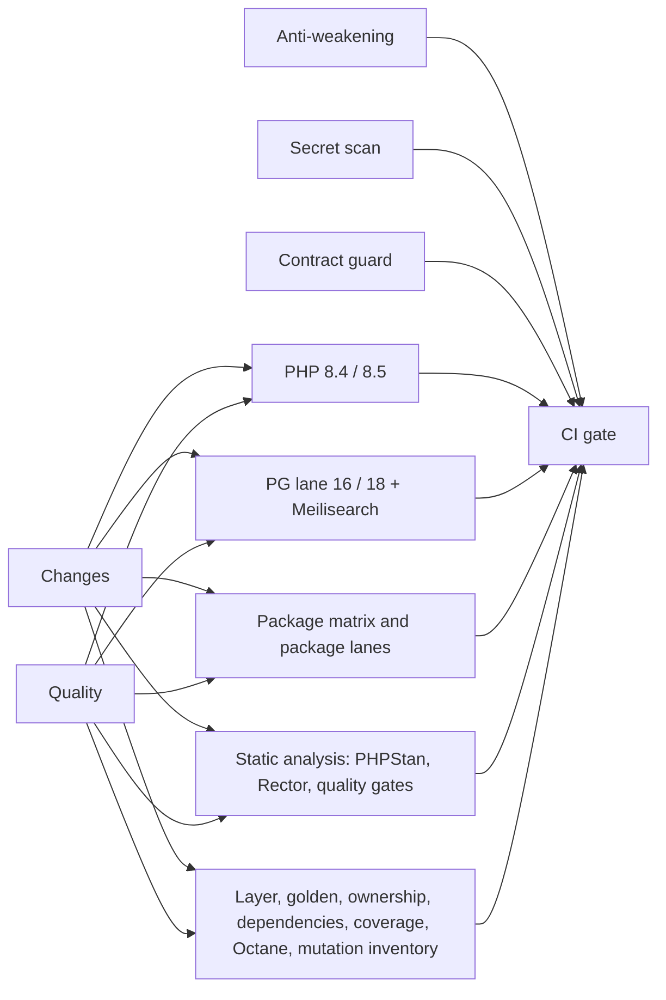

# Testing and CI

## Local suites

| Command | What runs |
| --- | --- |
| `composer test` | The root Pest suite on in-memory SQLite (no `pg`, `meilisearch` or Golden groups) |
| `composer test:pg` | Every `pg` group test against PostgreSQL |
| `composer test:arch` | Architecture and layer rules |
| `composer golden` | Golden surface and wire-contract snapshots |
| `composer test:coverage` | Merged line coverage for the source directories in `phpunit.xml`, with the minimum in `scripts/coverage-min-floor.txt` |
| `composer test:packages` | Each package suite with its own `phpunit.xml` |
| `composer analyse` | PHPStan at max level across all packages |
| `composer lint:check` / `composer lint` | Pint check / fix |
| `composer refactor:check` / `composer refactor` | Rector dry-run / apply |
| `composer deps:analyse` | Standalone dependency analysis of every package |

Heavy runs on a shared machine can be bounded with
`scripts/test-bounded -- <command>`: one run at a time, 2 GiB RAM, one CPU.

### PostgreSQL

`docker compose up -d --wait` starts loopback-only PostgreSQL 18 and Meilisearch, the
services of the CI `PG lane` job. Use separate Compose project names and host ports (`PGSQL_PORT`, `MEILISEARCH_PORT`) for concurrent checkouts. On a fresh data volume
`docker/pgsql/create-test-databases.sh` creates the lane's extra databases
(`corex_search_a_test`, `corex_search_b_test`, `corex_budget_test`,
`corex_control_test`, `corex_search_control_test`, `corex_sink_test`). The
volume is `corex_pgsql18_data`; a volume left by the earlier PostgreSQL 16
compose file is not reused and can be removed with `docker volume rm`.
The PostgreSQL lanes read:

| Variable | Default |
| --- | --- |
| `PGSQL_HOST` | `127.0.0.1` |
| `PGSQL_PORT` | `5434` with docker compose |
| `PGSQL_DATABASE` | `corex_test` |
| `PGSQL_USERNAME` / `PGSQL_PASSWORD` | `corex` / `corex` |
| `PGSQL_BUDGET_DATABASE`, `PGSQL_CONTROL_DATABASE`, `PGSQL_SINK_DATABASE` | extra databases for the resource-budget, scope-control and sink suites |
| `MEILISEARCH_HOST`, `MEILISEARCH_MASTER_KEY` | the Meilisearch adapter suite |

To run the lane as CI does against the compose services:

```bash
docker compose up -d --wait
PGSQL_PORT=5434 \
PGSQL_BUDGET_DATABASE=corex_budget_test \
PGSQL_CONTROL_DATABASE=corex_search_control_test \
PGSQL_SINK_DATABASE=corex_sink_test \
COREX_LIFECYCLE_CONTROL_DATABASE=corex_search_control_test \
MEILISEARCH_HOST=http://127.0.0.1:7700 \
MEILISEARCH_MASTER_KEY=corex-local-disposable-meilisearch-key \
composer test:pg
```

CI also runs the lane on PostgreSQL 16; the compose file follows the newest
version, which the package jobs use.

Some suites shell out to host tools or need PHP extensions:

- The tenancy claim lifecycle tests run `pg_dump` and `pg_restore`; their
  major version must not be older than the server's (`pg_dump` 17 refuses a
  PostgreSQL 18 server).
- The media thumbnail tests need `ext-gd`; without it the GD driver and its
  conversion profile are not registered.
- The tenancy Redis account-menu tests need `ext-redis` and a disposable
  Redis server; set `COREX_TEST_REDIS_PORT` to its port on `127.0.0.1` (they use
  database 15). Without the variable they are skipped. The tenancy CI job
  runs them against a `redis:8-alpine` service.

### Standalone package installs

Packages are tested both from the monorepo root and on their own, which proves
each `composer.json` declares everything the package uses:

```bash
python3 scripts/composer-with-snapshots.py --working-dir=packages/tasks update --prefer-dist
composer --working-dir=packages/tasks test
rm -rf packages/tasks/vendor
```

The wrapper writes a gitignored `.composer-snapshots.json` beside the package
manifest so the package resolves the same pinned ecosystem repositories as the
root.

## CI

`.github/workflows/ci.yml` is a job graph:



- **Changes** skips the PHP lanes when a push only touches Markdown, `docs/`
  or `LICENSE`. Pushes to `main` and manual runs without a job selection enable every regular lane.
- **Quality** is the fast gate: root `composer audit`, manifest policy, strict
  `composer validate` of every package, Pint, actionlint and zizmor.
- Lanes then run in parallel. The matrix only covers dimensions that add
  signal: PHP 8.4 and 8.5 for the root suite and Octane, PostgreSQL 16 and 18
  for the PG lane.
- **CI gate** is the check to require on `main`. A code run requires every
  regular lane to succeed. A documentation-only change can skip the PHP lanes.
  Quality, change detection, secret scanning, the history guard and the PHP
  contract guard must still pass.
- Code changes also check mutation inventory and parser controls in parallel
  with the package jobs. Dispatch with `mutation: true` to measure fragment
  scores and run the mutation registry.
- A targeted dispatch reports **Selected CI lanes** and has its own cancellation
  group. Use `gh workflow run ci.yml --ref <branch> -f jobs=tests-pg,panels-tests`
  to check those jobs and Quality. A full check is available by dispatching
  without `jobs`. Use `gh run rerun <run-id> --failed` to retry jobs on the same SHA.

Changing the files under `tests/Golden/baseline/` or `tests/Golden/schema/`, or the
rename map, package projection or promoted fixtures in `tests/Golden/`, needs a dated row in `tests/Golden/REBASELINE.md` explaining the affected layer and
reason. Add a new row in the snapshot commit. To record an earlier change,
append `(commit <full SHA>)` to the decision column of a new row. Each row
covers one commit. Keep the row in the final ledger. Make translations or
editorial revisions in a separate commit.

Practices: actions pinned by commit SHA, `permissions: {}` at the top with
read-only grants per job, `persist-credentials: false`, a timeout on every job,
superseded runs cancelled (except on `main`), Composer downloads cached by
`composer.lock`, and the merged coverage report uploaded as the
`root-coverage` artifact.

Shared steps live in composite actions:

- `.github/actions/setup-php`: PHP via `shivammathur/setup-php`, the Composer
  cache and a locked `composer install`.
- `.github/actions/lint-workflows`: actionlint and zizmor.

`distribution-proof.yml` runs the distribution proofs on pull requests that
touch dependency or distribution files, and on demand.
