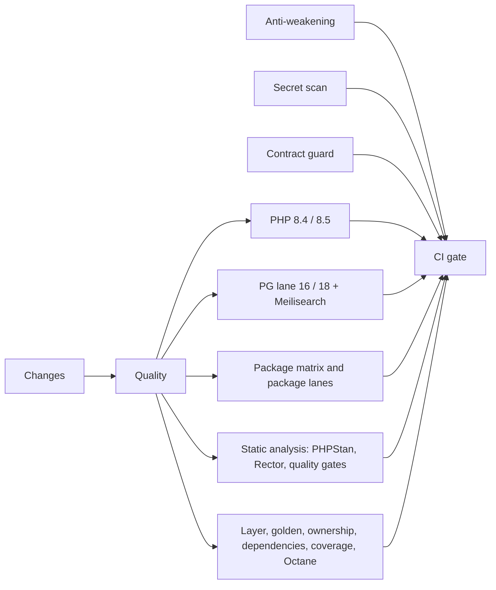

# Testing and CI

## Local suites

| Command | What runs |
| --- | --- |
| `composer test` | The root Pest suite on in-memory SQLite (no `pg`, `meilisearch` or Golden groups) |
| `composer test:pg` | Every `pg` group test against PostgreSQL |
| `composer test:arch` | Architecture and layer rules |
| `composer golden` | Golden surface and wire-contract snapshots |
| `composer test:coverage` | Root coverage, merged across processes, minimum 80% |
| `composer test:packages` | Each package suite with its own `phpunit.xml` |
| `composer analyse` | PHPStan at max level across all packages |
| `composer lint:check` / `composer lint` | Pint check / fix |
| `composer refactor:check` / `composer refactor` | Rector dry-run / apply |
| `composer deps:analyse` | Standalone dependency analysis of every package |

Heavy runs on a shared machine can be bounded with
`scripts/test-bounded -- <command>`: one run at a time, 2 GiB RAM, one CPU.

### PostgreSQL

`docker compose up -d pgsql` starts a loopback-only PostgreSQL. The PostgreSQL
lanes read:

| Variable | Default |
| --- | --- |
| `PGSQL_HOST` | `127.0.0.1` |
| `PGSQL_PORT` | `5434` with docker compose |
| `PGSQL_DATABASE` | `corex_test` |
| `PGSQL_USERNAME` / `PGSQL_PASSWORD` | `corex` / `corex` |
| `PGSQL_BUDGET_DATABASE`, `PGSQL_CONTROL_DATABASE`, `PGSQL_SINK_DATABASE` | extra databases for the resource-budget, scope-control and sink suites |
| `MEILISEARCH_HOST`, `MEILISEARCH_MASTER_KEY` | the Meilisearch adapter suite |

The CI `PG lane` job shows the full set of databases it creates.

Some suites shell out to host tools or need PHP extensions:

- The tenancy claim lifecycle tests run `pg_dump` and `pg_restore`; their
  major version must not be older than the server's (`pg_dump` 17 refuses a
  PostgreSQL 18 server).
- The media thumbnail tests need `ext-gd`; without it the GD driver and its
  conversion profile are not registered.

### Standalone package installs

Packages are tested both from the monorepo root and on their own, which proves
each `composer.json` declares everything the package uses:

```bash
python3 scripts/composer-with-snapshots.py --working-dir=packages/tasks update --prefer-dist
composer --working-dir=packages/tasks test
rm -rf packages/tasks/vendor
```

The wrapper writes a gitignored `.composer-snapshots.json` beside the package
manifest so the package resolves the same pinned ecosystem repositories as the
root.

## CI

`.github/workflows/ci.yml` is a job graph:



- **Changes** skips the PHP lanes when a push only touches Markdown, `docs/`
  or `LICENSE`. Pushes to `main` and manual runs always run everything.
- **Quality** is the fast gate: root `composer audit`, manifest policy, strict
  `composer validate` of every package, Pint, actionlint and zizmor.
- Lanes then run in parallel. The matrix only covers dimensions that add
  signal: PHP 8.4 and 8.5 for the root suite and Octane, PostgreSQL 16 and 18
  for the PG lane.
- **CI gate** is the single check to require in branch protection. Skipped
  lanes count as passed; failed or cancelled lanes fail it. Its step summary
  lists every job result.
- Mutation testing runs only on `workflow_dispatch` with `mutation: true`.
- After fixing a failure, re-check only what broke: re-run the failed jobs
  (`gh run rerun <run-id> --failed`) or dispatch the workflow with `jobs` set
  to the job ids, for example
  `gh workflow run ci.yml --ref <branch> -f jobs=tests-pg,panels-tests`.
  Changes and Quality always run; every other job outside the list is
  skipped and the CI gate stays green for it. Run the full workflow once
  at the end.

Practices: actions pinned by commit SHA, `permissions: {}` at the top with
read-only grants per job, `persist-credentials: false`, a timeout on every job,
superseded runs cancelled (except on `main`), Composer downloads cached by
`composer.lock`, and the merged coverage report uploaded as the
`root-coverage` artifact.

Shared steps live in composite actions:

- `.github/actions/setup-php`: PHP via `shivammathur/setup-php`, the Composer
  cache and a locked `composer install`.
- `.github/actions/lint-workflows`: actionlint and zizmor.

`distribution-proof.yml` runs the distribution proofs on pull requests that
touch dependency or distribution files, and on demand.
