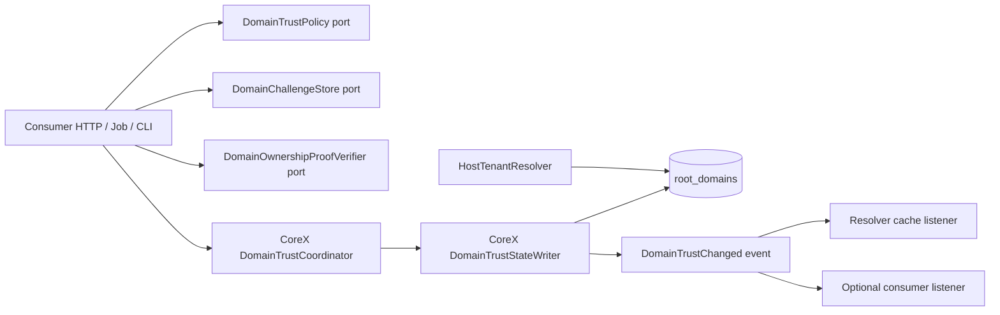

# P3.1 — L0 domain-trust extension design

## Context and non-negotiable boundaries

The reusable outcome is not a DNS product. CoreX owns the trusted state transition that its
tenant resolver already reads; an application owns DNS/edge policy and all transports. This keeps
`corex/*` useful outside CRM/CMS/Store and avoids a dependency on an application package.

The current reader is `Domain(verified_at)` plus `HostTenantResolver`. It must never infer trust
from a cache hit alone. Custom verification is opt-in; a package with no consumer binding keeps
the existing platform-domain lifecycle and exposes no HTTP, queue or CLI verification path.

## Options considered

### A. Put CNAME+TXT verification in `corex/tenancy`

- Pros: one ready-made workflow.
- Cons: embeds edge hostname, DNS vendor semantics, HTTP/jobs and TLS ownership in L0.
- Business rationale: rejected — it would make unrelated Laravel applications carry a product
  policy and violates the agnosticity test.

### B. A large generic DNS/edge framework

- Pros: supports many providers and proof mechanisms.
- Cons: a second orchestration platform, large API surface, credential/secrets lifecycle and
  artificial abstractions before consumers exist.
- Business rationale: rejected — CoreX needs a small stable seam, not a heavy control plane.

### C. Ports-and-events SPI in `corex/tenancy` (chosen)

- Pros: CoreX enforces the generic trusted-state invariant while a consumer supplies policy,
  storage and proof transport; tests run with fakes; no product identifier enters L0.
- Cons: first consumer writes a small adapter and must configure its own operational policy.
- Business rationale: satisfies reuse, keeps responsibility next to the operator and makes
  alternate proof methods/extensions possible without changing the resolver.

## Chosen component model



### New public contracts — `packages/tenancy/src/Contracts/`

| Contract | One responsibility | Deliberate non-responsibility |
|:--|:--|:--|
| `DomainTrustPolicy` | normalize/admit a requested host and describe the proof request | DNS I/O, persistence, user authorisation |
| `DomainChallengeStore` | atomically create, read and consume an opaque, account+host+generation-bound challenge | state writes, edge calls |
| `DomainOwnershipProofVerifier` | return observed proof facts for a normalized host | trust decision, credential storage, HTTP |
| `DomainTrustAuthorizer` | decide whether an already-authenticated caller may issue/verify/revoke/reassign | authentication or tenant discovery |

Each is an interface only. Implementations are private to a consumer or optional package. There
is no `CnameVerifier`, provider name, edge URL, route or cache key in CoreX.

### Frozen contract shape

The following PHP shape is the implementation target; names, parameter order and return types are
not left for the implementer to redesign. All values are final readonly objects under
`CoreX\Tenancy\DomainTrust`; all interfaces remain under `CoreX\Tenancy\Contracts`.

```php
interface DomainTrustPolicy
{
    public function normalize(string $host): NormalizedHost;
    public function accepts(NormalizedHost $host, ObservedDomainProof $proof): bool;
}

interface DomainChallengeStore
{
    public function issue(DomainChallengeDraft $draft): IssuedDomainChallenge;
    public function consumeMatching(DomainChallengeBinding $binding, ObservedDomainProof $proof): ChallengeConsumption;
}

interface DomainOwnershipProofVerifier
{
    public function observe(NormalizedHost $host): ObservedDomainProof;
}

interface DomainTrustAuthorizer
{
    public function assertAllowed(
        DomainTrustActor $actor,
        DomainTrustOperation $operation,
        string $accountId,
        NormalizedHost $host,
    ): void;
}
```

`DomainChallengeDraft` carries account id, host, generation and expiry; the store generates the
32-byte raw token, returns it once in `IssuedDomainChallenge`, and persists only its keyed digest.
`ObservedDomainProof` is an in-memory list of observed facts, including TXT candidate values and
adapter status; it is never serialised to an event, cache or log. `consumeMatching()` atomically
checks account, host, generation, expiry and digest match, then makes the challenge unusable.
`DomainTrustCoordinator` calls the authorizer before every operation, policy normalization before
any lookup, verifier observation before policy acceptance, and the state writer only after a
successful consumption. A consumer maps its own authenticated principal to `DomainTrustActor`;
CoreX neither authenticates it nor accepts a raw account id from an HTTP request.

### CoreX internal types and services — `packages/tenancy/src/DomainTrust/`

- Immutable value objects: `NormalizedHost`, `DomainChallenge`, `ObservedDomainProof`,
  `DomainTrustTransition` and `DomainTrustChangeReason`.
- `DomainTrustCoordinator`: issue, verify, revoke and reassign use ports above; it never reads
  a request, queue payload, environment secret or network.
- `DomainTrustStateWriter`: the only normal application write path for custom verification. It
  holds a central-DB transaction and row lock, rechecks account/domain/generation, consumes the
  challenge once, persists the transition through Eloquent, then emits the lifecycle event after
  commit. It does not promise distributed atomicity across a consumer challenge store.
- `DomainTrustChanged`: final Laravel event with account id, normalized host, old/new generation,
  reason and occurred-at; it carries no token, DNS response, credentials or raw hostname policy.

The implementation adds nullable-free `verification_generation` with default `0` to
`root_domains`; a transition increments it. The existing unique live-host constraint remains the
sole ownership arbiter. Any schema shape mismatch stops the item rather than adapting DDL.

## Frozen protocol and security invariants

1. `DomainTrustPolicy` returns an ASCII A-label normalized host or a typed denial. U-label/IDNA
   conversion is a consumer policy concern; L0 rejects ambiguous/non-ASCII input rather than
   silently requiring an optional runtime extension. Trailing dot, invalid labels, ports,
   reserved and foreign hosts are rejected or normalized by the policy before storage.
2. `DomainChallengeStore` creates 32 cryptographically random bytes, gives the raw token only to
   the initiating trusted consumer flow and stores only a keyed digest. It binds account id, host,
   expiry and generation; consume is atomic and single-use. The coordinator compares observed
   token values in constant time through their keyed digests.
3. `DomainOwnershipProofVerifier` returns observations, not boolean trust. A CNAME+TXT consumer
   adapter must report all relevant answers; the coordinator treats timeout, ambiguity, stale
   generation or wrong account/host as denial. A CNAME name cannot also host unrelated RR data;
   the adapter validates this according to its DNS policy.
4. Verification locks the live domain row, rechecks ownership and account status, then consumes
   the challenge and sets `verified_at` in one central transaction. If a store is outside that
   DB, retry is keyed by generation and terminal consumption is idempotent; no component claims a
   distributed transaction.
5. Revoke and reassign increment generation, clear trust first and invalidate both old and new
   resolver keys after commit. Cache is an optimisation only: invalidation failure makes an ask
   deny until durable state can be reread, never an allow from warm cache. Laravel cache locks may
   reduce duplicate work but do not replace the DB uniqueness/row-lock proof.
6. The resolver reads only non-deleted domain, non-null `verified_at` and active, addressable
   account. It gains strict normalized-host handling, but no DNS call, adapter lookup or policy
   branch.
7. Events are extension notifications, never a security gate. A failed optional listener cannot
   roll back or grant trust; synchronous core invalidation is part of the writer acceptance path.

## Security design

| Surface | Classification / threat | Required control |
|:--|:--|:--|
| Challenge token | credential | keyed digest only, never log/event/cache; short policy TTL, single use |
| Host and account id | internal tenancy metadata | validate before lookup; scoped authorizer; no cross-account object id |
| DNS/edge adapter | third-party integration / SSRF-like boundary | consumer owns endpoint allow-list and credentials; fake adapter in CoreX tests |
| Trusted state | integrity-critical | writer transaction + generation + DB uniqueness; no controller/model mass assignment |
| Ask response | public routing surface | only trusted state permits allow; denial is indistinguishable `404` |

STRIDE receipts required by tests: spoofed A→B proof, tampered/replayed token, denial of service
through duplicate requests, elevation through untrusted writer, information leak through logs or
ask response, and audit/event correlation without secret material.

## Source-backed implementation notes

- Laravel Events decouple listeners; queued work must not observe an uncommitted transition.
  [Laravel Events](https://laravel.com/framework/docs/events)
- Laravel cache supports atomic locks, but cache tags are not universal across drivers; use the
  database as authority and capability-check any cache optimisation.
  [Laravel Cache](https://laravel.com/framework/docs/12.x/cache)
- DNS CNAME data has exclusivity constraints at a name.
  [RFC 1034](https://www.rfc-editor.org/rfc/rfc1034)
- Challenge secrets require cryptographically sound randomness.
  [RFC 4086](https://datatracker.ietf.org/doc/rfc4086/)

## Execution-ready file map and acceptance

| Area | Exact implementation paths |
|:--|:--|
| Public ports | `packages/tenancy/src/Contracts/DomainTrustPolicy.php`, `DomainChallengeStore.php`, `DomainOwnershipProofVerifier.php`, `DomainTrustAuthorizer.php` |
| Core implementation | `packages/tenancy/src/DomainTrust/*`, `packages/tenancy/src/Events/DomainTrustChanged.php`, `packages/tenancy/src/Resolvers/HostTenantResolver.php` |
| State | one new `packages/tenancy/database/migrations/root/*domain-trust-generation*.php`, `packages/tenancy/src/Models/Domain.php` |
| Wiring/docs | `packages/tenancy/src/TenancyServiceProvider.php`, `packages/tenancy/config/tenancy.php`, `packages/tenancy/CHANGELOG.md` |
| Tests | `packages/tenancy/tests/Feature/DomainTrustTest.php`, `packages/tenancy/tests/Feature/HostResolutionTest.php`, package phpunit config if a lane is added |

Validation is: `composer lint:check`, `composer analyse`, the tenancy package test suite in its
SQLite and PG lanes, root `composer test:arch`, and the full D34 two-lane gate. Tests use only
fakes; they prove issue/verify/revoke/reassign, single-use/race/idempotency, cache invalidation,
no trust on malformed/replayed/foreign proof, adapter denial, and unchanged resolution of
platform domains. No live DNS query, TLS issuance, secret, public HTTP API or consumer code is
accepted in P3.1.
