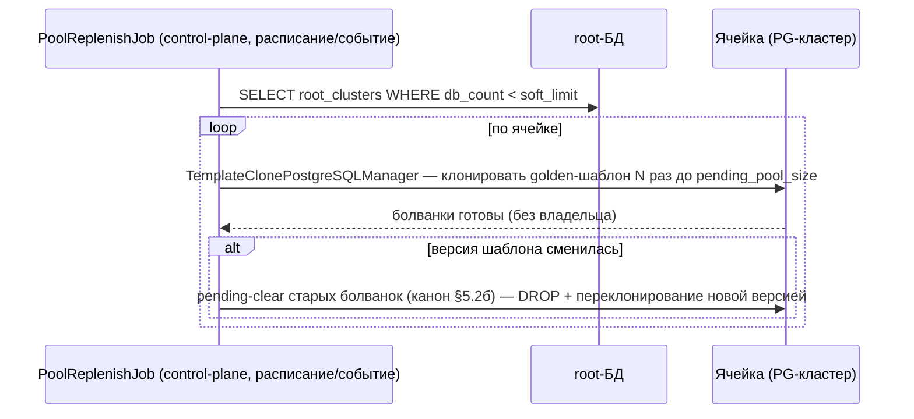
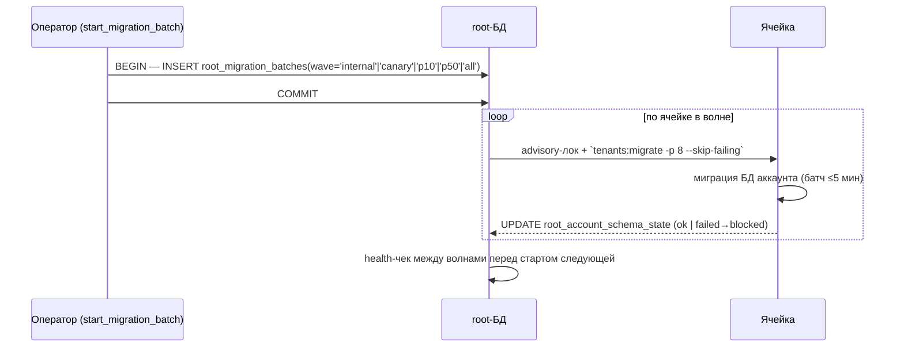
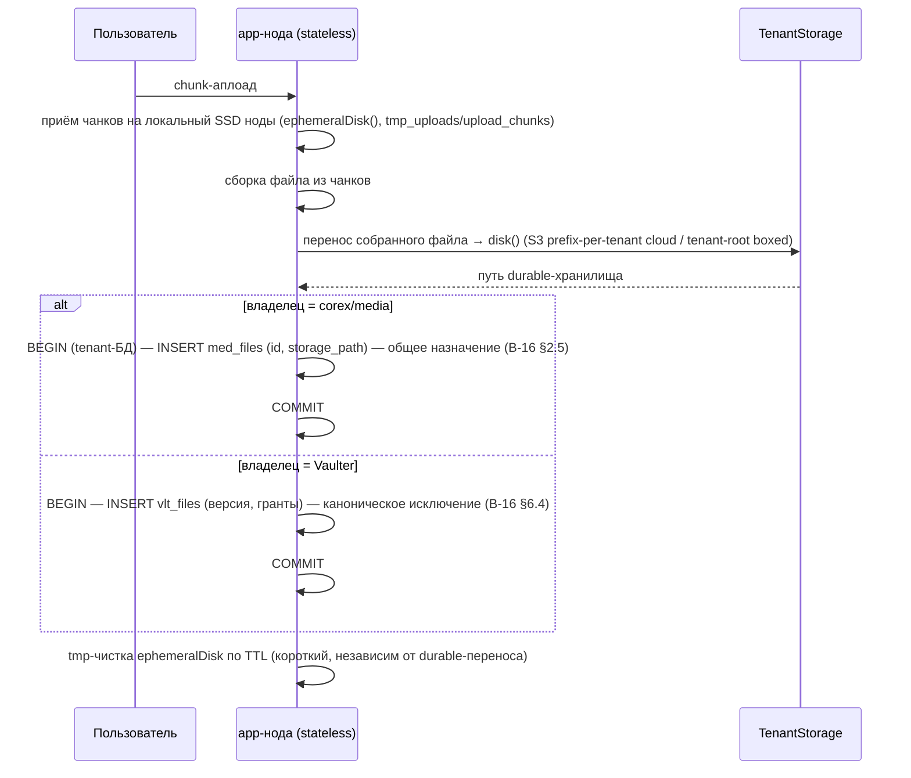
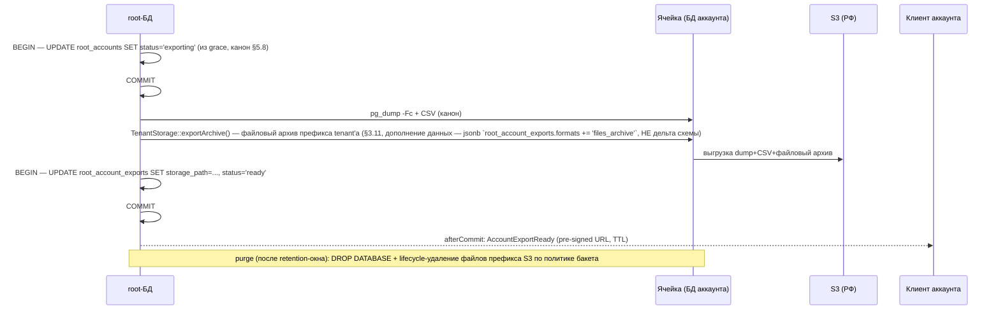
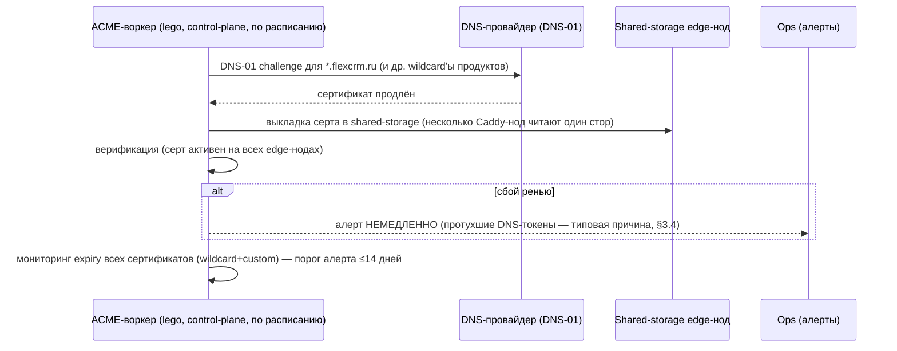

# B-33 — Авторазвёртывание tenant-CRM + multi-DB инфраструктура + файловый контур (saga-провижининг, ячейка, диск/S3)

> **Статус: финал волны P3.1–P3.5** (слой решений, FLEX-2 P2.7). Стоит на R-31 (P1.8).
> Разделы 2/3/5/7/8 дозаполнены срезами P3.1–P3.5 до финальной глубины.
> Канон НЕ пересматривается: root-схема, провижининг-флоу, FSM аккаунта, fleet-миграции,
> custom-домены, restore-runbook — **B-11** (§2.1, §5.1–§5.8); ссылаемся и детализируем,
> не переопределяем. Все дельты канона — только реестром §9 → `05-Projects/01-Products/FlexCRM/plans/FLEX-2/open-questions.md`
> → арбитраж P4.2 (D11 плана FLEX-2).
> **Директива владельца 2026-07-12 (D12 FLEX-2)** по tenancy-reuse вшита в §3.0: reuse-вердикт
> обязателен, самовольная замена базы запрещена.
> Нумерация разделов — формат волны B-27..B-32 (§7 MCP-тулзы, §8 НФТ-закладки, §9 реестр вопросов).
> Конвенции DDL: PK = UUIDv7 (генерируется приложением, B-11 §2), префиксы таблиц ≤3 симв.
> (`root_` для корневой БД), `created_at/updated_at timestamptz`, actor/ACTOR — jsonb как в
> `root_account_events` (B-11 §2.1); enum-строки через CHECK; partial unique WHERE deleted_at IS NULL.

---

## 1. Границы и состав

### 1.1 Что нормирует B-33

1. **Reuse-вердикт tenancy-базы** (§3.0) — по правилу владельца (D12 FLEX-2), со ссылкой на
   fresh-проверку R-31 §2.1 и канон B-11 §1.1 / R-05 §2.1.
2. **Детализация провижининг-пайплайна** поверх канонного флоу B-11 §5.2 (§3.2): saga-модель
   с явными компенсациями per-шаг, идемпотентность по signup-ключу, политика ретраев сида,
   позиция по step-state (Q32).
3. **Разделение сидов** (§3.3): инвариантный сид продукта (golden-шаблон) vs вертикальный сид
   (рантайм-шаг активации).
4. **TLS/поддомены — эксплуатационный норматив** (§3.4): ACME-воркер wildcard-ренью,
   мониторинг expiry; сам механизм (wildcard + on-demand за ask-endpoint) — канон B-11 §2.1/§5.7.
5. **Docker-топология ячейки и management-ячейки** (§3.5): контейнерная нарезка control-plane /
   tenant-plane; чего в v1 НЕТ (контейнер-на-tenant).
6. **Операционные лимиты ячейки** (§3.6): подтверждение soft-limit 700 БД + новый норматив —
   autovacuum-профиль ячейки.
7. **Файловый контур целиком** (§3.8–§3.11): матрица носителей, tenant-storage-абстракция,
   выбор хранилищ cloud/boxed, бэкап/перенос/мост диск↔S3. В каноне B-11 файлового контура
   нет (кроме `root_account_exports`) — B-33 закрывает гап дополнением, не правкой (R-31 §6).
8. **Скелет DDL-дельт root-схемы** (§2): кандидаты `root_accounts.provisioning_step` (Q32) и
   storage-конфиг (Q62) — приведены для арбитража P4.2, в канон НЕ вносятся.
9. **Эскиз контрактов** `TenantProvisioner` / `TenantStorage` (§4) и MCP-тулзов control-plane (§7).

### 1.2 Что НЕ входит (Scope Excluded)

- Исчерпывающий DDL (индексы, партиции, edge-cases) — срез P3.1.
- Полные сигнатуры контрактов — срез P3.3.
- Детальные sequence-диаграммы потоков — срез P3.2.
- AC-раздел — срез P3.5.
- Правка канона B-11 — только аддитивные дельта-кандидаты в §9 (маршрут P4.2, D11).
- Реализация PoC Приложения A B-11 — код, P6/repo (PoC — обязательный первый шаг, §3.0).
- Выбор конкретного RU S3-провайдера — эксплуатационное решение (§9, Q33).
- Single-DB RLS stancl v4 — нерелевантно (канон D1 master = физическая БД на аккаунт).
- Kubernetes-оркестрация — направление v2 (§3.5), не проектируется.
- Контейнер-на-tenant / выделенные enterprise-ячейки — roadmap v2 (§3.5).
- Self-hosted S3 в boxed-комплекте — не поставляется в v1 (§3.10, Q31).

### 1.3 Зависимости

`corex/tenancy` (дом решений B-33) → corex/core (контракты `TenantContext`,
`AccountConnectionResolver`, `TenantDatabaseProvisioner` — B-10/B-11 §1.1) ·
stancl/tenancy v4 (пин `dev-master#<sha> as 4.0.0`, §3.0) · B-11 (канон root-схемы и потоков) ·
SaaS control-plane (деплоер ячеек, ACME-воркер lego, migration-оркестратор — проприетарный
контур B-11 §1.1) · corex/billing (лимиты `storage_gb`, `root_usage_snapshots`) ·
laravel Filesystem/flysystem (tenant-storage, §3.9) · B-12 (`root_wfl_wakeups` — сосед по
root-контуру, владелец логики B-12).

---

## 2. Схема БД

> Срез P3.1: B-33 не вводит новых тенантских таблиц (§2.5) — вся DDL-глубина ниже
> относится к root-схеме: одно аддитивное дополнение (§2.4, уже вносится v1) и два
> дельта-кандидата (§2.2/§2.3, НЕ вносятся — арбитраж P4.2). Root-схема канона (B-11 §2.1)
> не переопределяется.

### 2.1 Root-схема канона — не переопределяется

Все таблицы провижининга/парка уже канонизированы B-11 §2.1: `root_clusters`,
`root_templates`, `root_accounts`, `root_domains`, `root_migration_batches`,
`root_account_schema_state`, `root_account_events`, `root_account_exports`. B-33 ничего в них
не меняет; ниже — два дельта-КАНДИДАТА (не вносятся) и одно аддитивное дополнение.

### 2.2 Дельта-кандидат Q32: `root_accounts.provisioning_step` — НЕ вносится

Позиция драфта (совпадает с предварительным R-31 §5 п.2): **v1 без step-state** —
FSM статусов (`pending/provisioning/trial/...`) + `root_account_events` (per-step события
пайплайна: `step_db_pulled`, `step_owner_synced`, `step_seed_done`, ...) + идемпотентный
повторный прогон saga (§3.2) покрывают resume и ops-дашборд. Скелет кандидата — для арбитража
P4.2, если ops-практика докажет обратное:

```sql
-- КАНДИДАТ (дельта root-схемы B-11 §2.1, Q32 → арбитраж P4.2; НЕ вносится в v1)
ALTER TABLE root_accounts ADD COLUMN provisioning_step varchar(32)
  CHECK (provisioning_step IN
  ('pulled','slug_bound','domain_created','owner_synced','seeded','activated'));
-- NULL = не в провижининге; заполняется оркестратором saga, очищается при status=trial
```

Альтернатива-максимум (таблица шагов `root_provisioning_steps` с timing/error per шаг) —
избыточна для v1: ту же телеметрию дают события с payload.

### 2.3 Дельта-кандидат Q62: storage-конфиг root-схемы — НЕ вносится

Позиция драфта: **v1 без DDL** — durable-хранилище платформы одно на регион (S3-бакет
RU-провайдера, §3.10), его параметры живут в конфиге control-plane + `root_clusters.meta`
jsonb (ключ `storage`: endpoint/bucket/region — на случай per-cell отличий). Скелет кандидата
на случай мульти-endpoint (второй регион, enterprise bucket-per-tenant):

```sql
-- КАНДИДАТ (аддитивная дельта root-схемы, Q62 → арбитраж P4.2; НЕ вносится в v1)
CREATE TABLE root_storage_endpoints (
  id         uuid PRIMARY KEY,                  -- UUIDv7
  name       varchar(64) NOT NULL UNIQUE,       -- 's3-ru-central-01'
  driver     varchar(16) NOT NULL CHECK (driver IN ('s3','local')),
  endpoint   varchar(255),                      -- NULL для local
  bucket     varchar(128),
  region     varchar(32),
  status     varchar(16) NOT NULL DEFAULT 'active'
             CHECK (status IN ('active','draining','retired')),
  meta       jsonb NOT NULL DEFAULT '{}',
  created_at timestamptz NOT NULL DEFAULT now(),
  updated_at timestamptz NOT NULL DEFAULT now()
);
CREATE INDEX root_storage_endpoints_active_ix ON root_storage_endpoints (status) WHERE status = 'active';  -- запрос: выбор endpoint при провижининге новой ячейки
-- + root_clusters.storage_endpoint_id uuid REFERENCES root_storage_endpoints(id) ON DELETE RESTRICT
```

### 2.4 Аддитивное дополнение B-33 (НЕ дельта по классификации R-31 §6): идемпотентность signup

Ключ идемпотентности signup (§3.2) хранится в `root_accounts.data` (stancl VirtualColumn —
колонка уже в каноне) + уникальный expression-индекс миграцией corex/tenancy:

```sql
-- дополнение B-33 (R-31 §6 классифицирует идемпотентность signup-ключа как дополнение, не дельту)
CREATE UNIQUE INDEX root_accounts_signup_key_uq
  ON root_accounts ((data->>'signup_key'))
  WHERE data->>'signup_key' IS NOT NULL AND deleted_at IS NULL;
```

Классификацию «дополнение vs дельта» подтверждает consistency-сверка P4.1 (строка в §9).

### 2.5 Тенантская сторона: новых таблиц нет

Файловые метаданные общего назначения (вложения, аватары, медиа) — собственность
**corex/media**: `med_files` — «единственный владелец файлового бинарного контента общего
назначения» (канон B-16 §2.5); потребители (`crm_*`, `com_*`, `cms_*`, `cht_attachments`)
хранят только `med_files.id` БЕЗ FK (контракт B-10/B-13/B-14/B-17). Единственное каноническое
исключение — Vaulter: `vlt_files` — собственный домен хранения (версии, гранты, retention —
B-16 §6.4). B-33 своих таблиц не добавляет — даёт обоим владельцам storage-абстракцию (§3.9)
и матрицу носителей (§3.8). Эфемерные классы файлов в БД не отражаются.

---

## 3. Ключевые архитектурные решения

> Решения зафиксированы, глубина (конфиги, SQL-механика, полные протоколы) добрана срезами P3.1–P3.5.
> срезами P3.1–P3.5; каждое решение — со ссылкой на R-31 §.

### 3.0 Reuse-вердикт tenancy-базы (директива владельца 2026-07-12, D12 FLEX-2)

Правило владельца: готовое решение на 100% удовлетворяет → используем как есть; частично →
свой пакет на его основе с расширенными возможностями; иначе → минимальная своя реализация
под все проекты Flex.

Анализ — fresh-проверка **R-31 §2.1** (2026-07): stancl/tenancy — НЕ 100%-fit:
v4 живёт на `dev-master` без стабильного Packagist-тега (последний тег v3.10.0, 2026-03-18);
требуется пин `dev-master#<sha> as 4.0.0` + собственный слой поверх (pending-пул-оркестрация,
`TemplateClonePostgreSQLManager`, cluster-роутинг, control-plane fleet-миграций, root-схема,
lifecycle FSM — всё это stancl не даёт из коробки). Альтернатива spatie/laravel-multitenancy
жива (4.0.5), но остаётся «низкоуровневым конструктором» (R-31 §2.1, R-05 §2.2/§3.2).

**Вердикт: «частично» → `corex/tenancy` = свой пакет-обёртка на основе stancl/tenancy v4
с расширенными возможностями Flex** (средний вариант правила). Совпадает с каноном
B-11 §1.1 и вердиктом R-05 §2.1 («берём как runtime-фундамент, поверх — свой corex/tenancy»).

Фиксация директивы владельца (2026-07-12):
- **Самовольная замена базы (spatie / полностью своя реализация) ЗАПРЕЩЕНА.**
- Пересмотр вердикта — ТОЛЬКО через D-запись в plan.md FLEX-2.
- Расхождение фактов на исполнении (например, выйдет стабильный тег stancl 4.0.0) →
  запись в `05-Projects/01-Products/FlexCRM/plans/FLEX-2/open-questions.md` + пометка здесь в §3, НЕ пересмотр вердикта.
- PoC-гейт B-11 Приложение A — обязательный первый шаг реализации; NO-GO по PoC → канонные
  fallback F1 (v3.10 + свой pending/parallel) / F2 (свой тонкий слой) — это ветки канонного
  механизма B-11, а не «замена базы»; активация fallback тоже фиксируется D-записью.

### 3.1 Вердикты по 11 входам R-31 §7 — все явно

| # | Вход R-31 §7 | Вердикт | Где детализировано |
|---|---|---|---|
| 1 | Топология: ячейка = PG + PgBouncer + stateless app-пул + Redis; management-ячейка отдельно; контейнер-на-tenant — roadmap | **принято + детализировано** — консенсус shared-app + DB-per-tenant (R-31 §3.1), маппинг тезиса владельца §A = control-plane/tenant-plane split | §3.5 |
| 2 | Провижининг: канон B-11 §5.2 + идемпотентность signup-ключа, компенсации per-шаг, ретраи сида, step-state по Q32 | **принято + детализировано** — saga-детализация не дельта (R-31 §2.2) | §3.2, §2.2, §2.4 |
| 3 | Сиды: инвариантный → golden-шаблон; вертикальный → идемпотентный рантайм-шаг | **принято** — критерий разбиения R-31 §2.3 («одинаково для всех — в шаблон») | §3.3 |
| 4 | Поддомены/TLS: wildcard DNS-01, ноль ACME на signup; ACME-воркер ренью + мониторинг expiry | **принято + детализировано** — канон §2.1/§5.7 совпал с best practice (R-31 §2.4) | §3.4 |
| 5 | Лимиты ячейки: soft 700 БД подтверждён; autovacuum-профиль — новый норматив | **принято** — 700 консервативно против практики 1000–10000 БД/инстанс (R-31 §3.2) | §3.6 |
| 6 | Fleet-миграции: канон §5.6 подтверждён дословно; финальные цифры — только PoC сц.6 | **принято как есть** — дельты нет (R-31 §3.3), B-33 ничего не добавляет сверх канона | §3.7 |
| 7 | Файлы — матрица носителей: эфемерное → локальный SSD; durable → S3/локальный root; app stateless; NFS отвергнут | **принято** — следствие для топологии вшито в §3.5 (R-31 §4.1) | §3.8 |
| 8 | Файловая изоляция: tenant-storage-абстракция поверх Filesystem-bootstrapper; prefix-per-tenant v1 | **принято + детализировано** — инвариант «tenant_id только из TenantContext» (R-31 §4.2) | §3.9 |
| 9 | Хранилище: cloud — RU-провайдер с аттестацией ИСПДн; boxed — локальный диск, self-hosted S3 не v1 | **принято** — D10-линза чистая через flysystem-disk (R-31 §4.3); Q31 решён здесь | §3.10 |
| 10 | Бэкап/перенос: S3-версионирование + lifecycle; файловый архив в offboarding; pg_dump/restore + prefix-sync; мост диск↔S3 dual-write | **принято + детализировано** (R-31 §4.4) | §3.11 |
| 11 | stancl v4: пин dev-master#sha подтверждён; PoC-гейт — обязательный первый шаг | **принято** — вшито в reuse-вердикт (R-31 §2.1) | §3.0 |

Отступлений от рекомендаций R-31 нет — все 11 входов приняты (6 из них — с детализацией B-33).

### 3.2 Провижининг-saga поверх канона B-11 §5.2 (вход 2)

Канонный флоу (pending-пул → слить slug/owner → домен → users-синк → сид → trial) не меняется;
B-33 добавляет обвязку надёжности (индустриальный saga-паттерн, R-31 §2.2):

1. **Один владелец пайплайна**: оркестратор `TenantProvisioner` (corex/tenancy) — единственная
   точка входа signup/ретраев/компенсаций; логика не размазывается по контроллерам и вебхукам.
2. **Идемпотентность по signup-ключу**: стабильный внешний ключ запроса
   (`signup_key` = signup_token формы / checkout_session_id) пишется в `root_accounts.data`
   при захвате болванки; повторный вызов с тем же ключом — no-op с возвратом существующего
   аккаунта. Последний рубеж от гонок — unique-индексы (§2.4 + канонный partial unique slug).
3. **Компенсации per-шаг** (явная таблица, R-31 §2.2/§7 п.2):

| Шаг saga | Сбой → компенсация |
|---|---|
| pullPending / синхронный клон | болванка без владельца: версия шаблона актуальна → вернуть в пул; устарела → `DROP DATABASE` |
| слить slug+owner | гонка slug → канонный 422 (B-11 §5.2 в); болванка возвращается в пул |
| INSERT root_domains | откат транзакцией вместе с UPDATE root_accounts (одна БД — атомарно) |
| users-синк владельца | ретрай (идемпотичен: upsert по identity id); сбой → аккаунт остаётся provisioning |
| сид вертикали | частично засиженная БД → `DROP` + новая болванка из пула, НЕ доснашивание; ретраи 3× → алерт, status остаётся `provisioning` (канон §5.2 г) |
| активация (status=trial) | последний шаг, после него компенсаций нет — только штатный lifecycle FSM |

4. **Ретраи сида**: 3 попытки с backoff → алерт ops; аккаунт никогда не виден пользователю
   как «сломанный трайл» (канон). DLQ очереди сида — норматив: failed-джоб сида не теряется.
5. **Step-state**: v1 — события `root_account_events` с per-step payload + идемпотентный
   повторный прогон saga с первого шага (все шаги — upsert/no-op при повторе). Колонка
   `provisioning_step` — дельта-кандидат Q32 (§2.2), арбитраж P4.2.

### 3.3 Сиды: инвариантный vs вертикальный (вход 3)

- **Инвариантный сид продукта** (системные роли, дефолтный workspace, базовые справочники —
  одинаково для всех аккаунтов) — вшивается в golden-шаблон на этапе сборки `root_templates`
  (CI): клонируется даром, ноль рантайм-стоимости (R-31 §2.3).
- **Вертикальный сид** (данные по `vertical_code`: воронки, поля, процессы вертикали) —
  рантайм-шаг активации: только данные (НЕ DDL — канон B-11 §3.2/AC-3), идемпотентные
  upsert'ы (`ON CONFLICT DO NOTHING`), queued при >2с (канон §5.2), безопасен при ретрае.
- Критерий разбиения: «всё, что одинаково для всех аккаунтов, — в шаблон» (R-31 §2.3).

### 3.4 Поддомены/TLS: эксплуатационный норматив ACME (вход 4)

Механизм — канон (B-11 §2.1 root_domains, §5.7 custom-домены; подтверждён best practice
R-31 §2.4: выдача поддомена на signup = O(1), ноль ACME-вызовов). B-33 фиксирует норматив
эксплуатации:

1. **ACME-воркер** (lego, control-plane) ведёт DNS-01-ренью wildcard `*.flexcrm.ru`
   (и wildcard'ы других продуктов) по расписанию; сбой ренью → алерт немедленно
   (протухшие DNS-токены провайдера — типовая причина отказа, R-31 §2.4).
2. **Мониторинг expiry** всех сертификатов (wildcard + custom) как метрика control-plane
   с порогом алерта ≤14 дней до истечения.
3. Серты — в shared-storage edge-нод (несколько Caddy-нод читают один стор); механика — P3.5/P6.
4. On-demand TLS — ТОЛЬКО custom-домены, строго за ask-endpoint (канон §5.7 — защита лимитов CA).

### 3.5 Docker-топология: ячейка + management-ячейка (вход 1)

Тезис владельца §A (root-контур отдельно от клиентских CRM; внутри CRM-контура — множество БД,
коннект по учётке) реализуется как **control-plane / tenant-plane split** (R-31 §3.1):

- **Management-ячейка (control-plane, root-контур)** — отдельный Compose-стек без tenant-БД:
  контейнеры `www/signup` (central app), IdP `id.flex.ru`, control-plane демоны (деплоер ячеек,
  ACME-воркер, WakeupDispatcher, migration-оркестратор), admin-панель парка, root-PG (+ свой
  PgBouncer), Redis control-plane. Состав — канон B-11 §1.1; здесь фиксируется контейнерная
  нарезка и отдельное размещение.
- **Tenant-ячейка** (единица масштабирования, = `root_clusters`): PG-кластер + PgBouncer
  (transaction mode, конфиг канона §7.1) + горизонтальный пул ОДИНАКОВЫХ **stateless**
  app-контейнеров (nginx + php-fpm + queue-workers + scheduler) + Redis ячейки. Один app-образ
  обслуживает ВСЕ аккаунты ячейки: «подключение к конкретной БД по учётке» =
  early-identification по host + динамический tenant-коннект (канон §5.4).
- **Stateless-инвариант app-контейнеров**: durable-файлы на локальном диске app-ноды в cloud
  запрещены (§3.8) — иначе ломаются горизонтальное масштабирование и переживаемость контейнера.
- **НЕ делаем в v1**: контейнер-на-tenant (стоимость idle-контейнеров × N, операционная
  кардинальность — R-31 §3.1); выделенная ячейка/стек для enterprise-«китов» — roadmap v2.
- Оркестрация v1 — **Docker Compose на ячейку**; Kubernetes — направление v2, миграция
  модель не ломает (ячейка → namespace).

### 3.6 Лимиты ячейки: 700 БД + autovacuum-профиль (вход 5)

- **Soft-limit 700 БД на ячейку** (канон `root_clusters.db_soft_limit`) подтверждён как
  консервативно-безопасный: практика — 1000–10000 БД/инстанс при пуле впереди (R-31 §3.2).
- **Autovacuum-профиль ячейки** — новый норматив B-33 (гап канона, дополнение — R-31 §3.2):
  `autovacuum_max_workers ≥ 10`, снижение `autovacuum_vacuum_scale_factor` для горячих таблиц,
  мониторинг отставания автовакуума как штатная метрика ячейки; политика «archive» для
  аккаунтов в `suspended/grace` — реже вакуумить. Конкретные числа — P3.5 + PoC.
- Соединения: без изменений канона — PgBouncer transaction mode, один `app_db_user` на ячейку,
  pool 5 / max_db_connections 10 (канон §7.1); бэкенды PG ≤ 400 (PoC сц.7).

### 3.7 Fleet-миграции: канон подтверждён, добавлений нет (вход 6)

B-11 §5.6 (expand-contract, волны internal→canary→p10→p50→all, `root_migration_batches` /
`root_account_schema_state`, `-p 8 --skip-failing`, батчи ≤5 мин, failed→blocked) дословно
совпадает с индустриальным консенсусом (R-31 §3.3). B-33 НЕ добавляет ничего; финальные цифры
параллелизма/порогов даёт только PoC сц.6 (канон §7.1). Волновой rollout переиспользуется
переносом/restore (§3.11) без изменений.

### 3.8 Файлы — матрица носителей (вход 7)

Норматив (R-31 §4.1); классы файлов и обязательный носитель:

| Класс | Носитель cloud | Носитель boxed |
|---|---|---|
| Временные аплоады (Livewire/FilePond tmp, chunk-сборка) | локальный SSD app-ноды (`tmp_uploads`, `upload_chunks`) | локальный диск |
| Промежуточные артефакты генерации (PDF-превью, конвертация) | локальный диск, short-TTL | локальный диск |
| Логи/телеметрия/дампы | локальный диск → централизованный лог-контур | локальный диск |
| **Durable tenant-контент** (вложения, документы, аватары, экспорты, медиа) | **S3 prefix-per-tenant** (§3.9/§3.10) | **локальный root** `storage/app/tenant` (S3 — опция конфига) |
| Cache/sessions | Redis / database-driver (канон B-11 §7.3 п.5) | то же |

Инварианты: (а) app-контейнеры stateless — durable на локальном диске app-ноды в cloud
ЗАПРЕЩЁН; (б) NFS-шаринг «диск на всех» — отвергнут (single point, локи — R-31 §4.1);
(в) эфемерные классы никогда не бэкапятся и не переносятся.

### 3.9 Tenant-storage-абстракция и изоляция (вход 8)

- Основа — **Filesystem-bootstrapper stancl** (уже канон, B-11 §4 п.1) + контракт
  **`TenantStorage`** (§4): модуль получает готовый flysystem-адаптер с уже зашитым
  префиксом/root'ом текущего аккаунта.
- **Инвариант изоляции**: `tenant_id` попадает в путь ТОЛЬКО из `TenantContext`, никогда из
  пользовательского ввода (R-31 §4.2); прямые вызовы `Storage::disk()` мимо TenantStorage
  для tenant-контента — запрещены конвенцией ядра (CI-линт — кандидат, P3.5).
- **Схема изоляции v1 — prefix-per-tenant** в общем бакете: `tenants/{account_id}/...`;
  IAM/ABAC-политики по префиксу — по возможностям выбранного провайдера (Q33).
  Bucket-per-tenant — enterprise-тир/roadmap (лимиты бакетов RU-провайдеров `[UNVERIFIED]` —
  Q33). Boxed: root-per-tenant тривиален (аккаунт один).

### 3.10 Хранилище: cloud RU-провайдер / boxed локальный диск (вход 9; Q31 решён)

- **Cloud**: S3-совместимое хранилище RU-провайдера, выбор по **формальной аттестации ИСПДн
  (152-ФЗ) + DPA**, не только по S3-совместимости; кандидаты — Yandex Object Storage, VK Cloud,
  Selectel, Timeweb S3 (R-31 §4.3). Конкретный выбор — эксплуатационное решение вне драфта
  (Q33 + §9); согласовано с каноном `root_account_exports.storage_path` («S3-совм. РФ»).
- **Boxed (D10-линза)**: **локальный диск через flysystem** (root `storage/app/tenant`);
  S3-совместимое хранилище — опция конфига (`FILESYSTEM_DISK`), НЕ требование. Деградация
  без S3 чистая: та же Storage-абстракция, другой disk (R-31 §4.3).
- **Q31 — решено здесь**: self-hosted S3 в boxed-комплекте **НЕ поставляем в v1**
  (MinIO выбыл: AGPL + архив community-репозитория; Garage/SeaweedFS/RustFS требуют своей
  эксплуатационной обвязки — R-31 §4.3). Выбор кандидата для v2 — boxed-гайд/roadmap.

### 3.11 Бэкап, перенос, мост диск↔S3 (вход 10)

- **Бэкап файлов (cloud)**: S3-версионирование + lifecycle-политики на бакете; per-tenant
  восстановление = листинг/копирование по префиксу; объектные теги `tenant_id` для отчётности.
  Дополняет БД-контур (pgBackRest + WAL — канон §5.8), не заменяет.
- **Offboarding-экспорт**: к канонному `pg_dump -Fc` + CSV добавляется **файловый архив
  префикса tenant'а**; носитель записи — существующий jsonb `root_account_exports.formats`
  (значение `files_archive`) — дополнение данных, НЕ дельта схемы (R-31 §4.4).
- **Перенос tenant'а между ячейками**: БД — `pg_dump -Fc` → `pg_restore -j` в даунтайм-окно
  (для крупных — logical replication, v2); файлы — server-side copy по префиксу (тот же бакет —
  перенос не нужен; смена бакета/региона — sync по префиксу). Политика инициирования/SLA — Q60.
- **Мост диск↔S3** (boxed→cloud миграция): dual-write + read-preference окна (писать в оба,
  читать новый с fallback, по завершении зеркалирования переключить disk); строго в границах
  tenant-root/префикса (R-31 §4.4).

### 3.12 Права: control-plane плоскость вне AzGuard tenant-матрицы (срез P3.4 — подтверждение отсутствия дельты)

> Срез P3.4: подтверждение отсутствия tenant-scoped permission keys — черновая пометка снята для права-подраздела.

B-33 не вводит ни одной тенантской таблицы (§2.5) и ни одной AzGuard-сущности с record-scope — все МCP-тулзы §7 (`tenancy.*`/`storage.*`/`tls.*`) живут на **control-plane плоскости** (staff/ops, admin-панель парка), авторизуемой существующим механизмом персонала (`is_staff`, impersonation-грант канон B-11 §5.9), НЕ тенантской AzGuard permission-матрицей (§5.5 B-11) — control-plane принципал не является tenant `Principal` (User/Agent/ApiKey), у него нет `workspace_id`/`account_id`-скоупа. Confirm-гейт `tenancy.move_account` (irreversible/double-confirm, B-32 §5.2 модель) — тот же двухфазный механизм, но применяется к STAFF-принципалу control-plane, не к tenant-пользователю. Единственная точка соприкосновения с tenant-стороной — `TenantStorage`/`usageBytes()` (§4) — используется существующими AzGuard-гейтованными сервисами (corex/media, B-16 §3.5) без нового permission key: доступ к файлу проверяется каноническими правами на владеющую сущность (`med_files`/`vlt_files`), не правами на storage-абстракцию саму по себе. **Вывод: дозаполнение прав-подраздела для B-33 = явное подтверждение отсутствия дельты**, а не пропуск — Scope Included этого item'а («полный список permission keys волны») не порождает новых ключей для B-33, т.к. её MCP-поверхность структурно вне периметра tenant AzGuard.

---

## 4. Контракты

> Срез P3.3: полные PHP-интерфейсы (@api, PHPStan level 8, форма B-16 §3), решение по стыку
> media↔TenantStorage (Q63), реестр событий и MCP-карта — черновая пометка снята.

Канонные контракты corex/core НЕ переопределяются: `TenantContext`,
`AccountConnectionResolver`, `TenantDatabaseProvisioner` (низкоуровневый «создай/дропни БД» —
B-11 §1.1). B-33 добавляет два:

```php
namespace Corex\Tenancy;                      // cloud-пакет

use Corex\Auth\Actor;

/** readonly, id+type+display — форма единая с B-16 §3 */
final readonly class AccountRef
{
    public function __construct(public string $id, public string $type /* 'root.account' */, public string $display /* slug */) {}
}
final readonly class ClusterRef
{
    public function __construct(public string $id, public string $type /* 'root.cluster' */, public string $display) {}
}

final readonly class SignupRequest
{
    public function __construct(
        public string $signupKey /* стабильный внешний ключ — §3.2 п.2 */, public string $slug,
        public string $ownerEmail, public string $verticalCode, public ?string $locale = null,
    ) {}
}

/** Сбой ретраев сида (3×) — исчерпан backoff, DLQ-алерт (флоу 5.1) */
final class ProvisioningSeedFailedException extends \RuntimeException {}
/** Гонка slug при слиянии болванки+владельца (канон B-11 §5.2в) */
final class SlugConflictException extends \DomainException {}

interface TenantProvisioner                   // оркестратор saga (§3.2); единственный владелец пайплайна
{
    /** Идемпотентно по signup_key (§2.4 UNIQUE-индекс) — повторный вызов = no-op с возвратом существующего аккаунта
     * @throws SlugConflictException|ProvisioningSeedFailedException */
    public function provision(SignupRequest $request): AccountRef;
    /** Повторный прогон saga с первого непройденного шага (все шаги upsert/no-op при повторе) */
    public function resume(AccountRef $account): AccountRef;
    /** Откат частичного провижининга по таблице компенсаций §3.2 */
    public function compensate(AccountRef $account): void;
    /** Пополнение pending-пула ячейки до pending_pool_size (флоу 5.2) */
    public function replenishPool(ClusterRef $cluster): int;
}

namespace Corex\Core\Storage;                 // контракт в ядре: boxed использует без corex/tenancy

final readonly class ExportArchiveRef
{
    public function __construct(public string $storagePath, public int $sizeBytes, public \DateTimeImmutable $createdAt) {}
}

interface TenantStorage                       // §3.9; адаптер с зашитым префиксом/root из TenantContext
{
    public function disk(): \Illuminate\Contracts\Filesystem\Filesystem;         // durable tenant-контент (S3 prefix / локальный root)
    public function ephemeralDisk(): \Illuminate\Contracts\Filesystem\Filesystem; // tmp/chunks/previews — локальный SSD ноды
    public function usageBytes(): int;                   // метрика storage_mb (механика — Q61, срез P3.5)
    public function exportArchive(): ExportArchiveRef;   // архив префикса для offboarding (§3.11)
}
```

### 4.1 Стык corex/media ↔ `TenantStorage` (Q63 — решено здесь)

**Media получает готовый `Filesystem` от `TenantStorage::disk()`, собственного S3-клиента или
per-tenant-конфига НЕ имеет.** `Corex\Media\MediaLibrary` (B-16 §3.5) внедряет
`Corex\Core\Storage\TenantStorage` конструктором (стандартный Laravel DI, per-request резолюция
по `TenantContext`) и вызывает `disk()->put(...)` — единая точка изоляции по префиксу
(`tenant_id` попадает в путь ТОЛЬКО из `TenantContext`, R-31 §4.2). Канонный S3-совместимый
драйвер media (B-16 §1.1, РФ-хостинг) переиспользует ТОТ ЖЕ диск, что и остальной durable-контур
(§3.8/§3.9) — вторая storage-обвязка не заводится: media больше не конфигурирует свой disk-driver
напрямую (это была бы дельта B-16 §1.1, если бы конфликтовала с `TenantStorage`, но конфликта
нет — `Filesystem`-интерфейс идентичен). Vaulter (`vlt_files`, каноническое исключение B-16 §6.4)
— тот же путь: `disk()` от `TenantStorage`, различие только в домене метаданных (свои таблицы),
не в носителе. Q63 → Resolved.

### 4.2 Реестр доменных событий (полная карта — сверка уникальности §9 S3)

| Событие | `name()` | Payload | Эмитент | Подписчики |
|---|---|---|---|---|
| `AccountActivated` | канон B-11 §3.4 (без дельты) | accountId | TenantProvisioner (флоу 5.1) | redirect + OIDC auto-login |
| `AccountExportReady` | канон B-11 §3.4 | accountId, storagePath | offboarding (флоу 5.5) | notifications(pre-signed URL) |
| `AccountMoved` | `tenancy.account.moved` | accountId, fromClusterId, toClusterId | оператор (флоу 5.6) | notifications(клиенту) |

`tenancy.account.moved` — новое событие control-plane; коллизий с доменными событиями волны
(`tsk./cal./soc./mkg./cst.`) нет — control-plane namespace `tenancy.*` (нормализация вместе с
`identity.`/`storage.`/`tls.` — B-34 §9 п.11).

Демоны control-plane (ACME-воркер, migration-оркестратор, деплоер ячеек) — не контракты
пакетов, а проприетарные приложения (B-11 §1.1); их CLI/API — P6.

---

## 5. Главные потоки — список

> Срез P3.2: детальные sequence-диаграммы + транзакционные границы (снята черновая пометка).
> afterCommit-события — стиль B-16 §5.2; root-транзакции — отдельная (единственная) БД
> control-plane, тенантские шаги — своя БД аккаунта (физически разные, D1).

### 5.1 Signup-провижининг (saga)

```mermaid
sequenceDiagram
  participant U as Форма signup
  participant TP as TenantProvisioner
  participant ROOT as root-БД
  participant POOL as pending-болванка (tenant-БД)
  participant Op as Ops (алерты)
  U->>TP: provision(SignupRequest{signup_key})
  TP->>ROOT: BEGIN — SELECT root_accounts WHERE data->>'signup_key'=? (идемпотентность, §2.4 UNIQUE-индекс)
  alt найден (повторный вызов)
    TP-->>U: no-op, вернуть существующий аккаунт
  else не найден
    TP->>ROOT: pullPending(cluster) — захват болванки из pool (fallback: синхронный клон, если пул пуст)
    TP->>ROOT: BEGIN — слить slug+owner + INSERT root_domains + UPDATE root_accounts (одна root-транзакция)
    alt гонка slug
      TP->>ROOT: ROLLBACK
      TP-->>U: канонный 422 (B-11 §5.2в); болванка возвращается в пул
    else успех
      TP->>ROOT: COMMIT
      TP-->>ROOT: afterCommit: INSERT root_account_events(step_db_pulled, step_slug_bound, step_domain_created)
    end
  end
  TP->>POOL: users-синк владельца (upsert по identity id — идемпотентно; сбой → ретрай, аккаунт остаётся provisioning)
  TP->>POOL: вертикальный сид (queued если >2с; ретраи 3× с backoff → DLQ-алерт при исчерпании)
  alt сид провалился 3×
    TP->>POOL: DROP DATABASE + новая болванка из пула (НЕ доснашивание частично засиженной)
    TP-->>Op: алерт ops; аккаунт остаётся provisioning (никогда не виден как «сломанный трайл»)
  else сид успешен
    TP->>ROOT: BEGIN — UPDATE root_accounts SET status='trial'
    TP->>ROOT: COMMIT
    TP-->>U: afterCommit: AccountActivated → redirect + OIDC auto-login
  end
```

Резюме шагов saga: pullPending → slug/owner/domain (root-tx) → users-синк (ретраи-идемпотентны) →
сид (ретраи 3×, DLQ) → активация. Компенсации — таблица §3.2 (без повтора здесь). Повторный
вызов `provision()` с тем же `signup_key` в ЛЮБОЙ момент — `resume()`: идемпотентный re-run
с первого непройденного шага (все шаги upsert/no-op при повторе).

### 5.2 Пополнение pending-пула



### 5.3 Fleet-миграция волной



Без изменений канона (§3.7) — B-33 добавлений не вносит; числа параллелизма — PoC сц.6.

### 5.4 Аплоад durable/ephemeral



### 5.5 Offboarding-экспорт с файлами



### 5.6 Перенос tenant'а между ячейками (Q60 — детальный поток, срез P3.2)

```mermaid
sequenceDiagram
  participant Op as Оператор control-plane (tenancy.move_account, irreversible/double-confirm — B-32 §5.2)
  participant SrcCell as Исходная ячейка
  participant DstCell as Целевая ячейка
  participant ROOT as root-БД
  participant U as Клиент аккаунта
  Op->>ROOT: BEGIN — UPDATE root_accounts SET status='suspended' (даунтайм-окно начат, согласовано с клиентом — v1 ручная операция)
  ROOT->>ROOT: COMMIT
  ROOT-->>Op: afterCommit: уведомление клиенту «окно переноса началось»
  Op->>SrcCell: pg_dump -Fc (БД аккаунта)
  Op->>DstCell: pg_restore -j (целевая ячейка)
  alt меняется бакет/регион хранения
    Op->>Op: prefix-sync файлов (server-side copy по префиксу; тот же бакет — перенос не нужен)
  end
  Op->>ROOT: BEGIN — UPDATE root_accounts SET cluster_id=целевая; UPDATE root_domains (реестр маршрутизации)
  Op->>ROOT: COMMIT
  Op->>Op: инвалидация host-кеша (канон §5.4 п.2)
  Op->>DstCell: смоук-тест (доступность аккаунта на новой ячейке)
  Op->>ROOT: BEGIN — UPDATE root_accounts SET status=предыдущий (trial|active) — включение
  ROOT->>ROOT: COMMIT
  ROOT-->>U: afterCommit: AccountMoved → уведомление клиенту «доступен снова»
```

v1 — ручная операция оператора (позиция драфта §3.11); триггер (порог db_count/whale-tenant),
степень автоматизации и даунтайм-SLA — пороги вне DDL, финализация числами — срез **P3.5**
(Q60 частично закрыт: поток задокументирован здесь, численные пороги остаются открытыми).

### 5.7 ACME wildcard-ренью



---

## 6. Интеграции (матрица доменов)

| Домен | Контракт/стык |
|---|---|
| **B-11 auth-tenancy** | Дом канона: root-схема, FSM, провижининг-флоу, fleet-миграции, домены/TLS, restore. B-33 = детализация поверх; дельта-кандидаты Q32/Q62 — §9 → арбитраж P4.2 |
| **B-10 core/modules** | Контракты `TenantContext`/`TenantStorage` в corex/core (boxed без corex/tenancy); lazy-миграции модулей ездят на канонном runner'е §5.6 |
| **B-12 workflow** | `root_wfl_wakeups` + WakeupDispatcher живут в management-ячейке (§3.5) рядом с migration-оркестратором; логика — B-12 |
| **B-15 attributes** | DDL-воркер кастомных полей соблюдает `schema_state.status=migrating` + advisory-лок (канон §5.6) — перенос/миграции с ним взаимно сериализованы |
| **corex/media (B-16 §2.5)** | Главный потребитель durable-контура: владелец файловых метаданных общего назначения (`med_files`); канонный S3-совместимый драйвер media (B-16 §1.1) работает ПОВЕРХ `TenantStorage::disk()` (§3.9) — вторая storage-обвязка НЕ заводится; форма стыка — Q63 (§9 → P3.3) |
| **B-16 спутники (Vaulter/Chatom)** | Vaulter: `vlt_files` — собственный домен хранения (каноническое исключение, B-16 §6.4), бинарники — через `TenantStorage::disk()` (§3.9); Chatom: `cht_attachments` хранят `med_files.id` — файлы едут через corex/media |
| **corex/billing** | Квота `storage_gb` (канон §7.2) — enforcement на аплоаде через `TenantStorage::usageBytes()`; метрика `storage_mb` в `root_usage_snapshots` (механика подсчёта — Q61) |
| **B-34 identity (P2.8)** | Единый root-контур: провижининг пишет `root_identity_accounts` (users-синк — канон §5.2); мульти-CRM membership — B-34 |
| **B-24/B-23 editions** | Тарифные ключи лимитов файлов/хранилища — класс A `root_plans.limits`; состав ключей — P3.5 |
| **B-18 import-export** | Offboarding/manual-экспорты — общий контур `root_account_exports` + файловый архив (§3.11) |

---

## 7. MCP-тулзы — финальная карта control-plane

> Срез P3.3: перечень имён уже в форме `module.verb_noun` (нейминг B-32 §3.3) — черновая пометка
> снята; side_effect-классы ниже. Все тулзы — **control-plane плоскость** (staff/ops,
> admin-панель парка и агенты эксплуатации), НЕ tenant-поверхность; `tenancy.`/`storage.`/`tls.`
> вне module_short-словаря B-32 §3.3 — та же волновая девиация, что `identity.` (B-34 §7);
> нормализация обеих плоскостей вместе — сверка P4.1 (открытый пункт B-34 §9 п.11, не блокирует
> исполнимость этого среза).

- `tenancy.get_account_status` — статус/FSM/события провижининга аккаунта (read)
- `tenancy.retry_provisioning` — resume saga застрявшего аккаунта (write)
- `tenancy.replenish_pool` — пополнить pending-пул ячейки (write)
- `tenancy.list_cells` — ячейки: db_count/soft-limit/версия шаблона/health (read)
- `tenancy.get_cell_health` — метрики ячейки: пулы, автовакуум-отставание, соединения (read)
- `tenancy.start_migration_batch` — создать волну fleet-миграции (write, confirm-гейт)
- `tenancy.get_migration_status` — прогресс батча/blocked-аккаунты (read)
- `tenancy.move_account` — перенос tenant'а между ячейками (irreversible, double-confirm)
- `storage.get_tenant_usage` — файловый usage аккаунта (read)
- `storage.start_export` — запуск offboarding/manual-экспорта с файловым архивом (write)
- `tls.get_certificates_expiry` — expiry-обзор wildcard/custom сертификатов (read)

---

## 8. НФТ, лимиты и Acceptance Criteria

> Срез P3.5: перфоманс-бюджеты, квоты, safety-инварианты и AC финализированы (числа канона
> §7.1 B-11 не дублируются и не меняются) — черновая пометка снята. Edition-гейтинг — не
> применим (control-plane плоскость, §3.12/§8.3): B-33 не вводит тенантских фич, гейтящихся
> `FeatureRegistry`.

### 8.1 Производительность (дополнение к канону §7.1 B-11 — не дублируется)

| Метрика | Бюджет | Механизм |
|---|---|---|
| Resume saga после сбоя (транзиентная ошибка) | ≤ 15 мин до полного восстановления; алерт если > 1 ч | идемпотентный re-run с первого непройденного шага (§3.2) |
| Autovacuum-отставание ячейки | алерт при lag > 24 ч с последнего успешного вакуума горячей таблицы | мониторинг control-plane (§3.6) |
| Заполнение tmp-диска app-ноды | алерт при > 80% локального SSD | ephemeralDisk() мониторинг (§3.8) |
| ACME-ренью | алерт немедленно при сбое; expiry-порог ≤ 14 дней | ACME-воркер (§3.4) |

### 8.2 Квоты и операционные пороги (Q60/Q61/autovacuum-числа закрыты)

| Параметр | Default | Класс |
|---|---|---|
| `autovacuum_max_workers` (ячейка) | ≥ 10 | — инженерный профиль, не тариф |
| `autovacuum_vacuum_scale_factor` (append-only горячие таблицы) | 0.02 (вместо PG-дефолта 0.2) | — инженерный профиль |
| Порог переноса tenant'а на logical replication (Q60) | БД ≤ 50 ГБ — `pg_dump`/`pg_restore -j` (v1, даунтайм-окно, целевое ≤ 30 мин); > 50 ГБ — logical replication (v2, не строится в этой волне) | **A** — операционный триггер, не бизнес-лимит |
| Механика usage `storage_mb` (Q61) | инкрементальный счётчик на аплоаде/удалении + nightly-реконсиляция листингом префикса, допустимый дрейф ≤ 1% | — enforcement квоты `storage_gb` (канон §7.2) |

Q60 → **Resolved** (пороги): ≤50ГБ — v1-механика (pg_dump/restore), даунтайм-окно согласуется с клиентом, целевое ≤30 мин; выше — logical replication, вне этой волны (roadmap v2). Q61 → **Resolved**: инкрементальный ledger + nightly-реконсиляция листингом, допустимый дрейф ≤1% (расхождение сверх — алерт ops).

### 8.3 Edition-гейтинг

Не применимо — вся МCP-поверхность §7 (`tenancy.*`/`storage.*`/`tls.*`) живёт на control-plane плоскости (staff/ops), структурно вне tenant `FeatureRegistry`/`root_plans.limits` тарифной сетки (§3.12, подтверждение отсутствия дельты).

### 8.4 Safety-инварианты (нарушение = блокер релиза)

1. **Stateless app-контейнеры**: durable-файлы НИКОГДА не пишутся на локальный диск app-ноды в cloud (§3.8) — только `ephemeralDisk()` для tmp/chunks/превью.
2. **`tenant_id` — только из `TenantContext`**: путь storage-объекта никогда не строится из пользовательского ввода напрямую (R-31 §4.2, CI-линт — кандидат).
3. **Идемпотентность signup**: повторный `provision()` с тем же `signup_key` — no-op с возвратом существующего аккаунта, дублей `root_accounts` не создаётся.
4. **Компенсации saga**: сбой сида после 3 ретраев → `DROP DATABASE` + новая болванка из пула, НЕ доснашивание частично засиженной БД.
5. **Одна storage-обвязка**: `corex/media` и Vaulter получают `Filesystem` ИСКЛЮЧИТЕЛЬНО от `TenantStorage::disk()` — второй S3-клиент/per-tenant-конфиг не заводится (Q63).

### 8.5 Acceptance criteria

- AC-1. Root-схема канона (B-11 §2.1) не изменена; дельта-кандидаты Q32/Q62 НЕ применены; аддитивный `root_accounts_signup_key_uq` создан.
- AC-2. Повторный вызов `provision()` с тем же `signup_key` возвращает существующий аккаунт (no-op), дублей `root_accounts` не создаётся (safety-инвариант §8.4 п.3).
- AC-3. Сбой сида после 3 ретраев → `DROP DATABASE` + новая болванка из пула; аккаунт остаётся `provisioning`, никогда не виден пользователю как «сломанный трайл» (safety-инвариант §8.4 п.4).
- AC-4. Resume saga после транзиентного сбоя завершает оставшиеся шаги за ≤15 мин без ручного вмешательства (перф-бюджет §8.1).
- AC-5. Durable-контент никогда не пишется на локальный диск app-ноды в cloud — только `ephemeralDisk()` для tmp/chunks (safety-инвариант §8.4 п.1, архитектурный тест).
- AC-6. `tenant_id` в storage-пути формируется ИСКЛЮЧИТЕЛЬНО из `TenantContext` — прямой пользовательский ввод в путь не подставляется (safety-инвариант §8.4 п.2).
- AC-7. `MediaLibrary` и Vaulter внедряют `TenantStorage` конструктором и вызывают `disk()->put(...)` — второй storage-драйвер/конфиг в кодовой базе отсутствует (safety-инвариант §8.4 п.5, Q63).
- AC-8. Autovacuum-профиль ячейки: `autovacuum_max_workers ≥ 10`, `vacuum_scale_factor=0.02` на горячих append-only таблицах; мониторинг лага срабатывает при отставании >24ч.
- AC-9. Fleet-миграция батчами ≤5 мин на 200 БД, 0 failed вне подтверждённых blocked (канон §5.6 B-11, без изменений B-33).
- AC-10. Сбой ACME-ренью триггерит алерт немедленно; мониторинг expiry всех сертификатов алертит при пороге ≤14 дней.
- AC-11. Квота `storage_gb` — мягкий отказ аплоада + уведомление при превышении; usage считается инкрементальным ledger'ом с nightly-реконсиляцией (дрейф ≤1%).
- AC-12. Перенос tenant'а (Q60): БД ≤50ГБ использует `pg_dump`/`pg_restore -j` с целевым даунтайм-окном ≤30 мин; больший объём — не строится в v1 (документированный roadmap-порог).
- AC-13. B-33 не декларирует ни одного tenant-scoped AzGuard permission key — вся МCP-поверхность §7 авторизуется control-plane staff/ops-механизмом (`is_staff`), не tenant-матрицей (§3.12).
- AC-14. Boxed-режим (без self-hosted S3, Q31) — durable-контур полностью на локальном диске `storage/app/tenant`, деградация не ломает ни один сценарий §5.
- AC-15. Пополнение pending-пула (`replenishPool`) идемпотентно относительно версии golden-шаблона: смена версии триггерит `pending-clear` старых болванок (DROP+переклонирование), смешивания версий в пуле не происходит.

---

## 9. Реестр открытых вопросов

Схема таблицы — формат волны: вопрос → откуда → куда (решён здесь / срез P3.x / арбитраж P4.2 / эскалация).

| # | Вопрос | Откуда | Куда / статус |
|---|---|---|---|
| 1 | **Q31**: self-hosted S3 для boxed-комплекта (MinIO выбыл — AGPL/архив) | R-31 §5 п.1 (§4.3) | **решён здесь** §3.10: НЕ поставляем в v1 — boxed = локальный диск, S3 = опция конфига; выбор кандидата (Garage/SeaweedFS/коммерческий) — v2 boxed-гайд/roadmap. Q31 → Resolved |
| 2 | **Q32**: resumable step-state провижининга — хватает ли FSM + `root_account_events` или нужна колонка `provisioning_step` | R-31 §5 п.2 / §6 п.1 | позиция драфта §3.2 п.5/§2.2: v1 — события + идемпотентный re-run, схему не трогаем; скелет кандидата приведён §2.2; **дельта-кандидат root-схемы B-11 §2.1 → арбитраж P4.2** (D11) |
| 3 | **Q33**: prefix- vs bucket-per-tenant у RU-провайдеров — лимиты бакетов/ABAC `[UNVERIFIED]` | R-31 §5 п.3 (§4.2) | дизайн-часть закреплена §3.9: prefix-per-tenant v1, bucket — enterprise/roadmap; остаток вопроса = проверка лимитов/ABAC по докам выбранного провайдера — **эксплуатационная, при выборе провайдера (P6/deploy)**; статус в open-questions.md обновлён, не закрыт |
| 4 | Storage-конфиг root-схемы: v1 без DDL (config + `root_clusters.meta`) vs таблица `root_storage_endpoints` | новый (§2.3) | позиция драфта: v1 без дельты; **дельта-кандидат → арбитраж P4.2** (D11) — **Q62** |
| 5 | Политика переноса/ребаланса tenant'а между ячейками: триггер (порог db_count, whale), даунтайм-окно/SLA, степень автоматизации | новый (§3.11, §5 п.6) | **срез P3.5** (пороги) + **P3.2** (поток) — **Q60**; предварительно: v1 = ручная операция оператора, окно согласуется с клиентом | закрыт полностью (срез **P3.5**, §8.2): порог ≤50ГБ — v1 `pg_dump`/`pg_restore -j`, целевое даунтайм-окно ≤30 мин; >50ГБ — logical replication (v2, не строится в волне). Q60 → Resolved |
| 6 | Механика подсчёта storage-usage per-tenant (метрика `storage_mb`): инкрементальный ledger vs периодический листинг префикса vs inventory-отчёты провайдера | новый (§4 `usageBytes`, §8 п.5) | **срез P3.5** — **Q61**; предварительно: инкрементальный счётчик + nightly-реконсиляция листингом | закрыт (срез **P3.5**, §8.2): инкрементальный ledger при аплоаде/удалении + nightly-реконсиляция листингом, допустимый дрейф ≤1%. Q61 → Resolved |
| 7 | Числа autovacuum-профиля ячейки (workers, scale factor, пороги алерта отставания) | §3.6 (гап канона, дополнение R-31 §3.2) | **срез P3.5** + PoC; норматив-рамка зафиксирована здесь | закрыт (срез **P3.5**, §8.2/§8.1): `autovacuum_max_workers ≥ 10`, `vacuum_scale_factor=0.02` на горячих таблицах, алерт лага >24ч — числа предварительны до PoC-подтверждения (не блокирует closure) |
| 8 | Классификация signup_key-индекса (§2.4): «дополнение B-33» по R-31 §6 vs формальная дельта root-схемы | §2.4 | **consistency-сверка P4.1** подтверждает классификацию; при переквалификации — арбитраж P4.2 |
| 9 | Shared-storage сертификатов для нескольких edge-нод: носитель/механика выкладки | §3.4 п.3 | **срез P3.5** + P6 (деплой-механика) |
| 10 | Расхождение фактов по stancl (напр. выйдет стабильный тег 4.0.0): процедура | §3.0 | канал зафиксирован: open-questions.md + пометка §3.0; пересмотр вердикта — только D-запись (директива владельца) |
| 11 | Соотношение канонного S3-совместимого драйвера corex/media (B-16 §1.1, РФ-хостинг) и `TenantStorage` (§3.9/§4): media-драйвер обязан работать поверх `TenantStorage::disk()` (префикс-изоляция только из TenantContext), НЕ вторая storage-обвязка; форма стыка — media получает готовый Filesystem от TenantStorage vs disk-имя из конфига | новый (ревью P2.7; B-16 §1.1/§2.5, §6) | **срез контрактов P3.3** — **Q63**; предварительно: media использует Filesystem от TenantStorage, собственного S3-клиента/per-tenant-конфига не имеет | закрыт (срез **P3.3**, §4.1): подтверждено предварительное решение — `MediaLibrary` внедряет `TenantStorage` конструктором, `disk()->put(...)`, вторая storage-обвязка не заводится. Q63 → Resolved |

Ни один вопрос R-31 не потерян: Q31/Q32/Q33 — строки 1–3 (Q31 решён, Q32 — арбитраж P4.2,
Q33 — обновлён); дельта-кандидаты — ровно два (Q32 строка 2, Q62 строка 4), оба помечены
маршрутом арбитраж P4.2; новые вопросы Q60–Q63 заведены в сквозной реестр
`05-Projects/01-Products/FlexCRM/plans/FLEX-2/open-questions.md`. Финальная зачистка P3.5: ни одной черновой пометки не
осталось; §7/§8 дозаполнены полностью; Q60/Q61/п.7(autovacuum) → Resolved этим срезом; Q32/Q62
остаются Decision pending → арбитраж P4.2 (D11, не в мандате P3.5); Q33/п.8/п.9/п.10 — открыты
эксплуатационно/сверкой P4.1, не блокируют closure P3.5 (не адресованы этому срезу по построению).
