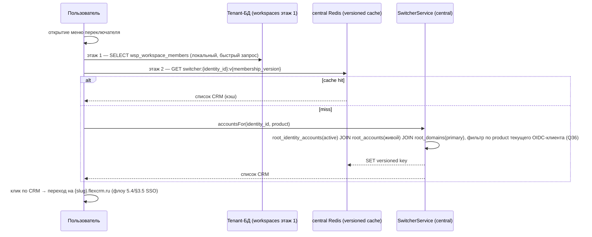
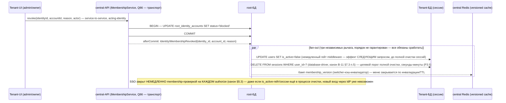
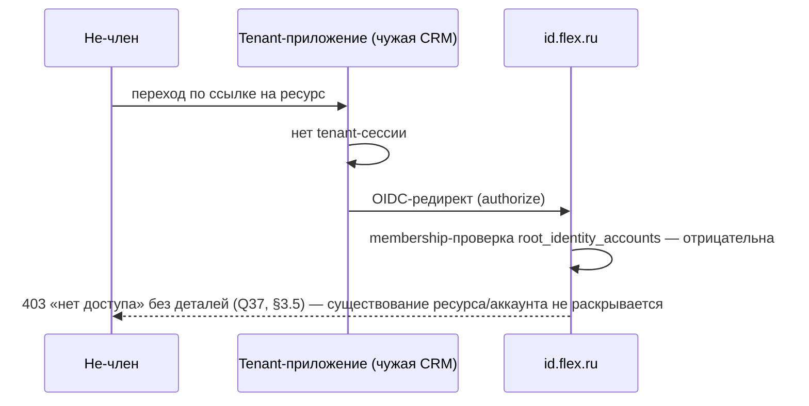
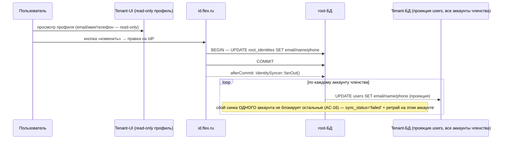

# B-34 — Кросс-БД identity: связка по identity_id, мульти-CRM membership, переключатель CRM

> **Статус: финал волны P3.1–P3.5** (слой решений, FLEX-2 P2.8). Стоит на R-32 (P1.9).
> Разделы 2/3/5/7/8 дозаполнены срезами P3.1–P3.5 до финальной глубины.
> Канон НЕ пересматривается: identity-контур **B-11** — `root_identities` /
> `root_identity_accounts` / `users`-проекция (§2.1–§2.2), `IdentitySyncer` (§3.2),
> OIDC id.flex.ru + silent-SSO (§5.3), host-резолюция (§5.4), tenant-isolation инварианты
> (§7.3) — фундамент без изменений; B-34 проектирует ПОВЕРХ. Все дельты канона — только
> реестром §9 → `05-Projects/01-Products/FlexCRM/plans/FLEX-2/open-questions.md` → арбитраж P4.2 (D11 плана FLEX-2).
> Roadmap-идея §E — только документируется (§3.9), НЕ проектируется (D10 плана FLEX-2).
> Нумерация разделов — формат волны B-27..B-33 (§7 MCP-тулзы, §8 НФТ-закладки, §9 реестр вопросов).
> Конвенции DDL: PK = UUIDv7 (генерируется приложением, B-11 §2), `created_at/updated_at
> timestamptz NOT NULL DEFAULT now()`, enum-строки через CHECK, partial unique
> WHERE deleted_at IS NULL; `root_` — каноническое исключение из правила префиксов ≤3 симв.
> (B-11 §2.1); actor — jsonb как в `root_account_events`.

---

## 1. Границы и состав

### 1.1 Что нормирует B-34

1. **Нормативы связки Н1–Н4** (§3.2): единственный ключ связки root↔tenant —
   `root_identities.id`; 🔴 запрет авто-merge/авто-привязки по телефону/email;
   email приглашения = транспорт, не ключ. Кандидаты в Safety-инварианты канона
   B-11 §7.3 — через арбитраж P4.2 (Q64).
2. **Membership-флоу мульти-CRM** (§3.3): acceptance-роут приглашения на central/IdP
   (Q34 решён здесь), root — единственный писатель `root_identity_accounts`, удаление
   сотрудника через central-API с fan-out, события `IdentityMembershipGranted/Revoked`
   (payload/подписчики — эскиз).
3. **Переключатель CRM** (§3.4): endpoint `id.flex.ru/api/me/accounts`, меню из двух
   источников, versioned-кэш в central Redis (TTL 5 мин), инвалидация по membership-событиям,
   статусные бейджи по FSM аккаунта; Q35 (v1 без UX-метаданных) и Q36 (фильтр по продукту)
   решены здесь.
4. **SSO-переход между поддоменами** (§3.5): фиксация канона B-11 §5.3 — ничего нового
   не строится; Q37 (403 vs 404 на cross-CRM deep-link) решён здесь.
5. **Sync-матрица «копия vs ссылка»** (§3.6): что из профиля копируется в tenant, что живёт
   по ссылке; правило единственного писателя проекции.
6. **Красная зона tenant-isolation К1–К5** (§3.7) — таблица запретов дословно из R-32 §5.4.
7. **Эскизы UI переключателя** (§3.8): sidebar-switcher (доноры Slack/Notion),
   анти-донор — отдельная страница Б24 Network.
8. **Roadmap-запись §E** (§3.9): поиск сотрудников по корневой БД — документирована,
   НЕ проектируется (D10, Q11).
9. **Скелеты дельта-кандидатов root-схемы** (§2): `root_invitations` (Q34-ветка) и
   UX-метаданные `root_identity_accounts` (Q35-ветка) — приведены для арбитража,
   в v1 НЕ активированы.
10. **Эскиз контрактов** `MembershipService` / `SwitcherService` (§4) и MCP-тулзов
    control-plane (§7).

### 1.2 Что НЕ входит (Scope Excluded)

- Исчерпывающий DDL (индексы, партиции, edge-cases) — срез P3.1.
- Полные сигнатуры контрактов и OIDC-протокол (токены, claims-детали) — срез P3.3.
- Детальные sequence-диаграммы потоков — срез P3.2.
- SQL scope-предикатов и матрица прав — срез P3.4.
- AC-раздел — срез P3.5.
- Пересмотр канона B-11 identity-контура — только дельта-кандидаты в §9 (маршрут P4.2, D11).
- Проектирование roadmap §E (поиск сотрудников) — D10: только документация (§3.9).
- Пиксельный UI переключателя — эскизы текстом (§3.8), макеты вне волны.
- Слияние учёток (user-driven merge через IdP) — v1.1+, вне волны (§3.2 Н2).
- Кросс-продуктовый переход в переключателе — v1.1 (Q36, §3.4).

### 1.3 Зависимости

`corex/tenancy` + central-контур IdP (дом решений B-34; central-приложения живут в
management-ячейке — B-33 §3.5) → B-11 (канон identity: root-схема §2.1, users-проекция §2.2,
IdentitySyncer §3.2, OIDC §5.3, host-резолюция §5.4) · B-33 (единый root-контур волны:
провижининг пишет первый membership владельца) · corex/core (контракты `TenantContext` —
B-10) · corex/auth (роли/права tenant-first-class — B-11 §2.3) · corex/billing
(enforcement `users_max` на акцепте — B-11 §7.2) · central Redis (кэш переключателя —
канонный общий Redis, B-11 §7.3 п.5).

---

## 2. Схема БД

> Срез P3.1: B-34 не вводит новых тенантских ни root-таблиц в v1 (§2.1) — оба дельта-кандидата
> (§2.2/§2.3) НЕ вносятся (арбитраж P4.2). Root-схема канона (B-11 §2.1) и тенантские
> `users`/`wsp_invitations` (B-11 §2.2) не переопределяются.

### 2.1 Канон — не переопределяется; новых таблиц v1 НЕТ

Хранение уже канонизировано B-11: `root_identities` (глобальная учётка, id = users.id всех
tenant-БД), `root_identity_accounts` (membership + курсор синка, UNIQUE (identity_id,
account_id), status invited/active/blocked), `root_idp_sessions`, тенантские `users`
(полная денормализованная проекция) и `wsp_invitations`. Сценарий Т2 R-32 (бухгалтер со
своей учёткой без своей CRM, членство в 2+ чужих) ложится в канон без изменений: identity
без `root_accounts.owner_identity_id`-строки + N строк membership (R-32 §4.3).

B-34 в v1 не добавляет ни таблиц, ни колонок: события (§3.3) — код, кэш переключателя (§3.4) —
central Redis без DDL. Ниже — два дельта-КАНДИДАТА (не вносятся, R-32 §8: оба условные,
активируются только альтернативными ветками — обе ветки B-34 ОТКЛОНИЛ, §3.3/§3.4).

### 2.2 Дельта-кандидат Q34-ветки: `root_invitations` — НЕ вносится

Позиция драфта (§3.3): приглашения остаются в tenant-БД (`wsp_invitations`, канон),
acceptance-роут — на central/IdP; реестр приглашений на root НЕ поднимается. Скелет
кандидата — только на случай пересмотра арбитражем P4.2:

```sql
-- КАНДИДАТ (дельта root-схемы B-11 §2.1, Q34-ветка «root_invitations»; НЕ вносится —
-- ветка отклонена §3.3, при пересмотре → арбитраж P4.2)
CREATE TABLE root_invitations (
  id           uuid PRIMARY KEY,                 -- UUIDv7
  account_id   uuid NOT NULL REFERENCES root_accounts(id) ON DELETE CASCADE,
  email        varchar(255) NOT NULL,            -- транспорт, НЕ ключ связки (Н4)
  identity_id  uuid REFERENCES root_identities(id) ON DELETE SET NULL,  -- заполняется при акцепте
  token_hash   varchar(64) NOT NULL UNIQUE,
  status       varchar(16) NOT NULL DEFAULT 'pending'
               CHECK (status IN ('pending','accepted','revoked','expired')),
  expires_at   timestamptz NOT NULL,
  accepted_at  timestamptz,
  created_at timestamptz NOT NULL DEFAULT now(),
  updated_at timestamptz NOT NULL DEFAULT now()
);
CREATE INDEX root_invitations_account_ix ON root_invitations (account_id, status);  -- запрос: список приглашений аккаунта по статусу (candidate)
CREATE INDEX root_invitations_expiry_ix  ON root_invitations (expires_at) WHERE status = 'pending';  -- запрос: TTL-свип просроченных приглашений (candidate)
```

### 2.3 Дельта-кандидат Q35-ветки: UX-метаданные переключателя — НЕ вносится

Позиция драфта (§3.4): v1 без UX-метаданных — сортировка списка CRM по name, без
закрепления/скрытия/last_accessed_at. Скелет кандидата на случай, если продуктовая
практика докажет потребность:

```sql
-- КАНДИДАТ (аддитивная дельта root-схемы B-11 §2.1, Q35-ветка; НЕ вносится —
-- v1 без метаданных §3.4, активация → арбитраж P4.2)
ALTER TABLE root_identity_accounts ADD COLUMN meta jsonb NOT NULL DEFAULT '{}';
-- ключи: {pinned: bool, hidden: bool, sort_order: int, last_accessed_at: timestamptz}
-- last_accessed_at — UX-телеметрия, НЕ security-факт (истина сессий — root_idp_sessions)
```

---

## 3. Ключевые архитектурные решения

> Решения зафиксированы, глубина (SQL, полные протоколы, sequence) добрана срезами P3.1–P3.5.
> срезами P3.1–P3.5; каждое решение — со ссылкой на R-32 §.

### 3.0 Вердикты по 10 входам R-32 §9 — все явно

| # | Вход R-32 §9 | Вердикт | Где детализировано |
|---|---|---|---|
| 1 | Модель: канон B-11 identity-контура — фундамент без изменений; B-34 поверх (переключатель, membership-флоу, нормативы); понятийная карта доноров R-32 §3 | **принято** — канон подтверждён research'ем по всем несущим точкам (R-32 §3/§8) | §3.1 |
| 2 | Нормативы Н1–Н4 (R-32 §4.2) как Safety-инварианты; кандидаты в B-11 §7.3 при арбитраже | **принято + детализировано** — зафиксированы инвариантами B-34; канонизация в B-11 §7.3 = аддитивная дельта → Q64 (арбитраж P4.2) | §3.2 |
| 3 | Membership-флоу (R-32 §4.3): acceptance на central/IdP; root — единственный писатель; удаление через central-API с fan-out; события Granted/Revoked — payload/подписчики | **принято + детализировано** — Q34 решён здесь (central-акцепт, канон-схема не меняется); эскиз событий; auth central-API → Q66 | §3.3 |
| 4 | Переключатель (R-32 §5.1–5.2): endpoint `id.flex.ru/api/me/accounts` (вариант а); меню = два источника; versioned-кэш central Redis TTL 5 мин; бейджи по FSM | **принято + детализировано** — Q35/Q36 решены здесь; носитель membership_version → Q65 | §3.4 |
| 5 | SSO-переход (R-32 §5.3): канонный OIDC/silent-SSO; membership re-check на каждом authorize; ничего нового не строить | **принято как есть** — дельты нет, B-34 только фиксирует; Q37 решён здесь | §3.5 |
| 6 | Sync-матрица (R-32 §4.4): профиль read-only в tenant-UI; должность/отдел/настройки/роли — tenant-first-class; единственный писатель проекции — IdentitySyncer (+CI-линт-кандидат) | **принято** — таблица перенесена; CI-линт — кандидат P3.5 | §3.6 |
| 7 | Красная зона К1–К5 (R-32 §5.4) — перенести отдельной таблицей запретов | **принято** — таблица дословно, с альтернативами | §3.7 |
| 8 | Roadmap §E — строка в §roadmap (3–5 строк, ссылка Q11); не проектировать (D10) | **принято** — документирована, проектирование остановлено | §3.9 |
| 9 | Эскизы UI переключателя: доноры Slack/Notion sidebar-switcher, анти-донор — страница Б24 Network | **принято + выполнено** — текстовые эскизы драфт-глубины | §3.8 |
| 10 | Открытые ветки Q34–Q37 — решить в B-34; дельты канона — через арбитраж P4.2 | **принято** — все 4 решены на драфт-уровне (§3.3–§3.5); дельта-ветки Q34/Q35 НЕ активированы, скелеты приведены §2.2–§2.3 | §3.3–§3.5, §9 |

Отступлений от рекомендаций R-32 нет — все 10 входов приняты (по всем четырём развилкам
Q34–Q37 выбраны предварительно рекомендованные R-32 варианты, с фиксацией обоснований).

### 3.1 Модель: канон — фундамент, B-34 — поверх (вход 1)

- Глобальный ID: `root_identities.id` (UUIDv7, генерируется приложением) = `users.id` в
  каждой tenant-БД — одно значение, ноль translation-слоёв (канон B-11 §2.1/§2.2; R-32 §4.1:
  это сразу целевая модель Slack Grid, без их legacy-translation-слоя).
- Правило-добавка B-34 (R-32 §4.1): `users.id` назначается ТОЛЬКО синком из root
  (cloud-режим); tenant-код никогда не генерирует id пользователя сам. Boxed — каноническое
  исключение (локальная генерация, `synced_at` NULL — B-11 §6.1).
- Понятийная карта доноров (R-32 §3): enterprise org user (Slack) / account (Notion) /
  Паспорт (Б24) ≈ `root_identities`; workspace/portal membership ≈ `root_identity_accounts`
  (уровень CRM) + `wsp_workspace_members` (уровень workspace внутри CRM). Донор EDUFY-2 §A
  переносится моделью, не механикой (у Flex — реестр + синк вместо FK одной БД, R-32 §2.5).

### 3.2 Нормативы Н1–Н4 — Safety-инварианты связки (вход 2; тезис §C)

Фиксируются как инварианты B-34 (дословно по R-32 §4.2; обоснование — recycled-номера,
разделяемые ящики: R-32 §4.2 с первоисточником Princeton CITP №29):

- **Н1.** Единственный ключ связки root↔tenant — `root_identities.id` (UUIDv7). Телефон,
  email, ФИО ключом связки не являются нигде: ни в синке, ни в приглашениях, ни в импорте.
- **Н2.** 🔴 Запрещены авто-merge и авто-привязка identity по совпадению телефона/email.
  Слияние учёток — только явная user-driven операция через IdP (v1.1+, вне волны).
- **Н3.** `root_identities.phone` — контактный атрибут без unique-индекса (канон B-11 §2.1
  уже таков — подтверждено); вход по телефону, если появится, — способ АУТЕНТИФИКАЦИИ на
  IdP, не идентификатор в данных.
- **Н4.** Приглашение в CRM адресуется по email (канон `wsp_invitations.email`), но акцепт
  СВЯЗЫВАЕТ по identity: кто аутентифицировался на IdP и предъявил токен приглашения — тот
  и член, независимо от того, на какой email пришло письмо. Email в приглашении — транспорт,
  не ключ (Notion/Slack-семантика, R-32 §4.2).

Статус относительно канона: Н1–Н4 — дополнение, ложащееся в B-34 без правки B-11 (R-32 §8);
их канонизация строками B-11 §7.3 — аддитивная дельта канона → **Q64, арбитраж P4.2**
(кандидаты в safety-инварианты среза P3.5 в любом случае).

### 3.3 Membership-флоу: central-акцепт, root — единственный писатель (вход 3; Q34 решён)

**Q34 — решено здесь** (вариант, рекомендованный R-32 §4.3/§7 п.1): приглашения остаются
канонными `wsp_invitations` в tenant-БД, acceptance-роут — на **центральном контуре
(id.flex.ru)**; `root_invitations` (дельта root-схемы) НЕ создаётся. Обоснование:
индустриальное правило «membership-мутации — только через control plane» (R-32 §2.4 п.3)
выполняется и без подъёма реестра приглашений — root пишет membership на акцепте; канон-схема
не меняется; tenant-БД сохраняет полную историю приглашений своего аккаунта. Дельта-ветка —
скелет §2.2, активация только через арбитраж P4.2.

Флоу (R-32 §4.3; детальный sequence — P3.2):

1. Приглашение создаётся в tenant-БД (`wsp_invitations`, канон AC-19, без изменений);
   письмо ведёт на acceptance-роут central (`id.flex.ru/invite/{token}`), НЕ на tenant-приложение.
2. IdP аутентифицирует (или регистрирует) приглашённого → `root_identities` create/find →
   **root пишет `root_identity_accounts`** (status=active, sync_status=pending) → событие
   `IdentityMembershipGranted` → `IdentitySyncer::syncToAccount()` создаёт users-строку →
   редирект на поддомен CRM, где tenant-приложение валидирует токен приглашения, помечает
   `wsp_invitations.accepted` и создаёт `wsp_workspace_members` (+роль из role_id — канон
   AC-19). Лимит `users_max` — на акцепте (канон B-11 §7.2).
3. Удаление сотрудника из CRM: tenant-UI зовёт **central-API** (транспорт/auth вызова — Q66)
   → root ставит `root_identity_accounts.status=blocked` → событие
   `IdentityMembershipRevoked` → fan-out: `users.is_active=false` (семантика канона B-11
   §2.2) + kill tenant-сессий пользователя (механика — Q67) + инвалидация кэша
   переключателя (§3.4). Membership-строка НЕ удаляется (история, FK-целостность проекции).
4. 🔴 Прямая запись tenant-приложения в root-таблицы — запрещена (К2, §3.7); только
   central-API + события. Read-only чтение root tenant-кодом остаётся в канонных рамках
   (host-резолюция B-11 §5.4 п.2); membership-ЧТЕНИЕ для переключателя — через central-API
   (§3.4, вариант (а)), не расширяя поверхность root-чтений tenant-кода.

**События root-контура** (дополнение, не дельта: новые события, не таблицы — R-32 §4.3):

| Событие | Payload (эскиз) | Излучатель | Подписчики (эскиз) |
|---|---|---|---|
| `Identity\MembershipGranted` | identity_id, account_id, membership_id, actor {type: identity\|support\|system, id}, occurred_at | central (MembershipService) | IdentitySyncer (syncToAccount) · switcher-кэш-инвалидатор (§3.4) · аудит-проектор → `root_account_events` · corex/billing (usage users) |
| `Identity\MembershipRevoked` | identity_id, account_id, membership_id, reason, actor, occurred_at | central (MembershipService) | fan-out is_active=false + kill сессий (Q67) · switcher-кэш-инвалидатор · аудит-проектор · corex/billing |

Гигиена payload: БЕЗ ПДн (email/name/phone не включаются — только uuid'ы; потребители
дочитывают из root по identity_id). События — central-очередь (как root-события lifecycle,
канон B-11 §3.4). Канонные `Tenancy\MemberJoined/MemberLeft` (workspace-уровень) не
задеваются — новые события живут уровнем выше (account-membership). Полная форма
payload/подписчиков — срез P3.3.

### 3.4 Переключатель CRM: endpoint, кэш, инвалидация (вход 4; Q35/Q36 решены)

**Источник данных — ровно один**: root-реестр (R-32 §5.1; Slack/Notion: switcher = проекция
membership-реестра, второй источник не нужен). Концептуальный запрос:
`root_identity_accounts (status=active) JOIN root_accounts (живые статусы, deleted_at IS NULL)
JOIN root_domains (is_primary)` → `{account_id, name, slug, primary_host, status, product[]}`.

- **Endpoint — вариант (а) R-32 §5.1: `GET id.flex.ru/api/me/accounts`** (API на IdP/central,
  tenant-приложение дергает с токеном пользователя; форма токена — P3.3). Root-БД трогает
  только central-контур — поверхность root-чтений tenant-кода НЕ расширяется сверх
  канонизированной host-резолюции. Вариант (б) (read-only чтение root из tenant-приложения
  тем же каналом, что host-кеш) — закладка-оптимизация, только если замер покажет проблему.
- **Меню = два независимых источника** (не смешивать в один endpoint — разные планы данных,
  разные права): workspaces текущей CRM — локальный запрос `wsp_workspace_members`
  (tenant-БД, быстрый); список CRM — кэшированный ответ endpoint'а.
- **Кэш**: user-scoped versioned key `switcher:{identity_id}:v{membership_version}` в
  **central Redis** (канонный общий Redis — B-11 §7.3 п.5); TTL 5 мин по образцу host-кеша
  (B-11 §5.4 п.2). Сама форма versioned-key — инженерная конвенция, унаследован маркер
  `[UNVERIFIED]` R-32 §5.2 (несущей нагрузки не несёт: механика инвалидации проверяема).
  Носитель `membership_version` (Redis-счётчик vs колонка = дельта схемы) — **Q65** (P3.3);
  предварительно — Redis INCR + fallback-recompute, схему не трогаем.
- **Инвалидация**: события `MembershipGranted/Revoked` (§3.3) бампают версию. **Отзыв
  членства ≠ только чистка меню** (R-32 §5.2): revoke обязан (1) бампнуть версию кэша,
  (2) добить tenant-сессии пользователя в этой CRM (канонный рычаг `users.is_active=false`
  + kill сессий — Q67), (3) отказать в SSO-переходе на IdP по membership-проверке (канон
  B-11 §5.3 — 403 на authorize). Пункт меню, живущий до TTL, — допустимая косметика:
  переход упрётся в 403 IdP. Переключение CRM — privilege boundary, не UI-событие.
- **Статусные бейджи** — по FSM аккаунта (канон B-11 §5.1): membership в suspended/grace
  CRM показывается с бейджем; exporting/deleted — не показывается.
- **Q35 — решено здесь** (вариант, рекомендованный R-32 §7 п.2): **v1 без UX-метаданных**
  (порядок/закрепление/скрытие/last_accessed_at) — сортировка по name; список CRM у
  подавляющего большинства identity короткий, метаданные не окупаются. Дельта-ветка
  (`meta jsonb`) — скелет §2.3, активация только через арбитраж P4.2.
- **Q36 — решено здесь** (вариант, рекомендованный R-32 §7 п.3): при мульти-продукте
  (`root_account_products`) v1 **фильтрует список по продукту текущего хоста** — OIDC-клиент
  несёт product (канон `root_oauth_clients.product`), endpoint принимает его контекстом.
  Кросс-продуктовый переход (показ всех аккаунтов со всеми продуктами) — v1.1.

### 3.5 SSO-переход: канон, ничего нового (вход 5; Q37 решён)

Канон B-11 §5.3 закрывает механику полностью (R-32 §5.3) — B-34 фиксирует без новых решений:

- Клик по CRM в переключателе = обычный переход на `https://{slug}.flexcrm.ru/…`; нет
  tenant-сессии → OIDC-редирект → «тихий» вход по cookie `.flexcrm.ru` (платформенные
  поддомены) без ввода пароля; custom-домены и кросс-продукт — полный code flow.
- Membership-проверка на IdP — на КАЖДОМ authorize (канон §5.3: `root_identity_accounts`),
  никакого «доверия меню» — переключение CRM = privilege boundary (R-32 §5.3).
- **Q37 — решено здесь** (вариант, рекомендованный R-32 §7 п.4): cross-CRM deep-link
  не-члену → **403 «нет доступа» без деталей (канон B-11 §5.3), НЕ 404**. Обоснование:
  anti-enumeration-правило OWASP multi-tenant IDOR относится к ответу НА РЕСУРС, а здесь
  отвечает IdP на authorize; существование slug'а и так публично через DNS/host-резолюцию —
  единообразный 404 enumeration-выигрыша не даёт, а UX ломает (пользователь с реальной, но
  отозванной ссылкой получил бы ложное «не существует»). Ответ 403 не раскрывает деталей
  аккаунта (имя/владельца/тариф). Проектирование cross-CRM ссылок (превью, request-access) —
  вне v1.

### 3.6 Sync-матрица «копия vs ссылка» (вход 6)

Канонный выбор — полная денормализованная users-проекция + fan-out + sync-on-demand
(B-11 §2.2/§3.2; открытый вопрос канона B-11 §9 п.1 о подтверждении полноты проекции
владельцем — НЕ задевается, матрица работает при любом исходе). Матрица (R-32 §4.4):

| Данные | Где истина | В tenant-БД | Направление правок |
|---|---|---|---|
| email, name, phone, locale | root_identities | копия (денорм. проекция) | правка ТОЛЬКО на IdP → fan-out; tenant-UI профиля — read-only по этим полям, кнопка «изменить» ведёт на id.flex.ru (Б24-паттерн Паспорта) |
| password_hash, MFA | root_identities | НЕТ (cloud; канон B-11 §7.3 п.6) | только IdP |
| Аватар | root (identity-скоуп) | копия/CDN-URL | IdP; fan-out как у профиля |
| Должность, отдел (`department_id`), настройки UI (`users.settings`) | tenant | first-class tenant-данные | только tenant; в root НЕ синкаются (root не знает оргструктур CRM) |
| Роли/права (aut_*) | tenant | first-class | только tenant (канон: права — corex/auth) |
| Членство (status) | root_identity_accounts | проекция `users.is_active` | только через central-API (§3.3) |
| last_login_at | оба, независимо | своё значение per план | не синкается (разная семантика: вход на IdP vs активность в CRM) |

Правила B-34:

1. У проекции ровно **один писатель — `IdentitySyncer`** (канон B-11 §3.2); любые прочие
   UPDATE профильных колонок `users` в tenant-коде — арх-тест-нарушение. CI-линт по образцу
   канона B-11 §7.3 п.1 — кандидат в safety-инварианты, финализация — срез P3.5.
2. **Обратного синка tenant→root у профиля НЕТ вообще** — исключает конфликты
   двунаправленной репликации и не создаёт нового write-канала в root (R-32 §4.4).
3. Гибрид распространения — канон: событийный fan-out + sync-on-demand на входе + re-sync
   при restore (B-11 §3.2/§5.3/§5.8 п.3; подтверждён индустрией — R-32 §2.4 п.4–5).

### 3.7 🔴 Красная зона tenant-isolation К1–К5 (вход 7; дословно R-32 §5.4)

| # | Приём | Почему запрещён | Альтернатива (через реестр/API) |
|---|---|---|---|
| К1 | Кросс-БД JOIN root↔tenant или tenant↔tenant (postgres_fdw, dblink) для membership/переключателя | дырка в изоляции: компрометация одной БД даёт SQL-мост в другие; ломает D1 и канон B-11 §7.3 п.2 | switcher-данные из root-API/кэша (§3.4); связь только uuid-значениями |
| К2 | Прямая запись tenant-приложения в root-таблицы | tenant-код получает write-credentials к реестру всех клиентов | central-API + события (§3.3) |
| К3 | Авто-связка identity↔user по телефону/email | кросс-tenant коллизия учёток (сценарий §C), recycled-номера | Н1–Н4 (§3.2): только identity_id |
| К4 | Общий session-store tenant-приложений (сессии всех CRM в одном Redis/БД как механизм SSO) | одна утечка = сессии всех клиентов; канон требует сессии в БД аккаунта (B-11 §7.3 п.5) | SSO только через IdP-редирект (§3.5) |
| К5 | Копирование в tenant-БД чужих membership-данных (список ДРУГИХ CRM пользователя в tenant users.settings и т.п.) | tenant-БД начинает хранить сведения о чужих tenant'ах — утечёт с экспортом/бэкапом аккаунта | список чужих CRM живёт только в root + эфемерный кэш (§3.4) |

Все решения B-34 проверены против К1–К5: переключатель — root-API + central-Redis-кэш (не
tenant-store: кэш живёт в central Redis, в tenant-БД/tenant-Redis список чужих CRM не
попадает — К5 соблюдён); membership-мутации — только central (К2); связка — только
identity_id (К3); SSO — только IdP (К4); ни одного кросс-БД JOIN (К1). Если какой-либо срез
P3.x упрётся в необходимость нарушить К1–К5 — это 🔴 эскалация (D6), не решение среза.

### 3.8 Эскизы UI переключателя (вход 9)

Доноры UX — Slack/Notion sidebar-switcher; анти-донор — отдельная страница Б24 Network
(выпадение из контекста портала — R-32 §2.3). Эскиз (текстовый, драфт-глубина; пиксели — вне волны):

- **Верх сайдбара** — блок текущей CRM: имя/иконка аккаунта; клик разворачивает меню
  переключателя (паттерн Notion R-32 §2.2).
- **Меню, этаж 1 — workspaces текущей CRM** (локальный источник §3.4): список
  `wsp_workspace_members` пользователя, активный отмечен; переход = `/w/{slug}` без SSO.
- **Меню, этаж 2 — «Мои CRM»** (кэшированный список §3.4): CRM identity с иконкой, именем и
  статус-бейджем (suspended/grace); текущая отмечена; клик = переход на поддомен (§3.5).
  Внизу — «Создать CRM» (signup-флоу B-33) и ссылка «Профиль» → id.flex.ru (§3.6).
- Двухэтажность соответствует тезису §D (уровень CRM → уровень workspaces); отличие от
  Notion: верхний этаж — ОДИН аккаунт-identity со списком CRM, не несколько логинов (R-32 §2.2).

### 3.9 §roadmap — поиск сотрудников по корневой БД (§E; НЕ проектируется, D10)

Roadmap-запись (фиксация по R-32 §6; ссылка **Q11** open-questions.md, Deferred):
из CRM запускается поиск специалиста (бухгалтер и т.п.) по корневой БД профилей платформы;
совпадения → выдача контактов → приглашение в свою CRM. По модели данных это платформенный
сервис ПОВЕРХ `root_identities` (opt-in флаг «виден в поиске», публичный профиль, согласие
на передачу контактов — 152-ФЗ), НЕ функция tenant-БД; membership-флоу (§3.3) и
переключатель (§3.4) — инфраструктурные предпосылки идеи. Проектирование — вне волны (D10).

### 3.10 Права: инициатор revoke на tenant-стороне (Q66 остаток — срез P3.4)

> Срез P3.4: permission key инициатора central-API вызова — черновая пометка снята для права-подраздела.

**Q66 (право инициатора) — решено здесь.** Tenant-UI кнопка «удалить сотрудника» (флоу 5.3, до вызова `CentralApiClient::revokeMembership`, §4.2) проверяет tenant-side AzGuard permission **`wsp.member.remove`** (namespace `wsp` — workspace/membership-сущность, канон-совместимый нейминг `{module}.{entity}.{action}`, B-11 §5.5) — scope workspace/account (не ownable: удаление сотрудника не привязано к владению записью). Проверка выполняется **ДО** вызова central-API, на обычной tenant-стороне (`AccessChecker::allowed(principal, 'wsp.member', 'remove')`) — НЕ кросс-БД JOIN (соблюдён К1, B-34 §3.7): central доверяет `acting_identity_id`, потому что tenant уже отфильтровал недостаточно-привилегированных инициаторов ДО отправки запроса (§4.2 уже фиксирует эту последовательность; P3.4 добавляет конкретный permission key). Системные роли (owner/admin, канон B-11 §8 AC-21) несут `wsp.member.remove` по умолчанию; `employee`-роль — нет. Право декларируется через `Extend\Permissions` пакета corex/tenancy (tenant-side интеграционный слой, НЕ central-контур — central-контур B-34 §4 не имеет tenant AzGuard, только client_credentials + acting-identity). Q66 → полностью Resolved (транспорт — P3.3, право инициатора — P3.4).

---

## 4. Контракты

> Срез P3.3: полные PHP-интерфейсы (@api, PHPStan level 8, форма B-16 §3), носитель
> `membership_version` (Q65), транспорт central-API (Q66), полная форма событий — черновая пометка
> снята (волновой caveat B-27/B-29/B-33 закрыт).

Канонные контракты НЕ переопределяются: `IdentitySyncer` (B-11 §3.2 — писатель проекции),
`WorkspaceResolver`, `AccountLifecycle` (B-11 §3.2), контракты corex/core (B-10). B-34
добавляет два контракта **central-контура** (живут в central-приложениях management-ячейки
B-33 §3.5, НЕ в tenant-плоскости):

```php
namespace Corex\Tenancy\Central;   // central/IdP-контур; tenant-код эти классы не импортирует

use Corex\Auth\Actor;

/** readonly, id+type+display — форма единая с B-16 §3 */
final readonly class MembershipRef
{
    public function __construct(public string $id, public string $identityId, public string $accountId, public string $status /* active|blocked */) {}
}
final readonly class SwitcherEntry
{
    public function __construct(public string $accountId, public string $name, public string $slug,
                                 public string $primaryHost, public string $status, public array $products) {}
}
final readonly class SwitcherList
{
    /** @param list<SwitcherEntry> $accounts */
    public function __construct(public array $accounts, public int $membershipVersion) {}
}

/** Приглашение просрочено/уже акцептовано/токен не матчит — central-акцепт (Q34) */
final class InvitationNotAcceptableException extends \DomainException {}
/** identity уже имеет активное членство в аккаунте — grant не создаёт дубль (natural upsert) */
final class MembershipAlreadyActiveException extends \DomainException {}

interface MembershipService        // ЕДИНСТВЕННЫЙ write-путь root_identity_accounts (§3.3, К2)
{
    /** central-акцепт (Q34) — create/find root_identities, INSERT root_identity_accounts
     * @throws InvitationNotAcceptableException */
    public function acceptInvitation(string $invitationToken, string $identityId): MembershipRef;
    /** @throws MembershipAlreadyActiveException */
    public function grant(string $identityId, string $accountId, Actor $actor): MembershipRef;    // + событие Granted
    /** → blocked + событие Revoked + fan-out (флоу 5.3): is_active-гейт + kill сессий + bump membership_version */
    public function revoke(string $identityId, string $accountId, string $reason, Actor $actor): void;
}

interface SwitcherService          // GET id.flex.ru/api/me/accounts (§3.4)
{
    public function accountsFor(string $identityId, ?string $product): SwitcherList; // cache-first, versioned key (§4.1)
    public function invalidate(string $identityId): void;                            // bump membership_version (§4.1)
}
```

### 4.1 Носитель `membership_version` (Q65 — финализировано здесь)

**Central Redis `INCR`, без DDL** — позиция драфта §3.4 подтверждена: ключ
`switcher:version:{identity_id}` (отдельный от кэша самого списка `switcher:{identity_id}:v{n}`,
§3.4) инкрементируется атомарно на каждое `MembershipGranted`/`Revoked`; потеря счётчика (Redis
restart без persistence) лечится fallback-пересчётом — `SwitcherService::accountsFor` при
отсутствии версии в Redis читает `MAX(updated_at)` по активным `root_identity_accounts` identity
и материализует новую версию как timestamp-хэш (детерминированно, без координации). Колонка
`version` в `root_identity_accounts` (альтернатива — дельта root-схемы) НЕ вводится — избыточна
против дешёвого fallback. Q65 → Resolved.

### 4.2 Транспорт central-API membership-мутаций (Q66 — финализировано здесь)

**First-party OAuth `client_credentials`** (продуктовый клиент tenant-приложения, тот же
OIDC-клиент, что и сам продукт, `root_oauth_clients.product`) **+ acting-identity в теле запроса**
(`identity_id` инициатора-сотрудника, не сервисного токена): central-API проверяет (1) валидность
client_credentials продукта, (2) что acting-identity несёт роль `admin`/`owner` В ЭТОМ АККАУНТЕ
(запрос к tenant-БД инициатора для проверки роли — обычный tenant-side auth-check ДО вызова
central-API, не кросс-БД JOIN на стороне central — К1 соблюдён). Формат вызова:

```php
namespace Corex\Tenancy\Central;

interface CentralApiClient            // вызывается ИЗ tenant-приложения (§3.3 п.3)
{
    /** @throws \Corex\Auth\UnauthorizedException если client_credentials невалиден на central */
    public function revokeMembership(string $identityId, string $accountId, string $reason, string $actingIdentityId): void;
}
```

Право инициатора проверяется ДО вызова, на tenant-стороне — permission key `wsp.member.remove`
(§3.10, срез P3.4); central доверяет `acting_identity_id` в подписанном service-to-service запросе
(client_credentials гарантирует, что запрос от легитимного продукта, не от третьей стороны).
Q66 → Resolved (транспорт + право инициатора).

### 4.3 Реестр доменных событий — полная форма (п.10 реестра — решено здесь)

| Событие | `name()` | Payload | Эмитент | Подписчики |
|---|---|---|---|---|
| `Identity\MembershipGranted` | `identity.membership.granted` | identity_id, account_id, membership_id, actor{type,id}, occurred_at | central (MembershipService) | IdentitySyncer, switcher-кэш-инвалидатор (§4.1), аудит-проектор → `root_account_events`, corex/billing |
| `Identity\MembershipRevoked` | `identity.membership.revoked` | identity_id, account_id, membership_id, reason, actor, occurred_at | central (MembershipService) | fan-out is_active=false + kill сессий, switcher-кэш-инвалидатор, аудит-проектор, corex/billing |

Гигиена payload (§3.3): БЕЗ ПДн — только uuid'ы, `reason` (enum-строка), `actor{type,id}`.
Потребители дочитывают email/name из root по `identity_id` при необходимости. Namespace
`identity.*` — control-plane-плоскость (вне module_short-словаря B-32 §3.3, та же волновая
девиация, что `tenancy.`/`storage.`/`tls.` B-33 §7 — нормализация обеих плоскостей одним
решением P4.1, не блокирует исполнимость этого среза). Item п.10 → закрыт.

---

## 5. Главные потоки — список

> Срез P3.2: детальные sequence-диаграммы + транзакционные границы (снята черновая пометка).
> Root-контур и tenant-контур — физически разные БД (D1); tx-границы указаны отдельно по
> каждой стороне. afterCommit-события — стиль B-16 §5.2.

### 5.1 Приглашение в чужую CRM → central-акцепт (Q34 — детальный sequence, срез P3.2)

```mermaid
sequenceDiagram
  participant Ten as Tenant-приложение (CRM)
  participant Central as id.flex.ru (central/IdP)
  participant ROOT as root-БД
  participant U as Приглашённый пользователь
  Ten->>Ten: BEGIN — INSERT wsp_invitations (канон AC-19, tenant-БД)
  Ten->>Ten: COMMIT
  Ten-->>U: письмо → `id.flex.ru/invite/{token}` (acceptance-роут НА CENTRAL, не на tenant-приложение)
  U->>Central: переход по ссылке
  Central->>Central: аутентификация/регистрация на IdP
  Central->>ROOT: BEGIN — create/find root_identities
  Central->>ROOT: MembershipService::acceptInvitation(token, identityId) — INSERT root_identity_accounts (status=active, sync_status=pending)
  Central->>ROOT: COMMIT
  Central-->>ROOT: afterCommit: Identity\MembershipGranted{identity_id, account_id, membership_id}
  ROOT-->>Ten: IdentitySyncer::syncToAccount() — создаёт users-строку в tenant-БД (async, per событие)
  Central-->>U: редирект на поддомен CRM
  U->>Ten: приходит с токеном приглашения
  Ten->>Ten: BEGIN — UPDATE wsp_invitations SET status='accepted'; INSERT wsp_workspace_members (+роль role_id, канон AC-19)
  Ten->>Ten: COMMIT
  Note over Ten: users_max — enforcement на этом шаге (канон B-11 §7.2); если лимит превышен — акцепт членства в АККАУНТЕ уже состоялся (root), но workspace-присоединение отклоняется — пограничный случай уходит в P3.4/арбитраж, не в этот флоу
```

`root_invitations` (дельта-ветка §2.2) НЕ задействуется — root пишет ТОЛЬКО `root_identity_accounts`, реестр приглашений остаётся в tenant-БД (`wsp_invitations`, канон).

### 5.2 Переключение CRM



### 5.3 Удаление сотрудника (fan-out, Q67 — механика kill-сессий, срез P3.2)



Membership-строка НЕ удаляется (история, FK-целостность проекции). Q67 — оба рычага
(is_active-гейт + удаление sessions-строк) применяются вместе, не альтернативно; целевой
порог полной очистки — срез **P3.5**.

### 5.4 Cross-CRM deep-link не-члену



### 5.5 Правка профиля (sync-матрица §3.6)



Обратного синка tenant→root у профиля НЕТ (§3.6 п.2) — единственный писатель проекции —
`IdentitySyncer`.

---

## 6. Интеграции (матрица доменов)

| Домен | Контракт/стык |
|---|---|
| **B-11 auth-tenancy** | Дом канона: root_identities/root_identity_accounts/users-проекция, IdentitySyncer, OIDC §5.3, host-резолюция §5.4, инварианты §7.3. B-34 = нормативы+флоу+переключатель ПОВЕРХ; дельта-ветки Q34/Q35 не активированы (§2.2–§2.3), канонизация Н1–Н4 — Q64 → арбитраж P4.2 |
| **B-33 provisioning (P2.7)** | Единый root-контур волны: central-API/IdP/подписчики событий живут в management-ячейке (B-33 §3.5); провижининг пишет первый membership владельца (users-синк — канон B-11 §5.2); offboarding аккаунта membership-историю НЕ трёт (B-11 §5.8) |
| **B-10 core/modules** | Контракты central-контура (§4) — вне tenant-плоскости, модули их не импортируют; tenant-сторона видит только users-проекцию + события; `TenantContext` не задет |
| **corex/auth (B-11 §2.3)** | Роли/права — tenant-first-class, в root не синкаются (§3.6); revoke membership НЕ трогает aut_-строки (история восстановима при re-grant) — гейт доступа = `users.is_active` + membership-проверка IdP |
| **corex/billing** | `users_max` — enforcement на акцепте приглашения/синке (канон B-11 §7.2); события Granted/Revoked — вход usage-метрики users (§3.3) |
| **B-16 спутники (Chatom/Vaulter)** | Не задеты схемно; отзыв членства гейтится канонными механизмами (is_active + сессии); panel-гранты внешних гостей (direct_grants TTL) — ортогональны membership |
| **B-32 agentic surface** | MCP-тулзы §7 — по нормативу B-32 (нейминг, side_effect-модель §3.4 B-32); control-plane namespace `identity.` — та же волновая девиация словаря module_short, что у B-33 (§9) |
| **UI shell (Inertia)** | Sidebar-switcher §3.8 — компонент app-shell продукта; данные строго из двух источников §3.4; пиксели/макеты — вне волны |

---

## 7. MCP-тулзы — финальная карта control-plane

> Срез P3.3: перечень имён уже в форме `module.verb_noun` — черновая пометка снята. Все тулзы —
> **control-plane плоскость** (staff/ops, admin-панель парка), НЕ tenant-поверхность:
> identity-мутации из tenant-агентов запрещены К2. Namespace `identity.` — control-plane
> плоскость вне module_short-словаря B-32 §3.3 (та же волновая девиация, что `tenancy.`/
> `storage.`/`tls.` B-33 §7 — нормализация вместе, §9 п.11, сверка P4.1).

- `identity.get_identity` — карточка identity: контакты, статус, список membership (read)
- `identity.list_memberships` — membership'ы по identity или по аккаунту (read)
- `identity.grant_membership` — выдать членство identity в аккаунте (write, confirm-гейт)
- `identity.revoke_membership` — отозвать членство + fan-out (write, confirm-гейт)
- `identity.resync_account_users` — принудительный re-sync users-проекции аккаунта (write)
- `identity.get_sync_status` — сводка sync_status по аккаунту: pending/failed-строки (read)
- `identity.invalidate_switcher_cache` — сброс кэша переключателя identity (write)
- `identity.list_invitations` — приглашения аккаунта со статусами (read; данные tenant-БД
  через штатный канал control-plane, НЕ кросс-БД JOIN — форма чтения P3.3)

---

## 8. НФТ, лимиты и Acceptance Criteria

> Срез P3.5: перфоманс-бюджеты, safety-инварианты и AC финализированы (числа канона B-11 §7.1
> не дублируются) — черновая пометка снята. Edition-гейтинг — не применим (control-plane
> плоскость идентичности, §3.12 pattern B-33): B-34 не вводит тенантских фич.

### 8.1 Производительность

| Операция | Бюджет | Механизм |
|---|---|---|
| Переключатель — cache hit | ≤ 1 мс (образец host-кеша B-11 §7.1) | один ключ central Redis |
| Переключатель — cache miss | один индексированный root-запрос, не hot-path (открытие меню) | `root_identity_accounts`/`root_accounts`/`root_domains` JOIN, TTL 5 мин |
| Revoke fan-out — is_active-гейт | эффект НЕМЕДЛЕННО на следующем запросе | middleware-гейт tenant-БД |
| Revoke fan-out — полная очистка сессий (Q67 — число) | целевой порог ≤ 60 с с момента `Identity\MembershipRevoked` | `DELETE FROM sessions WHERE user_id=?` (database-driver) |
| SSO-блокировка при revoke | немедленно, НЕЗАВИСИМО от скорости остальных рычагов fan-out | membership-проверка на КАЖДОМ `authorize` (канон §5.3) |

### 8.2 Квоты

`users_max` — на акцепте (канон B-11 §7.2), без изменений B-34. Лимит membership'ов НА identity НЕ вводится в v1 (сценарий Т2 — единицы CRM на человека; злоупотребление ловится общим rate-limit IdP, отдельного ключа не требуется). Кэш-объём переключателя тривиален (N членств identity — единицы-десятки), протухшие версии выметает TTL 5 мин без отдельной чистки.

### 8.3 Edition-гейтинг

Не применимо — вся МCP-поверхность §7 (`identity.*`) живёт на control-plane плоскости (staff/ops), структурно вне tenant `FeatureRegistry` (та же волновая девиация, что B-33 §8.3).

### 8.4 Safety-инварианты (нарушение = блокер релиза; Н1–Н4 — кандидаты в канон B-11 §7.3 независимо от исхода Q64)

1. **Н1 — единственный ключ связки**: root↔tenant связываются ИСКЛЮЧИТЕЛЬНО по `root_identities.id`; телефон/email/ФИО ключом связки не являются нигде.
2. **Н2 — 🔴 запрет авто-merge/авто-привязки**: identity НЕ связываются автоматически по совпадению телефона/email ни в синке, ни в приглашениях, ни в импорте; слияние — только явная user-driven операция на IdP (v1.1+).
3. **Н4 — email приглашения = транспорт, не ключ**: акцепт связывает по identity, аутентифицировавшемуся на IdP и предъявившему токен, независимо от того, на какой email пришло письмо.
4. **Красная зона К1–К5** (§3.7): ни один поток B-34 не выполняет кросс-БД JOIN (К1), не пишет напрямую в root-таблицы из tenant-кода (К2), не связывает identity по телефону/email (К3), не использует общий session-store между CRM (К4), не копирует в tenant-БД сведения о ЧУЖИХ CRM пользователя (К5).
5. **SSO закрыт немедленно при revoke**: membership-проверка на authorize блокирует новый вход НЕЗАВИСИМО от скорости остальных рычагов fan-out (is_active-гейт/удаление сессий).

### 8.5 Acceptance criteria

- AC-1. Root-схема канона (B-11 §2.1) не изменена; ни root, ни tenant-таблиц v1 не добавлено; дельта-кандидаты Q34-ветки (`root_invitations`)/Q35-ветки (UX-метаданные) НЕ активированы.
- AC-2. Ни один код-путь (синк/приглашение/импорт) не связывает identity по совпадению телефона/email — только `identity_id` (safety-инвариант §8.4 п.1).
- AC-3. Авто-merge identity архитектурно отсутствует — слияние происходит ТОЛЬКО explicit user-driven операцией на IdP (safety-инвариант §8.4 п.2, вне v1).
- AC-4. Central-акцепт приглашения связывает по `identity_id` независимо от email, на который пришло письмо (Н4-тест, safety-инвариант §8.4 п.3).
- AC-5. При revoke: `is_active`-гейт эффективен на следующем запросе немедленно; удаление строк `sessions` завершается за ≤60 с (перф-бюджет §8.1); SSO блокируется немедленно membership-проверкой на authorize независимо от скорости первых двух рычагов (safety-инвариант §8.4 п.5, Q67).
- AC-6. Переключатель: cache-hit читает ровно один ключ central Redis (≤1мс); cache-miss делает один индексированный root-запрос, кэшируется на TTL 5 мин.
- AC-7. Ни один поток B-34 не выполняет кросс-БД JOIN, не пишет напрямую в root-таблицы из tenant-кода, не использует общий session-store между CRM, не копирует в tenant-БД чужие membership-данные (safety-инвариант §8.4 п.4, К1/К2/К4/К5).
- AC-8. `wsp.member.remove` проверяется на tenant-стороне ДО вызова `CentralApiClient::revokeMembership`; central НЕ выполняет кросс-БД JOIN для проверки роли инициатора (К1 соблюдён транспортом Q66).
- AC-9. Fan-out синка профиля: сбой на одном аккаунте (`sync_status='failed'`+ретрай) не блокирует синк остальных аккаунтов membership (канон AC-16).
- AC-10. Потеря счётчика `membership_version` (Redis restart) восстанавливается детерминированным fallback `MAX(updated_at)` активных membership, без координации.
- AC-11. Cross-CRM deep-link не-члену возвращает 403 без деталей аккаунта (Q37) — никогда 404.
- AC-12. `users_max` энфорсится на шаге акцепта членства (канон §7.2); лимита membership'ов на identity в v1 нет.
- AC-13. Payload `Identity\MembershipGranted`/`Revoked` не содержит ни одного ПДн-поля — только uuid'ы, `reason` (enum), `actor{type,id}` (safety-гигиена §3.3).
- AC-14. Реестр событий `identity.*` — 0 коллизий с `tsk./cal./soc./mkg./cst./tenancy./storage./tls.` (сверено P3.3/S3 §2).
- AC-15. Полный сьют central-контура (`MembershipService`/`SwitcherService`) зелёный независимо от tenant-приложения (central живёт в management-ячейке, B-33 §3.5).

---

## 9. Реестр открытых вопросов

Схема таблицы — формат волны (P2.1, 5 колонок): вопрос → откуда → куда (маршрут) → статус/решение.

| # | Вопрос | Откуда | Куда (маршрут) | Статус/решение |
|---|---|---|---|---|
| 1 | **Q34**: acceptance-флоу приглашения при мульти-CRM — tenant `wsp_invitations` + central-акцепт vs `root_invitations` (дельта root-схемы) | R-32 §7 п.1 (§4.3) | детальный sequence → **срез P3.2**; дельта-ветка (скелет §2.2) — при пересмотре → **арбитраж P4.2** (D11) | **решён здесь** §3.3: tenant-приглашения + central-акцепт, канон-схема не меняется; root — единственный писатель membership. Q34 → Resolved; детальный sequence написан **срез P3.2** §5.1 |
| 2 | **Q35**: UX-метаданные переключателя (порядок/закрепление/скрытие, last_accessed_at) в `root_identity_accounts` | R-32 §7 п.2 (§5.2) | дельта-ветка (скелет §2.3) — при потребности → **арбитраж P4.2** (D11) | **решён здесь** §3.4: v1 БЕЗ метаданных, сортировка по name; дельта не активирована. Q35 → Resolved |
| 3 | **Q36**: состав переключателя при мульти-продукте (`root_account_products`) | R-32 §7 п.3 | кросс-продуктовый переход — v1.1 (roadmap) | **решён здесь** §3.4: v1 — фильтр по продукту текущего OIDC-клиента (`root_oauth_clients.product`). Q36 → Resolved |
| 4 | **Q37**: код ответа на cross-CRM deep-link не-члену — 403 канона vs 404 OWASP anti-enumeration | R-32 §7 п.4 (§5.3) | — (обоснование зафиксировано) | **решён здесь** §3.5: 403 канона B-11 §5.3 сохраняется — slug публичен через DNS, 404 выигрыша не даёт; OWASP-правило про ответ на ресурс, не authorize. Q37 → Resolved |
| 5 | **Q11**: roadmap §E — поиск сотрудников по корневой БД | inbox §E / R-32 §6 | проектирование — вне волны (D10); roadmap-запись выполнена §3.9 | Deferred (решить-потом); обязательство P2.8 закрыто |
| 6 | **Q64**: канонизация нормативов Н1–Н4 строками B-11 §7.3 — аддитивная дельта канона | новый (§3.2; R-32 §9 п.2) | **арбитраж P4.2** (D11); кандидаты в safety-инварианты среза P3.5 независимо от исхода | Decision pending (предварительно: канонизировать — нормативы дешёвые, кросс-tenant коллизия учёток дорогая) |
| 7 | **Q65**: носитель `membership_version` для versioned-key кэша: central Redis INCR (+fallback-recompute, без DDL) vs колонка version в `root_identity_accounts` (= дельта root-схемы) | новый (§3.4) | **срез P3.3**; при выборе колонки → арбитраж P4.2 (D11) | закрыт (срез **P3.3**, §4.1): Redis INCR подтверждён, схема не трогается; fallback — `MAX(updated_at)` активных membership при потере счётчика. Q65 → Resolved |
| 8 | **Q66**: аутентификация central-API membership-мутаций из tenant-приложения (удаление сотрудника §3.3 п.3): service-to-service транспорт (first-party client_credentials vs подписанный internal-токен) + передача acting-identity + права инициатора в tenant | новый (§3.3, §4) | **срез P3.3** (транспорт/контракт) + **P3.4** (права инициатора) | закрыт полностью: транспорт (срез **P3.3**, §4.2) — first-party OAuth client_credentials продукта + `actingIdentityId` в теле, `CentralApiClient`-контракт; право инициатора (срез **P3.4**, §3.10) — permission key `wsp.member.remove` (workspace/account scope, tenant-side, проверяется ДО вызова central-API). Q66 → Resolved |
| 9 | **Q67**: механика kill tenant-сессий при revoke: достаточно ли `is_active`-гейта middleware (эффект следующим запросом) vs явное удаление строк sessions (database-driver, tenant-БД) шагом fan-out; целевой порог полной очистки | новый (§3.3 п.3, §5 п.3) | **срез P3.2** (поток) + **P3.5** (порог) | закрыт полностью (срез **P3.5**, §8.1): целевой порог полной очистки сессий ≤60 с с момента `Identity\MembershipRevoked`; is_active-гейт немедленно, SSO блокируется независимо от скорости очистки. Q67 → Resolved |
| 10 | Полная форма payload/подписчиков событий `Identity\MembershipGranted/Revoked` (эскиз §3.3) + место в реестре событий | §3.3 | **срез P3.3** | закрыт (срез **P3.3**, §4.3): полная payload-форма зафиксирована (identity_id/account_id/membership_id/actor/occurred_at, БЕЗ ПДн), подписчики перечислены |
| 11 | Нормализация control-plane MCP-namespace'ов (`identity.` здесь; `tenancy.`/`storage.`/`tls.` B-33 §7) со словарём module_short норматива B-32 §3.3 | §7 (волновая девиация, вместе с B-33) | **срез P3.3** + сверка **P4.1** | наблюдение зафиксировано (срез **P3.3**, §4.3): control-plane — отдельная плоскость словаря вне module_short (зеркально B-33 §7); формальная сверка/итоговое решение остаётся **P4.1** (не блокирует исполнимость) |

Ни один вопрос R-32 не потерян: Q34–Q37 — строки 1–4 (все решены на драфт-уровне,
предварительные рекомендации R-32 подтверждены); Q11 — строка 5 (roadmap-обязательство
выполнено). Дельта-ветки Q34/Q35 НЕ активированы (безусловных дельт от B-34 нет —
консистентно R-32 §8); единственный новый дельта-кандидат — Q64 (канонизация Н1–Н4),
помечен маршрутом арбитраж P4.2. Новые вопросы Q64–Q67 заведены в сквозной реестр
`05-Projects/01-Products/FlexCRM/plans/FLEX-2/open-questions.md`. Финальная зачистка P3.5: ни одной черновой пометки не
осталось; §7/§8 дозаполнены полностью; Q67 → Resolved этим срезом; Q64 остаётся Decision
pending → арбитраж P4.2 (D11, кандидаты Н1–Н4 в safety-инварианты зафиксированы §8.4 независимо
от исхода арбитража); Q65/Q66 → Resolved P3.3/P3.4; Q11 — deferred roadmap.
