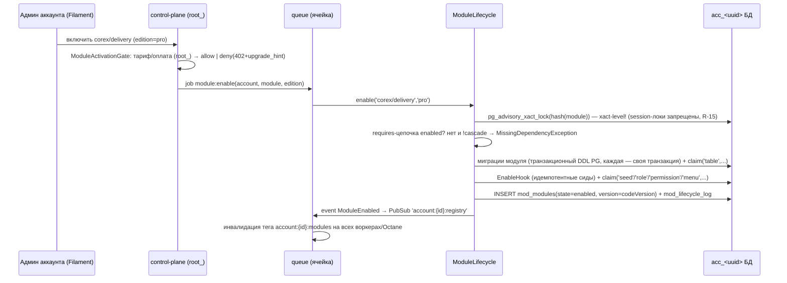

# B-10 — Ядро CoreX: corex/core + flex/modules + EntityRegistry + corex/components

> Доменная спека Этапа 4. Входы: MASTER_PLAN §3 (D1–D16), B-01 (§2.1–2.3, §3), B-02, R-04 (главный), R-07 §4.1–4.2, R-15 §2.2/§4, R-00 §1.
> Статус: draft → чекпойнт. Исполнитель финальных vault-доков и кода — дешёвая модель: спека самодостаточна. Дата: 2026-07-03.

---

## 1. Границы и состав

### 1.1 Пакеты домена

| Пакет | Репо/дистрибуция | Лицензия | Содержимое |
|---|---|---|---|
| **corex/core** | монорепо corex (read-only split, ADR-002) | MIT | DI/Contracts-конвенции, доменные события (база), `TenantContext` (value-object, потребление), Settings, Audit Log, Feature Flags, иерархия подразделений (ltree), PubSub-абстракция (замена LISTEN/NOTIFY по R-15) |
| **flex/modules** | standalone-репозиторий (OSS-вынос D7) | MIT | Манифест модуля, Module Loader, lifecycle state-машина `mod_modules`, реестр владения `mod_records`, EntityRegistry, 8 extenders, компилятор реестра, artisan-команды lifecycle |
| **corex/components** | монорепо corex (**решение границы D14: отдельный пакет, НЕ внутри corex/cms**) | MIT | Компонентный примитив: `Component`-класс, `#[Param]`, `CachePolicy`, `ResultDecorator`, 3-уровневый TemplateResolver, диагностика `component:where` |

Обоснование границы corex/components: компоненты нужны CMS (страницы), commerce-витрине (каталог/корзина) и потенциально публичным порталам CRM; тянуть весь corex/cms ради примитива нельзя. Темы (theme.json, наследование, Tailwind-токены) остаются в B-17; corex/components экспортирует только интерфейс `ThemeViewPaths` с null-реализацией по умолчанию.

### 1.2 Зависимости (направление стрелки = «зависит от»)

```
corex/components ──► illuminate/view, spatie/laravel-data        (НЕ зависит от flex/modules)
flex/modules     ──► illuminate/*, corex/core (только TenantContext + события)
corex/core       ──► illuminate/*                                 (низ пирамиды, ни от кого)
corex/tenancy (B-11) ──► corex/core (реализует TenantContextResolver)
все остальные corex/* ──► flex/modules (манифесты) + corex/core
```

Инверсия для boxed (D10): flex/modules не знает про root-БД и биллинг — облачные проверки инжектируются интерфейсом `ModuleActivationGate` (реализация в corex/billing/tenancy; boxed-реализация = `AllowAll`).

### 1.3 OSS vs проприетарное

Всё в этой спеке — MIT (воронка доверия, B-01 §6). Проприетарные потребители (биллинг-гейт активации, маркетплейс-каталог, MCP-инструменты `market.*`) подключаются через контракты §3/§4, в кодовой базе домена их нет.

---

## 2. Схема БД

Конвенции: PK `uuid` = **UUIDv7, генерирует приложение** (в PG 16 нет `uuidv7()`; DEFAULT отсутствует умышленно). Все таблицы живут в **БД аккаунта** (cloud: `acc_<uuid>`, boxed: единственная БД — схема идентична, D10). Префиксы: `mod_` (flex/modules), `sys_` (corex/core; дополнение к списку D9/B-01 §3 — см. §9.1). `timestamptz` везде.

```sql
CREATE EXTENSION IF NOT EXISTS ltree;

-- ============================================================
-- flex/modules
-- ============================================================

CREATE TABLE mod_modules (
    id             uuid PRIMARY KEY,                    -- UUIDv7 (приложение)
    name           varchar(190) NOT NULL,               -- composer name: 'corex/crm'
    state          varchar(16)  NOT NULL,
    version        varchar(32)  NOT NULL,               -- версия кода, под которую мигрирована ЭТА БД
    schema_version varchar(64),                         -- имя последней применённой миграции модуля
    edition        varchar(16)  NOT NULL DEFAULT 'standard',
    enabled_at     timestamptz,
    disabled_at    timestamptz,
    disable_reason varchar(16),                         -- manual | billing | dependency
    config         jsonb NOT NULL DEFAULT '{}',         -- пер-аккаунтная конфигурация модуля
    meta           jsonb NOT NULL DEFAULT '{}',         -- licence snapshot, источник установки
    created_at     timestamptz NOT NULL DEFAULT now(),
    updated_at     timestamptz NOT NULL DEFAULT now(),
    CONSTRAINT mod_modules_name_uq UNIQUE (name),
    CONSTRAINT mod_modules_state_ck  CHECK (state IN ('enabled','disabled','archived','purged')),
    CONSTRAINT mod_modules_edition_ck CHECK (edition IN ('standard','pro')),
    CONSTRAINT mod_modules_reason_ck CHECK (disable_reason IN ('manual','billing','dependency') OR disable_reason IS NULL)
);
COMMENT ON TABLE mod_modules IS
  'Состояние активации модулей per-account (Odoo ir_module_module). Состояние available ВИРТУАЛЬНО: код задеплоен, строки нет.';
COMMENT ON COLUMN mod_modules.version IS
  'Может отставать от версии кода (pending upgrade — штатное состояние; контракт: код совместим со схемой на 1 minor назад).';

CREATE INDEX mod_modules_state_ix ON mod_modules (state);

-- Реестр владения данными (Odoo ir_model_data) — фундамент предсказуемого purge
CREATE TABLE mod_records (
    module_name  varchar(190) NOT NULL,
    record_type  varchar(40)  NOT NULL,
    reference    varchar(255) NOT NULL,                 -- 'dlv_shipments' | 'delivery.shipment.view' | uuid сида
    meta         jsonb NOT NULL DEFAULT '{}',
    created_at   timestamptz NOT NULL DEFAULT now(),
    updated_at   timestamptz NOT NULL DEFAULT now(),
    PRIMARY KEY (module_name, record_type, reference),
    CONSTRAINT mod_records_type_ck CHECK (record_type IN
      ('table','column','index','role','permission','menu','setting','seed','blueprint','feature_flag','other'))
);
COMMENT ON TABLE mod_records IS
  'Что создал модуль в ЭТОЙ БД. Purge идёт строго по реестру (обратный created_at) + PurgeHook для нестандартных хвостов.';
CREATE INDEX mod_records_module_ix ON mod_records (module_name, created_at DESC);

-- Журнал lifecycle-операций (аудит enable/disable/upgrade/purge; диагностика падений)
CREATE TABLE mod_lifecycle_log (
    id           uuid PRIMARY KEY,
    module_name  varchar(190) NOT NULL,
    operation    varchar(16)  NOT NULL,
    from_state   varchar(16)  NOT NULL,                 -- включая виртуальный 'available'
    to_state     varchar(16)  NOT NULL,
    status       varchar(16)  NOT NULL DEFAULT 'success',
    actor_type   varchar(16)  NOT NULL,                 -- user | system | platform (control-plane) | cli
    actor_id     uuid,
    details      jsonb NOT NULL DEFAULT '{}',           -- migrations_run[], duration_ms, error, keep_data
    created_at   timestamptz NOT NULL DEFAULT now(),
    updated_at   timestamptz NOT NULL DEFAULT now(),
    CONSTRAINT mod_ll_op_ck     CHECK (operation IN ('enable','disable','upgrade','archive','purge')),
    CONSTRAINT mod_ll_status_ck CHECK (status IN ('success','failed','started')),
    CONSTRAINT mod_ll_actor_ck  CHECK (actor_type IN ('user','system','platform','cli'))
);
CREATE INDEX mod_ll_module_ix ON mod_lifecycle_log (module_name, created_at DESC);

-- ============================================================
-- corex/core (префикс sys_)
-- ============================================================

-- Настройки: каскад user → workspace → account → default из манифеста
CREATE TABLE sys_settings (
    id           uuid PRIMARY KEY,
    namespace    varchar(64)  NOT NULL,                 -- id модуля ('crm') или 'core'
    key          varchar(190) NOT NULL,
    scope_type   varchar(16)  NOT NULL DEFAULT 'account',
    scope_id     uuid,                                  -- NULL только при scope_type='account'
    value        jsonb NOT NULL,
    is_sensitive boolean NOT NULL DEFAULT false,
    created_at   timestamptz NOT NULL DEFAULT now(),
    updated_at   timestamptz NOT NULL DEFAULT now(),
    CONSTRAINT sys_settings_scope_ck CHECK (scope_type IN ('account','workspace','user')),
    CONSTRAINT sys_settings_scope_id_ck CHECK
      ((scope_type = 'account' AND scope_id IS NULL) OR (scope_type <> 'account' AND scope_id IS NOT NULL)),
    CONSTRAINT sys_settings_uq UNIQUE NULLS NOT DISTINCT (namespace, key, scope_type, scope_id)
);
COMMENT ON COLUMN sys_settings.is_sensitive IS
  'true → value хранится зашифрованным приложением (Laravel encrypter); маскируется в audit log и API.';
CREATE INDEX sys_settings_scope_ix ON sys_settings (scope_type, scope_id);

-- Audit Log (append-only; запись через queued listener по умолчанию)
CREATE TABLE sys_audit_log (
    id           uuid PRIMARY KEY,                      -- UUIDv7 = time-sortable курсор пагинации
    occurred_at  timestamptz NOT NULL DEFAULT now(),
    actor_type   varchar(16) NOT NULL,
    actor_id     uuid,
    workspace_id uuid,                                  -- логический уровень D1; NULL = операция уровня аккаунта
    entity_type  varchar(64),                           -- handle из EntityRegistry: 'crm.deal'
    entity_id    uuid,
    action       varchar(64) NOT NULL,                  -- 'created'|'updated'|'deleted'|'module.enabled'|...
    changes      jsonb,                                 -- {"field": {"old": ..., "new": ...}}
    context      jsonb NOT NULL DEFAULT '{}',           -- ip, user_agent, request_id, module
    created_at   timestamptz NOT NULL DEFAULT now(),
    updated_at   timestamptz NOT NULL DEFAULT now(),
    CONSTRAINT sys_audit_actor_ck CHECK (actor_type IN ('user','agent','api_key','system'))
);
COMMENT ON TABLE sys_audit_log IS
  'Append-only. Retention per-тариф (§7). Партиционирование по месяцам — отложено до порога объёма (§9.7).';
CREATE INDEX sys_audit_entity_ix ON sys_audit_log (entity_type, entity_id, occurred_at DESC);
CREATE INDEX sys_audit_actor_ix  ON sys_audit_log (actor_type, actor_id, occurred_at DESC);
CREATE INDEX sys_audit_wsp_ix    ON sys_audit_log (workspace_id, occurred_at DESC);
CREATE INDEX sys_audit_brin_ix   ON sys_audit_log USING BRIN (occurred_at);

-- Feature Flags: дефолт per-account + переопределения per-workspace/user/department
CREATE TABLE sys_feature_flags (
    id          uuid PRIMARY KEY,
    key         varchar(128) NOT NULL,                  -- 'crm.lead_mode' (D16: лид выключен по умолчанию)
    module      varchar(190),                           -- декларировавший модуль; NULL = core/платформа
    is_enabled  boolean NOT NULL DEFAULT false,
    payload     jsonb,                                  -- вариант/конфиг флага
    created_at  timestamptz NOT NULL DEFAULT now(),
    updated_at  timestamptz NOT NULL DEFAULT now(),
    CONSTRAINT sys_ff_key_uq UNIQUE (key)
);
COMMENT ON TABLE sys_feature_flags IS
  'B-01 §4: модули включаются per-account, workspace получает feature-флаги (sys_feature_overrides). В cloud платформа пушит тарифные флаги сюда из root_.';

CREATE TABLE sys_feature_overrides (
    id          uuid PRIMARY KEY,
    flag_id     uuid NOT NULL REFERENCES sys_feature_flags(id) ON DELETE CASCADE,
    scope_type  varchar(16) NOT NULL,
    scope_id    uuid NOT NULL,
    is_enabled  boolean NOT NULL,
    payload     jsonb,
    created_at  timestamptz NOT NULL DEFAULT now(),
    updated_at  timestamptz NOT NULL DEFAULT now(),
    CONSTRAINT sys_fo_scope_ck CHECK (scope_type IN ('workspace','user','department')),
    CONSTRAINT sys_fo_uq UNIQUE (flag_id, scope_type, scope_id)
);

-- Иерархия подразделений (потребители: AzGuard-скоупы dept/dept_tree, orgchart UI)
CREATE TABLE sys_departments (
    id           uuid PRIMARY KEY,
    workspace_id uuid NOT NULL,                         -- FK на wsp_workspaces(id) добавляет миграция corex/tenancy (B-11)
    parent_id    uuid REFERENCES sys_departments(id) ON DELETE RESTRICT,
    path         ltree NOT NULL,                        -- метки = короткий label из uuid (без дефисов)
    name         varchar(255) NOT NULL,
    head_user_id uuid,                                  -- руководитель; FK на users — миграция corex/auth
    sort_order   integer NOT NULL DEFAULT 0,
    deleted_at   timestamptz,
    created_at   timestamptz NOT NULL DEFAULT now(),
    updated_at   timestamptz NOT NULL DEFAULT now(),
    CONSTRAINT sys_dept_path_uq UNIQUE (path)
);
COMMENT ON COLUMN sys_departments.path IS
  'ltree + parent_id для FK/UI (конвенция B-01 §3). Перемещение поддерева = UPDATE path WHERE path <@ old (одна команда, см. §5.6).';
CREATE INDEX sys_dept_path_gist ON sys_departments USING GIST (path);
CREATE INDEX sys_dept_wsp_ix    ON sys_departments (workspace_id) WHERE deleted_at IS NULL;

CREATE TABLE sys_department_user (
    department_id uuid NOT NULL REFERENCES sys_departments(id) ON DELETE CASCADE,
    user_id       uuid NOT NULL,                        -- FK на users — миграция corex/auth
    role          varchar(16) NOT NULL DEFAULT 'member',
    is_primary    boolean NOT NULL DEFAULT false,
    created_at    timestamptz NOT NULL DEFAULT now(),
    updated_at    timestamptz NOT NULL DEFAULT now(),
    PRIMARY KEY (department_id, user_id),
    CONSTRAINT sys_du_role_ck CHECK (role IN ('member','head','deputy'))
);
-- одно основное подразделение на пользователя (база для AzGuard-скоупа dept)
CREATE UNIQUE INDEX sys_du_primary_uq ON sys_department_user (user_id) WHERE is_primary;
```

**corex/components таблиц не владеет** — компоненты являются кодом; кеш ViewModel — в cache-стор (Redis/tagged), резолв шаблонов — compile-time кеш.

---

## 3. Публичные контракты

Неймспейсы условные (`Flex\`, `Corex\`) — vendor-имя открыто (D16, §9.2). Все контракты `@api`, PHPStan level 8.

### 3.1 corex/core

Каноническая форма `TenantContext`/`AccountRef`/`WorkspaceRef` — B-11 §3.1 (владелец contract-shape); здесь — потребление контрактом corex/core.

```php
namespace Corex\Core\Tenancy;

final readonly class AccountRef
{
    public function __construct(
        public string $id,            // UUIDv7; boxed: фикс-константа из config
        public string $slug,
        public string $status,        // из FSM B-11 §5.1
        public array  $features,      // слитые feature-флаги root (boxed: из config)
        public array  $limits,        // root_plans.limits текущего тарифа
    ) {}
}

final readonly class WorkspaceRef
{
    public function __construct(
        public string  $id,
        public string  $slug,
        public string  $type,         // company|branch|partner
        public string  $path,         // ltree как строка
        public ?string $parentId,
    ) {}
}

/** Value-object; резолвится corex/tenancy (B-11). Boxed: константный singleton (SingleAccountResolver). */
final readonly class TenantContext
{
    public function __construct(
        public AccountRef    $account,
        public ?WorkspaceRef $workspace,   // null = общеаккаунтный контекст (админка, cron)
    ) {}
    public function isBoxed(): bool;       // true ⇔ AccountRef получен через SingleAccountResolver (boxed-биндинг)
    public function forWorkspace(WorkspaceRef $workspace): self;
}

interface TenantContextResolver { public function current(): TenantContext; }
```

```php
namespace Corex\Core\Contracts;

final readonly class SettingsScope
{
    public static function account(): self;
    public static function workspace(string $workspaceId): self;
    public static function user(string $userId): self;
}

interface SettingsRepository
{
    /** Каскад: user → workspace → account → default из манифеста модуля */
    public function get(string $namespace, string $key, ?SettingsScope $scope = null, mixed $default = null): mixed;
    public function set(string $namespace, string $key, mixed $value, ?SettingsScope $scope = null): void;
    public function forget(string $namespace, string $key, ?SettingsScope $scope = null): void;
    /** @return array<string, mixed> смердженный по каскаду набор namespace'а */
    public function all(string $namespace, ?SettingsScope $scope = null): array;
}

final readonly class AuditEntry
{
    public function __construct(
        public string $action,             // 'updated' | 'module.enabled' | ...
        public string $actorType,          // user|agent|api_key|system
        public ?string $actorId,
        public ?string $entityType,        // handle EntityRegistry
        public ?string $entityId,
        public ?array $changes = null,     // ['field' => ['old' => ..., 'new' => ...]]
        public array $context = [],        // ip, user_agent, request_id, module
    ) {}
}
interface AuditLogger { public function record(AuditEntry $entry): void; }  // дефолт: queued write

final readonly class FeatureFlagDefinition
{
    public function __construct(public string $key, public bool $default = false, public ?string $module = null, public ?array $payload = null) {}
}
interface FeatureFlags
{
    public function active(string $key, ?SettingsScope $scope = null): bool;   // с учётом overrides
    public function value(string $key, ?SettingsScope $scope = null): mixed;   // payload
    public function define(FeatureFlagDefinition $def): void;                  // идемпотентно, из манифестов
}

/**
 * R-15: LISTEN/NOTIFY через PgBouncer transaction mode запрещён.
 * Единственный канал pub/sub ядра. Драйверы: redis (cloud default),
 * database-polling (boxed без Redis), sync/null (тесты).
 */
interface PubSub
{
    public function publish(string $channel, array $payload): void;
    /** только long-running процессы (queue-воркер, Octane-тик); в request-цикле запрещено */
    public function subscribe(string $channel, \Closure $handler): void;
}
```

```php
namespace Corex\Core\Events;

abstract class DomainEvent
{
    public readonly string $eventId;              // UUIDv7
    public readonly \DateTimeImmutable $occurredAt;
    public readonly TenantContext $tenant;
    abstract public static function name(): string;   // 'core.setting.changed'
}
```

Доменные события ядра (имя → payload):

| Событие | name() | Payload |
|---|---|---|
| `SettingChanged` | `core.setting.changed` | namespace, key, scope, old, new (sensitive → маскировано) |
| `FeatureFlagToggled` | `core.feature.toggled` | key, scope, isEnabled |
| `DepartmentMoved` | `core.department.moved` | departmentId, oldPath, newPath |
| `ModuleEnabled` | `mod.module.enabled` | module, version, edition, actorType/actorId |
| `ModuleDisabled` | `mod.module.disabled` | module, reason (manual\|billing\|dependency) |
| `ModuleUpgraded` | `mod.module.upgraded` | module, fromVersion, toVersion, migrationsRun[] |
| `ModuleArchived` | `mod.module.archived` | module |
| `ModulePurged` | `mod.module.purged` | module, droppedTables[], deletedRecords (count по record_type) |

```php
namespace Corex\Core\Contracts;

interface DepartmentRepository
{
    public function find(string $id): ?Department;                    // DTO: id, workspaceId, parentId, path, name, headUserId
    /** @return list<Department> path <@ subtree-root (включая корень) */
    public function subtree(string $departmentId): array;
    public function primaryOf(string $userId): ?Department;           // для AzGuard scope=dept
    public function move(string $departmentId, ?string $newParentId): void;  // → DepartmentMoved
}
```

### 3.2 flex/modules: манифест

```php
namespace Flex\Modules;

abstract class CorexModule
{
    abstract public function manifest(): Manifest;
}

final class Manifest
{
    public static function make(string $composerName): self;          // = composer name, валидируется

    // --- идентичность и метаданные ---
    public function title(string $title): self;                       // translatable key допустим
    public function description(string $text): self;
    public function tablePrefix(string $prefix): self;                // D9: ≤3 симв, [a-z]{2,3}; уникален в экосистеме
    // версия НЕ поле манифеста: источник — composer (installed.json), боль SiteUpdate закрыта

    // --- зависимости ---
    /** @param list<Dep> $deps должны зеркалить composer require (компилятор сверяет, расхождение = ошибка компиляции) */
    public function requires(array $deps): self;
    /** @param list<Dep> $deps мягкие интеграции; UI показывает подсказку «работает лучше с…» */
    public function suggests(array $deps): self;

    // --- editions (D14/B-01 §7: с первого дня) ---
    /** @param array<string, list<string>> $map ['standard'=>[], 'pro'=>['live-sync','advanced-reports']] — фичи-ключи, доступные edition'у */
    public function editions(array $map): self;

    // --- структурные декларации ---
    /** @param list<Extend\Extender> $extenders см. §4 */
    public function extends(array $extenders): self;
    /** @param list<class-string<\Corex\Components\Component>> $components компоненты модуля (D14: first-class, НЕ extender) */
    public function components(array $components): self;

    // --- дефолты ядра ---
    /** @param list<SettingDefault> $defaults namespace = id модуля автоматически */
    public function settings(array $defaults): self;
    /** @param list<\Corex\Core\Contracts\FeatureFlagDefinition> $flags */
    public function featureFlags(array $flags): self;

    // --- поведение: подписки только в коде (урок b_module_to_module) ---
    /** @param array<class-string<DomainEvent>, list<class-string>> $listeners */
    public function listens(array $listeners): self;

    // --- lifecycle-хуки ---
    public function onEnable(string $hookClass): self;    // class-string<EnableHook>, идемпотентный
    public function onDisable(string $hookClass): self;   // опционально: снятие cron/вебхуков; ДАННЫЕ НЕ ТРОГАТЬ
    public function onPurge(string $hookClass): self;     // только нестандартные хвосты вне mod_records
}

final readonly class Dep
{
    public static function module(string $composerName, string $constraint = '*'): self;
    public static function phpExtension(string $ext): self;           // 'pgsql', 'redis'
}

final readonly class SettingDefault
{
    public static function make(string $key, mixed $default): self;
    public function workspaceScoped(): self;   // разрешить override на workspace
    public function userScoped(): self;
    public function sensitive(): self;
}
```

`composer.json` модуля: `"type": "corex-module"`, `"extra": {"corex": {"module": "Vendor\\Delivery\\DeliveryModule"}, "laravel": {"providers": [...]}}`. Модуль без тенантных фич обязан работать как обычный Laravel-пакет (совместимость с package discovery — R-04 §2.3).

### 3.3 flex/modules: lifecycle и реестры

```php
namespace Flex\Modules\Contracts;

enum ModuleState: string
{
    case Available = 'available';   // виртуальное: код есть, строки в mod_modules нет
    case Enabled   = 'enabled';
    case Disabled  = 'disabled';
    case Archived  = 'archived';
    case Purged    = 'purged';
}
enum DisableReason: string { case Manual='manual'; case Billing='billing'; case Dependency='dependency'; }

final readonly class ModuleStatus
{
    public function __construct(
        public string $name,
        public ModuleState $state,
        public string $codeVersion,        // из installed.json
        public ?string $dbVersion,         // mod_modules.version
        public bool $pendingUpgrade,       // codeVersion > dbVersion (derived, не хранится)
        public string $edition,
    ) {}
}

interface ModuleLifecycle
{
    /** available|disabled|archived → enabled. $cascade: авто-enable requires-цепочки. */
    public function enable(string $module, string $edition = 'standard', bool $cascade = false): void;
    /** enabled → disabled. Данные НЕ трогаются никогда. Бросает HasEnabledDependentsException без $cascade. */
    public function disable(string $module, DisableReason $reason, bool $cascade = false): void;
    /** disabled → archived (keepData=true) | purged (false). Из enabled напрямую запрещено. */
    public function uninstall(string $module, bool $keepData = true): void;
    /** догоняющие миграции: dbVersion → codeVersion; вызывается волнами control-plane или при re-enable */
    public function upgrade(string $module): void;
    public function status(string $module): ModuleStatus;
}

/** Облачный гейт (биллинг/тариф из root_); boxed-реализация AllowAll (D10) */
interface ModuleActivationGate
{
    public function check(TenantContext $ctx, string $module, string $edition): GateDecision; // allow | deny(reason, upgradeHint)
}

/** Компилированный реестр кода — собирается на деплое, читается с file-кеша, 0 сканов на hot path */
interface ModuleRegistry
{
    /** @return list<CompiledModule> все модули кодовой базы */
    public function all(): array;
    public function get(string $name): CompiledModule;   // манифест + extenders + components + версия
    /** @return list<CompiledModule> пересечение с mod_modules тенанта (кеш per-account с тегами) */
    public function active(TenantContext $ctx): array;
    public function isActive(string $name, TenantContext $ctx): bool;
}

interface RecordsRegistrar
{
    /** Регистрируется всё созданное модулем в БД аккаунта; вызывают миграции/сиды/хуки */
    public function claim(string $module, string $recordType, string $reference, array $meta = []): void;
    public function release(string $module, string $recordType, string $reference): void;
}

interface EnableHook  { public function __invoke(ModuleContext $ctx): void; }   // идемпотентный (повторный enable безопасен)
interface DisableHook { public function __invoke(ModuleContext $ctx): void; }
interface PurgeHook   { public function __invoke(ModuleContext $ctx): void; }

final readonly class ModuleContext
{
    public function __construct(public string $module, public TenantContext $tenant, public RecordsRegistrar $records) {}
}
```

### 3.4 EntityRegistry

```php
namespace Flex\Modules\Contracts;

enum Capability: string
{
    case Searchable   = 'searchable';    // → corex/search (индексация)
    case Auditable    = 'auditable';     // → sys_audit_log (observer на CRUD)
    case CustomFields = 'custom_fields'; // → flex/attributes (B-15)
    case Workflowable = 'workflowable';  // → flex/workflow (триггеры/действия, B-12)
    case Commentable  = 'commentable';   // → Chatom-панель (B-16)
    case Documentable = 'documentable';  // → Vaulter-панель (B-16)
    case SoftDeletes  = 'soft_deletes';  // влияет на partial-индексы и API-фильтры
}

final readonly class FieldDefinition
{
    public function __construct(
        public string $handle,
        public string $type,          // string|int|decimal|bool|date|datetime|json|money|relation|enum
        public bool $required = false,
        public bool $searchable = false,
        public ?array $meta = null,   // enum-варианты, precision, related handle
    ) {}
}

final readonly class EntityDefinition
{
    public function __construct(
        public string $handle,            // 'crm.deal' = '{module_short}.{entity}'
        public string $model,             // class-string Eloquent-модели
        public string $table,             // с префиксом модуля (валидация D9)
        public string $module,            // composer name владельца
        public string $labelSingular,
        public string $labelPlural,
        /** @var list<Capability> */
        public array $capabilities,
        /** @var list<FieldDefinition> системные поля; кастомные живут в flex/attributes */
        public array $fields,
        public ?string $titleAttribute,   // поле-заголовок для ссылок/поиска/AI
    ) {}
}

interface EntityRegistry
{
    public function get(string $handle): EntityDefinition;       // EntityNotFound при отсутствии
    public function has(string $handle): bool;
    /** @return list<EntityDefinition> активные для тенанта (модуль-владелец enabled) */
    public function all(?TenantContext $ctx = null): array;
    /** @return list<EntityDefinition> */
    public function byCapability(Capability $cap, ?TenantContext $ctx = null): array;
    public function forModel(string $modelClass): ?EntityDefinition;
}
```

Потребители EntityRegistry (контрактная таблица — кто что читает):

| Потребитель | Что берёт |
|---|---|
| corex/api | автогенерация REST по `Extend\Api::entity()`: маршруты, ресурсы, фильтры, включая soft-delete семантику |
| corex/auth (AzGuard) | справочник entity types для матрицы `aut_role_matrix` (role × entity × action × scope) |
| corex/filament | автосборка глобального поиска, resolving вкладок/связей |
| corex/ai + MCP | описание доменной модели агентам: сущности, поля, права, titleAttribute |
| flex/attributes (B-15) | `byCapability(CustomFields)` — куда можно вешать кастомные поля |
| flex/workflow (B-12) | `byCapability(Workflowable)` — триггеры и контекст шагов |
| Chatom/Vaulter (B-16) | `byCapability(Commentable/Documentable)` — панели на сущности, morph-таргеты |
| flex/import-export (B-18) | карта сущностей/полей для маппинга миграторов |

### 3.5 corex/components

```php
namespace Corex\Components;

#[\Attribute(\Attribute::TARGET_CLASS)]
final readonly class AsComponent
{
    public function __construct(
        public string $handle,     // 'crm.deal-list' — стабильный ключ override (НЕ алиас, урок October)
        public string $module,     // composer name владельца
    ) {}
}

#[\Attribute(\Attribute::TARGET_PROPERTY)]
final readonly class Param
{
    public function __construct(
        public ?string $label = null,
        public ?string $control = null,   // input|select|sort|blueprint-select|entity-select|toggle
        public ?int $min = null, public ?int $max = null,
        public ?array $options = null,
        public ?string $help = null,
    ) {}
    // схема инспектора/page-builder генерится РЕФЛЕКСИЕЙ типизированных свойств (аналог .parameters.php, но source of truth — типы PHP)
}

abstract class Component
{
    /** Типизированный ViewModel (spatie/laravel-data) — замена arResult. Кешируется ЦЕЛИКОМ. */
    abstract public function result(): \Spatie\LaravelData\Data;

    /** Кешируется ViewModel; Blade рендерится КАЖДЫЙ запрос (правки шаблона видны без сброса кеша — лучшее из Битрикса) */
    public function cache(): CachePolicy { return CachePolicy::none(); }

    public function assets(): AssetBundle { return AssetBundle::none(); }

    /** @return list<string> именованные шаблоны (аналог .default/card_v2) */
    public function templates(): array { return ['default']; }

    /** Компонент-секция: владеет SEF-маршрутами своей mount-точки (замена «комплексного компонента») */
    public function routes(): ?RouteMap { return null; }

    /** Побочные эффекты страницы (title/breadcrumbs/OG) — вне кеша; замена component_epilog */
    protected function pageContext(): PageContext;
    protected function context(): ComponentContext;   // TenantContext, site, locale, theme, params
}

final class CachePolicy
{
    public static function none(): self;
    public static function ttl(int $seconds): self;
    public static function forever(): self;
    /** @param \Closure(): list<string>|list<string> $tags авто-инвалидация по тегам on save */
    public function tags(\Closure|array $tags): self;
    public function varyBy(VaryBy ...$dims): self;
}
enum VaryBy { case Params; case Site; case Locale; case Workspace; case User; case Auth; }

/** Замена result_modifier: типизированный, регистрируется темой/приложением, кешируется ВМЕСТЕ с ViewModel */
interface ResultDecorator
{
    public function decorate(\Spatie\LaravelData\Data $result, ComponentContext $ctx): \Spatie\LaravelData\Data;
}

interface ComponentRegistry
{
    public function get(string $handle): ComponentDescriptor;   // класс, params-схема, templates, модуль
    /** @return list<ComponentDescriptor> активные для тенанта */
    public function all(?TenantContext $ctx = null): array;
}

interface TemplateResolver
{
    /** Победивший blade-путь по цепочке app → темы → пакет */
    public function resolve(string $handle, string $template): ResolvedTemplate;
    /** @return list<TemplateCandidate> ВСЯ цепочка с пометкой exists/winner — для component:where */
    public function chain(string $handle, string $template): array;
}

/** Тонкий контракт тем; полная модель тем — B-17. Null-реализация = пустая цепочка (app без тем). */
interface ThemeViewPaths
{
    /** @return list<string> view-пути активной темы + parent-цепочка, по приоритету */
    public function paths(ComponentContext $ctx): array;
}
```

Рендер: `<x-flex:crm.deal-list :limit="10" template="cards" />` — Blade-мост резолвит handle через ComponentRegistry; из page-builder — та же точка входа по handle + json-параметры. Цепочка резолва (ключ — handle, R-07 §4.2):

```
1. app:    resources/views/flex/components/{handle}/{template}.blade.php
2. тема:   {theme_view_paths}/components/{handle}/{template}.blade.php  (активная → parent-цепочка)
3. пакет:  {module}/resources/views/components/{handle}/{template}.blade.php  (view namespace модуля)
```

Резолв кешируется per (theme, handle, template) в компилированный кеш; инвалидация — deploy/смена темы. В debug-режиме вокруг вывода — HTML-комментарий с выигравшим путём.

---

## 4. Extension points и философия расширяемости

### 4.1 Глава: философия расширяемости

**Тезис.** Расширяемость = четыре ортогональных механизма, каждый решает свой класс задач; смешение классов — источник боли всех предшественников:

| Механизм | Класс задач | Пример |
|---|---|---|
| **События** (DomainEvent) | *поведение*: «случилось X — отреагируй» | модуль лояльности слушает `crm.deal.won` |
| **Extenders** (8 типизированных деклараций) | *структура*: расширить чужой модуль — поле, связь, вкладка, пункт меню, тип шага | «Доставка» добавляет hasMany к сделке и вкладку в её Filament-ресурс |
| **Компоненты** (corex/components) | *UI*: переопределяемая единица вывода — логика + параметры + шаблоны + кеш | тема магазина меняет карточку товара, не форкая модуль |
| **Capabilities** (флаги EntityRegistry) | *панели/спутники*: декларативно подключить сервис к сущности | `->commentable()` — и у сделки появились обсуждения Chatom |
| + **Contracts/DI** (baseline) | *замена реализации*: драйверы | свой Fiscal/Shipping/Payment-драйвер через binding |

**Сравнение с предшественниками:**

| | Битрикс | WordPress | October | Flarum | Statamic | **Flex** |
|---|---|---|---|---|---|---|
| Поведение | события в БД (`b_module_to_module`) — рассинхрон с кодом | строковые hooks + числовые приоритеты | события Laravel | events | events | типизированные DomainEvent, подписки ТОЛЬКО в коде (манифест) |
| Структура | «пиши в чужие таблицы», магия | filters мутируют всё подряд | массивы `register*()` без типов | 35 extenders (ядро заморожено ими) | нет (аддоны редко владеют данными) | **узкий ярус 8 extenders, RFC-gated** |
| UI | компоненты (гениально) + arResult (боль) | шаблоны темы, хуки | компоненты, alias-based override (нестабильный ключ) | Mithril SPA + ItemList | Antlers views | компоненты: typed ViewModel + handle-override + `component:where` |
| Данные модуля | инфоблоки (runtime-конструктор таблиц) | post_meta EAV | модели | миграции при enable | blueprints (YAML/JSONB) | EntityRegistry: настоящие Eloquent-модели + декларация; кастомные поля — flex/attributes |
| Диагностика «кто это сделал» | grep по репо | невозможно статически | сложно | инспектируемые декларации | — | компилированный реестр: `flex:modules:why` печатает источник каждой декларации |

**Принципы «встроить своё за минуты»** (свойство WP-экосистемы сохраняем, механику — нет):

1. **Лестница вмешательства** — от дешёвого к дорогому, каждая ступень самодостаточна:
   `переопределить шаблон компонента` (минуты, `flex:component:publish`) → `ResultDecorator` (адаптация данных под дизайн) → `слушатель события` (поведение) → `extender` (структура) → `свой модуль` (`make:module`, 15 минут до работающего скелета с testbench) → `замена сервиса через DI`.
2. **Один способ на задачу.** Для каждой задачи расширения существует ровно один канонический механизм; документация — таблицей «хочу X → используй Y».
3. **Всё инспектируемо.** Любая декларация видна статически (PHPStan), в компилированном реестре и через MCP (`registry.extension_points`). Ответ на «почему у сделки есть вкладка Доставка?» — одна команда.
4. **Расширение не может сломать владельца.** Extenders применяются пайплайном ядра в детерминированном порядке; мутация чужих данных «по цепочке фильтров» архитектурно невозможна; трансформации — только через явные Pipeline-контракты владельца (напр. Pricing Pipeline commerce).
5. **Генераторы + MCP вместо магии.** Порог входа снижаем инструментами (scaffold за секунды, песочница, пре-ревью), а не ослаблением контрактов.

**Анти-паттерны (запрещены архитектурно, проверяются lint'ом маркетплейса):**

- WP-hooks: строковые точки расширения, числовые приоритеты, глобальный мутабельный реестр.
- Недокументированные массивы (`arResult`): любые данные через границу модуля — только typed DTO.
- Подписки/обработчики в БД (`b_module_to_module`): состояние переживает код.
- Runtime-конструкторы таблиц (инфоблоки): сущности — это код (модель+миграция+декларация); UI-билдер FlexCMS **генерирует** код (`cms:blueprint:promote`), не заменяет его.
- Alias-based override (October): ключ переопределения — только стабильный handle.
- Кешируемый result_modifier без диагностики: декоратор кешируется с ViewModel, но класс типизирован, регистрация явная, `component:where` показывает всю цепочку.
- Прямой SQL в таблицы чужого префикса; `eval`; fs-операции вне директории модуля.

### 4.2 Ярус extenders: полный стартовый список (ровно 8)

Все реализуют `Flex\Modules\Extend\Extender` (маркер), компилируются `RegistryCompiler` на деплое, применяются в детерминированном порядке: `Entity → EntityField → Permissions → Api → Filament → Menu → Routes → Workflow`. Кросс-модульный extender (декларация на чужую сущность) применяется в проекции тенанта **только если целевой модуль тоже enabled**, иначе «спит» без ошибки.

```php
namespace Flex\Modules\Extend;

/** 1. Объявление собственной сущности → EntityRegistry */
final class Entity implements Extender
{
    public static function make(string $model): self;                 // class-string Eloquent
    public function handle(string $handle): self;                     // дефолт: '{module_short}.{snake(model)}'
    public function table(string $table): self;                       // валидация префикса D9
    public function label(string $singular, string $plural): self;
    public function titleAttribute(string $attr): self;
    public function searchable(): self;  public function auditable(): self;
    public function customFields(): self; public function workflowable(): self;
    public function commentable(): self;  public function documentable(): self;
    /** @param list<FieldDefinition> $fields опционально; иначе интроспекция $casts модели */
    public function fields(array $fields): self;
}

/** 2. Поле/связь к сущности ДРУГОГО модуля. Хранение — через flex/attributes (B-15); ALTER чужой таблицы запрещён. */
final class EntityField implements Extender
{
    public static function scalar(string $entityHandle, string $fieldHandle, string $type, array $meta = []): self;
    public static function relation(string $entityHandle, string $fieldHandle, string $relationType, string $related): self;
    // relationType: hasMany|belongsTo|belongsToMany; $related — class-string модели своего модуля
    public function required(): self; public function searchable(): self;
}

/** 3. REST-контракт: своя сущность в corex/api + расширение чужого ресурса */
final class Api implements Extender
{
    public static function entity(string $entityHandle): self;        // авто-REST CRUD из EntityDefinition
    public function readonly(): self;
    public function fields(array $only): self;
    public function include(string ...$relations): self;              // разрешённые ?include=
    /** добавить атрибут в API-ресурс ЧУЖОЙ сущности (аналог Flarum ApiSerializer, узкий) */
    public static function extendResource(string $entityHandle): self;
    public function attribute(string $name, string $resolverClass): self;  // class-string<ApiAttributeResolver>
}

/** 4. Filament: свои ресурсы + вкладка в чужой ресурс (мост в corex/filament Plugin Registry) */
final class Filament implements Extender
{
    /** @param list<class-string> $resources */
    public static function resources(array $resources, string $panel = 'app'): self;
    public static function pages(array $pages, string $panel = 'app'): self;
    public static function widgets(array $widgets, string $panel = 'app'): self;
    /** вкладка/relation-manager в ресурс сущности другого модуля */
    public static function tab(string $entityHandle, string $tabClass, string $panel = 'app'): self;
}

/** 5. Навигация панелей */
final class Menu implements Extender
{
    public static function item(string $panel, string $handle): self;  // panel: app|admin
    public function label(string $label): self; public function icon(string $icon): self;
    public function route(string $routeName): self;
    public function after(string $siblingHandle): self;                // детерминированный порядок вместо priority
    public function permission(string $permission): self;              // скрытие по AzGuard
    public function badge(string $badgeResolverClass): self;
    public static function group(string $panel, string $handle, string $label): self;
}

/** 6. Права → AzGuard ({panel}.{entity}.{action}); регистрируются в mod_records при enable */
final class Permissions implements Extender
{
    /** @param list<string> $actions */
    public static function group(string $entity, array $actions, string $panel = 'app'): self;
    public function scopeable(): self;   // участвует в scope-оси aut_role_matrix (none/own/dept/dept_tree/workspace/account)
}

/** 7. Маршруты (файлы, обычный Laravel-роутинг; группируются per-module middleware'ом активности) */
final class Routes implements Extender
{
    public static function api(string $file): self;    // routes/api.php модуля; авто-prefix /api/{module_short}
    public static function web(string $file): self;
    public function middleware(array $mw): self; public function prefix(string $prefix): self;
}

/** 8. Workflow: типы шагов конструктора + сущности-триггеры (критично для экосистемы FlexCRM, B-12) */
final class Workflow implements Extender
{
    public static function stepType(string $stepClass): self;          // class-string<StepType> (контракт B-12)
    public static function trigger(string $entityHandle, array $eventNames): self;
}
```

Потребители: Entity/EntityField → EntityRegistry (+flex/attributes); Api → corex/api; Filament → corex/filament; Menu → corex/filament-навигация; Permissions → AzGuard; Routes → RouteServiceProvider ядра; Workflow → flex/workflow ActionRegistry.

### 4.3 RFC-процесс новых extenders

Каждый extender — вечный публичный контракт (урок Flarum: 35 extenders заморозили ядро). Правила:

1. Новый extender — только через RFC в репозитории flex/modules (`docs/rfcs/NNNN-*.md`): мотивация, ≥2 независимых сценария из разных модулей, доказательство невыразимости через события/контракты/существующие extenders, эскиз API, план миграции.
2. Принятие: ревью core-team, период комментариев ≥2 недели, добавление = minor-версия flex/modules, пометка `@api`, изменение сигнатур после релиза = major.
3. `Extend\ApiController`-аналог Flarum (вмешательство в чужие контроллеры) — **отвергнут** (R-04 §5.1); переоценка только через RFC при доказанной потребности вертикалей (проверить в B-13).

### 4.4 Capabilities: контракт подключения спутников

Capability = запись в EntityDefinition. Спутник при boot запрашивает `byCapability()` и регистрирует свою механику, не зная модуль-владельца:

| Capability | Спутник | Что происходит автоматически |
|---|---|---|
| `auditable` | corex/core | observer created/updated/deleted → `AuditLogger::record()` (diff по `$fillable`, sensitive-поля маскируются) |
| `searchable` | corex/search | модель в Scout-индекс; конфиг полей из FieldDefinition.searchable |
| `custom_fields` | flex/attributes | сущность появляется в UI кастомных полей; хранение per-драйвер (B-15) |
| `workflowable` | flex/workflow | события сущности доступны как триггеры; сущность — как контекст шага (B-12) |
| `commentable` | chatom/core | панель обсуждений: `panelable_type = handle` (гейт 1 — AzGuard-право на родителя, B-16) |
| `documentable` | vaulter | панель файлов/документов сущности (B-16) |

### 4.5 DX: artisan-генераторы

| Команда | Результат |
|---|---|
| `make:module {vendor/name}` | скелет composer-пакета: манифест-класс, провайдер, testbench-приложение (Sylius plugin-skeleton паттерн), CI-шаблон, README, `composer.json type:corex-module` |
| `make:entity {Model} --module=` | модель + миграция (префикс модуля) + `Extend\Entity` в манифест + AzGuard-политика + Filament-ресурс + Pest-тест |
| `make:component {handle} --module=` | Component-класс с `#[Param]`-заготовками + Data-ViewModel + `default.blade.php` + тест; stubs кастомизируются `stub:publish` |
| `flex:module enable\|disable\|uninstall\|upgrade\|status {name}` | lifecycle §3.3; в cloud — обёртка над queued job, в boxed — синхронно |
| `flex:modules:compile` | компиляция реестра (деплой-хук, §5.2) |
| `flex:modules:why {declaration}` | какой модуль/extender породил пункт меню/вкладку/поле |
| `flex:component:where {handle} {template}` | печать резолв-цепочки шаблонов, победитель жирным |
| `flex:component:publish {handle} [--template=] [--to=app\|theme]` | копия шаблона для override |

Модули регистрируют собственные генераторы (Craft-паттерн): corex/commerce добавит `make:product-component`.

### 4.6 MCP-сервер для разработчиков модулей (контур, тулзы v1)

Отдельный пакет `flex/mcp-dev` (v1 — локальный stdio-сервер внутри dev-окружения; работает на тех же контрактах ModuleRegistry/EntityRegistry).

| Тулза | v | Что делает |
|---|---|---|
| `registry.entities` | 1 | EntityRegistry: сущности, поля, capabilities, titleAttribute |
| `registry.extension_points` | 1 | доступные extenders/события/контракты с полными сигнатурами |
| `registry.permissions` | 1 | дерево AzGuard-прав `{panel}.{entity}.{action}` |
| `registry.modules` | 1 | модули кодовой базы, версии, состояние в текущей БД |
| `registry.components` | 1 | компоненты: handle, params-схема, templates, цепочка override |
| `module.lint` | 1 | те же правила, что ревью маркетплейса (префиксы D9, зеркальность requires↔composer, запрещённые API §7.3) — автор видит вердикт до сабмита |
| `module.scaffold` / `entity.scaffold` / `component.scaffold` | 1 | генераторы §4.5 через MCP |
| `sandbox.migrate` | 1 | прогон миграций модуля на эфемерной tenant-БД (template-clone) |
| `sandbox.http` | 1 | вызов API модуля от имени тестового тенанта/роли |
| `docs.search` | 1 | версионированные доки CoreX (Boost-паттерн) |
| `guidelines` | 1 | инъекция конвенций (префиксы, transaction-pooling правила §7.3, extension-лестница §4.1) |
| `module.diff_contract` | 1.1 | SemVer-проверка изменений публичного API модуля |
| `sandbox.tinker` | 1.1 | REPL в песочнице |
| `market.validate` / `market.submit` / `market.stats` | 1.1 | пре-ревью, сабмит, статистика продаж (проприетарный маркетплейс-бекенд) |

---

## 5. Ключевые потоки

### 5.1 State-машина модуля (per-account БД)

```mermaid
stateDiagram-v2
    [*] --> available: код задеплоен (composer); строки в mod_modules НЕТ
    available --> enabled: enable — gate → миграции → сиды+mod_records → INSERT(state=enabled)
    enabled --> disabled: disable(reason) — код не грузится для тенанта; ДАННЫЕ НЕ ТРОГАЮТСЯ
    disabled --> enabled: enable — догоняющие миграции если pendingUpgrade, иначе только флаг
    disabled --> archived: uninstall(keepData=true) — таблицы живы
    disabled --> purged: uninstall(keepData=false) — drop по mod_records + PurgeHook
    archived --> enabled: re-enable — upgrade при необходимости, данные живы
    archived --> purged: uninstall(keepData=false)
    purged --> enabled: enable — как первый (чистые миграции)
```



Инварианты: из `enabled` в `archived/purged` напрямую нельзя (сначала disable — двухшаговость защищает от случайного сноса); `purged` — терминален для данных, но модуль можно включить заново «с нуля».

### 5.2 Компиляция реестра (деплой, per-инсталляция)

```mermaid
sequenceDiagram
    participant CI as deploy (composer install)
    participant C as flex:modules:compile
    participant M as Манифесты
    participant F as bootstrap/cache/flex_modules.php
    CI->>C: post-install hook
    C->>C: скан vendor/composer/installed.json: type=corex-module
    C->>M: new {ManifestClass}()->manifest() для каждого
    C->>C: валидация: tablePrefix уникален+формат D9; requires зеркалят composer;<br/>extenders ссылаются на существующие handles; components имеют #[AsComponent]
    Note over C: ошибка валидации = ФЕЙЛ ДЕПЛОЯ (не warning)
    C->>C: применение extenders пайплайном (порядок §4.2) → EntityRegistry, схемы компонентов
    C->>F: атомарная запись компилированного реестра (модули, entity defs, меню, permissions, резолв-кеш шаблонов)
```

Hot path: `ModuleRegistry::active(ctx)` = компилированный файл (opcache) ∩ per-account кеш состояния `mod_modules` (tagged cache, тег `account:{id}:modules`); 0 filesystem-сканов, 0 запросов к БД при тёплом кеше. Cache miss → один `SELECT name, state, edition FROM mod_modules` → пересборка тега.

### 5.3 Enable модуля в SaaS (сквозной)



**Edge cases:**
- *Падение на миграции K из N*: применённые K−1 остаются (каждая — атомарна), `mod_lifecycle_log.status=failed` + error; строка mod_modules НЕ создана → повторный enable продолжает с K (стандартный Laravel migrations-механизм + идемпотентный EnableHook).
- *Deny биллинга*: HTTP 402 + `upgrade_hint` (паттерн Vaulter-контракта), никаких операций в БД аккаунта.
- *Гонка двойного enable*: `pg_advisory_xact_lock` сериализует; второй увидит state=enabled и выйдет no-op.
- *Отключение за неоплату*: control-plane → `disable(reason=billing)` → retention 90 дней (тариф) → `uninstall(keepData=true)` → archived; обращение к маршрутам выключенного модуля → 402/404 middleware активного набора.

### 5.4 Disable / uninstall / purge

Пошагово `disable`: (1) проверка зависимых enabled-модулей — есть → исключение либо каскадный prompt (`cascade=true` выключает зависимые первыми, лог на каждый); (2) DisableHook (снять cron/вебхуки, данные не трогать); (3) `UPDATE mod_modules SET state='disabled', disable_reason=...`; (4) событие + инвалидация. Маршруты/меню/компоненты/extenders модуля исчезают из проекции тенанта немедленно.

Пошагово `purge` (из disabled/archived): (1) PurgeHook — нестандартные хвосты (внешние вебхуки, файлы media); (2) снятие AzGuard-ролей/прав по `mod_records(role|permission)`; (3) удаление меню/настроек/флагов по реестру; (4) `DROP TABLE` по `mod_records(table)` в **обратном порядке created_at** (FK-безопасность: дочерние таблицы создавались позже); (5) `DELETE FROM mod_records WHERE module_name=...`; (6) `UPDATE state='purged'` + событие `ModulePurged{droppedTables[]}`. Все шаги журналируются в `mod_lifecycle_log.details`.

### 5.5 Upgrade парка (контракт с B-11)

Деплой новой версии кода НЕ мигрирует автоматически тысячи БД. `pendingUpgrade = codeVersion > mod_modules.version` — штатное состояние; **контракт автора: код версии X.Y обязан работать со схемой X.(Y−1)**. Control-plane (B-11, `root_migration_batches`) гонит волны internal→canary→all: per-БД job `upgrade(module)` = догоняющие миграции + `UPDATE version` + лог. Skew больше одного minor — блокер деплоя (проверка в CI платформы).

### 5.6 Рендер компонента

```mermaid
sequenceDiagram
    participant B as Blade <x-flex:crm.deal-list>
    participant R as ComponentRegistry
    participant C as Component
    participant K as Cache (tagged)
    participant T as TemplateResolver
    B->>R: get('crm.deal-list'); модуль активен? нет → debug: заглушка-комментарий, prod: пусто
    B->>C: bind параметров в typed props (#[Param]-валидация: min/max/options)
    C->>K: ключ = hash(handle + varyBy-измерения); hit?
    alt miss
        C->>C: result() → typed ViewModel
        C->>C: ResultDecorator-цепочка (тема/приложение)
        C->>K: put(ViewModel, ttl, tags)
    end
    C->>C: pageContext() side-effects — ВНЕ кеша (title/breadcrumbs/OG)
    B->>T: resolve(handle, template) — компилированная цепочка app→темы→пакет
    B->>B: Blade-рендер ViewModel (каждый запрос; правки шаблона видны сразу)
```

Edge cases: неизвестный template → fallback `default` + warning-лог; исключение в `result()` → prod: пустой вывод + report, debug: рендер ошибки; истёкшие теги — инвалидация on save моделей по `CachePolicy::tags`.

### 5.7 Перемещение подразделения (ltree)

(1) `pg_advisory_xact_lock(hash('sys_departments:'||workspace_id))`; (2) проверка «новый родитель не внутри поддерева» (`new_parent.path <@ moving.path` → исключение); (3) одна команда: `UPDATE sys_departments SET path = new_parent.path || subpath(path, nlevel(old_parent_path)) WHERE path <@ moving.path`; (4) событие `DepartmentMoved` → AzGuard инвалидирует кеш прав scope=dept_tree.

---

## 6. Интеграции с другими доменами

| Домен | Направление | Контракт |
|---|---|---|
| **B-11 auth-tenancy** | B-11 реализует | `TenantContextResolver` (middleware ставит контекст), `AccountConnectionResolver`, `ModuleActivationGate` (cloud), волны upgrade (`root_migration_batches`); B-10 отдаёт: `sys_departments.path` для скоупов dept/dept_tree, EntityRegistry для `aut_role_matrix` |
| **B-12 workflow** | B-12 потребляет | `Extend\Workflow::stepType/trigger`, `byCapability(Workflowable)`, DomainEvent-шина как источник триггеров; воркеры B-12 соблюдают правила пулинга §7.3 |
| **B-13 CRM / B-14 commerce** | потребляют | манифесты модулей, EntityRegistry, компоненты (витрина commerce — на corex/components) |
| **B-15 attributes** | двусторонний | `Extend\EntityField` — декларации модулей; UI кастомных полей — по `byCapability(CustomFields)`; хранение целиком в B-15 (один механизм хранения, два источника деклараций — резолюция R-04 §5.2) |
| **B-16 спутники** | потребляют | capabilities commentable/documentable; `panelable_type` = handle EntityRegistry |
| **B-17 CMS** | потребляет | corex/components целиком; B-17 добавляет темы (реализация `ThemeViewPaths`), blueprint-модель, page-builder |
| **B-18 import-export** | потребляет | EntityRegistry (карта сущностей/полей), `mod_records` (что сидировано модулем — исключение из экспорта) |

### 6.1 Деградация в boxed-режиме (D10) — построчно

| Функция | Cloud SaaS | Boxed |
|---|---|---|
| TenantContext | резолв по Host → root_ → ячейка | константный singleton из `SingleAccountResolver` (AccountRef фиксирован, workspace=null) |
| Включение модуля | Filament-каталог → биллинг-гейт root_ → queued job | `flex:module enable` / админка; `ModuleActivationGate = AllowAll` (опц. license-file гейт для платных модулей) |
| mod_modules / mod_records | в БД аккаунта | те же таблицы, та же семантика (единственная БД) |
| Feature flags | root_ пушит тарифные флаги → sys_feature_flags | только локальные sys_feature_flags |
| PubSub | Redis (обязателен в ячейке) | Redis опционален; fallback-драйвер database-polling или sync |
| Кеш реестра | Redis tagged, тег per-account | file/array cache, один «аккаунт» |
| Подключение к PG | через PgBouncer :6432 (transaction mode) | напрямую в PG **тем же конфигом** (меняется только host/port); правила §7.3 соблюдаются всё равно — код один |
| Upgrade модулей | волны control-plane | `composer update && flex:module upgrade --all` |
| MCP dev-сервер | песочница платформы | локальный stdio на живой БД разработчика |

Инвариант D10: **ни один модуль не хардкодит облако** — обращения к биллингу/root_ только через инжектируемые интерфейсы; `TenantContext::isBoxed()` — единственный легальный ветвитель, и то только в инфраструктурном коде ядра.

---

## 7. НФТ, лимиты, safety-инварианты

### 7.1 Производительность (наследует НФТ CoreX: 5000 RPS / 4 vCPU, TTFB ≤ 15 мс)

| Метрика | Бюджет |
|---|---|
| `flex:modules:compile` (50 модулей) | ≤ 2 с; выполняется только на деплое |
| `ModuleRegistry::active()` при тёплом кеше | ≤ 0.5 мс, 0 запросов БД |
| Пересборка per-account кеша (cache miss) | 1 SELECT, ≤ 5 мс |
| Оверхед middleware активного набора (route→module check) | ≤ 0.2 мс (хеш-таблица из компилированного реестра) |
| Рендер компонента при cache hit | ≤ 1 мс сверх Blade-рендера |
| `AuditLogger::record` в sync-пути | ≤ 0.3 мс (постановка в очередь; запись — воркером) |
| enable модуля (типичный, ≤10 миграций) | ≤ 30 с; таймаут job 5 мин |
| Резолв шаблона компонента | 0 stat-вызовов при тёплом компилированном кеше |

### 7.2 Квоты per-тариф (значения задаёт биллинг; ядро только enforce'ит через FeatureFlags/Gate)

| Квота | Механизм |
|---|---|
| Максимум enabled-модулей | `ModuleActivationGate` (root_) |
| Retention sys_audit_log | 90 / 365 дней; nightly-джоба чистки по BRIN-диапазону |
| Retention mod_lifecycle_log | 365 дней, все тарифы |
| Размер `sys_settings.value` | ≤ 64 КБ (валидация приложения) |
| Feature-overrides на workspace | soft-limit 200 |

### 7.3 Конвенция ядра «код под transaction pooling» (R-15, обязательна для ВСЕХ модулей)

1. `SET` запрещён — только `SET LOCAL` внутри транзакции.
2. Временные таблицы запрещены.
3. Session-level advisory locks (`pg_advisory_lock`) запрещены — только `pg_advisory_xact_lock`.
4. `LISTEN/NOTIFY` запрещены — только контракт `PubSub` (Redis).
5. SQL-level `PREPARE` запрещён (protocol-level PS работает через PgBouncer 1.21+).
6. `PDO::ATTR_PERSISTENT` выключен — персистентность даёт пулер.
7. Никакого сессионного состояния между транзакциями (курсоры WITH HOLD, `SET ROLE`).

Enforcement: PHPStan-расширение `flex/modules-lint` (правила = ядро списка запрещённых API ревью маркетплейса): пункты 1–5 + `eval`, fs-операции вне директории модуля, DB-обращения (raw SQL / Schema builder) к таблицам чужого префикса, прямая запись в `mod_*`/`sys_*` мимо контрактов. Полный реестр правил — отдельная task-card (§9.6).

### 7.4 Safety-инварианты (нарушение = блокер релиза)

1. `disable` НИКОГДА не выполняет DML/DDL над данными модуля.
2. Физическое удаление данных — только `uninstall(keepData=false)`, только из disabled/archived, только по `mod_records` + PurgeHook; журнал в `mod_lifecycle_log`.
3. Uninstall модуля с enabled-зависимыми запрещён без явного каскада.
4. Ошибка валидации манифеста = фейл деплоя, а не warning.
5. Extender на неактивный целевой модуль «спит», не падает.
6. EnableHook обязан быть идемпотентным (повторный запуск после сбоя — штатный путь).
7. Компилированный реестр пишется атомарно (tmp + rename); Octane-воркеры перечитывают по сигналу деплоя.
8. Секреты (`is_sensitive` settings) не попадают в события, audit-diff и API-ответы в открытом виде.
9. Модуль не читает/не пишет таблицы чужого префикса напрямую — только через Contracts владельца.

---

## 8. Acceptance criteria

**flex/modules — реестр и компиляция**
- AC-1. Пакет с `type:corex-module` и валидным манифестом обнаруживается `flex:modules:compile`; результат — атомарно записанный file-кеш; повторная компиляция идемпотентна.
- AC-2. Манифест с невалидным `tablePrefix` (>3 симв., дубль в экосистеме) или `requires`, не зеркалящим composer.json, ФЕЙЛИТ компиляцию с точным сообщением.
- AC-3. Hot path подтверждён: при тёплых кешах запрос не выполняет ни одного filesystem-скана и ни одного SQL к `mod_*` (assert в интеграционном тесте через query/fs-шпионы).
- AC-4. `ModuleRegistry::active()` возвращает пересечение компилированного реестра с `mod_modules` текущего тенанта; для двух разных TenantContext в одном процессе (Octane) — разные наборы без утечки состояния.

**Lifecycle**
- AC-5. `enable` из available: миграции + идемпотентные сиды + записи `mod_records` (минимум типы table/permission/menu для тестового модуля) + строка `mod_modules(state=enabled, version=codeVersion)` + событие `ModuleEnabled` + инвалидация per-account кеша.
- AC-6. `enable` при невыполненных `requires` без cascade → `MissingDependencyException`, БД не изменена; с `cascade=true` — зависимости включаются первыми, лог на каждую.
- AC-7. Падение миграции K: применённые K−1 сохранены, `mod_lifecycle_log(status=failed)`, строки в mod_modules нет; повторный enable успешно доводит до конца.
- AC-8. `disable`: маршруты/меню/компоненты/extenders модуля исчезают из проекции тенанта; ни одна таблица/строка данных модуля не изменена (snapshot-diff в тесте); зависимые enabled-модули блокируют операцию без cascade.
- AC-9. `uninstall(keepData=true)`: state=archived, таблицы живы; re-enable восстанавливает работу с данными (включая догоняющие миграции при pendingUpgrade).
- AC-10. `uninstall(keepData=false)`: PurgeHook вызван; DROP только таблиц из `mod_records(table)` в обратном created_at; права/меню/настройки сняты; `mod_records` очищен; событие `ModulePurged` с перечнем.
- AC-11. Параллельный двойной enable сериализуется `pg_advisory_xact_lock`; второй — no-op без ошибки.
- AC-12. `pendingUpgrade` вычисляется при codeVersion > dbVersion; модуль версии X.Y проходит тестовый прогон против схемы X.(Y−1) (контракт N−1 в CI-шаблоне модуля).
- AC-13. Все lifecycle-операции оставляют запись в `mod_lifecycle_log` (operation, from/to, actor, details.duration_ms).

**EntityRegistry и extenders**
- AC-14. `Extend\Entity` тестового модуля появляется в `EntityRegistry::all()` с handle, table, capabilities, fields; `forModel()` находит по классу.
- AC-15. `Extend\EntityField::relation()` на сущность другого модуля видна в EntityRegistry и НЕ порождает ALTER чужой таблицы (проверка отсутствия DDL); при выключенном целевом модуле декларация отсутствует в проекции тенанта.
- AC-16. `Extend\Permissions` при enable регистрирует права в AzGuard в формате `{panel}.{entity}.{action}` и фиксирует их в `mod_records(permission)`.
- AC-17. `Extend\Menu::after()` даёт детерминированный порядок независимо от порядка регистрации модулей; пункт с `permission()` скрыт у пользователя без права.
- AC-18. `Extend\Api::entity()` порождает REST CRUD в corex/api; `extendResource()` добавляет атрибут в ответ чужой сущности; порядок применения extenders соответствует пайплайну §4.2.
- AC-19. Набор extenders закрыт восемью классами; попытка зарегистрировать сторонний `Extender`-класс вне списка отклоняется компилятором с отсылкой к RFC-процессу.
- AC-20. Capability-флаги: `byCapability(Auditable)` автоматически вешает observer → записи в sys_audit_log при CRUD (с diff и маскированием sensitive).

**corex/core**
- AC-21. Settings: каскад user→workspace→account→manifest-default подтверждён тестами всех уровней; `is_sensitive` хранится зашифрованным и маскируется в audit/events.
- AC-22. FeatureFlags: `active()` учитывает overrides (workspace/user/department) с приоритетом более узкого скоупа; определения из манифестов идемпотентно регистрируются при enable.
- AC-23. Audit: запись через queued listener; sync-путь ≤0.3 мс (бенч в CI); UUIDv7-PK работает как курсор пагинации (запрос «после id X» без OFFSET).
- AC-24. Departments: перемещение поддерева — один UPDATE по `path <@`; цикл (родитель внутри поддерева) отклоняется; `DepartmentMoved` инвалидирует AzGuard-кеш dept_tree; уникальность primary-подразделения на пользователя обеспечена partial unique.
- AC-25. PubSub: publish/subscribe работает на драйверах redis и database-polling; прямой вызов `LISTEN` в коде модуля ловится PHPStan-правилом.

**corex/components**
- AC-26. Компонент с `#[AsComponent]`+`#[Param]` регистрируется через `Manifest::components()`; params-схема генерится рефлексией (label/control/min/max в дескрипторе); невалидный параметр (вне min/max/options) отклоняется при биндинге.
- AC-27. Кешируется ViewModel (не HTML): правка blade-шаблона видна без сброса кеша; `varyBy(Params, Site, Locale, Workspace)` даёт раздельные ключи; инвалидация по тегам срабатывает при save связанной модели.
- AC-28. Резолв шаблонов: app-уровень бьёт тему, тема бьёт пакет; `flex:component:where` печатает полную цепочку с победителем; `flex:component:publish` создаёт корректную копию; при отсутствующем template — fallback на `default` с warning.
- AC-29. ResultDecorator из темы применяется и кешируется вместе с ViewModel; PageContext-эффекты выполняются вне кеша при каждом запросе.
- AC-30. Компонент неактивного модуля: prod — пустой вывод, debug — диагностический комментарий; исключение в result() не роняет страницу в prod (report + пустой вывод).

**Режимы и конвенции**
- AC-31. Полный интеграционный прогон сьюта в boxed-конфигурации (константный TenantContext, AllowAll-гейт, без Redis) — зелёный без изменения кода модулей (D10).
- AC-32. PHPStan-пакет `flex/modules-lint` ловит: `SET` без LOCAL, `pg_advisory_lock`, LISTEN/NOTIFY, CREATE TEMP, SQL PREPARE, raw-SQL к чужому префиксу, eval — на фикстурных нарушениях.
- AC-33. Генераторы `make:module` / `make:entity` / `make:component` производят компилируемый код, проходящий PHPStan 8 и собственные тесты из коробки; testbench-приложение модуля стартует.
- AC-34. MCP v1: `registry.*`, `module.lint`, `*.scaffold`, `sandbox.migrate`, `sandbox.http`, `docs.search`, `guidelines` отвечают по контракту (golden-тесты на JSON-ответы).

---

## 9. Открытые вопросы

1. **Префикс `sys_` для corex/core** — дополнение к списку префиксов B-01 §3 (там corex/core не имел префикса). Формат соответствует D9; утвердить и внести в реестр префиксов.
2. **Vendor/org-имя** (`flex`/`corex`/иное) — открыто с D16, нужно до Этапа 5; в спеке неймспейсы `Flex\`/`Corex\` и artisan-префикс `flex:` условны.
3. **`Extend\ApiController`-аналог** отвергнут; финальная проверка на сценариях вертикалей — при написании B-13 (если вертикалям понадобится вмешательство в чужие контроллеры — RFC, не тихое расширение).
4. **Link-модули (Odoo auto_install)**: v1 = `suggests` + подсказка в UI; авто-включение модуля-моста при активации обоих родителей — отложено (неявность vs удобство), пересмотр после первых интеграционных модулей маркетплейса.
5. **Apps-tier** (внешние приложения: webhooks + scoped-токены, Shopware-модель) — v2; в B-10 намеренно отсутствует, манифест apps и handshake — отдельная спека при запуске маркетплейса.
6. **Полный реестр запрещённых API** для `flex/modules-lint` и авторевью маркетплейса — ядро списка в §7.3; исчерпывающий перечень правил — отдельная task-card Этапа 5.
7. **sys_audit_log**: порог включения помесячного декларативного партиционирования (кандидат: >20M строк или >10 GB на аккаунт) и судьба updated_at в append-only журналах — уточнить при написании ADR по аудиту.
8. **Богатство `#[Param]`-схемы** (controls для визуального инспектора) зависит от page-builder FlexCMS, который по D16 отложен на v2 — в v1 достаточен перечисленный набор controls; расширение схемы — вместе с B-17.
9. **Биллинг модуля per-account при тарифах с включёнными наборами** (bundle в тарифе — у кого маржа) — вопрос B-11/биллинга, ядро отдаёт только `ModuleActivationGate`.
10. **Именование blade-префикса компонентов** (`<x-flex:...>`) — привязано к вопросу №2 (vendor-имя).
