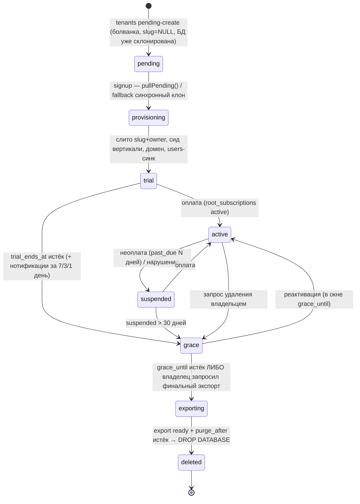

# B-11 — Auth & Tenancy: corex/tenancy (двухуровневая модель D1) + corex/auth (роли поверх AzGuard)

> Доменная спека Этапа 4. Входы: MASTER_PLAN §3 (D1–D16), B-01 (§1, §2.2, §3, §4), B-02, R-05, R-11, R-15, R-13 (§restore), R-08 (§роли), R-02 (§права), R-16 (§провижининг), R-12 (§wakeups).
> Статус: draft → ревью. Дата: 2026-07-03.
> Целевая аудитория: дешёвая модель, пишущая финальные vault-документы и код. Всё, что здесь зафиксировано, — решение; отступление = ошибка.

---

## 1. Границы и состав

### 1.1 Пакеты домена

| Пакет | Содержимое | Лицензия |
|---|---|---|
| **corex/core** (только контракты, см. B-10) | `TenantContext`, `AccountRef`/`WorkspaceRef`, интерфейсы `TenancyManager`, `AccountConnectionResolver`, `TenantDatabaseProvisioner`, дефолт-биндинг `SingleAccountResolver` (boxed). Контракты живут в ядре, чтобы boxed-инсталляция (FlexCMS) не тянула corex/tenancy вообще | MIT |
| **corex/tenancy** | Cloud-реализация: обёртка stancl/tenancy v4 (пин sha), модель `Account`, `TemplateClonePostgreSQLManager`, cluster-роутинг, pending-пул, lifecycle FSM аккаунта, control-plane миграций, workspaces (`wsp_*`), приглашения, root-схема `root_*` (миграции корневой БД), синк identities→users | MIT |
| **corex/auth** | Роли поверх AzGuard: таблицы `aut_*`, матрица role×entity×action×scope, компилятор матрицы → AzGuard permission keys + Eloquent-скоупы, principal-типы user/agent/api_key, системные/кастомные роли | MIT |
| **AzGuard** (внешний, `~/projects/packages/azguard`) | Capability-слой как есть: permission keys `{panel}.{entity}.{action}`, `az_guard_roles`/`role_permissions`/`model_has_roles`/`model_has_scopes`/`direct_grants(expires_at)`, кеш ≤1мс. Кандидаты в апстрим: контракт `ScopeResolver`, principal-тип `agent`, `is_system`-флаг ролей | MIT |
| **stancl/tenancy** | `dev-master#<sha> as 4.0.0` + `stancl/jobpipeline 2.0.0-rc7` (пин). Используется ТОЛЬКО внутри corex/tenancy (§7.4 PHPStan-правило) | MIT |
| **IdP-приложение `id.flex.ru`** | Отдельное Laravel-приложение на root-БД: OIDC Authorization Server (authorization code + PKCE), страницы login/MFA/consent, admin саппорта (impersonation-гранты) | **проприетарное** (SaaS control-plane) |
| **SaaS control-plane** | Деплоер ячеек, ACME-воркер (lego), Caddy-edge ask-endpoint, WakeupDispatcher-демон, migration-оркестратор, admin-панель парка | **проприетарное** |
| **corex/billing** | Владелец таблиц `root_plans`/`root_subscriptions`/`root_usage_snapshots` (DDL приведён здесь в §2.1 для целостности root-схемы; сервисная логика — вне B-11) | **проприетарное** |

### 1.2 Зависимости

- corex/tenancy → corex/core (контракты), stancl/tenancy (пин), corex/auth (роль владельца при активации).
- corex/auth → AzGuard, corex/core (EntityRegistry: `entity_key`, capabilities `ownable`/`workspace_scoped`; `sys_departments` ltree — B-10).
- Внутрь corex/tenancy НЕ входят: тарифная логика (corex/billing), кастомные поля (B-15, только точки сериализации §6.4), workflow-таймеры (B-12, только таблица-контракт `root_wfl_wakeups`).

### 1.3 Два деплой-режима (D10)

| | cloud | boxed |
|---|---|---|
| Пакеты | corex/tenancy + corex/auth | только corex/auth (+ corex/tenancy c `mode=boxed` для boxed-FlexCRM: workspaces без stancl) |
| TenantContext | из host + `/w/{workspace}` | константа из `SingleAccountResolver` |
| stancl | bootstrapped | не бутстрапится (mode=boxed) / не установлен (FlexCMS) |

---

## 2. Схема БД

Конвенции (B-01 §3): PK `uuid` = **UUIDv7, генерируется приложением** (min PG 16 — нативного `uuidv7()` нет, DEFAULT не ставим); `created_at/updated_at timestamptz NOT NULL DEFAULT now()` на ВСЕХ таблицах; enum-строки через CHECK; partial unique `WHERE deleted_at IS NULL`; деньги bigint minor units.

> Порядок создания в миграциях (FK-зависимости): `root_clusters` → `root_templates` → **`root_identities`** → `root_accounts` → остальные (DDL ниже сгруппирован тематически, не по порядку создания).

### 2.1 Корневая БД (префикс `root_`)

```sql
-- ============ Ячейки и шаблоны ============
CREATE TABLE root_clusters (
  id                uuid PRIMARY KEY,
  name              varchar(64) NOT NULL UNIQUE,          -- 'cell-01'
  region            varchar(32) NOT NULL DEFAULT 'ru-central',
  status            varchar(16) NOT NULL DEFAULT 'active'
                    CHECK (status IN ('provisioning','active','draining','readonly','retired')),
  pg_host_writer    varchar(255) NOT NULL,
  pg_host_reader    varchar(255),
  pg_port           int NOT NULL DEFAULT 5432,
  pgbouncer_host    varchar(255) NOT NULL,                -- транспорт приложений: всегда через пулер
  pgbouncer_port    int NOT NULL DEFAULT 6432,
  app_db_user       varchar(64) NOT NULL,                 -- ЕДИНСТВЕННЫЙ app-user ячейки (R-15 §2.1)
  tei_endpoint      varchar(255),                         -- embeddings-sidecar ячейки (R-16)
  backup_repo       varchar(255),                         -- pgBackRest stanza
  db_count          int NOT NULL DEFAULT 0,
  db_soft_limit     int NOT NULL DEFAULT 700,
  pending_pool_size int NOT NULL DEFAULT 20,
  template_version  int NOT NULL DEFAULT 0,               -- версия golden-шаблона, развёрнутая на ячейке
  meta              jsonb NOT NULL DEFAULT '{}',
  created_at timestamptz NOT NULL DEFAULT now(),
  updated_at timestamptz NOT NULL DEFAULT now()
);
COMMENT ON COLUMN root_clusters.app_db_user IS
  'Один PG-юзер на ячейку: пулы PgBouncer = кол-ву БД, не БД×юзеров (R-15)';

CREATE TABLE root_templates (
  id              uuid PRIMARY KEY,
  version         int NOT NULL UNIQUE,
  db_name         varchar(63) NOT NULL,                   -- 'tpl_flex_v42', IS_TEMPLATE=true на каждой ячейке
  status          varchar(16) NOT NULL DEFAULT 'building'
                  CHECK (status IN ('building','ready','retired')),
  embedding_model varchar(64) NOT NULL,                   -- модель, «вшитая» в vector(N) шаблона (R-16)
  embedding_dim   smallint NOT NULL,
  git_ref         varchar(64),
  built_at        timestamptz,
  created_at timestamptz NOT NULL DEFAULT now(),
  updated_at timestamptz NOT NULL DEFAULT now()
);
COMMENT ON TABLE root_templates IS
  'Golden-шаблон = артефакт релиза: CI катает миграции на tpl_flex_vNN, помечает IS_TEMPLATE; приложение к нему никогда не коннектится';

-- ============ Аккаунты ============
CREATE TABLE root_accounts (
  id                uuid PRIMARY KEY,                     -- UUIDv7; ключ stancl-тенанта
  slug              varchar(63),                          -- поддомен; NULL у pending-болванок (R-11 §2.3 п.4)
  name              varchar(255),
  cluster_id        uuid NOT NULL REFERENCES root_clusters(id) ON DELETE RESTRICT,
  db_name           varchar(63) NOT NULL,                 -- 'acc_'||hex(id); НИКОГДА не переименовывается
  status            varchar(16) NOT NULL DEFAULT 'pending' CHECK (status IN
                    ('pending','provisioning','trial','active','suspended','grace','exporting','deleted')),
  owner_identity_id uuid REFERENCES root_identities(id) ON DELETE RESTRICT,
  vertical_code     varchar(64),
  template_version  int NOT NULL,                         -- версия шаблона на момент клона
  embedding_model   varchar(64) NOT NULL,                 -- ФИКСИРУЕТСЯ при провижининге (R-16 §4)
  embedding_dim     smallint NOT NULL,                    -- размерность vector(N) в БД аккаунта
  locale            varchar(8) NOT NULL DEFAULT 'ru',
  trial_ends_at     timestamptz,
  suspended_at      timestamptz,
  grace_until       timestamptz,
  purge_after       timestamptz,
  data              jsonb NOT NULL DEFAULT '{}',          -- stancl VirtualColumn (db_connection-override и пр.)
  created_at timestamptz NOT NULL DEFAULT now(),
  updated_at timestamptz NOT NULL DEFAULT now(),
  deleted_at timestamptz,
  CHECK (status IN ('pending','provisioning') OR slug IS NOT NULL),
  CHECK (status IN ('pending','provisioning') OR owner_identity_id IS NOT NULL)
);
CREATE UNIQUE INDEX root_accounts_slug_uq  ON root_accounts (slug)
  WHERE slug IS NOT NULL AND deleted_at IS NULL;
CREATE UNIQUE INDEX root_accounts_db_uq    ON root_accounts (db_name);
CREATE INDEX root_accounts_cluster_ix ON root_accounts (cluster_id) WHERE deleted_at IS NULL;
CREATE INDEX root_accounts_status_ix  ON root_accounts (status)     WHERE deleted_at IS NULL;
CREATE INDEX root_accounts_purge_ix   ON root_accounts (purge_after) WHERE purge_after IS NOT NULL;
COMMENT ON COLUMN root_accounts.embedding_model IS
  'Контракт провижининга R-16: одна активная embedding-модель на БД; смена dim = ALTER+реиндекс, вне happy-path';

CREATE TABLE root_account_products (                      -- D10: одна БД, продукты = наборы модулей
  account_id   uuid NOT NULL REFERENCES root_accounts(id) ON DELETE CASCADE,
  product      varchar(32) NOT NULL CHECK (product IN ('flexcrm','flexstore')),
  activated_at timestamptz NOT NULL DEFAULT now(),
  created_at timestamptz NOT NULL DEFAULT now(),
  updated_at timestamptz NOT NULL DEFAULT now(),
  PRIMARY KEY (account_id, product)
);

-- ============ Домены ============
CREATE TABLE root_domains (
  id                 uuid PRIMARY KEY,
  account_id         uuid NOT NULL REFERENCES root_accounts(id) ON DELETE CASCADE,
  host               varchar(255) NOT NULL,
  type               varchar(16) NOT NULL CHECK (type IN ('platform','custom')),
  is_primary         boolean NOT NULL DEFAULT false,
  verification_token varchar(64),                         -- значение TXT _flex-verify.<host>
  verified_at        timestamptz,
  tls_status         varchar(16) NOT NULL DEFAULT 'none'
                     CHECK (tls_status IN ('none','pending','issued','failed')),
  ca_used            varchar(32),                         -- 'letsencrypt'|'zerossl'|... multi-CA (R-15 §2.5)
  created_at timestamptz NOT NULL DEFAULT now(),
  updated_at timestamptz NOT NULL DEFAULT now(),
  deleted_at timestamptz
);
CREATE UNIQUE INDEX root_domains_host_uq    ON root_domains (lower(host)) WHERE deleted_at IS NULL;
CREATE UNIQUE INDEX root_domains_primary_uq ON root_domains (account_id)
  WHERE is_primary AND deleted_at IS NULL;
COMMENT ON TABLE root_domains IS
  'platform-домен (slug.flexcrm.ru) создаётся автоматически при активации, verified_at=now(), tls_status=issued (wildcard). Читается ask-endpoint Caddy on-demand TLS: 200 если verified_at IS NOT NULL и account.status в (trial,active)';

-- ============ Единая учётка (IdP id.flex.ru) ============
CREATE TABLE root_identities (
  id                uuid PRIMARY KEY,                     -- = users.id во всех тенантских БД
  email             varchar(255) NOT NULL,
  phone             varchar(32),
  name              varchar(255) NOT NULL DEFAULT '',
  password_hash     varchar(255),                         -- NULL = только внешний вход/magic link
  email_verified_at timestamptz,
  mfa_totp_secret   text,                                 -- encrypted cast приложением
  mfa_enabled_at    timestamptz,
  locale            varchar(8) NOT NULL DEFAULT 'ru',
  is_staff          boolean NOT NULL DEFAULT false,       -- сотрудник платформы (саппорт)
  last_login_at     timestamptz,
  created_at timestamptz NOT NULL DEFAULT now(),
  updated_at timestamptz NOT NULL DEFAULT now(),
  deleted_at timestamptz
);
CREATE UNIQUE INDEX root_identities_email_uq ON root_identities (lower(email)) WHERE deleted_at IS NULL;

CREATE TABLE root_identity_accounts (                     -- членство + курсор синка в тенантскую users
  id          uuid PRIMARY KEY,
  identity_id uuid NOT NULL REFERENCES root_identities(id) ON DELETE CASCADE,
  account_id  uuid NOT NULL REFERENCES root_accounts(id) ON DELETE CASCADE,
  status      varchar(16) NOT NULL DEFAULT 'active' CHECK (status IN ('invited','active','blocked')),
  sync_status varchar(16) NOT NULL DEFAULT 'pending' CHECK (sync_status IN ('pending','synced','failed')),
  synced_at   timestamptz,
  created_at timestamptz NOT NULL DEFAULT now(),
  updated_at timestamptz NOT NULL DEFAULT now(),
  UNIQUE (identity_id, account_id)
);
CREATE INDEX root_identity_accounts_acc_ix  ON root_identity_accounts (account_id);
CREATE INDEX root_identity_accounts_sync_ix ON root_identity_accounts (sync_status)
  WHERE sync_status <> 'synced';

CREATE TABLE root_oauth_clients (                         -- OIDC-клиенты (продукты)
  id                uuid PRIMARY KEY,
  client_id         varchar(64) NOT NULL UNIQUE,
  secret_hash       varchar(255),                         -- NULL = public client (PKCE-only)
  name              varchar(128) NOT NULL,
  product           varchar(32),
  redirect_patterns jsonb NOT NULL,                       -- ['https://*.flexcrm.ru/auth/callback', ...]
  is_first_party    boolean NOT NULL DEFAULT true,
  created_at timestamptz NOT NULL DEFAULT now(),
  updated_at timestamptz NOT NULL DEFAULT now(),
  deleted_at timestamptz
);
COMMENT ON COLUMN root_oauth_clients.redirect_patterns IS
  'wildcard покрывает платформенные поддомены; custom-домены валидируются точным матчем по root_domains(verified)';

CREATE TABLE root_idp_sessions (                          -- SSO-сессии IdP (глобальный logout)
  id          uuid PRIMARY KEY,
  identity_id uuid NOT NULL REFERENCES root_identities(id) ON DELETE CASCADE,
  token_hash  varchar(64) NOT NULL UNIQUE,                -- sha256 от cookie-токена
  ip          inet,
  user_agent  varchar(512),
  expires_at  timestamptz NOT NULL,
  revoked_at  timestamptz,
  created_at timestamptz NOT NULL DEFAULT now(),
  updated_at timestamptz NOT NULL DEFAULT now()
);
CREATE INDEX root_idp_sessions_identity_ix ON root_idp_sessions (identity_id) WHERE revoked_at IS NULL;
-- Authorization codes (TTL 60с) и PKCE-верификаторы — ТОЛЬКО в Redis, таблиц нет.

CREATE TABLE root_oauth_refresh_tokens (
  id         uuid PRIMARY KEY,
  session_id uuid NOT NULL REFERENCES root_idp_sessions(id) ON DELETE CASCADE,
  client_id  varchar(64) NOT NULL,
  token_hash varchar(64) NOT NULL UNIQUE,
  expires_at timestamptz NOT NULL,
  revoked_at timestamptz,
  created_at timestamptz NOT NULL DEFAULT now(),
  updated_at timestamptz NOT NULL DEFAULT now()
);

CREATE TABLE root_impersonation_grants (                  -- support-impersonation (наш механизм поверх IdP;
  id                uuid PRIMARY KEY,                     --  stancl impersonation НЕ используем — решение R-05 в.10)
  staff_identity_id uuid NOT NULL REFERENCES root_identities(id) ON DELETE CASCADE,
  account_id        uuid NOT NULL REFERENCES root_accounts(id) ON DELETE CASCADE,
  target_user_id    uuid,                                 -- users.id в тенантской БД; NULL = владелец аккаунта
  reason            text NOT NULL,
  approved_by       uuid REFERENCES root_identities(id) ON DELETE SET NULL,
  expires_at        timestamptz NOT NULL,                 -- дефолт: created_at + 1 час
  used_at           timestamptz,
  revoked_at        timestamptz,
  created_at timestamptz NOT NULL DEFAULT now(),
  updated_at timestamptz NOT NULL DEFAULT now()
);
CREATE INDEX root_impersonation_acc_ix ON root_impersonation_grants (account_id, created_at);

-- ============ Тарифы/подписки/флаги (владелец — corex/billing) ============
CREATE TABLE root_plans (
  id          uuid PRIMARY KEY,
  code        varchar(32) NOT NULL UNIQUE,
  name        varchar(128) NOT NULL,
  price_minor bigint NOT NULL DEFAULT 0,
  currency    char(3) NOT NULL DEFAULT 'RUB',
  period      varchar(8) NOT NULL DEFAULT 'month' CHECK (period IN ('month','year')),
  limits      jsonb NOT NULL DEFAULT '{}',                -- ключи документированы в §7.2
  is_active   boolean NOT NULL DEFAULT true,
  created_at timestamptz NOT NULL DEFAULT now(),
  updated_at timestamptz NOT NULL DEFAULT now()
);

CREATE TABLE root_subscriptions (
  id           uuid PRIMARY KEY,
  account_id   uuid NOT NULL REFERENCES root_accounts(id) ON DELETE CASCADE,
  plan_id      uuid NOT NULL REFERENCES root_plans(id) ON DELETE RESTRICT,
  status       varchar(16) NOT NULL CHECK (status IN ('trialing','active','past_due','canceled')),
  period_start timestamptz NOT NULL,
  period_end   timestamptz NOT NULL,
  canceled_at  timestamptz,
  created_at timestamptz NOT NULL DEFAULT now(),
  updated_at timestamptz NOT NULL DEFAULT now()
);
CREATE INDEX root_subscriptions_acc_ix ON root_subscriptions (account_id, status);

CREATE TABLE root_feature_flags (
  id         uuid PRIMARY KEY,
  account_id uuid REFERENCES root_accounts(id) ON DELETE CASCADE,  -- NULL = глобальный дефолт
  flag       varchar(64) NOT NULL,
  value      jsonb NOT NULL,
  created_at timestamptz NOT NULL DEFAULT now(),
  updated_at timestamptz NOT NULL DEFAULT now(),
  UNIQUE NULLS NOT DISTINCT (account_id, flag)                     -- PG16: NULLS NOT DISTINCT
);

CREATE TABLE root_usage_snapshots (                       -- nightly-агрегаты (R-05 §4.8, фаза 1)
  account_id uuid NOT NULL REFERENCES root_accounts(id) ON DELETE CASCADE,
  metric     varchar(64) NOT NULL,                        -- 'users','storage_mb','ai_tokens','custom_fields',...
  period     date NOT NULL,
  value      numeric(18,3) NOT NULL,
  created_at timestamptz NOT NULL DEFAULT now(),
  updated_at timestamptz NOT NULL DEFAULT now(),
  PRIMARY KEY (account_id, metric, period)
);

-- ============ Control-plane миграций парка ============
CREATE TABLE root_migration_batches (
  id           uuid PRIMARY KEY,
  from_version int NOT NULL,
  to_version   int NOT NULL,
  wave         varchar(16) NOT NULL CHECK (wave IN ('internal','canary','p10','p50','all')),
  status       varchar(16) NOT NULL DEFAULT 'created'
               CHECK (status IN ('created','running','paused','done','failed')),
  stats        jsonb NOT NULL DEFAULT '{}',               -- {total, ok, failed, skipped, avg_ms}
  started_at   timestamptz,
  finished_at  timestamptz,
  created_at timestamptz NOT NULL DEFAULT now(),
  updated_at timestamptz NOT NULL DEFAULT now()
);

CREATE TABLE root_account_schema_state (                  -- единственная истина «кто на какой версии»
  account_id       uuid PRIMARY KEY REFERENCES root_accounts(id) ON DELETE CASCADE,
  current_version  int NOT NULL,
  target_version   int NOT NULL,
  status           varchar(16) NOT NULL DEFAULT 'ok'
                   CHECK (status IN ('ok','migrating','failed','blocked')),
  batch_id         uuid REFERENCES root_migration_batches(id) ON DELETE SET NULL,
  last_migrated_at timestamptz,
  last_error       text,
  created_at timestamptz NOT NULL DEFAULT now(),
  updated_at timestamptz NOT NULL DEFAULT now()
);
CREATE INDEX root_schema_state_bad_ix ON root_account_schema_state (status) WHERE status <> 'ok';
COMMENT ON COLUMN root_account_schema_state.status IS
  'migrating = сигнал для B-15: DDL-воркер кастомных полей аккаунта откладывает ops (R-13 §3.5); failed→blocked = аккаунт исключён из волн до разбора, код обслуживает совместимой версией';

-- ============ Lifecycle-аудит и экспорты ============
CREATE TABLE root_account_events (
  id         uuid PRIMARY KEY,
  account_id uuid NOT NULL REFERENCES root_accounts(id) ON DELETE CASCADE,
  event      varchar(64) NOT NULL,                        -- 'provisioned','activated','suspended',...
  actor      jsonb NOT NULL DEFAULT '{}',                 -- {type: identity|system|support, id}
  payload    jsonb NOT NULL DEFAULT '{}',
  created_at timestamptz NOT NULL DEFAULT now(),
  updated_at timestamptz NOT NULL DEFAULT now()
);
CREATE INDEX root_account_events_ix ON root_account_events (account_id, created_at);

CREATE TABLE root_account_exports (
  id             uuid PRIMARY KEY,
  account_id     uuid NOT NULL REFERENCES root_accounts(id) ON DELETE CASCADE,
  kind           varchar(16) NOT NULL CHECK (kind IN ('offboarding','pre_purge','manual')),
  status         varchar(16) NOT NULL DEFAULT 'pending'
                 CHECK (status IN ('pending','running','ready','failed','purged')),
  formats        jsonb NOT NULL DEFAULT '["pg_dump","csv"]',
  storage_path   varchar(512),                            -- S3-совм. хранилище в РФ
  url_expires_at timestamptz,                             -- TTL pre-signed URL
  size_bytes     bigint,
  purge_after    timestamptz,                             -- дамп удаляется по retention
  created_at timestamptz NOT NULL DEFAULT now(),
  updated_at timestamptz NOT NULL DEFAULT now()
);

-- ============ Контракт для B-12 (workflow-wakeups, R-12 §2.3) ============
CREATE TABLE root_wfl_wakeups (
  account_id   uuid PRIMARY KEY REFERENCES root_accounts(id) ON DELETE CASCADE,
  next_fire_at timestamptz NOT NULL,       -- MIN(fire_at) незакрытых wfl_timers аккаунта; может отставать
  leased_until timestamptz,                -- lease диспатча, не lock; протухший lease = строка снова видна
  created_at timestamptz NOT NULL DEFAULT now(),
  updated_at timestamptz NOT NULL DEFAULT now()
);
CREATE INDEX root_wfl_wakeups_due_ix ON root_wfl_wakeups (next_fire_at) WHERE leased_until IS NULL;
COMMENT ON TABLE root_wfl_wakeups IS
  'Сбрасываемый кеш маршрутизации (истина — тенантская wfl_timers). Upsert ON CONFLICT DO UPDATE SET next_fire_at=LEAST(...) после коммита тенантской tx; чинится reconciliation-свипом. Владелец логики — B-12';
```

### 2.2 Тенантская БД: users + workspaces (`wsp_`)

```sql
CREATE EXTENSION IF NOT EXISTS ltree;   -- присутствует в golden-шаблоне

CREATE TABLE users (                                      -- локальная проекция root_identities
  id              uuid PRIMARY KEY,                       -- = root_identities.id (единый глобальный id)
  email           varchar(255) NOT NULL,
  name            varchar(255) NOT NULL DEFAULT '',
  phone           varchar(32),
  locale          varchar(8) NOT NULL DEFAULT 'ru',
  password_hash   varchar(255),                           -- ТОЛЬКО boxed-режим; в cloud всегда NULL
  department_id   uuid,                                   -- FK на sys_departments (corex/core, B-10) — добавляется
                                                          --   его миграцией; ось scope dept/dept_tree
  is_active       boolean NOT NULL DEFAULT true,          -- false = членство blocked/удалено в root
  settings        jsonb NOT NULL DEFAULT '{}',
  last_login_at   timestamptz,
  synced_at       timestamptz,                            -- момент последнего синка из root; NULL в boxed
  created_at timestamptz NOT NULL DEFAULT now(),
  updated_at timestamptz NOT NULL DEFAULT now(),
  deleted_at timestamptz
);
CREATE UNIQUE INDEX users_email_uq ON users (lower(email)) WHERE deleted_at IS NULL;
COMMENT ON TABLE users IS
  'Полная денормализованная проекция (решение по R-05 в.3): офлайн-целостность и миграция с Б24 важнее тонкости. Удаление из аккаунта = is_active=false, строка живёт (FK-история)';

CREATE TABLE wsp_workspaces (
  id         uuid PRIMARY KEY,
  parent_id  uuid REFERENCES wsp_workspaces(id) ON DELETE RESTRICT,
  path       ltree NOT NULL,                              -- метки = uuid hex без дефисов
  type       varchar(16) NOT NULL DEFAULT 'company' CHECK (type IN ('company','branch','partner')),
  name       varchar(255) NOT NULL,
  slug       varchar(63) NOT NULL,                        -- сегмент URL /w/{slug}
  is_default boolean NOT NULL DEFAULT false,
  settings   jsonb NOT NULL DEFAULT '{}',
  created_at timestamptz NOT NULL DEFAULT now(),
  updated_at timestamptz NOT NULL DEFAULT now(),
  deleted_at timestamptz
);
CREATE UNIQUE INDEX wsp_workspaces_slug_uq ON wsp_workspaces (slug) WHERE deleted_at IS NULL;
CREATE UNIQUE INDEX wsp_workspaces_default_uq ON wsp_workspaces ((true))
  WHERE is_default AND deleted_at IS NULL;                -- ровно один дефолтный workspace
CREATE INDEX wsp_workspaces_path_gist ON wsp_workspaces USING gist (path);
COMMENT ON COLUMN wsp_workspaces.path IS
  'parent_id — для FK/UI; path — для иерархических предикатов (path <@ :subtree). type=partner: членство не даёт доступа к родителю (§5.4)';
-- НЕТ plan_*-полей: тариф — атрибут аккаунта в root (R-05 §2.13)

CREATE TABLE wsp_workspace_members (
  id           uuid PRIMARY KEY,
  workspace_id uuid NOT NULL REFERENCES wsp_workspaces(id) ON DELETE CASCADE,
  user_id      uuid NOT NULL REFERENCES users(id) ON DELETE CASCADE,
  status       varchar(16) NOT NULL DEFAULT 'active' CHECK (status IN ('active','suspended')),
  is_default   boolean NOT NULL DEFAULT false,            -- workspace по умолчанию для юзера
  joined_at    timestamptz NOT NULL DEFAULT now(),
  created_at timestamptz NOT NULL DEFAULT now(),
  updated_at timestamptz NOT NULL DEFAULT now(),
  UNIQUE (workspace_id, user_id)
);
CREATE INDEX wsp_members_user_ix ON wsp_workspace_members (user_id);
CREATE UNIQUE INDEX wsp_members_default_uq ON wsp_workspace_members (user_id) WHERE is_default;
COMMENT ON TABLE wsp_workspace_members IS
  'Membership = быстрый флаг допуска в резолвере (403 без него); ПРАВА внутри — только corex/auth (роли), роль в pivot не храним';

CREATE TABLE wsp_invitations (
  id           uuid PRIMARY KEY,
  email        varchar(255) NOT NULL,
  workspace_id uuid REFERENCES wsp_workspaces(id) ON DELETE CASCADE,  -- NULL = приглашение в аккаунт
  role_id      uuid REFERENCES aut_roles(id) ON DELETE SET NULL,      -- роль, выдаваемая по акцепту
  invited_by   uuid NOT NULL REFERENCES users(id) ON DELETE RESTRICT,
  token_hash   varchar(64) NOT NULL UNIQUE,
  status       varchar(16) NOT NULL DEFAULT 'pending'
               CHECK (status IN ('pending','accepted','revoked','expired')),
  expires_at   timestamptz NOT NULL,                      -- дефолт 7 дней
  accepted_at  timestamptz,
  created_at timestamptz NOT NULL DEFAULT now(),
  updated_at timestamptz NOT NULL DEFAULT now()
);
CREATE INDEX wsp_invitations_email_ix ON wsp_invitations (lower(email)) WHERE status = 'pending';
```

### 2.3 Тенантская БД: роли (`aut_`, corex/auth)

AzGuard-таблицы (`az_guard_roles`, `az_guard_role_permissions`, `model_has_roles`, `model_has_scopes`, `direct_grants`) — без изменений, это capability-слой. `aut_*` — надстройка-источник истины UI-матрицы, компилируемая в AzGuard.

```sql
CREATE TABLE aut_roles (
  id              uuid PRIMARY KEY,
  slug            varchar(64) NOT NULL,                   -- 'owner','admin','employee','sales_manager'
  name            varchar(128) NOT NULL,
  description     text,
  is_system       boolean NOT NULL DEFAULT false,         -- системные немутируемы: owner/admin/employee
  cloned_from_id  uuid REFERENCES aut_roles(id) ON DELETE SET NULL,
  azguard_role_id bigint,                                 -- ссылка на az_guard_roles (тип — по факту AzGuard)
  assignable_to   jsonb NOT NULL DEFAULT '["user"]',      -- подмножество ["user","agent","api_key"] (twenty)
  created_at timestamptz NOT NULL DEFAULT now(),
  updated_at timestamptz NOT NULL DEFAULT now(),
  deleted_at timestamptz
);
CREATE UNIQUE INDEX aut_roles_slug_uq ON aut_roles (slug) WHERE deleted_at IS NULL;
COMMENT ON COLUMN aut_roles.is_system IS
  'Системная роль: матрица read-only в UI, обновляется релизами; кастомизация = клонировать и править клон (Б24-модель)';

CREATE TABLE aut_role_matrix (
  id           uuid PRIMARY KEY,
  role_id      uuid NOT NULL REFERENCES aut_roles(id) ON DELETE CASCADE,
  entity_key   varchar(64) NOT NULL,                      -- из EntityRegistry: 'crm.deal','tsk.task','cst.<slug>'
  action       varchar(16) NOT NULL
               CHECK (action IN ('read','add','update','delete','export','import')),
  scope        varchar(16) NOT NULL
               CHECK (scope IN ('none','own','dept','dept_tree','workspace','account')),
  context_type varchar(32),                               -- 'pipeline' | 'stage' — контекстное переопределение
  context_id   uuid,
  created_at timestamptz NOT NULL DEFAULT now(),
  updated_at timestamptz NOT NULL DEFAULT now(),
  CHECK ((context_type IS NULL) = (context_id IS NULL)),
  UNIQUE NULLS NOT DISTINCT (role_id, entity_key, action, context_type, context_id)
);
CREATE INDEX aut_role_matrix_entity_ix ON aut_role_matrix (entity_key);
COMMENT ON TABLE aut_role_matrix IS
  'Семантика (Б24, R-08 §2.6): несколько ролей → max-scope-wins по базовым строкам; контекстная строка (context_type NOT NULL) СИЛЬНЕЕ базовой для записей своего контекста, включая сужение — так реализуются «стадийные права». Отсутствие строки = none';

CREATE TABLE aut_role_assignments (
  id             uuid PRIMARY KEY,
  role_id        uuid NOT NULL REFERENCES aut_roles(id) ON DELETE CASCADE,
  principal_type varchar(16) NOT NULL CHECK (principal_type IN ('user','agent','api_key')),
  principal_id   uuid NOT NULL,                           -- users.id | ai_agents.id (B-13) | ключ corex/api
  workspace_id   uuid REFERENCES wsp_workspaces(id) ON DELETE CASCADE,  -- NULL = роль на весь аккаунт
  granted_by     uuid REFERENCES users(id) ON DELETE SET NULL,
  expires_at     timestamptz,                             -- временное назначение (TTL-паттерн direct_grants)
  created_at timestamptz NOT NULL DEFAULT now(),
  updated_at timestamptz NOT NULL DEFAULT now(),
  UNIQUE NULLS NOT DISTINCT (role_id, principal_type, principal_id, workspace_id)
);
CREATE INDEX aut_assignments_principal_ix ON aut_role_assignments (principal_type, principal_id);
COMMENT ON TABLE aut_role_assignments IS
  'twenty roleTarget: агент и api_key — полноправные principal. Права агента при запуске от пользователя = intersection(права инициатора, права роли агента) — enforcement в corex/ai (B-13); здесь только модель';
```

Point-грант на запись (внешний участник, TTL) — штатный AzGuard `direct_grants(grantable morph, permission_key, panel_id, expires_at)`, новых таблиц не нужно.

---

## 3. Публичные контракты

### 3.1 Контракты ядра (corex/core, namespace `Corex\Core\Tenancy`)

```php
final readonly class AccountRef
{
    public function __construct(
        public string $id,            // UUIDv7
        public string $slug,
        public string $status,        // из FSM §5.1
        public array  $features,      // слитые feature-флаги root (boxed: из config)
        public array  $limits,        // root_plans.limits текущего тарифа
    ) {}
}

final readonly class WorkspaceRef
{
    public function __construct(
        public string  $id,
        public string  $slug,
        public string  $type,         // company|branch|partner
        public string  $path,         // ltree как строка
        public ?string $parentId,
    ) {}
}

final readonly class TenantContext
{
    public function __construct(
        public AccountRef    $account,
        public ?WorkspaceRef $workspace,   // null = общеаккаунтный контекст (админка, cron)
    ) {}
}

interface TenancyManager
{
    public function context(): ?TenantContext;            // null = central-контекст (root)
    public function initialized(): bool;
    public function initialize(AccountRef $account): void;   // переключить connection/cache/queue/fs
    public function setWorkspace(?WorkspaceRef $workspace): void;
    public function end(): void;
    /** Выполнить в контексте аккаунта и вернуть результат; исходный контекст восстанавливается. */
    public function runFor(AccountRef $account, ?WorkspaceRef $ws, \Closure $fn): mixed;
}

interface AccountConnectionResolver
{
    /** Полный Laravel-конфиг tenant-коннекта (host/port пулера ячейки, database, username). */
    public function resolve(AccountRef $account): DatabaseConnectionConfig;
}

final readonly class DatabaseConnectionConfig
{
    public function __construct(
        public string $driver,        // 'pgsql'
        public string $host,          // pgbouncer_host ячейки (boxed: PG напрямую)
        public int    $port,
        public string $database,      // db_name
        public string $username,      // app_db_user ячейки
        public array  $options = [],  // PDO: EMULATE_PREPARES по фиче-флагу (R-15 §2.3)
    ) {}
}

/** Boxed-дефолт в corex/core: единственный аккаунт из config('corex.boxed'). */
final class SingleAccountResolver implements AccountConnectionResolver { /* тривиально */ }
```

### 3.2 Контракты corex/tenancy (namespace `Corex\Tenancy`)

```php
final readonly class ProvisionParams
{
    public function __construct(
        public string  $accountId,
        public string  $clusterId,
        public int     $templateVersion,   // из root_clusters.template_version
        public string  $embeddingModel,    // фиксируется в root_accounts (R-16)
        public int     $embeddingDim,
        public ?string $verticalCode,      // сидинг данных, НЕ DDL
        public string  $locale = 'ru',
    ) {}
}

interface TenantDatabaseProvisioner
{
    /** Создать БД (клон шаблона или пул) + пост-шаги GRANT/ALTER DATABASE SET. Идемпотентен. */
    public function provision(ProvisionParams $params): void;
    /** DROP DATABASE; вызывается только lifecycle-оркестратором после exporting (D13). */
    public function drop(AccountRef $account): void;
    /** pg_dump -Fc + CSV/JSON по сущностям в S3; возвращает id root_account_exports. */
    public function export(AccountRef $account, string $kind): string;
}

interface AccountLifecycle       // FSM §5.1; каждый метод валидирует допустимость перехода
{
    public function activateFromPool(string $slug, string $ownerIdentityId, ?string $vertical): AccountRef;
    public function startTrial(AccountRef $a): void;      // trial_ends_at = now() + config('tenancy.trial_days')
    public function activate(AccountRef $a): void;        // оплата
    public function suspend(AccountRef $a, string $reason): void;
    public function resume(AccountRef $a): void;
    public function startGrace(AccountRef $a): void;      // grace_until, purge_after
    public function requestExport(AccountRef $a): string;
    public function purge(AccountRef $a): void;           // exporting → deleted, DROP DATABASE
}

interface WorkspaceResolver
{
    /** Резолв /w/{slug} + проверка членства текущего user; null-slug → default workspace. Нет членства → 403. */
    public function resolve(?string $slug): WorkspaceRef;
}

interface IdentitySyncer
{
    /** Идемпотентный upsert users-строки в БД аккаунта по root_identities+membership. */
    public function syncToAccount(string $identityId, string $accountId): void;
    /** Fan-out при изменении identity во все аккаунты членства (queued). */
    public function fanOut(string $identityId): void;
}

/**
 * Реализация контрактов corex/core (B-10 §3.1), делегированных сюда табл. §6 B-10.
 * Адаптер над TenancyManager::context(): B-10 §3.1 объявляет current(): TenantContext non-nullable,
 * TenancyManager::context() — nullable (null = central/root-запрос) ⇒ адаптер бросает исключение вне тенантского контекста.
 */
final class TenancyManagerContextResolver implements TenantContextResolver
{
    public function __construct(private TenancyManager $tenancy) {}
    public function current(): TenantContext { /* $this->tenancy->context() ?? throw CentralContextException */ }
}

/**
 * Облачная реализация ModuleActivationGate (B-10 §3.3, интерфейс объявлен там): читает
 * подписку/тариф аккаунта из root_plans/root_subscriptions (владелец таблиц — corex/billing, §1.1).
 * Boxed: биндинг AllowAll живёт в corex/core (B-10 §6.1), corex/tenancy не участвует.
 */
final class BillingModuleActivationGate implements ModuleActivationGate
{
    public function check(TenantContext $ctx, string $module, string $edition): GateDecision { /* root_subscriptions → allow | deny(reason, upgradeHint) */ }
}
```

`TemplateClonePostgreSQLManager extends Stancl\...\PostgreSQLDatabaseManager` — сабкласс ~40 строк: `CREATE DATABASE {db} TEMPLATE {tpl_flex_vNN} STRATEGY WAL_LOG` + пост-шаги (GRANT app_db_user, `ALTER DATABASE ... SET`), версия шаблона из `root_clusters` (R-11 §2.3 п.2). Пайплайн `TenantCreated ⇒ [CreateDatabase]` — **без** `MigrateDatabase` (схема в шаблоне) и без `SeedDatabase` (сидинг вертикали — отдельный шаг активации).

### 3.3 Контракты corex/auth (namespace `Corex\Auth`)

```php
enum PrincipalType: string { case User = 'user'; case Agent = 'agent'; case ApiKey = 'api_key'; }

enum Scope: string
{
    case None = 'none'; case Own = 'own'; case Dept = 'dept';
    case DeptTree = 'dept_tree'; case Workspace = 'workspace'; case Account = 'account';
    public function weight(): int { /* none=0 … account=5; max-scope-wins */ }
}

interface Principal
{
    public function principalType(): PrincipalType;
    public function principalId(): string;
}

/** Контекст записи для контекстных переопределений (pipeline/stage). */
final readonly class RecordContext
{
    public function __construct(public string $type, public string $id) {} // 'stage', uuid
}

interface AccessChecker
{
    /** Capability-проверка (AzGuard-кеш, ≤1мс): может ли принципал делать action над типом. */
    public function allowed(Principal $p, string $entityKey, string $action): bool;
    /** Эффективный scope: max по базовым строкам ролей; контекстная строка сильнее базовой. */
    public function scopeFor(Principal $p, string $entityKey, string $action, ?RecordContext $ctx = null): Scope;
    /** Проверка конкретной записи: scope-предикат + direct_grants + participant-роли панелей (gate 2 — R-08). */
    public function canOnRecord(Principal $p, string $action, object $record): bool;
}

interface ScopeResolver
{
    /** Накладывает WHERE по эффективному scope (таблица компиляции §5.5) на Builder. */
    public function apply(\Illuminate\Database\Eloquent\Builder $q,
                          Principal $p, string $entityKey, string $action): \Illuminate\Database\Eloquent\Builder;
}

interface RoleMatrixCompiler
{
    /** aut_role_matrix → AzGuard role_permissions (permission keys `{module}.{entity}.{action}`)
     *  + компилированная scope-карта в кеш. Транзакционно; бамп cache-версии в конце. */
    public function compile(string $roleId): void;
    public function recompileAll(): void;                 // после релиза/установки вертикали
}

interface ImpersonationService
{
    /** Вход саппорта по гранту из root: tenant-сессия с флагом; все ACTOR = {type:'support'}. */
    public function start(string $grantId): void;
    public function stop(): void;
    public function active(): ?string;                    // grant id
}
```

### 3.4 Доменные события

| Событие | Payload | Излучатель |
|---|---|---|
| `Tenancy\AccountProvisioned` | accountId, clusterId, dbName, templateVersion | provisioner |
| `Tenancy\AccountActivated` | accountId, slug, ownerIdentityId, verticalCode | lifecycle |
| `Tenancy\TrialStarted` / `TrialExpiring(daysLeft)` / `TrialExpired` | accountId, trialEndsAt | lifecycle/scheduler |
| `Tenancy\AccountSuspended` / `AccountResumed` | accountId, reason | lifecycle |
| `Tenancy\GraceStarted` | accountId, graceUntil, purgeAfter | lifecycle |
| `Tenancy\AccountExportReady` | accountId, exportId, urlExpiresAt | export-воркер |
| `Tenancy\AccountPurged` | accountId, dbName | lifecycle |
| `Tenancy\DomainVerified` / `DomainTlsIssued` | domainId, host, caUsed | domain-воркер |
| `Tenancy\WorkspaceCreated` / `WorkspaceArchived` | workspaceId, type, parentId | wsp-сервис |
| `Tenancy\MemberJoined` / `MemberLeft` | workspaceId, userId | wsp-сервис |
| `Tenancy\InvitationSent` / `InvitationAccepted` | invitationId, email, workspaceId | wsp-сервис |
| `Tenancy\UserSynced` | accountId, userId | IdentitySyncer |
| `Auth\RoleCreated` / `RoleCloned` | roleId, clonedFromId | corex/auth |
| `Auth\RoleMatrixUpdated` | roleId (→ триггер recompile) | corex/auth |
| `Auth\RoleAssigned` / `RoleRevoked` | roleId, principalType, principalId, workspaceId | corex/auth |
| `Auth\ImpersonationStarted` / `Ended` | grantId, staffIdentityId, targetUserId | ImpersonationService |

Все события тенантской плоскости несут `TenantContext` в payload очереди (stancl queue bootstrapper); root-события (lifecycle) — central-очередь.

---

## 4. Extension points

1. **Бутстрапперы**: конфиг-список `tenancy.bootstrappers` — модуль добавляет свой класс (пример ядра: `WorkspaceContextBootstrapper` — восстанавливает workspace в queued jobs). Порядок фиксирован: Database → Cache(prefix) → DatabaseSession → Queue → Filesystem → Scout → свои.
2. **Extender `Extend\Permissions`** (B-01 §2.3): модуль декларирует entity_keys, actions (может расширить базовые шесть доменными: `crm.deal.move_stage`) и вклад в системные роли; corex/auth мерджит в матрицу при активации модуля, `RoleMatrixCompiler::recompileAll()` после.
3. **Capabilities EntityRegistry, потребляемые auth**: `ownable` (есть `owner_id` → допустимы scope own/dept/dept_tree), `workspace_scoped` (есть `workspace_id` → допустим scope workspace). Сущность без capability: недопустимые scope не показываются в UI-матрице и трактуются компилятором как `account`.
4. **События §3.4** — единственный канал реакции модулей на lifecycle (никаких хуков в пайплайн провижининга: сидинг модуля — подписка на `AccountActivated`/`ModuleEnabled` B-10).
5. **`RecordContext`-провайдеры**: модуль регистрирует резолвер контекста записи (`crm`: Deal → `{type:'stage', id}`) — так стадийные права работают для любых сущностей с FSM.
6. **Контракт wakeup для B-12**: таблица `root_wfl_wakeups` + место в реестре root-демонов (`WakeupDispatcher` рядом с migration-оркестратором); corex/tenancy предоставляет `runFor()` для свипов.
7. **Вертикали (B-13)**: секция `roles:` манифеста = набор `aut_roles`+матриц; installer создаёт их как НЕсистемные (клоны employee) и прогоняет компилятор.

---

## 5. Ключевые потоки

### 5.1 Lifecycle аккаунта (FSM, D13: без free tier)



Правила: каждый переход — строка в `root_account_events` + событие §3.4; таймеры (`trial_ends_at`, `grace_until`, `purge_after`) обслуживаются планировщиком control-plane (central scheduler, не тенантские wfl); `deleted` — soft (`deleted_at`), физическая БД дропнута, дампы `root_account_exports` живут до `purge_after` дампа; бэкапы ячейки вычищаются retention ≤30 дней (фиксируется в ToS). Доступ по статусам: `trial|active` — полный; `suspended` — владельцу страница оплаты, остальным 403; `grace` — owner read-only + экспорт; `exporting|deleted` — 410.

### 5.2 Signup / провижининг (цель: секунды)

```mermaid
sequenceDiagram
    participant U as Пользователь
    participant W as www/signup (central app)
    participant R as root-БД
    participant C as Ячейка (PG)
    U->>W: форма (slug, email, пароль, вертикаль)
    W->>R: валидация slug (unique, зарезервированные имена) + create/find root_identities
    W->>R: pullPending() аккаунт ячейки (least db_count, template актуален)
    alt пул пуст
        W->>C: синхронный CREATE DATABASE ... TEMPLATE tpl_flex_vNN (p95 < 3с)
    end
    W->>R: UPDATE root_accounts: slug, owner, vertical, status=provisioning
    W->>R: INSERT root_domains (slug.flexcrm.ru, verified, tls=issued)
    W->>C: users-синк владельца + назначение системной роли owner
    W->>C: сид вертикали (данные, НЕ DDL; queued при > 2с)
    W->>R: status=trial, trial_ends_at; событие AccountActivated
    W-->>U: redirect https://slug.flexcrm.ru + OIDC auto-login (§5.3)
```

Edge cases: (а) пул пуст → синхронный клон, signup всё равно синхронный (порог 10с); (б) новый релиз шаблона → `tenants:pending-clear` дропает болванки старой версии, пополнятель нарезает новые; (в) гонка slug — ловит partial unique, пользователю 422; (г) сид вертикали упал → status остаётся provisioning, ретрай джоба, алерт после 3 попыток; аккаунт не виден как «сломанный трайл».

### 5.3 OIDC-вход (id.flex.ru, ADR-кандидат N7)

```mermaid
sequenceDiagram
    participant B as Браузер
    participant T as acme.flexcrm.ru (tenant app)
    participant I as id.flex.ru (IdP, root-БД)
    B->>T: GET /crm (нет tenant-сессии)
    T-->>B: 302 id.flex.ru/authorize?client_id=flexcrm&redirect_uri=https://acme.flexcrm.ru/auth/callback&state&code_challenge (PKCE S256)
    B->>I: authorize (cookie IdP-сессии? иначе login+MFA → root_idp_sessions)
    I->>I: root_identity_accounts: membership(identity, account по host)? нет → 403 «нет доступа»
    I-->>B: 302 callback?code=...(Redis, TTL 60с)
    B->>T: GET /auth/callback?code
    T->>I: POST /token (code+verifier; secret для confidential) → id_token{sub=identity_id, acct}, refresh
    T->>T: users WHERE id=sub; нет строки, но membership active → sync-on-demand (IdentitySyncer)
    T->>T: tenant-локальная сессия (database-driver, БД аккаунта)
    T-->>B: 302 /crm
```

Правила: id_token claims: `sub` (identity), `acct` (account id), `email`, `name`, `imp` (grant id при impersonation). Платформенные поддомены дополнительно шарят cookie `.flexcrm.ru` для «тихого» SSO между аккаунтами одного продукта; custom-домены и кросс-продукт — только полный code flow. Глобальный logout = revoke `root_idp_sessions` + каскад refresh; tenant-сессии добиваются по TTL (≤12ч) — фиксируем как осознанную задержку logout-а. Boxed: IdP отсутствует, стандартный Laravel guard по `users.password_hash`.

### 5.4 Резолюция запроса: host → account → workspace → scope

1. Edge (Caddy) терминирует TLS, проксирует с `Host` (заголовки `X-Account-*` НЕ ставятся — edge не источник истины, R-15 §2.8).
2. `ResolveTenantFromHost` (kernel early-identification): Redis-кеш `host → {account_id, db_name, cluster, status, features}` (TTL 5 мин + инвалидация по событиям домена/аккаунта); miss → root-БД.
3. Гейт статуса (§5.1). ОК → `TenancyManager::initialize()` (stancl DatabaseConfig: host/user из `root_clusters`, database из `db_name`).
4. `WorkspaceResolver`: сегмент `/w/{slug}` → workspace; без сегмента → default workspace юзера (или общеаккаунтный контекст для админ-роутов). Членство `wsp_workspace_members.status=active` обязательно, иначе 403. **partner-workspace**: членство в нём НЕ даёт видимости родителя; иерархический просмотр «родитель видит дочерние» — только через scope `workspace` + политика `settings.cascade_view=true` на родителе (ltree-предикат `path <@`).
5. `TenantContext` биндится в контейнер; все Eloquent-запросы workspace_scoped-сущностей получают global scope `workspace_id = context.workspace.id OR workspace_id IS NULL` (NULL = общеаккаунтные записи).

### 5.5 Проверка прав и компиляция scope

Двухфазно (Salesforce-разделение, R-02 §4.5):

1. **Capability (≤1мс)**: `AccessChecker::allowed()` → AzGuard permission key `{module}.{entity}.{action}` из кеша. Ключ существует, если у любой роли принципала в матрице scope ≠ none.
2. **Record scope**: `ScopeResolver::apply()` компилирует эффективный scope в WHERE:

| scope | Предикат (компиляция) | Требует capability |
|---|---|---|
| `none` | `WHERE false` (и capability не выдан) | — |
| `own` | `owner_id = :userId` | ownable |
| `dept` | `owner_id IN (SELECT id FROM users WHERE department_id = :dept)` | ownable + sys_departments |
| `dept_tree` | owner в поддереве: `department_id IN (SELECT id FROM sys_departments WHERE path <@ :userDeptPath)` | ownable + sys_departments |
| `workspace` | global scope workspace (уже наложен §5.4 п.5) — предикат пуст | workspace_scoped |
| `account` | предикат пуст, workspace-scope тоже снимается (для read согласно политике продукта) | — |

Разрешение конфликтов: несколько ролей → `max(weight)` по базовым строкам; `RecordContext` (стадия/воронка) → контекстные строки всех ролей, из них max; контекстный max **заменяет** базовый (может сужать — «менеджер видит сделки только на стадиях X,Y»). Для agent/api_key принципалов `own` резолвится по `owner_id = principal_id`? Нет: агент не владеет записями — `own/dept` у агентов вырождается в `none`, валидно только `workspace/account` (валидатор матрицы предупреждает). Кеш: компилированная карта `(role → entity → action → scope[, ctx])` — versioned cache key; `RoleMatrixUpdated` бампает версию.

### 5.6 Миграции парка (expand-contract, волны)

1. Релиз повышает `schema_version` шаблона (`root_templates.version`); все тенантские миграции идемпотентны, backward-compatible (app N работает со схемами N и N+1), `CREATE INDEX CONCURRENTLY` для горячих таблиц.
2. Оператор создаёт `root_migration_batches(from,to,wave)`; wave-выборка: `internal` (наши аккаунты) → `canary` (1–5% opt-in, мелкие) → `p10` → `p50` → `all`.
3. Оркестратор per ячейка: помечает аккаунты `schema_state.status=migrating` (→ B-15 откладывает DDL-ops), берёт в тенантской БД `pg_advisory_xact_lock(hashtext('fld_ddl'))` (взаимная сериализация с кастомными ALTER, R-13 §3.5), гонит `tenants:migrate -p 8 --skip-failing --tenants=...` батчами ≤5 мин с rate-limit ячейки.
4. Успех → `current_version=target`, `status=ok`; ошибка → `status=failed→blocked`, аккаунт исключён из волн, алерт; фичи гейтятся `current_version` (feature-флаги).
5. Contract-фаза (drop) — только следующим релизом после 100% adoption. Squash: `tenants:dump` после стабилизации; полная схема живёт в шаблоне.
6. Lazy-миграции модулей маркетплейса — тот же runner при активации модуля (B-10), версия модуля в тенантской `mod_modules`.

### 5.7 Custom-домен (R-15 §2.7)

1. Клиент вводит `crm.client.ru` (apex запрещён валидатором; лимит доменов — `limits.custom_domains_max`).
2. Создаётся `root_domains(type=custom, verification_token)`; UI показывает две записи: `CNAME crm.client.ru → edge.flexcrm.ru`, `TXT _flex-verify.crm.client.ru = <token>`.
3. Верификационный воркер (retry с backoff, 48ч дедлайн) проверяет обе записи → `verified_at=now()`, инвалидация host-кеша.
4. Первый TLS-handshake → Caddy on-demand → ask-endpoint control-plane `GET /api/tls/allow-domain?host=...`: 200 если `verified_at IS NOT NULL AND account.status IN ('trial','active')`, иначе 404. Выпуск → `tls_status=issued, ca_used` (fallback ZeroSSL при отказе LE).
5. Отвязка/удаление аккаунта → `deleted_at` на домене, кеш-инвалидация, ask-endpoint начинает отвечать 404 (серт не продлевается).

### 5.8 Offboarding, purge и restore

**Offboarding**: `grace → exporting`: воркер `export(kind='offboarding')` — `pg_dump -Fc` + CSV/JSON по сущностям → S3 (РФ) → `AccountExportReady` (pre-signed URL, TTL 14 дней) → по `purge_after`: `DROP DATABASE`, `status=deleted`, домены deleted, `root_wfl_wakeups` каскадом, identity-membership остаётся (история).

**Restore аккаунта (runbook, R-05 §4.7 + R-13 §3.4)**:
1. PITR-lab: pgBackRest selective restore целевой БД на lab-хост → `pg_dump` → загрузка в прод-ячейку как `acc_<id>_restored_YYYYMMDD` (никогда не клоббер).
2. Оператор сверяет, пользователь подтверждает подмену → swap: `root_accounts.db_name` → на restored, старая БД в карантин 7 дней.
3. Пост-restore чек-лист (обязательный, автоматизирован командой `flex:restore:reconcile {account}`):
   - `flex:schema:verify` — fingerprint-сверка fld-реестра со схемой (B-15/R-13);
   - discard queued jobs, ссылающихся на несуществующие op/записи (проверка существования при старте джоба);
   - полный reindex Meilisearch аккаунта;
   - reconciliation `root_wfl_wakeups` по факту `wfl_timers` (B-12);
   - re-sync users из root (root — истина по identity);
   - пересчёт usage-метрик nightly-джобом.

### 5.9 Impersonation саппорта

1. Саппорт (is_staff) создаёт грант в admin-панели control-plane: account, target (дефолт owner), reason (обязателен), TTL 1ч; опционально approved_by (4-eyes для prod-политики).
2. Вход через IdP: id_token с claim `imp=<grant_id>`; tenant app валидирует грант (не expired/revoked/использован по политике), открывает сессию **от имени target_user** с флагом impersonation.
3. Во время сессии: баннер в UI; все audit-записи ACTOR `{type:'support', id: staff_identity_id, grant: grant_id}`; запрещены: смена пароля/email, платежи, удаление аккаунта, выдача ролей admin/owner.
4. `stop()`/TTL → `ImpersonationEnded`, `used_at`; события зеркалируются в `root_account_events`.

---

## 6. Интеграции с другими доменами

| Домен | Контракт |
|---|---|
| **B-10 core/modules** | Контракты TenantContext/резолверы живут в corex/core; активация модуля per-account (`mod_modules`) + lazy-миграции ездят на `tenants:migrate --tenants=`; `Extend\Permissions` и capabilities `ownable/workspace_scoped` — вход corex/auth; правило кода под transaction pooling (SET LOCAL only, LISTEN/NOTIFY→Redis) — конвенция ядра |
| **B-12 workflow** | Экспортируем таблицу `root_wfl_wakeups` (§2.1) + слот root-демона WakeupDispatcher; `wakeup_driver=root_registry\|local_sweep` — конфиг деплой-режима; свипы используют `TenancyManager::runFor()`; reconciliation переиспользует оркестрацию волн (§5.6) |
| **B-13 CRM** | entity_keys из EntityRegistry в матрицу; `RecordContext`-провайдер pipeline/stage (стадийные права); агент = principal `agent` (aut_role_assignments), права запуска = intersection (enforcement в corex/ai); MCP-тулзы проходят те же AccessChecker/ScopeResolver |
| **B-15 attributes** | Взаимная сериализация DDL: advisory-лок `hashtext('fld_ddl')` + флаг `schema_state.status=migrating`; квоты из `root_plans.limits` (ключи §7.2) кешируются в features аккаунта, enforcement на INSERT op (R-13 §3.6); `flex:schema:verify` — шаг restore-runbook §5.8; кастомные сущности `cst_<slug>` регистрируют entity_key → автоматически попадают в матрицу прав |
| **B-16 спутники** | Chatom/Vaulter получают `TenantContext` в jobs (bootstrapper) и в JWT Hocuspocus (claims `acct`, `ws`, docName `{account_id}:{doc_id}`); gate 1 панелей = `AccessChecker::canOnRecord()`; participant-роли панелей (gate 2) — их таблицы, наш `direct_grants` для внешних гостей с TTL |
| **B-14 commerce** | Каналы/видимость per-workspace (D11) опираются на `workspace_id`-скоуп и `WorkspaceRef.type` |
| **corex/billing** | Владеет root_plans/subscriptions/usage; corex/tenancy читает limits/status подписки в AccountRef; события lifecycle → биллинг-реакции (suspend по past_due) |

### 6.1 Деградация в boxed-режиме (D10)

| Компонент | cloud | boxed |
|---|---|---|
| Резолюция тенанта | stancl early-identification по host | `SingleAccountResolver`: константный `TenantContext` из config; middleware host-резолва не регистрируется |
| users / вход | синк из root_identities, вход через OIDC | локальная auth (`users.password_hash`, стандартный guard/Fortify); `synced_at` NULL |
| Провижининг | pending-пул + template clone | `php artisan flex:install` (миграции с нуля + сид) |
| Квоты/фичефлаги | root_plans.limits / root_feature_flags | config-файлы (`corex.limits`, `corex.features`); AccountRef.limits наполняется из них |
| Workflow-wakeups | root_registry + WakeupDispatcher | `local_sweep` (B-12): свип своей БД по scheduler |
| Домены/TLS | edge Caddy + root_domains | реверс-прокси пользователя; таблиц root_ нет |
| Миграции | control-plane волны | `php artisan migrate` |
| Workspaces | есть (corex/tenancy) | supported core-only boxed profile: константный account и no-workspace. Boxed workspaces unsupported до named consumer и отдельного adapter design; `corex/tenancy` не становится зависимостью core-only PHP 8.3 профиля. |
| corex/auth | идентичен | идентичен (полностью автономен от tenancy) |
| Impersonation | IdP-грант | отсутствует |

Инвариант: ни один модуль не ветвится по `if (cloud)` — только контракты corex/core и конфиг-биндинги.

---

## 7. НФТ и лимиты

### 7.1 Производительность (пороги = гейты PoC, Приложение A)

| Метрика | Порог |
|---|---|
| Инициализация tenancy на запрос (FPM) | ≤ 5 мс p95 |
| Capability-проверка (AzGuard кеш) | ≤ 1 мс |
| Оверхед scope-предиката | ≤ 10% времени базового запроса листинга |
| Клон шаблона | p95 < 3 с; signup из пула e2e < 2 с; при пустом пуле < 10 с |
| `tenants:migrate` 200 БД `-p 8` | < 5 мин, 0 failed |
| Резолюция host из кеша | ≤ 1 мс (Redis) |
| Плотность ячейки | soft-limit 700 БД; PgBouncer per R-15 §2.3 (pool 5, max_db_connections 10, max_prepared_statements 200, autodb_idle 1200) |
| Runtime v1 | **PHP-FPM** (Octane не поддержан stancl v4 — R-11 §2.3 п.8); НФТ 5000 RPS добирается горизонтально |

### 7.2 Квоты per-тариф (`root_plans.limits`, канонические ключи)

```json
{
  "users_max": 25, "workspaces_max": 5, "partner_workspaces_max": 3,
  "custom_domains_max": 1, "custom_roles_max": 10,
  "custom_fields_per_entity": 50, "custom_entities_max": 10,
  "custom_indexes_per_entity": 5, "physical_columns_cap": 300,
  "storage_gb": 50, "ai_tokens_month": 1000000, "api_rps": 20,
  "restore_self_service": false
}
```

Enforcement: users_max — при акцепте приглашения/синке; workspaces/roles/domains — при создании; fld-ключи — B-15 (R-13 §3.6); grandfathering при даунгрейде (существующее живёт, новое не создать). Лимиты доезжают до тенанта в `AccountRef.limits` (кеш features, инвалидация по смене подписки).

### 7.3 Safety-инварианты

1. **Изоляция stancl**: импорт `Stancl\*` разрешён только в corex/tenancy — PHPStan-правило (custom rule) + arch-тест Pest в CI.
2. **Нет FK через границу БД**: тенантские таблицы не ссылаются на root и наоборот; связь только по uuid-значениям (users.id = identity id).
3. **Один app-user на ячейку**; приложение никогда не коннектится к golden-шаблону; DDL к тенантским БД — только миграционный runner и B-15-воркер.
4. **Transaction pooling гигиена** (конвенция ядра, CI-линт): `SET LOCAL` only, без сессионных advisory locks (только `pg_advisory_xact_lock`), без temp tables, LISTEN/NOTIFY → Redis.
5. **Сессии** — database-driver в БД аккаунта (физическая изоляция) + `scope_sessions` middleware; **очереди** — central Redis, non-prefixed connection, tenant-контекст в payload (R-11 §2.4).
6. Пароли в cloud — только в root (у тенантских users `password_hash` NULL); tenant key в URL — slug, не uuid.
7. Кластеры, бэкапы, экспорты, ClickHouse — РФ-ЦОД (ФЗ-152); purge-протокол D13: экспорт до DROP, бэкап-retention ≤30 дней в ToS.
8. Компилятор матрицы транзакционен: AzGuard-ключи и scope-карта не расходятся (бамп cache-версии последним шагом).
9. Ключ тенанта не енумерируем (UUIDv7: случайная часть 62 бита); pending-болванки не резолвятся по host (slug NULL).
10. Impersonation: грант одноразовый по политике, TTL ≤ 1ч, деструктивные операции запрещены (§5.9 п.3).
11. **Н1 — единственный ключ связки root↔tenant**: `root_identities.id` (UUIDv7); телефон/email/ФИО ключом связки не являются нигде (аддитивная дельта B-34 §3.2/§8.4, канонизация — D23/Q64, FLEX-2 P6.2).
12. **Н2 — 🔴 запрет авто-merge/авто-привязки identity**: identity НЕ связываются автоматически по совпадению телефона/email ни в синке (IdentitySyncer), ни в приглашениях, ни в импорте; слияние учёток — только явная user-driven операция на IdP (v1.1+) (B-34 §3.2/§8.4, D23/Q64).
13. **Н3 — `root_identities.phone` без unique-индекса**: контактный атрибут, не ключ связки (B-34 §3.2, D23/Q64).
14. **Н4 — email приглашения = транспорт, не ключ связки**: акцепт приглашения (`wsp_invitations.email`) связывает по `identity_id`, аутентифицировавшемуся на IdP и предъявившему токен, независимо от того, на какой email пришло письмо (B-34 §3.2/§8.4, D23/Q64).

---

## 8. Acceptance criteria

**Tenancy/root:**
- AC-1. Миграции корневой БД создают все таблицы §2.1 с точными CHECK/partial unique/FK ON DELETE как в DDL; `UNIQUE NULLS NOT DISTINCT` на root_feature_flags и aut-таблицах работает (PG 16).
- AC-2. `Account extends BaseTenant` с UUIDv7-генератором; кастомные колонки через `getCustomColumns()`, остальное — VirtualColumn `data`.
- AC-3. `TemplateClonePostgreSQLManager` клонирует `TEMPLATE tpl_flex_vNN STRATEGY WAL_LOG` + пост-шаги GRANT/SET; пайплайн TenantCreated не содержит MigrateDatabase/SeedDatabase.
- AC-4. Pending-пул: `tenants:pending-create` держит `pending_pool_size` болванок per ячейка; болванки имеют slug=NULL/owner=NULL и проходят CHECK-констрейнты; `pending-clear` инвалидацией по смене template_version.
- AC-5. Signup e2e из пула < 2 с; при пустом пуле < 10 с; гонка slug возвращает 422 без осиротевших БД.
- AC-6. FSM §5.1: недопустимые переходы бросают исключение; каждый переход пишет root_account_events + излучает событие §3.4; таймеры trial/grace/purge срабатывают шедулером.
- AC-7. Purge: экспорт (pg_dump -Fc + CSV) готов ДО DROP DATABASE; pre-signed URL с TTL; после purge root_wfl_wakeups и домены аккаунта удалены/помечены.
- AC-8. `flex:restore:reconcile` выполняет все 6 шагов §5.8 и идемпотентен.
- AC-9. Cluster-роутинг: connection tenant-коннекта строится из root_clusters (pgbouncer host, app_db_user) + db_name аккаунта; смена ячейки аккаунта = обновление записи, без деплоя.
- AC-10. embedding_model/embedding_dim фиксируются в root_accounts при провижининге из root_templates и доступны в ProvisionParams (контракт R-16).
- AC-11. Control-plane миграций: волна internal→canary→p10→p50→all; failed-аккаунт → blocked и исключается из следующих волн; статус migrating выставляется до и снимается после прогона.
- AC-12. Advisory-лок `hashtext('fld_ddl')` берётся migration-runner'ом в каждой тенантской БД (проверяется тестом одновременного B-15-op).

**Домены/TLS/IdP:**
- AC-13. Platform-домен создаётся при активации автоматически (verified, tls=issued); custom-домен проходит CNAME+TXT верификацию, ask-endpoint отвечает 200/404 по правилу §5.7 п.4; ca_used заполняется.
- AC-14. OIDC: authorization code + PKCE; id_token несёт sub/acct/email/imp; membership-проверка на IdP (403 чужому аккаунту); sync-on-demand создаёт users-строку при валидном членстве.
- AC-15. Глобальный logout ревокает IdP-сессию и refresh-токены; tenant-сессии истекают ≤12ч.
- AC-16. Fan-out синка identity (смена email/имени) доезжает во все аккаунты членства; сбой одного аккаунта не блокирует остальные (sync_status=failed + ретрай).

**Workspaces:**
- AC-17. wsp_workspaces: иерархия parent_id+path согласована (тест: перенос поддерева обновляет path потомков); ровно один is_default; slug уникален среди живых.
- AC-18. Резолвер /w/{slug}: не-член → 403; без slug → default workspace юзера; partner-workspace не даёт видимости родителя.
- AC-19. Приглашение: акцепт создаёт membership (+ роль из role_id), помечает accepted; истёкшее/ревокнутое → 410; лимит users_max проверяется на акцепте.
- AC-20. Global scope workspace_scoped-сущностей: `workspace_id = ctx OR IS NULL`; общеаккаунтный контекст снимает скоуп только для админ-роутов.

**corex/auth:**
- AC-21. Три системные роли (owner/admin/employee) сидируются, немутируемы (попытка правки матрицы → 403); клонирование создаёт редактируемую копию с cloned_from_id.
- AC-22. Компилятор: правка aut_role_matrix → AzGuard permission keys + scope-карта обновлены транзакционно; capability-проверка после компиляции ≤1мс (кеш).
- AC-23. Scope-предикаты §5.5 компилируются в ровно указанные WHERE; dept/dept_tree используют ltree sys_departments; max-scope-wins при нескольких ролях покрыт тестами (все 6×6 пар).
- AC-24. Контекстные переопределения: строка (role, crm.deal, read, none, stage, S1) скрывает сделки стадии S1 даже при базовом scope=account (сужение работает).
- AC-25. Принципалы agent/api_key: назначение роли, проверка прав и скоупы работают без users-строки; own/dept для агентов вырождается в none с предупреждением валидатора.
- AC-26. aut_role_assignments.expires_at: протухшее назначение исключается из компиляции/кеша без ручного вмешательства.
- AC-27. `Extend\Permissions` модуля добавляет entity_keys/actions в матрицу при активации и убирает при disable (матричные строки сохраняются для re-enable).

**Режимы/инварианты:**
- AC-28. Boxed: `mode=boxed` — приложение поднимается без root-БД и stancl-бутстрапа; SingleAccountResolver; корex/auth полностью функционален; FlexCMS без corex/tenancy собирается и работает.
- AC-29. PHPStan-правило «Stancl\* только в corex/tenancy» падает в CI при нарушении; arch-тест на отсутствие cross-DB FK.
- AC-30. Leak-тесты изоляции (PoC сц.4–5): 1000 переключений контекста, 0 пересечений cache/session/fs/queue.
- AC-31. Impersonation: вход по гранту, баннер, ACTOR=support в audit, запрещённые операции блокируются, авто-завершение по TTL, события в root_account_events.
- AC-32. Все таблицы имеют created_at/updated_at; все enum-поля под CHECK; все PK — uuid (UUIDv7 приложением); COMMENT ON присутствуют как в §2.

---

## 9. Открытые вопросы

1. **users-проекция**: выбрана полная денормализация (email/name/phone в тенанте) — R-05 в.3 чекпойнтом не решён; подтвердить у пользователя (альтернатива «тонкая проекция + API к IdP» уменьшает ПДн-поверхность, но ломает офлайн и миграцию с Б24).
2. **FLS (полевые права)** — в v1 отсутствуют (R-08 в.7); ПДн-маска corex/ai требует поле-уровневой семантики — решить в B-13: маска по типам полей fld_* (без FLS) или тянуть fieldPermission-слой.
3. **Row-level предикаты произвольные** (aut_predicates, twenty RLPP): v1 закрывает стадийные права контекстными строками матрицы; произвольные предикаты (вертикали) — v1.1. Подтвердить достаточность.
4. **Имя GitHub-org/vendor** (D16, открыто) — все namespaces `Corex\*` в §3 условны до решения.
5. **Scope-ось и principal-тип agent в апстрим AzGuard** vs только corex/auth (R-08 в.6) — предложение: контракт `ScopeResolver` + `is_system` в апстрим, семантика scope — в corex/auth.
6. **Grace-политика**: длительности (трайл 14 vs 30, grace 30 vs 90, TTL экспорта) — продуктовые числа, здесь дефолты 30/30/14 дней; подтвердить per продукт.
7. **Оборотные штрафы 152-ФЗ 2026** — точные суммы [UNVERIFIED], нужны для compliance-доков Этапа 5.
8. **Порог перехода PgBouncer→Odyssey** — задокументирован симптом (один core 100%), численный триггер снимет PoC.
9. **PoC-гейт (Приложение A)** может изменить: пин sha stancl, план A/B prepared statements, FPM-политику — спека фиксирует текущие дефолты, PoC — первая задача имплементации.
10. **Кросс-продуктовый SSO-consent**: first-party клиенты без consent-экрана — ок для v1; политика для будущих third-party OAuth-клиентов (маркетплейс apps v2) не спроектирована.

---

## Приложение A — PoC-гейт (обязателен ДО кода corex/tenancy; объединяет R-11 §2.6 + R-15 §2.3)

**Стенд**: PHP 8.5 (libpq 17) + Laravel 13 + PG 16/17 + PgBouncer 1.24 (transaction mode, wildcard `[databases]`, конфиг R-15 §2.3) + Redis; `stancl/tenancy: dev-master#<sha> as 4.0.0` + `stancl/jobpipeline 2.0.0-rc7` (пины в composer).

**Сценарии** (каждый — Pest-тест; код одноразовый):

| # | Сценарий | Порог GO |
|---|---|---|
| 1 | Кастомная модель Account (getCustomColumns под §2.1) + UUIDv7-генератор | без форка |
| 2 | TemplateClonePostgreSQLManager: golden ~150 таблиц + сид; пайплайн без MigrateDatabase; пост-шаг GRANT | клон p95 < 3 с |
| 3 | Pending-пул: create --count=20, pullPending, пустой пул, pending-clear при смене версии | signup < 2 с / < 10 с |
| 4 | Изоляция: 2 тенанта × 1000 переключений; cache(prefix)/session(database)/fs | 0 пересечений |
| 5 | Очереди: dispatch из тенанта → central Redis → Horizon-воркер; failed+retry сохраняет контекст | 0 потерь контекста |
| 6 | Парк: 200–1000 БД за PgBouncer; `tenants:migrate -p 8 --skip-failing` (ADD COLUMN + CIC) | < 5 мин, 0 failed |
| 7 | k6-нагрузка: 1000 БД, zipf (80% на 50 горячих); прогоны EMULATE_PREPARES=false/true; канареечный ALTER под нагрузкой | p95 горячего +≤5 мс vs прямой коннект; холодного ≤ +50 мс; ошибок PS = 0; бекендов PG ≤ 400 |
| 8 | (не гейт) Octane/FrankenPHP smoke: чередование тенантов, поиск залипания | информационно |

**Критерии**: GO — 1–7 зелёные без форка (кастомизация только сабклассы/конфиг/listeners). Conditional GO — падает только 8: фиксируем FPM v1. NO-GO — провал 1–7 или необходимость форка → fallback F1 (v3.10 + свой pending/parallel, ~0.5–1k LOC) либо F2 (свой тонкий слой ~1.5–2.5k LOC) — выбор по точке провала (R-11 §2.5).

**Эксплуатационная политика при GO**: пин sha; ежемесячный bump с прогоном PoC-сьюта как regression; подписка на releases — при теге 4.0.0 переход на `^4.0`; PS-режим (план A native / план B emulate) фиксируется результатом сц. 7 как фиче-флаг.
