# B-12 — Workflow-домен: flex/workflow (durable-движок) + statecraft (FSM) + конструктор процессов

> Доменная спека Этапа 4. Входы: MASTER_PLAN §3 (D1, D4, D7, D9, D10, D12, D16), B-01 (§2.1, §2.3, §3, §4, §6), B-02 (N3, ADR-006), R-03 (главный), R-12 (таймеры + SEL), R-06 (§4.3 AI-шаг), Architecture_StateMachine.md (statecraft).
> Статус: draft → исполнение дешёвыми моделями (установка D-001: полный DDL, контракты, AC).
> Дата: 2026-07-03.

---

## 1. Границы и состав

### 1.1 Пакеты домена

| Пакет | Содержимое | Лицензия | Зависимости |
|---|---|---|---|
| **flex/workflow** (vendor/имя — открыто, D16) | Durable-движок: интерпретатор JSON-графа, таблицы `wfl_*` (кроме `wfl_drafts`), таймеры/сигналы/задачи/инциденты, `WorkflowExpressionLanguage` (hardened SEL), валидатор графа, `ActionRegistry`, DSL-компилятор `Workflow::define()` → JSON, headless read-API мониторинга, contract-тесты | **MIT** | laravel/framework ^12\|^13, symfony/expression-language; ноль зависимостей от corex/* |
| **statecraft** (имя — открыто, D16) | Синхронный FSM: именованные рёбра, 4 слоя Topology/Guard/Policy/Action, `StateMachine::fire()`, `GuardResult`, `TransitionSerializer`, contract-тесты графа | **MIT** | laravel/framework; standalone |
| **corex/workflow** | Тонкий binding в CoreX: триггеры из EntityRegistry-событий и statecraft-переходов, `RootRegistryWakeupDriver` (tenancy), AzGuard-права, регистрация extender'а `Extend\Workflow`, базовый Filament-мониторинг | **MIT** | flex/workflow, statecraft, corex/core, corex/tenancy, corex/auth |
| **Конструктор процессов** (модуль FlexCRM) | Drag&drop канва, `wfl_drafts` (автосейвы + pinData), тест-прогон, публикация, bottleneck-аналитика, AI-шаг (handler + промпт-шаблоны через corex/ai), каталог отраслевых шаблонов, AI-режим «почему висит» | **проприетарно** | corex/workflow, corex/ai |

**Решение по мониторингу** (открытый пункт R-03 §4.6): базовый мониторинг (список запусков, timeline шагов из `wfl_logs`, кнопки retry/skip/cancel, инциденты) — **OSS** в corex/workflow (Filament-плагин): «доверие к автоматизации = удержание» нужно и boxed-FlexCMS. Проприетарно — только аналитика (bottleneck, конверсия рёбер, AI-диагностика).

**flex/workflow ≠ corex-модуль**: это библиотека. Модульная активация (state-машина `mod_modules`, B-10) — на corex/workflow.

### 1.2 Ключевые архитектурные решения (baseline, не пересматривать)

1. **Definition-as-data + step-checkpointing** (R-03 §4.1, ADR-N3): интерпретатор JSON-графа, чекпойнт шага = строка `wfl_steps`. НЕ replay генераторов/кода, ноль determinism-требований к action-коду.
2. **Иммутабельные версии** (`wfl_versions`), инстанс пиннится к версии; автомиграции инстансов нет (v1).
3. **Один queued job = один шаг**; claim через `SELECT … FOR UPDATE SKIP LOCKED` + `UNIQUE(instance_id, node_id, path, attempt)`.
4. **v1 — один активный токен** на инстанс (узлы v1 не порождают параллельных веток; параллельное согласование живёт *внутри* одного узла approval). `fork`/`join` — v1.1, `foreach`/`subprocess` — v2; колонка `path` и `parent_instance_id` заложены в схему сразу.
5. **Таймеры**: тенантская `wfl_timers` — единственная истина; `root_wfl_wakeups` — сбрасываемый кеш маршрутизации (R-12, вердикт (b)). Boxed (D10): `wakeup_driver=local_sweep`.
6. **statecraft не поглощается**: отдельный пакет; workflow слушает `TransitionCompleted` и двигает статусы только через `StateMachine::fire()`.
7. **Условия — SEL hardened-профиль** (R-12 §2.5): сабкласс без `constant`/`enum`, скалярный контекст, AST policy-walk, whitelist чистых функций, `compile()` запрещён.
8. **Инциденты — отдельная таблица `wfl_incidents`** (решение открытого вопроса R-03 §5.7): у инцидента свой lifecycle (open→resolved/ignored), он — якорь ручных retry/skip/cancel и алертов on-call; фильтры по статусу шага этого не дают.

---

## 2. Схема БД

Конвенции (B-01 §3): PK `uuid` = **UUIDv7, генерирует приложение** (D12; в PG 16 нет нативного генератора — DEFAULT не ставим); `timestamptz`; CHECK на строковых enum; префикс `wfl_` в БД аккаунта, `root_` в корневой. Все таблицы с `created_at/updated_at`; исключение — append-only `wfl_logs` (осознанно только `created_at(6)`).

### 2.1 Тенантская БД (пакет flex/workflow, миграции публикуемые)

```sql
-- ============ Определения ============
CREATE TABLE wfl_definitions (
  id                 uuid PRIMARY KEY,
  code               varchar(64)  NOT NULL,           -- стабильный код (аналог KEY_ Camunda); [a-z0-9_.]
  name               varchar(255) NOT NULL,
  description        text         NULL,
  subject_type       varchar(128) NULL,               -- код сущности EntityRegistry ('crm.deal'); NULL = standalone
  trigger_config     jsonb        NOT NULL DEFAULT '{"type":"manual"}',
  current_version_id uuid         NULL,                -- FK ниже (циклическая ссылка)
  status             varchar(16)  NOT NULL DEFAULT 'draft'
                     CHECK (status IN ('draft','active','paused','archived')),
  workspace_id       uuid         NULL,                -- wsp_workspaces (B-11); NULL = весь аккаунт
  created_by         uuid         NULL,
  created_at         timestamptz  NOT NULL DEFAULT now(),
  updated_at         timestamptz  NOT NULL DEFAULT now(),
  deleted_at         timestamptz  NULL
);
CREATE UNIQUE INDEX wfl_definitions_code_uq
  ON wfl_definitions (code, workspace_id) NULLS NOT DISTINCT
  WHERE deleted_at IS NULL;                            -- PG16: NULLS NOT DISTINCT
CREATE INDEX wfl_definitions_trigger_idx ON wfl_definitions
  USING gin (trigger_config jsonb_path_ops) WHERE status = 'active';
COMMENT ON COLUMN wfl_definitions.trigger_config IS
  'Денормализованная копия graph.trigger опубликованной версии; источник истины — граф версии. Форма: {type: manual|entity_event|schedule|state_transition|signal, event?, edge?, cron?, filter?, dedupe_key?}';
COMMENT ON COLUMN wfl_definitions.status IS
  'active = триггеры работают; paused = триггеры молчат, бегущие инстансы доживают; archived = только история';

-- ============ Иммутабельные версии ============
CREATE TABLE wfl_versions (
  id                  uuid PRIMARY KEY,
  definition_id       uuid        NOT NULL REFERENCES wfl_definitions(id) ON DELETE CASCADE,
  version             int         NOT NULL CHECK (version >= 1),  -- монотонный per definition
  version_tag         varchar(32) NULL,                -- семантический тег (Camunda 8.6 versionTag)
  graph               jsonb       NOT NULL,            -- canonical JSON, схема §2.3/§3.1
  checksum            char(64)    NOT NULL,            -- sha256 канонизированного graph (дедуп «сохранили без изменений»)
  fn_registry_version varchar(16) NOT NULL,            -- версия реестра SEL-функций на момент валидации (R-12 §2.5.4)
  validated_at        timestamptz NULL,                -- прошла валидатор (§5.6)
  published_at        timestamptz NULL,
  published_by        uuid        NULL,
  created_at          timestamptz NOT NULL DEFAULT now(),
  updated_at          timestamptz NOT NULL DEFAULT now(),
  UNIQUE (definition_id, version)
);
ALTER TABLE wfl_definitions
  ADD CONSTRAINT wfl_definitions_current_version_fk
  FOREIGN KEY (current_version_id) REFERENCES wfl_versions(id) ON DELETE SET NULL;

-- Защита иммутабельности на уровне БД (пояс к app-инварианту)
CREATE FUNCTION wfl_versions_immutable() RETURNS trigger LANGUAGE plpgsql AS $$
BEGIN
  IF OLD.published_at IS NOT NULL
     AND (NEW.graph IS DISTINCT FROM OLD.graph OR NEW.checksum IS DISTINCT FROM OLD.checksum) THEN
    RAISE EXCEPTION 'wfl_versions: graph is immutable after publish';
  END IF;
  RETURN NEW;
END $$;
CREATE TRIGGER trg_wfl_versions_immutable
  BEFORE UPDATE ON wfl_versions FOR EACH ROW EXECUTE FUNCTION wfl_versions_immutable();

-- ============ Инстансы ============
CREATE TABLE wfl_instances (
  id                 uuid PRIMARY KEY,
  definition_id      uuid         NOT NULL REFERENCES wfl_definitions(id) ON DELETE RESTRICT,
  version_id         uuid         NOT NULL REFERENCES wfl_versions(id)    ON DELETE RESTRICT,  -- ПИН к версии
  workspace_id       uuid         NULL,
  subject_type       varchar(128) NULL,               -- код сущности EntityRegistry
  subject_id         uuid         NULL,
  business_key       varchar(255) NULL,
  status             varchar(16)  NOT NULL DEFAULT 'running'
                     CHECK (status IN ('running','waiting','suspended','completed','failed','cancelled')),
  context            jsonb        NOT NULL DEFAULT '{}',   -- vars.* инстанса
  waiting_until      timestamptz  NULL,               -- MIN(fire_at) живых таймеров инстанса (n8n waitTill)
  steps_count        int          NOT NULL DEFAULT 0, -- счётчик исполненных активаций (бюджет, Т12)
  started_by_type    varchar(16)  NULL CHECK (started_by_type IN ('user','agent','system')),
  started_by_id      uuid         NULL,
  parent_instance_id uuid         NULL REFERENCES wfl_instances(id) ON DELETE SET NULL,  -- subprocess (v2)
  parent_step_id     uuid         NULL,               -- шаг родителя, породивший subprocess (v2)
  dry_run            boolean      NOT NULL DEFAULT false,  -- тест-прогон (§5.6)
  lock_version       int          NOT NULL DEFAULT 0, -- optimistic lock (REV_ Camunda)
  error              jsonb        NULL,               -- {code, message, node_id?} терминальная ошибка
  started_at         timestamptz  NOT NULL DEFAULT now(),
  finished_at        timestamptz  NULL,
  created_at         timestamptz  NOT NULL DEFAULT now(),
  updated_at         timestamptz  NOT NULL DEFAULT now()
);
CREATE INDEX wfl_instances_active_idx  ON wfl_instances (status) WHERE status IN ('running','waiting','suspended');
CREATE INDEX wfl_instances_subject_idx ON wfl_instances (subject_type, subject_id);
CREATE INDEX wfl_instances_def_idx     ON wfl_instances (definition_id, started_at);
CREATE INDEX wfl_instances_waiting_idx ON wfl_instances (waiting_until) WHERE waiting_until IS NOT NULL;
-- Идемпотентность триггера (Т7): один живой инстанс на (definition, business_key)
CREATE UNIQUE INDEX wfl_instances_bk_uq ON wfl_instances (definition_id, business_key)
  WHERE business_key IS NOT NULL AND status IN ('running','waiting','suspended');
COMMENT ON COLUMN wfl_instances.business_key IS
  'Ключ дедупликации старта (из trigger.dedupe_key) и поиска. Уникален среди ЖИВЫХ инстансов определения; завершённые не блокируют повторный запуск';
COMMENT ON COLUMN wfl_instances.waiting_until IS
  'Кеш ближайшего таймера для дешёвого local_sweep; пересчитывается при каждом изменении wfl_timers инстанса';

-- ============ Шаги (активация узла = токен + чекпойнт) ============
CREATE TABLE wfl_steps (
  id           uuid PRIMARY KEY,
  instance_id  uuid         NOT NULL REFERENCES wfl_instances(id) ON DELETE CASCADE,
  node_id      varchar(64)  NOT NULL,                 -- id узла в графе версии
  node_type    varchar(16)  NOT NULL,                 -- денорм из графа: фильтры мониторинга без парсинга jsonb
  path         varchar(255) NOT NULL DEFAULT 'root',  -- позиция токена: v1 всегда 'root'; v1.1+ 'root.fork1.b2'; v2 '…[i]' для foreach
  attempt      int          NOT NULL DEFAULT 1 CHECK (attempt >= 1),
  status       varchar(16)  NOT NULL DEFAULT 'pending'
               CHECK (status IN ('pending','running','waiting','completed','failed','compensated','skipped','cancelled')),
  input        jsonb        NULL,                     -- вычисленный input узла (снапшот)
  output       jsonb        NULL,                     -- результат (мемоизация, Inngest-паттерн)
  error        jsonb        NULL,                     -- {code, message, retryable, details?}
  started_at   timestamptz  NULL,
  finished_at  timestamptz  NULL,
  created_at   timestamptz  NOT NULL DEFAULT now(),
  updated_at   timestamptz  NOT NULL DEFAULT now(),
  UNIQUE (instance_id, node_id, path, attempt)        -- двойное исполнение исключено схемой (Т2)
);
CREATE INDEX wfl_steps_instance_idx ON wfl_steps (instance_id, status);
CREATE INDEX wfl_steps_stuck_idx    ON wfl_steps (status, started_at) WHERE status = 'running';
COMMENT ON COLUMN wfl_steps.path IS
  'Ключ ветки для параллели/циклов. Идемпотентный ключ действия НЕ хранится: детерминированно выводится как wfl:{instance_id}:{node_id}:{path}:{attempt} и отдаётся в ActionContext';

-- ============ Человеческие задачи (ACT_RU_TASK-референс) ============
CREATE TABLE wfl_tasks (
  id               uuid PRIMARY KEY,
  instance_id      uuid         NOT NULL REFERENCES wfl_instances(id) ON DELETE CASCADE,
  step_id          uuid         NOT NULL REFERENCES wfl_steps(id)     ON DELETE CASCADE,
  workspace_id     uuid         NULL,
  kind             varchar(16)  NOT NULL CHECK (kind IN ('approval','input','todo')),
  title            varchar(255) NOT NULL,
  description      text         NULL,
  mode             varchar(16)  NULL CHECK (mode IN ('parallel','sequential','quorum')),  -- только kind=approval
  quorum           jsonb        NULL,                 -- {"require":"all"|"any"|{"count":2}|{"percent":60}}
  on_reject        varchar(16)  NOT NULL DEFAULT 'route' CHECK (on_reject IN ('route','fail')),
  due_at           timestamptz  NULL,                 -- SLA (Т6)
  escalation       jsonb        NULL,                 -- копия node.escalation: [{"after":"PT24H","action":"notify|reassign|auto_approve|auto_reject","to":{...}}]
  escalation_level int          NOT NULL DEFAULT 0,   -- сколько ступеней эскалации уже сработало
  form             jsonb        NULL,                 -- JSON Schema формы для kind=input
  status           varchar(16)  NOT NULL DEFAULT 'open'
                   CHECK (status IN ('open','completed','expired','escalated','cancelled')),
  outcome          varchar(16)  NULL CHECK (outcome IN ('approved','rejected','submitted','done')),
  completed_at     timestamptz  NULL,
  created_at       timestamptz  NOT NULL DEFAULT now(),
  updated_at       timestamptz  NOT NULL DEFAULT now()
);
CREATE INDEX wfl_tasks_open_idx     ON wfl_tasks (status, due_at) WHERE status = 'open';
CREATE INDEX wfl_tasks_instance_idx ON wfl_tasks (instance_id);
COMMENT ON COLUMN wfl_tasks.on_reject IS
  'route (дефолт) = по ребру on:rejected; fail = инстанс failed + инцидент. Копия node.on_reject для инбокса без парсинга графа';
COMMENT ON COLUMN wfl_tasks.escalation IS 'escalated = таймер эскалации сработал, задача ещё open; expired = due_at прошёл и auto-действия нет';

-- ============ Участники задач (IDENTITYLINK-референс; роли — AzGuard) ============
CREATE TABLE wfl_task_participants (
  id               uuid PRIMARY KEY,
  task_id          uuid        NOT NULL REFERENCES wfl_tasks(id) ON DELETE CASCADE,
  participant_type varchar(16) NOT NULL CHECK (participant_type IN ('user','role','agent')),
  participant_id   uuid        NOT NULL,              -- user_id | aut_roles.id | ai_agents.id
  position         int         NULL,                  -- порядок для mode=sequential (0..N)
  status           varchar(16) NOT NULL DEFAULT 'pending'
                   CHECK (status IN ('pending','active','decided','skipped')),
  decision         varchar(16) NULL CHECK (decision IN ('approved','rejected')),
  comment          text        NULL,
  decided_by       uuid        NULL,                  -- фактический user (для role-участника: кто из роли решил)
  decided_at       timestamptz NULL,
  delegated_to     uuid        NULL,                  -- user_id делегата
  created_at       timestamptz NOT NULL DEFAULT now(),
  updated_at       timestamptz NOT NULL DEFAULT now(),
  UNIQUE (task_id, participant_type, participant_id)
);
CREATE INDEX wfl_task_participants_inbox_idx ON wfl_task_participants (participant_type, participant_id)
  WHERE status IN ('pending','active');
COMMENT ON COLUMN wfl_task_participants.status IS
  'sequential: active получает только текущий по position, остальные pending. parallel/quorum: все сразу active';

-- ============ Таймеры (истина; НЕ delayed jobs — урок SQS-900s) ============
CREATE TABLE wfl_timers (
  id          uuid PRIMARY KEY,
  instance_id uuid        NOT NULL REFERENCES wfl_instances(id) ON DELETE CASCADE,
  step_id     uuid        NULL REFERENCES wfl_steps(id) ON DELETE CASCADE,
  task_id     uuid        NULL REFERENCES wfl_tasks(id) ON DELETE CASCADE,
  kind        varchar(16) NOT NULL CHECK (kind IN ('wait','timeout','retry','escalation','sla','instance_timeout')),
  fire_at     timestamptz NOT NULL,
  payload     jsonb       NULL,                       -- напр. {"escalation_index":1}
  claimed_by  varchar(64) NULL,                       -- id воркера (LOCK_OWNER_ Camunda)
  claimed_at  timestamptz NULL,                       -- claim протух через 2×node_timeout → снова виден свипу
  fired_at    timestamptz NULL,
  created_at  timestamptz NOT NULL DEFAULT now(),
  updated_at  timestamptz NOT NULL DEFAULT now()
);
CREATE INDEX wfl_timers_due_idx      ON wfl_timers (fire_at) WHERE fired_at IS NULL;
CREATE INDEX wfl_timers_instance_idx ON wfl_timers (instance_id) WHERE fired_at IS NULL;
COMMENT ON COLUMN wfl_timers.kind IS
  'wait=узел wait по времени; timeout=таймаут узла (и crash-recovery running-шагов); retry=backoff-пауза ретрая; escalation/sla=задачи; instance_timeout=settings.timeout';

-- ============ Подписки на сигналы (Zeebe message subscription) ============
CREATE TABLE wfl_subscriptions (
  id              uuid PRIMARY KEY,
  instance_id     uuid         NOT NULL REFERENCES wfl_instances(id) ON DELETE CASCADE,
  step_id         uuid         NOT NULL REFERENCES wfl_steps(id)     ON DELETE CASCADE,
  signal_name     varchar(128) NOT NULL,
  correlation_key varchar(255) NULL,                  -- вычислен SEL при входе в узел ('deal:018f…')
  expires_at      timestamptz  NULL,                  -- = fire_at парного timeout-таймера
  created_at      timestamptz  NOT NULL DEFAULT now(),
  updated_at      timestamptz  NOT NULL DEFAULT now(),
  UNIQUE (step_id, signal_name)
);
CREATE INDEX wfl_subscriptions_match_idx ON wfl_subscriptions (signal_name, correlation_key);

-- ============ Сигналы (буфер входящих внешних событий, TTL) ============
CREATE TABLE wfl_signals (
  id                  uuid PRIMARY KEY,
  name                varchar(128) NOT NULL,
  correlation_key     varchar(255) NULL,
  payload             jsonb        NOT NULL DEFAULT '{}',
  instance_id         uuid         NULL REFERENCES wfl_instances(id) ON DELETE CASCADE,  -- адресный сигнал; NULL = корреляция по подписке
  consumed_at         timestamptz  NULL,
  consumed_by_step_id uuid         NULL,
  expires_at          timestamptz  NULL,              -- TTL буферизации (дефолт 7 дней, конфиг)
  created_at          timestamptz  NOT NULL DEFAULT now(),
  updated_at          timestamptz  NOT NULL DEFAULT now()
);
CREATE INDEX wfl_signals_buffer_idx ON wfl_signals (name, correlation_key) WHERE consumed_at IS NULL;
COMMENT ON TABLE wfl_signals IS
  'Сигнал, пришедший ДО подписки, буферизуется до expires_at; узел wait при входе сперва проверяет буфер (гонка сигнал/подписка закрыта, §5.4)';

-- ============ Инциденты (решение §1.2 п.8: отдельная таблица) ============
CREATE TABLE wfl_incidents (
  id          uuid PRIMARY KEY,
  instance_id uuid        NOT NULL REFERENCES wfl_instances(id) ON DELETE CASCADE,
  step_id     uuid        NULL REFERENCES wfl_steps(id) ON DELETE SET NULL,
  node_id     varchar(64) NULL,
  kind        varchar(32) NOT NULL CHECK (kind IN
              ('action_failed','expression_error','config_error','task_expired',
               'budget_exceeded','ai_semantic_fail','ai_technical_fail','stuck_running','uncaught')),
  message     text        NOT NULL,
  details     jsonb       NULL,                       -- exception chain, expr, снапшот переменных
  status      varchar(16) NOT NULL DEFAULT 'open' CHECK (status IN ('open','resolved','ignored')),
  resolution  varchar(16) NULL CHECK (resolution IN ('retried','skipped','cancelled','auto')),
  resolved_by uuid        NULL,
  resolved_at timestamptz NULL,
  created_at  timestamptz NOT NULL DEFAULT now(),
  updated_at  timestamptz NOT NULL DEFAULT now()
);
CREATE INDEX wfl_incidents_open_idx ON wfl_incidents (created_at) WHERE status = 'open';
CREATE UNIQUE INDEX wfl_incidents_step_open_uq ON wfl_incidents (step_id)
  WHERE status = 'open' AND step_id IS NOT NULL;      -- один открытый инцидент на шаг
COMMENT ON COLUMN wfl_incidents.kind IS
  'config_error = узел ссылается на несуществующее действие/роль (напр. модуль выключен); stuck_running = timeout-таймер застал шаг в running (crash-recovery)';

-- ============ Журнал (append-only; retention per-tenant) ============
CREATE TABLE wfl_logs (
  id          bigint GENERATED ALWAYS AS IDENTITY PRIMARY KEY,
  instance_id uuid           NOT NULL,                -- без FK: append-only, purge собственным retention-джобом
  step_id     uuid           NULL,
  node_id     varchar(64)    NULL,
  event       varchar(48)    NOT NULL,                -- instance.started, step.completed, edge.evaluated, task.escalated, signal.received, incident.opened…
  actor_type  varchar(16)    NULL CHECK (actor_type IN ('user','agent','system')),
  actor_id    uuid           NULL,
  payload     jsonb          NULL,                    -- для edge.evaluated: {edge, expr, result, vars_snapshot} (R-12 §2.5.6)
  created_at  timestamptz(6) NOT NULL DEFAULT clock_timestamp()  -- микросекунды: упорядочивание timeline
);
CREATE INDEX wfl_logs_instance_idx  ON wfl_logs (instance_id, id);
CREATE INDEX wfl_logs_retention_idx ON wfl_logs (created_at);
COMMENT ON TABLE wfl_logs IS
  'Журнал аудита/мониторинга, НЕ источник восстановления состояния (истина — wfl_instances/wfl_steps). Retention: ежедневный purge-джоб DELETE WHERE created_at < now() - retention (тариф, §7). updated_at отсутствует осознанно (append-only)';

-- ============ Счётчик потребления (бюджет шагов per-tenant, Т12) ============
CREATE TABLE wfl_usage (
  id            uuid PRIMARY KEY,
  period_key    char(7)     NOT NULL,                 -- 'YYYY-MM'
  definition_id uuid        NULL REFERENCES wfl_definitions(id) ON DELETE CASCADE,  -- NULL = агрегат аккаунта
  steps         bigint      NOT NULL DEFAULT 0,
  starts        bigint      NOT NULL DEFAULT 0,
  ai_steps      bigint      NOT NULL DEFAULT 0,
  created_at    timestamptz NOT NULL DEFAULT now(),
  updated_at    timestamptz NOT NULL DEFAULT now()
);
CREATE UNIQUE INDEX wfl_usage_uq ON wfl_usage (period_key, definition_id) NULLS NOT DISTINCT;
COMMENT ON TABLE wfl_usage IS
  'Инкремент батчем из completion-транзакции шага (UPSERT … SET steps = wfl_usage.steps + N). Квота месяца — из тарифа (root billing → кеш настроек аккаунта); boxed — из конфига';
```

### 2.2 Таблица конструктора (миграция проприетарного модуля FlexCRM)

```sql
-- Черновик per definition: last-write-wins с optimistic lock; НЕ версия
CREATE TABLE wfl_drafts (
  id              uuid PRIMARY KEY,
  definition_id   uuid        NOT NULL UNIQUE REFERENCES wfl_definitions(id) ON DELETE CASCADE,
  graph           jsonb       NOT NULL,               -- редактируемый граф (может быть невалиден)
  pin_data        jsonb       NULL,                   -- закреплённые тест-данные (n8n pinData): {inputs, subject_snapshot, signal_stubs, action_stubs}
  base_version_id uuid        NULL REFERENCES wfl_versions(id) ON DELETE SET NULL,  -- от какой версии начали правку (diff в UI)
  lock_version    int         NOT NULL DEFAULT 0,     -- конфликт двух вкладок → 409 + merge-диалог
  updated_by      uuid        NOT NULL,
  created_at      timestamptz NOT NULL DEFAULT now(),
  updated_at      timestamptz NOT NULL DEFAULT now()
);
```

### 2.3 Корневая БД (миграция corex/tenancy ∪ B-11; только cloud-режим)

```sql
CREATE TABLE root_wfl_wakeups (
  account_id   uuid PRIMARY KEY REFERENCES root_accounts(id) ON DELETE CASCADE,
  next_fire_at timestamptz NOT NULL,                  -- ≤ MIN(fire_at) незакрытых таймеров аккаунта; может «звонить раньше», никогда позже
  leased_until timestamptz NULL,                      -- lease диспатча (не lock): джоб умер → строка снова видна
  created_at   timestamptz NOT NULL DEFAULT now(),
  updated_at   timestamptz NOT NULL DEFAULT now()
);
CREATE INDEX root_wfl_wakeups_due_idx   ON root_wfl_wakeups (next_fire_at) WHERE leased_until IS NULL;
CREATE INDEX root_wfl_wakeups_lease_idx ON root_wfl_wakeups (leased_until) WHERE leased_until IS NOT NULL;
COMMENT ON TABLE root_wfl_wakeups IS
  'Кеш маршрутизации пробуждений (R-12 §2.3), НЕ истина. Upsert: INSERT … ON CONFLICT (account_id) DO UPDATE SET next_fire_at = LEAST(root_wfl_wakeups.next_fire_at, EXCLUDED.next_fire_at), после коммита тенантской tx (best-effort). Потерю чинит reconciliation';
```

### 2.4 Разделение runtime/history

По завершении инстанса «горячие» строки (`wfl_timers/subscriptions` его) уже закрыты каскадом логики; `wfl_steps/tasks` остаются как история исполнения (timeline мониторинга v1 читает их + `wfl_logs`). Отдельного архивного стора в v1 нет; retention применяется только к `wfl_logs`. Партиционирование `wfl_logs` по месяцам — отложено до факта (объёмы per-account малы благодаря DB-per-account).

---

## 3. Публичные контракты

Неймспейс `Flex\Workflow\*` (vendor открыт, D16 — далее по тексту условно `Flex\`).

### 3.1 Формат графа: JSON Schema (canonical `flex-workflow/v1`)

```json
{
  "$schema": "https://json-schema.org/draft/2020-12/schema",
  "$id": "https://flex.dev/schemas/flex-workflow.v1.json",
  "type": "object",
  "required": ["format", "nodes", "edges"],
  "additionalProperties": false,
  "properties": {
    "format":  { "const": "flex-workflow/v1" },
    "subject": { "type": ["string", "null"], "description": "код сущности EntityRegistry, напр. crm.deal" },
    "trigger": { "$ref": "#/$defs/trigger" },
    "inputs":  { "type": "object", "additionalProperties": { "$ref": "#/$defs/inputSpec" } },
    "settings": {
      "type": "object", "additionalProperties": false,
      "properties": {
        "timeout":     { "$ref": "#/$defs/duration", "description": "макс. жизнь инстанса; таймер kind=instance_timeout" },
        "max_steps":   { "type": "integer", "minimum": 1, "maximum": 5000, "default": 500 },
        "on_uncaught": { "enum": ["fail", "incident"], "default": "fail",
                         "description": "fail = instance.failed сразу; incident = инстанс suspended + открытый инцидент" }
      }
    },
    "nodes": {
      "type": "object", "minProperties": 2, "maxProperties": 200,
      "propertyNames": { "pattern": "^[a-z][a-z0-9_]{0,63}$" },
      "additionalProperties": { "$ref": "#/$defs/node" }
    },
    "edges": { "type": "array", "minItems": 1, "maxItems": 500, "items": { "$ref": "#/$defs/edge" } },
    "ui": {
      "type": "object", "additionalProperties": false,
      "properties": { "positions": { "type": "object",
        "additionalProperties": { "type": "array", "prefixItems": [{"type":"number"},{"type":"number"}] } } },
      "description": "UI-слой отделён от семантики (анти-n8n); в checksum НЕ входит"
    }
  },
  "$defs": {
    "duration":    { "type": "string", "pattern": "^P(?=.)(\\d+Y)?(\\d+M)?(\\d+D)?(T(?=.)(\\d+H)?(\\d+M)?(\\d+S)?)?$" },
    "expr":        { "type": "string", "minLength": 1, "maxLength": 1024, "description": "SEL hardened (§3.4)" },
    "inputSpec": {
      "type": "object", "required": ["type"], "additionalProperties": false,
      "properties": {
        "type":     { "enum": ["string", "int", "float", "bool", "uuid", "date", "datetime", "array", "object"] },
        "required": { "type": "boolean", "default": false },
        "default":  {}
      }
    },
    "trigger": {
      "type": "object", "required": ["type"], "additionalProperties": false,
      "properties": {
        "type":       { "enum": ["manual", "entity_event", "schedule", "state_transition", "signal"] },
        "event":      { "type": "string", "description": "entity_event: 'crm.deal.created' (EntityRegistry)" },
        "edge":       { "type": "string", "description": "state_transition: имя ребра statecraft 'deal.won'" },
        "signal":     { "type": "string", "description": "signal: имя внешнего сигнала" },
        "cron":       { "type": "string", "description": "schedule: 5-польный cron, TZ аккаунта" },
        "filter":     { "$ref": "#/$defs/expr", "description": "SEL-предикат над subject.*; false → старт молча пропущен" },
        "dedupe_key": { "$ref": "#/$defs/expr", "description": "SEL-выражение → business_key ('deal:' ~ subject.id)" }
      }
    },
    "retry": {
      "type": "object", "additionalProperties": false,
      "properties": {
        "attempts":  { "type": "integer", "minimum": 1, "maximum": 10, "default": 1 },
        "backoff":   { "enum": ["fixed", "exponential"], "default": "exponential" },
        "base":      { "$ref": "#/$defs/duration", "default": "PT30S" },
        "max_delay": { "$ref": "#/$defs/duration", "default": "PT1H" }
      }
    },
    "participant": {
      "type": "object", "minProperties": 1, "maxProperties": 1,
      "properties": {
        "user":  { "type": "string", "format": "uuid" },
        "role":  { "type": "string", "description": "код роли AzGuard" },
        "agent": { "type": "string", "description": "код агента ai_agents" },
        "expr":  { "$ref": "#/$defs/expr", "description": "динамический участник: 'subject.owner_id'" }
      }
    },
    "escalationStep": {
      "type": "object", "required": ["after", "action"], "additionalProperties": false,
      "properties": {
        "after":  { "$ref": "#/$defs/duration", "description": "от created_at задачи" },
        "action": { "enum": ["notify", "reassign", "auto_approve", "auto_reject"] },
        "to":     { "$ref": "#/$defs/participant", "description": "обязателен для notify/reassign" }
      }
    },
    "node": {
      "type": "object", "required": ["type"],
      "properties": { "type": { "enum": ["start", "end", "action", "condition", "wait", "approval", "ai"] },
                      "label": { "type": "string", "maxLength": 255 } },
      "allOf": [
        { "if": { "properties": { "type": { "const": "end" } } },
          "then": { "properties": { "outcome": { "type": "string", "default": "completed" } } } },
        { "if": { "properties": { "type": { "const": "action" } } },
          "then": {
            "required": ["action"],
            "properties": {
              "action":  { "type": "string", "description": "код из ActionRegistry: 'crm.deal.set_stage'" },
              "input":   { "type": "object", "description": "маппинг входа: литералы или {'$expr': '…'}" },
              "timeout": { "$ref": "#/$defs/duration", "default": "PT60S" },
              "retry":   { "$ref": "#/$defs/retry" }
            } } },
        { "if": { "properties": { "type": { "const": "wait" } } },
          "then": {
            "required": ["until"],
            "properties": { "until": {
              "type": "object", "additionalProperties": false, "minProperties": 1,
              "properties": {
                "duration":    { "$ref": "#/$defs/duration" },
                "datetime":    { "$ref": "#/$defs/expr", "description": "SEL → ISO-datetime" },
                "signal":      { "type": "string" },
                "correlation": { "$ref": "#/$defs/expr" },
                "timeout":     { "$ref": "#/$defs/duration", "description": "для signal: срок ожидания → ребро on:timeout" }
              } } } } },
        { "if": { "properties": { "type": { "const": "approval" } } },
          "then": {
            "required": ["participants"],
            "properties": {
              "mode":         { "enum": ["parallel", "sequential", "quorum"], "default": "parallel" },
              "quorum":       { "type": "object", "properties": { "count": {"type":"integer","minimum":1},
                                "percent": {"type":"integer","minimum":1,"maximum":100} } },
              "participants": { "type": "array", "minItems": 1, "maxItems": 50, "items": { "$ref": "#/$defs/participant" } },
              "title":        { "type": "string" }, "description": { "type": "string" },
              "due":          { "$ref": "#/$defs/duration" },
              "escalation":   { "type": "array", "maxItems": 5, "items": { "$ref": "#/$defs/escalationStep" } },
              "on_reject":    { "enum": ["route", "fail"], "default": "route" },
              "form":         { "type": "object", "description": "JSON Schema доп. полей решения" }
            } } },
        { "if": { "properties": { "type": { "const": "ai" } } },
          "then": {
            "required": ["agent", "output_schema"],
            "properties": {
              "agent":         { "type": "string", "description": "код агента; исполняется ЗАКРЕПЛЁННАЯ на момент publish версия (agent_version_id пишется валидатором в graph)" },
              "input_map":     { "type": "object", "description": "переменные процесса → входы агента; значения-литералы или {'$expr': '…'}" },
              "output_schema": { "type": "object", "description": "JSON Schema; валидный ответ → steps.<id>.output" },
              "budget":        { "type": "object", "properties": { "tokens": {"type":"integer"}, "max_tool_steps": {"type":"integer"} } },
              "timeout":       { "$ref": "#/$defs/duration", "default": "PT120S" },
              "retry":         { "$ref": "#/$defs/retry" }
            } } }
      ]
    },
    "edge": {
      "type": "object", "required": ["name", "from", "to"], "additionalProperties": false,
      "properties": {
        "name":    { "type": "string", "pattern": "^[a-z][a-z0-9_.]{0,63}$", "description": "уникален в графе; конвенция statecraft scope.verb" },
        "from":    { "type": "string" }, "to": { "type": "string" },
        "when":    { "$ref": "#/$defs/expr", "description": "только из condition-узла; порядок в массиве = порядок вычисления" },
        "default": { "type": "boolean", "description": "condition: ровно одно default-ребро" },
        "on":      { "enum": ["success", "failure", "approved", "rejected", "signal", "timeout",
                              "semantic_fail", "technical_fail"] },
        "description": { "type": "string" }
      }
    }
  }
}
```

**Семантика рёбер по типу узла-источника** (проверяет валидатор, §5.6):

| Узел | Обязательные исходящие | Опциональные |
|---|---|---|
| start | ровно 1 (без `when`/`on`) | — |
| action | 1 × `on:success` (или без `on` — синоним) | ≤1 × `on:failure` (Catch после исчерпания retry; нет → инцидент + `on_uncaught`) |
| condition | ≥1 × `when` + ровно 1 × `default:true` | — (first-match по порядку массива) |
| wait (signal) | `on:signal` | `on:timeout` (обязателен, если задан `until.timeout`) |
| wait (время) | ровно 1 (без `on`) | — |
| approval | `on:approved` | `on:rejected` (обязателен при `on_reject:'route'`) |
| ai | `on:success` | `on:semantic_fail`, `on:technical_fail` (нет → соответствующий инцидент) |
| end | 0 | — |

**Checksum**: sha256 от canonical-JSON (сортировка ключей, без `ui`). **Saga/компенсации (Т10)**: компенсация = обычная ветка от `on:failure`/`on:rejected` из компенсирующих action-узлов; отдельного примитива v1 нет.

### 3.2 Движок

```php
namespace Flex\Workflow\Contracts;

interface WorkflowEngine
{
    /** Старт по опубликованной версии definition. Дубль business_key среди живых → DuplicateBusinessKey. */
    public function start(string $definitionCode, array $input = [], ?SubjectRef $subject = null,
                          ?string $businessKey = null, ?Initiator $by = null): InstanceRef;

    /** Старт конкретной версии (тест-прогон, пиннинг). $dryRun => side-effect'ы через DryRunDecorator. */
    public function startVersion(string $versionId, array $input = [], ?SubjectRef $subject = null,
                                 bool $dryRun = false, ?array $pinData = null): InstanceRef;

    /** Внешний сигнал. Адресация: correlationKey (broadcast по подпискам) или instanceId. @return число доставленных. */
    public function signal(string $name, array $payload = [], ?string $correlationKey = null,
                           ?string $instanceId = null): int;

    public function cancel(string $instanceId, string $reason, Initiator $by): void;
    public function suspend(string $instanceId, Initiator $by): void;   // пауза токена; таймеры НЕ стреляют
    public function resume(string $instanceId, Initiator $by): void;

    /** Ручное лечение из мониторинга (резолвит открытый инцидент шага). */
    public function retryStep(string $stepId, Initiator $by): void;     // новая строка wfl_steps attempt+1
    public function skipStep(string $stepId, Initiator $by): void;      // status=skipped, токен → on:success-ребро
}

interface TaskService
{
    /** Только участник (или делегат, или workflow.task.complete_any). Идемпотентно: повторное решение того же участника → NoOp. */
    public function complete(string $taskId, Initiator $by, Decision $decision,
                             ?array $formData = null, ?string $comment = null): TaskOutcome;
    public function delegate(string $taskId, Initiator $by, ParticipantRef $to): void;
    public function inbox(ParticipantRef $for, InboxFilter $filter): PaginatedTasks;
}

enum Decision: string { case Approved = 'approved'; case Rejected = 'rejected'; case Submitted = 'submitted'; }

final readonly class SubjectRef  { public function __construct(public string $type, public string $id) {} }  // type = код EntityRegistry
final readonly class Initiator   { public function __construct(public string $type /* user|agent|system */, public ?string $id) {} }
final readonly class InstanceRef { public function __construct(public string $id, public string $versionId, public string $status) {} }
```

### 3.3 Действия и ActionRegistry

```php
interface WorkflowAction
{
    /** Обычный Laravel-код: HTTP, БД, now() — БЕЗ determinism-требований. Обязан быть идемпотентным по $ctx->idempotencyKey. */
    public function execute(ActionContext $ctx): ActionResult;

    public static function code(): string;         // 'crm.deal.set_stage' — глобально уникален; префикс = модуль
    public static function inputSchema(): array;    // JSON Schema → форма узла в конструкторе
    public static function outputSchema(): array;   // JSON Schema → автодополнение steps.<id>.output.* в SEL
    public static function meta(): ActionMeta;      // label, description, category, icon, stake: low|medium|high
}

final readonly class ActionContext
{
    public function __construct(
        public string $instanceId, public string $stepId, public string $nodeId,
        public int $attempt,
        public string $idempotencyKey,       // "wfl:{instance}:{node}:{path}:{attempt}" — для внешних side-effect'ов
        public array $input,                 // вычисленный input узла (скаляры/массивы)
        public array $vars,                  // context инстанса (read-only снапшот)
        public ?SubjectRef $subject,
        public bool $dryRun,                 // true → декоратор уже подменил side-effect-порты; флаг для кастомной логики
        public TenantContext $tenant,        // из B-01 §1 (boxed: константа)
    ) {}
}

final readonly class ActionResult
{
    public static function ok(array $output = []): self;
    public static function fail(string $code, string $message, bool $retryable = true, array $details = []): self;
    // retryable=false → ретраи не расходуются, сразу on:failure / инцидент (напр. валидационная ошибка входа)
}

interface ActionRegistry
{
    /** Регистрируют модули при boot через Extend\Workflow (B-10). Дубль кода → LogicException. */
    public function register(string $actionClass /* class-string<WorkflowAction> */): void;
    public function has(string $code): bool;
    public function resolve(string $code): WorkflowAction;                 // из DI-контейнера
    /** Каталог для конструктора: только действия активных модулей аккаунта. */
    public function catalog(?TenantContext $ctx = null): array;           // list<ActionDescriptor>
}
```

### 3.4 Expression Language (hardened SEL, R-12 §2.5 — норма, не рекомендация)

```php
/** Сабкласс: registerFunctions() переопределён — constant/enum ВЫРЕЗАНЫ, только whitelist-провайдер движка. */
final class WorkflowExpressionLanguage extends \Symfony\Component\ExpressionLanguage\ExpressionLanguage
{
    /** @throws \LogicException при попытке compile() — запрещён (урок CVE-2026-54133) */
    public function compile(\Symfony\Component\ExpressionLanguage\Expression|string $e, array $names = []): never;
}

interface ExpressionContextBuilder
{
    /**
     * Снапшот контекста ребра/узла. ИНВАРИАНТ (контракт-тест): значения — ТОЛЬКО скаляры/массивы, ни одного объекта.
     * Корни: subject.* (поля субъекта + связи ГЛУБИНОЙ 1: subject.company.region — read-модель EntityRegistry, B-10),
     *        vars.* (context инстанса), inputs.*, steps.<node_id>.output.*, actor.{id, roles[]} (только task-контекст),
     *        trigger.* (payload триггера). now() снапшотится один раз на вычисление шага.
     */
    public function build(InstanceRef $i, ?string $stepId, ?Initiator $actor): array;

    /** Список допустимых имён для lint(): пути subject.* из EntityRegistry + объявленные inputs/vars + outputs узлов графа. */
    public function names(array $graph): array;
}

interface ExpressionValidator
{
    /**
     * На save И на publish: parse() → lint($expr, $names) без IGNORE_*-флагов → AST policy-walk:
     * запрет метод-коллов (GetAttrNode method-call), глубина AST ≤ 20, нод ≤ 200, длина ≤ 1024.
     * @return list<ExpressionIssue{path, code, message}>
     */
    public function validate(string $expr, array $allowedNames): array;
}
```

**Whitelist функций, реестр версии `"1"`** (версия пишется в `wfl_versions.fn_registry_version`; расширение реестра = новая версия; функции модулей в v1 НЕ регистрируются — см. §9):
`now()`, `date(str)`, `date_add(d, iso_duration)`, `date_diff_days(a, b)`, `lower(s)`, `upper(s)`, `trim(s)`, `len(x)`, `min(...)`, `max(...)`, `round(n, p=0)`, `abs(n)`, `ceil(n)`, `floor(n)`, `is_empty(x)`, `has_role(code)` — все чистые; `has_role` — замыкание на `actor.roles` из снапшота (не метод-колл). Операторы SEL: арифметика, сравнения, `and/or/not`, `in`, `matches`, `contains`, `starts with`, `ends with`, `? :`, `?.`, `??`, `~`.

Результат вычисления каждого ребра пишется в `wfl_logs` событием `edge.evaluated` `{edge, expr, result, vars_snapshot}` — объяснимость GuardResult-стиля.

### 3.5 Таймеры / wakeup-драйверы

```php
interface WakeupDriver
{
    /** After-commit hook планирования таймера. root_registry: LEAST-upsert в root_wfl_wakeups (best-effort,
     *  ошибка глотается — накроет reconciliation). local_sweep: no-op. */
    public function scheduled(TenantContext $tenant, \DateTimeImmutable $fireAt): void;
}
// Реализации: LocalSweepWakeupDriver (flex/workflow, дефолт), RootRegistryWakeupDriver (corex/workflow).
// Конфиг: workflow.wakeup_driver = local_sweep | root_registry (D10). Root-БД сама всегда local_sweep (R-12 §2.3.6).
```

### 3.6 AI-шаг (контракт; реализация — проприетарный слой)

```php
interface AiStepHandler   // биндится corex/ai; отсутствие биндинга → publish-ошибка графа с ai-узлом
{
    /** Синхронно в рамках step-job (timeout узла — верхняя граница). Handler обязан:
     *  прогнать AgentRuntime закреплённой версии агента, валидировать output по schema (+1 retry
     *  c ошибкой валидации в промпте), нормализовать usage. */
    public function run(AiStepRequest $r): AiStepResult;
}
final readonly class AiStepRequest
{
    public function __construct(
        public string $agentVersionId,     // ПИН версии агента (валидатор публикации резолвит code → version)
        public array $input,               // по input_map
        public array $outputSchema,        // JSON Schema
        public ?int $budgetTokens, public ?int $maxToolSteps,
        public string $instanceId, public string $stepId,   // → ai_threads.source=workflow (аудит R-06)
        public TenantContext $tenant,
    ) {}
}
final readonly class AiStepResult
{
    public static function ok(array $output, TokenUsage $usage): self;
    public static function semanticFail(string $reason, TokenUsage $usage): self;  // невалидный output после retry / отказ модели
    public static function technicalFail(string $code, string $message): self;      // таймаут, квота (LLM_QUOTA_EXCEEDED), транспорт
}
// Маршрутизация: ok → on:success; semanticFail → on:semantic_fail (нет ребра → инцидент ai_semantic_fail);
// technicalFail → retry узла, после исчерпания → on:technical_fail (нет → инцидент ai_technical_fail).
```

### 3.7 statecraft (FSM-пакет; контракты фиксируются как в Architecture_StateMachine.md)

```php
namespace Flex\Statecraft\Contracts;

interface HasState
{
    public function currentState(string $field = 'status'): \BackedEnum;
    public function setStateValue(string $field, \BackedEnum $state): void;   // зовёт ТОЛЬКО pipeline
    public static function stateGraphProvider(string $field = 'status'): string; // class-string<StateGraphProvider>
}
interface Guard               { public function __invoke(GuardContext $ctx): GuardResult|bool; }        // subject, БЕЗ actor
interface TransitionAction    { public function handle(TransitionContext $ctx): void; }                 // эффект; транзакцией владеет pipeline
interface TransitionAuthorizer{ public function authorize(TransitionContext $ctx): bool; }               // actor + subject
interface StateGraphProvider  { public function define(StateGraphBuilder $g): StateGraph; }
interface HistoryRecorder     { public function record(TransitionContext $ctx): void; }                  // хук аудита приложения

final readonly class GuardResult          { public function __construct(public bool $allowed, public ?string $reason = null, public ?string $code = null) {} }
final readonly class TransitionDefinition {
    public function __construct(
        public string $name,              // именованное ребро 'deal.won' — первичный идентификатор (НЕ пара from/to)
        public array $from,               // list<BackedEnum> — multi-from
        public \BackedEnum $to,
        public ?string $guard = null, public ?string $authorizer = null, public ?string $action = null,  // class-string, без замыканий
        public array $meta = [],          // label, roles, icon… сериализуемо
    ) {}
}

final class StateMachine      // единственный путь записи статуса
{
    /** resolve → topology → guard → authorize(if actor) → tx{history → action → persist} → event
     *  @throws TransitionNotFound|TransitionNotAllowed|GuardRejected|UnauthorizedTransition */
    public function fire(HasState $subject, string $transition, ?\Illuminate\Contracts\Auth\Authenticatable $actor = null,
                         array $payload = [], string $field = 'status'): TransitionResult;
    public function canFire(HasState $subject, string $transition, string $field = 'status'): GuardResult;
    public function authorize(HasState $subject, string $transition, $actor, string $field = 'status'): bool;
    public function available(HasState $subject, $actor = null, string $field = 'status'): array; // AvailableTransition[]
    public function why(HasState $subject, string $transition, $actor = null, string $field = 'status'): GuardResult;
}
// События: TransitionStarting (cancellable) / TransitionCompleted / TransitionFailed
// Testing: assertUniqueNames, assertNoDanglingRefs, assertReachable, assertNoOrphanStates,
//          assertGuardsArePure, assertPoliciesNoTopology, assertSingleWritePath
```

**Интеграция workflow × statecraft (инвариант):**
1. Триггер `state_transition`: corex/workflow подписан на `TransitionCompleted`; матчит `trigger_config.edge == событие.definition->name` активных определений → `WorkflowEngine::start()` (subject = FSM-subject, business_key из `dedupe_key`).
2. Узел процесса двигает статус **только** действием `state.fire` (встроенный `WorkflowAction` corex/workflow, input: `{transition, payload}`) → `StateMachine::fire()`. Guard/Policy FSM не обходятся: `GuardRejected` → `ActionResult::fail(retryable: false)` → `on:failure`/инцидент.
3. Конвенция имён рёбер `scope.verb` общая для обоих пакетов.

### 3.8 Доменные события flex/workflow (payload — скаляры/массивы)

| Событие | Payload |
|---|---|
| `InstanceStarted` | instanceId, definitionCode, versionId, subject?, businessKey?, initiator |
| `InstanceCompleted` | instanceId, outcome (end-узла), durationMs |
| `InstanceFailed` / `InstanceCancelled` / `InstanceSuspended` / `InstanceResumed` | instanceId, error?/reason?, initiator? |
| `StepCompleted` / `StepFailed` / `StepSkipped` | instanceId, stepId, nodeId, nodeType, attempt, output?/error? |
| `TaskCreated` | taskId, instanceId, kind, title, dueAt?, participants[] — **хук corex/notifications** |
| `TaskCompleted` / `TaskEscalated` / `TaskExpired` | taskId, outcome?/escalationLevel?/action? |
| `SignalReceived` / `SignalBuffered` | signalId, name, correlationKey?, deliveredTo? |
| `IncidentOpened` / `IncidentResolved` | incidentId, instanceId, kind, resolution? — **хук алертов** |
| `VersionPublished` | definitionId, versionId, version |

---

## 4. Extension points

| Точка | Механизм | Потребитель |
|---|---|---|
| **Действия** | `Extend\Workflow::actions([DealSetStage::class, …])` (extender B-10) → `ActionRegistry::register()` при boot. Код действия обязан начинаться с префикса модуля (`crm.`, `com.`) — проверка verified-ревью маркетплейса | corex/crm, corex/commerce, любой модуль |
| **Триггеры-события** | Модуль декларирует сущности/события в EntityRegistry (B-10); движку ничего регистрировать не надо — binding матчит `trigger_config.event` по каталогу событий | все модули |
| **Сигналы** | Любой код зовёт `WorkflowEngine::signal()`; конвенция имён `{модуль}.{событие}`: `vaulter.document_signed`, `com.payment_captured` | спутники (B-16), commerce |
| **Доменные события** (§3.8) | стандартные Laravel-listeners | notifications, аудит, аналитика |
| **AiStepHandler** | binding интерфейса в контейнере (проприетарный модуль) | corex/ai + конструктор |
| **DryRunDecorator-порты** | Модуль может пометить side-effect-зависимости действия интерфейсом `MockableInDryRun` → в dry_run подменяются фейками | тест-прогон |
| **HistoryRecorder / statecraft events** | приложение подключает аудит-хук; workflow-binding слушает `TransitionCompleted` | corex/core Audit Log |
| **SEL-функции** | v1 ЗАКРЫТ (только реестр ядра, версионируемый). Модульные функции — v2 через RFC (см. §9) | — |
| **Субъекты процессов** | любая сущность EntityRegistry с capability `workflow: true` в декларации (имя capability согласовать в B-10) | CRM/commerce-сущности |

Модуль **не может**: добавлять типы узлов (вечный контракт формата, аналог RFC-политики extender'ов B-01 §2.3); регистрировать объекты в SEL-контекст (контракт-тест пакета).

---

## 5. Ключевые потоки

### 5.1 Исполнение шага (ядро рантайма)

```mermaid
sequenceDiagram
  participant Q as Laravel Queue
  participant J as AdvanceStepJob(step_id)
  participant DB as БД аккаунта
  participant A as WorkflowAction
  Q->>J: handle()
  J->>DB: tx1: UPDATE wfl_steps SET status='running', started_at=now() WHERE id=? AND status='pending'
  Note over J,DB: 0 строк → уже забран/отменён → exit.<br/>Тут же INSERT wfl_timers(kind='timeout', fire_at=now()+node.timeout) — crash-recovery
  DB-->>J: commit tx1
  J->>A: execute(ActionContext)  — вне транзакции, обычный Laravel-код
  A-->>J: ActionResult::ok(output) | fail(...)
  J->>DB: tx2: completion — SELECT инстанс FOR UPDATE; UPDATE wfl_steps (status, output/error);
  Note over J,DB: погасить timeout-таймер; вычислить исходящее ребро (SEL по снапшоту);<br/>INSERT следующего wfl_steps(pending) ИЛИ таймеры/задача/подписка ИЛИ финализация;<br/>UPDATE wfl_instances (status, waiting_until, steps_count+1, lock_version+1);<br/>UPSERT wfl_usage; INSERT wfl_logs
  DB-->>J: commit tx2
  J->>Q: after-commit: dispatch AdvanceStepJob(next) / WakeupDriver::scheduled()
```

Пошагово (нормативно):
1. **Claim** — `UPDATE … WHERE status='pending'` (атомарный CAS; параллельный клейм невозможен). Вместе с claim в tx1 создаётся timeout-таймер узла.
2. Исполнение по `node_type`: `action` → ActionRegistry; `condition` — без исполнения (сразу completion); `wait/approval` — персист таймера/подписки/задачи, шаг → `waiting`, инстанс → `waiting`; `ai` → AiStepHandler; `end` — финализация.
3. **Completion-транзакция**: инстанс лочится `FOR UPDATE` (v1 один токен — конфликтов нет, лок дешёвый); `lock_version+1` — optimistic-защита внешних апдейтов (`cancel` конкурентно с completion). Вставка следующего шага защищена `UNIQUE(instance,node,path,attempt)`.
4. **Крэш между tx1 и tx2**: шаг остаётся `running`; его timeout-таймер стреляет → шаг помечается `failed {code: stuck_running, retryable: true}` → стандартный retry-путь. Гарантия: **at-least-once** исполнение действия; идемпотентность внешних эффектов — обязанность действия по `idempotencyKey` (AC-9).
5. **Retry**: `attempt < retry.attempts` → INSERT `wfl_timers(kind='retry', fire_at=now()+backoff)`; таймер → новая строка `wfl_steps(attempt+1, pending)` → job. Исчерпание → ребро `on:failure`; нет ребра → `IncidentOpened(action_failed)` + политика `on_uncaught` (fail → `instance.failed`; incident → `suspended` до ручного retry/skip/cancel).
6. **Бюджет**: `steps_count >= settings.max_steps` при completion → инцидент `budget_exceeded`, инстанс `failed`. Месячная квота `wfl_usage` (аккаунт): ≥80% → событие-уведомление; ≥100% → блок новых `start()` (`WFL_QUOTA_EXCEEDED`) + пауза schedule-триггеров; бегущие инстансы доживают.

### 5.2 Согласование (approval)

```mermaid
stateDiagram-v2
  [*] --> open : вход в узел — INSERT wfl_tasks + participants,\nтаймеры sla (due) + escalation[i]
  open --> open : complete() участника — decision записан,\nоutcome ещё не вычислим / sequential activate next
  open --> escalated : таймер escalation — notify/reassign;\nescalation_level++
  escalated --> open : (продолжает приниматься)
  open --> completed : outcome вычислен (approved|rejected)
  escalated --> completed : auto_approve / auto_reject
  open --> expired : due_at прошёл, авто-действия нет → инцидент task_expired
  open --> cancelled : cancel инстанса
  completed --> [*] : step completed → ребро on:approved / on:rejected
```



Вычисление outcome по `mode` (нормативно):
- **parallel**: все участники `active`; `approved` — когда решили ВСЕ и все approved; `rejected` — при первом rejected (early-terminate, остальные → `skipped`).
- **sequential**: `active` только участник с минимальным `position` без решения; approved его — активируется следующий; `rejected` любого — терминально rejected. Итог approved — когда решил последний.
- **quorum**: `approved` при достижении `count`/`percent` голосов approved; `rejected` — когда достижение математически невозможно (остальные → `skipped`).

Правила: участник-`role` — решает любой носитель роли (в `decided_by` — фактический user; participant-строка одна на роль); участник-`expr` резолвится при входе в узел (значение → user-участник); `agent`-участник — HITL-точка для AI (агент решает через `TaskService::complete` со своим principal). `on_reject:'fail'` → инстанс `failed` + инцидент. Эскалация `reassign` — добавляет `to` участником и переводит просроченных в `skipped`. Kind `input`: outcome=`submitted`, formData валидируется по `form` → `steps.<id>.output.form`. Kind `todo`: outcome=`done`.

**Edge case Т13** (удаление участника/роли, используемой в графе): corex/auth перед удалением зовёт `ParticipantUsageChecker::isUsed(ref)` (интерфейс corex/workflow) → блок удаления или мастер замены (замена участника в **черновике**; опубликованные версии не правятся — новые инстансы получат исправленную новую версию; в живых задачах — `delegate`).

### 5.3 Таймеры: cloud и boxed

```mermaid
sequenceDiagram
  participant T as Тенантская tx (планирование)
  participant R as root_wfl_wakeups
  participant D as WakeupDispatcher (root-демон, тик 5–15с)
  participant S as SweepTenantTimersJob(account)
  participant Q as Queue
  T->>T: tx{wfl_steps + wfl_timers} commit
  T-->>R: after-commit: UPSERT … LEAST(next_fire_at, EXCLUDED) (best-effort)
  D->>R: UPDATE … SET leased_until=NULL WHERE leased_until<now()  — reaper протухших lease
  D->>R: SELECT account_id WHERE next_fire_at<=now() AND leased_until IS NULL FOR UPDATE SKIP LOCKED
  D->>R: SET leased_until = now() + 2×период_свипа
  D->>Q: dispatch SweepTenantTimersJob(account)
  S->>S: в БД аккаунта: SELECT wfl_timers WHERE fire_at<=now() AND fired_at IS NULL FOR UPDATE SKIP LOCKED
  S->>Q: fired_at=now(); dispatch job'ы по kind (wait→advance, retry→attempt+1, escalation→эскалация, …)
  S->>R: recompute MIN(fire_at) → UPSERT next_fire_at / DELETE строки (нет таймеров); leased_until=NULL
```

Нормативные правила (R-12 §2.3, без изменений): (1) upsert только `LEAST` — реестр «звонит раньше», никогда позже; (2) upsert после коммита, ошибка глотается; (3) отмена таймера/инстанса root-строку не трогает — ложное пробуждение безвредно; (4) **reconciliation** — тот же SweepTenantTimersJob по всем `root_accounts WHERE status IN ('trial','active')` раз в 5–15 мин, батчами с rate-limit per ячейка — единственная гарантия доставки; (5) **boxed (D10)**: `wakeup_driver=local_sweep` — scheduler приложения каждые 5–30с запускает свип единственной БД (паттерн Oban); root-реестра и диспатчера нет; сам механизм свипа — общий код; (6) root-БД для собственных процессов (провижининг) — всегда `local_sweep`.

Контракт точности: **пробуждение = секунды–десятки секунд; sub-минутные SLA продуктом не обещаются** (worst case при потере upsert — период reconciliation).

### 5.4 Сигналы и гонки

- `signal(name, payload, correlationKey)`: tx — INSERT `wfl_signals`; матч подписок `(signal_name, correlation_key)`; найдено → `consumed_at`/`consumed_by_step_id`, шаг waiting → completed(`{signal: payload}`), гашение timeout-таймера, advance по `on:signal`; не найдено → буфер до `expires_at` (`SignalBuffered`).
- Вход в wait-узел (subscription): в одной tx — сначала `SELECT wfl_signals … WHERE consumed_at IS NULL FOR UPDATE SKIP LOCKED` (буфер), поймал → мгновенный проход; иначе INSERT `wfl_subscriptions` + таймер timeout. Обе стороны под локами одной БД → гонка «сигнал ровно при входе» закрыта.
- Дубль сигнала: первый консьюмится, второй буферизуется и умирает по TTL (broadcast-семантика one-shot per subscription).
- `on:timeout` при `until.timeout`: таймер → подписка удаляется, шаг → completed по ребру timeout.

### 5.5 Триггеры и массовые старты (Т7)

`entity_event`/`state_transition`: listener → отбор активных определений (кеш по `wfl_definitions.trigger_config`, инвалидация по `updated_at`) → SEL-`filter` по снапшоту → вычислить `dedupe_key` → `start()` через **rate-limited queue** (по умолчанию 60 стартов/мин на definition, тариф). Импорт 10K лидов: события копятся в очереди, дубли режутся `business_key`-уникальностью, троттлинг размазывает старты. `schedule`: cron-тик binding'а (TZ аккаунта) → `start(business_key = code ~ ':' ~ период)` — пропущенный тик не дублируется. Массовая обработка «10K элементов в одном процессе» — v2 (`foreach`), пока паттерн: инстанс на элемент (Zeebe-подход).

### 5.6 Публикация и тест-прогон (конструктор, проприетарно)

1. **Черновик**: канва пишет `wfl_drafts.graph` (автосейв ≤1 раз/5с, `lock_version`-CAS; конфликт → 409 и merge-диалог).
2. **Валидатор** (`GraphValidator` — OSS, вызывается на save «мягко» и на publish «жёстко»): JSON Schema §3.1 → структура (ровно 1 start; end достижим; все узлы достижимы из start; рёбра ссылаются на существующие узлы; правила таблицы рёбер §3.1) → циклы допустимы только через узлы с ожиданием (wait/approval) — цикл из action/condition = ошибка `infinite_loop_risk` → SEL-валидация всех `when`/`filter`/`$expr` (lint + policy-walk, names из `ExpressionContextBuilder::names()`) → резолв ссылок: `action`-коды в ActionRegistry активных модулей, участники (роль/юзер существуют), `agent` → пин `agent_version_id`, `ai`-узел требует биндинга AiStepHandler.
3. **Тест-прогон**: `startVersion(draft-as-temp-version, dryRun: true, pinData)` — subject/сигналы/action-выходы подменяются из `pin_data`; side-effect'ы — через DryRunDecorator (моки); таймеры в dry_run сжимаются в 0; результат — timeline в UI. Dry-run инстансы помечены `dry_run=true`, чистятся через 7 дней.
4. **Публикация**: checksum ≠ checksum текущей версии (иначе NoOp) → INSERT `wfl_versions(version = max+1, fn_registry_version, validated_at, published_at)` → UPDATE `wfl_definitions.current_version_id` + денорм `trigger_config` → `VersionPublished`. Бегущие инстансы доживают на своих версиях (Camunda-инвариант).
5. **Права AzGuard** (коды corex/workflow, матрица role×entity×action×scope B-11): `workflow.definition.view|create|edit|publish|archive`, `workflow.instance.view|start|manage` (retry/skip/cancel/suspend), `workflow.task.complete_any`, `workflow.monitor.view`. Publish — отдельное право (редактор ≠ публикатор).
6. **Мониторинг зависших**: экран «Инциденты» (open `wfl_incidents`) + «Зависшие» (`waiting` дольше порога узла: `now() - steps.started_at > node.timeout × K`, K=3 конфиг) + timeline из `wfl_logs`; кнопки → `retryStep/skipStep/cancel`.

### 5.7 AI-шаг

Вход в `ai`-узел → step-job строит `AiStepRequest` (input_map по SEL-снапшоту, `agent_version_id` из графа) → `AiStepHandler::run()` (corex/ai: тред `source=workflow`, AiGateway: ПДн-маска → бюджет → вызов → ledger) → маршрутизация §3.6. Токены шага учитываются и в `ai_usage` (R-06), и в `wfl_usage.ai_steps`. High-stake действия внутри агентского прогона — HITL через approval-узел, не внутри AI-узла (agent-участник §5.2).

---

## 6. Интеграции

| Домен | Что импортирует / экспортирует | Деградация boxed (D10) |
|---|---|---|
| **B-10 core** | Импорт: EntityRegistry (read-модель снапшота `subject.*` глубиной 1 — контракт `EntityReadModel::snapshot(type, id, paths[])`; каталог событий для триггеров; capability `workflow`); extender `Extend\Workflow`; TenantContext. Экспорт: `ActionRegistry`, события §3.8. Module disable (B-10 lifecycle): действия модуля пропадают из каталога; бегущие инстансы с его action-узлом → инцидент `config_error` (suspend), определения помечаются `paused` + предупреждение | идентично |
| **B-11 auth/tenancy** | Импорт: AzGuard-права §5.6.5, agent-principal (R-06); TenantContext/AccountConnectionResolver. Экспорт в root-схему: `root_wfl_wakeups` (§2.3), демон WakeupDispatcher (в перечень root-демонов), reconciliation в оркестрацию батчей R-05. Root-БД сама пользуется flex/workflow для провижининга (D1) | root-части нет; права — AzGuard локально |
| **B-13 CRM** | corex/crm регистрирует каталог действий (`crm.deal.set_stage` через state.fire, `crm.activity.log`, `crm.task.create`, …) + FSM-графы statecraft (stage сделки); MCP-тулзы `wfl_process_diagnose`/`wfl_processes_search` (R-06) читают `wfl_logs`/`wfl_incidents` read-API | идентично |
| **corex/ai (домен R-06/B-13)** | Импорт: `AiStepHandler`-биндинг, пин версий агентов. Экспорт: workflow-триггер агентов (`ai_agent_triggers.type=workflow_step`) | без AI-модуля ai-узлы не публикуются (валидатор) |
| **B-16 спутники** | Vaulter/Chatom шлют сигналы (`vaulter.document_signed` + correlation `deal:{id}`) | идентично |
| **corex/notifications** | слушает `TaskCreated/TaskEscalated/IncidentOpened` → нотификации инбокса | идентично |
| **corex/billing (root)** | тариф → квоты: месячный бюджет шагов, лимит активных инстансов, retention `wfl_logs`, rate стартов; кешируются в настройках аккаунта при провижининге/смене тарифа | лимиты из config-файла |
| **B-18 import/export** | мигратор Б24: маппинг синтаксиса условий → SEL (таблица R-12 §2.5), классификация авто/AI-assisted/TODO-узлы; экспорт/импорт определения = canonical JSON версии | идентично |

Сводка boxed: отличий ровно два — `wakeup_driver=local_sweep` и источник квот (config вместо root-billing). Всё остальное (схема, рантайм, конструктор) идентично по построению.

---

## 7. НФТ и лимиты

| Параметр | Значение v1 | Примечание |
|---|---|---|
| Латентность пробуждения таймера | p95 ≤ 30с (cloud, 10% due-аккаунтов); worst case = период reconciliation (15 мин) при потере upsert | контракт «sub-минутные SLA не обещаются» — в продуктовую доку |
| Тик WakeupDispatcher / local_sweep | 5–15с / 5–30с | SKIP LOCKED: N инстансов диспатчера без координации |
| Reconciliation | каждые 5–15 мин, обход ≤700 БД ячейки ≤ 5 мин (rate-limit) | критерии PoC R-12 §3 |
| Длительность step-job | типично <1с; timeout action-узла дефолт 60с, max 300с; ai-узла дефолт 120с, max 600с | больше — выносить в сигнал/вебхук |
| Лимиты графа | ≤200 узлов, ≤500 рёбер, ≤50 участников approval, ≤5 ступеней эскалации | JSON Schema §3.1 |
| Лимиты SEL | длина ≤1 КБ, AST ≤200 нод, глубина ≤20; evaluate только по кешированному ParsedExpression (PSR-6); микробенч 10k evaluate — guard-тест пакета | R-12 §2.5 |
| Payload'ы | context инстанса ≤256 КБ; input/output шага ≤256 КБ (превышение → ошибка `payload_too_large`, retryable:false); снапшот SEL-контекста ≤64 КБ | защита jsonb-раздувания |
| max_steps на инстанс | дефолт 500, hard cap 5000 (тариф) | budget_exceeded → failed |
| Квоты per-тариф | месячный бюджет шагов (напр. 10K/100K/1M), активные инстансы (1K/10K/100K), старты definition 60/мин, retention wfl_logs 30/90/365 дней | enforcement §5.1.6 |
| Троттлинг массовых триггеров | rate-limited queue per definition | импорт 10K лидов не кладёт очередь |
| Safety-инварианты | (1) в SEL-контексте нет объектов; (2) `compile()` запрещён; (3) двойное исполнение шага исключено UNIQUE-индексом; (4) статусы сущностей меняются только через `StateMachine::fire()`; (5) `wfl_versions.graph` иммутабелен (DB-триггер); (6) действия идемпотентны по idempotencyKey | контракт-тесты пакета |
| Octane-совместимость | движок stateless между шагами; всё регидрируется из БД; EL-инстанс иммутабелен (singleton на воркер) | v1 среда — queue workers на FPM (R-11) |

---

## 8. Acceptance criteria

**Схема:**
- AC-1. Все таблицы §2.1 создаются миграциями flex/workflow на чистом PG 16; `wfl_drafts` — миграцией проприетарного модуля; `root_wfl_wakeups` — root-миграцией corex/tenancy. PK везде uuid (UUIDv7 из приложения), CHECK/FK/индексы соответствуют DDL дословно.
- AC-2. UPDATE `graph` опубликованной `wfl_versions` отклоняется DB-триггером; публикация с checksum, равным текущей версии, — NoOp.
- AC-3. Повторный `start()` с тем же `business_key` при живом инстансе кидает `DuplicateBusinessKey`; после завершения первого — новый старт проходит.

**Исполнение:**
- AC-4. Параллельный запуск двух AdvanceStepJob на один pending-шаг: ровно один исполняет (CAS-claim), второй — NoOp; вставка дубля активации блокируется `UNIQUE(instance,node,path,attempt)`.
- AC-5. Kill воркера между claim и completion: timeout-таймер переводит шаг в failed(stuck_running), retry-путь доводит инстанс до конца; действий с одним idempotencyKey у внешнего мока ≤ attempts.
- AC-6. Retry: `{attempts:3, backoff:exponential, base:PT30S}` даёт паузы ~30/60/120с (через wfl_timers, не delayed jobs); исчерпание без `on:failure` → инцидент `action_failed` + политика `on_uncaught`.
- AC-7. `retryStep/skipStep/cancel` из мониторинга работают на suspended-инстансе и резолвят инцидент (`resolution` соответствующий); skip двигает токен по `on:success`.
- AC-8. `condition`: рёбра вычисляются в порядке массива, first-match; каждый прогон пишет `edge.evaluated` в wfl_logs со снапшотом переменных.
- AC-9. Инстанс, спящий на `wait duration:P2D`, переживает рестарт воркеров/деплой/очистку Redis и продолжается по таймеру (истина — wfl_timers).

**Согласование:**
- AC-10. Все три mode дают корректный outcome по правилам §5.2 (матрица тестов: parallel early-reject, sequential порядок+reject в середине, quorum count=2 из 3 + «невозможность кворума»).
- AC-11. Эскалации: `[{after:PT24H, action:notify}, {after:PT48H, action:auto_reject}]` срабатывают по своим таймерам; auto_reject завершает задачу outcome=rejected и ведёт по `on:rejected`.
- AC-12. Решение принимает только участник/делегат/носитель `workflow.task.complete_any`; повторное решение того же участника — NoOp; role-участник фиксирует `decided_by`.

**Таймеры/tenancy:**
- AC-13. Cloud: хаос-тест R-12 — kill SweepTenantTimersJob после lease: lease истекает, reconciliation добирает; ноль потерянных таймеров; p95 wake-latency ≤30с при 10% due-аккаунтов.
- AC-14. Boxed: `wakeup_driver=local_sweep` — те же интеграционные тесты таймеров проходят без root-БД и без Redis; root-реестр не требуется ни одним кодпасом.
- AC-15. Upsert в root — только LEAST и только after-commit; сбой upsert не роняет планирование шага (тест с недоступной root-БД).

**SEL:**
- AC-16. `constant('...')`/`enum(...)` и метод-коллы в выражении отклоняются на save и на publish; попытка `compile()` кидает LogicException.
- AC-17. Контракт-тест: регистрация объекта в контекст ExpressionContextBuilder невозможна (исключение); все примеры выражений R-12 §2.5 вычисляются корректно.
- AC-18. Выражение с неизвестным именем (поле вне EntityRegistry-снапшота) — ошибка lint на save с указанием имени.

**Сигналы/триггеры:**
- AC-19. Сигнал, отправленный ДО входа инстанса в wait-узел, буферизуется и консьюмится при входе; после `expires_at` — не консьюмится.
- AC-20. `state_transition`-триггер: `TransitionCompleted('deal.won')` стартует процесс ровно один раз (dedupe_key); `filter=false` — старт молча пропущен с логом.
- AC-21. 10K событий импорта → старты размазаны rate-limit'ом, очередь остальных модулей не деградирует (нагрузочный тест).

**Версии/конструктор:**
- AC-22. Правка и публикация v2 при бегущем инстансе v1: инстанс доживает по графу v1, новые старты — v2.
- AC-23. Валидатор ловит: недостижимый узел, цикл без wait/approval, dangling-ребро, неизвестный action-код, ai-узел без AiStepHandler, отсутствующее default-ребро condition.
- AC-24. Тест-прогон с pinData не производит внешних side-effect'ов (моки DryRunDecorator) и отдаёт timeline; dry_run-инстансы не считаются в квотах.
- AC-25. Автосейв: конкурентная запись из двух сессий → вторая получает 409 (lock_version).

**AI-шаг:**
- AC-26. Невалидный output после внутреннего retry → `on:semantic_fail`; таймаут/квота → retry узла → `on:technical_fail`; отсутствие рёбер → инциденты соответствующих kind.
- AC-27. AI-узел исполняет версию агента, закреплённую на момент publish (правка агента не влияет на бегущие процессы и опубликованную версию).

**statecraft/границы:**
- AC-28. Действие `state.fire` при GuardRejected НЕ меняет статус и не расходует ретраи (retryable:false); grep-тест `assertSingleWritePath` пакета — зелёный.
- AC-29. flex/workflow и statecraft устанавливаются в чистое Laravel-приложение без corex/* и проходят свои тест-сьюты (OSS-граница); composer.json пакетов не содержит corex-зависимостей.
- AC-30. `wfl_logs` retention-джоб удаляет записи старше настройки тарифа; timeline завершённого инстанса внутри retention-окна полон (все события §3.8 отражены).

---

## 9. Открытые вопросы

1. **Нейминг** (D16, блокирует Этап 5): vendor/имена `flex/workflow`, `statecraft` (бывш. sibintek/statecraft), неймспейс `Flex\` — решает пользователь.
2. **Миграция бегущих инстансов на новую версию** (Camunda Migration API): v1 — «доживают»; для процессов длиной в месяцы (стройка, УК) спроектировать в v2 хотя бы «cancel + restart with mapping». Не блокирует.
3. **fork/join (v1.1)**: точная семантика join (`all|any|count`) и взаимодействие path-веток с инцидентами — отдельная мини-спека при реализации v1.1; схема (`path`) готова.
4. **SEL-функции модулей**: v1 реестр закрыт; политика открытия (RFC + verified-ревью, версионирование реестра per-модуль) — v2. Riskiest surface — держать закрытым до спроса.
5. **foreach / массовые процессы**: паттерн «инстанс на элемент» подтверждён как v1-ответ; `foreach`-узел с `MaxConcurrency` — v2 по спросу.
6. **Retention `wfl_logs` как тарифная фича** — стык с corex/billing (какие пороги в каких тарифах) — решается в спеке биллинга/тарифов, здесь только механизм.
7. **PoC таймеров** (R-12 §3: 500–700 БД, PgBouncer transaction mode, хаос-тест) — обязательный гейт перед прод-имплементацией cloud-пути; критерии зафиксированы в AC-13.
8. **Настройка точности SLA-таймеров пользователем** (продуктовый вопрос R-12) — draft: не давать, точность фиксирована контрактом §5.3; подтвердить на чекпойнте.
9. **Реальное несоответствие входов не обнаружено**: R-03-драфт DDL использовал ulid — приведено к UUIDv7 (D12); `on_reject: continue_edge|goto_node` из R-03 сведено к `route|fail` (маршрутизация — всегда именованные рёбра, goto_node ломал бы валидатор достижимости) — считать уточнением, не противоречием.
