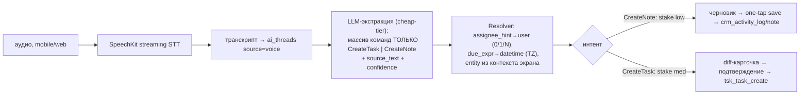

# B-13 — CRM-домен: corex/crm + corex/tasks + продукт FlexCRM (вертикали, агенты, онбординг)

> Доменная спека Этапа 4. Входы: MASTER_PLAN §3 (D1–D16), B-01, B-02, R-02 (главный), R-06 (агенты/MCP/голос), R-08 (§timeline/панели/роли), R-17 (§com_payers), спеки Wave 1: B-10, B-11, B-12, B-15.
> Статус: draft → чекпойнт CRM-блока. Дата: 2026-07-03.
> Установка D-001: спека самодостаточна — дешёвая модель пишет по ней финальные vault-доки и код без обращения к R-отчётам. Всё зафиксированное — решение; отступление = ошибка.

---

## 1. Границы и состав

### 1.1 Пакеты домена

| Пакет | Содержимое | Лицензия |
|---|---|---|
| **corex/crm** | Таблицы `crm_*`; сущности: компании, контакты, лиды (опция, D16), сделки; воронки first-class (`crm_pipelines`/`crm_stages`); statecraft-FSM Deal/Lead; транзакционная конверсия лида; timeline `crm_tml`+`crm_tml_targets`; активности (звонки/письма/встречи); универсальные связи `crm_relations`; шаблоны документов; каталог workflow-действий `crm.*`; MCP-тулзы `crm_*`; `Extend\Entity/Permissions/Api/Filament/Menu/Workflow`-декларации | MIT |
| **corex/tasks** | Таблицы `tsk_*`: задачи (FSM), проекты, канбан-колонки, спринты, тайм-логи, таймер, наблюдатели; workflow-действия `tsk.*`; MCP-тулзы `tsk_*` (чек-листы — v1.1) | MIT |
| **FlexCRM-продукт** (проприетарно) | Вертикали: манифест YAML + installer + `vrt_*`-таблицы; 8 пресетных системных агентов (сиды в corex/ai); конструктор процессов (B-12 §1.1); онбординг-визард «CRM за 15 минут»; голосовой ввод v1 (2 интента); отраслевые наборы агентов; bridge `PayerLinker` (crm↔commerce) | проприетарно |
| Потребляемые | flex/attributes (драйвер `ddl` — B-15), statecraft + flex/workflow через corex/workflow (B-12), corex/auth (`aut_role_matrix` — B-11), corex/ai (агентный рантайм, R-06 §4.1 — канон), chatom/core + vaulter (панели, B-16), corex/notifications, corex/search | — |

### 1.2 Зависимости (стрелка = «зависит от»)

```
corex/crm   ──► corex/core, flex/modules, flex/attributes, statecraft, corex/auth
corex/tasks ──► corex/core, flex/modules, statecraft, corex/auth   (от corex/crm НЕ зависит;
                привязка задач к сделкам — полиморфная tsk_task_targets по handle EntityRegistry)
FlexCRM     ──► corex/crm, corex/tasks, corex/workflow, corex/ai, corex/messenger, vaulter
```

Инверсии: corex/crm не знает про commerce — экспортирует `CompanyRequisitesProvider` (§6.2); corex/ai не знает про CRM — corex/crm регистрирует ToolProvider'ы в общем ToolRegistry (R-06 §4.1).

### 1.3 OSS vs проприетарное

MIT: вся модель данных, FSM, конверсия, timeline, задачи, базовый Filament-UI, каталог workflow-действий, MCP-тулзы (генерируются из EntityRegistry + доменные). Проприетарно: вертикали (манифесты, installer UI, маркетплейс), пресетные агенты и их промпты, конструктор агентов (v1.1), онбординг-визард, голос, bottleneck-аналитика процессов, миграторы Б24/amo (UI; базовые миграторы — flex/import-export, B-18).

---

## 2. Схема БД

Конвенции (B-01 §3): PK `uuid` = **UUIDv7, генерирует приложение** (DEFAULT нет); `timestamptz` везде; CHECK на строковых enum; partial unique/индексы `WHERE deleted_at IS NULL`; деньги bigint minor units + `currency char(3)`; `entity_type` = handle EntityRegistry (`crm.deal`, `tsk.task`, `cst.<slug>`); ACTOR = jsonb `{source: user|agent|api|workflow|import|system, id, name}` (B-15 §1.5). Кастомные поля — колонки `cf_*` через flex/attributes (драйвер ddl), в DDL ниже НЕ перечисляются. `search tsvector` поддерживается приложением (saving-хук, конфиг `russian`), как в каркасе `cst_` B-15 §2.8.

### 2.1 Справочники и воронки

```sql
CREATE TABLE crm_sources (
  id           uuid PRIMARY KEY,
  workspace_id uuid REFERENCES wsp_workspaces(id) ON DELETE CASCADE,  -- NULL = весь аккаунт
  code         varchar(64) NOT NULL,
  name         jsonb NOT NULL,                       -- i18n {ru: "Сайт"}
  is_active    boolean NOT NULL DEFAULT true,
  position     int NOT NULL DEFAULT 0,
  created_at timestamptz NOT NULL DEFAULT now(), updated_at timestamptz NOT NULL DEFAULT now(),
  UNIQUE NULLS NOT DISTINCT (workspace_id, code)
);
COMMENT ON TABLE crm_sources IS 'Источники лидов/сделок (сайт, звонок, реклама); сидится вертикалью/онбордингом';

CREATE TABLE crm_lost_reasons (
  id           uuid PRIMARY KEY,
  workspace_id uuid REFERENCES wsp_workspaces(id) ON DELETE CASCADE,
  code         varchar(64) NOT NULL,
  name         jsonb NOT NULL,
  entity_type  varchar(16) NOT NULL DEFAULT 'both' CHECK (entity_type IN ('lead','deal','both')),
  is_active    boolean NOT NULL DEFAULT true,
  position     int NOT NULL DEFAULT 0,
  created_at timestamptz NOT NULL DEFAULT now(), updated_at timestamptz NOT NULL DEFAULT now(),
  UNIQUE NULLS NOT DISTINCT (workspace_id, code)
);

CREATE TABLE crm_pipelines (
  id           uuid PRIMARY KEY,
  workspace_id uuid REFERENCES wsp_workspaces(id) ON DELETE CASCADE,  -- NULL = общая на аккаунт
  entity_type  varchar(64) NOT NULL,                 -- 'crm.deal' | 'crm.lead' | 'cst.<slug>' (§4.2)
  code         varchar(64) NOT NULL,
  name         jsonb NOT NULL,
  is_default   boolean NOT NULL DEFAULT false,
  position     int NOT NULL DEFAULT 0,
  settings     jsonb NOT NULL DEFAULT '{}',          -- {currency_default, rotten_days_default}
  created_at timestamptz NOT NULL DEFAULT now(), updated_at timestamptz NOT NULL DEFAULT now(),
  deleted_at   timestamptz
);
CREATE UNIQUE INDEX crm_pipelines_code_uq ON crm_pipelines (entity_type, code, workspace_id)
  NULLS NOT DISTINCT WHERE deleted_at IS NULL;
CREATE UNIQUE INDEX crm_pipelines_default_uq ON crm_pipelines (entity_type, workspace_id)
  NULLS NOT DISTINCT WHERE is_default AND deleted_at IS NULL;
COMMENT ON COLUMN crm_pipelines.entity_type IS 'Воронки доступны сделкам, лидам и кастомным сущностям cst_ (паритет смарт-процессов Б24). Регистрация — StageableRegistry §4.2';

CREATE TABLE crm_stages (
  id              uuid PRIMARY KEY,
  pipeline_id     uuid NOT NULL REFERENCES crm_pipelines(id) ON DELETE CASCADE,
  code            varchar(64) NOT NULL,
  name            jsonb NOT NULL,
  color           varchar(16),
  semantic        varchar(8) NOT NULL DEFAULT 'open' CHECK (semantic IN ('open','won','lost')),
  probability     smallint NOT NULL DEFAULT 0 CHECK (probability BETWEEN 0 AND 100),
  position        int NOT NULL DEFAULT 0,
  required_fields jsonb NOT NULL DEFAULT '[]',       -- ["amount","cf_object_id"] — guard перехода (HubSpot)
  settings        jsonb NOT NULL DEFAULT '{}',       -- {rotten_days: 14, sla_hours: 24}
  created_at timestamptz NOT NULL DEFAULT now(), updated_at timestamptz NOT NULL DEFAULT now(),
  deleted_at      timestamptz,
  UNIQUE (pipeline_id, code)
);
CREATE INDEX crm_stages_pipeline_ix ON crm_stages (pipeline_id, position) WHERE deleted_at IS NULL;
COMMENT ON COLUMN crm_stages.semantic IS 'Семантика стадии (Б24): open = в работе; won/lost — терминальные, ровно ≥1 won и ≥1 lost на воронку (валидатор). Статус записи (deal.status) обязан совпадать с semantic её стадии — инвариант §7.3';
COMMENT ON COLUMN crm_stages.required_fields IS 'Коды системных полей и cf_-slug''ов, обязательных ДЛЯ ВХОДА на стадию; проверка server-side в StageTransitioner (§5.2)';
```

### 2.2 Компании и контакты

```sql
CREATE TABLE crm_companies (
  id           uuid PRIMARY KEY,
  workspace_id uuid REFERENCES wsp_workspaces(id) ON DELETE CASCADE,
  name         varchar(255) NOT NULL,
  legal_name   varchar(255),
  domain       varchar(190),
  inn          varchar(12),                          -- РФ-реквизиты first-class (R-02 §4.2)
  kpp          varchar(9),
  ogrn         varchar(15),
  phones       jsonb NOT NULL DEFAULT '[]',          -- [{value, norm(E.164), type, is_primary}]
  emails       jsonb NOT NULL DEFAULT '[]',          -- [{value, norm(lower), type, is_primary}]
  address      jsonb,                                -- {full_text, city, fias_id?, ...} — форма com_addresses R-17
  bank_details jsonb,                                -- {bik, account, corr_account, bank_name}
  source_id    uuid REFERENCES crm_sources(id) ON DELETE SET NULL,
  owner_id     uuid REFERENCES users(id),
  created_by   jsonb NOT NULL,                       -- ACTOR
  search       tsvector,
  created_at timestamptz NOT NULL DEFAULT now(), updated_at timestamptz NOT NULL DEFAULT now(),
  deleted_at   timestamptz
);
CREATE INDEX crm_companies_inn_ix    ON crm_companies (inn) WHERE inn IS NOT NULL AND deleted_at IS NULL;
CREATE INDEX crm_companies_owner_ix  ON crm_companies (owner_id) WHERE deleted_at IS NULL; CREATE INDEX crm_companies_ws_ix     ON crm_companies (workspace_id) WHERE deleted_at IS NULL;
CREATE INDEX crm_companies_search_ix ON crm_companies USING GIN (search); CREATE INDEX crm_companies_phones_ix ON crm_companies USING GIN (phones jsonb_path_ops);
CREATE INDEX crm_companies_emails_ix ON crm_companies USING GIN (emails jsonb_path_ops);
COMMENT ON COLUMN crm_companies.inn IS 'Индекс НЕ уникальный: дубли — норма грязных CRM-данных; дедуп — через fld_entities.duplicate_criteria (B-15) + мастер слияния v1.1. Уникальность (inn,kpp) enforce''ит com_payers (R-17)';

CREATE TABLE crm_contacts (
  id           uuid PRIMARY KEY,
  workspace_id uuid REFERENCES wsp_workspaces(id) ON DELETE CASCADE,
  name_last    varchar(120),
  name_first   varchar(120),
  name_middle  varchar(120),
  display_name varchar(255) NOT NULL,                -- денорм для списков/поиска/AI (titleAttribute)
  job_title    varchar(190),
  phones       jsonb NOT NULL DEFAULT '[]',
  emails       jsonb NOT NULL DEFAULT '[]',
  birthday     date,
  source_id    uuid REFERENCES crm_sources(id) ON DELETE SET NULL,
  owner_id     uuid REFERENCES users(id),
  created_by   jsonb NOT NULL,
  search       tsvector,
  created_at timestamptz NOT NULL DEFAULT now(), updated_at timestamptz NOT NULL DEFAULT now(),
  deleted_at   timestamptz
);
CREATE INDEX crm_contacts_owner_ix  ON crm_contacts (owner_id) WHERE deleted_at IS NULL;
CREATE INDEX crm_contacts_ws_ix     ON crm_contacts (workspace_id) WHERE deleted_at IS NULL; CREATE INDEX crm_contacts_search_ix ON crm_contacts USING GIN (search);
CREATE INDEX crm_contacts_phones_ix ON crm_contacts USING GIN (phones jsonb_path_ops); CREATE INDEX crm_contacts_emails_ix ON crm_contacts USING GIN (emails jsonb_path_ops);

-- Типизированная M2M contact↔company: hot-path, label + primary (HubSpot associations)
CREATE TABLE crm_contact_company (
  id         uuid PRIMARY KEY,
  contact_id uuid NOT NULL REFERENCES crm_contacts(id)  ON DELETE CASCADE,
  company_id uuid NOT NULL REFERENCES crm_companies(id) ON DELETE CASCADE,
  label      varchar(64),                             -- 'ЛПР', 'Бухгалтер', NULL = без роли
  is_primary boolean NOT NULL DEFAULT false,
  created_at timestamptz NOT NULL DEFAULT now(), updated_at timestamptz NOT NULL DEFAULT now(),
  UNIQUE (contact_id, company_id)
);
CREATE UNIQUE INDEX crm_cc_primary_uq ON crm_contact_company (contact_id) WHERE is_primary; CREATE INDEX crm_cc_company_ix ON crm_contact_company (company_id);
```

### 2.3 Лиды и сделки

```sql
CREATE TABLE crm_leads (
  id               uuid PRIMARY KEY,
  workspace_id     uuid REFERENCES wsp_workspaces(id) ON DELETE CASCADE,
  title            varchar(255) NOT NULL,
  status           varchar(16) NOT NULL DEFAULT 'open'
                   CHECK (status IN ('open','converted','junk')),      -- statecraft LeadStatus (§5.1)
  pipeline_id      uuid REFERENCES crm_pipelines(id) ON DELETE RESTRICT,  -- NULL = лид вне воронки
  stage_id         uuid REFERENCES crm_stages(id)    ON DELETE RESTRICT,
  contact_name     varchar(255),                     -- сырые данные до конверсии (amo/Б24)
  phone            varchar(64),
  email            varchar(255),
  company_name     varchar(255),
  amount           bigint,                           -- minor units
  currency         char(3) NOT NULL DEFAULT 'RUB',
  source_id        uuid REFERENCES crm_sources(id) ON DELETE SET NULL,
  utm              jsonb,                            -- {source, medium, campaign, content, term}
  lost_reason_id   uuid REFERENCES crm_lost_reasons(id) ON DELETE SET NULL,
  owner_id         uuid REFERENCES users(id),
  created_by       jsonb NOT NULL,
  converted_at     timestamptz,
  converted_deal_id    uuid,                         -- FK на crm_deals — ALTER после её создания
  converted_contact_id uuid REFERENCES crm_contacts(id)  ON DELETE SET NULL,
  converted_company_id uuid REFERENCES crm_companies(id) ON DELETE SET NULL,
  position         numeric(20,10) NOT NULL DEFAULT 0,
  search           tsvector,
  created_at timestamptz NOT NULL DEFAULT now(), updated_at timestamptz NOT NULL DEFAULT now(),
  deleted_at       timestamptz,
  CHECK (status <> 'converted' OR converted_at IS NOT NULL)
);
CREATE INDEX crm_leads_kanban_ix ON crm_leads (pipeline_id, stage_id, position) WHERE deleted_at IS NULL;
CREATE INDEX crm_leads_owner_ix  ON crm_leads (owner_id, status) WHERE deleted_at IS NULL; CREATE INDEX crm_leads_search_ix ON crm_leads USING GIN (search);
COMMENT ON TABLE crm_leads IS 'D16: модуль лидов ВЫКЛЮЧЕН по умолчанию (feature flag crm.lead_mode, sys_feature_flags B-10). Простой режим: формы/звонки создают сразу deal+contact. Таблица существует всегда (включение без миграции)';

CREATE TABLE crm_deals (
  id             uuid PRIMARY KEY,
  workspace_id   uuid REFERENCES wsp_workspaces(id) ON DELETE CASCADE,
  title          varchar(255) NOT NULL,
  status         varchar(8) NOT NULL DEFAULT 'open'
                 CHECK (status IN ('open','won','lost')),   -- statecraft DealStatus (§5.1)
  pipeline_id    uuid NOT NULL REFERENCES crm_pipelines(id) ON DELETE RESTRICT,
  stage_id       uuid NOT NULL REFERENCES crm_stages(id)    ON DELETE RESTRICT,
  amount         bigint,
  currency       char(3) NOT NULL DEFAULT 'RUB',
  close_date     date,                               -- плановая дата закрытия
  won_at         timestamptz,
  lost_at        timestamptz,
  lost_reason_id uuid REFERENCES crm_lost_reasons(id) ON DELETE SET NULL,
  company_id     uuid REFERENCES crm_companies(id) ON DELETE SET NULL,
  source_id      uuid REFERENCES crm_sources(id)   ON DELETE SET NULL,
  utm            jsonb,
  owner_id       uuid REFERENCES users(id),
  created_by     jsonb NOT NULL,
  stage_entered_at timestamptz NOT NULL DEFAULT now(),  -- денорм: «сколько на стадии» без запроса history
  position       numeric(20,10) NOT NULL DEFAULT 0,     -- ручной порядок канбана (twenty POSITION)
  search         tsvector,
  created_at timestamptz NOT NULL DEFAULT now(), updated_at timestamptz NOT NULL DEFAULT now(),
  deleted_at     timestamptz,
  CHECK (status <> 'won'  OR won_at  IS NOT NULL),
  CHECK (status <> 'lost' OR lost_at IS NOT NULL)
);
CREATE INDEX crm_deals_kanban_ix  ON crm_deals (pipeline_id, stage_id, position) WHERE deleted_at IS NULL;
CREATE INDEX crm_deals_owner_ix   ON crm_deals (owner_id, status) WHERE deleted_at IS NULL; CREATE INDEX crm_deals_company_ix ON crm_deals (company_id) WHERE deleted_at IS NULL;
CREATE INDEX crm_deals_ws_ix      ON crm_deals (workspace_id) WHERE deleted_at IS NULL;
CREATE INDEX crm_deals_close_ix   ON crm_deals (close_date) WHERE status = 'open' AND deleted_at IS NULL; CREATE INDEX crm_deals_search_ix  ON crm_deals USING GIN (search);
COMMENT ON COLUMN crm_deals.status IS 'Грубая FSM statecraft (enum) поверх динамических стадий: переходы deal.win/deal.lose/deal.reopen. Движение стадий внутри open — StageTransitioner (§5.2). Инвариант: status = semantic текущей стадии';

ALTER TABLE crm_leads ADD CONSTRAINT crm_leads_conv_deal_fk
  FOREIGN KEY (converted_deal_id) REFERENCES crm_deals(id) ON DELETE SET NULL;

-- Типизированная M2M deal↔contact (роли участников)
CREATE TABLE crm_deal_contacts (
  id         uuid PRIMARY KEY,
  deal_id    uuid NOT NULL REFERENCES crm_deals(id)    ON DELETE CASCADE,
  contact_id uuid NOT NULL REFERENCES crm_contacts(id) ON DELETE CASCADE,
  label      varchar(64),
  is_primary boolean NOT NULL DEFAULT false,
  created_at timestamptz NOT NULL DEFAULT now(), updated_at timestamptz NOT NULL DEFAULT now(),
  UNIQUE (deal_id, contact_id)
);
CREATE UNIQUE INDEX crm_dc_primary_uq ON crm_deal_contacts (deal_id) WHERE is_primary; CREATE INDEX crm_dc_contact_ix ON crm_deal_contacts (contact_id);

-- История стадий (append-only; аналитика конверсий, Б24-паритет)
CREATE TABLE crm_stage_history (
  id            uuid PRIMARY KEY,                    -- UUIDv7 = time-sortable курсор
  entity_type   varchar(64) NOT NULL,                -- 'crm.deal' | 'crm.lead' | 'cst.<slug>'
  entity_id     uuid NOT NULL,
  pipeline_id   uuid NOT NULL REFERENCES crm_pipelines(id) ON DELETE CASCADE,
  from_stage_id uuid REFERENCES crm_stages(id) ON DELETE SET NULL,  -- NULL = создание записи
  to_stage_id   uuid NOT NULL REFERENCES crm_stages(id) ON DELETE RESTRICT,
  actor         jsonb NOT NULL,                      -- ACTOR
  duration_sec  bigint,                              -- время в from_stage
  created_at    timestamptz NOT NULL DEFAULT now()   -- append-only: updated_at осознанно нет
);
CREATE INDEX crm_sh_entity_ix   ON crm_stage_history (entity_type, entity_id, created_at); CREATE INDEX crm_sh_pipeline_ix ON crm_stage_history (pipeline_id, to_stage_id, created_at);
```

### 2.4 Универсальные связи, timeline, активности

```sql
-- Универсальный M2M-граф (Б24 entity_relation + HubSpot labels). Правило границы (R-02 в.7):
-- пары с богатой семантикой и hot-path — типизированные таблицы (deal_contacts, contact_company);
-- всё остальное (deal↔deal, company↔company-parent, cst↔любой, связи вертикалей) — сюда.
CREATE TABLE crm_relations (
  id         uuid PRIMARY KEY,
  src_type   varchar(64) NOT NULL,                   -- handle EntityRegistry
  src_id     uuid NOT NULL,
  dst_type   varchar(64) NOT NULL,
  dst_id     uuid NOT NULL,
  label      varchar(64),                            -- 'parent', 'duplicate_of', 'related'
  is_primary boolean NOT NULL DEFAULT false,
  created_by jsonb NOT NULL,
  created_at timestamptz NOT NULL DEFAULT now(), updated_at timestamptz NOT NULL DEFAULT now(),
  UNIQUE NULLS NOT DISTINCT (src_type, src_id, dst_type, dst_id, label)
);
CREATE INDEX crm_relations_src_ix ON crm_relations (src_type, src_id); CREATE INDEX crm_relations_dst_ix ON crm_relations (dst_type, dst_id);
COMMENT ON TABLE crm_relations IS 'FK невозможны (полиморфизм); чистка — хук RecordDeleted (§5.6)';

-- Timeline: полиморфная пара (Espo одна таблица × Б24 bind M2M; НЕ morph-колонки twenty)
CREATE TABLE crm_tml (
  id         uuid PRIMARY KEY,                       -- UUIDv7
  workspace_id uuid,
  type       varchar(32) NOT NULL CHECK (type IN ('comment','call','email','meeting','note',
             'stage_changed','field_changed','deal_created','deal_won','deal_lost','lead_created','lead_converted',
             'task_created','task_done','file_attached','doc_generated','process_step','agent_action','imported','panel_event')),
  actor      jsonb NOT NULL,                         -- ACTOR
  payload    jsonb NOT NULL DEFAULT '{}',            -- diff полей / метаданные звонка / excerpt комментария
  ref_type   varchar(64),                            -- ссылка на «богатую» запись: 'crm.activity','cht.message','vlt.file','wfl.instance','ai.tool_call'
  ref_id     uuid,
  happens_at timestamptz NOT NULL DEFAULT now(),
  pinned     boolean NOT NULL DEFAULT false,
  created_at timestamptz NOT NULL DEFAULT now(),
  updated_at timestamptz NOT NULL DEFAULT now()      -- мутации только pinned (append-only по содержимому)
);
CREATE INDEX crm_tml_happens_ix ON crm_tml (happens_at); CREATE INDEX crm_tml_ref_ix     ON crm_tml (ref_type, ref_id) WHERE ref_type IS NOT NULL;
COMMENT ON TABLE crm_tml IS 'Partition-ready (R-08-паттерн): FK ИЗ других таблиц НА crm_tml отсутствуют; happens_at NOT NULL. v1 — одна таблица; opt-in помесячные партиции pg_partman при >20M строк аккаунта. Заполнение: системные события — асинхронно из шины (queued listener); comment/note — синхронно';

CREATE TABLE crm_tml_targets (
  tml_id      uuid NOT NULL,                         -- БЕЗ FK (partition-ready); целостность — purge-джоб
  entity_type varchar(64) NOT NULL,
  entity_id   uuid NOT NULL,
  created_at  timestamptz NOT NULL DEFAULT now(),
  PRIMARY KEY (entity_type, entity_id, tml_id)       -- = индекс «лента сущности» (UUIDv7 сортирует по времени)
);
CREATE INDEX crm_tml_targets_tml_ix ON crm_tml_targets (tml_id);
COMMENT ON TABLE crm_tml_targets IS 'Одно событие (звонок) → несколько сущностей (контакт+сделка+компания) одной вставкой (Б24 bind). Видимость записи ленты = видимость целевой сущности (AccessChecker::canOnRecord, B-11)';

-- Активности: единая таблица call/email/meeting (богатая структура; в ленту — ref)
CREATE TABLE crm_activities (
  id            uuid PRIMARY KEY,
  workspace_id  uuid REFERENCES wsp_workspaces(id) ON DELETE CASCADE,
  kind          varchar(16) NOT NULL CHECK (kind IN ('call','email','meeting')),
  status        varchar(16) NOT NULL DEFAULT 'planned' CHECK (status IN ('planned','done','canceled','missed')),
  subject       varchar(255),
  body          text,                                -- текст письма / заметка о звонке / повестка
  direction     varchar(3) CHECK (direction IN ('in','out')),   -- call/email
  phone         varchar(64),                         -- call
  duration_sec  int,                                 -- call/meeting (факт)
  location      varchar(255),                        -- meeting
  email_meta    jsonb,                               -- email: {from, to[], cc[], message_id, thread_id}
  recording_file_id uuid,                            -- запись звонка (med_files, без FK — контракт media)
  transcript    text,                                -- STT-транскрипт (вход summarizer-агента)
  starts_at     timestamptz,
  ends_at       timestamptz,
  owner_id      uuid REFERENCES users(id),
  created_by    jsonb NOT NULL,
  created_at timestamptz NOT NULL DEFAULT now(), updated_at timestamptz NOT NULL DEFAULT now(),
  deleted_at    timestamptz,
  CHECK (kind = 'call' OR direction IS NULL OR kind = 'email')
);
CREATE INDEX crm_activities_planned_ix ON crm_activities (owner_id, starts_at)
  WHERE status = 'planned' AND deleted_at IS NULL;
CREATE INDEX crm_activities_kind_ix ON crm_activities (kind, status) WHERE deleted_at IS NULL;

CREATE TABLE crm_activity_targets (                  -- Who/What обобщённо (Salesforce)
  activity_id uuid NOT NULL REFERENCES crm_activities(id) ON DELETE CASCADE,
  entity_type varchar(64) NOT NULL,
  entity_id   uuid NOT NULL,
  created_at  timestamptz NOT NULL DEFAULT now(),
  PRIMARY KEY (activity_id, entity_type, entity_id)
);
CREATE INDEX crm_at_entity_ix ON crm_activity_targets (entity_type, entity_id);

-- Шаблоны документов (генерация docx/pdf из записи; поставляются вертикалями)
CREATE TABLE crm_doc_templates (
  id           uuid PRIMARY KEY,
  workspace_id uuid REFERENCES wsp_workspaces(id) ON DELETE CASCADE,
  code         varchar(64) NOT NULL,
  name         jsonb NOT NULL,
  entity_type  varchar(64) NOT NULL,                 -- к какой сущности применим
  file_id      uuid NOT NULL,                        -- docx-шаблон в media (без FK)
  engine       varchar(8) NOT NULL DEFAULT 'docx' CHECK (engine IN ('docx','pdf')),
  mapping      jsonb NOT NULL DEFAULT '{}',          -- {placeholder → путь поля: "amount", "cf_object_id.title", "company.inn"}
  is_active    boolean NOT NULL DEFAULT true,
  created_by   jsonb NOT NULL,
  created_at timestamptz NOT NULL DEFAULT now(), updated_at timestamptz NOT NULL DEFAULT now(),
  deleted_at   timestamptz,
  UNIQUE NULLS NOT DISTINCT (workspace_id, code)
);
```

### 2.5 Задачи (corex/tasks, префикс `tsk_`)

```sql
CREATE TABLE tsk_projects (
  id           uuid PRIMARY KEY,
  workspace_id uuid REFERENCES wsp_workspaces(id) ON DELETE CASCADE,
  name         varchar(255) NOT NULL,
  description  text,
  status       varchar(16) NOT NULL DEFAULT 'active' CHECK (status IN ('active','archived')),
  owner_id     uuid REFERENCES users(id),
  starts_on    date,
  due_on       date,
  settings     jsonb NOT NULL DEFAULT '{}',          -- {kanban_enabled, sprint_enabled}
  created_by   jsonb NOT NULL,
  created_at timestamptz NOT NULL DEFAULT now(), updated_at timestamptz NOT NULL DEFAULT now(),
  deleted_at   timestamptz
);
CREATE INDEX tsk_projects_ws_ix ON tsk_projects (workspace_id, status) WHERE deleted_at IS NULL;

CREATE TABLE tsk_stages (                            -- канбан-колонки проекта
  id          uuid PRIMARY KEY,
  project_id  uuid NOT NULL REFERENCES tsk_projects(id) ON DELETE CASCADE,
  code        varchar(64) NOT NULL,
  name        jsonb NOT NULL,
  color       varchar(16),
  position    int NOT NULL DEFAULT 0,
  auto_status varchar(16) CHECK (auto_status IN ('in_progress','done')),
  created_at timestamptz NOT NULL DEFAULT now(), updated_at timestamptz NOT NULL DEFAULT now(),
  UNIQUE (project_id, code)
);
COMMENT ON COLUMN tsk_stages.auto_status IS 'Перенос карточки в колонку опционально файрит FSM задачи (task.start / task.complete). NULL = чисто визуальная колонка';

CREATE TABLE tsk_sprints (
  id         uuid PRIMARY KEY,
  project_id uuid NOT NULL REFERENCES tsk_projects(id) ON DELETE CASCADE,
  name       varchar(190) NOT NULL,
  goal       text,
  status     varchar(16) NOT NULL DEFAULT 'planned' CHECK (status IN ('planned','active','completed')),
  starts_on  date NOT NULL,
  ends_on    date NOT NULL,
  created_at timestamptz NOT NULL DEFAULT now(), updated_at timestamptz NOT NULL DEFAULT now(),
  CHECK (ends_on >= starts_on)
);
CREATE UNIQUE INDEX tsk_sprints_active_uq ON tsk_sprints (project_id) WHERE status = 'active';

CREATE TABLE tsk_tasks (
  id            uuid PRIMARY KEY,
  workspace_id  uuid REFERENCES wsp_workspaces(id) ON DELETE CASCADE,
  project_id    uuid REFERENCES tsk_projects(id) ON DELETE SET NULL,   -- NULL = вне проекта (CRM-задача)
  sprint_id     uuid REFERENCES tsk_sprints(id)  ON DELETE SET NULL,
  stage_id      uuid REFERENCES tsk_stages(id)   ON DELETE SET NULL,
  parent_id     uuid REFERENCES tsk_tasks(id)    ON DELETE CASCADE,    -- подзадачи (1 уровень, валидатор)
  title         varchar(255) NOT NULL,
  description   text,
  status        varchar(16) NOT NULL DEFAULT 'open'
                CHECK (status IN ('open','in_progress','waiting','done','cancelled')),  -- statecraft TaskStatus
  priority      varchar(8) NOT NULL DEFAULT 'normal' CHECK (priority IN ('low','normal','high','urgent')),
  author_id     uuid REFERENCES users(id),          -- постановщик
  assignee_id   uuid REFERENCES users(id),          -- исполнитель (один; соисполнители = watchers)
  created_by    jsonb NOT NULL,                     -- ACTOR (агент/процесс тоже создают задачи)
  starts_at     timestamptz,
  due_at        timestamptz,
  completed_at  timestamptz,
  estimate_minutes int,
  spent_minutes    int NOT NULL DEFAULT 0,          -- проекция Σ tsk_time_logs (той же транзакцией)
  position      numeric(20,10) NOT NULL DEFAULT 0,
  search        tsvector,
  created_at timestamptz NOT NULL DEFAULT now(), updated_at timestamptz NOT NULL DEFAULT now(),
  deleted_at    timestamptz,
  CHECK (status <> 'done' OR completed_at IS NOT NULL)
);
CREATE INDEX tsk_tasks_assignee_ix ON tsk_tasks (assignee_id, status) WHERE deleted_at IS NULL;
CREATE INDEX tsk_tasks_kanban_ix   ON tsk_tasks (project_id, stage_id, position) WHERE deleted_at IS NULL;
CREATE INDEX tsk_tasks_due_ix      ON tsk_tasks (due_at)
  WHERE status IN ('open','in_progress','waiting') AND deleted_at IS NULL;   -- reminder-агент/эскалации
CREATE INDEX tsk_tasks_sprint_ix   ON tsk_tasks (sprint_id) WHERE sprint_id IS NOT NULL; CREATE INDEX tsk_tasks_search_ix   ON tsk_tasks USING GIN (search);

CREATE TABLE tsk_task_targets (                      -- привязка к CRM/любым сущностям (twenty taskTarget)
  task_id     uuid NOT NULL REFERENCES tsk_tasks(id) ON DELETE CASCADE,
  entity_type varchar(64) NOT NULL,
  entity_id   uuid NOT NULL,
  created_at  timestamptz NOT NULL DEFAULT now(),
  PRIMARY KEY (task_id, entity_type, entity_id)
);
CREATE INDEX tsk_tt_entity_ix ON tsk_task_targets (entity_type, entity_id);

CREATE TABLE tsk_task_watchers (
  task_id    uuid NOT NULL REFERENCES tsk_tasks(id) ON DELETE CASCADE,
  user_id    uuid NOT NULL REFERENCES users(id) ON DELETE CASCADE,
  created_at timestamptz NOT NULL DEFAULT now(),
  PRIMARY KEY (task_id, user_id)
);

CREATE TABLE tsk_time_logs (
  id         uuid PRIMARY KEY,
  task_id    uuid NOT NULL REFERENCES tsk_tasks(id) ON DELETE CASCADE,
  user_id    uuid NOT NULL REFERENCES users(id),
  minutes    int NOT NULL CHECK (minutes > 0),
  spent_on   date NOT NULL,
  comment    text,
  source     varchar(8) NOT NULL DEFAULT 'manual' CHECK (source IN ('manual','timer')),
  created_at timestamptz NOT NULL DEFAULT now(), updated_at timestamptz NOT NULL DEFAULT now()
);
CREATE INDEX tsk_tl_task_ix ON tsk_time_logs (task_id); CREATE INDEX tsk_tl_user_ix ON tsk_time_logs (user_id, spent_on);

CREATE TABLE tsk_timers (                            -- один бегущий таймер на пользователя
  user_id    uuid PRIMARY KEY REFERENCES users(id) ON DELETE CASCADE,
  task_id    uuid NOT NULL REFERENCES tsk_tasks(id) ON DELETE CASCADE,
  started_at timestamptz NOT NULL DEFAULT now(),
  created_at timestamptz NOT NULL DEFAULT now(), updated_at timestamptz NOT NULL DEFAULT now()
);
```

### 2.6 Вертикали (FlexCRM, префикс `vrt_`)

```sql
CREATE TABLE vrt_installs (
  id                uuid PRIMARY KEY,
  code              varchar(64) NOT NULL,            -- 'realty', 'construction'
  level             varchar(8) NOT NULL CHECK (level IN ('preset','composer')),
  version           varchar(32) NOT NULL,            -- установленная версия манифеста
  status            varchar(16) NOT NULL DEFAULT 'installing'
                    CHECK (status IN ('installing','enabled','disabled','failed')),
  manifest          jsonb NOT NULL,                  -- снапшот скомпилированного манифеста (аудит/diff апгрейда)
  manifest_checksum char(64) NOT NULL,               -- sha256 canonical-YAML → идемпотентность
  installed_by      jsonb NOT NULL,                  -- ACTOR
  error             jsonb,
  enabled_at        timestamptz,
  disabled_at       timestamptz,
  created_at timestamptz NOT NULL DEFAULT now(), updated_at timestamptz NOT NULL DEFAULT now(),
  UNIQUE (code)
);

CREATE TABLE vrt_records (                           -- реестр владения (зеркало семантики mod_records B-10)
  vertical_code varchar(64) NOT NULL,
  record_type   varchar(24) NOT NULL CHECK (record_type IN
                ('entity','field','option','pipeline','stage','process','role','matrix_row',
                 'agent','doc_template','source','seed','feature_flag','menu','other')),
  reference     varchar(255) NOT NULL,               -- uuid или код созданного объекта
  meta          jsonb NOT NULL DEFAULT '{}',
  created_at timestamptz NOT NULL DEFAULT now(), updated_at timestamptz NOT NULL DEFAULT now(),
  PRIMARY KEY (vertical_code, record_type, reference)
);
COMMENT ON TABLE vrt_records IS 'Что создала вертикаль в ЭТОЙ БД. Deactivate/reactivate/upgrade идут строго по реестру (§5.4). Composer-вертикали дополнительно регистрируются в mod_records своим composer-именем (код-часть)';
```

### 2.7 Агентный слой (`ai_`, canonical R-06 §4.1)

Полный DDL определяющих таблиц агентов — здесь (их сидируют FlexCRM и вертикали); runtime-таблицы — нормативный список ниже, детальный DDL — task-card corex/ai (§9-Q3).

```sql
CREATE TABLE ai_agents (
  id                 uuid PRIMARY KEY,
  workspace_id       uuid REFERENCES wsp_workspaces(id) ON DELETE CASCADE,  -- NULL = весь аккаунт
  code               varchar(64) NOT NULL,
  label              jsonb NOT NULL,
  icon               varchar(64),
  description        jsonb,
  origin             varchar(16) NOT NULL DEFAULT 'custom' CHECK (origin IN ('system','vertical','custom')),
  vertical_code      varchar(64),                    -- origin=vertical
  status             varchar(16) NOT NULL DEFAULT 'draft' CHECK (status IN ('draft','active','archived')),
  current_version_id uuid,                           -- FK ниже
  created_by         jsonb NOT NULL,
  created_at timestamptz NOT NULL DEFAULT now(), updated_at timestamptz NOT NULL DEFAULT now(),
  deleted_at         timestamptz
);
CREATE UNIQUE INDEX ai_agents_code_uq ON ai_agents (code, workspace_id)
  NULLS NOT DISTINCT WHERE deleted_at IS NULL;

CREATE TABLE ai_agent_versions (                     -- иммутабельны после publish (паттерн wfl_versions B-12)
  id                uuid PRIMARY KEY,
  agent_id          uuid NOT NULL REFERENCES ai_agents(id) ON DELETE CASCADE,
  version           int NOT NULL CHECK (version >= 1),
  system_prompt     text NOT NULL,
  model_ref         varchar(64) NOT NULL DEFAULT 'auto',   -- код ai_models | 'auto' (tier-роутинг)
  model_config      jsonb NOT NULL DEFAULT '{}',     -- {temperature, max_tokens}
  response_format   jsonb NOT NULL DEFAULT '{"type":"text"}',
  tools             jsonb NOT NULL DEFAULT '[]',     -- [{code:"crm_deals_search", stake_override?}]
  knowledge_scopes  jsonb NOT NULL DEFAULT '[]',     -- коды ai_knowledge_sources
  guardrails        jsonb NOT NULL DEFAULT '{}',     -- {deny_phrases[], no_ai_entities[]}
  budget            jsonb NOT NULL DEFAULT '{}',     -- {max_steps: 10, max_tokens: 20000} per-run
  evaluation_inputs jsonb NOT NULL DEFAULT '[]',
  published_at      timestamptz,
  published_by      uuid,
  created_at timestamptz NOT NULL DEFAULT now(), updated_at timestamptz NOT NULL DEFAULT now(),
  UNIQUE (agent_id, version)
);
ALTER TABLE ai_agents ADD CONSTRAINT ai_agents_curver_fk
  FOREIGN KEY (current_version_id) REFERENCES ai_agent_versions(id) ON DELETE SET NULL;

CREATE TABLE ai_agent_triggers (
  id         uuid PRIMARY KEY,
  agent_id   uuid NOT NULL REFERENCES ai_agents(id) ON DELETE CASCADE,
  type       varchar(16) NOT NULL CHECK (type IN ('chat','voice','entity_event','schedule','webhook','workflow_step')),
  config     jsonb NOT NULL DEFAULT '{}',            -- {event, filter} | {cron, dedupe_key} | {secret_ref}
  is_enabled boolean NOT NULL DEFAULT true,
  created_at timestamptz NOT NULL DEFAULT now(), updated_at timestamptz NOT NULL DEFAULT now()
);
CREATE INDEX ai_agent_triggers_type_ix ON ai_agent_triggers (type) WHERE is_enabled;
```

Runtime-таблицы corex/ai (норматив R-06 §4.1, колоночный состав зафиксирован там; DDL — task-card): `ai_threads` (source: chat|voice|trigger|workflow; context_entity_type/id), `ai_turns` (usage-денорм), `ai_messages` (parts jsonb), `ai_tool_calls` (**аудит + HITL**: tool_code, args, stake, approved_by, entity_type/id), `ai_usage` (ledger), `ai_budgets` (scope account/workspace/agent; soft 80 % → downgrade, hard 100 % → `LLM_QUOTA_EXCEEDED`), `ai_models`, `ai_knowledge_sources`, `ai_chunks` (vector(N) по R-16), `ai_pii_map`.

---

## 3. Публичные контракты

Неймспейсы условны до решения vendor-имени (D16). PHPStan 8, все контракты `@api`.

### 3.1 statecraft-графы (D16: «процесс со статусами» = FSM + процессы на переходах)

```php
enum DealStatus: string { case Open='open'; case Won='won'; case Lost='lost'; }
enum LeadStatus: string { case Open='open'; case Converted='converted'; case Junk='junk'; }
enum TaskStatus: string { case Open='open'; case InProgress='in_progress'; case Waiting='waiting';
                          case Done='done'; case Cancelled='cancelled'; }
```

| FSM | Переход (именованное ребро) | from → to | Guard / Action |
|---|---|---|---|
| Deal | `deal.win` | open → won | guard: required_fields won-стадии заполнены; action: won_at=now(), stage_id=won-стадия |
| Deal | `deal.lose` | open → lost | guard: payload.lost_reason_id обязателен (настройка воронки); action: lost_at, stage_id=lost-стадия |
| Deal | `deal.reopen` | won,lost → open | authorizer: право `crm.deal.reopen`; action: won_at/lost_at=NULL, stage_id из payload |
| Lead | `lead.convert` | open → converted | **только через LeadConverter** (guard проверяет флаг конверсии в контексте, прямой fire запрещён) |
| Lead | `lead.junk` / `lead.reopen` | open → junk / junk → open | payload.lost_reason_id / — |
| Task | `task.start` / `task.wait` / `task.complete` / `task.cancel` / `task.reopen` | open→in_progress / in_progress→waiting / open,in_progress,waiting→done / →cancelled / done,cancelled→open | complete: action completed_at=now(), автозакрытие таймера |

Workflow-триггеры `state_transition` (B-12 §3.7): рёбра `deal.win`, `deal.lose`, `lead.convert`, `task.complete` и т.д. Единственный путь записи `status` — `StateMachine::fire()` (инвариант B-12 AC-28).

### 3.2 Воронки и стадии

```php
interface PipelineRepository
{
    public function forEntity(string $entityType, ?string $workspaceId): array;  // list<Pipeline> c stages
    public function defaultFor(string $entityType, ?string $workspaceId): Pipeline;
    public function stage(string $stageId): Stage;    // DTO: id, code, semantic, probability, requiredFields[], settings
}

final readonly class StageMoveResult
{
    public function __construct(
        public bool $ok,
        public array $missingFields = [],             // незаполненные required_fields (коды)
        public ?string $deniedReason = null,          // 'permission' | 'invalid_stage' | 'guard:<code>'
    ) {}
}

interface StageTransitioner
{
    /** Полный пайплайн §5.1: принадлежность стадии → права (RecordContext) → required_fields →
     *  semantic-мост в statecraft → history → событие. @throws StageMoveDenied */
    public function move(object $record, string $stageId, Actor $actor, array $payload = []): StageMoveResult;
    public function canMove(object $record, string $stageId, Actor $actor): StageMoveResult;  // дешёвая проверка для канбана
    public function movePipeline(object $record, string $pipelineId, string $stageId, Actor $actor): StageMoveResult;  // маппинг стадий обязателен
}
```

### 3.3 Конверсия лида

```php
final readonly class ConversionPlan
{
    public function __construct(
        public string $leadId,
        public bool $createDeal = true,
        public ?string $dealPipelineId = null,        // NULL = default воронка сделок
        public ?string $existingContactId = null,     // слить с найденным дубликатом
        public ?string $existingCompanyId = null,
        public array $dealOverrides = [],             // {title, amount, owner_id}
    ) {}
}
final readonly class ConversionResult
{
    public function __construct(public string $leadId, public ?string $dealId,
        public string $contactId, public ?string $companyId,
        public array $duplicates = []) {}             // list<DuplicateCandidate>: конверсия остановлена дубликат-чеком
}

interface LeadConverter
{
    /** Кандидаты-дубликаты по duplicate_criteria (phone.norm/email.norm/inn) ДО конверсии */
    public function findDuplicates(string $leadId): array;   // list<DuplicateCandidate{entityType, id, title, matchedBy}>
    /** ОДНА транзакция БД (§5.3). Повторный вызов на converted-лиде → LeadAlreadyConverted. */
    public function convert(ConversionPlan $plan, Actor $actor): ConversionResult;
}
```

### 3.4 Timeline, активности, связи, задачи, документы

```php
final readonly class TimelineEntry
{
    public function __construct(
        public string $type,                          // из CHECK crm_tml.type
        public Actor $actor,
        public array $targets,                        // list<{type, id}>, ≥1
        public array $payload = [],
        public ?string $refType = null, public ?string $refId = null,
        public ?\DateTimeImmutable $happensAt = null,
    ) {}
}
interface TimelineWriter
{
    public function record(TimelineEntry $e): string;             // tml_id; комментарии/заметки — sync, системное — queued
    /** Лента сущности: пагинация UUIDv7-курсором, фильтр типов; права проверяет вызывающий слой */
    public function feed(string $entityType, string $entityId, ?string $cursor, int $limit = 50,
                         array $types = []): TimelinePage;
    public function retarget(string $tmlId, array $addTargets): void;   // конверсия лида (§5.3)
    public function pin(string $tmlId, bool $pinned): void;
}

interface ActivityService
{
    public function log(ActivityDraft $d, Actor $actor): string;       // kind, targets, status=done → timeline sync
    public function plan(ActivityDraft $d, Actor $actor): string;      // status=planned
    public function complete(string $activityId, Actor $actor, ?string $outcomeNote = null): void;
}

interface RelationManager
{
    public function link(string $srcType, string $srcId, string $dstType, string $dstId,
                         ?string $label, Actor $actor): string;
    public function unlink(string $relationId, Actor $actor): void;
    public function of(string $entityType, string $entityId, ?string $label = null): array;  // обе стороны
}

interface TaskService
{
    public function create(TaskDraft $d, Actor $actor): TaskRef;       // + targets + событие + timeline на targets
    public function assign(string $taskId, string $assigneeId, Actor $actor): void;
    public function moveToStage(string $taskId, string $stageId, Actor $actor): void;  // + auto_status → FSM fire
    public function complete(string $taskId, Actor $actor): void;      // = StateMachine::fire task.complete
}
interface TimeTracker
{
    public function startTimer(string $taskId, string $userId): void;  // UPSERT tsk_timers (замещает бегущий)
    public function stopTimer(string $userId, ?string $comment = null): TimeLogRef;  // → tsk_time_logs(source=timer)
    public function log(string $taskId, string $userId, int $minutes, \DateTimeImmutable $spentOn,
                        ?string $comment = null): TimeLogRef;
}

interface DocumentGenerator
{
    /** Рендер шаблона по mapping (значения — через AttributeStore B-15 + связи) → файл в media/Vaulter-панель
     *  сущности + timeline(doc_generated). */
    public function generate(string $templateId, string $entityType, string $entityId, Actor $actor): GeneratedDoc;
}
```

### 3.5 Вертикали

```php
interface VerticalInstaller
{
    /** Идемпотентно (checksum-diff): install|upgrade по состоянию vrt_installs. Каждый созданный объект
     *  регистрируется в vrt_records. Ошибка на шаге K → status=failed, повторный запуск доигрывает (§5.4). */
    public function install(VerticalManifest $m, InstallOptions $o, Actor $actor): InstallReport;
    /** Деактивация БЕЗ потери данных (§5.4): поля → disable (B-15), процессы → paused,
     *  агенты → archived, воронки → deleted_at (записи живут), меню/флаги сняты. */
    public function deactivate(string $code, Actor $actor): void;
    public function reactivate(string $code, Actor $actor): void;
    public function status(string $code): ?VerticalStatus;
}
// InstallOptions { bool $withDemoData, ?string $workspaceId }
// InstallReport  { code, version, created: array<record_type, int>, warnings[] }
```

### 3.6 Контракт для commerce (решение R-17: com_payers ↔ crm_companies)

```php
final readonly class CompanyRequisites
{
    public function __construct(
        public string $companyId, public string $name, public ?string $legalName,
        public ?string $inn, public ?string $kpp, public ?string $ogrn,
        public ?array $bankDetails, public ?array $legalAddress,
        public ?string $email, public ?string $phone,
    ) {}
}
interface CompanyRequisitesProvider   // экспортирует corex/crm; потребляет corex/commerce (B-14)
{
    public function byCompany(string $companyId): ?CompanyRequisites;
    public function findByInn(string $inn, ?string $kpp = null): array;  // list<CompanyRequisites>
}
```

**Совместная модель (норматив для B-14):** `com_payers` — владелец платёжной сущности (заказы снапшотят реквизиты из payer, R-17 §3.3); к нему добавляется колонка `crm_company_ref uuid NULL` **без FK** (кросс-модульная ссылка по значению — commerce обязан работать без CRM-модуля). Бридж `PayerLinker` (FlexCRM, модуль-мост): (а) при создании заказа из сделки — find-or-create payer по `(inn, kpp)` из `CompanyRequisitesProvider`, проставить `crm_company_ref`; (б) слушает `crm.company.updated` — обновляет **текущие** реквизиты связанного payer (снапшоты в заказах не трогаются); (в) слушает `com.payer.created` (standalone-чекаут) — предлагает привязку/создание crm_company. Реквизиты не дублируются как «две истины»: истина для юрлица-клиента = crm_company (при активном CRM), com_payers хранит денорм-кеш для commerce-hot-path + снапшоты.

**Зеркальная связка `com_customers.crm_contact_ref → crm.contact`** (закрывает B-14 §9-Q1, вторая половина): тот же паттерн, тот же модуль-мост FlexCRM — `ContactLinker` (разделяет код с `PayerLinker`, `crm_contact_ref uuid NULL` без FK). (а) при создании покупателя из контакта сделки — find-or-create customer по контакту, проставить `crm_contact_ref`; (б) слушает `crm.contact.updated` — обновляет **текущие** данные связанного customer (снапшоты покупателя в существующих заказах не трогаются); (в) слушает `com.customer.created` (standalone-регистрация) — предлагает привязку/создание crm_contact. Разрыв связи: `RecordDeleted` (entityType=`crm.contact`) → `crm_contact_ref` очищается (`SET NULL`), снапшот покупателя в существующих заказах сохраняется (симметрично `payer_snapshot`).

### 3.7 Доменные события (имя → payload; все несут TenantContext, B-10 §3.1)

| Событие | name() | Payload |
|---|---|---|
| LeadCreated / LeadJunked | `crm.lead.created` / `.junked` | leadId, sourceId?, actor |
| LeadConverted | `crm.lead.converted` | leadId, dealId?, contactId, companyId?, actor |
| DealCreated | `crm.deal.created` | dealId, pipelineId, stageId, amount?, actor |
| DealStageChanged | `crm.deal.stage_changed` | dealId, fromStageId, toStageId, pipelineId, durationSec, actor |
| DealWon / DealLost / DealReopened | `crm.deal.won` / `.lost` / `.reopened` | dealId, stageId, amount?, lostReasonId?, actor |
| ContactCreated / CompanyCreated | `crm.contact.created` / `crm.company.created` | id, actor |
| CompanyUpdated | `crm.company.updated` | companyId, changes{}, actor (вход PayerLinker) |
| ContactUpdated | `crm.contact.updated` | contactId, changes{}, actor (вход ContactLinker, §3.6) |
| ActivityLogged / ActivityCompleted | `crm.activity.logged` / `.completed` | activityId, kind, targets[], actor |
| RecordDeleted | `crm.record.deleted` | entityType, entityId (хук чистки relations/targets/eav B-15) |
| TaskCreated / TaskAssigned / TaskStatusChanged / TaskCompleted | `tsk.task.created` / `.assigned` / `.status_changed` / `.completed` | taskId, targets[], assigneeId?, from/to?, actor |
| TaskOverdue | `tsk.task.overdue` | taskId, dueAt (scheduler-джоба; вход reminder-агента и процессов) |
| TimeLogged | `tsk.timelog.added` | taskId, userId, minutes, spentOn |
| VerticalInstalled / VerticalDeactivated | `vrt.installed` / `.deactivated` | code, version, actor |
| DocGenerated | `crm.doc.generated` | templateId, entityType, entityId, fileId, actor |
| OnboardingStepCompleted | `crm.onboarding.step` | step, elapsedSec (TTFV-метрики §5.6) |

### 3.8 MCP-сервер FlexCRM v1 (полный список тулзов)

Транспорт/аутентификация — норматив R-06 §4.2: `POST https://{account}.flexcrm.ru/mcp` (Streamable HTTP, laravel/mcp); v1 auth = Sanctum PAT (abilities `mcp:read`/`mcp:write`), контекст = пользователь-владелец токена; v1.1 = OAuth 2.1 + PKCE. Один ToolRegistry обслуживает MCP и внутренний AgentRuntime. Права: тулза не попадает в каталог без capability-права (`AccessChecker::allowed`), scope накладывается `ScopeResolver::apply` (B-11 §5.5), record-проверка при execute. Общие правила ответов (Anthropic-нормы R-06 §2.6): `response_format: concise|detailed`, пагинация `next_cursor`, лимит выдачи ≤50, human-readable идентификаторы, ошибки с примером валидного вызова.

| Тулза | Тип/stake | Сигнатура args (обязательные **жирным**) | Возврат (concise) |
|---|---|---|---|
| `crm_deals_search` | R | query?, pipeline_code?, stage_code?, status?, owner_hint?, amount_gte?, amount_lte?, updated_after?, limit?, cursor? | [{id, title, stage, amount, owner, company, days_in_stage}] |
| `crm_leads_search` / `crm_contacts_search` / `crm_companies_search` | R | query?, owner_hint?, filters{}, limit?, cursor? | аналогично, titleAttribute + 1-строчный summary |
| `crm_deal_get_context` | R | **deal_id** \| deal_ref (человекочитаемо), depth? | сделка + компания + контакты + последние 10 timeline + открытые задачи + стадия/просрочки — одним вызовом |
| `crm_contact_create` | W med | **name**, phones[]?, emails[]?, company_hint?, job_title? | contact \| duplicates[] (кандидаты вместо создания) |
| `crm_lead_create` | W med | **title**, contact_name?, phone?, email?, source_code?, amount? | lead \| duplicates[] |
| `crm_deal_create` | W med | **title**, pipeline_code?, amount?, company_id?, contact_ids[]? | deal |
| `crm_deal_update` | W med | **deal_id**, fields{} (валидация через fld-реестр B-15) | deal, changed[] |
| `crm_deal_update_stage` | W high | **deal_id**, **stage_code**, lost_reason_code? | StageMoveResult (missingFields объясняются) |
| `crm_lead_convert` | W high | **lead_id**, create_deal?, pipeline_code? | ConversionResult \| duplicates[] |
| `crm_activity_log` | W low | **kind**, **targets[]**, subject?, body?, happens_at? | activity_id, tml_id |
| `crm_relations_link` | W med | **src**, **dst** (typed refs), label? | relation_id |
| `tsk_tasks_search` | R | query?, assignee_hint?, status?, due_before?, project_code?, limit?, cursor? | [{id, title, status, assignee, due}] |
| `tsk_task_get` | R | **task_id** | задача + targets + тайм-сводка |
| `tsk_task_create` | W med | **title**, assignee_hint?, due_expr?, targets[]?, priority?, description? | task (resolver: assignee по имени, due по выражению) |
| `tsk_task_update` | W med | **task_id**, patch{} | task |
| `tsk_task_complete` | W low | **task_id** | ok |
| `wfl_processes_search` | R | subject_ref?, status?, definition_code? | инстансы: статус, текущий шаг, кто держит |
| `wfl_process_get_status` | R | **instance_id** | шаг, ожидания, SLA, участники задач |
| `wfl_process_diagnose` | R | **instance_id** | «почему висит»: история шагов + инциденты + ожидания (wfl_logs/wfl_incidents read-API B-12) |
| `wfl_process_start` | W high | **definition_code**, subject_ref?, inputs{} | instance_id |
| `rpt_pipeline_snapshot` | R | pipeline_code?, period | сводка воронки: суммы/конверсии по стадиям (агрегаты, не строки) |
| `rpt_report_run` | R | **report_code**, params{} | именованный отчёт (каталог отчётов — Filament) |
| `meta_entities_list` / `meta_entity_describe` | R | — / **entity** | EntityRegistry + fld-поля (self-describing) |
| `search_global` | R | **query**, entity_types[]?, limit? | гибридный поиск по корпусу тенанта (RAG retrieve) |

Stake-семантика (R-06 §2.4/§4.1): `low` — без подтверждения; `med` — подтверждение отключаемо настройкой агента; `high` — всегда HITL (`ai_tool_calls.approved_by`; в workflow — approval-узел). Опасные тулзы (`http_request`, code-interpreter) в MCP не экспонируются.

---

## 4. Extension points

### 4.1 Что экспортирует домен

| Точка | Механизм | Потребитель |
|---|---|---|
| Доменные события §3.7 | Laravel-listeners; `entity_event`-триггеры workflow | процессы, агенты, аналитика, PayerLinker |
| statecraft-рёбра §3.1 | `state_transition`-триггеры workflow (B-12) | конструктор процессов |
| Workflow-действия | `Extend\Workflow::actions([...])`: `crm.deal.set_stage` (обёртка StageTransitioner), `crm.deal.win`/`crm.deal.lose` (state.fire), `crm.deal.change_owner`, `crm.deal.update_fields`, `crm.lead.convert`, `crm.activity.log`, `crm.doc.generate`, `crm.relation.link`, `tsk.task.create`, `tsk.task.assign`, `tsk.task.complete` — каждое с inputSchema/outputSchema/stake (B-12 §3.3) | конструктор процессов, вертикали |
| MCP/агент-тулзы §3.8 | ToolProvider'ы в общий ToolRegistry corex/ai | MCP-клиенты, AgentRuntime |
| `StageableRegistry` | `StageableRegistry::register(entityHandle, config{statusField, fsmMap})` — подключает воронки/стадии/history/канбан к сущности (в т.ч. `cst_<slug>`). Собственный реестр corex/crm — НЕ новая capability ядра (enum B-10 закрыт, RFC не требуется) | кастомные сущности, вертикали |
| `CompanyRequisitesProvider` §3.6 | DI-binding | corex/commerce (B-14) |
| `RecordContext`-провайдер | `Deal/Lead → {type:'stage', id: stage_id}` (B-11 §4.5) — стадийные права | corex/auth |
| Timeline-типы | `TimelineWriter` открыт спутникам: Chatom пишет `comment` (ref cht.message), Vaulter — `file_attached`, workflow — `process_step`, corex/ai — `agent_action` (контракт B-16) | спутники |
| `VoiceIntentRegistry` | v1 закрыт двумя интентами (D16); расширение — v1.1 | — |

### 4.2 Что декларирует сам (через extenders B-10)

- `Extend\Entity`: `crm.company`, `crm.contact`, `crm.lead`, `crm.deal`, `crm.activity`, `tsk.project`, `tsk.task` — capabilities: `searchable`, `auditable`, `custom_fields` (кроме activity — v1 без cf), `workflowable`, `commentable` (deal, task, project), `documentable` (deal, company, task, project), `soft_deletes`; `ownable`/`workspace_scoped` (B-11 §4.3).
- `Extend\Permissions`: entity_keys выше × actions `read|add|update|delete|export|import` + доменные `crm.deal.move_stage`, `crm.deal.reopen`, `crm.lead.convert`, `crm.pipeline.manage`, `tsk.task.complete_any`, `vrt.manage`; `scopeable()` для ownable-сущностей. Системные роли: owner/admin — всё account; employee — read workspace / add+update own.
- `Extend\Api`: авто-REST всех сущностей; фильтры `filter[fields][…]` — B-15 §6.4.
- `Extend\Filament`, `Extend\Menu`: разделы CRM (канбан, списки, отчёты) и Задачи.
- `Extend\EntityField` вертикалей — только через flex/attributes DSL (B-15 §4.1); ALTER чужих таблиц запрещён.
- Кастомная сущность вертикали = `cst_<slug>` через op `create_entity` (B-15 §2.8) + опц. `StageableRegistry` → получает REST/MCP/права/воронки/timeline автоматически.

---

## 5. Ключевые потоки

### 5.1 Переход стадии сделки (гибрид: динамические стадии × statecraft)

```mermaid
sequenceDiagram
  participant UI as UI/API/MCP/workflow
  participant ST as StageTransitioner
  participant AC as AccessChecker (B-11)
  participant SM as StateMachine (statecraft)
  participant DB as tenant PG
  UI->>ST: move(deal, target_stage, actor)
  ST->>ST: target ∈ deal.pipeline? нет → invalid_stage
  ST->>AC: allowed('crm.deal','update') + scopeFor(ctx: {stage: target}) — стадийные права (aut_role_matrix context)
  ST->>ST: required_fields target-стадии заполнены? (системные + cf_ через AttributeStore) нет → missingFields[]
  alt target.semantic = open и deal.status = open
    ST->>DB: tx: UPDATE stage_id, stage_entered_at, position; INSERT crm_stage_history(duration_sec)
    ST-->>UI: событие crm.deal.stage_changed (afterCommit) + timeline(stage_changed, queued)
  else target.semantic = won|lost
    ST->>SM: fire(deal, 'deal.win'|'deal.lose', actor, {stage_id, lost_reason_id?})
    Note over SM,DB: guard(+required_fields) → authorize → tx{history-hook → action: won_at/lost_at,<br/>stage_id, stage_history → persist} → TransitionCompleted
    SM-->>UI: workflow-триггер state_transition 'deal.won' (B-12 §3.7)
  end
```

Edge cases: (а) конкурентные переходы — optimistic по `updated_at` (второй → 409 stale); (б) удаление стадии со сделками — `ON DELETE RESTRICT` + мастер переназначения в UI; (в) reopen — право `crm.deal.reopen`, стадия по payload, history пишется; (г) массовый drag канбана — `position` пересчитывается дробной вставкой (numeric), полный rebalance джобом при исчерпании точности; (д) движение через MCP `crm_deal_update_stage` — тот же StageTransitioner, guard'ы не обходятся.

### 5.2 Транзакционная конверсия лида

```mermaid
sequenceDiagram
  participant U as UI/MCP (crm_lead_convert)
  participant C as LeadConverter
  participant DB as tenant PG
  U->>C: findDuplicates(lead) — phone.norm/email.norm/inn по GIN-индексам
  C-->>U: duplicates[] → пользователь выбирает merge/new (агент: возврат кандидатов, stake high)
  U->>C: convert(plan, actor)
  C->>DB: BEGIN
  C->>DB: SELECT lead FOR UPDATE; status='open'? нет → LeadAlreadyConverted
  C->>DB: contact = plan.existingContactId ?? INSERT crm_contacts (из сырых полей лида; created_by=actor)
  C->>DB: company = plan.existingCompanyId ?? (company_name? INSERT crm_companies : NULL)
  C->>DB: link contact↔company (crm_contact_company, is_primary=true если первая)
  C->>DB: deal? INSERT crm_deals(status=open, default/plan pipeline+первая open-стадия,<br/>amount/currency/source/utm/owner из лида) + crm_deal_contacts(primary) + stage_history(from NULL)
  C->>DB: перенос cf_-значений lead→deal по совпадающим slug'ам (маппинг конфигурируем)
  C->>DB: retarget: crm_tml_targets(+deal,+contact,+company) для всех событий лида (лид-target остаётся);<br/>tsk_task_targets и crm_activity_targets — аналогично
  C->>DB: statecraft fire(lead,'lead.convert') внутри tx (конверсионный контекст) → converted_*, converted_at
  C->>DB: COMMIT → события LeadConverted + DealCreated (afterCommit) + timeline(lead_converted)
```

Инварианты: конверсия атомарна (любой сбой = полный откат); повторная конверсия исключена (`SELECT FOR UPDATE` + CHECK status); обратные ссылки `converted_*` заполнены; таймлайн-история непрерывна (сделка «видит» события лидового периода). Простой режим (D16, lead_mode=off): формы/API создают сразу `deal+contact` тем же дедуп-пайплайном (findDuplicates по контакту) — код конверсии переиспользуется без лида.

### 5.3 Timeline-запись

Синхронно (в транзакции вызывающего): `comment` (Chatom-мост), `note`, `crm.activity.log`. Асинхронно (queued listener шины, twenty-паттерн): `stage_changed`, `field_changed` (из `ValueChanged` B-15 §3.5 — diff в payload), `task_created/done`, `process_step`, `agent_action`, панельные события. `field_changed` схлопывается: одно событие на транзакцию записи со всеми changes. Чтение ленты: PK-скан `crm_tml_targets (entity_type, entity_id, tml_id DESC)` → батч-выборка `crm_tml` → права уже проверены на родителе (видимость = видимость сущности).

### 5.4 Вертикаль: манифест, install, deactivate

**YAML-манифест (полная спецификация; canonical-форма компилируется в jsonb-снапшот):**

```yaml
vertical: realty                # ^[a-z][a-z0-9_]{1,63}$
name: {ru: "Недвижимость"}
version: 1.2.0                  # semver; upgrade = diff манифестов
level: preset                   # preset | composer (composer: + PHP-код, манифест внутри пакета type:corex-module)
requires:
  modules: [corex/crm, corex/tasks]         # должны быть enabled (B-10)
  features: []                              # напр. crm.lead_mode — installer включит флаг
feature_flags:                              # sys_feature_flags (B-10)
  - {key: realty.booking, default: true}
entities:                                   # кастомные сущности → op create_entity (B-15)
  - code: realty.object
    label: {ru: "Объект недвижимости"}
    stageable: false                        # true → StageableRegistry + секция pipelines для неё
    fields:                                 # FieldDefinition-форма B-15 §3.1 (origin=vertical)
      - {code: area, type: decimal, label: {ru: "Площадь, м²"}, filterable: true}
      - {code: object_type, type: select, label: {ru: "Тип"},
         options: [{code: flat, label: {ru: "Квартира"}}, {code: house, label: {ru: "Дом"}}]}
fields:                                     # поля на СУЩЕСТВУЮЩИЕ сущности
  - entity: crm.deal
    items:
      - {code: object_id, type: reference, ref: realty.object, label: {ru: "Объект"}}
      - {code: commission, type: money, label: {ru: "Комиссия"}}
pipelines:
  - entity: crm.deal
    code: sales_flat
    name: {ru: "Продажа квартир"}
    default: true
    stages:
      - {code: new,     name: {ru: "Новая"},    semantic: open, probability: 10}
      - {code: showing, name: {ru: "Показ"},    semantic: open, probability: 40, required_fields: [cf_object_id]}
      - {code: deal_won,  name: {ru: "Успех"},  semantic: won,  probability: 100}
      - {code: deal_lost, name: {ru: "Провал"}, semantic: lost}
processes:                                  # графы flex-workflow/v1 (B-12 §3.1)
  - {code: showing_reminder, file: processes/showing_reminder.json, activate: true}
roles:                                      # aut_roles (НЕсистемные клоны, B-11 §4.7) + строки матрицы
  - slug: realty_agent
    name: {ru: "Агент по недвижимости"}
    clone_of: employee
    matrix:
      - {entity: crm.deal, action: read, scope: dept}
      - {entity: cst.realty_object, action: update, scope: workspace}
agents:                                     # сиды ai_agents (origin=vertical) + version + triggers
  - code: realty-matcher
    label: {ru: "Подбор объектов"}
    version:
      system_prompt: prompts/matcher.md     # файл манифеста
      model_ref: auto
      tools: [crm_deals_search, meta_entity_describe, search_global]
      budget: {max_steps: 8, max_tokens: 15000}
    triggers: [{type: chat}]
document_templates:
  - {code: dkp_draft, name: {ru: "Договор КП (черновик)"}, entity: crm.deal,
     file: templates/dkp.docx, mapping: {AMOUNT: amount, OBJECT: cf_object_id.title, INN: company.inn}}
sources:                                    # справочники
  - {code: avito, name: {ru: "Авито"}}
seeds:
  - {file: seeds/lost_reasons.yaml, kind: reference}   # справочные — всегда
  - {file: seeds/demo.yaml, kind: demo}                # только при InstallOptions.withDemoData
onboarding:
  default_pipeline: sales_flat
  wizard_hints: {step_pipeline: "Воронка продаж квартир уже настроена"}
```

**Installer (идемпотентный, порядок шагов):** (1) валидация манифеста (JSON Schema + ссылочная целостность: stages ссылаются на объявленные поля, tools существуют в ToolRegistry, processes проходят GraphValidator B-12 §5.6); (2) `vrt_installs(status=installing)`; (3) requires-модули enabled? нет → ошибка до любых изменений; (4) feature_flags → `FeatureFlags::define`; (5) entities/fields → `FieldManager` (B-15, ACTOR=vertical, **ожидание op done** через broadcast/polling до следующего шага — reference-поля зависят от таблиц); (6) sources/справочники; (7) pipelines+stages; (8) roles + матрица → `RoleMatrixCompiler::recompileAll`; (9) doc_templates (файлы → media); (10) agents (draft → publish version); (11) processes (INSERT definitions + publish версий); (12) seeds; (13) `status=enabled` + событие. Каждый созданный объект → `vrt_records`. Сбой на шаге K → `status=failed`, лог; повторный install доигрывает по diff (все шаги идемпотентны: find-by-code before create).

**Upgrade:** diff manifest(new) × manifest(vrt_installs.manifest): новые объекты создаются; изменённые stages/roles/templates обновляются; **поля**: type-change запрещён (B-15 §4.1 п.4 — ошибка апгрейда), исчезнувшие → disable c grace; процессы — новая версия definition (бегущие доживают, B-12 AC-22); агенты — новая published-версия.

**Deactivate (без потери данных, D16/B-01 §9):** по `vrt_records` в обратном порядке: processes → `paused`; agents → `archived`; doc_templates/sources → `is_active=false`; pipelines → `deleted_at` (сделки живут, воронка read-only в UI); поля → `disable` (B-15 grace, restore при reactivate); роли остаются (назначения живут), помечаются в meta; кастомные сущности → `archive_entity` (B-15). Reactivate — зеркально (restore полей в grace-окне; после grace — предупреждение о purged-полях). Полный purge — только явной командой `vrt:purge --force` (право `vrt.manage`, двойное подтверждение).

### 5.5 Голос v1 (D16: два интента)



Command envelope (зафиксирован под расширение v1.1): `{intents: [{type: 'create_task'|'create_note', payload, source_text, confidence, needs_confirmation}]}`. Правила: confidence < 0.6 → уточняющий вопрос, не действие; N совпадений resolver'а («какой из двух Ивановых?») → выбор в UI; вся цепочка `TranscriptCreated → IntentExtracted → ActionDrafted → UserConfirmed → MutationApplied` персистится (`ai_messages` + `ai_tool_calls` со stake/approved_by). Исполнение — те же тулзы `tsk_task_create`/`crm_activity_log` под правами пользователя.

### 5.6 Онбординг «CRM за 15 минут» (проприетарный визард)

| # | Шаг | Что происходит | TTFV-событие |
|---|---|---|---|
| 1 | Профиль | название, отрасль → предложение вертикали (или «универсальная CRM»); часовой пояс, валюта | `onboarding.step{profile}` |
| 2 | Воронка | шаблон стадий (от вертикали/дефолт «Новая→Переговоры→Успех/Провал»), drag-правка; lead_mode предложен ТОЛЬКО при выборе «мигрирую с Б24/amo» (D16: выключен по умолчанию) | `pipeline_customized` |
| 3 | Данные | импорт Б24/amo/CSV (B-18) ИЛИ demo-данные вертикали ИЛИ «начну с нуля» + создание первой сделки инлайн | `first_deal_created` / `import_started` |
| 4 | Команда | приглашения email (wsp_invitations B-11) + роль из пресета | `member_invited` |
| 5 | Каналы | веб-форма (embed-код → lead/deal) + email-forwarding адрес (BCC → activity kind=email); телефония — заглушка «скоро» | `channel_connected` |
| 6 | Автоматизация | вкл. 1 процесс-шаблон («сделка застряла N дней → задача владельцу») + агент summarizer | `first_process_activated` |

Механика: состояние — `sys_settings` namespace `crm.onboarding` (scope account); шаги пропускаемы, визард возобновляем; события шагов → `sys_audit_log` + nightly-метрика `onboarding_progress` в `root_usage_snapshots` (B-11). **Целевые метрики**: TTFV (signup → first_deal_created) p50 ≤ 15 мин; activation = ≥4 из 6 шагов за первые 24 ч; продукт-KPI онбординга мониторится с первого дня.

### 5.7 Пресетные агенты: 8 системных (сиды FlexCRM, origin=system)

| # | code | Роль (суть system_prompt) | Тулзы | Триггеры | Права/stake |
|---|---|---|---|---|---|
| 1 | `copilot-qa-document` | Q&A по конкретному документу/файлу в контексте | `search_global` (сужен контекстом doc), `meta_entity_describe` | chat (context_entity = vlt.document) | read-only |
| 2 | `copilot-rag` | Ответы по корпусу CRM тенанта («что мы обещали клиенту X?») | `search_global`, `crm_*_search`, `crm_deal_get_context` | chat | read-only |
| 3 | `summarizer` | Суммаризация сделки/треда/транскрипта звонка → заметка | `crm_deal_get_context`, `tsk_tasks_search`, `crm_activity_log` | chat; entity_event `crm.activity.completed` (kind=call, transcript≠NULL); UI-кнопка | запись low (note) |
| 4 | `drafter` | Черновики писем/КП по контексту сделки и шаблонам | `crm_deal_get_context`, `crm_contacts_search` | chat | read-only; НЕТ send-тулзы by design |
| 5 | `lead-scorer` | Скоринг лида 0–100 + причины (structured output) | `crm_leads_search`, `crm_companies_search` | workflow_step (AI-узел B-12 §3.6); entity_event `crm.lead.created` | read-only; выход пишет процесс (`cf_score`) |
| 6 | `planner` | «Следующие шаги» по сделке → предлагает задачи | `crm_deal_get_context`, `tsk_task_create` | chat | task_create = med → HITL confirm |
| 7 | `reminder-agent` | Проактив: просроченные задачи, «протухшие» сделки (rotten_days стадии) | `tsk_tasks_search(overdue)`, `crm_deals_search(stale)`, `crm_activity_log` | schedule cron (tools-as-trigger, dedupe_key = entity:date) | автономный: роль агента + `run_as` сервисный участник |
| 8 | `process-doctor` | «Почему висит процесс»: диагноз + рекомендация | `wfl_process_diagnose`, `wfl_processes_search`, `crm_deal_get_context` | chat; кнопка на инциденте wfl | read-only |

Общие правила (норматив R-06 §4.4): агент = principal AzGuard (`aut_role_assignments.principal_type='agent'`, B-11); эффективные права запуска из чата = **intersection(права инициатора, роль агента)**; автономные запуски (7) — только роль агента + `run_as`; тулзы генерируются с пересечением прав (недоступный объект → тулзы нет в каталоге); все LLM-вызовы — через AiGateway (ПДн-маска → бюджет → ledger). Промпты системных агентов обновляются релизами (версии иммутабельны — новая версия + repoint); кастомизация клиентом = клон (origin=custom) — конструктор v1.1.

---

## 6. Интеграции

### 6.1 Матрица доменов

| Домен | Импортирует из B-13 | Экспортирует в B-13 |
|---|---|---|
| B-10 core/modules | декларации Entity/Permissions/Api/Menu/Workflow; компоненты (публичные виджеты — v1.1) | EntityRegistry, manifest/lifecycle, sys_settings/feature flags (crm.lead_mode), sys_audit_log, PubSub |
| B-11 auth/tenancy | entity_keys в `aut_role_matrix`; RecordContext-провайдер stage; роли вертикалей (клоны) | AccessChecker/ScopeResolver (≤1мс), workspace-скоуп, agent/api_key-principals, квоты `root_plans.limits` |
| B-12 workflow | каталог действий `crm.*`/`tsk.*`; statecraft-графы Deal/Lead/Task; сигналы (`vaulter.document_signed` двигает сделку) | триггеры entity_event/state_transition, AI-шаг (lead-scorer), ParticipantUsageChecker (B-12 §5.2) |
| B-14 commerce | `CompanyRequisitesProvider`; событие `crm.company.updated` | `com_payers.crm_company_ref` (без FK); событие `com.order.placed` → timeline сделки (`panel_event`, ref `com.order`) при связке deal↔order через crm_relations |
| B-15 attributes | capability `custom_fields` (драйвер ddl); required_fields стадий читают cf_ через AttributeStore; `ValueChanged` → timeline field_changed; cst_-сущности вертикалей | FieldManager/AttributeStore/fld-реестр, квоты полей |
| B-16 спутники | capabilities commentable/documentable (панели на deal/task/project/company); TimelineWriter для панельных событий | Chatom-панель (комментарии = cht_channel type=comments, gate 1 = право на родителя), Vaulter-панель (файлы/документы, vlt_grants), контракт B-01 §5 — детали B-16 |
| B-18 import/export | требования мигратора (§6.3) | flex/import-export: idempotent upsert, imp-реестр external id |
| corex/ai | ToolProvider'ы §3.8; сиды агентов; голос §5.5 | AgentRuntime, AiGateway, ToolRegistry, ai_*-схема |
| corex/notifications | события §3.7 (TaskCreated/Assigned/Overdue, DealStageChanged → подписки) | каналы доставки |
| corex/search | searchable-сущности; фасеты cf-полей — слоты B-15 §6.3 | Meilisearch/pgsql-драйвер |

### 6.2 Требования к мигратору Б24/amoCRM (вход B-18, здесь — контракт со стороны CRM)

1. **Маппинг сущностей**: Б24 лид/сделка/контакт/компания/дело/задача → crm_leads/crm_deals/crm_contacts/crm_companies/crm_activities/tsk_tasks; amo lead=сделка; наличие лидов в источнике → визард предлагает включить `crm.lead_mode`.
2. **Воронки/стадии**: категории Б24 → crm_pipelines; семантика статусов (SUCCESS/FAIL/прочие) → semantic won/lost/open; stage-коды сохраняются в meta для сверки.
3. **Кастомные поля**: `custom_fields_values`/UF_* → `FieldManager::create` (ACTOR=import), **дожидаясь op done до заливки данных** (B-15 §6.1); неизвестные типы → text + warning-отчёт.
4. **Связи**: контакт↔компания (M2M Б24 / 1:N amo → is_primary), сделка↔контакты; произвольные `b_crm_entity_relation` → crm_relations.
5. **История**: timeline Б24/примечания amo → `crm_tml(type=imported, payload={origin, original_type})`, happens_at = исходное время; stage-история → crm_stage_history (best-effort).
6. **Идемпотентность**: upsert по external id — реестр соответствий (`system, external_id ↔ entity_type, entity_id`) живёт в таблицах B-18 (`imp_`); повторный прогон не создаёт дублей; ответственные маппятся по email через users.
7. **Объёмы**: батчи + rate-limit (события создания НЕ триггерят процессы — импорт-режим гасит `entity_event`-триггеры флагом сессии импорта; после — опц. backfill).

### 6.3 Деградация в boxed-режиме (D10)

| Компонент | Cloud | Boxed |
|---|---|---|
| Схема crm_/tsk_/vrt_/ai_ | БД аккаунта | идентична (единственная БД) — без изменений |
| Права/scope | aut_role_matrix + workspace | идентично (corex/auth автономен, B-11 §6.1) |
| Кастомные поля | DDL-пайплайн, квоты из root_plans | тот же op-log, queue=sync допустим, квоты из config (B-15 §6.5) |
| Процессы | wakeup root_registry | `local_sweep` (B-12 §5.3); функционально идентично |
| Агенты/LLM | AiGateway → YandexGPT/GigaChat, бюджеты из тарифа | ключи провайдеров в config; нет ключей → `ai.enabled=false`: агентские разделы скрыты, MCP отдаёт только R-тулзы без RAG, CRM полностью функционален |
| Голос | SpeechKit streaming | требует ключ SpeechKit; нет → фича скрыта |
| MCP-сервер | `{account}.flexcrm.ru/mcp`, PAT | локальный хост, PAT — идентично |
| Панели Chatom/Vaulter | local-драйвер chatom, Hocuspocus-sidecar | chatom local идентичен; без sidecar Vaulter-документы в режиме single-editor (B-16) |
| Вертикали | каталог маркетплейса + installer | установка из файла/пакета: `vrt:install path/manifest.yaml` |
| Онбординг-визард | полный | шаги 3 (импорт) и 5 (каналы) сокращены; TTFV-метрики только локально |

Инвариант: ни один код-путь corex/crm|tasks не ветвится по `if (cloud)` — только контракты (B-10 §6.1).

---

## 7. НФТ и лимиты

### 7.1 Производительность (наследует НФТ ядра: 5000 RPS / 4 vCPU; право ≤1 мс — B-11)

| Метрика | Бюджет | Механизм |
|---|---|---|
| Канбан-колонка (50 карточек из 100K сделок) | p95 ≤ 100 мс | индекс `(pipeline_id, stage_id, position)` partial + scope-предикат B-11 |
| Лента сущности (50 событий) | p95 ≤ 50 мс | PK-скан crm_tml_targets → батч crm_tml |
| Переход стадии (без won/lost) | p95 ≤ 150 мс | одна tx: UPDATE + history + после-коммитные события |
| Конверсия лида (полная) | p95 ≤ 500 мс | одна tx §5.2 |
| `crm_deal_get_context` (MCP) | p95 ≤ 700 мс | ≤6 запросов, конверт ≤4K токенов (concise) |
| Список задач «мои открытые» | p95 ≤ 50 мс | индекс (assignee_id, status) |
| Установка preset-вертикали (без demo) | ≤ 60 с (ожидание fld-ops — асинхронно с прогрессом) | §5.4 |
| Запись timeline из шины | лаг ≤ 5 с | queued listener |

### 7.2 Квоты per-тариф (ключи `root_plans.limits`, дополнение к B-11 §7.2)

| Ключ | Default | Enforcement |
|---|---|---|
| `crm_pipelines_max` (на entity_type) | 10 | при создании воронки |
| `crm_stages_per_pipeline` | 25 | при создании стадии |
| `crm_doc_templates_max` | 50 | при создании шаблона |
| `crm_tml_retention_days` | 365 (unlim на верхних) | nightly purge старше retention (pinned не трогаются) + чистка сирот crm_tml_targets |
| `vrt_installs_max` | 3 | installer |
| `ai_agents_custom_max` | 10 (v1.1, конструктор) | corex/ai |
| `ai_tokens_month` | B-11 §7.2 | AiGateway (soft 80 %/hard 100 %) |
| `custom_fields_per_entity` и пр. | B-15 §7.2 | flex/attributes |
| `voice_minutes_month` | 300 | AiGateway (STT-ledger) |

### 7.3 Safety-инварианты (нарушение = блокер релиза)

1. `crm_deals.status`/`crm_leads.status`/`tsk_tasks.status` изменяются **только** через `StateMachine::fire()`; `deal.status == stage.semantic` всегда (контракт-тест + nightly-чекер).
2. Движение стадии — только `StageTransitioner` (UI/REST/MCP/workflow — один код-путь); required_fields — server-side.
3. Конверсия лида атомарна; повторная невозможна; `converted_*`-ссылки консистентны.
4. Timeline append-only по содержимому (UPDATE только pinned); `crm_stage_history` — строго append-only.
5. Никакой агентский/MCP-путь не обходит AccessChecker/ScopeResolver; тулзы отсутствуют в каталоге без прав; write-тулзы re-check при execute.
6. Deactivate вертикали не выполняет ни одного DELETE данных; purge — только явный, по vrt_records, с журналом.
7. Типизированные связи (deal_contacts, contact_company) не дублируются в crm_relations (валидатор link()).
8. ПДн (phones/emails/ФИО) уходят в LLM только через AiGateway-псевдонимизацию (R-06 §4.5); поля с `no_ai`-флагом источника исключаются из RAG и tool-ответов.
9. Удаление stage/pipeline с записями — RESTRICT; сирот в kanban не бывает.
10. Импорт-сессия гасит workflow-триггеры (нет лавины процессов на 10K записей; согласовано с rate-limit B-12 §5.5).

---

## 8. Acceptance criteria

**Схема (corex/crm, corex/tasks)**
- AC-1. Миграции создают все таблицы §2.1–2.6 с точными CHECK/FK ON DELETE/partial-индексами/COMMENT ON; все PK — uuid (UUIDv7 приложением); FK `crm_leads.converted_deal_id` добавлен ALTER-ом после crm_deals.
- AC-2. `crm_tml` не имеет входящих FK; `crm_tml_targets.tml_id` без FK; тест переключения на партиционированную crm_tml (pg_partman) проходит без изменения кода чтения/записи.
- AC-3. Уникальности: одна default-воронка на (entity_type, workspace); один primary в deal_contacts/contact_company; UNIQUE NULLS NOT DISTINCT на crm_relations и справочниках.

**Воронки и FSM**
- AC-4. Валидатор воронки: ≥1 стадия semantic=won и ≥1 lost; удаление стадии со сделками отклонено (RESTRICT), мастер переназначения работает.
- AC-5. `StageTransitioner::move` в open-стадию: одна транзакция UPDATE+history; `crm.deal.stage_changed` afterCommit; `duration_sec` в history соответствует stage_entered_at.
- AC-6. Перевод в won-стадию файрит `deal.win`: won_at выставлен, `TransitionCompleted('deal.win')` стартует подписанный процесс B-12 ровно один раз (dedupe).
- AC-7. required_fields: незаполненное системное поле И незаполненное cf_-поле оба блокируют переход с перечнем missingFields; MCP `crm_deal_update_stage` получает тот же отказ.
- AC-8. Стадийные права: контекстная строка матрицы (role, crm.deal, update, none, stage, S1) запрещает move на/с S1 носителю роли (интеграционный тест с B-11).
- AC-9. Прямой UPDATE status мимо statecraft ловится contract-тестом `assertSingleWritePath`; несоответствие status↔semantic ловится nightly-чекером.
- AC-10. `StageableRegistry`: кастомная сущность cst_ получает воронку, канбан, stage_history и стадийные права без кода (конфиг-регистрация).

**Лиды и конверсия**
- AC-11. При `crm.lead_mode=false` разделы лидов скрыты (UI/REST 404/меню), веб-форма создаёт deal+contact; включение флага не требует миграций.
- AC-12. `findDuplicates` находит кандидатов по phone.norm/email.norm (GIN) и inn; convert с existingContactId сливает без дублей.
- AC-13. Конверсия: kill процесса посреди convert → полный откат (лид open, ничего не создано); успешная — заполняет converted_*, retarget'ит timeline/задачи/активности, файрит LeadConverted+DealCreated.
- AC-14. Повторный convert → `LeadAlreadyConverted`, БД не изменена.

**Timeline и активности**
- AC-15. Одно событие (звонок) биндится к контакту+сделке+компании одной записью crm_tml + 3 targets; лента каждой сущности его видит.
- AC-16. `ValueChanged` (B-15) порождает ровно одно timeline-событие field_changed на транзакцию со всеми diff.
- AC-17. Видимость ленты = видимость целевой сущности: пользователь без права read на сделку не получает её событий через ленту контакта (тест cross-target).
- AC-18. Активность kind=call с transcript триггерит summarizer (entity_event) → заметка в ленте от ACTOR {source: agent}.
- AC-19. Retention-джоб чистит crm_tml старше квоты, pinned остаются, сироты crm_tml_targets удаляются.

**Задачи**
- AC-20. FSM задачи: все переходы §3.1 валидируются; complete выставляет completed_at и закрывает бегущий таймер автора.
- AC-21. Канбан: перенос в колонку с auto_status=done файрит task.complete; в чисто визуальную — только stage_id.
- AC-22. Таймер: start при бегущем таймере закрывает предыдущий (лог source=timer); spent_minutes = Σ time_logs (проекция в той же tx).
- AC-23. tsk_task_targets: задача видна в ленте сделки (task_created/task_done через TimelineWriter); подзадачи глубже 1 уровня отклоняются.
- AC-24. `tsk.task.overdue` эмитится шедулером один раз на задачу (dedupe) — на нём работают reminder-агент и процессы.

**Вертикали**
- AC-25. Установка манифеста-примера §5.4 создаёт все объекты; все — в vrt_records; повторный install (тот же checksum) = no-op.
- AC-26. Сбой на шаге processes (невалидный граф) → status=failed, шаги 1–10 не откатываются, повторный install доигрывает 11–13.
- AC-27. Deactivate: данные сделок/записей cst_ нетронуты (snapshot-diff); поля disabled (не purged); reactivate в grace-окне восстанавливает всё, включая restore полей.
- AC-28. Upgrade 1.2.0→1.3.0: новая стадия добавлена, изменённый label обновлён, попытка сменить тип поля → ошибка апгрейда с точным сообщением.
- AC-29. Composer-вертикаль: пакет type:corex-module с манифестом внутри проходит тот же installer; код-часть активируется через mod_modules (B-10).

**Агенты и MCP**
- AC-30. 8 системных агентов сидируются с published-версиями и триггерами по таблице §5.7; роль агента назначена (aut_role_assignments).
- AC-31. MCP: каталог тулзов пользователя с ролью «только read crm.deal scope=own» не содержит write-тулзов; `crm_deals_search` возвращает только own-сделки (scope-предикат в SQL).
- AC-32. `crm_deal_get_context` собирает конверт одним вызовом ≤6 SQL; concise ≤4K токенов; deal_ref человекочитаемый резолвится.
- AC-33. `crm_deal_update_stage` (stake high) из AgentRuntime создаёт ai_tool_call со stake=high и ждёт approved_by (HITL); из MCP-клиента (человек) — исполняется под его правами без HITL.
- AC-34. `crm_contact_create` при дубликате возвращает candidates[] и НЕ создаёт запись.
- AC-35. lead-scorer как AI-узел процесса (B-12 §3.6): structured output по схеме пишется в переменные процесса; невалидный output → on:semantic_fail.
- AC-36. reminder-agent: schedule-запуск без инициатора работает под ролью агента + run_as; created_by заметок = ACTOR agent; dedupe_key исключает повторное напоминание в тот же день.

**Голос**
- AC-37. Фраза «поставь Иванову задачу позвонить клиенту в пятницу к 14» → CreateTask{title, assignee_hint:'Иванов', due_expr} → resolver → diff-карточка → подтверждение → задача; вся цепочка в ai_messages/ai_tool_calls.
- AC-38. Два Ивановых → выбор пользователя; confidence<0.6 → уточнение без действия; заметка сохраняется one-tap без diff-карточки.

**Интеграции и режимы**
- AC-39. PayerLinker: заказ из сделки → payer find-or-create по (inn,kpp) с crm_company_ref; изменение ИНН компании обновляет payer, но payer_snapshot существующего заказа неизменен.
- AC-40. Полный сьют corex/crm+tasks зелёный в boxed-конфигурации (без root-БД, queue=sync, config-квоты, ai.enabled=false) — D10.
- AC-41. Онбординг: прохождение 6 шагов пишет события `crm.onboarding.step`; демо-аккаунт достигает first_deal_created ≤ 15 мин сценарным тестом.
- AC-42. Импорт-режим: заливка 10K лидов не стартует ни одного процесса; счётчики/поиск/фасеты консистентны после backfill.

---

## 9. Открытые вопросы

1. **«Неразобранное» (amo unsorted, R-02 в.10)**: буфер входящих обращений до акцепта — v1 отсутствует (формы создают lead/deal напрямую); нужен ли отдельный pre-lead буфер для омниканальности (Chatom/телефония) — решить вместе с B-16. Draft: v1.1, отдельная сущность `crm_inbox`.
2. **Полный DDL runtime-таблиц corex/ai** (`ai_threads/turns/messages/tool_calls/usage/budgets/models/knowledge/chunks/pii_map`): B-13 канонизировал определяющие таблицы (§2.7), остальное — колоночный норматив R-06 §4.1 + R-16. Нужна отдельная task-card «corex/ai DDL» на Этапе 5 (в программе нет спеки B-1X для AI-домена).
3. **FLS/маскирование полей** (B-11 §9.2): v1 — ПДн-маска AiGateway по типам полей (phone/email/ФИО-детект) без полноценного fieldPermission-слоя; FLS — v1.1. Подтвердить достаточность для 152-ФЗ (псевдонимизация ≠ обезличивание, R-16).
4. **Email-канал**: v1 = BCC-forwarding + ручной лог (crm_activities kind=email); полный IMAP/SMTP-sync с тредингом — v1.1 (отдельный модуль mail).
5. **Повторяющиеся задачи/активности** (recurrence) — v1.1; поле не закладывалось (добавление колонки дёшево).
6. **Мастер слияния дубликатов** (companies/contacts merge) — v1.1; duplicate_criteria и dedupe-чек при создании — v1.
7. **Views-слой** (сохранённые фильтры/колонки канбана per-user, twenty view*) — v1 на Filament-персистенции; выделенные таблицы crm_views — при необходимости в v1.1.
8. **Vendor/org-имя** (D16) — все неймспейсы и artisan-префиксы условны до решения.
9. **Уточнения входов (не противоречия)**: R-02 §4.2-DDL использовал ULID → приведено к UUIDv7 (D12); acl_scopes/acl_predicates из R-02 §4.5 заменены на `aut_role_matrix` B-11 (канон); crm_tml «PARTITION BY RANGE» из R-02 §4.4 смягчено до partition-ready + opt-in (малые аккаунты, консистентно с R-08/B-10).
