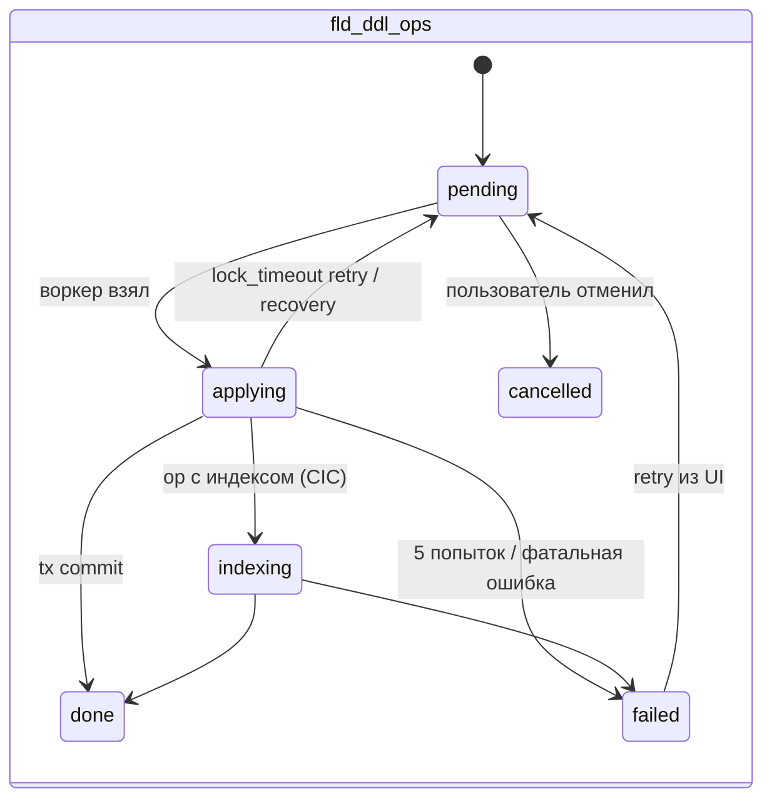
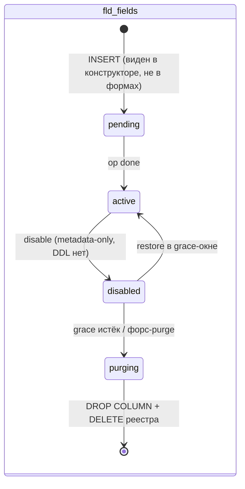

# B-15 — flex/attributes: единый пакет кастомных полей/атрибутов

> Доменная спека Этапа 4. Входы: MASTER_PLAN §3 (D1–D16), B-01 (§2.1 flex/attributes, §3 конвенции, §4 tenancy), B-02 (N2), R-13 (DDL-пайплайн — принят целиком), R-01 (§2.4, §3.1, §4.1–4.2, §4.7), R-02 (§2.1, §3.1, §4.1), R-07 (§4.3–4.4), R-14 (§2.7, §3).
> Статус: draft на ревью. Дата: 2026-07-03.
> Установка D-001: спека самодостаточна — дешёвая модель пишет по ней финальные vault-доки и код без обращения к R-отчётам.

---

## 1. Границы и состав

### 1.1 Что это

**flex/attributes** — standalone OSS-пакет (MIT, свой репозиторий, реализует ADR-кандидат N2): единый реестр метаданных полей/сущностей `fld_*` + три взаимозаменяемых storage-драйвера значений. Разрешает противоречие R-01×R-02×R-07: CRM-поля = реальные колонки, commerce-атрибуты = типизированный EAV-словарь, CMS-blueprint = jsonb-payload — **одна модель метаданных, один API значений, один DDL-пайплайн**.

| Драйвер | Хранение значений | Основной потребитель | Референс |
|---|---|---|---|
| `ddl` | реальные колонки `cf_*` основной таблицы (ALTER TABLE через op-log) | corex/crm (FlexCRM) | twenty, EspoCRM rebuild, Б24 смарт-процессы (R-02 §3.1) |
| `eav` | типизированный словарь `fld_values` + денормализация фасетов | corex/commerce (FlexStore) | Saleor AttributeValue, Bagisto typed cols (R-01 §3.1) |
| `jsonb` | payload-колонка host-таблицы + авто-managed partial expression-индексы | corex/cms (FlexCMS) | Craft 5, Statamic eloquent (R-07 §4.3) |

Выбор драйвера — **per-entity** (`fld_entities.storage_driver`), не per-продукт: внутри одного аккаунта CRM-сделки живут на `ddl`, товары на `eav`, контент на `jsonb`.

### 1.2 Состав пакета

```
flex/attributes
├── Registry/          реестр fld_* (entities, fields, groups, options, sets, indexes)
├── Types/             FieldType-классы v1 (§3.4) + FieldTypeRegistry
├── Drivers/
│   ├── Ddl/           op-log fld_ddl_ops, воркер ApplyDdlOps, CIC-протокол, fingerprint
│   ├── Eav/           fld_values, upsert-логика, оси вариаций
│   └── Jsonb/         payload-доступ, expression-индексы (через тот же op-log)
├── Values/            AttributeStore — единый API чтения/записи (§3.2)
├── Validation/        валидатор значений (rules из FieldType + validation jsonb)
├── Facets/            FacetProjector (jsonb-проекция) + SearchMapping (слоты, §6.3)
├── Declaration/       Extend\EntityField DSL + flex:attributes:sync (§4.1)
├── Quotas/            QuotaProvider-контракт + enforcement (§7.2)
└── Console/           flex:schema:verify|repair, flex:attributes:sync, flex:attributes:purge-expired
```

### 1.3 Зона OSS vs проприетарное

| OSS (пакет, MIT) | Вне пакета |
|---|---|
| Весь реестр, все 3 драйвера, DDL-пайплайн, валидация, фасет-проектор, события, DSL деклараций, консольные команды, Filament-филдсеты (генерация форм) | Тарифные лимиты (root_plans, corex/billing — cloud); UI-конструктор полей FlexCRM (проприетарный, использует API пакета); vertical-инсталлеры (декларации через тот же DSL) |

### 1.4 Зависимости

- PHP 8.4–8.5, Laravel 12–13 (D4-политика пакетов), PostgreSQL 16+ (транзакционный DDL, NULLS NOT DISTINCT, fast default).
- **Не зависит от corex**: все внешние нужды — через контракты пакета (`QuotaProvider`, `SearchDirtyMarker`, `ActorResolver`, `EntityTableResolver`); corex/core поставляет реализации-адаптеры (EntityRegistry ↔ fld_entities, root_plans ↔ квоты).
- Очередь: Laravel queues (unique jobs); в boxed допустим `queue=sync` (§6.5).
- MySQL: драйверы `eav` и `jsonb` совместимы (отложено по D4); драйвер `ddl` на MySQL **не поддерживается** (нетранзакционный DDL ломает гарантии атомарности — R-13 §3.8) — для boxed-MySQL сущности CRM переключаются на `jsonb`.

### 1.5 Терминология

- **Поле (field)** — единица метаданных (`fld_fields`); в commerce-контексте синоним «атрибут».
- **Slug/code поля** — snake_case ≤ 40 символов, **неизменяем после создания** (API-стабильность, R-13 §2.3); редактируется только `label`.
- **Тип (type)** — семантика хранения/валидации; **контрол (control)** — UI-представление. Разделены (Saleor input_type ≠ storage, unbox-опыт).
- **Набор (set)** — именованное подмножество полей сущности (commerce product_type / «семейство» Bagisto).
- **ACTOR** — jsonb-снапшот инициатора `{source: user|agent|api|import|vertical|system, id, name}` (twenty-паттерн).

---

## 2. Схема БД

Все таблицы — в **тенантской БД** (R-13: бэкап/PITR атомарно сохраняет метаданные вместе со схемой и значениями). Префикс `fld_` (D9). PK — `uuid` (UUIDv7, D12); генерируется приложением. `now()` в DEFAULT только для timestamps-колонок (не для cf_-колонок — volatile default запрещён, §2.9).

### 2.1 Реестр сущностей
```sql
CREATE TABLE fld_entities (
  id               uuid PRIMARY KEY,
  module           varchar(32) NOT NULL,
  code             varchar(64) NOT NULL,
  table_name       varchar(63) NOT NULL,
  storage_driver   text NOT NULL CHECK (storage_driver IN ('ddl','eav','jsonb')),
  payload_column   varchar(63),
  discriminator    jsonb,
  facets_column    varchar(63),
  label            jsonb NOT NULL,
  label_plural     jsonb,
  icon             varchar(64),
  color            varchar(16),
  is_system        boolean NOT NULL DEFAULT false,
  is_custom        boolean NOT NULL DEFAULT false,
  is_audit_logged  boolean NOT NULL DEFAULT true,
  is_searchable    boolean NOT NULL DEFAULT true,
  duplicate_criteria jsonb,
  label_field_id   uuid,
  workspace_id     uuid,
  status           text NOT NULL DEFAULT 'active'
                   CHECK (status IN ('pending','active','archived','purging')),
  created_at       timestamptz NOT NULL DEFAULT now(),
  updated_at       timestamptz NOT NULL DEFAULT now(),
  UNIQUE (code)
);
CREATE INDEX fld_entities_module ON fld_entities (module, status);

COMMENT ON COLUMN fld_entities.code IS
  'Глобальный код сущности: crm.deal, com.product, cms.article. Зеркалится в EntityRegistry (B-10)';
COMMENT ON COLUMN fld_entities.table_name IS
  'Физическая таблица: crm_deals / com_products / cms_entries / cst_<slug>';
COMMENT ON COLUMN fld_entities.payload_column IS
  'Только jsonb-драйвер: колонка payload host-таблицы (custom_data / payload)';
COMMENT ON COLUMN fld_entities.discriminator IS
  'jsonb-драйвер поверх ОБЩЕЙ таблицы (несколько логических сущностей в одной физической, '
  'кейс CMS-blueprint над cms_entries): {"column":"blueprint_id","value":"<uuid>"}. '
  'Используется как partial-предикат expression-индексов (R-07 §4.3). NULL = вся таблица';
COMMENT ON COLUMN fld_entities.facets_column IS
  'eav-драйвер: колонка jsonb-проекции фасетов host-таблицы (обычно facets). NULL = проекция выключена';
COMMENT ON COLUMN fld_entities.is_custom IS
  'true = пользовательская сущность cst_<slug>, создана через op create_entity';
COMMENT ON COLUMN fld_entities.duplicate_criteria IS
  'Критерии дедупликации записей (twenty): [["cf_inn"],["name","phone"]]';
COMMENT ON COLUMN fld_entities.label_field_id IS
  'FK на fld_fields (какое поле = «имя записи»); констрейнт вешается ALTER-ом после создания fld_fields';
COMMENT ON COLUMN fld_entities.workspace_id IS
  'NULL = сущность видна всему аккаунту; иначе — только workspace (D1)';

-- после создания fld_fields:
ALTER TABLE fld_entities
  ADD CONSTRAINT fld_entities_label_field_fk
  FOREIGN KEY (label_field_id) REFERENCES fld_fields (id) ON DELETE SET NULL;
```

### 2.2 Группы и поля
```sql
CREATE TABLE fld_field_groups (
  id          uuid PRIMARY KEY,
  entity_id   uuid NOT NULL REFERENCES fld_entities (id) ON DELETE CASCADE,
  code        varchar(40) NOT NULL,
  label       jsonb NOT NULL,
  position    int NOT NULL DEFAULT 0,
  created_at  timestamptz NOT NULL DEFAULT now(),
  updated_at  timestamptz NOT NULL DEFAULT now(),
  UNIQUE (entity_id, code)
);
COMMENT ON TABLE fld_field_groups IS 'UI-секции формы (Lunar attribute_groups): «Финансы», «Логистика»';

CREATE TABLE fld_fields (
  id               uuid PRIMARY KEY,
  entity_id        uuid NOT NULL REFERENCES fld_entities (id) ON DELETE CASCADE,
  group_id         uuid REFERENCES fld_field_groups (id) ON DELETE SET NULL,
  code             varchar(40) NOT NULL,
  label            jsonb NOT NULL,
  description      jsonb,
  type             varchar(24) NOT NULL CHECK (type IN
                   ('text','int','decimal','bool','date','datetime','select','multiselect',
                    'reference','money','url','email','phone','file','json')),
  control          varchar(32) NOT NULL,
  origin           text NOT NULL DEFAULT 'runtime'
                   CHECK (origin IN ('declared','runtime','vertical')),
  owner_module     varchar(32),
  storage_target   jsonb,
  ref_entity_id    uuid REFERENCES fld_entities (id) ON DELETE RESTRICT,
  unit             varchar(24),
  is_required      boolean NOT NULL DEFAULT false,
  is_unique        boolean NOT NULL DEFAULT false,
  is_multiple      boolean NOT NULL DEFAULT false,
  is_variant_axis  boolean NOT NULL DEFAULT false,
  is_filterable    boolean NOT NULL DEFAULT false,
  is_localizable   boolean NOT NULL DEFAULT false,
  is_system        boolean NOT NULL DEFAULT false,
  default_value    jsonb,
  validation       jsonb,
  config           jsonb,
  overrides        jsonb,
  search_slot      varchar(16),
  position         int NOT NULL DEFAULT 0,
  status           text NOT NULL DEFAULT 'pending'
                   CHECK (status IN ('pending','active','disabled','purging')),
  disabled_at      timestamptz,
  purge_after      timestamptz,
  created_at       timestamptz NOT NULL DEFAULT now(),
  updated_at       timestamptz NOT NULL DEFAULT now(),
  UNIQUE (entity_id, code),
  CHECK (NOT is_variant_axis OR type = 'select'),
  CHECK (type NOT IN ('select','multiselect') OR control IS NOT NULL),
  CHECK (type <> 'reference' OR ref_entity_id IS NOT NULL),
  CHECK (NOT is_multiple OR type IN ('multiselect','reference','file')),
  CHECK (status <> 'disabled' OR disabled_at IS NOT NULL)
);
CREATE INDEX fld_fields_entity_status ON fld_fields (entity_id, status);
CREATE INDEX fld_fields_purge ON fld_fields (purge_after)
  WHERE status = 'disabled' AND purge_after IS NOT NULL;
CREATE UNIQUE INDEX fld_fields_slot ON fld_fields (entity_id, search_slot)
  WHERE search_slot IS NOT NULL;

COMMENT ON COLUMN fld_fields.code IS
  'Slug snake_case ≤40 симв., НЕИЗМЕНЯЕМ (R-13 §3.5: API-стабильность; физический rename не нужен). '
  'Грамматика: ^[a-z][a-z0-9_]{0,39}$, запрещены зарезервированные слова PG и системные имена колонок';
COMMENT ON COLUMN fld_fields.origin IS
  'declared = Extend\EntityField из кода модуля; runtime = создано пользователем; vertical = пресет-инсталлер';
COMMENT ON COLUMN fld_fields.owner_module IS
  'Для origin=declared/vertical: пакет-владелец; регистрируется в mod_records (B-10) для предсказуемого purge';
COMMENT ON COLUMN fld_fields.storage_target IS
  'ddl: {"columns":[{"name":"cf_budget_amount","pg_type":"bigint"},{"name":"cf_budget_currency","pg_type":"char(3)"}]} '
  '(= physical_columns из R-13); jsonb: {"path":"budget"}; eav: NULL';
COMMENT ON COLUMN fld_fields.is_required IS
  'Enforcement ТОЛЬКО на уровне приложения (валидатор + required_fields стадий CRM). '
  'SET NOT NULL запрещён политикой ALTER (R-13 §2.3)';
COMMENT ON COLUMN fld_fields.is_unique IS
  'Реализуется managed-уникальным индексом (fld_indexes, partial WHERE deleted_at IS NULL) — только ddl-драйвер';
COMMENT ON COLUMN fld_fields.is_variant_axis IS
  'Ось вариаций SKU (Bagisto is_configurable / Saleor variant_selection). Только type=select, только eav. '
  'Guard: неизменяем при существующих SKU (интерфейс для B-14, §6.2)';
COMMENT ON COLUMN fld_fields.is_filterable IS
  'Поле попадает в фасет-проекцию и filterable-схему поискового индекса (назначается search_slot, §6.3)';
COMMENT ON COLUMN fld_fields.default_value IS
  'Дефолт значения. Для ddl-драйвера транслируется в DEFAULT <константа> (fast default PG11+); '
  'volatile-выражения (now(), random()) ЗАПРЕЩЕНЫ валидатором — «текущее время» решается приложением';
COMMENT ON COLUMN fld_fields.validation IS
  'Доп. правила поверх типовых: {"min":0,"max":1e9,"regex":"...","min_len":1,"max_len":255,"step":0.5}';
COMMENT ON COLUMN fld_fields.overrides IS
  'Пользовательские переопределения declared-полей (twenty overrides): {"label":{...},"position":5,"group_id":"..."}. '
  'Ядровое определение из кода не мутируется';
COMMENT ON COLUMN fld_fields.search_slot IS
  'Слот в общем Meilisearch-индексе ячейки: f_s1..f_s32 | f_n1..f_n16 (решение R-14 open question, §6.3)';
COMMENT ON COLUMN fld_fields.purge_after IS
  'Конец grace-окна двухфазного удаления (disable + 30 дней); джоб ставит op purge_field';
```

### 2.3 Словарь дискретных значений
```sql
CREATE TABLE fld_options (
  id          uuid PRIMARY KEY,
  field_id    uuid NOT NULL REFERENCES fld_fields (id) ON DELETE CASCADE,
  code        varchar(64) NOT NULL,
  label       jsonb NOT NULL,
  meta        jsonb,
  position    int NOT NULL DEFAULT 0,
  is_active   boolean NOT NULL DEFAULT true,
  created_at  timestamptz NOT NULL DEFAULT now(),
  updated_at  timestamptz NOT NULL DEFAULT now(),
  UNIQUE (field_id, code)
);
CREATE INDEX fld_options_field ON fld_options (field_id, is_active, position);

COMMENT ON TABLE fld_options IS
  'Словарь значений select/multiselect (и осей вариаций). i18n — в label jsonb (Lunar-модель); '
  'code — стабильный ключ для 1С/импорта/фасетов (R-01)';
COMMENT ON COLUMN fld_options.meta IS 'Свотчи: {"hex":"#f00","image_id":"..."} (Shopware display_type)';
COMMENT ON COLUMN fld_options.is_active IS
  'false = скрыта из форм, существующие значения валидны (удаление опции с значениями запрещено, §5.7)';
```

### 2.4 Наборы полей (attribute sets / «типы товара»)
```sql
CREATE TABLE fld_sets (
  id          uuid PRIMARY KEY,
  entity_id   uuid NOT NULL REFERENCES fld_entities (id) ON DELETE CASCADE,
  code        varchar(64) NOT NULL,
  label       jsonb NOT NULL,
  is_default  boolean NOT NULL DEFAULT false,
  position    int NOT NULL DEFAULT 0,
  created_at  timestamptz NOT NULL DEFAULT now(),
  updated_at  timestamptz NOT NULL DEFAULT now(),
  UNIQUE (entity_id, code)
);
COMMENT ON TABLE fld_sets IS
  'Набор полей сущности (Saleor product_type / Bagisto attribute_family). '
  'Commerce: com_products.product_type_id → fld_sets.id (контракт для B-14, §6.2). '
  'Для ddl/jsonb-сущностей наборы опциональны (обычно NULL — все поля)';

CREATE TABLE fld_set_fields (
  set_id                   uuid NOT NULL REFERENCES fld_sets (id) ON DELETE CASCADE,
  field_id                 uuid NOT NULL REFERENCES fld_fields (id) ON DELETE CASCADE,
  position                 int NOT NULL DEFAULT 0,
  is_required_override     boolean,
  is_variant_axis_override boolean,
  created_at               timestamptz NOT NULL DEFAULT now(),
  updated_at               timestamptz NOT NULL DEFAULT now(),
  PRIMARY KEY (set_id, field_id)
);
COMMENT ON COLUMN fld_set_fields.is_variant_axis_override IS
  'Переопределение оси per-набор (R-01 §4.1 pivot is_variant_axis_override). NULL = наследовать поле';
```

### 2.5 EAV-хранилище значений (драйвер `eav`)
```sql
CREATE TABLE fld_values (
  id             uuid PRIMARY KEY,
  field_id       uuid NOT NULL REFERENCES fld_fields (id) ON DELETE CASCADE,
  record_id      uuid NOT NULL,
  option_id      uuid REFERENCES fld_options (id) ON DELETE RESTRICT,
  locale         varchar(12),
  value_text     text,
  value_int      bigint,
  value_decimal  numeric(18,6),
  value_bool     boolean,
  value_date     date,
  value_dt       timestamptz,
  value_ref      uuid,
  value_json     jsonb,
  created_at     timestamptz NOT NULL DEFAULT now(),
  updated_at     timestamptz NOT NULL DEFAULT now(),
  UNIQUE NULLS NOT DISTINCT (field_id, record_id, option_id, value_ref, locale)
);
CREATE INDEX fld_values_record  ON fld_values (record_id);
CREATE INDEX fld_values_option  ON fld_values (field_id, option_id) WHERE option_id IS NOT NULL;
CREATE INDEX fld_values_int     ON fld_values (field_id, value_int) WHERE value_int IS NOT NULL;
CREATE INDEX fld_values_decimal ON fld_values (field_id, value_decimal) WHERE value_decimal IS NOT NULL;
CREATE INDEX fld_values_ref     ON fld_values (field_id, value_ref) WHERE value_ref IS NOT NULL;

COMMENT ON TABLE fld_values IS
  'Типизированный EAV-словарь (одна таблица, НЕ таблица-на-тип — анти-Magento, R-01 §2.8). '
  'Одна строка = (поле, запись[, опция][, ссылка][, локаль]). Multiselect = строка на опцию (Saleor)';
COMMENT ON COLUMN fld_values.record_id IS
  'PK строки host-таблицы сущности поля (com_products и т.п.). Полиморфизм → FK невозможен; '
  'целостность: каскадная чистка доменным хуком RecordDeleted + fingerprint-verify (§5.6)';
COMMENT ON COLUMN fld_values.option_id IS 'select/multiselect: значение = ссылка на словарь, не копия (Saleor)';
COMMENT ON COLUMN fld_values.value_decimal IS 'NUMERIC, не float (точность range-фильтров; Saleor-ошибка numeric FLOAT)';
COMMENT ON COLUMN fld_values.value_ref IS 'type=reference: uuid записи целевой сущности (без FK — полиморфизм)';
COMMENT ON COLUMN fld_values.locale IS
  'Только для is_localizable свободных значений (text и пр.); словарные i18n — в fld_options.label. NULL = нелокализуемое';
```

Маппинг тип → колонки `fld_values`:

| type | колонки | примечание |
|---|---|---|
| text/url/email/phone | value_text | |
| int | value_int | |
| decimal | value_decimal | |
| bool | value_bool | |
| date / datetime | value_date / value_dt | |
| select/multiselect | option_id | строка на опцию |
| reference | value_ref | строка на ссылку при is_multiple |
| money | value_int + value_json | value_int = amount minor units (range-фильтры); value_json = `{"amount":N,"currency":"RUB"}` |
| file | value_ref | uuid из med_files (без FK, контракт media) |
| json | value_json | |

### 2.6 Managed-индексы
```sql
CREATE TABLE fld_indexes (
  id          uuid PRIMARY KEY,
  entity_id   uuid NOT NULL REFERENCES fld_entities (id) ON DELETE CASCADE,
  field_id    uuid REFERENCES fld_fields (id) ON DELETE CASCADE,
  name        varchar(63) NOT NULL,
  kind        text NOT NULL CHECK (kind IN ('btree','gin','gist','unique','expression')),
  definition  jsonb NOT NULL,
  status      text NOT NULL DEFAULT 'pending'
              CHECK (status IN ('pending','building','active','invalid','dropping')),
  created_at  timestamptz NOT NULL DEFAULT now(),
  updated_at  timestamptz NOT NULL DEFAULT now(),
  UNIQUE (name)
);
COMMENT ON COLUMN fld_indexes.name IS
  'Всегда cfi_<slug>_<shortOpId> (≤63 байта, резервированный namespace R-13 §3.5)';
COMMENT ON COLUMN fld_indexes.definition IS
  'ddl-колонки: {"columns":["cf_budget_amount"],"where":"deleted_at IS NULL"}; '
  'jsonb expression: {"expression":"((payload->>''price'')::numeric)","where":"blueprint_id = ''<id>''"}; '
  'unique: {"columns":["cf_inn"],"unique":true,"where":"deleted_at IS NULL"}';
COMMENT ON COLUMN fld_indexes.status IS
  'building = идёт CREATE INDEX CONCURRENTLY; invalid = CIC упал, ждёт recovery-скан (drop + retry)';
```

### 2.7 Op-log DDL-операций (R-13 §3.1, канон)
```sql
CREATE TABLE fld_ddl_ops (
  id            uuid PRIMARY KEY,          -- UUIDv7 = порядок очереди
  entity_id     uuid NOT NULL REFERENCES fld_entities (id) ON DELETE RESTRICT,
  field_id      uuid REFERENCES fld_fields (id) ON DELETE RESTRICT,
  index_id      uuid REFERENCES fld_indexes (id) ON DELETE RESTRICT,
  op_type       text NOT NULL CHECK (op_type IN
                ('create_entity','add_field','disable_field','purge_field',
                 'add_index','drop_index','archive_entity','purge_entity')),
  payload       jsonb NOT NULL,
  status        text NOT NULL DEFAULT 'pending' CHECK (status IN
                ('pending','applying','indexing','done','failed','cancelled')),
  attempts      smallint NOT NULL DEFAULT 0,
  last_error    jsonb,
  requested_by  jsonb NOT NULL,
  created_at    timestamptz NOT NULL DEFAULT now(),
  updated_at    timestamptz NOT NULL DEFAULT now(),
  applied_at    timestamptz
);
CREATE INDEX fld_ddl_ops_queue ON fld_ddl_ops (status, id)
  WHERE status IN ('pending','applying','indexing','failed');

COMMENT ON TABLE fld_ddl_ops IS
  'Op-log = сериализация/аудит/ретраи; НЕ источник истины схемы (истина = реестр + фактическая схема, '
  'урок twenty gen-2, R-13 §2.1). Дренаж — один unique-job на аккаунт';
COMMENT ON COLUMN fld_ddl_ops.payload IS
  'Декларативная цель: add_field → снапшот FieldDefinition (type, columns, default); '
  'add_index → definition; create_entity → каркас cst_-таблицы; purge_* → grace-подтверждение';
COMMENT ON COLUMN fld_ddl_ops.last_error IS '{sqlstate, message, at}';
COMMENT ON COLUMN fld_ddl_ops.requested_by IS 'ACTOR: user/agent/api/import/vertical-installer';

CREATE TABLE fld_schema_state (
  id                   smallint PRIMARY KEY DEFAULT 1 CHECK (id = 1),
  registry_fingerprint text,
  schema_fingerprint   text,
  verified_at          timestamptz,
  drift                jsonb,
  created_at           timestamptz NOT NULL DEFAULT now(),
  updated_at           timestamptz NOT NULL DEFAULT now()
);
COMMENT ON TABLE fld_schema_state IS
  'Singleton. Fingerprint-протокол (§5.6): sha256 канонической сериализации desired (реестр) '
  'и actual (pg_attribute/pg_index по управляемым объектам cf_/cfi_/cst_)';
COMMENT ON COLUMN fld_schema_state.drift IS 'Детальный diff при mismatch: [{class, object, expected, actual}]';
```

### 2.8 Конвенции физических объектов (драйвер ddl)

| Объект | Namespace | Пример |
|---|---|---|
| Колонка кастомного поля | `cf_<slug>` (композит: `cf_<slug>_<part>`) | `cf_budget_amount`, `cf_budget_currency` |
| Managed-индекс | `cfi_<slug>_<shortOpId>` | `cfi_budget_amount_0h3k` |
| Таблица кастомной сущности | `cst_<slug>` | `cst_projects` |

Резервирование взаимное (R-13 §3.5): релизные миграции ядра/модулей **никогда** не создают объекты `cf_/cfi_/cst_` (CI-линт, B-10) и не полагаются на фиксированный набор колонок; пайплайн **никогда** не трогает не-cf_ объекты.

Маппинг тип → PG-колонки (ddl):

| type | колонки | FK / индексируемость |
|---|---|---|
| text/url/email/phone | `cf_x text` | btree по запросу (managed) |
| int | `cf_x bigint` | btree |
| decimal | `cf_x numeric(18,6)` | btree |
| bool | `cf_x boolean` | partial btree WHERE cf_x |
| date / datetime | `cf_x date` / `cf_x timestamptz` | btree |
| select | `cf_x uuid REFERENCES fld_options (id) ON DELETE RESTRICT` | честный FK; btree |
| multiselect | `cf_x uuid[]` | GIN; FK невозможен на массиве — валидатор + RESTRICT-протокол опций |
| reference | `cf_x uuid` + FK на `fld_entities.table_name` цели `ON DELETE SET NULL` (только если цель — фикс. таблица или cst_) | btree |
| money | `cf_x_amount bigint` + `cf_x_currency char(3)` | btree по amount |
| file | `cf_x uuid[]` (med_files, без FK) | GIN |
| json | `cf_x jsonb` | GIN jsonb_path_ops по запросу |

Каркас `cst_<slug>` (op `create_entity`, R-02 §4.1):

```sql
CREATE TABLE cst_<slug> (
  id            uuid PRIMARY KEY,
  workspace_id  uuid,
  owner_id      uuid,
  title         varchar(255) NOT NULL,
  created_by    jsonb NOT NULL,           -- ACTOR
  search        tsvector,
  position      int NOT NULL DEFAULT 0,
  created_at    timestamptz NOT NULL DEFAULT now(),
  updated_at    timestamptz NOT NULL DEFAULT now(),
  deleted_at    timestamptz
);
CREATE INDEX cst_<slug>_ws ON cst_<slug> (workspace_id) WHERE deleted_at IS NULL;
CREATE INDEX cst_<slug>_search ON cst_<slug> USING GIN (search);
```

### 2.9 Матрица разрешённых ALTER (политика безопасности, R-13 §2.3 — канон)

| Операция | Политика |
|---|---|
| `ADD COLUMN` nullable без DEFAULT | ✅ базовый путь (AEL на мс) |
| `ADD COLUMN … DEFAULT <константа>` | ✅ fast default PG11+; DEFAULT только non-volatile (валидатор) |
| `ADD COLUMN … DEFAULT now()/random()` | ⛔ полная перезапись таблицы — запрещён |
| `SET NOT NULL` | ⛔ v1; required — уровень приложения |
| `ALTER TYPE` | ⛔ тип неизменяем (HubSpot/unbox). Whitelist: `varchar(n)→varchar(m>n)/text` (metadata-only) |
| `RENAME COLUMN` | ⛔ slug неизменяем; правится только label |
| `DROP COLUMN` | ✅ только двухфазно: disable → grace 30 дн → purge |
| `CREATE INDEX` (не CONCURRENTLY) | ⛔ на непустых таблицах (SHARE-лок блокирует записи) |
| `CREATE INDEX CONCURRENTLY` | ✅ единственный способ; autocommit-коннект, спец-протокол §5.3 |

Обвязка каждого ALTER: `SET LOCAL lock_timeout='3s'`, `SET LOCAL statement_timeout='15s'`, ретраи с экспоненциальным backoff+jitter (постгрес-ai-паттерн).

Лимиты PG, определяющие капы (§7.2): ≤1600 колонок на таблицу (дропнутые считаются, attnum не переиспользуется); кортеж ≤ 8 КБ heap-страницы (varlena → TOAST); идентификаторы ≤63 байта → slug ≤40 + префиксы/суффиксы влезают.

---

## 3. Публичные контракты

Namespace пакета: `Flex\Attributes\` (vendor-имя — открытый вопрос D-001, здесь плейсхолдер).

### 3.1 Ключевые DTO
```php
namespace Flex\Attributes\Support;

final readonly class RecordRef {
    public function __construct(
        public string $entityCode,      // 'crm.deal'
        public string $recordId,        // uuid host-строки
        public ?string $locale = null,
    ) {}
}

final readonly class Actor {           // ACTOR-снапшот
    public function __construct(
        public string $source,          // user|agent|api|import|vertical|system
        public ?string $id,
        public ?string $name,
    ) {}
    public function toArray(): array;
}

final readonly class FieldDefinition { // вход создания поля (API и DSL сходятся сюда)
    public function __construct(
        public string $entityCode,
        public string $code,
        public string $type,
        public array $label,            // i18n
        public ?string $control = null, // null → дефолт типа
        public ?string $groupCode = null,
        public bool $required = false,
        public bool $unique = false,
        public bool $multiple = false,
        public bool $filterable = false,
        public bool $localizable = false,
        public bool $variantAxis = false,
        public ?string $refEntityCode = null,
        public ?string $unit = null,
        public mixed $default = null,
        public array $validation = [],
        public array $config = [],
        public array $options = [],     // [{code, label, meta, position}] для select/multiselect
        public array $setCodes = [],    // привязка к наборам
        public int $position = 0,
    ) {}
}

final readonly class ColumnSpec {
    public function __construct(
        public string $name,            // 'cf_budget_amount'
        public string $pgType,          // 'bigint'
        public ?string $constDefault,   // SQL-литерал константы или null
    ) {}
}

final readonly class DdlOpRef {
    public function __construct(public string $opId, public string $status) {}
}

final readonly class ValueChange {
    public function __construct(public string $fieldCode, public mixed $old, public mixed $new) {}
}

final class ValueBag implements \ArrayAccess, \IteratorAggregate {
    /** @return mixed типизированное PHP-значение (castOut типа) */
    public function get(string $code): mixed;
    public function has(string $code): bool;
    public function toArray(): array;   // сериализация для corex/api
}

final readonly class DriverCapabilities {
    public function __construct(
        public bool $supportsUniqueIndex,
        public bool $supportsForeignKeys,
        public bool $supportsVariantAxes,
        public bool $supportsManagedIndexes,
        public bool $requiresDdlPipeline,
    ) {}
}
// ddl:   (true,  true,  false, true,  true)
// eav:   (false, false, true,  false, false)
// jsonb: (false, false, false, true,  true)   — expression-индексы идут через op-log
```

### 3.2 Управление метаданными и значениями
```php
namespace Flex\Attributes\Contracts;

interface FieldManager {
    /** Валидация → квота → tx(INSERT fld_fields status=pending + INSERT fld_ddl_ops) → dispatch.
     *  eav-драйвер: DDL не нужен → поле сразу active, op не создаётся.
     *  @throws QuotaExceededException (422), InvalidDefinitionException (422) */
    public function create(FieldDefinition $def, Actor $actor): FieldCreationResult; // {field, ?DdlOpRef}

    /** Только метаданные без DDL: label, description, group, position, validation, config,
     *  required, filterable (→ §6.3 слот), опции. Тип/slug/multiple/localizable неизменяемы. */
    public function update(string $fieldId, FieldPatch $patch, Actor $actor): Field;

    public function disable(string $fieldId, Actor $actor): void;      // фаза 1 drop (metadata-only)
    public function restore(string $fieldId, Actor $actor): void;      // в grace-окне: status→active
    public function purge(string $fieldId, Actor $actor): DdlOpRef;    // форс до grace (право admin)

    public function createEntity(EntityDefinition $def, Actor $actor): EntityCreationResult; // cst_
    public function archiveEntity(string $entityId, Actor $actor): void;
    public function purgeEntity(string $entityId, Actor $actor): DdlOpRef;

    public function addOption(string $fieldId, OptionDefinition $def, Actor $actor): Option;
    public function updateOption(string $optionId, OptionPatch $patch, Actor $actor): Option;
    /** @throws OptionInUseException — есть значения/SKU-оси на этой опции */
    public function deactivateOption(string $optionId, Actor $actor): void;

    public function createSet(string $entityId, SetDefinition $def, Actor $actor): FieldSet;
    public function attachFieldToSet(string $setId, string $fieldId, array $overrides = []): void;
}

interface FieldRepository {
    public function entity(string $entityCode): ?Entity;
    public function field(string $entityCode, string $code): ?Field;
    /** @return Field[] active-поля; $setCode → отфильтровано набором с учётом overrides */
    public function fieldsFor(string $entityCode, ?string $setCode = null, bool $includeDisabled = false): array;
    public function options(string $fieldId, bool $onlyActive = true): array;
    /** @return Field[] оси вариаций набора (contract для B-14) */
    public function variantAxes(string $setId): array;
}

interface AttributeStore {   // ЕДИНЫЙ API значений, драйвер прозрачен
    public function get(RecordRef $r, string $code): mixed;
    public function all(RecordRef $r, ?string $setCode = null): ValueBag;
    /** Batch без N+1: eav — один SELECT по record_id ANY(...); ddl/jsonb — значения уже в строке */
    public function loadMany(string $entityCode, array $recordIds): array; // [recordId => ValueBag]

    /** Валидация → запись драйвером → фасет-проекция → search_dirty → событие ValueChanged.
     *  ВСЁ в одной транзакции с записью host-строки (вызывается из доменного saving-хука).
     *  @param array<string,mixed> $values [code => raw] @throws ValidationException */
    public function set(RecordRef $r, array $values, Actor $actor): void;

    public function deleteRecordValues(RecordRef $r): void;  // хук RecordDeleted (чистка eav-строк)

    /** Типобезопасный фильтр в Eloquent/QueryBuilder независимо от драйвера:
     *  ddl → WHERE cf_x…; eav → EXISTS(fld_values…); jsonb → expression по payload */
    public function scopeFilter(Builder $q, string $entityCode, string $code, string $op, mixed $value): Builder;
    // $op ∈ eq|neq|in|gte|lte|between|contains|is_null|not_null
}
```

### 3.3 Драйверы и типы
```php
interface StorageDriver {
    public function code(): string;                                  // 'ddl'|'eav'|'jsonb'
    public function capabilities(): DriverCapabilities;
    /** null = DDL не требуется (eav). Иначе — план для op-log */
    public function planFieldCreation(Field $f): ?DdlPlan;
    public function planFieldPurge(Field $f): ?DdlPlan;
    public function planIndexCreation(ManagedIndex $i): ?DdlPlan;
    public function planEntityCreation(Entity $e): ?DdlPlan;
    public function write(RecordRef $r, array $changes /* ValueChange[] */): void;
    public function read(string $entityCode, array $recordIds, array $fields): array;
    public function applyFilter(Builder $q, Field $f, string $op, mixed $value): Builder;
}

interface FieldType {
    public function code(): string;                                  // 'money'
    public function defaultControl(): string;                        // 'money-input'
    public function allowedControls(): array;
    /** ddl: физические колонки (композит = N штук) */
    public function columns(Field $f): array;                        // ColumnSpec[]
    /** eav: какие value_*-колонки пишутся */
    public function eavColumns(): array;                             // ['value_int','value_json']
    /** jsonb: SQL-выражение доступа (аналог Craft getValueSql) */
    public function jsonbExpression(Field $f, string $payloadColumn): string;
    public function castIn(mixed $raw, Field $f): mixed;             // API → storage
    public function castOut(mixed $stored, Field $f): mixed;         // storage → PHP/API
    public function rules(Field $f): array;                          // Laravel validation rules
    /** Проекция в facets jsonb: код опции / скаляр / null (не проецируется) */
    public function facetValue(mixed $v, Field $f): string|int|float|array|null;
    /** Значение для поискового слота: string|string[] → f_s*, int|float → f_n* (§6.3) */
    public function searchValue(mixed $v, Field $f): string|int|float|array|null;
}

interface FieldTypeRegistry {   // extension point §4.2
    public function register(FieldType $type): void;
    public function get(string $code): FieldType;
}

interface QuotaProvider {       // cloud: адаптер root_plans (corex/billing); boxed: config
    public function limits(): FieldQuotas;
    // FieldQuotas { customFieldsPerEntity, customEntities, customIndexesPerEntity,
    //               physicalColumnsCap, optionsPerField, filterableStrSlots, filterableNumSlots }
}

interface SearchDirtyMarker {   // реализует corex/search; boxed-pgsql: no-op допустим
    public function markDirty(string $tableName, array $recordIds): void;
}

interface EntityTableResolver { // реализует corex/core (EntityRegistry)
    public function tableFor(string $entityCode): string;
    public function softDeleteColumn(string $entityCode): ?string;   // для partial-предикатов индексов
}
```

### 3.4 Типы полей v1 × UI-контролы

| type | default control | допустимые controls | примечания |
|---|---|---|---|
| text | input | input, textarea, richtext, masked-input | richtext хранит HTML в той же колонке |
| int | number | number, slider, rating | rating = int 1..config.max |
| decimal | number | number, slider | numeric(18,6) |
| bool | toggle | toggle, checkbox | |
| date | date-picker | date-picker | |
| datetime | datetime-picker | datetime-picker | timestamptz |
| select | select | select, radio, button-group, swatch | значения — fld_options |
| multiselect | multiselect | multiselect, checkbox-list, tags, swatch | is_multiple=true всегда |
| reference | reference-picker | reference-picker, select-remote | ref_entity_id обязателен |
| money | money-input | money-input | композит amount+currency (ADR-005) |
| url | url-input | url-input | валидация URL |
| email | email-input | email-input | |
| phone | phone-input | phone-input | E.164-нормализация castIn |
| file | file-upload | file-upload, image-upload | uuid[] из corex/media |
| json | key-value | key-value, code-editor | без фасетов |

Кандидаты v1.1 через FieldTypeRegistry (не в ядре v1): address, full_name, phones[], emails[], actor, formula (twenty-набор — R-02 §2.1).

### 3.5 Доменные события

Все события — synchronous Laravel events c immutable payload; workflow-движок (B-12) подписывается через Extend\Workflow-триггеры.

| Событие | Payload |
|---|---|
| `FieldCreated` | fieldId, entityCode, code, type, driver, origin, actor, opId? |
| `FieldActivated` | fieldId, entityCode, code (op done — поле доступно в формах/API) |
| `FieldDisabled` | fieldId, entityCode, code, purgeAfter, actor |
| `FieldRestored` | fieldId, entityCode, code, actor |
| `FieldPurged` | fieldId, entityCode, code, actor |
| `EntityCreated` / `EntityActivated` / `EntityPurged` | entityId, code, tableName, actor |
| `OptionAdded` / `OptionDeactivated` | optionId, fieldId, code, actor |
| `ValueChanged` | entityCode, recordId, changes: ValueChange[], actor, at — **триггер workflow «поле изменилось»** |
| `DdlOpFailed` | opId, opType, entityCode, lastError, attempts (терминальный fail → алерт/тост) |
| `SchemaDriftDetected` | driftClass (missing_column/orphan_column/type_mismatch), details |

`ValueChanged` эмитится один раз на транзакцию записи (все изменённые поля записи в одном событии), после коммита (`afterCommit`), чтобы workflow не видел незакоммиченные значения.

---

## 4. Extension points

### 4.1 Декларация полей модулем: `Extend\EntityField`

Единая модель метаданных: declared-поля и runtime-поля живут в одном реестре `fld_fields`, различаются `origin`. Модуль декларирует поля кодом:

```php
// в манифесте модуля (B-10)
new Extend\EntityField('crm.deal')
    ->group('finance', label: ['ru' => 'Финансы'])
    ->money('budget', label: ['ru' => 'Бюджет'], group: 'finance', filterable: true)
    ->select('grade', label: ['ru' => 'Класс'], options: [
        'a' => ['ru' => 'A'], 'b' => ['ru' => 'B'],
    ], control: 'radio')
    ->reference('curator', target: 'crm.contact', label: ['ru' => 'Куратор']),
```

Семантика синка (`flex:attributes:sync`, вызывается lifecycle-ом модуля при enable/upgrade — B-10):

1. Декларации компилируются в `FieldDefinition[]` → diff с реестром (`origin='declared' AND owner_module=X`).
2. Новые поля → `FieldManager::create` (те же квоты **не** применяются к declared — это схема модуля, не пользовательский контент; применяется только технический `physical_columns_cap`), тот же op-log.
3. Исчезнувшие из декларации → `disable` (grace 30 дней, страховка от опечатки в декларации); purge — только при uninstall модуля с `keepData=false` через `mod_records` (B-10).
4. Изменение label/options — обновление метаданных; изменение **type — ошибка синка** (тип неизменяем; модуль обязан завести новое поле + data-миграцию).
5. Идемпотентно: повторный sync без изменений = no-op (сравнение канонических форм).

Пользователь не может удалить declared-поле; может (в `overrides`): переименовать label, перенести в другую группу, сменить position, докинуть опций к select (user-опции помечаются `meta.user_added=true` и не трогаются синком).

### 4.2 Реестры расширения

| Extension point | Кто расширяет | Контракт |
|---|---|---|
| `FieldTypeRegistry` | модуль добавляет свой тип поля | `FieldType` (§3.3); ограничение: `columns()` только из whitelist PG-типов пакета (text, bigint, numeric, boolean, date, timestamptz, uuid, uuid[], char(3), jsonb) — произвольный SQL в DDL-пайплайн не попадает |
| `ControlRegistry` | модуль добавляет UI-контрол | `control code → Filament-компонент + Inertia-компонент`; контрол обязан объявить совместимые types |
| `ValidatorRegistry` | кастомные правила validation jsonb | `code → callable(rule config, value): bool` |
| События §3.5 | поведение (workflow, аудит, вебхуки) | подписка стандартная |
| Capability `attributable` | сущность модуля подключает кастомные поля | флаг в Extend\Entity (B-10) → авто: вкладка полей в Filament, секция `fields` в REST, регистрация в fld_entities |

### 4.3 Что пакет экспортирует наружу

- `AttributeStore` / `FieldRepository` / `FieldManager` — DI-синглтоны.
- Trait `HasAttributes` для Eloquent-моделей host-сущностей: `$model->attr('budget')`, `$model->setAttrs([...])`, scope `whereAttr('budget','>=',1000_00)` — сахар над AttributeStore.
- Filament: `AttributeFieldset::make($entityCode, ?$setCode)` — генерация формы из реестра (контролы из ControlRegistry, группы из fld_field_groups, required/validation применены).
- corex/api (B-10): авто-включение секции `fields` в ресурсы и фильтров `filter[fields][<code>][<op>]=` (§6.4).

---

## 5. Ключевые потоки

### 5.1 Создание поля (runtime, драйвер ddl)

```mermaid
sequenceDiagram
    participant UI as UI/REST
    participant API as FieldManager
    participant DB as tenant PG
    participant Q as queue
    participant W as ApplyDdlOps (unique per account)

    UI->>API: POST fields {code:'budget', type:'money', ...}
    API->>API: валидация FieldDefinition (slug-грамматика, тип, whitelist DEFAULT)
    API->>DB: tx: count квоты → INSERT fld_fields(status=pending) + INSERT fld_ddl_ops(add_field)
    API-->>UI: 202 {field, op_id, status: pending}
    API->>Q: dispatch ApplyDdlOps(accountId)  // ShouldBeUnique
    W->>DB: pg_advisory_xact_lock(hashtext('fld_ddl'))
    W->>DB: SELECT op WHERE status='pending' ORDER BY id FOR UPDATE SKIP LOCKED
    W->>DB: tx: SET LOCAL lock_timeout='3s'; ALTER TABLE crm_deals ADD COLUMN IF NOT EXISTS cf_budget_amount bigint, cf_budget_currency char(3)
    W->>DB: (та же tx) fld_fields.status='active'; op.status='done'; refreshFingerprints()
    W-->>UI: broadcast fld.op.updated {op_id, done} → событие FieldActivated
```

Пошагово (канон R-13 §3.2–3.3):

1. **API-слой**: валидация (type из enum; slug `^[a-z][a-z0-9_]{0,39}$`, уникален per entity, не зарезервирован; DEFAULT — константа; control совместим с type) → квота (§7.2, в той же транзакции INSERT'а — `count(fld_fields WHERE entity_id=? AND status IN ('pending','active','disabled'))`) → `INSERT fld_fields(status='pending')` + `INSERT fld_ddl_ops` одной транзакцией → ответ `202 {op_id}` мгновенно. **API никогда не делает DDL синхронно.**
2. **Воркер**: один unique-job на аккаунт (`ShouldBeUnique`); страховка от второго воркера — `pg_advisory_xact_lock(hashtext('fld_ddl'))` в тенантском коннекте; выборка ops по одному `FOR UPDATE SKIP LOCKED` в порядке UUIDv7.
3. **Идемпотентность хендлера** обязательна: `ADD COLUMN IF NOT EXISTS`; перед действием — проверка `information_schema`: колонка есть и тип совпадает → op done (no-op); есть, но тип другой → `failed` с кодом `drift_detected`.
4. `lock_not_available (55P03)` → status='pending', attempts++, backoff 1s→2s→4s… + jitter; иные ошибки → `failed` после 5 попыток (терминально; UI: «повторить/отменить», retry = status→pending).
5. ALTER + `fld_fields.status='active'` + `op.status='done'` + fingerprints — **атомарно в одной транзакции** (транзакционный DDL PG; урок twenty appliedAt-TODO).
6. Recovery-скан при старте воркера: зависшие `applying` → pending (идемпотентный хендлер доигрывает); `indexing` — см. §5.3.

Для `eav`-сущности шаги 2–6 не нужны: `planFieldCreation()` возвращает null, поле создаётся сразу `active` синхронно (только метаданные), событие FieldActivated — немедленно.

### 5.2 Статусные машины





### 5.3 Managed-индекс (CIC-протокол, R-13 §3.3)

`CREATE INDEX CONCURRENTLY` нельзя в транзакции; провал оставляет INVALID-индекс:

```
tx1:  op.status='indexing'; fld_indexes.status='building'          (короткая транзакция)
raw:  отдельный autocommit-коннект:
      CREATE INDEX CONCURRENTLY IF NOT EXISTS cfi_<slug>_<opId8> ON <table> (…) [WHERE …];
      провал → DROP INDEX IF EXISTS cfi_… → retry/failed
tx2:  fld_indexes.status='active'; op.status='done'; refreshFingerprints()
recovery при старте воркера: pg_index.indisvalid=false AND indexname LIKE 'cfi_%'
      → DROP INDEX, op → pending
```

Прогресс долгого индекса — `pg_stat_progress_create_index` (blocks_done/blocks_total) → broadcast для UI. jsonb-драйвер использует тот же протокол для expression-индексов: `CREATE INDEX CONCURRENTLY cfi_price_x ON cms_entries (((payload->>'price')::numeric)) WHERE blueprint_id='<id>'` (partial-предикат из `fld_entities.discriminator`; R-07 §4.3).

### 5.4 Двухфазное удаление поля

1. `disable(field)`: `status='disabled'`, `disabled_at=now()`, `purge_after=now()+30d` — **DDL нет**. UI/API/поиск/фасеты скрывают поле; значения нетронуты; квота продолжает учитывать (анти-абьюз). Managed-индексы поля остаются (дешевле, чем dropать/пересоздавать при restore).
2. Grace-окно 30 дней: `restore()` = `status='active'`, purge_after=NULL — мгновенно, без потерь.
3. Джоб `flex:attributes:purge-expired` (daily): `purge_after < now()` → op `purge_field` → воркер: ddl — `ALTER TABLE … DROP COLUMN` (metadata-only, мс) + `DROP INDEX` managed-индексов; eav — `DELETE FROM fld_values WHERE field_id=?` (батчами по 10K); jsonb — обход payload не выполняется (ключи-сироты игнорируются читателем; вычищаются lazy при следующей записи записи) + drop expression-индексов; затем DELETE строк реестра (options каскадом), освобождение search_slot (§6.3).
4. Удаление сущности: `archive_entity` (скрыта, данные на месте) → `purge_entity` (DROP TABLE cst_ / чистка fld_values / реестра). Системные сущности (`is_system`) не архивируются.

### 5.5 Запись значений (единый поток, все драйверы)

```mermaid
sequenceDiagram
    participant D as Домен (crm/commerce/cms)
    participant S as AttributeStore
    participant V as Validator
    participant Drv as StorageDriver
    participant F as FacetProjector
    participant PG as tenant PG

    D->>S: set(RecordRef, {budget: {amount:5000000, currency:'RUB'}, grade:'a'}, actor)
    S->>V: rules(FieldType) + validation jsonb + required + option/ref existence
    V-->>S: ок / ValidationException 422
    S->>Drv: write(changes) — внутри транзакции host-записи
    Note over Drv,PG: ddl: UPDATE host SET cf_*…<br/>eav: upsert fld_values (INSERT ON CONFLICT)<br/>jsonb: UPDATE host SET payload = payload || {...}
    S->>F: project(record) — если entity.facets_column и есть filterable-изменения
    F->>PG: UPDATE host SET facets = <проекция> (та же tx)
    S->>PG: SearchDirtyMarker.markDirty(table, [recordId]) (та же tx)
    S-->>D: return; afterCommit → event ValueChanged
```

Правила:

- Валидация всегда server-side: типовые rules + `validation` jsonb + required (+ `required_fields` стадий CRM — снаружи, домен добавляет свои rules) + существование option_id (и is_active для новых значений) + существование value_ref (SELECT 1 из целевой таблицы).
- eav-upsert: `INSERT … ON CONFLICT (field_id, record_id, option_id, value_ref, locale) DO UPDATE`; multiselect — diff-протокол (delete отсутствующие опции, insert новые).
- `is_unique` (ddl): нарушение уникального managed-индекса → 422 `value_not_unique` (SQLSTATE 23505 маппится).
- Проекция фасетов (eav): пересборка **всего** объекта facets записи (объём мал — только filterable-поля этой записи): `{"color":["red","blue"],"ram_size":16}` — ключи = `fld_fields.code`, значения = `fld_options.code` / скаляры (R-01 §4.2). Диапазоны чисел фильтруются НЕ по jsonb (GIN не умеет ranges), а по `fld_values (field_id, value_decimal)` или поисковым движком.
- Запись значения в `pending`/`disabled`-поле → 422 `field_not_writable`.

### 5.6 Fingerprint / verify / restore (R-13 §3.4)

- **Fingerprint**: канонический JSON `[{table, column, pg_type, nullable, default}] + [{index, def}]` только по управляемым объектам (`cf_/cfi_/cst_` + expression-индексы jsonb) — desired из реестра, actual из `pg_attribute`/`pg_index` → sha256 обоих в `fld_schema_state`. Обновляется в каждой транзакции воркера.
- **`flex:schema:verify`**: сравнение хешей; mismatch → детальный diff в `fld_schema_state.drift` + событие SchemaDriftDetected. Классы дрейфа и починка (`flex:schema:repair`): колонка отсутствует → re-apply op (идемпотентно, безопасно); лишняя `cf_`-колонка без реестра → карантин (отчёт админу; авто-drop только `--force`); тип не совпадает → только ручной разбор.
- **Restore из бэкапа**: реестр+схема+значения — один PITR-снапшот → рассинхрон исключён конструктивно. Реконсиляция внешних плоскостей (шаги runbook B-11): (1) Redis-джобы, ссылающиеся на op после точки восстановления — воркер начинает с проверки существования op, иначе discard; (2) Meilisearch — reindex аккаунта; (3) метеринг числа полей в root — nightly-пересчёт.
- Запуски verify: шаг restore-runbook; перед волной релизных миграций аккаунта; nightly-сэмпл 1% парка.

### 5.7 Edge cases (перечень с поведением)

| # | Кейс | Поведение |
|---|---|---|
| E1 | Два админа создают поля одновременно | оба op в лог (UUIDv7-порядок), unique-job дренирует последовательно; дубль slug → 422 на втором INSERT (UNIQUE entity_id+code) |
| E2 | Релизная миграция парка во время pending-op | migration-runner берёт тот же advisory-лок; control-plane флаг `root_account_schema_state.status='migrating'` → диспетчер откладывает ApplyDdlOps, ops копятся pending, UI: «обновление системы» (R-13 §3.5) |
| E3 | Крэш воркера посреди ALTER | транзакционный DDL: полный откат; recovery-скан applying→pending; идемпотентный доигрыш |
| E4 | Крэш посреди CIC | INVALID-индекс; recovery-скан дропает, op→pending |
| E5 | Даунгрейд тарифа между enqueue и apply | воркер повторяет квоту; существующие поля не удаляются (grandfathering), новые ops → failed `quota_exceeded` |
| E6 | Долгий SELECT-отчёт держит ShareLock | lock_timeout=3s + backoff-ретраи; ALTER не строит очередь позади себя |
| E7 | Удаление опции, на которую есть значения/SKU-оси | запрещено (OptionInUseException); только `is_active=false` |
| E8 | Смена is_variant_axis при существующих SKU | запрещено guard'ом домена (contract B-14) |
| E9 | Пользователь передумал до применения | `pending → cancelled`; fld_fields-строка удаляется |
| E10 | Restore поля в grace-окне при занятом slug новым полем | restore → 409 `code_taken`; UI предлагает purge нового или новый slug (slug неизменяем — авто-rename невозможен) |
| E11 | jsonb: смена типа поля blueprint | запрещено как везде (тип неизменяем); ключи payload со старыми данными читаются castOut с fallback null + warning |
| E12 | ручной ALTER мимо пайплайна | ловится fingerprint-verify (nightly / pre-migration) → drift-протокол |
| E13 | 1600-attnum риск при churn | hard cap 300 физических cf-колонок; мониторинг `pg_attribute` включая attisdropped, алерт на 1000 |
| E14 | Запись значений во время indexing | разрешена (CIC не блокирует записи); поле в формах появляется только после done |

---

## 6. Интеграции

### 6.1 Матрица «кто что импортирует»

| Домен | Импортирует из B-15 | Экспортирует в B-15 |
|---|---|---|
| B-10 core/modules | `Extend\EntityField`; fld_entities ← зеркало EntityRegistry; CI-линт reserved-префиксов cf_/cfi_/cst_ в миграциях модулей; capability `attributable` | EntityTableResolver, реестр модулей (owner_module), mod_records (purge declared-полей) |
| B-11 auth/tenancy | — | QuotaProvider (root_plans.limits), флаг `migrating` control-plane, шаг verify в restore-runbook, TenantContext |
| B-12 workflow | событие ValueChanged / FieldActivated как триггеры | — |
| B-13 CRM | драйвер ddl для crm_*-сущностей; cst_-сущности (op create_entity); AttributeFieldset в карточках; required_fields стадий поверх валидатора | список системных сущностей (fld_entities seed) |
| B-14 commerce | драйвер eav; fld_sets = product types; variantAxes()/axis-протокол; фасет-проекция в com_products.facets | guard осей при SKU; com_variant_axis_values (FK на fld_fields/fld_options — таблица живёт в commerce) |
| B-17 CMS | драйвер jsonb; fld_entities.discriminator per blueprint; expression-индексы через op-log; `Blueprint::fieldSql` = FieldType::jsonbExpression | схема blueprint (см. §9-Q3) |
| B-18 import/export | создаёт поля через FieldManager (ACTOR=import), **дожидается op done** до заливки данных; маппинг колонок импорта ↔ fld_fields | — |
| corex/search | SearchMapping (слоты §6.3), SearchDirtyMarker, filterable-схема индексов | контракт документа Meili |
| corex/api | секция `fields` ресурсов + фильтры (§6.4) | — |
| corex/filament | AttributeFieldset, конструктор полей (админ-UI) | — |

### 6.2 Контракт осей вариаций (для B-14)

- Ось = поле `type=select, is_variant_axis=true` драйвера eav, привязанное к набору (fld_set_fields, с учётом override).
- `FieldRepository::variantAxes(setId): Field[]` — упорядоченный список осей.
- SKU = комбинация `fld_options.id` по осям; уникальность — `axis_hash = sha1(join(',', sorted(option_ids)))`, колонка и unique-индекс живут в `com_variants` (B-14). Пакет экспортирует чистую функцию `AxisHash::compute(array $optionIds): string` — единая реализация для commerce и импортёров.
- Таблица `com_variant_axis_values (variant_id, field_id → fld_fields, option_id → fld_options)` — в B-14; FK на fld_* легальны (одна БД).
- Guards (enforce домен B-14, пакет даёт проверки): смена набора осей запрещена при существующих SKU; `is_variant_axis` неизменяем при SKU; деактивация опции с SKU запрещена.

### 6.3 Фасеты в поисковом движке: **решение открытого вопроса R-14 §2.7**

Контекст: Meilisearch — общий индекс per entity-type на ячейку (сотни аккаунтов), изоляция tenant tokens (`account_id` filter). Смена `filterableAttributes` = внутренний reindex **всего общего индекса** (задача ∝ размеру, страдают все аккаунты ячейки). Варианты: (a) объединённый именованный filterable-набор (union кастомных фасетов всех аккаунтов), (b) generic-слоты.

**Решение: generic-слоты (вариант b).**

| Критерий | (a) именованный union | (b) generic-слоты — ПРИНЯТО |
|---|---|---|
| Создание кастомного фасета | settingsUpdate + reindex общего индекса (минуты–часы, все аккаунты) | zero-op: схема индекса фиксирована |
| Рост filterable-набора | неограничен (∝ Σ аккаунтов) → деградация фасет-латентности Meili | константа (48 слотов + системные) |
| Коллизии имён между аккаунтами | нужен префикс `a<id>_slug` → тот же взрыв кардинальности | исключены by design |
| Сложность | низкая | маппинг slug↔slot в метаданных + резолв на чтении |

Схема каждого entity-индекса ячейки объявляется один раз при создании:

- **Системные именованные атрибуты**: `account_id`, `workspace_ids[]`, `status`, `category_paths[]`, `price` (из com_price_index), `updated_at` — общие для всех аккаунтов, управляются corex/search.
- **Generic-слоты**: `f_s1..f_s32` (string | string[]: коды опций, нормализованный текст) и `f_n1..f_n16` (number: int/decimal/money-minor-units/date→epoch-day/datetime→epoch). Значения слотов заполняются `FieldType::searchValue()`.
- Назначение: при `is_filterable=true` полю выдаётся первый свободный слот его сущности **в его аккаунте** (`fld_fields.search_slot`, partial-unique §2.2). Слоты — namespace всего индекса, но значения account-scoped: каждый запрос принудительно фильтрован `account_id` (tenant token), поэтому `f_s1=color` аккаунта A и `f_s1=brand` аккаунта B не пересекаются никогда. Facet distribution по слоту всегда выполняется внутри account-фильтра → counts корректны.
- UI/API резолвят слот → человекочитаемый фасет через реестр (label из fld_fields, значения-коды → labels из fld_options) — этот резолв и так нужен для i18n.
- `is_filterable true→false`: слот помечается `draining`, фоновая переиндексация записей сущности аккаунта вычищает значения, затем слот освобождается. `false→true`: слот + инкрементальный push записей аккаунта (markDirty bulk). При purge поля слот освобождается после той же переиндексации.
- Исчерпание слотов → 422 `quota_filterable_exceeded` (квота §7.2 ≤ числа слотов; подсказка UI: снять filterable с другого поля).
- **PG-only режим (boxed, D10) слотов не требует**: фасеты по `facets jsonb` GIN с натуральными ключами-slug'ами + EAV числовые ranges; отличие скрыто за capability-флагами corex/search (R-14 §3).

Размерность 32/16 — стартовая (покрывает Б24/amo-практику ≤20 фильтруемых полей на сущность); финализировать после PoC-бенча R-14 (влияние числа filterable на латентность Meili) — §9-Q4.

### 6.4 Выражение в corex/api и Filament

REST (авто-генерация corex/api из EntityRegistry):

```
GET  /api/crm/deals/{id}                    → { ..., "fields": {"budget": {"amount":5000000,"currency":"RUB"}, "grade":"a"} }
PATCH /api/crm/deals/{id}                   ← { "fields": {"budget": {"amount":6000000,"currency":"RUB"}} }
GET  /api/crm/deals?filter[fields][grade][in]=a,b&filter[fields][budget.amount][gte]=1000000
GET  /api/meta/entities/{code}/fields       → полный реестр полей (self-describing, MCP-тулзы из него же)
POST /api/meta/entities/{code}/fields       → 202 {op_id} (создание поля через API)
GET  /api/meta/ddl-ops/{id}                 → статус op (fallback-polling; основной канал — broadcast fld.op.updated)
```

- Сериализация значения — `FieldType::castOut` → JSON (money → объект, select → code опции, reference → `{id, label}`).
- Грамматика фильтра: `filter[fields][<code>][<op>]`; op ∈ `eq|neq|in|gte|lte|between|contains|is_null`; транслируется `AttributeStore::scopeFilter` в драйвер-специфичный SQL.
- Filament: `AttributeFieldset::make('crm.deal')` в формах ресурсов; конструктор полей — стандартные страницы пакета (Filament plugin), продукты навешивают свой UX поверх.
- Поле `pending` видно в мета-API со статусом, но не принимает значения; `disabled` — видно только с `include_disabled=1`.

### 6.5 Деградация в boxed-режиме (D10)

| Аспект | Cloud | Boxed |
|---|---|---|
| Реестр/драйверы/op-log | тенантская БД | та же схема, единственная БД (TenantContext=константа) — **без изменений** |
| Квоты | QuotaProvider → root_plans через кеш фичефлагов | ConfigQuotaProvider → `config/attributes.php` (дефолт: технические капы) |
| Воркер | Redis queue, unique per account | допустим `queue=sync`: op применяется сразу после INSERT (продолжает существовать как op — аудит/статусы сохранены); CIC — тот же отдельный autocommit-коннект |
| Поиск | Meili-слоты §6.3 | драйвер `pgsql`: facets jsonb GIN + tsvector; слоты не назначаются (search_slot NULL) |
| Флаг `migrating` | control-plane root | локальный lock артefакт миграций (advisory-лок общий — работает одинаково) |
| Метеринг полей | nightly в root | нет |
| MySQL-boxed | — | драйвер ddl недоступен; сущности конфигурируются на jsonb (§1.4) |

Ни один код-путь пакета не обращается к root-БД напрямую — только через контракты.

---

## 7. НФТ и лимиты

### 7.1 Производительность

| Метрика | Цель | Механизм |
|---|---|---|
| add_field (metadata-only ALTER) | p50 < 1 c, p95 < 5 c под нагрузкой (PoC-критерий R-13 §3.8) | очередь + lock_timeout + fast default |
| Влияние ALTER на p99 приложения | нулевой рост error-rate | lock_timeout=3s + backoff (не строит очередь) |
| Чтение значений ddl | 0 доп. запросов (колонки в строке) | join-free по построению |
| Чтение значений eav, список 50 записей × 30 атрибутов | 1 доп. запрос (`record_id = ANY(...)`), без join-взрыва Magento | loadMany batch |
| Чтение jsonb | 0 доп. запросов | payload в строке |
| Запись значения + фасет-проекция + dirty | ≤ 5 мс поверх host-записи | одна транзакция, проекция только filterable этой записи |
| CIC на 10M строк | не блокирует записи; прогресс в UI | pg_stat_progress_create_index |
| verify полного реестра | < 3 c на аккаунт | один проход pg_attribute/pg_index |

### 7.2 Квоты per-тариф (enforcement ДО очереди, R-13 §3.6)

`root_plans.limits jsonb` (cloud) / config (boxed), дефолты:

| Ключ | Default | Примечание |
|---|---|---|
| `custom_fields_per_entity` | 50 | считаются pending+active+disabled (анти-абьюз спамом заявок/удалений) |
| `custom_entities` | 10 | cst_-таблицы |
| `custom_indexes_per_entity` | 5 | managed-индексы |
| `physical_columns_cap` | 300 | **технический hard cap поверх любого тарифа**: запас до 1600 attnum с учётом churn дропов и композитов ×N; warn на 150 |
| `options_per_field` | 1000 | UI-фасет отдаёт top-100 (Meili maxValuesPerFacet) + facet-search |
| `filterable_str_per_entity` | 32 | = слоты f_s* (§6.3) |
| `filterable_num_per_entity` | 16 | = слоты f_n* |
| `multiselect_values_per_record` | 64 | защита uuid[]-ширины и фасет-документа |

Механика: проверка в транзакции INSERT'а op (мгновенный 422 `quota_exceeded`, ничего не enqueue'ится); воркер повторяет проверку (гонки, даунгрейд — grandfathering, E5). Declared-поля модулей квотами не считаются (только physical_columns_cap).

### 7.3 Safety-инварианты (нарушение = баг release-blocker)

1. DDL исполняет **только** воркер op-log'а; API-слой не выполняет ALTER/CREATE INDEX никогда.
2. ALTER + метаданные + статус op коммитятся атомарно (одна транзакция); единственное исключение — CIC со своим протоколом §5.3.
3. Волатильные DEFAULT, SET NOT NULL, ALTER TYPE (вне whitelist), RENAME — отвергаются валидатором до op-log.
4. Slug и type поля неизменяемы после создания.
5. Пайплайн трогает только объекты `cf_/cfi_/cst_` (+ декларированные expression-индексы); релизные миграции — никогда их (CI-линт).
6. Удаление данных — только двухфазное (disable → grace ≥30 дн → purge); purge необратим и логируется (op-log вечный, ops не удаляются).
7. Каждая мутация метаданных несёт ACTOR.
8. `fld_values.option_id` защищён FK RESTRICT; деактивация ≠ удаление.
9. Фасет-проекция и search_dirty — в транзакции записи значения (не eventual).
10. Воркер уважает advisory-лок `fld_ddl` и флаг `migrating` (сериализация с релизными миграциями).

---

## 8. Acceptance criteria

**Реестр и метаданные**

- AC-1. Миграции пакета создают все таблицы §2 (fld_entities, fld_field_groups, fld_fields, fld_options, fld_sets, fld_set_fields, fld_values, fld_indexes, fld_ddl_ops, fld_schema_state) с точными типами, CHECK, FK, partial/GIN-индексами и COMMENT ON.
- AC-2. Создание поля каждого из 15 типов v1 через FieldManager проходит валидацию и активируется на всех трёх драйверах (для несовместимых комбинаций — явный 422: is_variant_axis вне eav/select, is_unique вне ddl).
- AC-3. Slug-валидатор отклоняет: >40 симв., не-snake_case, дубль в entity, зарезервированные слова PG, имена системных колонок host-таблицы.
- AC-4. Попытка изменить type/code существующего поля → 422 `immutable_property` (API, DSL-sync и Filament).
- AC-5. `fld_fields.overrides` применяется поверх declared-определения при чтении (label/position/group), ядровое определение не мутируется.

**DDL-пайплайн (драйвер ddl)**

- AC-6. POST поля возвращает 202 `{op_id}` ≤ 200 мс; DDL не исполняется в HTTP-запросе (assert на отсутствие ALTER в connection-логе запроса).
- AC-7. Op-статусы проходят машину §5.2; broadcast `fld.op.updated` на каждый переход; failed терминален после 5 попыток с last_error {sqlstate,message,at}.
- AC-8. Kill -9 воркера между ALTER и commit → после рестарта op доигрывается идемпотентно, ни частичной схемы, ни дублей колонок (тест с fault-injection).
- AC-9. Kill -9 посреди CIC → recovery-скан находит INVALID cfi_-индекс, дропает, op возвращается в pending и завершается.
- AC-10. Конкурентные создания полей двумя клиентами сериализуются (unique job + advisory-лок): итоговая схема детерминирована, оба op done.
- AC-11. При флаге `migrating` аккаунта ops копятся pending и применяются после снятия флага.
- AC-12. Композитный тип money разворачивается в 2 колонки `cf_x_amount bigint` + `cf_x_currency char(3)`; select создаёт колонку с честным FK на fld_options.
- AC-13. Волатильный DEFAULT / SET NOT NULL / смена типа отвергаются на валидации (op не создаётся).
- AC-14. disable скрывает поле из форм/API/фасетов без DDL; restore в grace-окне возвращает без потери данных; после purge_after джоб дропает колонку и реестр; op-log сохраняет полную историю.
- AC-15. create_entity создаёт cst_-таблицу ровно по каркасу §2.8 и регистрирует в fld_entities; сущность сразу получает REST/мета-API.
- AC-16. `flex:schema:verify` ловит рукотворный `ALTER TABLE … ADD COLUMN cf_manual text` мимо пайплайна (drift class orphan_column, карантин без авто-drop) и отсутствие управляемой колонки (repair re-apply восстанавливает).
- AC-17. PoC-критерии R-13 §3.8 выполнены на стенде 10M строк + pgbench: add_field p95 < 5 c, нулевой рост error-rate, recovery без ручных действий.

**EAV-драйвер**

- AC-18. Поле eav активируется без op (мгновенно); значения пишутся upsert'ом с UNIQUE NULLS NOT DISTINCT; multiselect diff-протокол не плодит дубли.
- AC-19. loadMany(50 записей × 30 полей) выполняет ровно 1 SQL-запрос к fld_values.
- AC-20. Фасет-проекция обновляет facets jsonb в той же транзакции; `facets @> '{"color":["red"]}'` использует GIN (EXPLAIN-тест); числовой range-фильтр использует partial-индекс (field_id, value_decimal).
- AC-21. variantAxes(set) возвращает оси с учётом is_variant_axis_override; AxisHash::compute стабилен к порядку option_ids; деактивация опции со значениями → OptionInUseException.

**JSONB-драйвер**

- AC-22. Поле с `is_filterable`/индексом создаёт partial expression-индекс через op-log (CIC) с предикатом из discriminator; `FieldType::jsonbExpression` совпадает с выражением индекса (EXPLAIN подтверждает index scan).
- AC-23. Несколько логических сущностей (blueprint) над одной cms_entries сосуществуют: поля не пересекаются, индексы partial-изолированы.

**Единый API значений**

- AC-24. `AttributeStore::set/get/all/loadMany/scopeFilter` дают идентичное поведение (типы PHP-значений, валидация, события) на всех трёх драйверах — общий contract-тест-suite гоняется ×3 драйвера.
- AC-25. ValueChanged эмитится afterCommit, один на транзакцию, со всеми изменёнными полями; на нём срабатывает подписчик-workflow (интеграционный тест с B-12-заглушкой).
- AC-26. REST выражает поля секцией `fields` + фильтрами `filter[fields][…]`; мета-API отдаёт self-describing реестр; MCP-генератор B-10 строит тулзы из него.

**Квоты, слоты, boxed**

- AC-27. Квоты enforce-ятся до постановки в очередь (422 quota_exceeded), учитывают pending+disabled; grandfathering при даунгрейде; технический cap 300 колонок непреодолим тарифом.
- AC-28. is_filterable=true назначает свободный слот; исчерпание → 422; purge/снятие filterable освобождает слот после фоновой переиндексации; PG-only режим работает без слотов (интеграционный тест с драйвером pgsql corex/search).
- AC-29. Полный тест-прогон пакета проходит в boxed-конфигурации (single-DB, queue=sync, ConfigQuotaProvider, без root-БД и Meilisearch).
- AC-30. Restore-runbook-тест: PITR-восстановление БД → verify зелёный без ручных действий; протухшие Redis-джобы дискардятся; reindex восстанавливает поиск.

---

## 9. Открытые вопросы

- **Q1 (пользователь, до Этапа 5).** Vendor/namespace пакета: `flex/attributes` — рабочее имя; GitHub-org/packagist-vendor не выбраны (D-001 §D16). В спеке — плейсхолдер `Flex\Attributes`.
- **Q2 (→ B-14).** `fld_sets` как физическая реализация «типа товара»: предложен контракт `com_products.product_type_id → fld_sets.id` (§2.4, §6.2). B-14 может завести com_product_types как тонкую надстройку (доп. атрибуты типа товара: правила SKU-лимитов, шаблон name_suffix) — тогда com_product_types.field_set_id → fld_sets. Решить при написании B-14, контракт осей не меняется.
- **Q3 — закрыт (B-17 §2.3, §6.1, 2026-07-04).** Каноническая форма схемы blueprint решена в пользу единого реестра: поля blueprint регистрируются в `fld_fields` (entity per blueprint через discriminator); таблица CMS-слоя канонично называется `cms_blueprints` (не `blg_blueprints` — тот префикс упразднён B-17) и не хранит второй источник истины схемы — только layout/template/promoted. YAML-экспорт — производная от реестра. См. B-17 §2.3 «Резолюция Q3 принята».
- **Q4 (PoC).** Размерность слотов 32/16 (§6.3) и влияние 48+ filterable-атрибутов на латентность Meili — финализировать по бенчу R-14 §PoC; изменение размерности = плановая волна shadow-index+swap per ячейка.
- **Q5 (PIM-кейс).** Локализация свободных eav-значений через `locale`-колонку (компромисс R-01 §4.9) — проверить на реальном PIM-сценарии (описания на 2+ языках × каналы); возможно потребуется channel-ось в fld_values (Bagisto value_per_channel) — v1 сознательно без неё (каналы решают видимость/цены, не значения — D11).
- **Q6 (v1.1).** Композитные типы address/full_name/phones[]/emails[]/actor и formula-поля (Espo notStorable) — через FieldTypeRegistry после стабилизации ядра; формат `file`-типа зависит от контракта corex/media (uuid[] без FK — подтвердить в B-10).
- **Q7 (импортозамещённый поиск).** Manticore tier-2 (R-14): если станет драйвером — маппинг слотов ложится на его attr-колонки нативно (`ALTER TABLE ADD COLUMN` RT-таблицы), политика слотов сохраняется; отдельной работы в B-15 нет, отметка для corex/search.
