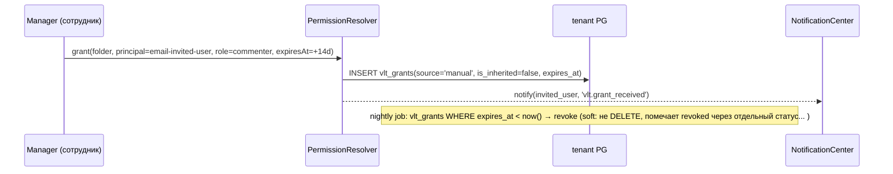

# B-16 — Спутники: панельный контракт + Chatom + Vaulter + corex/media + corex/notifications

> Доменная спека Этапа 4. Входы: MASTER_PLAN §3 (D1–D16), B-01 (§2.1–2.3 карта пакетов, §3 конвенции, §5 контракт «панель на сущности», §6 open-core), B-02 (N6 Vaulter-коллаборация), R-08 (главный, §2.1–2.6, §4, §5), R-11 (§broadcasting, п.26/28), B-10 (§3.4 EntityRegistry/Capability, §4.4 capabilities), B-11 (§3.3 AccessChecker/ScopeResolver, §3.4 события Auth), B-13 (§5.3 timeline, §6.1 матрица, §6.3 boxed).
> Статус: draft на ревью. Дата: 2026-07-03.
> Установка D-001: спека самодостаточна — дешёвая модель пишет по ней финальные vault-доки и код без обращения к R-отчётам.

---

## 1. Границы и состав

### 1.1 Пакеты домена

| Пакет | Дистрибуция | Лицензия | Содержимое |
|---|---|---|---|
| **corex/panels** (новый, кандидат в flex/modules-семью) | монорепо corex (read-only split) | MIT | Контракт «панель на сущности»: `Panelable`/`PanelHost`, двухуровневый gate (§3.1), общая часть `pnl_participants`-паттерна (переиспользуется Chatom/Vaulter как trait/базовый класс, не отдельная таблица — см. §2.1) |
| **chatom/core** | standalone-репозиторий (существует) | MIT | Схема `cht_*`: каналы (discussion/comments/dm), сообщения (time-sortable PK, partition-ready), membership+read-state, реакции, меншены, вложения-контракт; `Chatable`/`BroadcastContract`/`ModerationContract` |
| **corex/messenger** | монорепо corex | MIT | Binding: PanelHost-регистрация в EntityRegistry, мост AzGuard (gate 1/2), мост corex/notifications, драйвер `local` (chatom/core) / `remote` (ChatomIo), Filament/Vue-виджеты, AI-агент-в-канале |
| **ChatomIo** | отдельный PaaS-продукт | проприетарное | Wire-совместимый remote-драйвер (§6.2); вне кода этого домена, только контракт |
| **vaulter/core** (было: `corex/vaulter` — namespace-противоречие §6 снято) | standalone-репозиторий (существует) | MIT | Схема `vlt_*`: folders/files/file_versions, documents/doc_updates/doc_snapshots, grants; `PermissionResolver`, `DocumentSyncContract` |
| **Hocuspocus-sidecar** | Node-приложение, docker-образ | MIT (Hocuspocus сам MIT) | Отдельный процесс вне PHP-рантайма; см. §6.3 деградация |
| **corex/media** | монорепо corex | MIT | Медиатека: `med_files`, конвертации/производные (thumbnails), S3-совместимый драйвер (РФ-хостинг), полиморфные привязки-потребители через uuid-без-FK контракт (уже используется B-13/B-14/B-17) |
| **corex/notifications** | монорепо corex | MIT | Центр уведомлений: `ntf_notifications`, каналы доставки (in-app/email/push/messenger), digest, per-user настройки подписки |

Обоснование `corex/panels` как отдельного (тонкого) пакета: без него Chatom и Vaulter независимо реализуют один и тот же двухуровневый gate — дублирование логики, разъезжающиеся баги авторизации (урок Discourse: category-security и membership реализованы центральным AuthZ-слоем, не в каждом плагине по-своему). Пакет НЕ владеет таблицами продукта — только интерфейсами + одной таблицей регистрации панелей `pnl_panel_types` (§2.1) для интроспекции (MCP `registry.extension_points`, B-10 §7).

### 1.2 Зависимости

```
corex/panels    ──► corex/core (EntityRegistry, TenantContext), corex/auth (AccessChecker) — контракты, не реализация
chatom/core     ──► illuminate/*, corex/panels (реализует PanelHost)         (НЕ знает про corex/tenancy, CRM)
vaulter/core    ──► illuminate/*, corex/panels (реализует PanelHost)          (НЕ знает про Hocuspocus напрямую —
                                                                                только DocumentSyncContract)
corex/messenger ──► chatom/core, corex/core (EntityRegistry-регистрация), corex/auth, corex/notifications, corex/ai
corex/media     ──► illuminate/*, S3-совместимый SDK                          (НЕ знает про Vaulter/CRM/CMS)
corex/notifications ──► corex/core (Settings, PubSub), Reverb (in-app real-time)
Hocuspocus-sidecar ──► HTTP webhook в Laravel; JWT из Laravel               (не Composer-зависимость — Node-процесс)
```

Vaulter **не зависит** от corex/media: файлы Vaulter — собственный домен хранения (`vlt_files`, версии, гранты — иная модель retention и ACL, чем медиатека). Точка сопряжения — опциональная (§6.4): Vaulter-файл может быть *опубликован* в медиатеку (обложка документа, превью) через явный экспорт, не общая таблица.

### 1.3 Зона OSS vs проприетарное

Всё перечисленное в §1.1 — MIT (воронка доверия, B-01 §6), кроме ChatomIo (PaaS) и облачных частей corex/notifications (тарифные квоты digest/push — читаются из `root_plans.limits`, B-11). Проприетарные потребители: конструктор AI-агента-в-канале (FlexCRM), маркетплейс-шаблоны панелей — подключаются через контракты §3, в коде домена их нет.

---

## 2. Схема БД

Конвенции (B-01 §3, единые для всего домена): PK `uuid` = **UUIDv7, генерируется приложением** (PG 16 не имеет нативного `uuidv7()`, DEFAULT не ставим). `timestamptz` на всех таблицах. Партийные партиции — `WHERE deleted_at IS NULL`. Все таблицы живут в **БД аккаунта** (cloud и boxed — идентичная схема, D10).

```sql
CREATE EXTENSION IF NOT EXISTS ltree;   -- присутствует в golden-шаблоне (B-10/B-11)
```

### 2.1 corex/panels (префикс `pnl_`)

```sql
-- Реестр типов панелей, зарегистрированных спутниками при boot (для интроспекции MCP/UI, НЕ hot path)
CREATE TABLE pnl_panel_types (
    id              uuid PRIMARY KEY,
    panel_type      varchar(64)  NOT NULL,          -- 'chatom.comments' | 'chatom.dm' | 'vaulter.drive'
    module          varchar(190) NOT NULL,          -- владелец: 'chatom/core' | 'vaulter/core'
    gate2_roles     jsonb NOT NULL DEFAULT '["owner","moderator","member","guest"]',
    supports_anchor boolean NOT NULL DEFAULT false,  -- inline-комментарии (anchor jsonb, §2.2)
    created_at      timestamptz NOT NULL DEFAULT now(),
    updated_at      timestamptz NOT NULL DEFAULT now(),
    CONSTRAINT pnl_panel_types_uq UNIQUE (panel_type)
);
COMMENT ON TABLE pnl_panel_types IS
  'Регистрируется PanelHost::boot() каждого спутника. Источник для MCP registry.extension_points и component:where-аналога панелей.';
```

Общая шапка (НЕ отдельная таблица — конвенция колонок, которую повторяют `cht_channels` и `vlt_folders`/корневые ресурсы Vaulter, §2.2/§2.4):

```sql
-- panelable_type varchar NULL, panelable_id uuid NULL   -- morph на хозяина; NULL = автономная панель (DM, личный диск)
-- workspace_id   uuid NULL                              -- логический уровень D1; NULL = наследуется от panelable
```

### 2.2 chatom/core (префикс `cht_`)

```sql
CREATE TABLE cht_channels (
    id                uuid PRIMARY KEY,
    type              varchar(24)  NOT NULL,          -- 'discussion' | 'comments' | 'dm'
    panelable_type    varchar(64),                    -- EntityRegistry handle хозяина: 'crm.deal' | NULL (DM)
    panelable_id      uuid,
    workspace_id      uuid,                           -- NULL = наследуется от panelable-сущности
    name              varchar(255),                   -- NULL допустим для comments/dm (безымянные)
    topic             text,
    status             varchar(16) NOT NULL DEFAULT 'open',
    threading_enabled boolean NOT NULL DEFAULT true,
    auto_join_users   boolean NOT NULL DEFAULT false,  -- участники panelable добавляются автоматически (gate1-based)
    delete_after_seconds integer,                     -- retention per channel (ФЗ-152, §9.3)
    messages_count    integer NOT NULL DEFAULT 0,      -- денормализация (Discourse-паттерн)
    user_count        integer NOT NULL DEFAULT 0,
    last_message_id   uuid,                            -- БЕЗ FK-констрейнта (отложенно-проверяемая ссылка, R-08 §4.3)
    last_message_at   timestamptz,
    meta              jsonb NOT NULL DEFAULT '{}',      -- custom-поля панели (GetStream-паттерн)
    created_at        timestamptz NOT NULL DEFAULT now(),
    updated_at        timestamptz NOT NULL DEFAULT now(),
    deleted_at        timestamptz,
    deleted_by_id     uuid,
    CONSTRAINT cht_channels_type_ck CHECK (type IN ('discussion','comments','dm')),
    CONSTRAINT cht_channels_status_ck CHECK (status IN ('open','closed','archived','read_only'))
);
COMMENT ON COLUMN cht_channels.panelable_type IS
  'Полиморфная привязка к сущности-хозяину (Discourse chatable-паттерн). Gate 1 = AzGuard-право на panelable через AccessChecker (B-11). NULL → gate 1 = membership-only (DM, автономная панель).';
CREATE INDEX cht_channels_panelable_ix ON cht_channels (panelable_type, panelable_id) WHERE deleted_at IS NULL;
CREATE INDEX cht_channels_workspace_ix ON cht_channels (workspace_id) WHERE deleted_at IS NULL;

CREATE TABLE cht_messages (
    id            uuid PRIMARY KEY,                   -- UUIDv7 — time-sortable курсор пагинации (D12)
    channel_id    uuid NOT NULL REFERENCES cht_channels(id) ON DELETE CASCADE,
    user_id       uuid,                                -- NULL = системное/AI-сообщение (agent_id в meta)
    parent_id     uuid,                                -- тред (БЕЗ FK — избегаем self-FK на partition-ready таблице)
    anchor        jsonb,                                -- inline-комментарии: {block_id|node_id, range} (Vaulter-документ)
    body          text NOT NULL,                       -- raw
    body_html     text,                                -- rendered (cooked)
    blocks        jsonb,                                -- интерактивные блоки (кнопки согласований B-12, AI-виджеты)
    excerpt       varchar(500),                         -- денормализованное превью (списки/уведомления)
    meta          jsonb NOT NULL DEFAULT '{}',
    is_streaming  boolean NOT NULL DEFAULT false,       -- AI-агент печатает (corex/ai)
    resolved_at   timestamptz,                          -- только для type='comments' треда (root-сообщение)
    resolved_by_id uuid,
    created_at    timestamptz NOT NULL,                 -- БЕЗ DEFAULT: приложение проставляет = UUIDv7-момент
    edited_at     timestamptz,
    deleted_at    timestamptz,
    deleted_by_id uuid
);
COMMENT ON TABLE cht_messages IS
  'Partition-ready с первого дня по created_at (opt-in для крупных аккаунтов, R-08 §4.3): created_at NOT NULL, никаких FK ИЗ других таблиц НА cht_messages кроме отложенно-проверяемых. v1 — single-table.';
CREATE INDEX cht_messages_channel_ix ON cht_messages (channel_id, id DESC);         -- рабочая лошадка пагинации
CREATE INDEX cht_messages_parent_ix  ON cht_messages (parent_id) WHERE parent_id IS NOT NULL;
CREATE INDEX cht_messages_brin_ix    ON cht_messages USING BRIN (created_at);

CREATE TABLE cht_memberships (
    id                    uuid PRIMARY KEY,
    channel_id            uuid NOT NULL REFERENCES cht_channels(id) ON DELETE CASCADE,
    user_id               uuid NOT NULL,
    role                  varchar(16) NOT NULL DEFAULT 'member',   -- gate 2: owner|moderator|member|guest (расширяемый enum пакета)
    is_gate1_derived      boolean NOT NULL DEFAULT true,           -- true = получил доступ через право на panelable, а не явный грант
    following             boolean NOT NULL DEFAULT true,
    muted                 boolean NOT NULL DEFAULT false,
    notification_level    varchar(16) NOT NULL DEFAULT 'mention',  -- never|mention|always
    last_read_message_id  uuid,                                    -- Discourse-паттерн: read-state = указатель, не разность счётчиков
    last_viewed_at        timestamptz,
    unread_count          integer NOT NULL DEFAULT 0,              -- денормализация (Rocket.Chat-подписка), инкремент на записи
    mention_count         integer NOT NULL DEFAULT 0,
    expires_at            timestamptz,                             -- гость-подрядчик TTL (внешний участник сделки)
    created_at timestamptz NOT NULL DEFAULT now(),
    updated_at timestamptz NOT NULL DEFAULT now(),
    CONSTRAINT cht_memberships_role_ck CHECK (role IN ('owner','moderator','member','guest')),
    CONSTRAINT cht_memberships_uq UNIQUE (channel_id, user_id)
);
CREATE INDEX cht_memberships_user_ix ON cht_memberships (user_id);
COMMENT ON TABLE cht_memberships IS
  'Gate 2: переопределения ТОЛЬКО расширяющие (Google-модель) — участник не может получить меньше, чем даёт gate 1. is_gate1_derived=false — явный грант (внешний гость без права на panelable).';

CREATE TABLE cht_reactions (
    id         uuid PRIMARY KEY,
    message_id uuid NOT NULL REFERENCES cht_messages(id) ON DELETE CASCADE,
    user_id    uuid NOT NULL,
    emoji      varchar(32) NOT NULL,
    created_at timestamptz NOT NULL DEFAULT now(),
    updated_at timestamptz NOT NULL DEFAULT now(),
    CONSTRAINT cht_reactions_uq UNIQUE (message_id, user_id, emoji)
);
CREATE INDEX cht_reactions_message_ix ON cht_reactions (message_id);

CREATE TABLE cht_mentions (
    id             uuid PRIMARY KEY,
    message_id     uuid NOT NULL REFERENCES cht_messages(id) ON DELETE CASCADE,
    mentionable_type varchar(24) NOT NULL,             -- 'user' | 'group' | 'all' | 'here'
    mentionable_id uuid,                                -- NULL для all/here
    notified_at    timestamptz,                         -- fan-out уведомлений выполнен (corex/notifications)
    created_at timestamptz NOT NULL DEFAULT now(),
    updated_at timestamptz NOT NULL DEFAULT now(),
    CONSTRAINT cht_mentions_type_ck CHECK (mentionable_type IN ('user','group','all','here'))
);
CREATE INDEX cht_mentions_message_ix ON cht_mentions (message_id);
CREATE INDEX cht_mentions_pending_ix ON cht_mentions (notified_at) WHERE notified_at IS NULL;

CREATE TABLE cht_attachments (
    id         uuid PRIMARY KEY,
    message_id uuid NOT NULL REFERENCES cht_messages(id) ON DELETE CASCADE,
    med_file_id uuid NOT NULL,                          -- corex/media: med_files.id, БЕЗ FK (контракт §5, media-граница)
    kind        varchar(16) NOT NULL DEFAULT 'file',    -- file|image|video|audio (из med_files.kind, денормализовано)
    created_at timestamptz NOT NULL DEFAULT now(),
    updated_at timestamptz NOT NULL DEFAULT now()
);
CREATE INDEX cht_attachments_message_ix ON cht_attachments (message_id);
```

Read-state и денормализация: `unread_count`/`mention_count` инкрементируются в той же транзакции записи сообщения (не через nightly-пересчёт); `messages_count`/`last_message_id`/`last_message_at` канала — той же транзакцией. Партиционирование (opt-in, крупные аккаунты): `PARTITION BY RANGE (created_at)` помесячно через pg_partman; hash-by-channel не применять (R-08 §4.3 — горячий канал остаётся горячим).

### 2.3 corex/messenger (без своих таблиц; только binding-конфиг)

```sql
-- Ничего: corex/messenger — тонкий binding-слой (провайдер, конфиг драйвера local|remote). Данные — в cht_*.
```

### 2.4 vaulter/core (префикс `vlt_`)

```sql
CREATE TABLE vlt_folders (
    id             uuid PRIMARY KEY,
    parent_id      uuid REFERENCES vlt_folders(id) ON DELETE RESTRICT,
    path           ltree NOT NULL,                     -- materialized path (метки = uuid hex без дефисов)
    attachable_type varchar(64),                        -- корень поддерева-панели: EntityRegistry handle хозяина
    attachable_id  uuid,                                -- NULL = не корень (обычная вложенная папка)
    workspace_id   uuid,
    name           varchar(255) NOT NULL,
    inherit_mode   varchar(16) NOT NULL DEFAULT 'full_inherit',  -- full_inherit (v1 — единственный реализованный)
    created_at timestamptz NOT NULL DEFAULT now(),
    updated_at timestamptz NOT NULL DEFAULT now(),
    deleted_at timestamptz,
    CONSTRAINT vlt_folders_inherit_ck CHECK (inherit_mode IN ('full_inherit','break','strict_expansive'))
);
COMMENT ON COLUMN vlt_folders.inherit_mode IS
  'v1 реализует только full_inherit (Google strict-expansive, R-08 §2.5/§4.4). break/strict_expansive — зарезервированы в CHECK для эволюции без миграции модели (не реализованы в PermissionResolver v1).';
CREATE INDEX vlt_folders_path_gist ON vlt_folders USING GIST (path);
CREATE INDEX vlt_folders_attachable_ix ON vlt_folders (attachable_type, attachable_id) WHERE deleted_at IS NULL;

CREATE TABLE vlt_files (
    id              uuid PRIMARY KEY,
    folder_id       uuid NOT NULL REFERENCES vlt_folders(id) ON DELETE RESTRICT,
    name            varchar(255) NOT NULL,
    mime_type       varchar(127) NOT NULL,
    size_bytes      bigint NOT NULL,
    current_version_id uuid,                            -- FK добавляется ALTER после создания vlt_file_versions (циклическая ссылка)
    storage_quota_bucket varchar(16) NOT NULL DEFAULT 'standard',  -- retention tier (§5.4)
    created_by_id   uuid NOT NULL,
    created_at timestamptz NOT NULL DEFAULT now(),
    updated_at timestamptz NOT NULL DEFAULT now(),
    deleted_at timestamptz
);
ALTER TABLE vlt_files ADD CONSTRAINT vlt_files_current_version_fk
    FOREIGN KEY (current_version_id) REFERENCES vlt_file_versions(id) ON DELETE SET NULL DEFERRABLE INITIALLY DEFERRED;
CREATE INDEX vlt_files_folder_ix ON vlt_files (folder_id) WHERE deleted_at IS NULL;

CREATE TABLE vlt_file_versions (
    id            uuid PRIMARY KEY,
    file_id       uuid NOT NULL REFERENCES vlt_files(id) ON DELETE CASCADE,
    version_no    integer NOT NULL,
    storage_path  varchar(512) NOT NULL,                 -- S3-совместимый ключ
    size_bytes    bigint NOT NULL,
    checksum_sha256 varchar(64) NOT NULL,
    is_named      boolean NOT NULL DEFAULT false,        -- именованные версии не экспирируются (Nextcloud)
    retention_tier varchar(16) NOT NULL DEFAULT 'second', -- second|minute|hour|day|week (tiered retention)
    created_by_id uuid NOT NULL,
    created_at    timestamptz NOT NULL DEFAULT now(),
    updated_at    timestamptz NOT NULL DEFAULT now(),
    CONSTRAINT vlt_file_versions_uq UNIQUE (file_id, version_no)
);
CREATE INDEX vlt_file_versions_file_ix ON vlt_file_versions (file_id, version_no DESC);
COMMENT ON COLUMN vlt_file_versions.retention_tier IS
  'Tiered retention (Nextcloud-паттерн): compaction-джоб прорежает старые версии по правилу секунды→минуты→часы→день→неделя, кап 50% квоты аккаунта. is_named обходит прореживание.';

CREATE TABLE vlt_documents (
    id              uuid PRIMARY KEY,
    folder_id       uuid NOT NULL REFERENCES vlt_folders(id) ON DELETE RESTRICT,
    title           varchar(255) NOT NULL,
    doc_name        varchar(190) NOT NULL,                -- Hocuspocus docName = '{account_id}:{id}', уникален глобально в БД
    state_vector    bytea,                                 -- последний известный Yjs state vector (для клиентов-новичков)
    last_snapshot_id uuid,                                 -- FK добавляется после vlt_doc_snapshots (циклическая ссылка)
    is_locked       boolean NOT NULL DEFAULT false,        -- single-editor режим без sidecar (§6.3)
    locked_by_id    uuid,
    locked_at       timestamptz,
    created_by_id   uuid NOT NULL,
    created_at timestamptz NOT NULL DEFAULT now(),
    updated_at timestamptz NOT NULL DEFAULT now(),
    deleted_at timestamptz,
    CONSTRAINT vlt_documents_docname_uq UNIQUE (doc_name)
);

CREATE TABLE vlt_doc_updates (
    id          uuid PRIMARY KEY,                        -- UUIDv7 — порядок апдейтов = порядок PK
    document_id uuid NOT NULL REFERENCES vlt_documents(id) ON DELETE CASCADE,
    update_bin  bytea NOT NULL,                            -- бинарный Yjs-апдейт (append-only)
    user_id     uuid,                                      -- NULL = сервисный/merge-апдейт
    created_at  timestamptz NOT NULL,                      -- БЕЗ DEFAULT: sidecar-webhook проставляет момент апдейта
    updated_at  timestamptz NOT NULL DEFAULT now()
);
COMMENT ON TABLE vlt_doc_updates IS
  'Append-only Yjs-журнал (y-sweet/Notion-паттерн). Компакция — не DELETE отдельных строк (см. §9.4 ФЗ-152), а вставка нового снапшота + отложенный TRUNCATE диапазона старее последнего снапшота.';
CREATE INDEX vlt_doc_updates_document_ix ON vlt_doc_updates (document_id, id);

CREATE TABLE vlt_doc_snapshots (
    id              uuid PRIMARY KEY,
    document_id     uuid NOT NULL REFERENCES vlt_documents(id) ON DELETE CASCADE,
    state_vector    bytea NOT NULL,
    merged_state    bytea NOT NULL,                        -- полный Y.Doc merge на момент снапшота = версия документа
    covers_up_to_update_id uuid NOT NULL,                  -- компакция закрывает vlt_doc_updates.id <= это значение
    label           varchar(255),                           -- именованная версия (пользовательская, "перед отправкой клиенту")
    is_named        boolean NOT NULL DEFAULT false,
    created_by_id   uuid,                                   -- NULL = авто-компакция по idle/N-апдейтов
    created_at timestamptz NOT NULL DEFAULT now(),
    updated_at timestamptz NOT NULL DEFAULT now()
);
ALTER TABLE vlt_documents ADD CONSTRAINT vlt_documents_snapshot_fk
    FOREIGN KEY (last_snapshot_id) REFERENCES vlt_doc_snapshots(id) ON DELETE SET NULL DEFERRABLE INITIALLY DEFERRED;
CREATE INDEX vlt_doc_snapshots_document_ix ON vlt_doc_snapshots (document_id, created_at DESC);
COMMENT ON TABLE vlt_doc_snapshots IS
  'Снапшоты = одновременно история версий документа (UI "версии"). Компакция: idle ≥2 мин ИЛИ каждые ~10 мин активной сессии (Notion-паттерн, R-08 §2.4).';

CREATE TABLE vlt_grants (
    id                uuid PRIMARY KEY,
    resource_type     varchar(16) NOT NULL,                -- 'folder' | 'file' | 'document'
    resource_id       uuid NOT NULL,
    principal_type    varchar(16) NOT NULL,                -- 'user' | 'team' | 'role'
    principal_id      uuid NOT NULL,
    role              varchar(16) NOT NULL,                -- viewer|commenter|editor|manager (маска — вычислитель)
    is_inherited      boolean NOT NULL DEFAULT false,
    source_resource_id uuid,                                -- откуда унаследован (для UI "почему у меня есть доступ")
    source            varchar(16) NOT NULL DEFAULT 'manual', -- manual|gate1|vertical|import
    expires_at        timestamptz,                          -- гость-подрядчик TTL (az direct_grants-паттерн)
    granted_by_id     uuid,
    created_at timestamptz NOT NULL DEFAULT now(),
    updated_at timestamptz NOT NULL DEFAULT now(),
    CONSTRAINT vlt_grants_resource_ck CHECK (resource_type IN ('folder','file','document')),
    CONSTRAINT vlt_grants_principal_ck CHECK (principal_type IN ('user','team','role')),
    CONSTRAINT vlt_grants_role_ck CHECK (role IN ('viewer','commenter','editor','manager'))
);
CREATE INDEX vlt_grants_resource_ix ON vlt_grants (resource_type, resource_id);
CREATE INDEX vlt_grants_principal_ix ON vlt_grants (principal_type, principal_id);
COMMENT ON TABLE vlt_grants IS
  'Google strict-expansive (v1): гранты только повышают эффективный доступ относительно gate 1/наследования; deny/break — не реализованы, но forma ACE (resource×principal×role) позволяет добавить effect-колонку без миграции модели (R-08 §2.5).';
```

Точка сопряжения с общей панельной шапкой: `vlt_folders.attachable_type/attachable_id` = ровно `panelable_type/panelable_id` семантически (иное имя колонки — историческое из R-08, зафиксировано; переименовывать не нужно, оба явно комментированы как один паттерн).

### 2.5 corex/media (префикс `med_`)

```sql
CREATE TABLE med_files (
    id              uuid PRIMARY KEY,
    disk            varchar(32) NOT NULL DEFAULT 's3',      -- 's3' (РФ-совместимый) | 'local' (boxed без S3)
    path            varchar(512) NOT NULL,                  -- ключ объекта
    original_name   varchar(255) NOT NULL,
    mime_type       varchar(127) NOT NULL,
    kind            varchar(16)  NOT NULL,                  -- 'image'|'video'|'audio'|'document'|'other' (для UI/фильтров)
    size_bytes      bigint NOT NULL,
    checksum_sha256 varchar(64),
    width           integer,                                 -- для image/video
    height          integer,
    duration_seconds integer,                                -- для video/audio
    uploaded_by_id  uuid,
    meta            jsonb NOT NULL DEFAULT '{}',             -- exif, custom
    created_at timestamptz NOT NULL DEFAULT now(),
    updated_at timestamptz NOT NULL DEFAULT now(),
    deleted_at timestamptz,
    CONSTRAINT med_files_kind_ck CHECK (kind IN ('image','video','audio','document','other'))
);
COMMENT ON TABLE med_files IS
  'Единственный владелец файлового бинарного контента общего назначения. Потребители (crm_*, com_*, cms_*, cht_attachments) хранят med_files.id БЕЗ FK-констрейнта (контракт B-10/B-13/B-14/B-17) — media не должна знать имена таблиц-потребителей.';

CREATE TABLE med_conversions (
    id           uuid PRIMARY KEY,
    file_id      uuid NOT NULL REFERENCES med_files(id) ON DELETE CASCADE,
    name         varchar(64) NOT NULL,                       -- 'thumb_200'|'preview_1024'|'webp'
    disk         varchar(32) NOT NULL DEFAULT 's3',
    path         varchar(512) NOT NULL,
    mime_type    varchar(127) NOT NULL,
    width        integer, height integer,
    size_bytes   bigint NOT NULL,
    status       varchar(16) NOT NULL DEFAULT 'ready',        -- pending|ready|failed
    created_at timestamptz NOT NULL DEFAULT now(),
    updated_at timestamptz NOT NULL DEFAULT now(),
    CONSTRAINT med_conversions_uq UNIQUE (file_id, name),
    CONSTRAINT med_conversions_status_ck CHECK (status IN ('pending','ready','failed'))
);
CREATE INDEX med_conversions_file_ix ON med_conversions (file_id);

CREATE TABLE med_relations (                                 -- ЕДИНСТВЕННЫЙ канонический учёт «где используется файл»
    id           uuid PRIMARY KEY,
    file_id      uuid NOT NULL REFERENCES med_files(id) ON DELETE RESTRICT,
    related_type varchar(64) NOT NULL,                        -- 'crm.deal.attachment' | 'cms.entry.field:hero_image' | 'cht.message'
    related_id   uuid NOT NULL,
    created_at timestamptz NOT NULL DEFAULT now(),
    updated_at timestamptz NOT NULL DEFAULT now(),
    CONSTRAINT med_relations_uq UNIQUE (file_id, related_type, related_id)
);
CREATE INDEX med_relations_related_ix ON med_relations (related_type, related_id);
COMMENT ON TABLE med_relations IS
  'Потребители обязаны писать сюда при привязке файла (RelationLookup-контракт, реиспользован из B-17 §3.4). RESTRICT на file_id: удаление файла с активными связями запрещено на уровне БД (defence-in-depth поверх RelationLookup::isUsed() в коде).';
```

### 2.6 corex/notifications (префикс `ntf_`)

```sql
CREATE TABLE ntf_notifications (
    id            uuid PRIMARY KEY,                          -- UUIDv7 — time-sortable инбокс
    user_id       uuid NOT NULL,
    type          varchar(64) NOT NULL,                       -- 'crm.deal.assigned' | 'cht.mention' | 'vlt.grant_received'
    title         varchar(255) NOT NULL,
    body          text,
    action_url    varchar(512),
    related_type  varchar(64),                                -- EntityRegistry handle источника (без FK)
    related_id    uuid,
    payload       jsonb NOT NULL DEFAULT '{}',
    read_at       timestamptz,
    dismissed_at  timestamptz,
    created_at timestamptz NOT NULL DEFAULT now(),
    updated_at timestamptz NOT NULL DEFAULT now()
);
CREATE INDEX ntf_notifications_inbox_ix ON ntf_notifications (user_id, id DESC);
CREATE INDEX ntf_notifications_unread_ix ON ntf_notifications (user_id) WHERE read_at IS NULL;

CREATE TABLE ntf_deliveries (                                 -- фактическая доставка per-канал (аудит + ретраи)
    id              uuid PRIMARY KEY,
    notification_id uuid NOT NULL REFERENCES ntf_notifications(id) ON DELETE CASCADE,
    channel         varchar(16) NOT NULL,                     -- 'in_app'|'email'|'push'|'messenger'
    status          varchar(16) NOT NULL DEFAULT 'pending',   -- pending|sent|failed|skipped
    error           text,
    sent_at         timestamptz,
    created_at timestamptz NOT NULL DEFAULT now(),
    updated_at timestamptz NOT NULL DEFAULT now(),
    CONSTRAINT ntf_deliveries_channel_ck CHECK (channel IN ('in_app','email','push','messenger')),
    CONSTRAINT ntf_deliveries_status_ck CHECK (status IN ('pending','sent','failed','skipped'))
);
CREATE INDEX ntf_deliveries_pending_ix ON ntf_deliveries (status) WHERE status = 'pending';

CREATE TABLE ntf_preferences (                                -- per-user настройки per-тип события
    id         uuid PRIMARY KEY,
    user_id    uuid NOT NULL,
    event_type varchar(64) NOT NULL,                           -- 'crm.deal.assigned' | '*' (дефолт-строка типа)
    channels   jsonb NOT NULL DEFAULT '["in_app"]',            -- подмножество in_app|email|push|messenger
    digest     varchar(16) NOT NULL DEFAULT 'instant',          -- instant|hourly|daily|off
    created_at timestamptz NOT NULL DEFAULT now(),
    updated_at timestamptz NOT NULL DEFAULT now(),
    CONSTRAINT ntf_preferences_uq UNIQUE (user_id, event_type),
    CONSTRAINT ntf_preferences_digest_ck CHECK (digest IN ('instant','hourly','daily','off'))
);

CREATE TABLE ntf_digest_runs (                                 -- батч-агрегация hourly/daily
    id          uuid PRIMARY KEY,
    user_id     uuid NOT NULL,
    period      varchar(16) NOT NULL,                          -- 'hourly'|'daily'
    period_start timestamptz NOT NULL,
    period_end   timestamptz NOT NULL,
    notification_ids jsonb NOT NULL,                            -- список ntf_notifications.id, вошедших в дайджест
    sent_at     timestamptz,
    created_at timestamptz NOT NULL DEFAULT now(),
    updated_at timestamptz NOT NULL DEFAULT now(),
    CONSTRAINT ntf_digest_runs_uq UNIQUE (user_id, period, period_start)
);
```

---

## 3. Публичные контракты

Все контракты `@api`, PHPStan level 8. Неймспейсы условные (vendor открыт, B-02 §4 п.6).

### 3.1 corex/panels: контракт «панель на сущности»

```php
namespace Corex\Panels;

/** Сущность-хозяин панели (Deal, Task, Document, Company — из EntityRegistry, B-10) */
interface Panelable
{
    public function panelKey(): string;   // EntityRegistry handle: 'crm.deal'
    public function panelId(): string;    // uuid записи
}

final readonly class PanelBaseAccess
{
    public function __construct(
        public bool $canView,             // gate 1 пройден?
        public bool $canPost,             // может участник по умолчанию писать (не только читать)?
        public ?string $denyReason = null,
    ) {}
    public static function granted(bool $canPost = true): self;
    public static function denied(string $reason): self;
}

/** Реализуется спутником (chatom/core, vaulter/core) и регистрируется через PanelRegistry::register() при boot */
interface PanelHost
{
    public function panelType(): string;                                       // 'chatom.comments'|'vaulter.drive'
    /** Gate 1: право на родителя через AzGuard хост-приложения. Панель НЕ дублирует авторизацию родителя. */
    public function resolveBaseAccess(Principal $principal, ?Panelable $parent): PanelBaseAccess;
    /** Gate 2: эффективная роль участника панели (расширяет, не сужает базовый доступ). */
    public function participantRole(Principal $principal, string $panelId): ?string;
}

interface PanelRegistry
{
    public function register(PanelHost $host): void;             // вызывается ServiceProvider'ом спутника
    public function get(string $panelType): PanelHost;
    /** @return list<PanelHost> все зарегистрированные (для MCP registry.extension_points) */
    public function all(): array;
}

/**
 * Единая точка проверки прав на панель для UI/API/MCP — оборачивает gate1+gate2,
 * реализуется каждым спутником поверх своих таблиц membership, но с общим контрактом
 * (чтобы Filament/Vue-виджеты и MCP-тулзы писались один раз против PanelAccessChecker).
 */
interface PanelAccessChecker
{
    public function canView(Principal $principal, string $panelType, string $panelId): bool;
    public function canPost(Principal $principal, string $panelType, string $panelId): bool;
    public function canModerate(Principal $principal, string $panelType, string $panelId): bool;
}
```

Правило расширения (Google-модель, R-08 §4.1): gate 2 (participant-роль) может **только повышать** относительно gate 1; участник без gate 1 существует лишь через явный грант (`is_gate1_derived=false` в `cht_memberships`, `source='manual'` в `vlt_grants`).

### 3.2 chatom/core

```php
namespace Chatom\Core;

enum ChannelType: string { case Discussion = 'discussion'; case Comments = 'comments'; case Dm = 'dm'; }
enum MemberRole: string  { case Owner = 'owner'; case Moderator = 'moderator'; case Member = 'member'; case Guest = 'guest'; }

final readonly class ChannelRef
{
    public function __construct(
        public string $id, public ChannelType $type,
        public ?string $panelableType, public ?string $panelableId,
        public ?string $workspaceId,
    ) {}
}

interface ChannelManager
{
    /** Создаёт канал; auto_join_users=true — подтягивает участников panelable (роли, имеющие gate1). */
    public function create(ChannelType $type, ?Panelable $parent, array $options = []): ChannelRef;
    public function findOrCreateDm(string $userIdA, string $userIdB): ChannelRef;
    /** Автономный «личный обсуждение»-канал без panelable (DM-стиль gate) */
    public function archive(string $channelId): void;
}

final readonly class MessageInput
{
    public function __construct(
        public string $channelId, public ?string $userId,
        public string $body, public ?string $parentId = null,
        public ?array $anchor = null,      // inline-комментарий: ['block_id' => ..., 'range' => [..]]
        public ?array $blocks = null, public ?array $mentions = null,
        public bool $isStreaming = false,
    ) {}
}

interface MessageService
{
    public function post(MessageInput $input): MessageRef;         // проверяет canPost (PanelAccessChecker)
    public function edit(string $messageId, string $body, string $actorId): void;
    public function delete(string $messageId, string $actorId): void;
    public function resolve(string $messageId, string $actorId): void;    // только type=comments, root-сообщение треда
    public function markRead(string $channelId, string $userId, string $upToMessageId): void;   // last_read_message_id
    /** @return list<MessageRef> курсор-пагинация по id DESC/ASC */
    public function history(string $channelId, ?string $beforeId = null, int $limit = 50): array;
}

/** Контракт морф-привязки (реализует хост-модель домена: Deal, Task, ...) */
interface Chatable extends \Corex\Panels\Panelable {}

/** Драйверный контракт (local — chatom/core; remote — ChatomIo, §6.2) */
interface BroadcastDriver
{
    public function broadcastMessage(MessageRef $message): void;   // канал Reverb: private-cht.{channel_id} (BroadcastChannelPrefixBootstrapper)
    public function broadcastPresence(string $channelId, string $userId, bool $typing): void;
}

interface ModerationContract
{
    public function flag(string $messageId, string $actorId, string $reason): void;
    public function mute(string $channelId, string $userId, ?\DateTimeInterface $until = null): void;
    public function ban(string $userId, ?string $channelId = null): void;  // null = app-wide
}
```

Доменные события (namespace `Chatom\Core\Events`):

| Событие | Payload |
|---|---|
| `ChannelCreated` | channelId, type, panelableType, panelableId |
| `MessagePosted` | messageId, channelId, userId, parentId, hasMentions |
| `MessageEdited` / `MessageDeleted` | messageId, channelId, actorId |
| `MessageResolved` | messageId, channelId, actorId |
| `MemberJoined` / `MemberLeft` | channelId, userId, isGate1Derived |
| `MentionCreated` | mentionId, messageId, mentionableType, mentionableId |
| `ReactionAdded` / `ReactionRemoved` | messageId, userId, emoji |

### 3.3 corex/messenger (binding)

```php
namespace Corex\Messenger;

enum MessengerDriver: string { case Local = 'local'; case Remote = 'remote'; }

/** Wire-контракт local↔remote (глубина wire-совместимости — §6.2) */
interface MessengerGateway
{
    public function driver(): MessengerDriver;
    public function channels(): \Chatom\Core\ChannelManager;
    public function messages(): \Chatom\Core\MessageService;
}

/** Регистрируется в boot(): подключает capability commentable/documentable к EntityRegistry-сущностям (B-10 §4.4) */
final class ChatomPanelProvider
{
    public function boot(\Flex\Modules\Contracts\EntityRegistry $registry, \Corex\Panels\PanelRegistry $panels): void;
}
```

### 3.4 vaulter/core

```php
namespace Vaulter\Core;

enum GrantRole: string { case Viewer='viewer'; case Commenter='commenter'; case Editor='editor'; case Manager='manager'; }
enum ResourceType: string { case Folder='folder'; case File='file'; case Document='document'; }

interface FolderManager
{
    public function createRoot(Panelable $parent, string $name): FolderRef;      // корень поддерева-панели
    public function createSubfolder(string $parentFolderId, string $name): FolderRef;
    public function move(string $folderId, string $newParentId): void;
}

interface FileManager
{
    public function upload(string $folderId, UploadedFileInput $input, string $actorId): FileRef;
    public function newVersion(string $fileId, UploadedFileInput $input, string $actorId): FileVersionRef;
    /** Именованная версия — исключается из tiered-retention прореживания */
    public function nameVersion(string $versionId, string $label): void;
    public function delete(string $fileId, string $actorId): void;               // soft delete; см. AC-14 право-на-забвение
}

interface DocumentManager
{
    public function create(string $folderId, string $title, string $actorId): DocumentRef;
    /** Короткоживущий подписанный токен для Hocuspocus onAuthenticate: docName, userId, mode */
    public function issueCollabToken(string $documentId, string $userId, string $mode /* read|write */): string;
    public function currentSnapshot(string $documentId): ?SnapshotRef;
    /** @return list<SnapshotRef> — версии документа = снапшоты */
    public function versions(string $documentId): array;
    public function restoreVersion(string $documentId, string $snapshotId, string $actorId): void;  // создаёт НОВЫЙ снапшот=копию, не rewind
}

/** Webhook-приёмник от Hocuspocus-sidecar (HMAC-подписанный) */
interface DocumentSyncContract
{
    public function onUpdate(string $documentId, string $updateBin, ?string $userId): void;   // append vlt_doc_updates
    public function onCompact(string $documentId, string $stateVector, string $mergedState, string $coversUpToUpdateId): void;
}

/** Реализация — двухуровневый gate + strict-expansive вычислитель */
interface PermissionResolver
{
    public function effectiveRole(Principal $principal, ResourceType $type, string $resourceId): ?GrantRole;
    public function can(Principal $principal, ResourceType $type, string $resourceId, string $action): bool;  // view|comment|edit|manage
    public function grant(ResourceType $type, string $resourceId, string $principalType, string $principalId,
                           GrantRole $role, ?\DateTimeInterface $expiresAt = null): void;
    public function revoke(string $grantId): void;
    /** @return list<GrantRef> с пометкой is_inherited/source — «почему у меня есть доступ» (Google Shared Drives UX) */
    public function explain(ResourceType $type, string $resourceId, Principal $principal): array;
}

interface Documentable extends \Corex\Panels\Panelable {}
```

Доменные события (namespace `Vaulter\Core\Events`):

| Событие | Payload |
|---|---|
| `FolderCreated` / `FileUploaded` / `FileVersioned` | folderId/fileId, actorId |
| `DocumentCreated` | documentId, folderId, actorId |
| `DocumentUpdated` (afterCommit, debounced) | documentId, updatedByUserIds[] |
| `DocumentSnapshotted` | documentId, snapshotId, isNamed |
| `GrantIssued` / `GrantRevoked` | resourceType, resourceId, principalType, principalId, role |
| `DocumentSigned` | documentId, actorId — **двигает workflow** (B-12 сигнал `vaulter.document_signed`, B-13 §6.1) |

### 3.5 corex/media

```php
namespace Corex\Media;

interface MediaLibrary
{
    public function store(UploadedFileInput $input, string $uploadedById): MediaFileRef;
    /** Конвертации — асинхронно (queued); ready-статус проверяется перед выдачей srcset */
    public function conversion(string $fileId, string $name): ?MediaConversionRef;
    public function delete(string $fileId): void;   // бросает MediaFileInUseException если RelationLookup::isUsed()
}

/** Контракт единого учёта использования — потребители ОБЯЗАНЫ регистрировать привязку */
interface RelationLookup
{
    public function attach(string $fileId, string $relatedType, string $relatedId): void;
    public function detach(string $fileId, string $relatedType, string $relatedId): void;
    public function isUsed(string $fileId): bool;
    /** @return list<RelationRef{relatedType, relatedId}> */
    public function usages(string $fileId, int $limit = 50): array;
}

interface ConversionPipeline
{
    /** Регистрируется модулями-потребителями (напр. corex/cms — srcset-профили) */
    public function define(string $name, ConversionSpec $spec): void;
}
```

Доменные события: `MediaFileUploaded`, `MediaConversionReady`, `MediaFileDeleted` (payload: fileId, kind, sizeBytes).

### 3.6 corex/notifications

```php
namespace Corex\Notifications;

enum Channel: string { case InApp='in_app'; case Email='email'; case Push='push'; case Messenger='messenger'; }
enum Digest: string { case Instant='instant'; case Hourly='hourly'; case Daily='daily'; case Off='off'; }

final readonly class NotificationInput
{
    public function __construct(
        public string $userId, public string $type, public string $title,
        public ?string $body = null, public ?string $actionUrl = null,
        public ?string $relatedType = null, public ?string $relatedId = null,
        public array $payload = [],
    ) {}
}

interface NotificationCenter
{
    /** Пишет ntf_notifications + резолвит каналы по ntf_preferences (или дефолту события) → dispatch per-канал */
    public function notify(NotificationInput $input): void;
    public function markRead(string $notificationId, string $userId): void;
    public function markAllRead(string $userId): void;
    /** @return list<NotificationRef> курсор-пагинация инбокса */
    public function inbox(string $userId, ?string $beforeId = null, int $limit = 30): array;
    public function unreadCount(string $userId): int;
}

interface NotificationChannelDriver
{
    public function channel(): Channel;
    public function send(NotificationInput $input, string $recipientAddress): void;  // throws → ntf_deliveries.status=failed, retry
}

interface PreferenceRepository
{
    public function get(string $userId, string $eventType): NotificationPreference;   // fallback на '*'-строку, затем hardcoded default
    public function set(string $userId, string $eventType, array $channels, Digest $digest): void;
}

/** Батч-джоб (cron/queue): агрегирует непрочитанные instant→hourly/daily по ntf_preferences.digest */
interface DigestBuilder
{
    public function build(string $userId, Digest $period): ?DigestRef;   // null = нечего слать
}
```

Доменные события: `NotificationCreated`, `NotificationDelivered(channel)`, `NotificationDeliveryFailed(channel, error)`, `DigestSent`.

---

## 4. Extension points

### 4.1 Что домен экспортирует

| Точка | Механизм | Потребитель |
|---|---|---|
| `PanelHost`/`PanelRegistry` | регистрация нового типа панели без изменения ядра (будущий activity-feed-панель — см. §6.5) | любой спутник |
| `Capability::Commentable/Documentable` (B-10 EntityRegistry) | сущность объявляет `->commentable()`/`->documentable()` в `Extend\Entity` (B-10 §4.2) — панель подключается автоматически | corex/crm (B-13), corex/commerce (B-14), corex/cms (B-17) |
| `ChatomPanelProvider`/аналог Vaulter | boot-хук: слушает `EntityRegistry::byCapability()`, создаёт panel-роуты/виджеты | corex/messenger, vaulter binding в продукте |
| `BroadcastDriver` (local/remote) | drop-in замена реализации без изменения кода потребителя | corex/messenger config |
| `RelationLookup` (corex/media) | ОБЯЗАН вызываться потребителем при привязке/отвязке файла | crm_*, com_*, cms_*, cht_attachments (B-13/B-14/B-17) |
| `ConversionPipeline` | модуль регистрирует свои профили конвертации (srcset CMS, аватары CRM) | corex/cms (B-17 §4.5), corex/crm |
| `NotificationChannelDriver` | новый канал доставки (SMS, Telegram-бот) — drop-in | продукты |
| Доменные события §3.2–§3.6 | стандартные Laravel-listeners; `TimelineWriter` (B-13 §4.1) подписан на `MessagePosted`/`FileUploaded`/`DocumentSigned` | corex/crm timeline |
| `DocumentSigned` | сигнал `vaulter.document_signed` в flex/workflow | B-12 §3.7 (signal), B-13 (сделка) |
| `Extend\Workflow::actions` из этого домена | `cht.message.post`, `vlt.grant.issue`, `ntf.notify` — узлы конструктора процессов | B-12 |

### 4.2 Что домен потребляет (декларирует через extenders B-10)

- `Extend\Entity`-capabilities `commentable`/`documentable` объявляются НЕ этим доменом, а доменом-хозяином (B-13/B-14/B-17); домен B-16 только реагирует на них через `byCapability()`.
- `Extend\Permissions`: `chatom.channel.post`, `chatom.channel.moderate`, `vaulter.folder.upload`, `vaulter.document.edit`, `vaulter.grant.manage`, `media.file.delete`, `notifications.digest.manage` — namespace-панели (R-08 §4.1), заводятся в AzGuard при boot пакета (не требуют `Extend\Permissions` из manifest продукта — панельные права декларирует сам спутник).
- `Extend\Api`: авто-REST на `ChannelRef`/`MessageRef`/`FolderRef`/`DocumentRef`/`NotificationRef` — опционально, продукт включает через `Extend\Api::entity()` если нужен headless-доступ (FlexCRM — да; вертикали — по необходимости).
- `Extend\Filament`: готовые Filament relation-manager'ы (`ChatPanelTab`, `FilesPanelTab`) — вкладки в чужой ресурс через `Filament::tab()` (B-10 §4.2 п.4).

---

## 5. Ключевые потоки

### 5.1 Двухуровневый доступ к панели (gate 1 → gate 2)

```mermaid
flowchart LR
  U[User/Agent] --> Q{panelable NULL?}
  Q -->|нет| G1[Gate 1: AccessChecker.canOnRecord родитель, B-11]
  Q -->|да, DM/автономная| G2s[Gate 2 only: membership]
  G1 -->|deny| D[403, панель не существует для юзера]
  G1 -->|allow| G2[Gate 2: participant role в membership/grants]
  G2 --> EFF[эффективные действия: max(gate1_base, gate2_extension)]
  EX[явный грант / expires_at] --> G2
```

Шаги (детально): 1) UI/API/MCP запрашивает `PanelAccessChecker::canView`; 2) резолвится `panelable` через `panelable_type/id` → `EntityRegistry::forModel()`; 3) если хозяин есть — `AccessChecker::canOnRecord(principal, 'read', $parent)` (B-11 §3.3); 4) если хозяина нет (DM) — gate 1 автоматически `granted()`; 5) ищется строка membership/grant (`cht_memberships` / `vlt_grants`) — её роль **не может понижать** результат шага 3, только повышать (напр. explicit `editor`-грант поверх `viewer` от gate 1); 6) итоговое разрешение = максимум из двух источников.

### 5.2 Chatom: комментарий на сделке (типовой сценарий Commentable)

```mermaid
sequenceDiagram
  participant UI as UI (deal page)
  participant M as MessageService
  participant PAC as PanelAccessChecker
  participant DB as tenant PG
  participant TL as TimelineWriter (B-13)
  UI->>M: post({channelId, body, mentions})
  M->>PAC: canPost(user, 'chatom.comments', channelId)
  PAC-->>M: gate1(AccessChecker crm.deal.read) ∧ gate2(role≥member)
  alt denied
    M-->>UI: 403
  else allowed
    M->>DB: BEGIN; INSERT cht_messages; UPDATE cht_channels(messages_count+1,last_message_id,last_message_at);<br/>UPDATE cht_memberships(unread_count+1) WHERE user_id<>author; INSERT cht_mentions; COMMIT
    M-->>UI: MessagePosted (afterCommit)
    M->>TL: TimelineWriter::write(dealId, 'comment', ref=message.id)  — B-13 §5.3 синхронно в транзакции вызывающего
    M-->>UI: broadcast private-cht.{channelId} (Reverb, channel-prefix, R-11)
  end
```

Edge cases: (а) канал ещё не создан для сделки (первый комментарий) — `auto_join_users=true` создаёт канал + добавляет всех с gate1 как `member` лениво при первом обращении; (б) упомянутый юзер без gate1 — mention создаётся, но `notified_at` НЕ проставляется (нет доступа = нет уведомления, инвариант §7.3 п.5); (в) удаление автора из аккаунта — `deleted_by_id` вместо каскада, сообщения остаются (история сделки).

### 5.3 Vaulter: совместное редактирование документа (Hocuspocus)

```mermaid
sequenceDiagram
  participant C as Client (TipTap+y-indexeddb)
  participant L as Laravel (DocumentManager)
  participant H as Hocuspocus-sidecar
  participant DB as tenant PG
  C->>L: GET /vlt/documents/{id}/token
  L->>L: PermissionResolver.can(user, document, 'edit'|'view')
  L-->>C: JWT{docName:'{account}:{id}', userId, mode, exp:60s}
  C->>H: WS connect docName, token
  H->>H: onAuthenticate(token) — verify JWT signature+exp
  H-->>C: SyncStep1 (state vector) → SyncStep2 (missing updates)
  C->>H: локальные правки (Yjs update, awareness)
  H->>L: webhook onChange (HMAC), debounced
  L->>DB: INSERT vlt_doc_updates(update_bin, user_id, created_at)
  Note over H,DB: раз в idle≥2мин ИЛИ каждые ~10 мин активной сессии
  H->>L: webhook onStoreDocument (compact)
  L->>DB: INSERT vlt_doc_snapshots; UPDATE vlt_documents.last_snapshot_id/state_vector
```

Edge cases: (а) офлайн-редактирование — y-indexeddb локально, при reconnect Yjs CRDT-merge автоматический, без спец-кода Laravel; (б) конфликт токена (истёк во время сессии) — sidecar разрывает соединение, клиент рефрешит токен и переподключается (SyncStep1 заново); (в) sidecar недоступен — деградация §6.3; (г) `restoreVersion` не переписывает историю — создаёт новый снапшот-копию поверх текущего состояния (append-only принцип, инвариант §7.3 п.3).

### 5.4 Vaulter: грант гостю с истечением (внешний участник сделки)



Примечание к очистке истёкших грантов: v1 — nightly job физически удаляет строки `vlt_grants` с `expires_at < now()` (гранты не версионируются, это не append-only домен) и пишет `GrantRevoked` для аудита в `sys_audit_log` (B-10) до удаления.

### 5.5 Медиа: удаление файла с проверкой использования

```mermaid
sequenceDiagram
  participant U as User
  participant ML as MediaLibrary
  participant RL as RelationLookup
  participant DB as tenant PG
  U->>ML: delete(fileId)
  ML->>RL: isUsed(fileId)
  alt используется
    RL-->>ML: true, usages[]
    ML-->>U: MediaFileInUseException(usages) — UI показывает "где используется"
  else свободен
    ML->>DB: soft delete med_files; queued job: физическое удаление объекта S3 через N дней (grace)
    ML-->>U: MediaFileDeleted
  end
```

### 5.6 Notifications: mention → доставка с учётом preference/digest

```mermaid
flowchart TD
  E[MentionCreated] --> P{ntf_preferences юзера для 'cht.mention'}
  P -->|digest=instant| S1[NotificationCenter.notify → ntf_notifications + dispatch каналы сразу]
  P -->|digest=hourly/daily| S2[запись ntf_notifications, channel dispatch ОТЛОЖЕН]
  S2 --> D[DigestBuilder cron: раз в период, агрегирует непрочитанные → ntf_digest_runs → 1 email/push]
  S1 --> C1{канал доступен?}
  C1 -->|in_app| R1[Reverb broadcast private-ntf.{user_id}]
  C1 -->|email/push недоступен, нет ключа boxed| SK[status=skipped, лог]
```

---

## 6. Интеграции

### 6.1 Матрица доменов

| Домен | Импортирует из B-16 | Экспортирует в B-16 |
|---|---|---|
| B-10 core/modules | `Capability::Commentable/Documentable`, EntityRegistry для `byCapability()` | EntityRegistry, extenders, `sys_audit_log` (AuditLogger для grant/moderation-действий) |
| B-11 auth/tenancy | `AccessChecker::canOnRecord` (gate 1), `Principal`/`PrincipalType` (agent тоже может быть автором сообщения — corex/ai) | scope-предикаты, TenantContext, workspace_id |
| B-12 workflow | сигнал `vaulter.document_signed`; действия `cht.message.post`/`ntf.notify` как Workflow-узлы | триггеры entity_event для approval-уведомлений |
| B-13 CRM | capabilities на `crm.deal/task/project/company`; `TimelineWriter` подписан на события домена | EntityRegistry-декларации, timeline-контракт |
| B-14 commerce | capabilities на заказ/товар (документы поставщика, обсуждение возврата — v1.1) | — |
| B-17 CMS | `RelationLookup` (media), `ConversionPipeline` (srcset) | media-контракт (уже описан в B-17 §3.4/§4.4 как потребитель) |
| corex/ai (B-13 §5.7) | агент как `user_id=NULL, meta.agent_id` автор в `cht_messages`; `is_streaming` для AI-канала | ToolProvider'ы `cht_message_post`/`vlt_document_search` |

### 6.2 Глубина wire-совместимости chatom/core ↔ ChatomIo

Контракт `local|remote` синхронизирует ТОЛЬКО **shape каналов и сообщений** (JSON-представление `ChannelRef`/`MessageRef`/`MemberRef`/`ReactionRef` — поля идентичны в обоих драйверах). НЕ синхронизируются: конфигурация типа канала (permissions/commands/cooldown — ChatomIo-специфика), модерационные watchers, presence-at-scale API. Обоснование: продукту нужна **портируемость данных** (переключение драйвера не теряет историю сообщений), но не полная feature-parity инфраструктуры масштаба (ScyllaDB-специфичные фичи ChatomIo не обязаны существовать в local). `MessengerGateway`-интерфейс — единственная точка переключения; UI и timeline-код от драйвера не зависят.

### 6.3 Деградация в boxed-режиме (D10)

| Компонент | Cloud | Boxed |
|---|---|---|
| Схема `cht_*`/`vlt_*`/`med_*`/`ntf_*` | БД аккаунта | идентична (единственная БД) |
| Chatom | local-драйвер (chatom/core), Reverb (BroadcastChannelPrefixBootstrapper, R-11) | идентично; Reverb ставится обязательным компонентом docker-compose |
| Vaulter — коллаборация | Hocuspocus-sidecar как отдельный сервис кластера | **политика (снимает open question R-08 §5.4): Hocuspocus — опциональный docker-compose сервис.** Есть → полная Yjs-коллаборация. Нет → `vlt_documents.is_locked` включает single-editor режим: первый открывший ставит `locked_by_id`/`locked_at` (TTL 15 мин от последнего heartbeat), редактирует через периодическое auto-save (не Yjs-протокол — обычный REST PATCH тела документа как HTML/JSON снапшот в `vlt_doc_snapshots` с `is_named=false`), второй пользователь — read-only с баннером «редактирует X». FlexCMS/малые self-host инсталляции по умолчанию БЕЗ sidecar |
| corex/media | S3-совместимый диск | `disk='local'` (файловая система хоста), конвертации — синхронная очередь (`queue=sync` допустим) |
| corex/notifications — email/push | внешние провайдеры (по ключам аккаунта) | нет ключа провайдера → канал `skipped` (не ошибка); in-app (Reverb) всегда работает |
| ChatomIo (remote-драйвер) | опционально | недоступен (нет смысла — PaaS вовне) |

Инвариант (как в B-13 §6.3): ни один код-путь домена не ветвится по `if (cloud)` — только контракты (`MessengerGateway`, `DocumentSyncContract` с sidecar-presence как конфиг-флаг, не рантайм-проверка окружения).

### 6.4 Граница Vaulter ↔ corex/media

Разные модели намеренно: `vlt_files` — версионируемый, ACL-грантовый, retention-tiered корпоративный документ; `med_files` — общего назначения асset (картинка каталога, аватар, вложение чата) без грантовой модели (доступ = доступ к родительской записи через её собственные права). Мост: `DocumentManager` может опубликовать **производную** (thumbnail обложки документа, PDF-экспорт) в `med_files` явным вызовом `MediaLibrary::store()` + `RelationLookup::attach(fileId, 'vlt.document.cover', documentId)` — односторонняя связь, не общая таблица. Обратного пути (med_files → vlt) нет.

### 6.5 Activity feed сделки: проекция audit log, НЕ отдельная панель (R-08 §5 в.9 — РЕШЕНО)

**Решение**: активность = проекция `sys_audit_log` (B-10 §2, actor/entity/action/changes) + панельных событий (`MessagePosted`, `FileUploaded`, `DocumentSigned` — уже пишутся в `crm_tml` через `TimelineWriter`, B-13 §5.3). Отдельного хранилища feed НЕ заводим. Обоснование против GetStream-паттерна (отдельная Feed-модель actor/verb/object): GetStream Feeds решает задачу масштаба (миллиарды fan-out записей на десятки млн пользователей, push-модель). У Flex — DB-per-account с сотнями пользователей на аккаунт (R-08 §4.3 контекст), fan-out тривиален прямым запросом `crm_tml_targets` (B-13 §5.3), задача GetStream не стоит. Возможная будущая эскалация (v2, если конкретный аккаунт превышает практический порог ленты) — материализованная проекция `crm_tml` в отдельный read-optimized store (ClickHouse — уже есть в roadmap cross-tenant аналитики, B-01 §4) — НЕ новая PG-таблица feed.

---

## 7. НФТ и лимиты

### 7.1 Производительность (наследует НФТ ядра: 5000 RPS / 4 vCPU, право ≤1мс B-11)

| Метрика | Бюджет | Механизм |
|---|---|---|
| История канала (50 сообщений) | p95 ≤ 60 мс | индекс `(channel_id, id DESC)`, PK-курсор без OFFSET |
| Отправка сообщения (без broadcast) | p95 ≤ 100 мс | одна tx: INSERT + 2 UPDATE денормализации |
| Broadcast доставки (Reverb) | p95 ≤ 300 мс от коммита | afterCommit listener, очередь `redis` |
| Список файлов папки (200 файлов) | p95 ≤ 80 мс | индекс `(folder_id) WHERE deleted_at IS NULL` |
| PermissionResolver.explain (грант-цепочка) | p95 ≤ 50 мс | кеш эффективных прав `(resource,principal)→role` с тег-инвалидацией (AzGuard-паттерн, R-08 §4.4) |
| Hocuspocus round-trip (SyncStep1→2) | p95 ≤ 200 мс (локальная сеть sidecar↔клиент) | stateless sidecar, без БД в hot-path редактирования |
| Инбокс уведомлений (30 записей) | p95 ≤ 50 мс | индекс `(user_id, id DESC)` |
| Медиа-загрузка (до 20MB) | p95 ≤ 2 с приём + async конвертации | presigned upload URL (без прохода через PHP-процесс) |

### 7.2 Квоты per-тариф (ключи `root_plans.limits`, дополнение к B-11 §7.2/B-13 §7.2)

| Ключ | Default | Enforcement |
|---|---|---|
| `chatom_channels_max` | unlim (авто по сущностям) | — (панели создаются 1:1 к сущностям, не самостоятельный ресурс) |
| `chatom_message_retention_days` | unlim / 365 на нижнем тарифе | nightly purge (см. §9.3 ФЗ-152) |
| `vaulter_storage_gb` | 5 (нижний), выше — по тарифу | при upload — 402 upgrade_hint (R-08 п.«HTTP 402») |
| `vaulter_file_versions_named_max` | 20 на файл | при `nameVersion` |
| `media_storage_gb` | суммарно с vaulter_storage_gb или отдельный ключ — **открытый вопрос §9.5** | — |
| `notifications_digest_max_per_run` | 100 | DigestBuilder (обрезка + "и ещё N") |

### 7.3 Safety-инварианты (нарушение = блокер релиза)

1. Ни один путь UI/API/MCP не публикует сообщение/файл/грант в обход `PanelAccessChecker`/`PermissionResolver` — единая точка входа, повторная проверка на execute (агентские тулзы тоже, паттерн B-13 §7.3 п.5).
2. Gate 2 не может дать больше прав, чем позволяет модель родителя за пределами gate 1 (участник без gate 1 существует только через явный грант с явным источником `source`).
3. `vlt_doc_updates`/`cht_messages` — append-only по содержимому; UPDATE только на строго определённых полях (`edited_at`, `deleted_at`) — тело исторической записи не переписывается (кроме права-на-забвение §9.3/§9.4, которое ЯВНО документируется как исключение с аудитом).
4. Удаление `med_files` с активными `med_relations` невозможно (RESTRICT на FK + проверка в коде — defence-in-depth).
5. Уведомление никогда не создаётся для принципала без gate 1 на связанную сущность (mention без доступа — тихо, без `notified_at`).
6. Vaulter grant с `expires_at` в прошлом — эффективно `null` (проверяется в `PermissionResolver::effectiveRole`, не только при истечении джобом).
7. Hocuspocus-токен всегда с TTL ≤ 60с на выпуск сессии и `mode` (read/write), проверяемым на каждый onAuthenticate — нет долгоживущих credential для WS.
8. Broadcast-канал всегда идёт через `BroadcastChannelPrefixBootstrapper`-путь (единые Reverb-креды с префиксом), НЕ per-tenant `BroadcastingConfigBootstrapper` (R-11 — открытый баг #1448).

---

## 8. Acceptance criteria

1. `pnl_panel_types` содержит записи `chatom.discussion`, `chatom.comments`, `chatom.dm`, `vaulter.drive` после boot обоих спутников; `flex:modules:compile`-аналог для панелей (`registry.extension_points`) возвращает список без ошибок.
2. Создание `cht_channels(type='comments', panelable_type='crm.deal', panelable_id=X)` без явного membership: пользователь с правом `crm.deal.read` на сделку X видит канал и может читать/писать по умолчанию согласно `auto_join_users`.
3. Пользователь без права на сделку X не видит канал (`PanelAccessChecker::canView` = false), даже если у него есть строка в `cht_memberships` с `is_gate1_derived=true`, протухшей после отзыва прав (проверка на чтение, не только на запись).
4. Явный `cht_memberships`-грант гостю (`is_gate1_derived=false`) без права на сделку — гость видит и пишет в канал, но НЕ видит саму сделку в CRM (изоляция панели от родителя подтверждена).
5. `cht_messages.id` — UUIDv7; пагинация курсором `(channel_id, id DESC)` без деградации на 1M+ строк одного канала (EXPLAIN подтверждает Index Scan, не Seq Scan).
6. `unread_count`/`mention_count`/`messages_count`/`last_message_id` консистентны с фактическим состоянием после конкурентной записи 50 сообщений от разных пользователей (нет потерянных инкрементов — проверка через одну транзакцию на инкремент).
7. `vlt_grants` с `role=viewer` от родителя + локальный явный грант `role=editor` дают эффективный `editor` (расширение); попытка выдать `viewer`, когда gate 1 уже даёт `editor`, не понижает эффективный доступ (`PermissionResolver::effectiveRole` берёт максимум).
8. `PermissionResolver::explain()` возвращает цепочку `is_inherited=true, source_resource_id=<parent folder>` для файла, унаследовавшего доступ от корневой папки панели.
9. Hocuspocus-токен с `mode=read` не даёт sidecar принять запись (webhook `onChange` для read-only сессии не эмитится sidecar'ом — или отклоняется на уровне `onAuthenticate`, тест: попытка записи от read-токена завершается отказом).
10. `vlt_doc_updates` растёт append-only при совместном редактировании двух клиентов; после компакции (`vlt_doc_snapshots`) merged_state детерминированно восстанавливает документ, эквивалентный состоянию клиента на момент снапшота (round-trip тест Yjs merge).
11. Без Hocuspocus-sidecar (`config('vaulter.collab_enabled') = false`): открытие документа вторым пользователем при активном `is_locked` показывает read-only баннер; heartbeat-TTL 15 мин освобождает лок при неактивности первого редактора.
12. Удаление `med_files` с непустым `med_relations` бросает `MediaFileInUseException` со списком usages; после `detach()` всех связей удаление проходит (soft delete + отложенный физический purge).
13. `cht_attachments.med_file_id` без FK-констрейнта — миграция чата не падает при недоступности пакета `corex/media` (тест: удалить модуль media, вставить сообщение с attachment — не бросает FK violation на уровне БД).
14. `ntf_preferences(digest='daily')` — mention не создаёт немедленную доставку email/push, а попадает в `ntf_digest_runs` при следующем прогоне `DigestBuilder`; `in_app`-канал (Reverb) всегда мгновенный независимо от digest-настройки типа события (если явно не выключен channels).
15. Broadcast чата в boxed-режиме без внешних ключей email/push-провайдеров: `ntf_deliveries.status='skipped'` для этих каналов, `in_app` доставляется; ошибки не всплывают пользователю.
16. `DocumentSigned` событие доходит до `flex/workflow` как сигнал `vaulter.document_signed` и продвигает ожидающий процесс сделки (интеграционный тест B-12↔B-16).
17. Activity-лента сделки (UI) рендерится из `crm_tml` без отдельного feed-хранилища; включает панельные события (`comment`, `file_attached`) вперемешку с системными (`stage_changed`) в едином хронологическом порядке.
18. Право-на-забвение (§9.3): вызов `ForgetUser::execute(userId)` заменяет `body`/`body_html` удалённых-по-запросу сообщений на tombstone-плейсхолдер и НЕ трогает чужие сообщения того же канала; для Vaulter — компакция снапшота, содержащего ПДн пользователя, порождает новый снапшот без пересоздания всей истории апдейтов (append сохраняется, видимость ПДн в старых апдейтах закрывается retention-джобом согласно политике §9.4).
19. Партиционирование `cht_messages` (opt-in): при включении для существующего аккаунта миграция проходит без блокировки записи дольше 5с (attach partition онлайн, R-08 §4.3 подход pg_partman).
20. Все контракты домена (`PanelHost`, `MessageService`, `PermissionResolver`, `NotificationCenter`, `RelationLookup`) проходят PHPStan level 8 без `@phpstan-ignore`.

---

## 9. Открытые вопросы

1. **`media_storage_gb` vs `vaulter_storage_gb` — единая или раздельная квота?** (§7.2) Draft: единая `storage_gb` на аккаунт (медиа+Vaulter делят одну квоту хранения), но требует подтверждения биллинг-моделью (вне этой спеки, corex/billing).
2. **Форум (публичный, FlexCMS-комьюнити)** — подтверждено D16 «не chatom/core», но конкретная схема `topics/posts` (Discourse-класс) НЕ спроектирована ни в этой спеке, ни в B-17 — числится как будущий модуль вне периметра Этапа 4. Зафиксировать явно в B-99/roadmap, чтобы не потерялось.
3. **ФЗ-152 право на забвение — политика стирания зафиксирована частично**: для `cht_messages` — tombstone-замена содержимого удобна (append-only по PK сохраняется, содержимое стирается). Для `vlt_doc_updates` (бинарные Yjs-апдейты, ПДн может быть внутри произвольного текста документа) — переписывание конкретного апдейта невозможно без нарушения CRDT-цепочки; решение v1: retention-джоб может **физически truncate** диапазон апдейтов старше последнего снапшота (снапшот пересоздаётся БЕЗ данных удаляемого пользователя через ручной или полуавтоматический редакт документа перед компакцией) — это ручной процесс с юридическим сопровождением, не автоматика. Нужно решение пользователя: приемлема ли эта операционная модель (ручной пересмотр документа) или требуется техническое решение уровня Yjs-редактирования истории (сложнее, не проработано).
4. **Retention/`delete_after_seconds` per-channel** — колонка заложена в DDL (§2.2), но джоб автоочистки и его взаимодействие с правом-на-забвение (п.3) не детализирован пошагово — для Этапа 5 нужна отдельная task-card «retention worker».
5. **Anchor-комментарии** (`cht_messages.anchor jsonb`) заложены в схему, но контракт синхронизации anchor-координат с реальными Yjs-block/node-id Vaulter-документа (что если блок удалён/переструктурирован редактированием) НЕ проработан — v1 может показывать «якорь утерян» деградацией, но алгоритм повторного якорения (Figma/Notion делают fuzzy-relocation) вне периметра этой спеки.
6. **Глубина wire-совместимости ChatomIo** зафиксирована на уровне «shape каналов/сообщений» (§6.2) — окончательное решение по модерации/watchers остаётся за реализацией ChatomIo (проприетарный продукт, вне периметра доменной спеки OSS-контрактов).
7. **`vlt_folders.attachable_*` vs `panelable_*` naming** — оставлено историческое расхождение имён колонок при идентичной семантике (§2.4 примечание); для консистентности будущих ревизий рекомендуется унификация имени в task-card Этапа 5, но не блокирует реализацию.
8. **FLS (поле-уровневые права) на панельный контент** — R-08 §5 в.7 передан в B-11/B-13; в этом домене не затронут (панели не хранят структурированные атрибуты, требующие FLS v1).
9. **RoleGroup/generic ScopeResolver апстрим в AzGuard** — решение R-08 §5 в.6 относится к B-11, здесь не переопределяется; `PanelHost`/`PermissionResolver` данного домена используют `AccessChecker`/`Scope` как готовый контракт B-11, не расширяя его.
