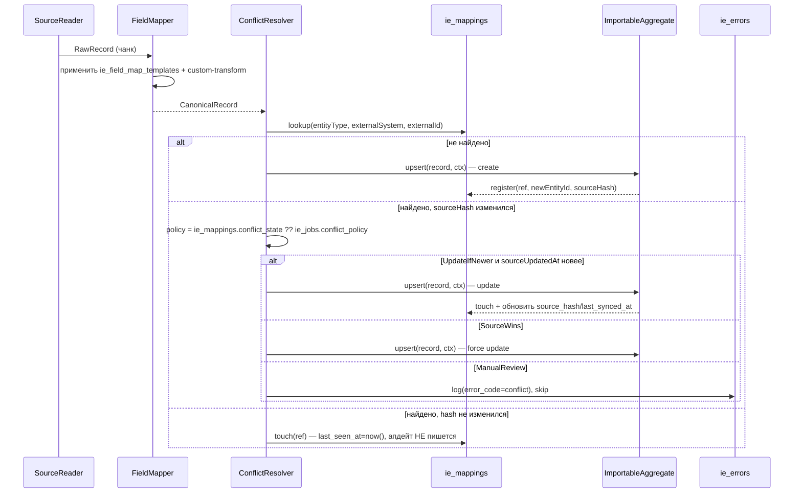
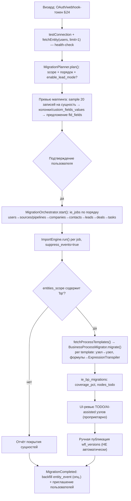
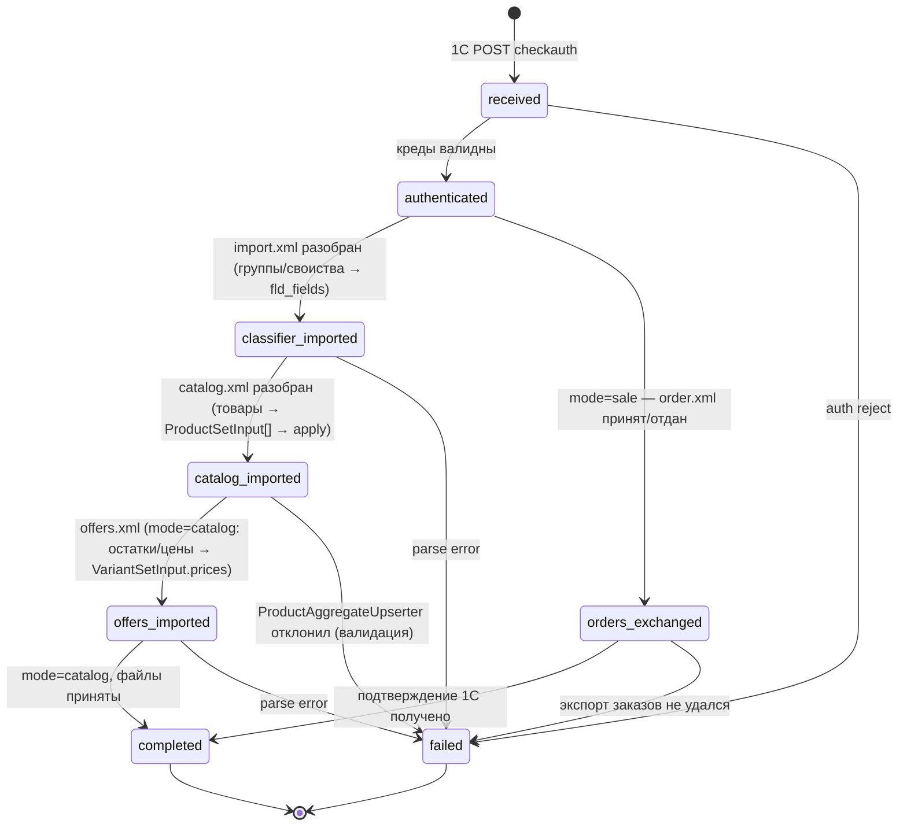
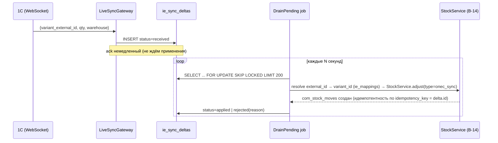
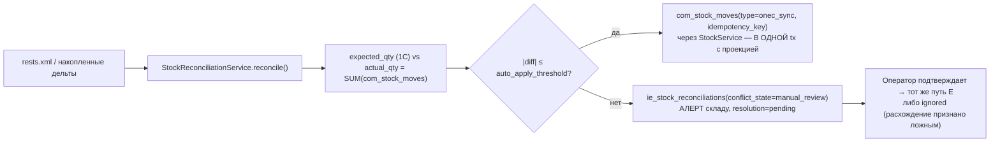
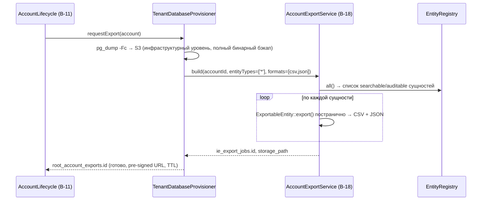

# B-18 — flex/import-export (OSS) + миграторы Б24/amoCRM + corex/1c-sync

> Вход: R-01 §4.9 В10 (productSet), R-17 §2.3/§3.3 (идемпотентность вебхуков, паттерн журнал-дедупликация), R-02 §2.7/§2.8/§4.6/§6.2 (модели Б24/amo), R-03/R-12 §2.4-2.5 (транспиляция условий, hardened SEL), R-00 §2 (FlexStore 1С-baseline: CommerceML FSM 8 состояний, live-дельты, conflict_state, file_hash), B-13 §6.2 (контракт мигратора со стороны CRM), B-14 §2.9/§3.7/§6.1 (com_ схема, ProductAggregateUpserter, ie_mappings forward-ref), B-15 (FieldManager/AttributeStore), B-11 §2.1/§3.2 (root_account_exports, TenantDatabaseProvisioner::export), B-12 §3.2-3.4 (WorkflowEngine, ActionRegistry, hardened SEL), B-10 §3.4 (EntityRegistry).
> Статус: draft → Этап 4.5 (B-99 consistency).

---

## 1. Границы и состав

### 1.1 Пакеты домена

| Пакет | Суть | Репозиторий |
|---|---|---|
| **flex/import-export** (OSS, MIT) | Универсальный движок импорта/экспорта: декларативный контракт источник→маппинг→валидация→идемпотентный upsert; коннекторы CSV/XLSX/JSON; реестр внешних ссылок `ie_mappings`; журнал ошибок с partial-continue; UI-независимое ядро (Filament-обвязка — в FlexCRM) | отдельный, standalone |
| **flex/import-export-bitrix24** (OSS, базовый уровень) | Мигратор Б24: REST-клиент, маппинг сущностей (лиды/сделки/контакты/компании/задачи/пользователи/воронки) на `crm_*`/`tsk_*`, отчёт покрытия | под тем же vendor |
| **flex/import-export-amocrm** (OSS, базовый уровень) | Мигратор amoCRM, зеркало Б24-мигратора, короче (меньше сущностей) | под тем же vendor |
| **corex/1c-sync** | CommerceML batch-обмен (каталог/остатки/заказы) поверх ядра flex/import-export; FSM-сессии, идемпотентность по `file_hash` | монорепо corex |

### 1.2 Зависимости (стрелка = «зависит от»)

```
flex/import-export-bitrix24 ──┐
flex/import-export-amocrm   ──┼──► flex/import-export (ядро: SourceReader/Mapper/ConflictResolver/ImportEngine)
corex/1c-sync ─────────────────┘         │
                                          ▼
                          EntityRegistry (B-10) ── ImportableAggregateRegistry
                                          │
        ┌─────────────────────────────────┼──────────────────────────┐
        ▼                                 ▼                          ▼
  corex/crm (B-13)               corex/commerce (B-14)        flex/attributes (B-15)
  ImportableAggregate            ProductAggregateUpserter     FieldManager (кастомные поля
  per crm.deal/lead/...          (productSet-контракт)        источника → fld_fields)
        │                                 │
        ▼                                 ▼
  flex/workflow (B-12, ТОЛЬКО              corex/tenancy (B-11): root_account_exports,
  для мигратора БП Б24)                    TenantDatabaseProvisioner::export()
```

Ядро flex/import-export **не знает** про CRM/Commerce напрямую — только через `ImportableAggregate`-контракт, который реализуют модули-потребители (инверсия зависимости, как ADR-006 «модули экспортируют только Contracts»).

### 1.3 Зона OSS vs проприетарное (B-01 §6)

| OSS (MIT) | Проприетарное |
|---|---|
| flex/import-export: ядро движка, CSV/XLSX/JSON-коннекторы, `ie_*`-схема, `ImportEngine`/`ExportEngine`, реестр `ie_mappings`, журнал ошибок | Конструктор мигратора (drag&drop UI сопоставления колонок, визард «CRM за день») — FlexCRM |
| flex/import-export-bitrix24 / -amocrm: REST-клиенты, маппинг данных сущностей (§1.1), базовый отчёт покрытия | Транспиляция бизнес-процессов Б24 (`ie_bp_migrations`/`ie_bp_nodes`) — использует проприетарный конструктор workflow (B-12 §6) и AiGateway (per-account квота); AI-assisted узлы = платная фича |
| corex/1c-sync: CommerceML **batch**-обмен (каталог, остатки, заказы), FSM-сессии, идемпотентность | corex/1c-sync: **live WebSocket-дельты** (`ie_sync_deltas`) — Pro-граница, подтверждена R-00/B-01 §6 |
| Экспорт при offboarding (D13): полный дамп в переносимые форматы — часть обязательств тарифа, но код в OSS-ядре | — |

### 1.4 Два деплой-режима (D10)

Ядро не хардкодит облако: `ie_connections`/`ie_jobs`/`ie_mappings` — тенантские таблицы, идентичные в cloud/boxed. Различается только: (а) live-дельты — фича-флаг, требует публичный WS-эндпоинт (нет в boxed без реверс-прокси — конфигурируется отдельно, не блокер); (б) офлайн-режим 1С-обмена (файловый каталог вместо S3-вебхука) доступен в обоих режимах — CommerceML-протокол изначально файловый.

---

## 2. Схема БД

Конвенции (B-01 §3, единые с B-13/B-14/B-15): PK `uuid` UUIDv7 (генерирует приложение); `timestamptz` на всех таблицах; CHECK на строковых enum; partial unique `WHERE deleted_at IS NULL` где применимо; ACTOR = jsonb `{source: user|agent|api|import|vertical|system, id, name}` (B-15 §3.1). Префикс `ie_` (D9, ≤3 симв.) — единый для генерического движка, миграторов Б24/amoCRM и corex/1c-sync (последний — специализированный канал импорта/экспорта, а не отдельный namespace таблиц; заранее анонсирован форвард-ссылкой B-14 §3.7/§6.1).

### 2.1 Источники и шаблоны маппинга

```sql
CREATE TABLE ie_connections (
  id               uuid PRIMARY KEY,
  workspace_id     uuid REFERENCES wsp_workspaces (id) ON DELETE CASCADE,  -- NULL = весь аккаунт
  kind             varchar(24) NOT NULL CHECK (kind IN
                   ('csv_upload','xlsx_upload','json_api','bitrix24','amocrm','onec_exchange','onec_websocket')),
  name             varchar(128) NOT NULL,
  direction        varchar(8)  NOT NULL DEFAULT 'import' CHECK (direction IN ('import','export','both')),
  config           jsonb NOT NULL DEFAULT '{}',      -- НЕсекретное: base_url, entities scope, batch_size, webhook_url
  credentials_ref  varchar(128),                     -- ссылка в sys_settings (is_sensitive, B-10); токены/секреты не здесь
  status           varchar(16) NOT NULL DEFAULT 'active' CHECK (status IN ('active','disabled','error')),
  last_checked_at  timestamptz,
  last_error       jsonb,
  created_by       jsonb NOT NULL,
  created_at timestamptz NOT NULL DEFAULT now(), updated_at timestamptz NOT NULL DEFAULT now(), deleted_at timestamptz
);
CREATE INDEX ie_connections_ws_ix ON ie_connections (workspace_id) WHERE deleted_at IS NULL;
COMMENT ON COLUMN ie_connections.kind IS
  'onec_exchange = файловый/HTTP CommerceML batch (OSS); onec_websocket = live-дельты (Pro, feature flag ie.live_sync)';

CREATE TABLE ie_field_map_templates (
  id            uuid PRIMARY KEY,
  workspace_id  uuid REFERENCES wsp_workspaces (id) ON DELETE CASCADE,
  entity_type   varchar(64) NOT NULL,                -- handle EntityRegistry: 'crm.deal', 'com.product'
  source_kind   varchar(24) NOT NULL,                -- 'csv_upload'|'xlsx_upload'|'bitrix24'|'amocrm'
  name          varchar(128) NOT NULL,
  mappings      jsonb NOT NULL,                      -- [{source_field, target_field, transform, default, required}]
  is_system     boolean NOT NULL DEFAULT false,       -- поставляется мигратором (не редактируется как обычный шаблон)
  created_at timestamptz NOT NULL DEFAULT now(), updated_at timestamptz NOT NULL DEFAULT now(),
  UNIQUE NULLS NOT DISTINCT (workspace_id, entity_type, source_kind, name)
);
COMMENT ON COLUMN ie_field_map_templates.mappings IS
  'transform ∈ null|date_format|split|join|lookup_option|const|expr(SEL безопасный, только чтение raw.*, R-12 §2.5 whitelist)';
```

### 2.2 Задания импорта/экспорта

```sql
CREATE TABLE ie_jobs (
  id                    uuid PRIMARY KEY,
  workspace_id          uuid REFERENCES wsp_workspaces (id) ON DELETE CASCADE,
  connection_id         uuid REFERENCES ie_connections (id) ON DELETE SET NULL,
  direction             varchar(8)  NOT NULL CHECK (direction IN ('import','export')),
  entity_type           varchar(64) NOT NULL,        -- handle EntityRegistry; 'ie.migration' группируется в ie_migrations
  format                varchar(16) NOT NULL CHECK (format IN ('csv','xlsx','json','api','commerceml')),
  field_map_template_id uuid REFERENCES ie_field_map_templates (id) ON DELETE SET NULL,
  conflict_policy       varchar(16) NOT NULL DEFAULT 'update_if_newer'
                        CHECK (conflict_policy IN ('update_if_newer','source_wins','manual_review')),
  dry_run               boolean NOT NULL DEFAULT false,
  status                varchar(24) NOT NULL DEFAULT 'queued' CHECK (status IN
                        ('queued','mapping_preview','running','paused','completed','completed_with_errors','failed','cancelled')),
  source_file_id        uuid,                        -- med_files, без FK (контракт corex/media) — upload-форматы
  suppress_events        boolean NOT NULL DEFAULT true,  -- B-13 §6.2 п.7: entity_event НЕ триггерится во время импорта
  options                jsonb NOT NULL DEFAULT '{}',
  stats                  jsonb NOT NULL DEFAULT '{}', -- {total, processed, created, updated, skipped, failed}
  started_at timestamptz, finished_at timestamptz,
  created_by             jsonb NOT NULL,
  created_at timestamptz NOT NULL DEFAULT now(), updated_at timestamptz NOT NULL DEFAULT now()
);
CREATE INDEX ie_jobs_status_ix ON ie_jobs (status) WHERE status IN ('queued','mapping_preview','running','paused');
CREATE INDEX ie_jobs_ws_ix     ON ie_jobs (workspace_id, created_at DESC);
COMMENT ON COLUMN ie_jobs.suppress_events IS
  'true → ImportEngine оборачивает upsert в EventSuppressionScope (B-10); backfill entity_event опционален отдельным джобом после completed';

CREATE TABLE ie_job_chunks (                          -- прогресс постранично/по чанкам источника
  id               uuid PRIMARY KEY,
  job_id           uuid NOT NULL REFERENCES ie_jobs (id) ON DELETE CASCADE,
  sequence         int  NOT NULL,
  cursor           varchar(160),                      -- Б24 `next`, offset файла, page-token amoCRM
  status           varchar(16) NOT NULL DEFAULT 'pending' CHECK (status IN ('pending','running','done','failed')),
  records_total    int, records_processed int NOT NULL DEFAULT 0, records_failed int NOT NULL DEFAULT 0,
  started_at timestamptz, finished_at timestamptz,
  created_at timestamptz NOT NULL DEFAULT now(), updated_at timestamptz NOT NULL DEFAULT now(),
  UNIQUE (job_id, sequence)
);
CREATE INDEX ie_job_chunks_pending_ix ON ie_job_chunks (job_id, sequence) WHERE status = 'pending';
COMMENT ON TABLE ie_job_chunks IS
  'Одна строка = один SKIP LOCKED-юнит очереди; рестарт джоба продолжает с первого pending-чанка (нет полного ребилда)';
```

### 2.3 Универсальный реестр внешних ссылок

```sql
CREATE TABLE ie_mappings (                            -- КАНОНИЧЕСКИЙ универсальный external-ref (B-14 forward-ref)
  id               uuid PRIMARY KEY,
  entity_type      varchar(64)  NOT NULL,              -- handle EntityRegistry: crm.deal, com.product, com.variant...
  entity_id        uuid         NOT NULL,
  external_system  varchar(32)  NOT NULL,              -- 'bitrix24'|'amocrm'|'onec'|'csv:<template_id>'
  external_id      varchar(190) NOT NULL,              -- Б24 numeric id как строка / 1С GUID / произвольный ключ CSV
  source_hash      varchar(64),                        -- sha256 канонической формы исходной записи (детект «изменилось»)
  conflict_state   varchar(16) NOT NULL DEFAULT 'update_if_newer'
                   CHECK (conflict_state IN ('update_if_newer','source_wins','manual_review')),
  last_synced_at   timestamptz,
  last_seen_at     timestamptz,                        -- запись встретилась в последнем прогоне (детект «исчезла у источника»)
  connection_id    uuid REFERENCES ie_connections (id) ON DELETE SET NULL,
  meta             jsonb,
  created_at timestamptz NOT NULL DEFAULT now(), updated_at timestamptz NOT NULL DEFAULT now(),
  UNIQUE (entity_type, external_system, external_id)
);
CREATE INDEX ie_mappings_entity_ix ON ie_mappings (entity_type, entity_id);
CREATE INDEX ie_mappings_stale_ix  ON ie_mappings (external_system, last_seen_at);
COMMENT ON TABLE ie_mappings IS
  'Единственный источник соответствия «внешний id ↔ наш uuid» для ВСЕХ мигратора/1С/CSV. '
  'conflict_state — per-запись политика (переопределяет ie_jobs.conflict_policy для конкретной пары); '
  'ManualReview выставляется ImportEngine автоматически при source_hash-конфликте (§5.1)';
```

### 2.4 Журнал ошибок (partial-continue)

```sql
CREATE TABLE ie_errors (
  id            uuid PRIMARY KEY,
  job_id        uuid NOT NULL REFERENCES ie_jobs (id) ON DELETE CASCADE,
  chunk_id      uuid REFERENCES ie_job_chunks (id) ON DELETE SET NULL,
  external_id   varchar(190),
  raw_record    jsonb NOT NULL,                        -- сырая запись источника (для ретрая/дебага)
  error_code    varchar(32) NOT NULL CHECK (error_code IN
                ('validation','mapping','conflict','aggregate_rejected','transient','quota_exceeded')),
  message       text NOT NULL,
  details       jsonb,
  is_retryable  boolean NOT NULL DEFAULT true,
  resolved      boolean NOT NULL DEFAULT false,
  resolved_by   jsonb,
  created_at timestamptz NOT NULL DEFAULT now(), updated_at timestamptz NOT NULL DEFAULT now()
);
CREATE INDEX ie_errors_job_ix ON ie_errors (job_id, resolved);
COMMENT ON TABLE ie_errors IS
  'Одна битая запись НЕ останавливает джоб (partial-continue, требование задачи). '
  'aggregate_rejected = ImportableAggregate::upsert() бросил доменное исключение (напр. дублирующийся slug)';
```

### 2.5 Мигратор Б24/amoCRM: сущности и бизнес-процессы

```sql
CREATE TABLE ie_migrations (                          -- обёртка над набором ie_jobs одного переезда
  id                uuid PRIMARY KEY,
  workspace_id      uuid REFERENCES wsp_workspaces (id) ON DELETE CASCADE,
  source_system     varchar(16) NOT NULL CHECK (source_system IN ('bitrix24','amocrm')),
  connection_id     uuid NOT NULL REFERENCES ie_connections (id) ON DELETE RESTRICT,
  entities_scope    jsonb NOT NULL,                    -- ['leads','deals','contacts','companies','tasks','users','pipelines','bp']
  enable_lead_mode  boolean NOT NULL DEFAULT false,    -- источник имел лиды → визард предложит crm.lead_mode (B-13 §2.3)
  status            varchar(16) NOT NULL DEFAULT 'draft'
                    CHECK (status IN ('draft','running','review','completed','failed','cancelled')),
  jobs              jsonb NOT NULL DEFAULT '[]',       -- денорм порядок: [{entity_type, job_id}]
  summary           jsonb NOT NULL DEFAULT '{}',       -- итоговый отчёт покрытия по всем сущностям
  started_at timestamptz, finished_at timestamptz,
  created_by        jsonb NOT NULL,
  created_at timestamptz NOT NULL DEFAULT now(), updated_at timestamptz NOT NULL DEFAULT now()
);
COMMENT ON COLUMN ie_migrations.entities_scope IS
  'Порядок исполнения ФИКСИРОВАН движком: users → sources/pipelines → companies → contacts → leads → deals → tasks → bp '
  '(зависимости FK: crm_deals.company_id, crm_leads.converted_*_id требуют компании/контакты заранее)';

CREATE TABLE ie_bp_migrations (                       -- перенос бизнес-процессов (проприетарный слой, §1.3)
  id                   uuid PRIMARY KEY,
  migration_id         uuid NOT NULL REFERENCES ie_migrations (id) ON DELETE CASCADE,
  source_template_id   varchar(64)  NOT NULL,          -- Б24 template id/code
  source_name          varchar(255) NOT NULL,
  target_definition_id uuid REFERENCES wfl_definitions (id) ON DELETE SET NULL,  -- draft-версия (B-12, НЕ published)
  nodes_total          int NOT NULL DEFAULT 0,
  nodes_auto           int NOT NULL DEFAULT 0,         -- транспилировано автоматически (действие/условие простое)
  nodes_ai_assisted    int NOT NULL DEFAULT 0,         -- AI предложил перевод узла, требует ревью человеком
  nodes_todo           int NOT NULL DEFAULT 0,         -- не переносимо (PHP-код, внешний коннектор) → узел-заглушка
  coverage_pct         numeric(5,2) NOT NULL DEFAULT 0,
  status               varchar(16) NOT NULL DEFAULT 'draft'
                       CHECK (status IN ('draft','reviewed','published','skipped')),
  created_at timestamptz NOT NULL DEFAULT now(), updated_at timestamptz NOT NULL DEFAULT now()
);
COMMENT ON TABLE ie_bp_migrations IS
  'Публикация target_definition_id (wfl_versions.published_at) — ТОЛЬКО ручное действие после review (§7.3-инв.3); '
  'движок никогда не публикует непроверенный граф';

CREATE TABLE ie_bp_nodes (                             -- построчный отчёт транспиляции (аудит и UI-ревью)
  id              uuid PRIMARY KEY,
  bp_migration_id uuid NOT NULL REFERENCES ie_bp_migrations (id) ON DELETE CASCADE,
  source_node_id  varchar(64)  NOT NULL,               -- Б24 activity id
  source_type     varchar(64)  NOT NULL,               -- CBPActivity-класс/тип (IfElseActivity, SetVariable, PHP-код...)
  source_expr     text,                                -- исходная формула/условие (=if(...), dateadd(...))
  target_node_id  varchar(64),                         -- id узла в графе flex-workflow/v1 (B-12 §3.1)
  target_expr     text,                                -- транспилированный hardened SEL
  translation     varchar(16) NOT NULL CHECK (translation IN ('auto','ai_assisted','todo')),
  confidence      numeric(3,2),                        -- только ai_assisted: 0..1 (порог review — продуктовый)
  note            text,
  created_at timestamptz NOT NULL DEFAULT now(), updated_at timestamptz NOT NULL DEFAULT now()
);
CREATE INDEX ie_bp_nodes_migration_ix ON ie_bp_nodes (bp_migration_id, translation);
```

### 2.6 corex/1c-sync: CommerceML batch-сессии

```sql
CREATE TABLE ie_sync_sessions (                        -- FSM 8 состояний (R-00 §2 baseline)
  id                uuid PRIMARY KEY,
  connection_id     uuid NOT NULL REFERENCES ie_connections (id) ON DELETE RESTRICT,
  mode              varchar(16) NOT NULL CHECK (mode IN ('catalog','sale')),  -- CommerceML: номенклатура vs заказы
  status            varchar(24) NOT NULL DEFAULT 'received' CHECK (status IN (
                    'received','authenticated','classifier_imported','catalog_imported',
                    'offers_imported','orders_exchanged','completed','failed')),
  protocol_version  varchar(8) NOT NULL DEFAULT '3.1', -- [design decision §9-Q6]: CommerceML 3.1 как дефолт-таргет
  requestor         varchar(64),                       -- 1С-сессия/токен (checkauth)
  stats             jsonb NOT NULL DEFAULT '{}',       -- {categories, products, offers, prices, orders}
  last_error        jsonb,
  started_at timestamptz NOT NULL DEFAULT now(), finished_at timestamptz,
  created_at timestamptz NOT NULL DEFAULT now(), updated_at timestamptz NOT NULL DEFAULT now()
);
CREATE INDEX ie_sync_sessions_status_ix ON ie_sync_sessions (status) WHERE status NOT IN ('completed','failed');
COMMENT ON TABLE ie_sync_sessions IS
  'Одна активная сессия на (connection_id, mode) одновременно — advisory lock на старте (§7.3-инв.4)';

CREATE TABLE ie_sync_files (                           -- идемпотентность приёма по file_hash, чанки 1С
  id            uuid PRIMARY KEY,
  session_id    uuid NOT NULL REFERENCES ie_sync_sessions (id) ON DELETE CASCADE,
  kind          varchar(16) NOT NULL CHECK (kind IN ('import','offers','prices','orders','rests')),  -- имена CommerceML-файлов
  filename      varchar(255) NOT NULL,
  file_hash     varchar(64)  NOT NULL,                 -- sha256(содержимое) — 1С ретраит заливку того же файла
  part_no       int, parts_total int,                  -- 1С шлёт файл частями (~1MB блоки)
  bytes_received bigint NOT NULL DEFAULT 0,
  status        varchar(16) NOT NULL DEFAULT 'receiving' CHECK (status IN ('receiving','received','parsed','failed')),
  parse_error   jsonb,
  created_at timestamptz NOT NULL DEFAULT now(), updated_at timestamptz NOT NULL DEFAULT now(),
  UNIQUE (session_id, filename, file_hash)
);
COMMENT ON TABLE ie_sync_files IS
  'UNIQUE(session_id, filename, file_hash) = повторная заливка идентичного файла — noop (1С ретраит на любой HTTP-сбой)';
```

### 2.7 corex/1c-sync: live-дельты (Pro) и сверка остатков

```sql
CREATE TABLE ie_sync_deltas (                          -- Pro-граница (D-решение R-00/B-01 §6)
  id            uuid PRIMARY KEY,
  connection_id uuid NOT NULL REFERENCES ie_connections (id) ON DELETE CASCADE,
  entity_type   varchar(64)  NOT NULL,                 -- v1 scope: 'com.variant' (остатки/цены)
  external_id   varchar(190) NOT NULL,
  payload       jsonb NOT NULL,                        -- {qty?, price_list_code?, amount?} — дельта от 1С
  status        varchar(16) NOT NULL DEFAULT 'received' CHECK (status IN ('received','applied','rejected')),
  applied_at    timestamptz,
  reject_reason varchar(64),
  received_at   timestamptz NOT NULL DEFAULT now(),
  created_at timestamptz NOT NULL DEFAULT now(), updated_at timestamptz NOT NULL DEFAULT now()
);
CREATE INDEX ie_sync_deltas_pending_ix ON ie_sync_deltas (status) WHERE status = 'received';
COMMENT ON TABLE ie_sync_deltas IS
  'Pro-only (feature flag ie.live_sync, root_plans.limits). Применение СТРОГО через StockService/PriceIndexer (B-14 §3.5), '
  'никогда прямая мутация com_stock_levels/com_price_index';

CREATE TABLE ie_stock_reconciliations (                -- сверка ТОЛЬКО отчёт, никогда молчаливой перезаписи (Т6/R-17)
  id                uuid PRIMARY KEY,
  session_id        uuid REFERENCES ie_sync_sessions (id) ON DELETE SET NULL,
  variant_id        uuid NOT NULL REFERENCES com_variants (id) ON DELETE CASCADE,
  warehouse_id      uuid NOT NULL REFERENCES com_warehouses (id) ON DELETE CASCADE,
  expected_qty      numeric(14,3) NOT NULL,            -- значение из 1С (rests.xml / live-дельта)
  actual_qty        numeric(14,3) NOT NULL,             -- SUM(com_stock_moves) на момент сверки
  diff_qty          numeric(14,3) NOT NULL,
  conflict_state    varchar(16) NOT NULL DEFAULT 'manual_review'
                    CHECK (conflict_state IN ('update_if_newer','source_wins','manual_review')),
  resolution        varchar(16) CHECK (resolution IN ('applied_as_move','ignored','pending')),
  resolved_move_id  uuid REFERENCES com_stock_moves (id) ON DELETE SET NULL,
  resolved_by       jsonb,
  created_at timestamptz NOT NULL DEFAULT now(), updated_at timestamptz NOT NULL DEFAULT now()
);
CREATE INDEX ie_stock_recon_pending_ix ON ie_stock_reconciliations (conflict_state) WHERE resolution IS NULL;
COMMENT ON TABLE ie_stock_reconciliations IS
  'Расхождение 1С↔журнал — ТОЛЬКО отчёт. Применение diff = НОВАЯ строка com_stock_moves(type=onec_sync, '
  'idempotency_key=session_id:variant_id:warehouse_id) через StockService (B-14 §2.6/§3.5); UPDATE com_stock_levels '
  'напрямую ЗАПРЕЩЁН на уровне кода (R-01 §4.5, R-17 инвариант, повторено здесь как контракт B-18)';
```

### 2.8 Экспорт при offboarding (D13)

```sql
CREATE TABLE ie_export_jobs (                          -- тенантская сторона; координируется root_account_exports (B-11 §2.1)
  id             uuid PRIMARY KEY,
  root_export_id uuid,                                 -- root_account_exports.id — кросс-БД, БЕЗ FK
  kind           varchar(16) NOT NULL CHECK (kind IN ('offboarding','pre_purge','manual')),
  entity_types   jsonb NOT NULL,                        -- ['crm.deal','com.product',...] | ['*'] = всё из EntityRegistry
  formats        jsonb NOT NULL DEFAULT '["csv","json"]',
  status         varchar(16) NOT NULL DEFAULT 'running' CHECK (status IN ('running','done','failed')),
  stats          jsonb NOT NULL DEFAULT '{}',           -- {entity_type: rows}
  storage_path   varchar(512),
  created_at timestamptz NOT NULL DEFAULT now(), updated_at timestamptz NOT NULL DEFAULT now(), finished_at timestamptz
);
COMMENT ON TABLE ie_export_jobs IS
  'AccountExportService (ниже §3.7) — реализация вызывается TenantDatabaseProvisioner::export() (B-11 §3.2) '
  'ПОСЛЕ pg_dump -Fc (инфраструктурный уровень); эта таблица — только CSV/JSON-слой по сущностям для переносимости';
```

---

## 3. Публичные контракты

### 3.1 Ключевые DTO (namespace `Flex\ImportExport\Support`)

```php
final readonly class ExternalRef {
    public function __construct(
        public string $entityType,      // handle EntityRegistry
        public string $externalSystem,  // 'bitrix24'|'amocrm'|'onec'|'csv:<template_id>'
        public string $externalId,
    ) {}
}

final readonly class RawRecord {         // сырая запись источника до маппинга
    public function __construct(
        public ExternalRef $ref,
        public array $fields,           // ['NAME' => 'Иван', 'PHONE' => [...]] — как отдал источник
        public ?string $sourceHash = null,
    ) {}
}

final readonly class CanonicalRecord {   // после FieldMapper — готово для ImportableAggregate
    public function __construct(
        public ExternalRef $ref,
        public string $entityType,
        public array $attributes,       // [target_field => value], включая cf_-код для кастомных полей
        public array $relations = [],   // [{type: 'company'|'contact'|..., ref: ExternalRef, label?: string}]
        public ?\DateTimeImmutable $sourceUpdatedAt = null,
    ) {}
}

enum ConflictPolicy: string {
    case UpdateIfNewer = 'update_if_newer';  // apply если sourceUpdatedAt > ie_mappings.last_synced_at (дефолт)
    case SourceWins    = 'source_wins';      // всегда перезаписать нашими данными источника
    case ManualReview  = 'manual_review';    // не применять — создать ie_errors(error_code=conflict), ждать решения
}

final readonly class ImportOptions {
    public function __construct(
        public bool $dryRun = false,
        public ConflictPolicy $conflictPolicy = ConflictPolicy::UpdateIfNewer,
        public bool $suppressEvents = true,
        public int $chunkSize = 500,
    ) {}
}

final readonly class ChunkResult {
    public function __construct(
        public int $processed, public int $created, public int $updated,
        public int $skipped, public int $failed, public ?string $nextCursor,
    ) {}
}
```

### 3.2 Ядро движка (namespace `Flex\ImportExport\Contracts`)

```php
interface SourceReader {
    /** Один вызов = один чанк. Курсор непрозрачен (offset/page-token/byte-position). */
    public function read(?string $cursor, int $limit): SourceBatch; // {records: RawRecord[], nextCursor: ?string, done: bool}
}

interface FieldMapper {
    /** Применяет ie_field_map_templates.mappings (или код-мигратора) к сырой записи. */
    public function map(RawRecord $raw, string $entityType, ?string $templateId): CanonicalRecord;
}

interface ConflictResolver {
    /** Сравнивает CanonicalRecord с существующим ie_mappings-состоянием, решает apply|skip|manual_review. */
    public function resolve(CanonicalRecord $incoming, ?ExternalRefState $existing, ConflictPolicy $policy): ConflictDecision;
}

/** Реализуется КАЖДЫМ модулем-потребителем (CRM/Commerce/Tasks) для своих сущностей.
 *  Регистрируется в ImportableAggregateRegistry при boot (Extend\Import, B-10 §4.2). */
interface ImportableAggregate {
    public static function entityType(): string;        // 'crm.deal'
    /** Идемпотентен: тот же CanonicalRecord + существующий ExternalRef → noop.
     *  Резолв relations (company/contact/...) — через ExternalRefResolver ($ctx). */
    public function upsert(CanonicalRecord $record, ImportContext $ctx): AggregateUpsertResult;
    /** Обратное направление — для экспорта (CSV/офлайн-дамп, 1С sale-обмен). */
    public function toCanonical(string $entityId): CanonicalRecord;
}

final readonly class ImportContext {
    public function __construct(
        public string $jobId,
        public ExternalRefResolver $refs,   // резолв связей по ExternalRef → uuid (или создание placeholder)
        public Actor $actor,                // B-15 Actor, source=import
        public bool $dryRun,
    ) {}
}

interface ExternalRefResolver {
    /** ie_mappings lookup; при отсутствии — null (мигратор решает: создать заглушку или отложить в ie_errors). */
    public function resolve(ExternalRef $ref): ?string;   // uuid | null
    public function register(ExternalRef $ref, string $entityId, ?string $sourceHash = null): void;
    public function touch(ExternalRef $ref): void;        // last_seen_at = now() (детект «пропало у источника»)
}

interface ImportEngine {
    /** Оркестрирует: SourceReader → FieldMapper → ConflictResolver → ImportableAggregate::upsert,
     *  чанками (ie_job_chunks), с partial-continue (сбой записи → ie_errors, чанк продолжается).
     *  suppressEvents оборачивает upsert в EventSuppressionScope (B-10). */
    public function run(string $jobId): void;
    public function pause(string $jobId): void;
    public function resume(string $jobId): void;
    public function cancel(string $jobId): void;
    /** Повторно обработать только failed-записи чанка/джоба (после исправления маппинга). */
    public function retryErrors(string $jobId): void;
}

interface ImportJobService {
    public function create(string $entityType, string $connectionId, string $format,
                           ?string $templateId, ImportOptions $opts, Actor $actor): string; // jobId
    /** Первые N записей БЕЗ upsert — предпросмотр колонок/значений для UI-визарда маппинга. */
    public function previewMapping(string $jobId, int $sampleSize = 20): MappingPreview;
    public function progress(string $jobId): JobProgress;
}
```

### 3.3 Экспорт

```php
interface ExportableEntity {
    /** Полный список записей сущности постранично (для CSV/XLSX/JSON-дампа). */
    public function export(?string $cursor, int $limit): ExportBatch; // {records: CanonicalRecord[], nextCursor}
}

interface ExportWriter {                    // формат назначения
    public function write(iterable $records, ExportTarget $target): ExportManifestEntry;
}

/** Реализация — B-18; вызывается TenantDatabaseProvisioner::export() (B-11 §3.2) как «CSV/JSON-слой». */
interface AccountExportService {
    /** Обходит EntityRegistry (все searchable/auditable сущности либо явный scope),
     *  для каждой — ExportableEntity::export() постранично → ExportWriter, пишет ie_export_jobs. */
    public function build(string $accountId, array $entityTypes, array $formats): string; // ie_export_jobs.id
}
```

### 3.4 Мигратор Б24/amoCRM (namespace `Flex\ImportExport\Migrators`)

```php
interface SourceClient {                    // Bitrix24Client / AmoCrmClient
    public function testConnection(): ConnectionHealth;
    /** Постраничная выгрузка сущности источника (rate-limit — внутри реализации, §7.1). */
    public function fetchEntity(string $sourceEntity, ?string $cursor, int $limit): SourceBatch;
    /** Только Б24: экспорт шаблонов БП аккаунта (архив настроек, R-02 §2.7). */
    public function fetchProcessTemplates(): array;  // list<RawProcessTemplate>
}

interface MigrationPlanner {
    /** Строит ie_migrations.entities_scope в фиксированном порядке зависимостей (§2.5 comment),
     *  детектирует наличие лидов в источнике → enable_lead_mode. */
    public function plan(string $connectionId, array $requestedEntities): MigrationPlan;
}

interface MigrationOrchestrator {
    public function start(string $migrationId): void;   // создаёт и последовательно запускает ie_jobs по plan
    public function report(string $migrationId): MigrationReport;  // покрытие по сущностям + БП
}

/** Транспиляция условий/формул источника → hardened SEL (B-12 §3.4). Реестр — per source_system. */
interface ExpressionTranspiler {
    /** @return TranspileResult{expr: ?string, translation: 'auto'|'ai_assisted'|'todo', confidence: ?float, note: ?string} */
    public function transpile(string $sourceExpr, array $availableNames): TranspileResult;
}

interface BusinessProcessMigrator {
    /** Строит draft wfl_versions.graph узел-в-узел (действие/условие/ожидание/согласование → B-12 §3.1),
     *  условия — через ExpressionTranspiler; неизвестные типы узлов (PHP-код, внешний коннектор Б24) → node type 'todo'
     *  (константа-заглушка в графе, требует ручной замены перед публикацией). */
    public function migrate(string $migrationId, RawProcessTemplate $tpl): string; // ie_bp_migrations.id
}
```

### 3.5 corex/1c-sync (namespace `Corex\OneCSync\Contracts`)

```php
interface CommerceMlParser {
    /** Парсит classifier (import.xml: группы/свойства) → FieldManager::create (B-15) для новых атрибутов/категорий. */
    public function parseClassifier(string $xml): ClassifierResult;
    /** catalog.xml (товары) → ProductSetInput[] (B-14 §3.7), сопоставление по ie_mappings(external_system='onec'). */
    public function parseCatalog(string $xml): array; // list<ProductSetInput>
    /** offers.xml (остатки/цены) → делта на VariantSetInput.prices + qty per warehouse. */
    public function parseOffers(string $xml): array;
    /** orders.xml — обратное направление: наши com_orders → CommerceML XML для «Заказы» пакета. */
    public function renderOrders(array $orderIds): string;
}

interface CommerceMlSessionManager {
    /** checkauth → ie_sync_sessions(status=received→authenticated). Advisory lock (connection_id, mode). */
    public function open(string $connectionId, string $mode): string; // sessionId
    /** Приём файла (возможно частями); идемпотентен по file_hash (ie_sync_files). */
    public function receiveFile(string $sessionId, string $kind, string $filename, string $chunk, int $partNo, int $partsTotal): void;
    public function advance(string $sessionId, string $toStatus): void;  // валидирует допустимый переход FSM §5.3
    public function complete(string $sessionId): void;
    public function fail(string $sessionId, string $reason): void;
}

/** Живые дельты (Pro). Вход СТРОГО событийный — никогда синхронного прямого write в com_*. */
interface LiveSyncGateway {
    public function ingest(string $connectionId, string $entityType, string $externalId, array $payload): void; // → ie_sync_deltas(status=received)
    /** Consumer-джоб: резолвит ie_mappings → StockService::adjust()/PriceIndexer (B-14), помечает applied|rejected. */
    public function drainPending(int $limit = 200): int;
}

interface StockReconciliationService {
    /** Сравнивает rests.xml/live-дельту с SUM(com_stock_moves); НИКОГДА не пишет com_stock_levels напрямую.
     *  |diff| ≤ auto_apply_threshold (конфиг) → сразу создаёт com_stock_moves(type=onec_sync) через StockService;
     *  иначе — ie_stock_reconciliations(conflict_state=manual_review), ждёт решения оператора. */
    public function reconcile(string $sessionId, array $expectedLevels): ReconciliationSummary;
}
```

### 3.6 Доменные события (afterCommit; payload — скаляры/массивы)

| Событие | Payload | Потребители |
|---|---|---|
| `Ie\JobStarted` / `JobCompleted` / `JobFailed` | jobId, entityType, stats | notifications, ie_migrations.summary |
| `Ie\RecordImported` | jobId, externalRef, entityId, outcome (created\|updated\|skipped) | timeline (`crm_tml type=imported`), search |
| `Ie\RecordFailed` | jobId, externalRef, errorCode | мониторинг мигратора |
| `Ie\MigrationCompleted` | migrationId, sourceSystem, summary | onboarding-визард, notifications |
| `Ie\BpMigrationReady` | bpMigrationId, coveragePct | UI-ревью конструктора (проприетарно) |
| `Ie\SyncSessionCompleted` / `SyncSessionFailed` | sessionId, mode, stats | мониторинг 1С-интеграции |
| `Ie\StockDiscrepancyDetected` | reconciliationId, variantId, diffQty | алерт складу, workflow (B-12 сигнал `ie.stock_discrepancy`) |
| `Ie\AccountExportReady` | exportJobId, rootExportId, storagePath | root_account_exports (B-11), notifications |

---

## 4. Extension points

| Точка | Механизм | Кто расширяет |
|---|---|---|
| Форматы источника/назначения | `SourceReaderRegistry` / `ExportWriterRegistry` (`csv`, `xlsx`, `json`, `commerceml`, `api`) | модули-коннекторы |
| Сущности-получатели | `ImportableAggregateRegistry::register(class-string<ImportableAggregate>)` при boot модуля (`Extend\Import`, новый узкий extender **N11**, RFC — B-10 §4.3) | corex/crm, corex/commerce, corex/tasks, flex/attributes (кастомные `cst_`-сущности вертикалей) |
| Транспиляторы выражений | `ExpressionTranspilerRegistry::register(sourceSystem, class-string<ExpressionTranspiler>)` | flex/import-export-bitrix24, -amocrm |
| Политики конфликтов | `ConflictResolverRegistry` — дефолтный резолвер переопределяем per entity_type (напр. commerce остатки всегда `manual_review` выше порога) | corex/commerce (StockReconciliationService), вертикали |
| Шаблоны маппинга | `ie_field_map_templates` + UI-визард (проприетарно, FlexCRM) поверх OSS-контракта `FieldMapper` | пользователь, мигратор |
| События §3.6 | стандартные Laravel listeners / `WorkflowEngine::signal()` | workflow, notifications, любой модуль |

Модуль **не может**: писать в `com_stock_levels`/`com_price_index` из ie_-кода напрямую (только через StockService/PriceIndexer, B-14 §4); публиковать `wfl_versions` мигратора без явного ручного действия (§7.3-инв.3); обходить `ie_mappings` UNIQUE-констрейнт собственной таблицей соответствий.

---

## 5. Ключевые потоки

### 5.1 Идемпотентный upsert (общий для CSV/Б24/amoCRM/1С)



Инвариант: **весь блок — одна транзакция БД** на запись (upsert + register/touch + событие). Сбой одной записи → откат её транзакции, запись в `ie_errors`, чанк продолжается со следующей (partial-continue).

### 5.2 Миграция с Б24: полный сценарий



Edge cases: (а) Б24 API-лимит/сеть — чанк уходит в `retryable` `transient`-ошибку, `ImportEngine` ретраит с backoff, джоб не падает целиком; (б) дубликат `external_id` в разных сущностях (напр. лид и сделка с одинаковым числовым id в разных модулях Б24) — `entity_type` в `ie_mappings` UNIQUE разделяет их корректно; (в) сделка ссылается на компанию, ещё не смигрированную (нарушение порядка) — `ExternalRefResolver::resolve()` возвращает `null`, `ImportableAggregate` создаёт запись без company_id и логирует `ie_errors(error_code=mapping, is_retryable=true)`; backfill-проход по завершении миграции компаний повторно резолвит через `retryErrors`.

### 5.3 CommerceML batch — FSM 8 состояний



Идемпотентность: каждый файл — `ie_sync_files(file_hash)` UNIQUE; повторная заливка (1С ретраит на HTTP-таймаут) — noop. Переход `catalog_imported` вызывает `ProductAggregateUpserter::apply()` (B-14 §3.7) с `matchBy='sku'` или GUID из `ie_mappings(external_system='onec')`; `missingVariants='keep'` по умолчанию для 1С-каталога (в отличие от ручного импорта — 1С не всегда шлёт полный список вариантов в одном файле).

### 5.4 Живые дельты (Pro) — сигнальный путь



### 5.5 Сверка остатков — никогда молчаливой перезаписи



### 5.6 Экспорт при offboarding (D13)



---

## 6. Интеграции

### 6.1 Матрица «кто что импортирует / экспортирует»

| Домен | Предоставляет B-18 | Использует у B-18 |
|---|---|---|
| B-10 core/modules | `EntityRegistry` (карта сущностей/полей для маппинга), новый extender `Extend\Import` (N11, RFC), `EventSuppressionScope` | `ImportableAggregateRegistry` регистрируется как реестр ядра |
| B-11 auth/tenancy | `root_account_exports`, `TenantDatabaseProvisioner::export()`, ACTOR/TenantContext | `AccountExportService` — реализация вызываемого контракта |
| B-12 workflow | `WorkflowEngine`/`ActionRegistry`, `wfl_definitions/versions` (draft), hardened SEL (`ExpressionValidator`) | `ExpressionTranspiler` производит SEL-строки, валидируемые тем же `ExpressionValidator` до записи в `wfl_versions.graph`; сигнал `ie.stock_discrepancy` |
| B-13 CRM | `ImportableAggregate` per `crm.deal/lead/contact/company/activity`, `tsk.task`; контракт мигратора §6.2 (порядок сущностей, custom_fields, timeline) | `ie_mappings`, `ImportEngine`, `ExpressionTranspiler` для стадийных триггеров |
| B-14 commerce | `ProductAggregateUpserter` (productSet, §3.7 первоисточник), `StockService`, `PriceIndexer`, `com_stock_moves.idempotency_key`-паттерн | `ie_mappings(external_system=onec)`, `ie_stock_reconciliations`, CommerceML-парсер |
| B-15 attributes | `FieldManager::create()` для новых атрибутов/кастомных полей из источника, `AttributeStore` | ACTOR=import при создании полей; квота полей учитывает миграционный batch (§7.2) |
| B-16 спутники | — (документы/чаты не мигрируются в v1, см. §9) | `crm_tml(type=imported)` пишется через CRM-адаптер, не напрямую |

### 6.2 Деградация в boxed-режиме (D10)

| Компонент | Cloud | Boxed |
|---|---|---|
| CSV/XLSX/JSON импорт | идентично | идентично (нет зависимости от облака) |
| Б24/amoCRM мигратор | идентично (исходящие HTTPS-запросы к облачным API источников) | идентично при наличии egress; локальные инсталляции без интернета — фича недоступна (продуктовое ограничение, не архитектурное) |
| corex/1c-sync batch | S3/webhook-приём файлов | тот же файловый обмен через локальную директорию/HTTP-эндпоинт приложения — CommerceML изначально файловый протокол, различий в коде нет |
| corex/1c-sync live | Pro-флаг из `root_plans.limits` | Pro-флаг из `config('ie.live_sync')`; требует публичный WS-эндпоинт — конфигурируется отдельно |
| Экспорт offboarding | `root_account_exports` + `TenantDatabaseProvisioner::export()` | не применимо (нет lifecycle purge в boxed) — `AccountExportService.build()` доступен напрямую как artisan-команда `ie:export` для ручного бэкапа |
| Квоты §7.2 | `root_plans.limits` | `config('ie.php')` |

---

## 7. НФТ и лимиты

### 7.1 Производительность

- Чанк по умолчанию: 500 записей (CSV/XLSX/JSON), 50 записей на batch-вызов Б24 REST (`batch`-метод, лимит платформы — [UNVERIFIED, зависит от тарифа Б24]), 250 — amoCRM (лимит ~7 запросов/сек, документированный порог — [UNVERIFIED, менялся исторически]). Явный rate-limiter в `SourceClient`-реализации с экспоненциальным backoff при HTTP 429/503.
- XLSX — потоковый читатель (SpreadsheetReader/OpenSpout-класс библиотек), без загрузки файла целиком в память (лимит памяти воркера ≤512 МБ на джоб).
- CommerceML-файлы принимаются потоково (1С шлёт частями ~1MB); парсинг XML — SAX/потоковый парсер, не DOM целиком (каталоги 50K+ SKU).
- `ie_mappings` — таблица горячего пути upsert; UNIQUE-индекс `(entity_type, external_system, external_id)` обязателен под нагрузкой батч-джоба (не `EXISTS`-скан).
- Целевая пропускная способность джоба: ≥200 записей/сек на CRM-сущность (простая структура), ≥50 записей/сек на commerce-productSet (сложный агрегат с осями/ценами).

### 7.2 Квоты per-тариф (`root_plans.limits`, boxed = config)

| Ключ | Смысл |
|---|---|
| `ie.max_rows_per_job` | лимит строк на один импорт (нижние тарифы — напр. 10K) |
| `ie.max_active_connections` | число одновременных источников (Б24+amo+1С) |
| `ie.live_sync_enabled` | Pro-флаг живых 1С-дельт (§2.7) |
| `ie.migration_included` | one-time бесплатная миграция с Б24/amo в рамках онбординга (маркетинговая гарантия §8) vs платная повторная |
| `ie.retention_errors_days` | сколько хранить `ie_errors`/`ie_bp_nodes` после завершения джоба |

Enforcement — ДО старта джоба (`ImportJobService.create()` бросает `QuotaExceededException`, 422), а не по факту переполнения на середине выполнения.

### 7.3 Safety-инварианты (нарушение = release-blocker)

1. `ie_mappings` — единственная таблица соответствий внешних id; ни один модуль не заводит параллельный реестр.
2. Upsert через `ImportableAggregate`/`ProductAggregateUpserter` — НИКОГДА напрямую в `crm_*`/`com_*` таблицы мимо доменных сервисов (валидация/события/фасет-проекции обязаны сработать).
3. `wfl_versions`, созданные `BusinessProcessMigrator`, никогда не публикуются автоматически — `published_at` выставляется только явным пользовательским действием после ревью `ie_bp_nodes`.
4. Одна активная `ie_sync_sessions` на `(connection_id, mode)` — advisory lock; конкурентная 1С-сессия отклоняется `409`.
5. Сверка остатков (`ie_stock_reconciliations`) — расхождение сверх порога никогда не применяется автоматически; ниже порога — применяется ТОЛЬКО новой строкой `com_stock_moves`, никогда `UPDATE com_stock_levels`.
6. `ie_jobs.suppress_events=true` не подавляет запись в `ie_mappings`/`ie_errors` — подавляются только `entity_event`-триггеры workflow (чтобы миграция 10K лидов не породила 10K автоматизаций).
7. Секреты (OAuth-токены Б24/amo, 1С-пароль) — никогда в `ie_connections.config`; только `credentials_ref` на `sys_settings(is_sensitive)`.

---

## 8. Acceptance criteria

1. `ie_connections`/`ie_field_map_templates`/`ie_jobs`/`ie_job_chunks`/`ie_mappings`/`ie_errors` созданы миграциями пакета flex/import-export с UUIDv7 PK, `timestamptz` на всех таблицах, партиал-индексами где указано.
2. `ie_mappings` имеет `UNIQUE(entity_type, external_system, external_id)`; повторный импорт идентичного источника (тот же файл/тот же REST-снимок) не создаёт дублей ни в `ie_mappings`, ни в целевых `crm_*`/`com_*` таблицах.
3. `ImportEngine::run()` продолжает обработку чанка после сбоя одной записи (partial-continue): падение одной строки CSV не останавливает джоб, ошибка видна в `ie_errors` с `raw_record` для ретрая.
4. `dry_run=true` выполняет полный конвейер (чтение → маппинг → резолв конфликтов) БЕЗ вызова `ImportableAggregate::upsert()` и без записи в `ie_mappings`; предпросмотр возвращает те же decision-метки (create/update/skip/manual_review), что дал бы реальный прогон.
5. `ConflictPolicy::UpdateIfNewer` не переписывает запись, если `sourceUpdatedAt` не новее `ie_mappings.last_synced_at`; `ManualReview` создаёт `ie_errors(error_code=conflict)` и не трогает целевую запись.
6. CSV/XLSX-импорт: UI предпросмотра колонок (`previewMapping`) возвращает sample ≥20 строк с предложенным маппингом на существующие `fld_fields`/системные поля entity_type; сохранение шаблона переиспользуется в следующих джобах того же `entity_type`.
7. Мигратор Б24: REST-клиент выгружает лиды/сделки/контакты/компании/задачи/пользователей/воронки; `MigrationPlanner` строит порядок с зависимостями (пользователи→справочники→компании→контакты→лиды→сделки→задачи); сделка с ещё не смигрированной компанией создаётся без FK и дозаполняется backfill-проходом.
8. Мигратор Б24: категории (направления) → `crm_pipelines`, статусы SUCCESS/FAIL/прочие → `semantic won/lost/open` (B-13 §2.1); исходные коды сохранены в `meta` для сверки.
9. Мигратор Б24: `custom_fields_values`/`UF_*` создают `fld_fields` через `FieldManager::create(actor=import)` и ДОЖИДАЮТСЯ статуса `active` (DDL op done) перед заливкой значений; неизвестные типы полей падают в `text` + запись в `ie_errors(error_code=validation)`, не блокируя остальные поля.
10. Мигратор Б24: `b_crm_entity_relation`-связи и M2M контакт↔компания переносятся в `crm_relations`/`crm_contact_company` с сохранением `label`/`is_primary`.
11. Мигратор Б24: таймлайн/примечания переносятся в `crm_tml(type='imported', payload={origin, original_type})` с `happens_at` = исходное время события (не время импорта).
12. Импорт-режим гасит `entity_event`-триггеры (`ie_jobs.suppress_events=true` по умолчанию) — импорт 10K записей не создаёт workflow-инстансов; опциональный backfill-джоб после завершения инициирует триггеры точечно.
13. Мигратор бизнес-процессов: каждый узел шаблона Б24 классифицирован `auto`/`ai_assisted`/`todo` в `ie_bp_nodes`; `coverage_pct` = `(nodes_auto + nodes_ai_assisted) / nodes_total`; итоговый `wfl_versions.graph` валиден по JSON Schema `flex-workflow/v1` (B-12 §3.1) и проходит `ExpressionValidator` на всех сгенерированных SEL-выражениях.
14. `wfl_versions`, созданная мигратором БП, остаётся `published_at IS NULL` до явного действия пользователя; попытка запуска неопубликованного графа через `WorkflowEngine::start()` отклоняется.
15. Мигратор amoCRM: лид=сделка маппится в `crm_deals` (без промежуточного `crm_leads`, если `enable_lead_mode=false`); Digital Pipeline-триггеры на стадиях best-effort маппятся в `crm_stages.settings`/простые workflow-триггеры, недостающее помечено в отчёте покрытия.
16. corex/1c-sync: `ie_sync_sessions.status` проходит допустимые переходы FSM §5.3 (никаких «прыжков» через промежуточные состояния кроме документированных `authenticated→orders_exchanged` для mode=sale); недопустимый переход отклоняется исключением.
17. corex/1c-sync: повторная заливка идентичного файла (тот же `file_hash`) — noop по `ie_sync_files.UNIQUE(session_id, filename, file_hash)`, сессия не падает.
18. corex/1c-sync: `parseCatalog()` производит `ProductSetInput[]`, применяемые через `ProductAggregateUpserter::apply()` (B-14 §3.7) с `missingVariants='keep'` по умолчанию; повторный прогон идентичного `catalog.xml` — `outcome='noop'` по всем товарам.
19. corex/1c-sync: сверка остатков никогда не выполняет `UPDATE com_stock_levels` напрямую — только запись `com_stock_moves(type='onec_sync', idempotency_key)`; расхождение сверх `auto_apply_threshold` создаёт `ie_stock_reconciliations(conflict_state='manual_review')` и НЕ применяется автоматически.
20. `ie_sync_deltas` (Pro) недоступны при `ie.live_sync_enabled=false` (тариф/конфиг) — попытка `LiveSyncGateway::ingest()` отклоняется 403, batch-режим продолжает работать без деградации.
21. Экспорт offboarding: `AccountExportService.build()` покрывает 100% сущностей `EntityRegistry::all()` с `capability Searchable|Auditable`; CSV и JSON генерируются постранично без полной загрузки таблицы в память; `ie_export_jobs.stats` содержит построчный счётчик по каждой сущности.
22. Секреты источников (OAuth-токены, 1С-пароль) не хранятся в `ie_connections.config` (grep-тест по миграциям/фикстурам на отсутствие полей `token`/`password`/`secret` вне `sys_settings`).
23. Квоты `root_plans.limits.ie.*` проверяются в `ImportJobService.create()` до старта джоба, а не постфактум.
24. Advisory lock `(connection_id, mode)` в `CommerceMlSessionManager.open()` отклоняет вторую одновременную сессию тем же соединением с понятной ошибкой (409), не создавая гонки в `com_stock_moves`.
25. Contract-тест: `ImportableAggregate::upsert()` вызванный дважды с идентичным `CanonicalRecord` и уже существующим `ExternalRef` — второй вызов не создаёт вторую запись и не порождает второе доменное событие `Created` (только `NoOp`/`Updated` при реальном изменении).

---

## 9. Открытые вопросы

1. **Q1 — вендор-неймспейс.** `Flex\ImportExport\`/`Corex\OneCSync\` — плейсхолдеры (общий вопрос D-001, решается на Этапе 5 вместе со всеми доменами).
2. **Q2 — прошивка ProductSetInput в OSS-ядро или commerce-специфика.** `CommerceMlParser` физически живёт в `corex/1c-sync`, но опирается на `ProductAggregateUpserter` из `corex/commerce` — граница чистая (интерфейс), но требует commerce-модуль enabled; для FlexCRM-only аккаунтов (без commerce) 1С-каталожный синк недоступен по определению — уточнить в продуктовой матрице (FlexCRM использует 1С только для реквизитов контрагентов? вне scope v1).
3. **Q3 — BP-миграция: OSS или проприетарная граница.** Решение в этой спеке: транспиляция бизнес-процессов Б24 — проприетарный слой (зависит от проприетарного конструктора workflow B-12 §6 и платного AiGateway). Базовые мигратор данных (сущности) — OSS. Если пользователь хочет иначе — пересмотреть §1.3 на Этапе 5.
4. **Q4 — амоCRM Digital Pipeline → workflow, глубина маппинга.** R-02 §2.8: только UX-триггеры на стадиях, без полноценного BPM у источника. Продуктовое решение: маппить 1:1 в простые workflow-триггеры (создать задачу/сменить поле/webhook) автоматически (`auto`), Salesbot-сценарии — всегда `todo`. Требует подтверждения на review реальных amoCRM-аккаунтов.
5. **Q5 — связка `crm_company_ref`/`com_payers.crm_company_ref` (B-14 §9-Q1).** Открытый вопрос самой B-14: когда единая компания мигрирует и в CRM, и в Commerce (реквизиты ИНН/КПП), `ie_mappings` может резолвить одну и ту же внешнюю компанию Б24 в ДВЕ записи (`crm_companies` + `com_payers`) без связи между ними до решения B-13/B-14 open Q1. Мигратор Б18 должен создавать обе, но backfill-связи — блокируется решением в B-13/B-14, не в этой спеке.
6. **Q6 — версия протокола CommerceML.** `ie_sync_sessions.protocol_version` дефолт `'3.1'` — рабочее допущение (design decision), не подтверждено внешним источником в этой волне ресёрча; нужна точечная проверка совместимости с актуальными выгрузками 1С:Управление торговлей/Битрикс-модулем обмена на этапе реализации.
7. **Q7 — точные rate-limit Б24/amoCRM API.** Помечено `[UNVERIFIED]` в §7.1 — лимиты меняются по тарифам источника; PoC перед кодом должен снять актуальные цифры на тестовом портале.
8. **Q8 — маркетинговая рамка «переезд с Б24 за день».** Что НЕ переносится (зафиксировать в публичных материалах, чтобы не создавать ложных ожиданий): сложные BP с PHP-кодом/внешними коннекторами (только `todo`-заглушка), настройки телефонии/АТС, история звонков с записями (только метаданные звонка, если доступны через API — сам файл записи не выгружается в v1), права/роли (переносится best-effort, требует ручной перепроверки матрицы AzGuard), кастомные виджеты/приложения маркетплейса Б24. Это раздел контента для FlexCRM-визарда, не код — зафиксировать как контракт ожиданий на Этапе 5 (BRD/маркетинговые материалы).
9. **Q9 — партиционирование `ie_errors`/`ie_bp_nodes` по объёму.** При крупных миграциях (100K+ записей с высоким error-rate) — потребность в ретеншне/партициях аналогично `crm_tml`; отложено до нагрузочного PoC (аналог R-08-паттерна).
10. **Q10 — экспорт документов/чатов при offboarding.** Vaulter-файлы и Chatom-история — вне scope `AccountExportService` v1 (только доменные данные CRM/Commerce); полный дамп файлового хранилища — отдельный контракт с B-16, зафиксировать связь на Этапе 4.5 (B-99).
