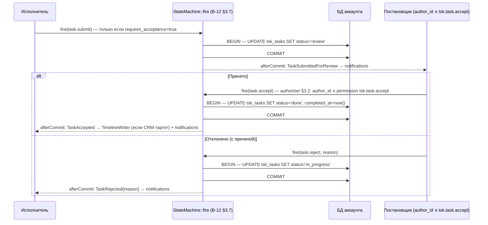
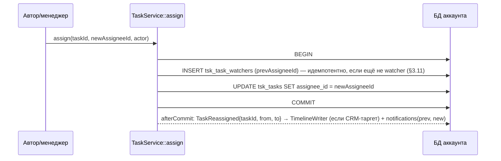
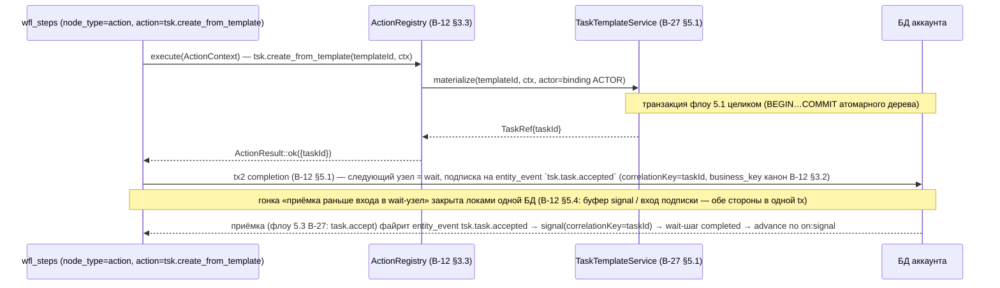

# B-27 — corex/tasks: коллаборация (роли, чек-листы, шаблоны, recurrence, зависимости, приёмка, КПД)

> **Финал волны P3.1–P3.5** — слой решений FLEX-2 P2.1 (2026-07-11), глубина добрана срезами P3.x:
> БД-детали (индексы/партиции/edge-cases) — P3.1, детальные потоки — P3.2, полные
> сигнатуры контрактов — P3.3, guard'ы/права — P3.4, AC/НФТ — P3.5.
> Вход: `05-Projects/01-Products/FlexCRM/plans/flex/20_research/R-24_tasks-collab.md` (§4, §5, «→ входы B-27»).
> Канон-базис: B-13 §2.5 (`tsk_`), B-13 §3.4 (TaskService), B-12 §3.5 (wakeup), B-12 §3.7 (statecraft).
> Дельта строго АДДИТИВНА к B-13 §2.5 — существующий DDL не переопределяется.
> Конвенции: PK = UUIDv7 (D12), префикс `tsk_` (D4), `created_by` jsonb ACTOR — как в B-13.

---

## 1. Границы и состав

**В модуле (аддитивная дельта corex/tasks):**
- Соисполнители задач (`tsk_task_coassignees`) — multi-assignee поверх единственного `assignee_id`.
- Чек-листы (`tsk_checklist_items`) — плоская декомпозиция внутри задачи с per-item assignee.
- Шаблоны задач и деревьев (`tsk_task_templates` + `tsk_task_template_children`) + merge/replace-контракт применения + точка интеграции с манифестом вертикали (B-13 §5.4).
- Повторяющиеся задачи (`tsk_recurrence_rules`, RRULE + windowed materialization через wakeup B-12 §3.5).
- Зависимости задач (`tsk_task_dependencies`, 4 типа FS/SS/FF/SF + lag, DAG-инвариант) + гант-read-model.
- Приёмка результата: статус `review` в FSM задачи + флаг `requires_acceptance`.
- КПД-read-model `tsk_user_performance_daily` (паттерн B-24 §7).

**Вне модуля (не гап, канон):**
- Лёгкие CRM-напоминания — `crm_activities kind=task` (B-13 §2.4); два уровня задач разделены осознанно (R-24 §4.7), пересмотр не требуется.
- Полноценный OKR/KPI-конструктор — v1.1/v2 (R-24 §4.6), см. §9.
- Собственный cron/scheduler — запрещён: единственный механизм пробуждения — wakeup B-12 §3.5 (R-24 §4.4).

**Зависимости модуля:** corex/workflow+statecraft (FSM статусов, wakeup), AzGuard/B-11 (доменный action `accept` на entity_key `tsk.task` → permission key `tsk.task.accept`), corex/notifications (события), B-24 read-model-слой (КПД), B-13 §5.4 (вертикали несут шаблоны).

---

## 2. Схема БД

> Срез P3.1: полный DDL (индексы, партиции/edge-cases, CHECK/COMMENT) — черновая пометка снята.

```sql
-- Соисполнители: multi-assignee (Asana-модель), НЕ несут финальной ответственности (R-24 §4.1 п.2)
CREATE TABLE tsk_task_coassignees (
  task_id    uuid NOT NULL REFERENCES tsk_tasks(id) ON DELETE CASCADE,
  user_id    uuid NOT NULL REFERENCES users(id) ON DELETE CASCADE,
  created_by jsonb NOT NULL,                 -- ACTOR: соисполнителя может добавить агент/процесс
  created_at timestamptz NOT NULL DEFAULT now(),
  PRIMARY KEY (task_id, user_id)
);
CREATE INDEX tsk_task_coassignees_user_ix ON tsk_task_coassignees (user_id);  -- запрос: «мои задачи как соисполнителя»

-- Чек-лист: плоский список, без вложенности (R-24 §4.2); отметка пункта НЕ файрит FSM задачи
CREATE TABLE tsk_checklist_items (
  id           uuid PRIMARY KEY,             -- UUIDv7
  task_id      uuid NOT NULL REFERENCES tsk_tasks(id) ON DELETE CASCADE,
  title        varchar(500) NOT NULL,
  is_done      boolean NOT NULL DEFAULT false,
  assignee_id  uuid REFERENCES users(id) ON DELETE SET NULL,    -- nullable: мини-ответственность per пункт
  position     int NOT NULL DEFAULT 0,
  completed_at timestamptz,
  completed_by jsonb,                        -- ACTOR отметившего
  created_by   jsonb NOT NULL,
  created_at timestamptz NOT NULL DEFAULT now(), updated_at timestamptz NOT NULL DEFAULT now(),
  CHECK (NOT is_done OR completed_at IS NOT NULL)
);
CREATE INDEX tsk_checklist_items_task_ix     ON tsk_checklist_items (task_id, position);        -- запрос: рендер чек-листа задачи по порядку
CREATE INDEX tsk_checklist_items_assignee_ix ON tsk_checklist_items (assignee_id) WHERE NOT is_done;  -- запрос: «мои открытые пункты»

-- Корневой шаблон задачи (Planfix-паттерн «шаблон дерева», R-24 §4.3)
CREATE TABLE tsk_task_templates (
  id            uuid PRIMARY KEY,
  workspace_id  uuid REFERENCES wsp_workspaces(id) ON DELETE CASCADE,
  name          varchar(190) NOT NULL,
  payload       jsonb NOT NULL,              -- replace-категория: title/description/priority/estimate + роли по умолчанию
  checklist     jsonb NOT NULL DEFAULT '[]', -- merge-категория: пункты чек-листа
  source        varchar(16) NOT NULL DEFAULT 'manual'
                CHECK (source IN ('manual','vertical')),  -- vertical = из YAML-манифеста B-13 §5.4
  vertical_code varchar(64),                 -- код вертикали-владельца (для деактивации без потери данных)
  is_active     boolean NOT NULL DEFAULT true,
  created_by    jsonb NOT NULL,
  created_at timestamptz NOT NULL DEFAULT now(), updated_at timestamptz NOT NULL DEFAULT now(),
  deleted_at    timestamptz
);
CREATE INDEX tsk_task_templates_ws_ix       ON tsk_task_templates (workspace_id) WHERE is_active AND deleted_at IS NULL;  -- запрос: каталог шаблонов workspace
CREATE INDEX tsk_task_templates_vertical_ix ON tsk_task_templates (vertical_code) WHERE source = 'vertical';             -- запрос: деактивация вертикали (find-by-vertical_code)
COMMENT ON COLUMN tsk_task_templates.vertical_code IS 'Заполнена только при source=vertical; installer идентифицирует свои шаблоны по этому коду для идемпотентного сида и деактивации без потери данных (B-13 §5.4). Стабильный код шаблона внутри манифеста — формат ключа P3.3 (Q43)';

-- Узлы дерева шаблона (self-FK — схема без ограничения глубины; валидатор v1 — 1 уровень, см. §3.3)
CREATE TABLE tsk_task_template_children (
  id              uuid PRIMARY KEY,
  template_id     uuid NOT NULL REFERENCES tsk_task_templates(id) ON DELETE CASCADE,
  parent_child_id uuid REFERENCES tsk_task_template_children(id) ON DELETE CASCADE,  -- NULL = потомок корня
  payload         jsonb NOT NULL,
  checklist       jsonb NOT NULL DEFAULT '[]',
  position        int NOT NULL DEFAULT 0,
  created_at timestamptz NOT NULL DEFAULT now(), updated_at timestamptz NOT NULL DEFAULT now()
);
CREATE INDEX tsk_ttc_template_ix ON tsk_task_template_children (template_id, position);              -- запрос: дерево шаблона по порядку
CREATE INDEX tsk_ttc_parent_ix   ON tsk_task_template_children (parent_child_id) WHERE parent_child_id IS NOT NULL;  -- запрос: потомки узла (валидатор глубины §3.3)

-- Правило повторения: RRULE = бизнес-семантика, wakeup B-12 §3.5 = драйвер (R-24 §4.4)
CREATE TABLE tsk_recurrence_rules (
  id                 uuid PRIMARY KEY,
  template_id        uuid NOT NULL REFERENCES tsk_task_templates(id) ON DELETE RESTRICT,  -- нельзя удалить шаблон с активным правилом — сначала деактивировать (§3.6)
  project_id         uuid REFERENCES tsk_projects(id) ON DELETE CASCADE, -- контекст материализации (nullable)
  rrule              text NOT NULL,          -- RFC 5545 (COUNT/UNTIL/EXDATE внутри)
  dtstart            timestamptz NOT NULL,
  timezone           varchar(64) NOT NULL,
  is_active          boolean NOT NULL DEFAULT true,  -- правки правила: is_active=false + новое правило (instance-first)
  materialized_until timestamptz,            -- граница windowed-материализации (окно 30 дней)
  created_by         jsonb NOT NULL,
  created_at timestamptz NOT NULL DEFAULT now(), updated_at timestamptz NOT NULL DEFAULT now()
);
CREATE INDEX tsk_recurrence_rules_wakeup_ix  ON tsk_recurrence_rules (materialized_until) WHERE is_active;  -- запрос: wakeup-обработчик — какие правила пора материализовать дальше
CREATE INDEX tsk_recurrence_rules_project_ix ON tsk_recurrence_rules (project_id) WHERE project_id IS NOT NULL;

-- Зависимости: edge-таблица, все 4 типа в БД даже при FS-only UI v1 (R-24 §4.5)
CREATE TABLE tsk_task_dependencies (
  predecessor_id  uuid NOT NULL REFERENCES tsk_tasks(id) ON DELETE CASCADE,
  successor_id    uuid NOT NULL REFERENCES tsk_tasks(id) ON DELETE CASCADE,
  dependency_type varchar(2) NOT NULL DEFAULT 'FS' CHECK (dependency_type IN ('FS','SS','FF','SF')),
  lag_minutes     int NOT NULL DEFAULT 0,
  created_by      jsonb NOT NULL,
  created_at      timestamptz NOT NULL DEFAULT now(),
  PRIMARY KEY (predecessor_id, successor_id),
  CHECK (predecessor_id <> successor_id)
);
CREATE INDEX tsk_task_dependencies_successor_ix ON tsk_task_dependencies (successor_id);  -- запрос: recursive CTE ганта — обратный обход (предшественники), критично для critical_path/slack §3.7 (Q4-бюджет)
COMMENT ON TABLE tsk_task_dependencies IS 'DAG-инвариант (детект цикла при вставке ребра) — сервисный, safety-инвариант §8, НЕ DB-constraint (Postgres не выражает ациклический граф декларативно). PK — уже индекс на predecessor_id для прямого обхода';

-- КПД: read-model, nightly batch — паттерн crm_activity_rollups B-24 §7 (R-24 §4.6);
-- ключ агрегата (workspace_id, user_id, day) — как у всех операционных read-моделей B-24 §7
CREATE TABLE tsk_user_performance_daily (
  id                    uuid PRIMARY KEY,             -- UUIDv7; surrogate — workspace_id nullable делает составной PK невозможным в PG (PK-колонки NOT NULL по определению), поэтому не PK, а UNIQUE ниже (§9 п.8 решено)
  workspace_id          uuid REFERENCES wsp_workspaces(id) ON DELETE CASCADE,  -- nullable по образцу tsk_tasks.workspace_id: NULL = задачи вне workspace (CRM-задачи) — отдельная строка агрегата
  user_id               uuid NOT NULL REFERENCES users(id) ON DELETE CASCADE,
  day                   date NOT NULL,
  tasks_completed       int NOT NULL DEFAULT 0,
  tasks_overdue         int NOT NULL DEFAULT 0,
  avg_completion_hours  numeric(10,2),
  checklist_items_done  int NOT NULL DEFAULT 0,
  computed_at           timestamptz NOT NULL DEFAULT now(),  -- отметка nightly-batch прогона (паттерн mkg_campaign_stats.computed_at)
  UNIQUE NULLS NOT DISTINCT (workspace_id, user_id, day)  -- ключ агрегата; идемпотентный upsert nightly-batch по этому ключу
);
CREATE INDEX tsk_upd_user_ix ON tsk_user_performance_daily (user_id, day DESC);  -- запрос: КПД-карточка пользователя за период
COMMENT ON TABLE tsk_user_performance_daily IS 'Read-model/projection (B-26 §2) — не партиционируется и не архивируется тем же механизмом append-only; пересчитывается детерминированно nightly-batch''ем, повторный прогон идемпотентен по UNIQUE-ключу';
```

**Изменения `tsk_tasks` (аддитивно, канон B-13 §2.5 не переписывается):**

| Изменение | Тип | Назначение |
|---|---|---|
| `status` CHECK + `'review'` | расширение enum | статус приёмки между `in_progress` и `done` (R-24 §4.1 п.4) |
| `requires_acceptance` | `boolean NOT NULL DEFAULT false` | Б24-аналог «завершать без подтверждения» (инверсия); дефолт задачи — из `tsk_projects.settings.default_requires_acceptance` (jsonb, без DDL-правки проекта) |
| `recurrence_rule_id` | `uuid NULL REFERENCES tsk_recurrence_rules(id)` | provenance материализованного экземпляра |
| `recurrence_occurs_at` | `timestamptz NULL` | оригинальное вхождение RRULE; уникальность `(recurrence_rule_id, recurrence_occurs_at)` для идемпотентного upsert — индекс на P3.1 |

```sql
-- Индексы аддитивной дельты tsk_tasks (срез P3.1)
CREATE UNIQUE INDEX tsk_tasks_recurrence_uq ON tsk_tasks (recurrence_rule_id, recurrence_occurs_at)
  WHERE recurrence_rule_id IS NOT NULL;   -- идемпотентный upsert материализации (§5 поток 2)
CREATE INDEX tsk_tasks_review_ix ON tsk_tasks (assignee_id) WHERE status = 'review';  -- запрос: очередь «на приёмке» постановщика/author

-- COMMENT-правка канона (семантика колонки НЕ меняется, только текст описания устарел)
COMMENT ON COLUMN tsk_tasks.assignee_id IS
  'Единственный носитель финальной ответственности (КПД §2 считается только по этой колонке). Соисполнители — tsk_task_coassignees (B-27 §2), НЕ watchers: комментарий канона B-13 §2.5 «соисполнители = watchers» устарел и снят этим COMMENT (B-27 P3.1)';
```

Комментарий канона `assignee_id` («соисполнители = watchers») устарел: соисполнители теперь `tsk_task_coassignees` — COMMENT переписан выше (срез P3.1), семантика колонки не меняется.

---

## 3. Ключевые архитектурные решения

> Решения зафиксированы; механика (guard'ы, SQL, сигнатуры) добрана срезами P3.1–P3.5.

Вердикты по всем 8 входам R-24 («→ входы B-27»):

### 3.1 Вход 1 — Соисполнители = `tsk_task_coassignees` — **ПРИНЯТО** (R-24 §4.1 п.2)

Multi-assignee по Asana-модели, не четвёртая роль-enum и не roles-таблица. `assignee_id` остаётся единственным носителем финальной ответственности; КПД (§2, read-model) считается ТОЛЬКО по `assignee_id`. Watchers (канон) не трогаются. Права соисполнителя (какие FSM-переходы/поля ему доступны) — вопрос среза прав, см. §9 (Q42).

### 3.2 Вход 2 — Приёмка = статус `review` + `requires_acceptance` — **ПРИНЯТО**, право приёмки решено (R-24 §4.1 п.4, Q1)

FSM: `open → in_progress → review → done`. Флаг `requires_acceptance` на задаче (дефолт с проекта). **Решение Q1 (драфт-уровень): гибрид** — переход `review → done` (`task.accept`) авторизован для `author_id` ЛИБО носителя AzGuard permission key `tsk.task.accept`: доменный action `accept` на entity_key `tsk.task` (EntityRegistry), декларируется через `Extend\Permissions` по образцу `crm.deal.move_stage` (B-11 §4 п.2; формат ключа `{module}.{entity}.{action}` — B-11 §5.5). Обоснование: жёсткий `author_id` ломается на отпуске/увольнении постановщика; доменный action — штатный extension point `aut_role_matrix`, новый механизм не строится. Record-scope ось для v1 — только `workspace`/`account`: `tsk_tasks` НЕ ownable (нет `owner_id`, только author_id/assignee_id), а own/dept/dept_tree по B-11 §4 п.3 требуют capability `ownable` (недопустимый scope компилятор трактует как `account`); ownable-маппинг задач (owner = assignee_id?) = дельта канона B-11 — заведён Q44 (§9 п.10), маршрут P3.4 → арбитраж. Детальный authorizer/guard и SQL-скоупы — P3.4.

### 3.3 Вход 4 (частично) + Q3 — Дерево шаблонов: схема без лимита, валидатор v1 = 1 уровень — **ИЗМЕНЕНО** против предварительного R-24 §5.3

R-24 предварительно рекомендовал «без ограничения глубины». **Отступление с обоснованием:** материализация дерева создаёт реальные `tsk_tasks.parent_id`, а канон B-13 §2.5 ограничивает подзадачи 1 уровнем (валидатор). Шаблон глубже «корень + 1 уровень» физически не разворачивается в канонную структуру. Решение: схема `tsk_task_template_children` несёт self-FK без ограничения (снятие лимита не потребует миграции), но валидатор создания/применения шаблона v1 допускает ровно 1 уровень потомков — консистентно канон-валидатору подзадач. Снятие лимита — только вместе с пересмотром канон-ограничения подзадач (арбитраж, не здесь). Q3 закрыт этим решением.

### 3.4 Вход 3 — Чек-листы = плоская `tsk_checklist_items` — **ПРИНЯТО** (R-24 §4.2)

Без вложенности (Б24-паттерн: чек-лист ≠ подзадача). Опциональный `assignee_id` per пункт. Отметка пункта не триггерит статус задачи (микро-приёмка отдельна от финальной приёмки).

### 3.5 Вход 4 — Шаблоны: merge/replace-контракт per категория — **ПРИНЯТО** (R-24 §4.3)

Категории применения шаблона: **replace** — core-поля (`title/description/priority/estimate`) + роли (assignee/coassignees из payload); **merge/append** — чек-листы (и вложения, когда появятся). Точка интеграции с вертикалями: YAML-манифест вертикали (B-13 §5.4) может нести ключ `task_templates` → installer идемпотентно сидирует `tsk_task_templates(source='vertical', vertical_code)`; деактивация вертикали переводит её шаблоны в `is_active=false` без потери данных (паттерн B-13 §5.4). Формат ключа манифеста — P3.3 (§9, Q43).

### 3.6 Вход 5 — Recurrence = RRULE + windowed materialization через wakeup B-12 §3.5 — **ПРИНЯТО** (R-24 §4.4)

Свой cron НЕ вводится. Правило живёт на шаблоне (`tsk_recurrence_rules.template_id`, Б24-модель «регулярность привязана к шаблону»). Материализация окна 30 дней через ту же wakeup-механику, что таймеры workflow (`WakeupDriver`, LEAST-upsert; boxed = local_sweep — деградация D10 бесплатна). Правки правила — instance-first: `is_active=false` + новое правило; будущие несостоявшиеся экземпляры отменяются, прошлые не трогаются. Идемпотентность материализации — уникальность `(recurrence_rule_id, recurrence_occurs_at)` на задаче (§2). Вопрос границы пакета (wakeup — corex-уровень vs зависимость от flex/workflow) уже открыт как Q13 (R-26) — решение B-29/P3.3 обязано покрыть и recurrence задач; здесь фиксируется только «переиспользуем wakeup, не строим свой».

### 3.7 Вход 6 — Зависимости: edge-таблица, 4 типа, CTE-read-model — **ПРИНЯТО** (R-24 §4.5, Q4)

Все 4 типа (FS/SS/FF/SF) + `lag_minutes` в БД, UI v1 — только FS. DAG-инвариант (проверка цикла при вставке связи) — safety-инвариант (§8). **Решение Q4: query-time recursive CTE для v1** (is_blocked, critical_path/slack): объём задач per-account мал (DB-per-account, R-08), денормализация в `tsk_tasks` запрещена (правило read-model-слоя B-24 §7). Материализация — v1.1 при доказанной необходимости; закладка и бюджет CTE — P3.1.

### 3.8 Вход 7 — КПД = read-model `tsk_user_performance_daily` — **ПРИНЯТО** (R-24 §4.6)

Nightly batch, консистентно `crm_activity_rollups` (B-24 §7), включая ключ агрегата `(workspace_id, user_id, day)` — per-workspace аналитика (дочерние компании) и edition-скоупинг read-моделей B-24 §7 ложатся без доработок; `workspace_id` nullable (задачи вне workspace — отдельная строка). НЕ отдельный KPI-движок (ни у кого из рынка его нет во встроенном виде). Считает только по `assignee_id` (§3.1). OKR/KPI-конструктор — v1.1/v2 (§9).

### 3.9 Вход 8 — Открытые вопросы R-24 §5 — **ПРИНЯТО**: разобраны, не потеряны

Q1 решён здесь (§3.2), Q3 решён здесь (§3.3), Q4 решён здесь (§3.7, детали P3.1), Q2 (лимиты) — маршрутизирован в срез НФТ P3.5 с предварительной позицией драфта (§8). Полный реестр — §9.

### 3.10 statecraft-дельта статусов (согласование с B-12 §3.7 — только решение)

`TaskStatus` BackedEnum расширяется значением `review`. Именованные рёбра (конвенция `scope.verb`, B-12 §3.7):

| Ребро | from → to | Guard/Authorizer (имена; детали — P3.2/P3.4) |
|---|---|---|
| `task.start` | open → in_progress | — (канон) |
| `task.submit` | in_progress → review | guard: `requires_acceptance = true` |
| `task.complete` | in_progress → done | guard: `requires_acceptance = false` (иначе — только через review) |
| `task.accept` | review → done | authorizer: author_id ∨ permission `tsk.task.accept` (§3.2) |
| `task.reject` | review → in_progress | authorizer: тот же, payload: причина |
| `task.cancel` | multi-from → cancelled | — (канон) |

Единственный путь записи статуса — `StateMachine::fire` (инвариант B-12 §3.7); канбан-колонка `tsk_stages.auto_status='done'` при `requires_acceptance=true` файрит `task.submit`, а не `task.complete` (перенос карточки в done-колонку ставит задачу «на проверку»). Детальный граф, guard-контекст и события — P3.2/P3.4.

### 3.11 Делегирование — reassign + авто-watcher (решение драфт-уровня)

`TaskService::assign` (канон B-13 §3.4) остаётся механизмом делегирования: смена `assignee_id`; прежний исполнитель автоматически добавляется в `tsk_task_watchers` (Б24-практика — делегировавший сохраняет видимость). `author_id` неизменен — цепочка приёмки не рвётся. Отдельная сущность «делегирование» не вводится.

### 3.12 Права: авторизация приёмки, coassignee-guard, ownable-развилка (Q1/Q42/Q44 — срез P3.4)

> Срез P3.4: guard'ы FSM-переходов + права соисполнителя + запись позиции по ownable — черновая пометка снята для права-подраздела.

**Q1 (право приёмки) — обоснование зафиксировано финально.** Authorizer перехода `task.accept`/`task.reject` — НЕ AzGuard record-scope (не выражается предикатом `WHERE`), а доменный OR-authorizer внутри `TaskService::accept/reject` (вызывается из `StateMachine::fire`, канон B-12 §3.7):
```php
$isAuthorized = $task->author_id === $actor->userId
    || AccessChecker::allowed($principal, 'tsk.task', 'accept');   // permission key tsk.task.accept, Extend\Permissions
```
`AccessChecker::allowed()` — capability-фаза (≤1мс, B-11 §5.5 п.1), НЕ record-scope-фаза: `tsk.task.accept` не несёт own/dept/dept_tree (см. Q44 ниже — tasks не ownable), поэтому это чистая capability-проверка «может ли роль принципала вообще принимать чужие задачи», плюс жёстко закодированный `author_id`-обход. Обе ветки — легальные пути одного и того же доменного правила, не конфликтующие скоупы.Q1 остаётся Resolved (P2.1), это уточнение — механика P3.4.

**Q42 (права coassignee) — решено здесь.** Позиция драфта подтверждена без изменений: coassignee (`tsk_task_coassignees`) НЕ несёт финальной ответственности (§3.1) → не авторизован на переходах, требующих финальной ответственности. Обновлённая таблица рёбер (дополняет §3.10):

| Ребро | Authorizer |
|---|---|
| `task.start` | `assignee_id = principal.userId` ∨ coassignee ∨ `author_id` (канон — начать работу может любой участник) |
| `task.submit` | **только `assignee_id = principal.userId`** — coassignee НЕ авторизован (Q42, дельта явная: сдача на приёмку = акт финальной ответственности) |
| `task.complete` | **только `assignee_id = principal.userId`** — coassignee НЕ авторизован (тот же аргумент) |
| `task.accept` / `task.reject` | `author_id ∨ permission tsk.task.accept` (Q1, см. выше) — coassignee не участвует |
| `task.cancel` | `author_id ∨ assignee_id ∨ permission tsk.task.accept` (отмена — не приёмка, порог ниже) |
| Чек-лист (`ChecklistService::toggleItem`) | ЛЮБОЙ участник задачи (assignee ∨ coassignee ∨ `checklist_items.assignee_id`) — микро-приёмка не задета инвариантом финальной ответственности |

Coassignee — участник (start/wait/чек-лист, канон wait-узла B-12 §5.4 без изменений), не совладелец приёмки. Guard реализуется внутри `TaskService`/`ChecklistService` (доменная авторизация), НЕ новым AzGuard scope — `tsk_task_coassignees` не несёт capability, только membership-факт (как `soc_group_members` для группы, B-28). Q42 → Resolved.

**Q44 (ownable-маппинг) — НЕ закрывается этим срезом, подтверждена позиция без дельты.** Capability `ownable` в каноне B-11 §4 п.3 требует физической колонки `owner_id` (компилятор трактует отсутствие — `own`/`dept`/`dept_tree` недопустимы, деградация к `account`, B-11 §5.5 таблица). У `tsk_tasks` такой колонки нет (`author_id`/`assignee_id` — не `owner_id`). Три пути: (а) оставить `account`/`workspace` — `author_id`-authorizer уже закрывает «own»-кейс приёмки на уровне доменной логики, без AzGuard-скоупа; (б) физически добавить `owner_id` (алиас `assignee_id`) — дельта DDL канона B-13 §2.5, вне Files P3.1 (закрыт); (в) переопределить семантику capability `ownable` так, чтобы она резолвилась по `assignee_id` без физической колонки `owner_id` — это ИЗМЕНЕНИЕ МЕХАНИКИ компилятора scope (не аддитивное расширение предикатами, разрешённое Scope Excluded этого item'а), значит по Scope Excluded («изменение механики — эскалация/дельта») остаётся вне мандата P3.4. **Позиция P3.4: (а) — v1 без ownable**, `author_id`-authorizer достаточен для приёмки, `workspace`/`account` достаточны для видимости; Q44 остаётся **Decision pending → арбитраж P4.2** (без изменений маршрута — P3.4 не вводит дельту канона самовольно, D11).

---

## 4. Контракты

> Срез P3.3: полные PHP-интерфейсы (@api, PHPStan level 8, форма B-16 §3), Ref-классы (readonly,
> id+type+display — Code Guidance P3.3), реестр событий и MCP-карта — черновая пометка снята.

Расширение существующего `TaskService` (B-13 §3.4) + новые сервисы `corex/tasks`:

```php
namespace Corex\Tasks;

use Corex\Auth\Actor;                 // ACTOR jsonb-носитель (B-13 §2.1)

enum DependencyType: string { case FS = 'FS'; case SS = 'SS'; case FF = 'FF'; case SF = 'SF'; }
enum TemplateApplyMode: string { case Replace = 'replace'; case Merge = 'merge'; }  // §3.5

/** readonly, id+type+display — единая форма внутри волны (не идентична ChannelRef B-16 §3.2: там enum ChannelType, без display, + panelableType/panelableId/workspaceId) */
final readonly class TaskRef
{
    public function __construct(
        public string $id, public string $type /* 'tsk.task' */, public string $display /* title */,
    ) {}
}

final readonly class RecurrenceRuleRef
{
    public function __construct(public string $id, public string $templateId, public bool $isActive) {}
}

/** Узел read-model ганта — потребитель CTE §3.7 (Q4) */
final readonly class DependencyEdge
{
    public function __construct(
        public string $predecessorId, public string $successorId,
        public DependencyType $type, public int $lagMinutes,
    ) {}
}

final readonly class DependencyGraph
{
    /** @param list<DependencyEdge> $edges */
    public function __construct(public array $edges, public array $criticalPathTaskIds, public array $slackByTaskId) {}
}

final readonly class MaterializeContext
{
    public function __construct(
        public ?string $projectId = null, public ?string $assigneeId = null,
        /** @var array<string,string> $coassigneeOverrides — userId по roleSlot из template payload */
        public array $coassigneeOverrides = [],
    ) {}
}

/** DAG-инвариант §8: вставка ребра, создающего цикл, отклоняется до записи */
final class CyclicDependencyException extends \DomainException {}
/** Глубина дерева шаблона > 1 уровня (валидатор §3.3) */
final class TemplateDepthExceededException extends \DomainException {}
/** Переход FSM запрещён текущим guard'ом/authorizer'ом (§3.2/§3.10) */
final class TaskTransitionNotAllowedException extends \DomainException {}

interface TaskService          // канон B-13 §3.4 + дельта
{
    // канон: create / assign / moveToStage / complete — сигнатуры без изменений (B-13 §3.4)
    public function addCoassignee(string $taskId, string $userId, Actor $actor): void;
    public function removeCoassignee(string $taskId, string $userId, Actor $actor): void;
    /** = fire(task.submit); guard requires_acceptance=true (§3.10) */
    public function submitForReview(string $taskId, Actor $actor): void;
    /** = fire(task.accept); authorizer author_id ∨ permission tsk.task.accept (§3.2) */
    public function accept(string $taskId, Actor $actor): void;
    /** = fire(task.reject); тот же authorizer, что accept */
    public function reject(string $taskId, Actor $actor, string $reason): void;
    /** @throws TaskTransitionNotAllowedException */
}

interface ChecklistService
{
    public function addItem(string $taskId, string $title, ?string $assigneeId, Actor $actor): string /* itemId */;
    /** Пишет completed_by/completed_at при $isDone=true; не файрит FSM задачи (§3.4) */
    public function toggleItem(string $itemId, bool $isDone, Actor $actor): void;
    public function assignItem(string $itemId, ?string $userId, Actor $actor): void;
    /** @param list<string> $orderedItemIds */
    public function reorder(string $taskId, array $orderedItemIds, Actor $actor): void;
}

interface TaskTemplateService
{
    /** merge/replace по категории поля (§3.5); $mode применяется декларативно per секция шаблона, не выбирается вызывающим */
    public function apply(string $templateId, string $taskId, Actor $actor): void;
    /** Корень + дерево (валидатор §3.3: ровно 1 уровень потомков); одна атомарная транзакция (флоу 5.1)
     * @throws TemplateDepthExceededException */
    public function materialize(string $templateId, MaterializeContext $ctx, Actor $actor): TaskRef;
    /** Идемпотентный сид из YAML-манифеста вертикали (source='vertical', vertical_code — §3.5, формат §4.1 ниже) */
    public function syncFromManifest(string $verticalCode, array $taskTemplatesSection, Actor $actor): void;
    /** Деактивация шаблонов вертикали без потери данных (is_active=false) — паттерн B-13 §5.4 */
    public function deactivateVertical(string $verticalCode, Actor $actor): void;
}

interface RecurrenceService
{
    /** Правка = деактивация старого правила + новое (instance-first, §3.6); НЕ update существующей строки */
    public function upsertRule(string $templateId, string $rrule, \DateTimeImmutable $dtstart,
                                string $timezone, ?string $projectId, Actor $actor): RecurrenceRuleRef;
    public function deactivate(string $ruleId, Actor $actor): void;
    /** internal — вызывается ТОЛЬКО wakeup-обработчиком (флоу 5.2); идемпотентен по (rule_id, occurs_at) */
    public function materializeWindow(string $ruleId): void;
}

interface DependencyService
{
    /** @throws CyclicDependencyException детект цикла ДО вставки ребра (safety-инвариант §8) */
    public function link(string $predecessorId, string $successorId, DependencyType $type,
                          int $lagMinutes, Actor $actor): void;
    public function unlink(string $predecessorId, string $successorId, Actor $actor): void;
    /** Read-model ганта: query-time recursive CTE (Q4 — v1, материализация v1.1) */
    public function graphOf(string $projectId): DependencyGraph;
}
```

### 4.1 Формат ключа `task_templates` в YAML-манифесте вертикали (Q43 — решено здесь)

Секция манифеста вертикали (B-13 §5.4), потребляемая `TaskTemplateService::syncFromManifest`:

```yaml
# фрагмент манифеста вертикали (B-13 §5.4)
task_templates:
  - code: onboarding_client            # стабильный код внутри манифеста — идемпотентный ключ сида
    payload:                           # replace-категория (§3.5): core-поля + роли по умолчанию
      title: "Онбординг клиента"
      description: "Чек-лист первого месяца работы с клиентом"
      priority: normal
      estimate_hours: 4
      assignee_role_slot: account_manager    # роль-слот из aut_role_matrix вертикали, не user_id (переносимо между аккаунтами)
    checklist:                         # merge-категория (§3.5)
      - "Отправить приветственное письмо"
      - "Назначить встречу-знакомство"
    children:                          # дерево — ровно 1 уровень (валидатор §3.3)
      - payload: { title: "Подготовить договор", priority: high }
        checklist: []
```

Идемпотентность: `syncFromManifest` матчит существующие строки по `(vertical_code, code)` — эквивалент `find-by-code before create` паттерна vertical-installer (B-13 §5.4); `code` внутри YAML **не персистентная колонка** — маппится в `tsk_task_templates.vertical_code` как составной ключ `{vertical_code}:{code}` (одна колонка, не пара) при отсутствии отдельного поля `code` в DDL §2 — сверено с P4.1 (не требует правки DDL, т.к. `vertical_code` уже varchar без ограничения формата). `assignee_role_slot` резолвится в конкретный `user_id`/`coassigneeOverrides` через `MaterializeContext` на этапе `materialize()` (installer или ручной вызов передаёт маппинг слот→пользователь), не хранится в `tsk_tasks.payload` как роль. Q43 → Resolved.

### 4.2 Реестр доменных событий (полная карта — сверка уникальности §9 S3)

| Событие | `name()` | Payload | Эмитент | Подписчики |
|---|---|---|---|---|
| `TaskCoassigneeAdded` / `Removed` | `tsk.task.coassignee_added` / `.coassignee_removed` | taskId, userId, actor | TaskService | notifications, TimelineWriter (если CRM-target) |
| `TaskSubmittedForReview` | `tsk.task.submitted_for_review` | taskId, actor | StateMachine::fire (task.submit) | notifications(author_id ∨ tsk.task.accept-держатели) |
| `TaskAccepted` | `tsk.task.accepted` | taskId, actor | StateMachine::fire (task.accept) | notifications, TimelineWriter, **wait-узел B-12 §5.4 (кросс-модульный сценарий №1, §5.5)** |
| `TaskRejected` | `tsk.task.rejected` | taskId, reason, actor | StateMachine::fire (task.reject) | notifications |
| `TaskReassigned` | `tsk.task.reassigned` | taskId, from, to, actor | TaskService::assign (§5.4) | notifications(prev,new), TimelineWriter (если CRM-target) |
| `ChecklistItemToggled` | `tsk.checklist_item.toggled` | itemId, taskId, isDone, actor | ChecklistService | — (внутренний UI-рефреш) |
| `TaskMaterializedFromTemplate` | `tsk.task.materialized_from_template` | taskId, templateId, childIds[] | TaskTemplateService | TimelineWriter (если CRM-target), notifications(task_assigned) |
| `RecurrenceInstanceCreated` | `tsk.recurrence.instance_created` | taskId, ruleId, occursAt | RecurrenceService (wakeup, §5.2) | — |
| `DependencyLinked` / `Unlinked` | `tsk.dependency.linked` / `.unlinked` | predecessorId, successorId, type, actor | DependencyService | — (read-model инвалидация) |

Уникальность имён (сверка §9 S3): все `tsk.*` — новые, ни один не пересекается с канонными `tsk.task.created/assigned/status_changed/completed` (B-13 §3.7), `tsk.task.overdue`, `tsk.timelog.added`; с `crm.*` (B-13 §3.7) и `pnl./cht./vlt./med./ntf.` (B-16 §3) коллизий нет.

Все события несут `TenantContext` (B-10 §3.1), хук `corex/notifications`.

---

## 5. Главные потоки

> Срез P3.2: детальные sequence-диаграммы + транзакционные границы (снята черновая пометка).
> Все afterCommit-события — стиль B-16 §5.2 (эмиссия строго после COMMIT, не внутри транзакции).

### 5.1 Применение шаблона (дерево)

```mermaid
sequenceDiagram
  participant C as Caller (user | vertical-installer | wfl.action)
  participant TTS as TaskTemplateService
  participant DB as БД аккаунта
  participant Q as afterCommit-очередь
  C->>TTS: materialize(templateId, ctx, actor)
  TTS->>DB: BEGIN
  TTS->>DB: INSERT tsk_tasks (root; payload → replace-поля title/description/priority/estimate; assignee/coassignees из payload)
  TTS->>DB: INSERT tsk_tasks × N (потомки 1 уровня, parent_id=root.id — валидатор §3.3 запрещает глубже)
  TTS->>DB: INSERT tsk_checklist_items (merge/append: template.checklist + children.checklist)
  TTS->>DB: COMMIT
  TTS-->>Q: TaskMaterializedFromTemplate{taskId, templateId, childIds[]}
  Q->>Q: TimelineWriter (B-13 §5.3, listener) — timeline на targets, ТОЛЬКО если задача привязана к CRM-сущности; НИКОГДА прямой INSERT crm_tml из TaskTemplateService
  Q->>Q: corex/notifications: task_assigned → assignee + coassignees
```

Ошибка/откат: `template.is_active=false` или depth-нарушение (payload несёт >1 уровня) — отклонено ДО `BEGIN` (валидация вне транзакции, ServiceException); частичное дерево при сбое середины транзакции невозможно — одна атомарная `BEGIN…COMMIT` на весь материализованный поддерево.

### 5.2 Материализация recurrence

```mermaid
sequenceDiagram
  participant W as Wakeup (B-12 §3.5) — sweep-хук tsk
  participant RS as RecurrenceService
  participant DB as БД аккаунта
  W->>RS: тик sweep: SELECT tsk_recurrence_rules WHERE materialized_until <= (now()+окно) AND is_active FOR UPDATE SKIP LOCKED
  loop по правилу
    RS->>RS: RRULE → вхождения окна 30 дней (rlanvin/php-rrule, zone=rule.timezone)
    loop по вхождению
      RS->>DB: BEGIN
      RS->>DB: TaskTemplateService::materialize(template_id, occurs_at) — upsert по UNIQUE(recurrence_rule_id, recurrence_occurs_at); конфликт (уже материализовано) → ON CONFLICT DO NOTHING, без ошибки
      RS->>DB: COMMIT
      RS-->>DB: afterCommit: RecurrenceInstanceCreated{taskId, ruleId, occursAt}
    end
    RS->>DB: UPDATE tsk_recurrence_rules SET materialized_until = окно_конец
  end
  RS-->>W: afterCommit: upsert next_fire_at (LEAST, B-12 §5.3) — следующий тик сдвига окна
```

Boxed: `local_sweep` (D10) — тот же код, без root-диспетчера. **Единообразие с B-29** (Scope Included): правка серии — **instance-first** (`is_active=false` + новое правило, §3.6), сознательно ОТЛИЧАЕТСЯ от календарной override-семантики B-29 §3.11 (this_only/this_and_following/all) — расхождение обосновано там (interop CalDAV/Google требует overrides у календаря, у задач такого требования нет); P3.2 подтверждает: обе спеки перекрёстно ссылаются друг на друга (B-27 §3.6 ↔ B-29 §3.11), дрейфа конвенций не найдено.

### 5.3 Приёмка



`requires_acceptance=false` — прямой `task.complete` (канон B-13, без узла `review`). Единственный путь записи статуса — `StateMachine::fire` (инвариант B-12 §3.7): канбан-drop в done-колонку при `requires_acceptance=true` файрит `task.submit`, не `task.complete` (§3.10).

### 5.4 Делегирование



`author_id` и цепочка приёмки (§3.2) неизменны; соисполнители (`tsk_task_coassignees`) не затрагиваются.

### 5.5 Кросс-модульный сценарий волны №1 (B-27×B-12): workflow создаёт задачу из шаблона и ждёт приёмки

> Атрибуция: первичная спека — **B-27** (материализация + приёмка); сторона B-12 (wait-узел/entity_event/signal) — ссылка на канон §5.1/§5.4/§5.5 B-12, дельты нет. Остальные спеки волны ссылаются сюда, не дублируют.



Шаги: (1) шаг процесса типа `action` вызывает `tsk.create_from_template` — материализация по флоу 5.1 (одна атомарная транзакция, без изменений); (2) шаг завершается, workflow переходит в `wait`-узел, подписанный на `entity_event` `tsk.task.accepted` с `correlationKey = taskId` (канонный механизм B-12 §3.2/§5.4, без дельты); (3) когда постановщик принимает задачу (флоу 5.3 — `task.accept`), доменное событие транслируется в `entity_event`, `signal()` матчит подписку по `correlationKey`, wait-шаг завершается, workflow продолжается по ребру `on:signal`. Откат: если задача отклонена (`task.reject`) или отменена — workflow остаётся в `wait` (нет события `tsk.task.accepted`) до эскалации по таймеру узла (`until.timeout`, канон B-12 §5.4) — политика эскалации/долгого ожидания вне Scope этого item'а (продуктовая настройка узла, не механика).

---

## 6. Интеграции (матрица доменов)

| Домен / спека | Стык | Направление |
|---|---|---|
| B-12 §3.5 wakeup | материализация recurrence + напоминания задач — единый механизм пробуждения, свой шедулер запрещён | tasks → workflow (граница пакета — Q13) |
| B-12 §3.7 statecraft | дельта FSM `review` + новые рёбра; статус двигает только `StateMachine::fire` | tasks реализует StateGraphProvider |
| B-12 §4 | действия `tsk.*` в ActionRegistry (процессы создают задачи из шаблонов, двигают статусы через `state.fire`) | workflow → tasks |
| B-13 §5.4 вертикали | манифест несёт `task_templates`; идемпотентный сид, деактивация без потери данных (§3.5) | вертикаль → tasks |
| B-13 §2.4 crm_activities | разграничение уровней: kind=task = лёгкое напоминание, `tsk_tasks` = коллаборация (R-24 §4.7) — без стыка данных | — |
| B-11 / AzGuard | доменный action `accept` на `tsk.task` через `Extend\Permissions` → permission key `tsk.task.accept` (§3.2); scope v1 = workspace/account (не ownable — Q44); права соисполнителя — P3.4 | tasks → auth |
| B-24 §7 read-models | `tsk_user_performance_daily` — nightly batch по паттерну `crm_activity_rollups` | tasks → analytics |
| corex/notifications | события §4 (приёмка, отклонение, соисполнитель, чек-лист) | tasks → notifications |
| B-16 панели-спутники | комментарии/файлы задачи — канонные capability-панели (commentable/documentable), дельты не требуется | — |

---

## 7. MCP-тулзы — финальная карта (byte-в-byte с B-32 §7.1)

> Срез P3.3: нейминг `module.verb_noun` (module_short `tsk`, B-32 §3.3) — черновая пометка снята.
> `tasks.create_task` эскиза P2.1 УДАЛЕНА: дублировала канонную `tsk_task_create` (B-13 §3.8) —
> дедуп выполнен консолидацией B-32 §7.1 (Scope Included «байт-в-байт совпадение имён»).

| Тулза | side_effect (B-32 §3.4) | Суть |
|---|---|---|
| `tsk.add_coassignee` | write | соисполнитель |
| `tsk.add_checklist_item` / `tsk.toggle_checklist_item` | write | чек-лист |
| `tsk.get_checklist` | read | чтение чек-листа |
| `tsk.apply_template` / `tsk.create_from_template` | write | развернуть шаблон/дерево |
| `tsk.set_recurrence` | write | RRULE повторения |
| `tsk.link_dependency` | write | ребро зависимости (DAG-инвариант — обучающая ошибка при цикле) |
| `tsk.get_dependencies` | read | рёбра + critical path (Q4) |
| `tsk.submit_for_review` | write | сдача на приёмку |
| `tsk.accept_task` / `tsk.reject_task` | write (high) | приёмка/возврат постановщиком (право — Q1: `tsk.task.accept`) |
| `tsk.delegate_task` | write | смена исполнителя с уведомлением (флоу 5.4) |
| `tsk.list_performance` | read | КПД-read-model |
| `tsk.get_workload_snapshot` | read | сводка загрузки исполнителей |

Мутационные тулзы — confirm-гейт по side_effect (B-32 §3.4); `tsk.accept_task`/`tsk.reject_task` —
`write (high)`: подтверждение непробиваемо настройкой агента (не `write`-med, §3.4 B-32); наследуют
авторизацию §3.2 (author_id ∨ permission `tsk.task.accept`; агент = principal с ролью, intersection
прав B-13 §5.7). Обход гейта прямым вызовом `TaskService` невозможен (B-32 §3.7 — единая точка
enforcement).

**JSON Schema аргументов — образец для `write (high)`-тулзы** (полная схема остальных — по тому же
шаблону, ToolProvider-слой B-32 §3.2):

```json
{
  "tsk.accept_task": {
    "type": "object",
    "properties": {
      "task_id": { "type": "string", "format": "uuid" }
    },
    "required": ["task_id"],
    "additionalProperties": false
  },
  "tsk.link_dependency": {
    "type": "object",
    "properties": {
      "predecessor_id": { "type": "string", "format": "uuid" },
      "successor_id":   { "type": "string", "format": "uuid" },
      "type":           { "type": "string", "enum": ["FS", "SS", "FF", "SF"], "default": "FS" },
      "lag_minutes":    { "type": "integer", "default": 0 }
    },
    "required": ["predecessor_id", "successor_id"],
    "additionalProperties": false
  }
}
```

---

## 8. НФТ, лимиты и Acceptance Criteria

> Срез P3.5: перфоманс-бюджеты, квоты `root_plans.limits`, edition-гейтинг, safety-инварианты
> и AC финализированы — черновая пометка снята.

### 8.1 Производительность (главные запросы из S1_db.md §4)

| Запрос | Бюджет | Механизм |
|---|---|---|
| `graphOf()` — critical path/slack (recursive CTE, Q4) | p95 ≤ 200 мс при ≤500 рёбер/проект | `tsk_task_dependencies_successor_ix` (обратный обход без Seq Scan) |
| Рендер чек-листа задачи | p95 ≤ 50 мс | `tsk_checklist_items_task_ix` |
| «Мои открытые пункты» чек-листа | p95 ≤ 50 мс | `tsk_checklist_items_assignee_ix` |
| Очередь «на приёмке» постановщика | p95 ≤ 50 мс | `tsk_tasks_review_ix` |
| Wakeup-sweep recurrence (тик) | p95 ≤ 100 мс на батч правил | `tsk_recurrence_rules_wakeup_ix` |
| Материализация шаблона (корень+≤1 уровень потомков+чек-листы, одна tx) | p95 ≤ 300 мс | атомарная транзакция §5.1 |
| КПД nightly-batch | вне пиковых окон; upsert идемпотентен | `tsk_upd_user_ix` |

### 8.2 Квоты (`root_plans.limits`, дополнение к D-005; Q2 закрыт)

| Ключ | Default | Enforcement | Класс (D-005 §3) |
|---|---|---|---|
| `tasks.max_coassignees` | 20 | `TaskService::addCoassignee` | **C** — технический anti-abuse потолок, не тарифицируется (Q2: позиция «без жёстких бизнес-лимитов v1» подтверждена — одно значение на всех тирах) |
| `tasks.max_checklist_items` | 200 | `ChecklistService::addItem` | **C** |
| `tasks.dependency_graph_max_edges` (per project) | 500 | `DependencyService::link` — защищает CTE-бюджет §8.1 | **C** |
| `tasks.recurrence_window_days` | 30 (R-24 §4.4) | `RecurrenceService::materializeWindow` — ops-конфиг, НЕ пользовательская настройка | **C** |

Q2 → **Resolved**: жёстких бизнес-лимитов v1 нет (все аккаунты — один default), ключи заведены в реестр как технические anti-abuse guard'ы (класс C, D-005 §3) — апсейл-триггера не несут, апгрейд тарифа их не поднимает.

### 8.3 Edition-гейтинг (эскиз по B-23 §1.2–1.3)

`corex/tasks` ядро (create/assign/complete/kanban) — **обязателен** (B-24 §2 «tasks.board.basic», не меняется). Коллаборационная дельта волны:

| Фича | `licensed_features`-ключ | Тир |
|---|---|---|
| Соисполнители, чек-листы, шаблоны задач | `tasks.collab.basics` | **standard** — широко применимая продуктивность, не редкая advanced-фича |
| Recurrence (повторяющиеся задачи) | `tasks.recurrence.basic` | **pro** |
| Зависимости/гант (critical path) | `tasks.dependencies.gantt` | **pro** |
| КПД read-model | `tasks.performance.kpi_dashboard` | **pro** |

Эскиз-предложение волны; формальное внесение строк в консолидированную B-23 §1.3 / продуктовую B-24 §2 — аддитивная дельта утверждённого канона (паттерн Q52 для mkg) → **Q72, арбитраж P4.2** (D11).

### 8.4 Safety-инварианты (нарушение = блокер релиза)

1. **DAG-инвариант**: вставка ребра `tsk_task_dependencies`, создающего цикл, отклоняется ДО записи (`CyclicDependencyException`).
2. **Единственный путь записи статуса** — `StateMachine::fire`; прямой UPDATE `tsk_tasks.status` ловится contract-тестом (паттерн B-13 AC-9).
3. **КПД считается только по `assignee_id`** — соисполнитель (`tsk_task_coassignees`) никогда не учитывается в `tsk_user_performance_daily`.
4. **Recurrence-правка — instance-first**: прошлые материализованные экземпляры НЕ переписываются при смене правила (`is_active=false` + новое правило, §3.6).
5. **Идемпотентность материализации** — `(recurrence_rule_id, recurrence_occurs_at)` уникален; повторный тик sweep не дублирует задачу.

### 8.5 Acceptance criteria

- AC-1. Миграция создаёт `tsk_task_coassignees`/`tsk_checklist_items`/`tsk_task_templates`/`tsk_task_template_children`/`tsk_recurrence_rules`/`tsk_task_dependencies`/`tsk_user_performance_daily` с точными CHECK/FK ON DELETE/индексами §2; аддитивная дельта `tsk_tasks` (`status`+`'review'`, `requires_acceptance`, `recurrence_rule_id`, `recurrence_occurs_at`) не переписывает канон B-13 §2.5.
- AC-2. Вставка ребра `tsk_task_dependencies`, создающего цикл, отклоняется до записи (safety-инвариант §8.4 п.1).
- AC-3. Повторный вызов `RecurrenceService::materializeWindow` с тем же `(rule_id, occurs_at)` — no-op (`ON CONFLICT DO NOTHING`), задача не дублируется (`tsk_tasks_recurrence_uq`).
- AC-4. `TaskTemplateService::materialize` — одна атомарная транзакция: корень+потомки+чек-листы создаются вместе или не создаются вовсе; глубина шаблона >1 уровня отклоняется до `BEGIN` (`TemplateDepthExceededException`).
- AC-5. `task.submit`/`task.complete` авторизуются **только** `assignee_id = principal.userId`; вызов от coassignee получает `TaskTransitionNotAllowedException` (Q42, S4 §3).
- AC-6. `task.accept`/`task.reject` авторизуются `author_id ∨ AccessChecker::allowed(tsk.task, accept)` (Q1); третье лицо без `tsk.task.accept` получает отказ.
- AC-7. Единственный путь записи статуса — `StateMachine::fire`; прямой UPDATE `tsk_tasks.status` мимо StateMachine ловится contract-тестом.
- AC-8. `TaskService::assign` (делегирование) идемпотентно добавляет прежнего исполнителя в `tsk_task_watchers`; `author_id` неизменен, цепочка приёмки не рвётся.
- AC-9. Кросс-модульный сценарий №1 (B-27×B-12, S2 §2): workflow-шаг материализует задачу из шаблона → wait-узел подписан на `tsk.task.accepted` (correlationKey=taskId) → приёмка резолвит wait без гонки «приёмка раньше входа в wait» (буфер signal в одной tx, B-12 §5.4).
- AC-10. `graphOf()` укладывается в перф-бюджет §8.1 при ≤500 рёбер/проект; EXPLAIN подтверждает использование `tsk_task_dependencies_successor_ix` без Seq Scan.
- AC-11. Реестр событий `tsk.*` (§4.2) — 0 коллизий с канонными `tsk.task.created/assigned/status_changed/completed` (сверено P3.3/S3 §2).
- AC-12. `tsk.accept_task`/`tsk.reject_task` требуют confirm-гейт `write (high)`; обход `TaskService` напрямую невозможен (единая точка enforcement B-32 §3.7).
- AC-13. `tsk_user_performance_daily` nightly batch идемпотентен по `UNIQUE NULLS NOT DISTINCT (workspace_id,user_id,day)` — упавший и повторённый прогон даёт тот же результат, без дублей.
- AC-14. Создание соисполнителя/чек-лист-пункта сверх default-порога §8.2 отклоняется понятной ошибкой; повышение порога — только правкой `root_plans.limits`-конфига, без миграции схемы.
- AC-15. Полный сьют corex/tasks зелёный в boxed-конфигурации (`local_sweep`, queue=sync, без root-БД) — D10, включая materialize/recurrence/acceptance-флоу.

---

## 9. Реестр открытых вопросов

Ядро драфта: все вопросы R-24 §5 + новые. Формат: вопрос → откуда → куда.

| # | Вопрос | Откуда | Куда | Статус/решение |
|---|---|---|---|---|
| 1 | Право приёмки: author_id vs роль | R-24 §5.1 (Q1) | **решён здесь** — §3.2: гибрид author_id ∨ permission `tsk.task.accept` (`Extend\Permissions`, scope v1 = workspace/account); guard/SQL — P3.4 | закрыт (Q1 → Resolved) |
| 2 | Лимиты соисполнителей/чек-лист-пунктов per задача (`root_plans.limits` vs без лимита v1) | R-24 §5.2 (Q2) | срез НФТ **P3.5** | закрыт (Q2 → Resolved, §8.2): без жёстких бизнес-лимитов v1 подтверждено — ключи `tasks.max_coassignees`(20)/`tasks.max_checklist_items`(200)/`tasks.dependency_graph_max_edges`(500) заведены классом **C** (D-005 §3, технический anti-abuse потолок, не тарифицируется) |
| 3 | Глубина дерева шаблонов | R-24 §5.3 (Q3) | **решён здесь** — §3.3: схема без лимита, валидатор v1 = 1 уровень (консистентно канону подзадач) | закрыт (Q3 → Resolved) |
| 4 | critical_path/slack: CTE vs материализация | R-24 §5.4 (Q4) | **решён здесь** — §3.7: CTE v1, материализация v1.1; бюджет и закладка — P3.1 | закрыт (Q4 → Resolved) |
| 5 | Права соисполнителя: какие FSM-переходы/поля доступны coassignee (предварительно: start/wait/чек-лист — да; submit/complete — только assignee) | новый (§3.1) | срез прав **P3.4** (заведён Q42) | закрыт (срез **P3.4**, §3.12): подтверждено — start/чек-лист/wait доступны, `task.submit`/`task.complete` — только `assignee_id`; guard доменный (TaskService), не AzGuard-scope. Q42 → Resolved |
| 6 | Формат ключа `task_templates` в YAML-манифесте вертикали (структура payload, идемпотентность сида) | новый (§3.5) | срез контрактов **P3.3** (заведён Q43) | закрыт (срез **P3.3**, §4.1): YAML-фрагмент `task_templates[].{code,payload,checklist,children}`, идемпотентность по `(vertical_code, code)` → `tsk_task_templates.vertical_code`; `assignee_role_slot` резолвится в `MaterializeContext` на этапе materialize, не хранится ролью. Q43 → Resolved |
| 7 | Граница пакета wakeup (corex-уровень vs зависимость tasks от flex/workflow) — общий с календарём | R-26 §5.1 (**Q13**, уже в реестре) | B-29 (P2.3) → P3.3; решение обязано покрыть recurrence задач | закрыт (Q13 уже Resolved B-29 §3.8 P2.3; форма контракта — срез **P3.3** B-29 §4, покрывает и recurrence задач: обработчик регистрирует sweep-хук на `tsk_recurrence_rules.materialized_until` тем же каналом, что `cal_reminders`) |
| 8 | Уникальный индекс `(recurrence_rule_id, recurrence_occurs_at)` + COMMENT-правка `assignee_id` + PK `tsk_user_performance_daily` (surrogate vs составной при nullable workspace_id) | новый (§2) | срез БД **P3.1** | закрыт (индекс/COMMENT добавлены §2/§«Изменения tsk_tasks»; PK — surrogate `id uuid`, composite невозможен из-за nullable workspace_id, ключ агрегата остаётся UNIQUE NULLS NOT DISTINCT) |
| 9 | OKR/KPI-конструктор поверх read-model | R-24 §4.6 | v1.1/v2 — roadmap, вне волны | deferred |
| 10 | Ownable-маппинг `tsk_tasks` (owner = assignee_id?) — дельта канона B-11 §4 п.3 (ownable = наличие `owner_id`): нужен ли record-scope own/dept/dept_tree для задач или workspace/account достаточно | новый (§3.2) | срез прав **P3.4** → арбитраж P4.2 (заведён Q44) | аннотирован (срез **P3.4**, §3.12): позиция подтверждена без дельты — v1 workspace/account, `author_id`-authorizer закрывает own-кейс приёмки доменной логикой; переопределение capability `ownable` без физической колонки `owner_id` = изменение механики компилятора (вне Scope Excluded P3.4) — маршрут на арбитраж P4.2 НЕ меняется, Decision pending |
| 11 | Edition-строки коллаборационной дельты волны (`tasks.collab.basics`/`tasks.recurrence.basic`/`tasks.dependencies.gantt`/`tasks.performance.kpi_dashboard`) в консолидированную матрицу B-23 §1.3 / продуктовую B-24 §2 — аддитивная дельта утверждённого канона (паттерн Q52 mkg) | новый (§8.3, срез P3.5) | арбитраж P4.2 (D11, заведён **Q72**, умбрелла-вопрос волны — покрывает и B-28/B-29) | Decision pending (эскиз §8.3 дан; позиция: coassignees/checklists/templates — standard, recurrence/dependencies/KPI — pro) |

Ни один вопрос R-24 §5 не потерян: п.1–4 таблицы покрывают все четыре; сквозной реестр `05-Projects/01-Products/FlexCRM/plans/FLEX-2/open-questions.md` обновлён (Q1/Q3/Q4 → Resolved, Q2 → Resolved этим срезом P3.5, Q42/Q43/Q44 заведены P2.1/P3.4, Q72 заведён этим срезом P3.5). Финальная зачистка P3.5: ни одной черновой пометки в спеке не осталось; §7/§8 дозаполнены полностью; открытых (нерешённых/неэскалированных) строк реестра, адресованных P3.5, не осталось — Q44 остаётся Decision pending маршрутом на арбитраж P4.2 (D11, не в мандате P3.5), Q9 — deferred roadmap.
