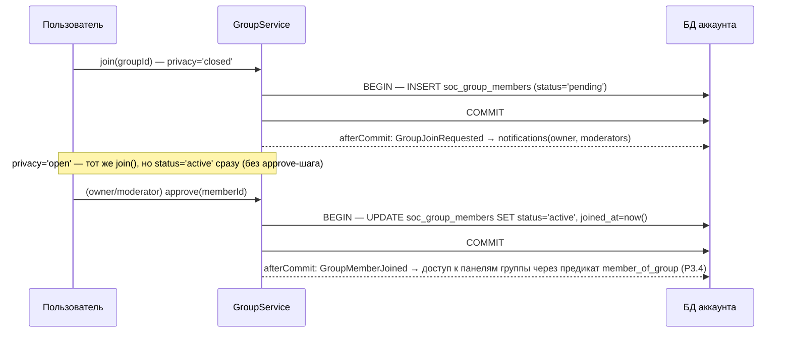
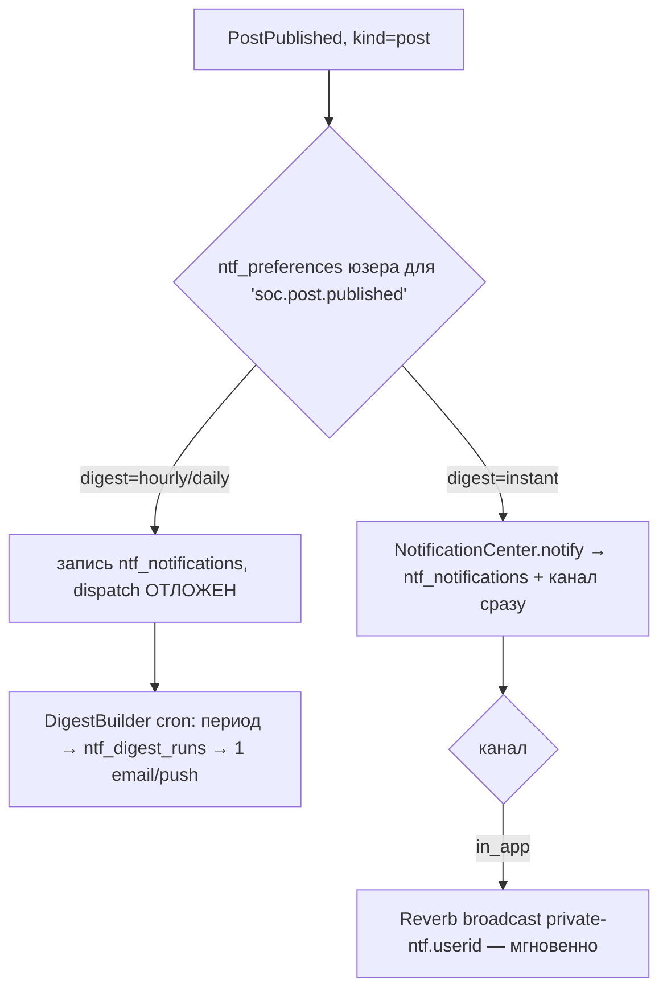
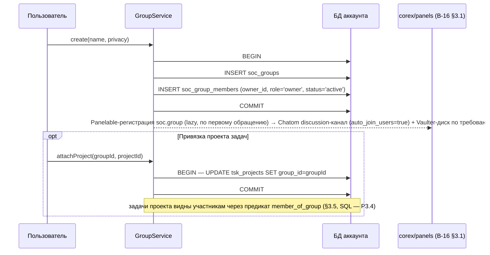

# B-28 — Соц-контур: корпоративная лента + рабочие группы (`soc_`)

> **Финал волны P3.1–P3.5** — слой решений FLEX-2 P2.2 (2026-07-12), глубина добрана срезами P3.x:
> БД-детали (индексы/партиции/edge-cases) — P3.1, детальные потоки — P3.2, полные
> сигнатуры контрактов — P3.3, SQL scope-предикатов и guard'ы — P3.4, AC/НФТ — P3.5.
> Вход: `05-Projects/01-Products/FlexCRM/plans/flex/20_research/R-25_social-feed-groups.md` (§4, §5, «→ входы B-28»).
> Канон-базис: B-16 §3.1 (PanelHost/Panelable), §6.5 (лента сделки = проекция, НЕ пересматривается),
> §2.6 (corex/notifications), §2.2 (форма `cht_reactions`/`cht_mentions`); B-11 §5.5 (scope-компиляция).
> Конвенции: PK = UUIDv7 (D12), префикс `soc_` (D4), `author` jsonb ACTOR — как `created_by` в B-13.

---

## 1. Границы и состав

**В модуле (новый пакет соц-контура, рабочее имя `corex/social`; vendor/нейминг открыт — B-02 §4 п.6):**
- Корпоративная лента: посты, объявления с подтверждением прочтения (ack), опросы, реакции, упоминания, закрепление (`soc_posts` + спутниковые таблицы).
- Read/ack-состояние per-message (`soc_post_reads`) — compliance-аудит «кто подтвердил».
- Рабочие группы: приватность open/closed/secret, роли owner/moderator/member, membership c заявками (`soc_groups`, `soc_group_members`).
- Группа как контейнер: регистрация `soc.group` как `Panelable` (Chatom-обсуждение, Vaulter-диск), аддитивная колонка `tsk_projects.group_id`.
- Scope-предикат `member_of_group` — видимость group-привязанных записей участникам группы (решение здесь, SQL-компиляция — P3.4).
- Специализация `corex/notifications`: типы событий `soc.post.published` (digestable) / `soc.post.ack_required` (non-digestible), `soc.mention`.

**Вне модуля (не гап, канон):**
- Лента СДЕЛКИ/CRM-сущностей — проекция `sys_audit_log`+`crm_tml` (B-16 §6.5, РЕШЕНО) — соц-лента её НЕ подменяет и НЕ дублирует.
- Комментарии к постам — Chatom `cht_channels type='comments'` через PanelHost (B-16 §2.2/§3.1), своей `soc_comments` нет.
- Доставка уведомлений — существующий `corex/notifications` (B-16 §2.6), нового движка нет.
- Файлы — `corex/media` (`med_files`, граница B-16 §6.4); диск группы — Vaulter-панель.
- Оргструктура — `sys_departments` (B-11 traceability, roadmap corex P1.10): лента её потребляет для адресации, не определяет.

**Зависимости:** corex/core (TenantContext, EntityRegistry B-10), corex/auth (AzGuard, `Extend\Permissions`), corex/panels (Panelable), corex/notifications, corex/media; потребители: corex/tasks (`group_id`), B-29 календарь (`owner_type='group'` — вход), chatom/core + vaulter/core (панели групп/постов).

## 2. Схема БД

> Срез P3.1: полный DDL (индексы, партиции, edge-cases, CHECK/COMMENT) — черновая пометка снята.

```sql
CREATE TABLE soc_posts (                    -- пост ленты: авторский контент со своим ЖЦ (НЕ audit-событие)
    id            uuid PRIMARY KEY,          -- UUIDv7 (D12) — time-sortable курсор ленты
    workspace_id  uuid,                      -- NULL = уровень аккаунта (вся компания)
    author        jsonb NOT NULL,            -- ACTOR (как created_by B-13)
    kind          varchar(16) NOT NULL DEFAULT 'post' CHECK (kind IN ('post','announcement','poll')),
    body          text NOT NULL,             -- raw
    body_html     text,                      -- rendered
    audience_type varchar(16) NOT NULL DEFAULT 'company'
                  CHECK (audience_type IN ('company','department','group','users')),
    audience_ref  jsonb,                     -- source of truth: department_id | group_id | user_ids[]; NULL при 'company'
    audience_department_id uuid REFERENCES sys_departments(id) ON DELETE CASCADE,  -- денормализация audience_ref для индексируемости (§3.4, P3.1) — пишется той же транзакцией, что audience_ref
    audience_group_id      uuid,             -- денормализация; FK добавлен ALTER'ом ниже (soc_groups объявлена позже по файлу)
    requires_ack  boolean NOT NULL DEFAULT false,         -- только kind='announcement' (governance, §3.11)
    ack_version   integer NOT NULL DEFAULT 1,             -- re-ack при существенной правке (§3.11)
    expires_at    timestamptz,               -- срок активности объявления
    pinned        boolean NOT NULL DEFAULT false,
    created_at    timestamptz NOT NULL DEFAULT now(),
    updated_at    timestamptz NOT NULL DEFAULT now(),
    edited_at     timestamptz,
    deleted_at    timestamptz,
    deleted_by_id uuid,
    CHECK (NOT requires_ack OR kind = 'announcement'),        -- governance-CHECK (§3.3 п.3)
    CHECK (audience_type <> 'department' OR audience_department_id IS NOT NULL),
    CHECK (audience_type = 'group' OR audience_group_id IS NULL)
);
CREATE INDEX soc_posts_feed_ix       ON soc_posts (workspace_id, pinned DESC, created_at DESC) WHERE deleted_at IS NULL;  -- запрос: лента workspace/аккаунта, закреплённые первыми
CREATE INDEX soc_posts_department_ix ON soc_posts (audience_department_id) WHERE audience_type = 'department' AND deleted_at IS NULL;
CREATE INDEX soc_posts_group_ix      ON soc_posts (audience_group_id) WHERE audience_type = 'group' AND deleted_at IS NULL;
CREATE INDEX soc_posts_audience_users_ix ON soc_posts USING GIN (audience_ref jsonb_path_ops) WHERE audience_type = 'users';  -- запрос: «посты, где явно указан я»
CREATE INDEX soc_posts_expiring_ix   ON soc_posts (expires_at) WHERE expires_at IS NOT NULL AND deleted_at IS NULL;  -- запрос: скрытие/уборка просроченных объявлений
COMMENT ON COLUMN soc_posts.audience_ref IS 'Источник истины адресации (department_id|group_id|user_ids[] в зависимости от audience_type). audience_department_id/audience_group_id — денормализация для индексируемого фильтра ленты (P3.1), пишутся атомарно с audience_ref в той же транзакции PostService';

CREATE TABLE soc_post_reads (               -- per-message read/ack (НЕ conversation-level, §3.3 / R-25 §3.1)
    id          uuid PRIMARY KEY,
    post_id     uuid NOT NULL REFERENCES soc_posts(id) ON DELETE CASCADE,
    user_id     uuid NOT NULL,
    read_at     timestamptz NOT NULL,
    ack_at      timestamptz,                 -- NULL = прочитано, не подтверждено
    ack_version integer,                     -- какая версия контента подтверждена
    UNIQUE (post_id, user_id)
);
CREATE INDEX soc_post_reads_user_ix        ON soc_post_reads (user_id, read_at DESC);       -- запрос: «мои прочитанные посты»
CREATE INDEX soc_post_reads_pending_ack_ix ON soc_post_reads (post_id) WHERE ack_at IS NULL;  -- запрос: AckService::pendingUsers — кто не подтвердил
COMMENT ON TABLE soc_post_reads IS
  'Partition-ready с первого дня по read_at (объём N×M: посты×сотрудники, паттерн cht_messages/crm_tml — Q7 Resolved). v1 — single-table; opt-in помесячные партиции pg_partman при высоком объёме (B-26 §3). FK ИЗ других таблиц НА soc_post_reads отсутствуют';

CREATE TABLE soc_reactions (                -- форма едина с cht_reactions (B-16 §2.2); таблица своя (§3.8)
    id         uuid PRIMARY KEY,
    post_id    uuid NOT NULL REFERENCES soc_posts(id) ON DELETE CASCADE,
    user_id    uuid NOT NULL,
    emoji      varchar(32) NOT NULL,
    created_at timestamptz NOT NULL DEFAULT now(),
    updated_at timestamptz NOT NULL DEFAULT now(),
    UNIQUE (post_id, user_id, emoji)
);                                           -- реакции на КОММЕНТАРИИ постов — cht_reactions (канал comments), не здесь (§3.2); UNIQUE(post_id,…) уже индекс для «реакции поста»

CREATE TABLE soc_mentions (                 -- форма едина с cht_mentions (B-16 §2.2); enum доменный (§3.8)
    id               uuid PRIMARY KEY,
    post_id          uuid NOT NULL REFERENCES soc_posts(id) ON DELETE CASCADE,
    mentionable_type varchar(24) NOT NULL CHECK (mentionable_type IN ('user','department','group','all')),
    mentionable_id   uuid,                   -- NULL для 'all'
    notified_at      timestamptz,            -- fan-out выполнен (corex/notifications)
    created_at timestamptz NOT NULL DEFAULT now(),
    updated_at timestamptz NOT NULL DEFAULT now(),
    CHECK (mentionable_type = 'all' OR mentionable_id IS NOT NULL)
);
CREATE INDEX soc_mentions_post_ix    ON soc_mentions (post_id);
CREATE INDEX soc_mentions_pending_ix ON soc_mentions (notified_at) WHERE notified_at IS NULL;  -- запрос: fan-out воркер уведомлений (паттерн cht_mentions_pending_ix)

CREATE TABLE soc_post_attachments (         -- по образцу cht_attachments (B-16 §2.2); добавка к R-25 §4.2 (§3.3)
    id          uuid PRIMARY KEY,
    post_id     uuid NOT NULL REFERENCES soc_posts(id) ON DELETE CASCADE,
    med_file_id uuid NOT NULL,               -- corex/media: med_files.id, БЕЗ FK (media-граница B-16 §6.4)
    kind        varchar(16) NOT NULL DEFAULT 'file' CHECK (kind IN ('file','image','video','audio')),
    created_at timestamptz NOT NULL DEFAULT now(),
    updated_at timestamptz NOT NULL DEFAULT now()
);
CREATE INDEX soc_post_attachments_post_ix ON soc_post_attachments (post_id);  -- запрос: вложения поста

CREATE TABLE soc_polls (                    -- опрос = модель, прикреплённая к посту kind='poll' (Viva-паттерн)
    id             uuid PRIMARY KEY,
    post_id        uuid NOT NULL UNIQUE REFERENCES soc_posts(id) ON DELETE CASCADE,
    question       varchar(500) NOT NULL,
    allow_multiple boolean NOT NULL DEFAULT false,
    is_anonymous   boolean NOT NULL DEFAULT false,
    closes_at      timestamptz,
    created_at timestamptz NOT NULL DEFAULT now(),
    updated_at timestamptz NOT NULL DEFAULT now()
);

CREATE TABLE soc_poll_options (
    id       uuid PRIMARY KEY,
    poll_id  uuid NOT NULL REFERENCES soc_polls(id) ON DELETE CASCADE,
    text     varchar(255) NOT NULL,
    position integer NOT NULL DEFAULT 0
);
CREATE INDEX soc_poll_options_poll_ix ON soc_poll_options (poll_id, position);  -- запрос: варианты опроса по порядку

CREATE TABLE soc_poll_votes (
    id        uuid PRIMARY KEY,
    poll_id   uuid NOT NULL REFERENCES soc_polls(id) ON DELETE CASCADE,
    option_id uuid NOT NULL REFERENCES soc_poll_options(id) ON DELETE CASCADE,
    user_id   uuid NOT NULL,
    voted_at  timestamptz NOT NULL DEFAULT now(),
    UNIQUE (option_id, user_id)
);
COMMENT ON TABLE soc_poll_votes IS
  'Инвариант «1 голос на poll при allow_multiple=false» — сервисный (PollService::vote проверяет soc_polls.allow_multiple в транзакции голосования), НЕ DB-constraint: allow_multiple живёт на родителе (soc_polls), кросс-табличный partial-unique в Postgres недостижим декларативно. UNIQUE(option_id,user_id) — DB-гарантия только «не дважды за один вариант»';

CREATE TABLE soc_groups (                   -- группа = соц-контейнер, НЕ AzGuard-роль (§3.5)
    id           uuid PRIMARY KEY,
    workspace_id uuid,                       -- NULL = уровень аккаунта
    name         varchar(255) NOT NULL,
    description  text,
    privacy      varchar(16) NOT NULL DEFAULT 'open' CHECK (privacy IN ('open','closed','secret')),  -- видимость = производная (§3.3)
    is_archived  boolean NOT NULL DEFAULT false,
    owner_id     uuid NOT NULL,              -- users.id
    meta         jsonb NOT NULL DEFAULT '{}',
    created_at timestamptz NOT NULL DEFAULT now(),
    updated_at timestamptz NOT NULL DEFAULT now(),
    deleted_at timestamptz
);
CREATE INDEX soc_groups_ws_ix ON soc_groups (workspace_id) WHERE deleted_at IS NULL AND NOT is_archived;  -- запрос: каталог активных групп

-- Достраиваем денормализацию soc_posts.audience_group_id (миграционный порядок: soc_groups после soc_posts, §9 п.7 / S1 «миграционный порядок»)
ALTER TABLE soc_posts ADD CONSTRAINT soc_posts_audience_group_fk
  FOREIGN KEY (audience_group_id) REFERENCES soc_groups(id) ON DELETE CASCADE;
-- CASCADE (не SET NULL, в отличие от tsk_projects.group_id ниже): пост адресован ГРУППЕ как
-- единственной аудитории — SET NULL нарушил бы CHECK(audience_type='group' → audience_group_id NOT NULL);
-- на практике GroupService::archive() — soft-delete (deleted_at), CASCADE срабатывает только на hard-delete группы

CREATE TABLE soc_group_members (            -- membership-факт: чистая many-to-many (Slack-паттерн R-25 §2.4)
    id         uuid PRIMARY KEY,
    group_id   uuid NOT NULL REFERENCES soc_groups(id) ON DELETE CASCADE,
    user_id    uuid NOT NULL,
    role       varchar(16) NOT NULL DEFAULT 'member' CHECK (role IN ('owner','moderator','member')),  -- 3 роли (§3.3)
    status     varchar(16) NOT NULL DEFAULT 'active' CHECK (status IN ('active','pending','invited')),  -- pending = заявка в closed
    expires_at timestamptz,                  -- закладка v1.1: внешний гость по паттерну Vaulter (§3.10), v1 не используется
    joined_at  timestamptz,
    created_at timestamptz NOT NULL DEFAULT now(),
    updated_at timestamptz NOT NULL DEFAULT now(),
    UNIQUE (group_id, user_id)
);
CREATE INDEX soc_group_members_user_ix     ON soc_group_members (user_id, status) WHERE status = 'active';  -- запрос: предикат member_of_group (P3.4) — «в каких группах активен пользователь»
CREATE INDEX soc_group_members_pending_ix  ON soc_group_members (group_id) WHERE status = 'pending';        -- запрос: очередь заявок owner/moderator
CREATE INDEX soc_group_members_expiring_ix ON soc_group_members (expires_at) WHERE expires_at IS NOT NULL;  -- запрос: TTL-свип истёкших гостевых грантов (v1.1)

-- Аддитивная дельта к канону B-13 §2.5 (существующий DDL не переопределяется).
-- Классификация подтверждена арбитражем P4.2 (D-006, критерий (а) — Q73): чисто-структурная
-- plumbing-колонка (nullable FK, ON DELETE SET NULL), не задевающая семантику/механику/деньги
-- → допустима IN-PLACE декларацией расширяющего модуля, без маршрута КАНДИДАТ/арбитраж.
ALTER TABLE tsk_projects ADD COLUMN group_id uuid REFERENCES soc_groups(id) ON DELETE SET NULL;
COMMENT ON COLUMN tsk_projects.group_id IS
  'NULL = обычный проект; NOT NULL = проект группы: видимость через предикат member_of_group (B-28 §3.5, SQL — P3.4). ON DELETE SET NULL: удаление группы не должно удалять/блокировать проект, только развязывает видимость';
CREATE INDEX tsk_projects_group_ix ON tsk_projects (group_id) WHERE group_id IS NOT NULL;  -- запрос: проекты группы (§5 поток 5)
```

## 3. Ключевые архитектурные решения

> Каждое решение — со ссылкой на R-25; отступления от рекомендаций — с обоснованием (финал P3.1–P3.5).

### 3.1 Вход 1 — Лента = отдельная `soc_posts`, НЕ `crm_tml`/audit-проекция — **ПРИНЯТО** (R-25 §4.1)

Авторский контент со своим жизненным циклом (редактирование, ack, опросы) ≠ системные события записи. Канон B-16 §6.5 (лента сделки = проекция) не пересматривается — он остаётся за CRM-сущностями; смешение доменов сломало бы partition/retention-модель `crm_tml` (B-13 §2.4). Консистентно Viva Engage (messages ≠ audit log) и Б24 (Живая лента ≠ timeline сделки).

### 3.2 Вход 2 — Комментарии к посту через Chatom PanelHost — **ПРИНЯТО** (R-25 §4.1)

`soc_posts` регистрируется в EntityRegistry как `soc.post` и реализует `Panelable` (B-16 §3.1); Chatom создаёт `cht_channels type='comments', panelable_type='soc.post'` при первом обращении. Отдельной `soc_comments` нет — экономится целый домен. Следствие (уточнение драфта): **реакции и упоминания в комментариях живут в `cht_reactions`/`cht_mentions`** (это cht_messages); `soc_reactions`/`soc_mentions` — только на сам пост. Двусмысленность `post_id/comment_ref` из эскиза R-25 §4.2 снята.

### 3.3 Вход 3 — DDL-скелет `soc_` — **ПРИНЯТО с дополнениями** (R-25 §4.2)

Набор R-25 §4.2 принят полностью. Дополнения драфта (аддитивные, в рамках Т1/входа 8):
1. `soc_mentions` — упоминания в постах требуют носителя (R-25 §4.7 фиксирует форму, но таблица в эскизе §4.2 отсутствовала); форма = `cht_mentions`, enum доменный (`user|department|group|all` — `here` бессмысленно вне realtime-канала).
2. `soc_post_attachments` — посты с файлами (Т1) по образцу `cht_attachments`: `med_file_id` без FK (media-граница B-16 §6.4).
3. Governance-CHECK: `requires_ack=true` допустим только при `kind='announcement'` (см. §3.11) — точный констрейнт P3.1.
4. Упрощения против Б24 приняты: видимость = производная от `privacy` (secret не видна не-участникам по определению, отдельного флага нет), ролей три (owner/moderator/member, без «помощника»), `is_archived` — ортогональный флаг (R-25 §3.2).

### 3.4 Вход 4 — Адресация `audience_type`+`audience_ref`, без подписочной таблицы — **ПРИНЯТО** (R-25 §4.3)

`company` = все сотрудники аккаунта без ref; `department` — по `sys_departments`; `group` — по `soc_groups`; `users` — явный список. Отдельная таблица «подписки на компанию» не вводится. Материализация `audience_ref` в индексируемую колонку (например, `audience_group_id`) — решение среза P3.1, если план запросов ленты этого потребует.

### 3.5 Вход 5 — Группа = membership-факт + scope-предикат `member_of_group`, НЕ AzGuard-роль — **ПРИНЯТО с уточнением механики** (R-25 §4.4)

Роль в группе (owner/moderator/member) — доменный факт `soc_group_members`, не роль AzGuard (вывод R-08 §2.6 «иерархия ролей не нужна» сохраняется). Уточнение драфта: `member_of_group` — это НЕ новая ось `aut_role_matrix` (таблица компиляции B-11 §5.5 не расширяется), а **сужающий предикат контейнера**, накладываемый поверх базового scope на group-привязанные записи — аналогично workspace-скоупу B-11 §5.4 п.5: `group_id IS NULL ∨ EXISTS(soc_group_members active)`. SQL-компиляция, взаимодействие с max-scope-wins и статус относительно канона B-11 (аддитивное расширение резолвера vs дельта) — срез P3.4 (заведён Q45; если P3.4 признает дельтой канона — арбитраж P4.2 по D11).

### 3.6 Вход 6 — Группа как контейнер: существующие механизмы, НЕ новая иерархия — **ПРИНЯТО** (R-25 §4.5)

- `tsk_projects.group_id` (nullable FK) — аддитивная дельта B-13 §2.5 (§2 выше).
- `cal_calendars.owner_type='group'` — вход для B-29 (P2.3), зеркальная пометка: календарный драфт обязан предусмотреть группу как владельца календаря.
- `soc.group` = `Panelable`: Chatom-панель обсуждения (`type='discussion'`, `auto_join_users=true` — участники группы) и Vaulter-диск группы — через существующий PanelHost-контракт B-16 §3.1; gate 1 для панелей группы = членство (secret: не-участник не проходит gate 1).

### 3.7 Вход 7 — Digest/realtime = специализация `corex/notifications` — **ПРИНЯТО** (R-25 §4.6)

Новых движков нет. Типы событий (в `ntf_notifications.type` / `ntf_preferences.event_type`, B-16 §2.6):
- `soc.post.published` — обычный пост: digestable по пользовательским предпочтениям (`ntf_preferences.digest`).
- `soc.post.ack_required` — объявление с `requires_ack=true`: non-digestible на уровне ТИПА события — in-app всегда, email/push по каналам пользователя, digest-настройка его не подавляет (аналогия B-16 AC-14).
- `soc.mention` — упоминание в посте (fan-out через `soc_mentions.notified_at`, как `cht_mentions`).
Механика enforcement в `DigestBuilder`/`NotificationRouter` — P3.2/P3.3.

### 3.8 Вход 8 + Q5 — Реакции/меншены: пер-модульные таблицы единой формы; единая polymorphic `rct_reactions` — **ОТКЛОНЕНА в v1** (R-25 §4.7, §5.1)

Развилка драфт-уровня, решается здесь (Q5). Trade-off:

| Критерий | (a) Единая `rct_reactions` (polymorphic reactable_type/id) | (b) Пер-модульные таблицы единой формы (`cht_reactions` + `soc_reactions`) — ВЫБРАНО |
|---|---|---|
| Дублирование | нет DDL-дублей | две маленькие таблицы одной формы (низкая цена) |
| Целостность | polymorphic — БЕЗ FK, мусор при удалении хозяина чистится вручную | жёсткий FK + ON DELETE CASCADE на своего хозяина |
| Канон | требует миграции `cht_reactions` → ревизия утверждённого B-16 §2.2 (эскалация, самовольно не правим) | канон B-16 нетронут |
| Границы пакетов | новый micro-пакет-владелец `rct_` + кросс-модульная зависимость chatom↔social | каждый модуль владеет своей таблицей (mod_records purge предсказуем, B-10) |
| Масштаб/партиции | горячие реакции чата и ленты в одной таблице — партиционировать сложнее | независимые профили роста |
| UI/UX переиспользование | достигается и так | достигается КОНТРАКТОМ: единая форма таблиц + общий интерфейс (эмодзи-пикер/меншен-автокомплит пишутся один раз) |

Решение: **(b)** — прямое применение вывода R-08 §2.3 «переиспользовать контракты, не таблицы» и формулировки входа 8 («не polymorphic на первом шаге»). Унификация — на уровне capability `reactable` (по аналогии с commentable/documentable B-10 §4.2) и общего контракта `ReactionService`; форма контракта — срез P3.3. Предварительное «да» из R-25 §5.1 отклонено: выигрыш дедупликации не окупает ревизию канона B-16 + потерю FK-целостности. Q5 → Resolved (ревизия B-16 НЕ требуется).

### 3.9 Вход 9 — Открытые вопросы R-25 §5 разобраны — **ПРИНЯТО**

Все четыре пункта: п.1 (Q5) — решён в §3.8; п.2 (Q6) — решён в §3.10; п.3 (Q7, партиционирование `soc_post_reads`) — срез P3.1, позиция драфта: partition-ready с первого дня по паттерну `cht_messages`; п.4 (Q8, автоэскалация) — v1.1, подтверждено в §3.11. Реестр — §9.

### 3.10 Q6 — Внешние гости в secret-группах: v1 — НЕТ, закладка в схеме, активация v1.1 по паттерну Vaulter — **решение драфта** (R-25 §5.2)

В v1 участники групп — только пользователи аккаунта. Общей модели «внешний гость» на уровне identity в волне нет (B-34 — про кросс-БД identity сотрудников, не гостей). Закладка: `soc_group_members.status='invited'` + `expires_at` (TTL-семантика Vaulter-грантов B-16 §5.4 / `cht_memberships.expires_at`). При активации v1.1 — переиспользовать гостевой паттерн Vaulter (`source='manual'`, strict-expansive), не изобретать новый.

### 3.11 Compliance-объём v1: `requires_ack` + `ack_version` + `expires_at`; criticality-градация — НЕ в v1 — **решение драфта** (R-25 §2.5, Code Guidance P2.2)

Из compliance-паттерна R-25 §2.5 в v1 входят: флаг `requires_ack` (governance: только `kind='announcement'` и только с правом публикации в компанию/отдел), `ack_version` (повторное подтверждение при существенной правке), `expires_at`, отчёт автору «кто подтвердил/не подтвердил» (per-message `soc_post_reads`). НЕ входят в v1: 4-уровневая градация `criticality` (informational/relevant/critical/mandatory — избыточна для Б24-паритета, kind+requires_ack покрывают кейс; закладка колонки — на срезе P3.1 при желании, не решение), автоэскалация руководителю по SLA (v1.1, Q8 — зависимость на иерархию `sys_departments`). Политика re-ack: bump `ack_version` — явное действие автора при редактировании («запросить повторное подтверждение»), НЕ автоматический на каждый edit (иначе шум); правки-опечатки не сбрасывают подтверждения.

### 3.12 Governance публикации и модерации — permission keys AzGuard — **решение драфта** (формат B-11 §5.5, паттерн Q1/B-27 §3.2)

Через `Extend\Permissions`, формат `{module}.{entity}.{action}`: `soc.post.create` (в группу — членство + право), `soc.post.publish_company` (компания/отдел; оно же — governance-гейт `requires_ack`), `soc.post.moderate` (чужие посты: pin/удаление), `soc.group.create`, `soc.group.manage` (настройки/состав — плюс доменная роль owner/moderator внутри группы). Scope-ось v1 = workspace/account (`soc_posts`/`soc_groups` не ownable — авторство ≠ owner_id-владение). Детальные guard'ы и матрица «доменная роль группы × permission» — срез P3.4.

### 3.13 Права: SQL-компиляция `member_of_group`, матрица доменная-роль×permission, guard анонимных опросов (Q45 — срез P3.4)

> Срез P3.4: SQL-компиляция нового scope-предиката + guard'ы — черновая пометка снята для права-подраздела.

**Q45 (SQL-компиляция `member_of_group`, статус относительно канона) — решено здесь.** Предикат реализуется НЕ как новая строка в таблице компиляции scope B-11 §5.5 (которая осталась нетронутой — `none/own/dept/dept_tree/workspace/account`), а как **аддитивный Eloquent global scope**, регистрируемый модулем `corex/social` на моделях с колонкой контейнера-группы (`tsk_projects.group_id`, `soc_posts.audience_group_id` при `audience_type='group'`, `cal_calendars` при `owner_type='group'` — B-29 §3.2), по прямой аналогии с global scope workspace (B-11 §5.4 п.5: «все Eloquent-запросы workspace_scoped-сущностей получают global scope `workspace_id = ctx OR IS NULL`» — тот же механизм уровня Eloquent-модели, не уровня `ScopeResolver::apply()`/`Scope`-enum). Компилируемый SQL (накладывается ПОВЕРХ уже выданного `ScopeResolver::apply()` — AND, не замена):

```sql
-- group-контейнер NULL (не group-scoped запись) ИЛИ пользователь активный член группы
WHERE (group_id IS NULL OR group_id IN (
  SELECT group_id FROM soc_group_members
  WHERE user_id = :userId AND status = 'active'
))
```
(для `soc_posts` — колонка `audience_group_id` вместо `group_id`; предикат действует только при `audience_type='group'`, иначе `audience_group_id IS NULL` и ветка тривиальна).

**Статус относительно канона B-11 (Q45 п.2): аддитивное расширение резолвера, НЕ дельта.** Обоснование: (1) `Scope`-enum (§3.3 B-11) и таблица компиляции §5.5 не редактируются — весов/значений scope не добавляется; (2) механизм идентичен уже существующему прецеденту (workspace global scope) — не новый класс механики; (3) `max-scope-wins` (несколько ролей → max по базовым строкам) не задет — предикат `member_of_group` работает ПОСЛЕ разрешения конфликта ролей, как дополнительное сужение (аналог workspace-скоупа, который тоже накладывается независимо от роли). Secret-группы: видимость самой группы уже гейтится membership на уровне `GroupService`/panel gate 1 (B-28 §3.6) — предикат `member_of_group` для проектов/календарей — производная той же проверки, не отдельная модель. Q45 → Resolved (не требует арбитража).

**Матрица «доменная роль группы (owner/moderator/member) × permission keys `soc.*`»:**

| Permission key | Scope | Кто проверяет | Доменная роль-эскалация (gate2-паттерн B-16 §3.1) |
|---|---|---|---|
| `soc.group.create` | workspace/account | AzGuard capability (любой сотрудник с правом) | — (группы ещё нет) |
| `soc.group.manage` | workspace/account | `AccessChecker::allowed` ИЛИ доменная роль `owner` группы (гибрид, паттерн Q1/B-27 §3.2: `group.owner_id = principal.userId ∨ permission soc.group.manage`) | owner повышает без глобального права (self-service) |
| `soc.post.moderate` (pin/удалить чужой) | workspace/account (глобально) ИЛИ группа (локально) | `AccessChecker::allowed(soc.post.moderate)` ∨ (`post.audience_type='group'` ∧ `GroupMembership::roleOf(user,group) IN ('owner','moderator')`) | group owner/moderator модерируют посты СВОЕЙ группы без глобального права — расширение, не сужение (аналогия panel gate2, B-16 §3.1) |
| `soc.post.create` (в группу) | membership (не permission-scope) | `GroupMembership::isMember()` — членство ДОСТАТОЧНО (не требует отдельного `soc.post.create`, кроме company/department-адресации — там `soc.post.publish_company`) | — |
| `soc.group.moderate` (approve/reject заявок) | доменная роль | `role IN ('owner','moderator')` записи `soc_group_members` (не AzGuard permission — доменный факт, канон §3.5 «НЕ AzGuard-роль») | — |

**Guard анонимных опросов** (`is_anonymous=true`) — решено здесь: анонимность АБСОЛЮТНА, ни одна роль (автор поста, `soc.post.moderate`, group owner/moderator) не снимает маскирование голосующих в `PollService::results()`; только агрегаты (`tally`, `totalVotes`) возвращаются всегда. Обоснование: анонимный опрос — договор с голосующим сотрудником, а не право автора на раскрытие — снятие анонимности правом модератора создало бы скрытый бэкдор, ломающий продуктовое обещание. Кандидат в safety-инварианты P3.5: «is_anonymous=true → voterIds никогда не покидают `PollService`, независимо от вызывающего принципала».

## 4. Контракты

> Срез P3.3: полные PHP-интерфейсы (@api, PHPStan level 8, форма B-16 §3), capability `reactable`
> (Q5 P3.3-порция), реестр событий и MCP-карта — черновая пометка снята.

```php
namespace Corex\Social;

use Corex\Auth\Actor;
use Corex\Auth\Principal;

enum AudienceType: string { case Company = 'company'; case Department = 'department'; case Group = 'group'; case Users = 'users'; }
enum GroupPrivacy: string { case Open = 'open'; case Closed = 'closed'; case Secret = 'secret'; }
enum GroupMemberRole: string { case Owner = 'owner'; case Moderator = 'moderator'; case Member = 'member'; }

/** readonly, id+type+display — единая форма внутри волны (не идентична ChannelRef B-16 §3.2: там enum ChannelType, без display, + panelableType/panelableId/workspaceId) */
final readonly class PostRef
{
    public function __construct(public string $id, public string $type /* 'soc.post' */, public string $display /* превью body */) {}
}
final readonly class GroupRef
{
    public function __construct(public string $id, public string $type /* 'soc.group' */, public string $display /* name */) {}
}
final readonly class PollRef
{
    public function __construct(public string $id, public string $postId, public bool $isAnonymous) {}
}

final readonly class PublishInput
{
    public function __construct(
        public string $kind /* post|announcement|poll */, public string $body,
        public AudienceType $audienceType, public ?string $audienceRef = null /* department_id|group_id|user_ids[] JSON */,
        public bool $requiresAck = false, public ?\DateTimeImmutable $expiresAt = null, public bool $pinned = false,
    ) {}
}

final readonly class AckReport
{
    /** @param list<string> $pendingUserIds */
    public function __construct(public string $postId, public int $ackVersion, public array $pendingUserIds, public int $totalAudience) {}
}

final readonly class FeedFilter
{
    public function __construct(
        public ?AudienceType $projection = null /* company|department|group|mentions — Viva-паттерн §2.3 */,
        public ?string $groupId = null, public ?string $cursor = null, public int $limit = 30,
    ) {}
}

/** @param list<PostRef> $items курсор-пагинация UUIDv7 (soc_posts_feed_ix) */
final readonly class FeedPage
{
    public function __construct(public array $items, public ?string $nextCursor) {}
}

/** @param array<string,int> $tally optionId => votes; голосовавшие не раскрываются при is_anonymous (guard P3.4) */
final readonly class PollResults
{
    public function __construct(public array $tally, public int $totalVotes, public bool $isAnonymous) {}
}

/** Governance-нарушение: requires_ack на kind ≠ announcement, или публикация в компанию/отдел без права (§3.11/§3.12) */
final class PostGovernanceException extends \DomainException {}

interface PostService
{
    /** @throws PostGovernanceException — CHECK-инвариант §2/§3.11 (requires_ack только на announcement) */
    public function publish(PublishInput $input, Actor $actor): PostRef;
    public function edit(string $postId, string $body, Actor $actor): void;
    public function pin(string $postId, bool $pinned, Actor $actor): void;   // требует soc.post.moderate на чужом посте
    public function delete(string $postId, Actor $actor): void;              // soft-delete
    /** Явное действие автора — bump ack_version, повторный fan-out (§3.11) */
    public function requestReAck(string $postId, Actor $actor): void;
}

interface FeedQuery
{
    /** Один поток данных, разные проекции company|department|group|mentions (Viva-паттерн §2.3) */
    public function feedFor(Principal $principal, FeedFilter $filter): FeedPage;
}

interface AckService
{
    public function acknowledge(string $postId, string $userId): void;   // UPSERT soc_post_reads, идемпотентно
    /** @return list<string> userId — источник soc_post_reads_pending_ack_ix */
    public function pendingUsers(string $postId): array;
    public function ackReport(string $postId): AckReport;
}

interface PollService
{
    /** @param list<string> $optionIds — 1|N в зависимости от allow_multiple */
    public function vote(string $pollId, array $optionIds, string $userId): void;
    public function results(string $pollId): PollResults;   // is_anonymous=true → только агрегаты (guard — P3.4)
}

/** Единый контракт реакций поста и комментария (§3.8): форма едина с cht_reactions, таблицы раздельны */
interface ReactionService
{
    public function react(string $reactableType /* 'soc.post'|'cht.message' */, string $reactableId, string $userId, string $emoji): void;
    public function unreact(string $reactableType, string $reactableId, string $userId, string $emoji): void;
    /** @return array<string,int> emoji => count */
    public function summary(string $reactableType, string $reactableId): array;
}

interface GroupService
{
    public function create(string $name, GroupPrivacy $privacy, Actor $actor): GroupRef;
    public function archive(string $groupId, Actor $actor): void;   // soft-delete; не CASCADE hard-delete soc_posts.audience_group_fk (§2)
    /** open → status=active сразу; closed → status=pending (флоу 5.2) */
    public function join(string $groupId, string $userId): void;
    public function approve(string $memberId, Actor $actor): void;
    public function reject(string $memberId, Actor $actor): void;   // DELETE pending-строки (не soft-delete)
    public function leave(string $groupId, string $userId): void;
    public function setRole(string $memberId, GroupMemberRole $role, Actor $actor): void;
}

/** Источник предиката `member_of_group` (P3.4) */
interface GroupMembership
{
    public function isMember(string $userId, string $groupId): bool;
    /** @return list<GroupRef> */
    public function groupsOf(string $userId): array;
}
```

### 4.1 Capability `reactable` — форма контракта (Q5 P3.3-порция — решено здесь)

По решению P2.2 §3.8 (Q5 → Resolved: пер-модульные таблицы единой формы, ревизия B-16 не
требуется): унификация реакций поста и комментария живёт на уровне capability, аналогично
`commentable`/`documentable` (B-10 §4.2), а не общей таблицы. `EntityRegistry`-декларация
`soc.post` несёт capability `reactable`; `ReactionService` (выше) — единая точка вызова UI/API/MCP
поверх ДВУХ носителей (`soc_reactions` для постов, `cht_reactions` для комментариев PanelHost) —
диспетчеризация по `$reactableType` внутри реализации, не по интерфейсу. Emoji-пикер (UI) и
`soc.vote_poll`-подобные MCP-тулзы пишутся один раз против интерфейса, не против таблицы. Q5
(P3.3-порция) → Resolved.

### 4.2 Реестр доменных событий (полная карта — сверка уникальности §9 S3)

| Событие | `name()` | Payload | Эмитент | Подписчики |
|---|---|---|---|---|
| `PostPublished` | `soc.post.published` | postId, requiresAck, audienceType | PostService | notifications (fan-out §5.1) |
| `PostAcknowledged` | `soc.post.acknowledged` | postId, userId | AckService | — (ackReport read-side) |
| `PostMentioned` | `soc.post.mentioned` | mentionId, postId, mentionableType, mentionableId | PostService (парсинг body) | notifications (fan-out по `soc_mentions.notified_at`) |
| `PollVoted` | `soc.poll.voted` | pollId, userId | PollService | — |
| `GroupCreated` | `soc.group.created` | groupId, actor | GroupService | corex/panels (lazy-регистрация) |
| `GroupJoinRequested` | `soc.group.join_requested` | groupId, userId | GroupService (closed) | notifications(owner, moderators) |
| `GroupMemberJoined` / `Left` | `soc.group.member_joined` / `.member_left` | groupId, userId | GroupService | доступ к панелям группы (предикат `member_of_group`) |

Уникальность имён (сверка §9 S3): все `soc.*` — новые, коллизий с канонными `crm.*`/`tsk.*`
(B-13 §3.7), `pnl./cht./vlt./med./ntf.` (B-16 §3) и `cht.reaction_added/removed` (эмитируются
`cht_reactions`-путём, не `soc_`) нет.

Все события несут `TenantContext` (B-10 §3.1). Регистрация `soc.post`/`soc.group` как
`Panelable` — через corex/panels (B-16 §3.1), собственного `PanelHost` модуль НЕ реализует
(панели дают Chatom/Vaulter).

## 5. Главные потоки

> Срез P3.2: детальные sequence/flowchart + транзакционные границы (снята черновая пометка).
> afterCommit-события — стиль B-16 §5.2; чтение через `TimelineWriter` не применимо (соц-лента —
> отдельный ЖЦ, §3.1) — свой fan-out через `corex/notifications`.

### 5.1 Публикация объявления → ack-цикл (кросс-модульный сценарий волны №2: B-28×B-16 ntf)

> Атрибуция: первичная спека — **B-28** (жизненный цикл поста/ack); механика digest/preference —
> ссылка на канон B-16 §5.6 (flowchart mention→digest), НЕ дублируется, только специализация
> типами событий (§3.7).

```mermaid
sequenceDiagram
  participant A as Автор (soc.post.publish_company)
  participant PS as PostService
  participant DB as БД аккаунта
  participant Q as afterCommit-очередь
  participant NTF as corex/notifications (B-16 §5.6)
  participant U as Адресат (пользователь)
  A->>PS: publish(kind='announcement', requires_ack=true, audience)
  PS->>DB: BEGIN
  PS->>DB: INSERT soc_posts (audience_department_id/audience_group_id денормализованы атомарно с audience_ref)
  PS->>DB: COMMIT
  PS-->>Q: PostPublished{postId, requiresAck=true}
  Q->>NTF: fan-out ЧАНКАМИ по M адресатам аудитории (Q46 — поток): тип события `soc.post.ack_required`
  Note over NTF: `ack_required` — non-digestible НА УРОВНЕ ТИПА события (канон B-16 §5.6 flowchart: preference=digest игнорируется этим типом) — in-app всем немедленно, email/push по каналам пользователя
  NTF->>NTF: Reverb broadcast private-ntf.{user_id} (in-app, канон B-16 §5.6)
  Note over Q: `soc_post_reads`-строки НЕ создаются при публикации (лениво — только по факту открытия/ack, Q46-позиция); fan-out — только ntf, не reads
  U->>PS: acknowledge(postId, userId) — пользователь жмёт «Подтвердить»
  PS->>DB: BEGIN — UPSERT soc_post_reads (post_id,user_id) SET ack_at=now(), ack_version=posts.ack_version
  PS->>DB: COMMIT
  PS-->>Q: PostAcknowledged{postId, userId}
  A->>PS: ackReport(postId) — read: soc_post_reads_pending_ack_ix
  opt Существенная правка контента
    A->>PS: requestReAck(postId) — явное действие автора
    PS->>DB: BEGIN — UPDATE soc_posts SET ack_version = ack_version+1
    PS->>DB: COMMIT
    PS-->>Q: fan-out `soc.post.ack_required` ПОВТОРНО только неподтвердившим новую версию (ack_version сравнение в §7.6)
  end
```

Fan-out М-адресатов — асинхронной очередью чанками (Q46, позиция драфта закреплена здесь): вставка `ntf_notifications` идёт пачками (batch size — порог P3.5), не одним INSERT на M строк; `soc_post_reads` не материализуется заранее (при публикации нулевая запись per адресат была бы M лишних строк для тех, кто никогда не откроет пост) — строка создаётся ПЕРВЫМ обращением пользователя (upsert на `read_at`, `ack_at` — только по явному подтверждению). Ошибка/откат: правка `is_anonymous`/`requires_ack` после публикации запрещена (не в Scope §3.11 — CHECK `requires_ack` действует только на INSERT); повторный `acknowledge` того же пользователя — идемпотентный UPSERT (не дублирует строку, `UNIQUE(post_id,user_id)`).

### 5.2 Заявка в closed-группу



`reject(memberId)` — симметрично: `DELETE` pending-строки (не soft-delete — заявка не сущность с ЖЦ) + уведомление отклонённому.

### 5.3 Digest-доставка обычных постов

Ссылка на канон B-16 §5.6 (flowchart) без дельты — специализация только типом события:



### 5.4 Опрос

```mermaid
sequenceDiagram
  participant U as Пользователь
  participant PS as PollService
  participant DB as БД аккаунта
  U->>PS: vote(pollId, optionIds[])
  PS->>DB: BEGIN
  PS->>DB: SELECT soc_polls.allow_multiple FOR UPDATE (сервисный инвариант single-choice, §2 COMMENT)
  PS->>DB: INSERT soc_poll_votes × 1|N (UNIQUE(option_id,user_id) — не дважды за вариант)
  PS->>DB: COMMIT
  PS-->>DB: afterCommit: PollVoted{pollId, userId}
  U->>PS: results(pollId) — read; is_anonymous=true → только агрегаты, голосовавшие не раскрываются (guard — P3.4)
```

`closes_at` прошёл → `vote()` отклоняется до транзакции (валидация вне БД-записи).

### 5.5 Группа-как-контейнер



---

## 6. Интеграции (матрица доменов)

| Домен / канон | Что берёт B-28 | Что отдаёт |
|---|---|---|
| corex/panels (B-16 §3.1) | Panelable-контракт | регистрация `soc.post` (comments), `soc.group` (discussion + drive) |
| chatom/core (B-16 §2.2) | comments/discussion-каналы, cht_reactions/cht_mentions для комментариев | panelable-хозяева; форма reactions/mentions едина (§3.8) |
| vaulter/core (B-16 §2.4/§5.4) | drive-панель группы; гостевой паттерн (v1.1, §3.10) | panelable-хозяин `soc.group` |
| corex/notifications (B-16 §2.6) | ntf_notifications/preferences/DigestBuilder | типы `soc.post.published` / `soc.post.ack_required` (non-digestible) / `soc.mention` |
| corex/media (B-16 §2.5) | med_files по `med_file_id` без FK (граница §6.4) | `soc_post_attachments` — использование файла (уч. при удалении, B-16 §5.5) |
| corex/tasks (B-13 §2.5, B-27) | — | аддитивная `tsk_projects.group_id` (§2) |
| B-29 календарь (P2.3) | — | вход: `cal_calendars.owner_type='group'` (§3.6, зеркальная пометка) |
| corex/auth B-11 (§4/§5.5) | permission keys `soc.*` (Extend\Permissions), scope-резолвер | предикат `member_of_group` (Q45 → P3.4) |
| corex/core B-10 | EntityRegistry (`soc.post`, `soc.group`), события, capability `reactable` (предложение, P3.3) | mod_records-реестр владения `soc_*` |
| sys_departments (B-11 traceability) | адресация `audience_type='department'`; эскалация ack v1.1 | — |

## 7. MCP-тулзы — финальная карта (byte-в-byte с B-32 §7.3)

> Срез P3.3: нейминг `module.verb_noun` — черновая пометка снята; дополнено `soc.get_post` /
> `soc.publish_announcement` / `soc.create_poll` / `soc.add_comment` (эскиз P2.2 их не перечислял,
> консолидация B-32 §7.3 добавила — дедуп-сверка «карта B-32 = сумма пер-модульных перечней»).

| Тулза | side_effect | Суть |
|---|---|---|
| `soc.list_feed` / `soc.get_post` | read | лента / пост+комментарии+реакции |
| `soc.publish_post` | write | пост в ленту/группу |
| `soc.publish_announcement` | write (high) | объявление с requires_ack (иной stake — compliance R-25) |
| `soc.acknowledge_post` | write | подтверждение прочтения |
| `soc.get_ack_report` | read | кто не подтвердил |
| `soc.create_poll` / `soc.vote_poll` / `soc.get_poll_results` | write / write / read | опросы |
| `soc.add_comment` | write | комментарий (Chatom PanelHost) |
| `soc.create_group` / `soc.join_group` | write | группы (заявка в closed — поток §5.2) |
| `soc.list_groups` / `soc.list_group_members` | read | группы + membership (ACL B-11 — N7) |

JSON Schema (образец, `write (high)`):

```json
{
  "soc.publish_announcement": {
    "type": "object",
    "properties": {
      "body": { "type": "string" },
      "audience_type": { "type": "string", "enum": ["company", "department", "group", "users"] },
      "audience_ref": { "type": "string" },
      "expires_at": { "type": "string", "format": "date-time" }
    },
    "required": ["body", "audience_type"],
    "additionalProperties": false
  }
}
```

## 8. НФТ, лимиты и Acceptance Criteria

> Срез P3.5: перфоманс-бюджеты, квоты `root_plans.limits`, edition-гейтинг, safety-инварианты
> и AC финализированы — черновая пометка снята.

### 8.1 Производительность

| Запрос | Бюджет | Механизм |
|---|---|---|
| Лента workspace/account (50 постов, закреплённые первыми) | p95 ≤ 100 мс | `soc_posts_feed_ix` |
| «Кто не подтвердил» (ackReport) | p95 ≤ 100 мс | `soc_post_reads_pending_ack_ix` |
| Fan-out воркер упоминаний | throughput батчами, не hot-path | `soc_mentions_pending_ix` |
| Голос/результаты опроса | p95 ≤ 50 мс | `UNIQUE(option_id,user_id)` |
| Предикат `member_of_group` (P3.4) | бюджет компиляции scope ≤ 1 мс наследуется (B-11 §7.1) | `soc_group_members_user_ix` |

### 8.2 Квоты (`root_plans.limits`; Q46 закрыт числами)

| Ключ | Default | Enforcement | Класс |
|---|---|---|---|
| `soc.groups_max` | 50 | `GroupService::create` | **A** — рост орг-структуры/кол-ва команд → апгрейд тарифа |
| `soc.post_attachments_max` | 10 (на пост) | `PostService::publish` | **C** — технический потолок media-обработки |
| `soc.poll_options_max` | 20 | `PollService`/`PostService::publish` (kind=poll) | **C** — UI-санитарный потолок |
| `soc.fanout_batch_size` (ops-конфиг, НЕ `root_plans.limits`) | 500 получателей/чанк | `PostService::publish` fan-out (Q46) | — инженерный параметр очереди, не тариф |
| `soc.large_account_employee_threshold` (ops-мониторинг) | 2000 сотрудников | триггер мониторинга глубины очереди fan-out, не enforcement-блок | — операционный порог, не лимит аккаунта |

Q46 → **Resolved**: fan-out — асинхронная очередь чанками по 500 получателей; `soc_post_reads` не материализуется заранее (лениво по первому просмотру/ack, S2 §5.1); крупные аккаунты (>2000 сотрудников) — под мониторингом глубины очереди, без отдельного бизнес-лимита.

### 8.3 Edition-гейтинг (эскиз по B-23 §1.2–1.3)

| Фича | `licensed_features`-ключ | Тир |
|---|---|---|
| Лента, посты, комментарии, реакции, опросы | `social.feed.basics` | **standard** — Б24-паритетная база коллаборации |
| Рабочие группы (`soc_groups`) | `social.groups.collaboration` | **standard** — Slack-паритетная база |
| Объявления с governance-подтверждением (`requires_ack`) | `social.announcements.governance` | **pro** — compliance-фича корпоративного уровня |

Эскиз волны; формальное внесение строк в B-23 §1.3/B-24 §2 — часть умбрелла-вопроса **Q72** (B-27 §8.3, арбитраж P4.2, D11).

### 8.4 Safety-инварианты (нарушение = блокер релиза)

1. **Абсолютная анонимность опроса**: `is_anonymous=true` → `voterIds` никогда не покидают `PollService::results()`, независимо от вызывающего принципала (ни автор поста, ни `soc.post.moderate`, ни group owner/moderator не снимают маскирование).
2. **Governance-CHECK**: `requires_ack=true` допустим только при `kind='announcement'` — DB-уровень (`CHECK`), не только сервисная проверка.
3. **Ack идемпотентен**: повторный `AckService::acknowledge` того же `(post_id,user_id)` — UPSERT, не создаёт вторую строку и не искажает `ackReport`.
4. **Единственный писатель timeline-инварианта соц-контура**: соц-лента НЕ пишет `crm_tml` напрямую (§3.1) — нарушение (прямой `INSERT crm_tml` из `PostService`) — блокер.
5. **`member_of_group` — накладывается ПОСЛЕ разрешения ролей** (max-scope-wins не задет, Q45 P3.4) — предикат не должен становиться первичным источником прав.

### 8.5 Acceptance criteria

- AC-1. Миграция создаёт все `soc_*`-таблицы §2 с точными CHECK/FK ON DELETE/индексами/COMMENT; аддитивная `tsk_projects.group_id` не переписывает канон B-13 §2.5.
- AC-2. `INSERT soc_posts` с `requires_ack=true` и `kind ≠ 'announcement'` отклоняется на уровне БД (governance-CHECK, safety-инвариант §8.4 п.2).
- AC-3. `PollService::results()` для `is_anonymous=true` никогда не возвращает `voterIds` ни одному вызывающему принципалу — только агрегаты `tally`/`totalVotes` (safety-инвариант §8.4 п.1).
- AC-4. Повторный `AckService::acknowledge` того же `(post_id,user_id)` — идемпотентный UPSERT, дублей `soc_post_reads` не создаётся.
- AC-5. Fan-out объявления на компанию (M адресатов) — вставка чанками по `soc.fanout_batch_size` (§8.2), не одним INSERT на M строк; `soc_post_reads` не материализуется заранее (лениво, первым обращением).
- AC-6. Предикат `member_of_group` компилируется ПОСЛЕ разрешения конфликта ролей (`max-scope-wins` не задет); бюджет компиляции scope ≤ 1 мс не нарушается (замер §8.1).
- AC-7. `soc.post.moderate`: group owner/moderator модерирует посты СВОЕЙ группы (pin/удалить) без глобального права; модерация чужой группы требует глобального `soc.post.moderate`.
- AC-8. `soc.group.manage`: owner группы правит настройки СВОЕЙ группы без глобального права (self-service gate2, S4 §1).
- AC-9. Кросс-модульный сценарий №2 (B-28×B-16, S2 §2): публикация объявления → `soc.post.ack_required` — non-digestible НА УРОВНЕ ТИПА события (доставляется in-app немедленно независимо от `digest=hourly/daily` пользователя).
- AC-10. Реестр событий `soc.*` — 0 коллизий с канонными `crm.*`/`tsk.*` и `pnl./cht./vlt./med./ntf.` (сверено P3.3/S3 §2).
- AC-11. MCP-тулза `soc.publish_announcement` классифицирована `write (high)` — отдельный stake от `soc.publish_post` (`write`); confirm-гейт не обходится прямым вызовом `PostService`.
- AC-12. `requestReAck` бампает `ack_version` и повторно уведомляет ТОЛЬКО не подтвердивших новую версию (сравнение `ack_version`, не всех адресатов заново).
- AC-13. Автоэскалация неподтвердивших (Q8) в v1 отсутствует — нет scheduled-джобы, эскалирующей руководителю; единственный канал — `ackReport` автору (позиция v1.1 подтверждена).
- AC-14. `soc_post_reads` несёт `COMMENT ON TABLE` partition-ready по `read_at`; переключение на помесячные партиции `pg_partman` не требует изменения кода чтения/записи (Q7).
- AC-15. Полный сьют `corex/social` зелёный в boxed-конфигурации (D10) — без внешнего SaaS, уведомления локальны.

## 9. Реестр открытых вопросов

Ядро драфта: все вопросы R-25 §5 + новые. Формат: вопрос → откуда → куда.

| # | Вопрос | Откуда | Куда | Статус/решение |
|---|---|---|---|---|
| 1 | Единая polymorphic `rct_reactions` vs пер-модульные таблицы | R-25 §5.1 (Q5) | **решён здесь** — §3.8: пер-модульные единой формы, ревизия B-16 не требуется; контракт/capability reactable — P3.3 | закрыт (Q5 → Resolved; P3.3-порция закрыта §4/§4.1: `ReactionService` — единый интерфейс поверх `soc_reactions`/`cht_reactions`, capability `reactable` декларируется на `soc.post` по аналогии commentable/documentable B-10 §4.2) |
| 2 | Внешние гости в secret-группах | R-25 §5.2 (Q6) | **решён здесь** — §3.10: v1 нет, закладка (`status='invited'`+`expires_at`), активация v1.1 по паттерну Vaulter B-16 §5.4 | закрыт (Q6 → Resolved) |
| 3 | Партиционирование `soc_post_reads` (объём N×M) | R-25 §5.3 (Q7) | срез БД **P3.1** | закрыт (Q7 → Resolved: partition-ready с первого дня по `read_at`, COMMENT ON TABLE §2, паттерн `cht_messages`/`crm_tml`; v1 — single-table, opt-in партиции B-26 §3) |
| 4 | Автоэскалация неподтвердивших (notify manager по SLA) | R-25 §5.4 (Q8) | **v1.1** (§3.11, зависимость `sys_departments`) → срез НФТ **P3.5** фиксирует отсутствие в v1-AC | закрыт (срез **P3.5**, AC-13 §8.5): позиция v1.1 подтверждена явным AC — автоэскалации в v1 нет, единственный канал уведомления — `ackReport` автору; Q8 → Deferred (roadmap v1.1) |
| 5 | `member_of_group`: SQL-компиляция, взаимодействие с max-scope-wins §5.5, статус относительно канона B-11 (аддитивное расширение резолвера vs дельта) | новый (§3.5) | срез прав **P3.4** → арбитраж P4.2 (D11), если дельта (заведён Q45) | закрыт (срез **P3.4**, §3.13): аддитивный Eloquent global scope (аналогия workspace-скоупа B-11 §5.4 п.5), `Scope`-enum/таблица §5.5 не меняются, max-scope-wins не задет (предикат накладывается после разрешения ролей). Q45 → Resolved, арбитраж НЕ требуется |
| 6 | Fan-out company-объявления: чанки/очередь вставки ntf + reads, пороги для крупных аккаунтов | новый (§8) | срезы **P3.2/P3.5** (заведён Q46) | закрыт (срез **P3.5**, §8.2): batch-size = 500 получателей/чанк, порог мониторинга крупных аккаунтов = 2000 сотрудников (ops-триггер, не бизнес-лимит). Q46 → Resolved |
| 7 | Индексы ленты: материализация `audience_ref`→колонка (audience_group_id/audience_department_id), курсор пагинации по UUIDv7, инвариант single-choice голосов, governance-CHECK requires_ack, закладка колонки criticality | новый (§2/§3.3/§3.4/§3.11) | срез БД **P3.1** | закрыт (§2: `audience_department_id`/`audience_group_id` денормализованы + партиальные индексы; GIN на `audience_ref` для `users`; курсор пагинации = UUIDv7 `id` через `soc_posts_feed_ix`; single-choice — сервисный инвариант, не DB-constraint, COMMENT ON зафиксирован; governance-CHECK `requires_ack` добавлен; criticality-колонка — НЕ заводится v1 (позиция драфта B-28 §3.11 подтверждена, закладка не требуется до продуктовой потребности)) |
| 8 | Матрица «доменная роль группы (owner/moderator/member) × permission keys `soc.*`», guard анонимных опросов | новый (§3.12, §5 п.4) | срез прав **P3.4** | закрыт (срез **P3.4**, §3.13): матрица 5 строк (create/manage/moderate/post-в-группу/approve-заявок) с gate2-эскалацией доменной роли; guard анонимности — абсолютный, ни одна роль не раскрывает голосующих (кандидат safety-инвариант P3.5) |
| 9 | Модерация ленты как продукт-фича (скрытие/жалобы), realtime-обновление ленты (Reverb) | новый | v1.1/v2 — roadmap, вне волны | deferred |
| 10 | Edition-строки соц-контура (`social.feed.basics`/`social.groups.collaboration`/`social.announcements.governance`) в консолидированную матрицу B-23/B-24 | новый (§8.3, срез P3.5) | арбитраж P4.2 (умбрелла **Q72**, см. B-27 §8.3) | Decision pending (эскиз §8.3 дан) |

Ни один вопрос R-25 §5 не потерян: п.1–4 таблицы покрывают все четыре; сквозной реестр `05-Projects/01-Products/FlexCRM/plans/FLEX-2/open-questions.md` обновлён (Q5/Q6 → Resolved, Q7 аннотирован P3.1, Q8 подтверждён deferred v1.1 (AC-13, §8.5), Q45 → Resolved P3.4, Q46 → Resolved этим срезом P3.5). Финальная зачистка P3.5: ни одной черновой пометки не осталось; §7/§8 дозаполнены полностью.
