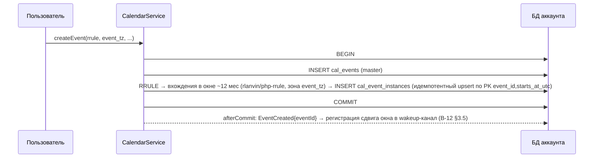
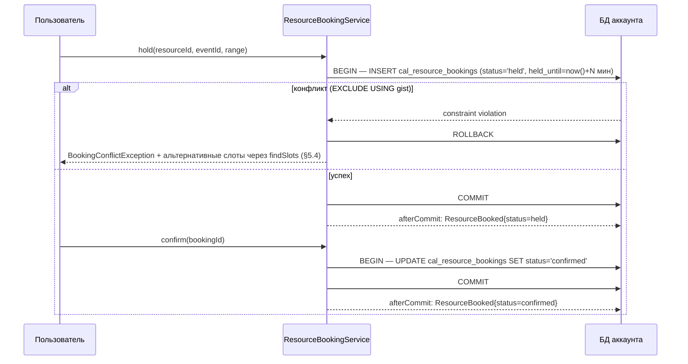
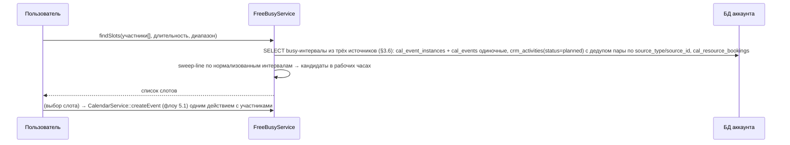
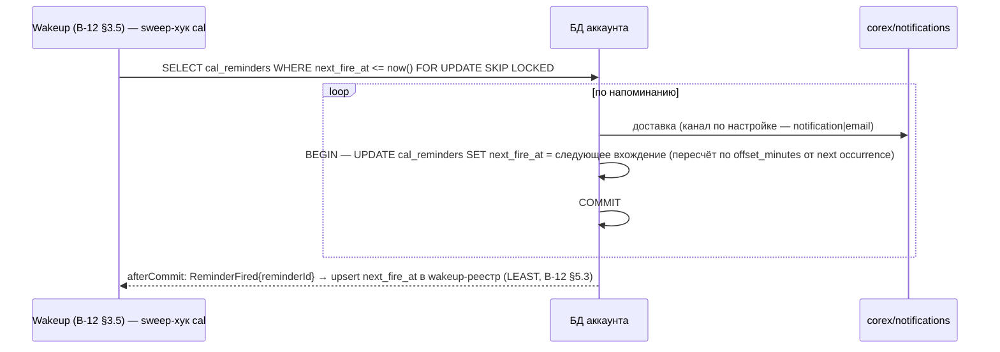

# B-29 — corex/calendar: события, RSVP, recurrence, календари, ресурсы, free-busy, слоты, внешний sync

> **Финал волны P3.1–P3.5** — слой решений FLEX-2 P2.3 (2026-07-12), глубина добрана срезами P3.x:
> БД-детали (индексы/партиции/edge-cases) — P3.1, детальные потоки — P3.2, полные
> сигнатуры контрактов и sync-протоколы токенов — P3.3, guard'ы/права — P3.4, AC/НФТ — P3.5.
> Вход: `05-Projects/01-Products/FlexCRM/plans/flex/20_research/R-26_calendar.md` (§4, §5, «→ входы B-29»).
> Канон-базис: B-13 §2.4 (`crm_activities`), B-13 §5.3 (timeline), B-12 §3.5 (wakeup),
> B-27 §3.6 (recurrence задач — единый подход волны), B-28 §3.6 (группа как владелец календаря).
> Канон `crm_activities` (B-13 §2.4) НЕ переопределяется — календарь связывается с ним, не поглощает.
> Конвенции: PK = UUIDv7 (D12), префикс `cal_` (D4), `created_by` jsonb ACTOR — как в B-27/B-13.
> Нумерация разделов — формат волны (как B-27/B-28: §7 MCP-тулзы, §8 НФТ, §9 реестр вопросов);
> девиация от канон-нумерации B-13 зафиксирована в P2.1/P2.2 Pending — сверку P4.1 вести по названиям.

---

## 1. Границы и состав

**В модуле (`corex/calendar` — новый модуль, гап (3) D2: событий в спеках не было вообще):**
- Календари как контейнеры (`cal_calendars`): личные / группы (B-28 §3.6) / workspace; наложение нескольких календарей; шаринг (`cal_calendar_shares`).
- События (`cal_events`) с участниками-полиморфными (user | crm_contact | внешний email) и RSVP (`cal_attendees`).
- Повторяемость: RRULE строкой + windowed materialization (`cal_event_overrides`, `cal_event_instances`) — единый подход волны с B-27 §3.6.
- Ресурсы first-class (`cal_resources`) + брони (`cal_resource_bookings`) с БД-гарантией от double-booking (exclusion constraint).
- Free-busy — внутренний сервис (sweep-line); внутренний подбор слотов v1; публичные booking-страницы — v1.1 (закладка `cal_booking_types`).
- Напоминания (`cal_reminders`) через wakeup B-12 §3.5 — свой шедулер запрещён.
- Внешний sync: адаптерный слой (`cal_sync_connections`, `cal_sync_event_map`); v1 — CalDAV (клиент + sabre/dav-экспорт, boxed-совместим), Google/Graph — v1.1 (§3.7).
- Связка с CRM: пара «`crm_activities kind=meeting` ↔ `cal_events`» (§3.1) — атомарное создание, дедуп в free-busy.

**Вне модуля (не гап, канон/roadmap):**
- `crm_activities` и timeline `crm_tml` (B-13 §2.4/§5.3) — не переопределяются; timeline-запись встречи несёт парная активность, не событие.
- Публичные booking-страницы (event types, round-robin) — v1.1 (§3.6); Cal.com — только архитектурный референс (AGPL, код не заимствуем).
- Парсинг входящих iMIP REPLY — v1.1, закладка mail-модуля (R-30); v1 — только исходящие приглашения.
- Задачи и их due-даты — `tsk_tasks` (B-27); due_at НЕ занятость (§3.6).

**Зависимости модуля:** corex/workflow (wakeup-канал B-12 §3.5 — §3.8), corex/crm (пара с активностью, участник-контакт), AzGuard/B-11 (права, шаринг — P3.4), corex/notifications (напоминания, приглашения, RSVP-события), общий RRULE-обвяз `rlanvin/php-rrule` с corex/tasks (§3.3), B-16 capability-панели (комментарии к событию — канон, дельты не требуется).

**Позиционирование против Б24 (R-26 §4.9):** ресурсы first-class с БД-гарантией (v1) · встроенный booking (v1.1) · высокоуровневый API слотов · чистая пара «активность ↔ событие» без UF-костыля `resourcebooking` (§3.10).

---

## 2. Схема БД

> Срез P3.1: полный DDL (индексы, exclusion-constraint, EXDATE, уникальность uid,
> партиции) — черновая пометка снята.

```sql
-- Календарь = контейнер (аналог секции Б24, CAL_TYPE → owner_type); 'resource' осознанно НЕ владелец (§3.2)
CREATE TABLE cal_calendars (
  id          uuid PRIMARY KEY,                -- UUIDv7
  owner_type  varchar(16) NOT NULL CHECK (owner_type IN ('user','group','workspace')),
  owner_id    uuid NOT NULL,                   -- users.id | soc_groups.id (B-28 §3.6) | wsp_workspaces.id; полиморфный, FK нет — чистка хуком RecordDeleted
  name        varchar(190) NOT NULL,
  color       varchar(16),
  timezone    varchar(64),                     -- дефолтная зона календаря (fallback для событий)
  is_default  boolean NOT NULL DEFAULT false,  -- личный календарь по умолчанию
  created_by  jsonb NOT NULL,                  -- ACTOR
  created_at timestamptz NOT NULL DEFAULT now(), updated_at timestamptz NOT NULL DEFAULT now(),
  deleted_at  timestamptz
);
CREATE INDEX cal_calendars_owner_ix   ON cal_calendars (owner_type, owner_id) WHERE deleted_at IS NULL;  -- запрос: календари владельца (личные/группы/workspace)
CREATE UNIQUE INDEX cal_calendars_default_uq ON cal_calendars (owner_type, owner_id)
  WHERE is_default AND deleted_at IS NULL;  -- ровно один личный календарь по умолчанию на владельца

-- Шаринг календаря (наложение чужих календарей, Т4); взаимодействие с AzGuard-scope — P3.4 (Q48)
CREATE TABLE cal_calendar_shares (
  id           uuid PRIMARY KEY,
  calendar_id  uuid NOT NULL REFERENCES cal_calendars(id) ON DELETE CASCADE,
  subject_type varchar(16) NOT NULL CHECK (subject_type IN ('user','group','workspace')),
  subject_id   uuid NOT NULL,
  permission   varchar(16) NOT NULL DEFAULT 'view' CHECK (permission IN ('view_busy','view','edit')),
  created_by   jsonb NOT NULL,
  created_at timestamptz NOT NULL DEFAULT now(), updated_at timestamptz NOT NULL DEFAULT now(),
  UNIQUE (calendar_id, subject_type, subject_id)
);
CREATE INDEX cal_calendar_shares_subject_ix ON cal_calendar_shares (subject_type, subject_id);  -- запрос: «какие календари расшарены мне» (наложение, Т4)

-- Событие-master: инстанты UTC + определение повтора в local wall-clock зоне события (R-26 §2.6)
CREATE TABLE cal_events (
  id           uuid PRIMARY KEY,
  calendar_id  uuid NOT NULL REFERENCES cal_calendars(id) ON DELETE CASCADE,
  title        varchar(255) NOT NULL,
  description  text,
  location     varchar(255),
  starts_at    timestamptz NOT NULL,           -- первое вхождение (master); длительность = ends_at - starts_at
  ends_at      timestamptz NOT NULL,
  is_all_day   boolean NOT NULL DEFAULT false, -- all-day: date-only семантика (представление дат — P3.1), НЕ midnight-timestamps
  event_tz     varchar(64) NOT NULL,           -- IANA; DST-стабильная экспансия RRULE
  rrule        text,                           -- RFC 5545 строкой; NULL = одиночное событие
  exdates      timestamptz[],                  -- исключения; массив vs таблица — P3.1
  status       varchar(16) NOT NULL DEFAULT 'confirmed' CHECK (status IN ('confirmed','cancelled')),
  uid          varchar(255) NOT NULL,          -- iCalendar UID (iMIP/CalDAV-матчинг по UID+email)
  sequence     int NOT NULL DEFAULT 0,         -- версия для iMIP/ICS (RFC 5545 SEQUENCE)
  source_type  varchar(64),                    -- связка-пара: 'crm.activity' (§3.1); паттерн crm_tml.ref_type
  source_id    uuid,
  created_by   jsonb NOT NULL,
  created_at timestamptz NOT NULL DEFAULT now(), updated_at timestamptz NOT NULL DEFAULT now(),
  deleted_at   timestamptz,
  CHECK (ends_at >= starts_at)
);
CREATE UNIQUE INDEX cal_events_uid_uq      ON cal_events (uid);  -- iMIP/CalDAV матчинг: UID глобально уникален внутри аккаунта
CREATE INDEX cal_events_calendar_range_ix  ON cal_events (calendar_id, starts_at) WHERE deleted_at IS NULL;  -- запрос: события календаря в диапазоне (master-строки одиночных событий)
CREATE INDEX cal_events_source_ix         ON cal_events (source_type, source_id) WHERE source_type IS NOT NULL;  -- запрос: пара «событие ↔ crm_activity» (§3.1, MeetingPairService)
COMMENT ON COLUMN cal_events.exdates IS
  'Массив timestamptz (не отдельная таблица): исключения RRULE как правило малочисленны (единицы-десятки на серию), запрос всегда «дай все exdates события целиком» — колонка дешевле джойна. Пересмотр в таблицу — только если PoC покажет исключения per-instance querying';

-- Override: перенос/отмена/правка ОДНОГО вхождения серии (child с original_start — R-26 §2.4)
CREATE TABLE cal_event_overrides (
  id             uuid PRIMARY KEY,
  event_id       uuid NOT NULL REFERENCES cal_events(id) ON DELETE CASCADE,
  original_start timestamptz NOT NULL,         -- какое вхождение переопределено
  kind           varchar(16) NOT NULL CHECK (kind IN ('moved','cancelled','modified')),
  payload        jsonb NOT NULL DEFAULT '{}',  -- diff-поля: starts_at/ends_at/title/location/…
  created_by     jsonb NOT NULL,
  created_at timestamptz NOT NULL DEFAULT now(), updated_at timestamptz NOT NULL DEFAULT now(),
  UNIQUE (event_id, original_start)
);

-- Материализованное окно вхождений (гибрид R-26 §3.3): производная, пересчитываемая; горизонт ~12 мес (ops-конфиг §8)
CREATE TABLE cal_event_instances (
  event_id      uuid NOT NULL REFERENCES cal_events(id) ON DELETE CASCADE,
  starts_at_utc timestamptz NOT NULL,
  ends_at_utc   timestamptz NOT NULL,
  override_id   uuid REFERENCES cal_event_overrides(id) ON DELETE CASCADE,  -- NULL = из правила
  is_cancelled  boolean NOT NULL DEFAULT false,
  PRIMARY KEY (event_id, starts_at_utc)        -- идемпотентный upsert материализации
);
CREATE INDEX cal_event_instances_range_ix ON cal_event_instances (starts_at_utc, ends_at_utc) WHERE NOT is_cancelled;  -- запрос: free-busy sweep-line (§3.6) по диапазону всех событий аккаунта
COMMENT ON TABLE cal_event_instances IS
  'Partition-ready с первого дня по starts_at_utc (объём = события×горизонт ~12 мес, Q16 Resolved): FK на инстансы отсутствуют (только FK ИЗ instances на events), паттерн `crm_tml`. v1 — single-table; opt-in помесячные партиции pg_partman при высоком объёме (B-26 §3)';

-- Участники: полиморфные user | crm_contact | внешний email (§3.4); отдельная таблица, НЕ jsonb (R-26 §2.7)
CREATE TABLE cal_attendees (
  id          uuid PRIMARY KEY,
  event_id    uuid NOT NULL REFERENCES cal_events(id) ON DELETE CASCADE,
  user_id     uuid REFERENCES users(id) ON DELETE CASCADE,        -- внутренний сотрудник
  contact_id  uuid REFERENCES crm_contacts(id) ON DELETE SET NULL, -- клиент CRM (встречи с клиентами)
  email       varchar(255),                    -- адрес доставки iMIP: снапшот для contact, идентичность для внешнего гостя
  role        varchar(16) NOT NULL DEFAULT 'required' CHECK (role IN ('chair','required','optional')),
  partstat    varchar(16) NOT NULL DEFAULT 'needs_action'
              CHECK (partstat IN ('needs_action','accepted','declined','tentative')),  -- RFC-строки только на границе сериализации
  response_at timestamptz,
  created_by  jsonb NOT NULL,
  created_at timestamptz NOT NULL DEFAULT now(), updated_at timestamptz NOT NULL DEFAULT now(),
  CHECK (user_id IS NOT NULL OR contact_id IS NOT NULL OR email IS NOT NULL)
);
CREATE INDEX cal_attendees_event_ix   ON cal_attendees (event_id);          -- запрос: участники события (карточка + RSVP)
CREATE INDEX cal_attendees_user_ix   ON cal_attendees (user_id) WHERE user_id IS NOT NULL;  -- запрос: «мои встречи» (join через event_id)
CREATE INDEX cal_attendees_contact_ix ON cal_attendees (contact_id) WHERE contact_id IS NOT NULL;  -- запрос: встречи CRM-контакта (карточка контакта)
COMMENT ON TABLE cal_attendees IS
  'Уникальность участника (один user/contact/email не дублируется на событии) — сервисный инвариант AttendeeService::invite (проверка перед INSERT), НЕ DB-constraint: три взаимоисключающих домена идентичности (user_id/contact_id/email) не выражаются одним UNIQUE без сложного COALESCE-выражения, которое усложняет план запроса сильнее, чем стоит дубль-edge-case';

-- Напоминания: offset от начала вхождения; fire_at ближайшего вхождения регистрируется в wakeup-канал (§3.8)
CREATE TABLE cal_reminders (
  id             uuid PRIMARY KEY,
  event_id       uuid NOT NULL REFERENCES cal_events(id) ON DELETE CASCADE,
  user_id        uuid NOT NULL REFERENCES users(id) ON DELETE CASCADE,  -- per-user настройка
  offset_minutes int NOT NULL DEFAULT 15,
  channel        varchar(16) NOT NULL DEFAULT 'notification' CHECK (channel IN ('notification','email')),
  next_fire_at   timestamptz,                  -- материализованный ближайший fire
  created_at timestamptz NOT NULL DEFAULT now(), updated_at timestamptz NOT NULL DEFAULT now(),
  UNIQUE (event_id, user_id, offset_minutes, channel)
);
CREATE INDEX cal_reminders_wakeup_ix ON cal_reminders (next_fire_at) WHERE next_fire_at IS NOT NULL;  -- запрос: sweep-хук wakeup-обработчика (§3.8) — due-напоминания

-- Ресурсы first-class (НЕ «ресурс = календарь-секция», боль Б24 — R-26 §4.4)
CREATE TABLE cal_resources (
  id         uuid PRIMARY KEY,
  name       varchar(190) NOT NULL,
  kind       varchar(32) NOT NULL DEFAULT 'room',   -- room / equipment / vehicle / …
  capacity   int,
  metadata   jsonb NOT NULL DEFAULT '{}',
  is_active  boolean NOT NULL DEFAULT true,
  created_by jsonb NOT NULL,
  created_at timestamptz NOT NULL DEFAULT now(), updated_at timestamptz NOT NULL DEFAULT now(),
  deleted_at timestamptz
);
CREATE INDEX cal_resources_active_ix ON cal_resources (kind) WHERE is_active AND deleted_at IS NULL;  -- запрос: каталог доступных ресурсов по типу

-- Бронь = отдельная таблица (решение Q15, §3.5): M2M событие↔ресурсы (композитная бронь «комната+оборудование»)
CREATE EXTENSION IF NOT EXISTS btree_gist;  -- нужен exclusion-constraint ниже (uuid-равенство внутри GiST)

CREATE TABLE cal_resource_bookings (
  id          uuid PRIMARY KEY,
  resource_id uuid NOT NULL REFERENCES cal_resources(id) ON DELETE CASCADE,
  event_id    uuid NOT NULL REFERENCES cal_events(id) ON DELETE CASCADE,
  starts_at   timestamptz NOT NULL,
  ends_at     timestamptz NOT NULL,
  status      varchar(16) NOT NULL DEFAULT 'confirmed' CHECK (status IN ('held','confirmed','cancelled')),
  held_until  timestamptz,                     -- hold-паттерн многошагового бронирования (R-26 §2.8)
  created_by  jsonb NOT NULL,
  created_at timestamptz NOT NULL DEFAULT now(), updated_at timestamptz NOT NULL DEFAULT now(),
  CHECK (ends_at > starts_at),
  CHECK (status <> 'held' OR held_until IS NOT NULL),
  -- Анти-double-booking (safety-инвариант §8): гонка на вставке = constraint violation, не интерфейсная проверка
  EXCLUDE USING gist (
    resource_id WITH =,
    tstzrange(starts_at, ends_at, '[)') WITH &&
  ) WHERE (status IN ('held','confirmed'))
);
CREATE INDEX cal_resource_bookings_event_ix ON cal_resource_bookings (event_id);  -- запрос: брони события (композитная бронь — все ресурсы одной встречи)
CREATE INDEX cal_resource_bookings_held_ix  ON cal_resource_bookings (held_until) WHERE status = 'held';  -- запрос: sweep просроченных hold'ов (§5 поток 3)
COMMENT ON TABLE cal_resource_bookings IS
  'tenant_id в EXCLUDE не нужен (физическая DB-per-account, D1). Полуоткрытые интервалы [) — стыковка встреч 10:00-11:00/11:00-12:00 без ложного конфликта. v1: брони только для событий без RRULE (валидатор, Q47) — per-instance брони recurring-серий — v1.1';

-- Подключение внешнего календаря: per-calendar курсор (R-26 §4.6)
CREATE TABLE cal_sync_connections (
  id                   uuid PRIMARY KEY,
  calendar_id          uuid NOT NULL REFERENCES cal_calendars(id) ON DELETE CASCADE,
  provider             varchar(16) NOT NULL CHECK (provider IN ('caldav','google','graph')),  -- google/graph — v1.1 (§3.7)
  direction            varchar(16) NOT NULL DEFAULT 'both' CHECK (direction IN ('pull','push','both')),
  external_calendar_id varchar(255) NOT NULL,
  cursor               text,                   -- syncToken / deltaLink / DAV sync-token; NULL = нужен полный ресинк
  credentials_ref      varchar(255) NOT NULL,  -- ссылка на секрет-хранилище, НЕ сами токены (Q50 → P3.3)
  status               varchar(16) NOT NULL DEFAULT 'active' CHECK (status IN ('active','error','revoked')),
  last_synced_at       timestamptz,
  created_by           jsonb NOT NULL,
  created_at timestamptz NOT NULL DEFAULT now(), updated_at timestamptz NOT NULL DEFAULT now(),
  UNIQUE (calendar_id, provider, external_calendar_id)
);
CREATE INDEX cal_sync_connections_error_ix ON cal_sync_connections (status) WHERE status = 'error';  -- запрос: reconciliation-sweep/алерт по сбойным подключениям (§8)

-- Маппинг внешних событий: идемпотентность sync + ETag-конкуренция (R-26 §2.3)
CREATE TABLE cal_sync_event_map (
  connection_id uuid NOT NULL REFERENCES cal_sync_connections(id) ON DELETE CASCADE,
  external_id   varchar(255) NOT NULL,
  event_id      uuid NOT NULL REFERENCES cal_events(id) ON DELETE CASCADE,
  etag          varchar(255),
  synced_at     timestamptz,
  PRIMARY KEY (connection_id, external_id)
);
CREATE INDEX cal_sync_event_map_event_ix ON cal_sync_event_map (event_id);  -- запрос: push наших правок — «какое external_id у этого события в этом подключении»

-- ЗАКЛАДКА v1.1 (§3.6): booking-типы (event types поверх free-busy; слот — вычисляемая величина, НЕ хранится)
CREATE TABLE cal_booking_types (
  id              uuid PRIMARY KEY,
  owner_id        uuid NOT NULL REFERENCES users(id) ON DELETE CASCADE,
  slug            varchar(64) NOT NULL,
  duration_min    int NOT NULL,
  buffer_before   int NOT NULL DEFAULT 0, buffer_after int NOT NULL DEFAULT 0,
  notice_min      int NOT NULL DEFAULT 0,       -- minimum notice (R-26 §2.2)
  horizon_days    int NOT NULL DEFAULT 30,      -- rolling window
  availability    jsonb NOT NULL DEFAULT '{}',  -- weekly windows (Cal.com availability_rules — референс)
  is_active       boolean NOT NULL DEFAULT false,  -- v1: выключено; включение — v1.1
  created_by      jsonb NOT NULL,
  created_at timestamptz NOT NULL DEFAULT now(), updated_at timestamptz NOT NULL DEFAULT now(),
  deleted_at      timestamptz,
  CHECK (duration_min > 0), CHECK (horizon_days > 0),
  UNIQUE (owner_id, slug) 
);
```

**Изменения существующих таблиц:** НЕТ. `crm_activities` (B-13 §2.4) не меняется — связка живёт на стороне `cal_events.source_type/source_id` (аддитивно, паттерн `crm_tml.ref_type/ref_id`).

---

## 3. Ключевые архитектурные решения

> Решения зафиксированы; механика (SQL, сигнатуры, guard'ы, sync-протоколы) добрана срезами P3.1–P3.5.

Вердикты по всем 10 входам R-26 («→ входы B-29»):

### 3.1 Вход 1 — Две связанные сущности: `cal_events` + `crm_activities kind=meeting` — **ПРИНЯТО** (R-26 §4.1)

`crm_activities` НЕ трогаем (канон B-13 §2.4: transcript, recording, targets, timeline-проекция §5.3). Связь — `cal_events.source_type='crm.activity'/source_id`; создание встречи из CRM создаёт пару **атомарно в одной транзакции** (HubSpot-паттерн). Timeline-запись (`crm_tml type='meeting'`) несёт ПАРНАЯ активность по канону §5.3 — событие календаря в `crm_tml` само не пишет; событие без CRM-привязки (планёрка, отпуск) timeline не задевает. Free-busy дедуплицирует пару по связке (§3.6). **Уточнение драфт-уровня (мастер времени):** истина времени/участников пары = `cal_events`; парная активность зеркалит `starts_at/ends_at` через `MeetingPairService` (обе записи в одной транзакции). Активность без события (мигрированный amoCRM task=meeting, B-18) — легальна; мигрированное Б24-«дело»-встреча — так же: канон B-18 (§1.1/§2.5) маппит «дело» только в `crm_activities`/`tsk_tasks`, парного `cal_events` мигратор не создаёт — создание пары мигратором было бы дельтой канона B-18 (§9 п.12, Q51). Обоснование: оба богатых донора (Б24, HubSpot) держат две сущности; одна сущность затащила бы RRULE/RSVP/секции в чужой домен (R-26 §2.9).

### 3.2 Вход 2 — Схема `cal_`: календарь = контейнер, master+RRULE+windowed instances — **ПРИНЯТО с уточнениями** (R-26 §4.2)

Состав таблиц — §2. Три уточнения против эскиза R-26 (каждое с обоснованием):
1. `owner_type` = `user | group | workspace` — БЕЗ `'resource'`: R-26 §4.4 сам отвергает «ресурс = календарь-секция» (боль Б24); ресурсная занятость живёт в `cal_resource_bookings`, календарь ресурсу не нужен. Устраняется внутреннее противоречие R-26 §4.2↔§4.4.
2. `'company'` → `'workspace'`: термин `company` коллидирует с `crm_companies` (зафиксировано ревью P2.2 для B-28); общекорпоративный календарь = календарь workspace (B-11 `wsp_workspaces`, type=company).
3. Группа как владелец — `owner_id → soc_groups.id`: зеркальная пометка B-28 §3.6 выполнена; gate видимости группового календаря = членство в группе (secret-группы — не-участник не видит), детально — P3.4.
Добавлены сверх списка R-26: `cal_calendar_shares` (Т4 «наложение календарей» требует носителя шаринга), `cal_sync_event_map` (идемпотентность sync §2.3 требует маппинга external_id↔event_id), `cal_booking_types` (закладка v1.1, §3.6). Зафиксировано как расширение состава — сверка P4.1/P3.1.

### 3.3 Вход 3 — Recurrence: общий RRULE-обвяз с задачами — **ПРИНЯТО**, сверено с B-27 §3.6 (R-26 §4.2, R-24 §4.4)

Подход идентичен B-27: RRULE строкой RFC 5545 (НЕ раскладывать в колонки), движок `rlanvin/php-rrule` — один пакет-обвяз, два потребителя (задачи + календарь); windowed materialization; пробуждение — wakeup B-12 §3.5, свой cron запрещён. Правки серии — НЕ instance-first-паттерн задач, а канонная календарная семантика overrides (§3.11): у календаря есть interop-требование (CalDAV/Google master+overrides, R-26 §2.3), у задач его нет — расхождение механики overrides обосновано и осознанно. **Окно материализации: ~12 мес** (против 30 дней у задач) — параметр, не расхождение подхода: календарю нужна форвард-видимость для free-busy/слотов и год вперёд для повторяющихся встреч; имя/расположение общего пакета-обвяза — P3.3 (Q49). Идемпотентность — PK `(event_id, starts_at_utc)`.

### 3.4 Вход 4 — RSVP: `cal_attendees` RFC-совместимой таблицей — **ПРИНЯТО с расширением** (R-26 §4.3)

Таблица участников, НЕ jsonb; `partstat`-enum внутренний, RFC-строки только на границе сериализации (.ics). **Расширение против R-26 (user|email): полиморфный участник user | crm_contact | внешний email** — требование item'а (встречи с клиентами): `contact_id` связывает участника с CRM-контактом (профиль, история), `email` для контакта — снапшот адреса доставки iMIP на момент приглашения (контакт мог сменить email — приглашение уходило на старый; политика обновления — P3.2). Внешний гость без контакта — email-only. Внутренние отвечают в UI (прямое обновление partstat); внешним/контактам — исходящий iMIP (method=REQUEST, SEQUENCE-версии) в v1, парсинг REPLY — v1.1 (закладка mail-модуля R-30). `partstat='delegated'` не поддерживается в v1 (нет продуктового сценария).

### 3.5 Вход 5 — Ресурсы first-class + exclusion constraint; развилка Q15 решена: отдельная таблица броней — **ПРИНЯТО, развилка решена здесь** (R-26 §4.4, §5.3)

Анти-double-booking — гарантия БД: `EXCLUDE USING gist (resource_id WITH =, tstzrange '[)' WITH &&) WHERE status IN ('held','confirmed')`, гонка = constraint violation, не интерфейсная проверка (позиционное преимущество против Б24). **Решение Q15: ни прямой FK на событии, ни participant-строка `cutype=resource` — отдельная таблица `cal_resource_bookings`** (event_id + resource_id + свой range + status). Обоснование: (а) прямой `resource_id` на `cal_events` даёт максимум один ресурс на событие — композитная бронь «комната + проектор» (критика Б24, R-26 §2.1) не выражается; (б) participant-строка не несёт диапазона и статуса hold — exclusion constraint на неё не ложится; (в) отдельная таблица держит constraint чисто и поддерживает hold-паттерн (`held/held_until`). RFC-`CUTYPE=RESOURCE` остаётся сериализационным представлением брони в .ics (граница, не хранение). **Ограничение v1:** бронь — только для событий без RRULE (валидатор); брони recurring-серий (per-instance материализация броней) — v1.1, механика — P3.2 (Q47).

### 3.6 Вход 6 — Free-busy внутренний сервис; booking-страницы v1.1 — **ПРИНЯТО** (R-26 §4.5)

Free-busy — sweep-line по нормализованным интервалам из трёх источников: `cal_event_instances` (+ одиночные `cal_events`), `crm_activities(status='planned')` — с дедупом пары по `source_type/source_id` (§3.1), `cal_resource_bookings`. `tsk_tasks.due_at` — pressure signal, НЕ занятость: в busy не конвертируется. `FreeBusyService` — публичный контракт (вход для вертикалей B-13 §5.4). v1 — внутренний подбор слота участников (планировщик а-ля Б24, но с высокоуровневым API `findSlots` — которого у Б24 нет, жалоба интеграторов); публичные booking-страницы (event types, буферы, notice, round-robin) — v1.1 поверх той же free-busy (конвейер R-26 §2.2), закладка `cal_booking_types` уже в схеме. Слот — вычисляемая величина, НЕ хранится. Cal.com — референс архитектуры, код не заимствуем (AGPL).

### 3.7 Вход 7 — Sync: адаптерный слой; развилка Q14 решена: CalDAV v1, Google/Graph v1.1 — **ПРИНЯТО, развилка решена здесь** (R-26 §4.6, §5.2)

Контракт `CalendarSyncAdapter` (per-calendar курсор, идемпотентные джобы с ключом connection+cursor, ETag-конкуренция 412→fetch+merge+retry, политика конфликтов «external wins по контент-полям, internal wins по CRM-метаданным»). **Решение Q14: v1 = CalDAV** — клиент (`sync-collection` RFC 6578, poll) + экспорт нашего календаря CalDAV-сервером на sabre/dav (чистый PHP, ложится в Laravel): единственный канал, работающий в boxed без внешних SaaS — деградация D10 бесплатна, cloud и boxed получают одинаковый v1. **Google (syncToken+watch) и Graph (delta+notifications) — v1.1 cloud-адаптеры** (тот же контракт; push — только «грязный хинт», триггерящий pull). Unified API (Nylas/Cronofy) — отказ: календарь — ядро продукта, boxed несовместим, $/account. Периодический reconciliation-sweep обязателен (§8). Протоколы токенов/renewal каналов — P3.3.

### 3.8 Вход 8 — Напоминания через wakeup B-12 §3.5; развилка Q13 решена: без выноса пакета — **ПРИНЯТО, развилка решена здесь** (R-26 §4.7, §5.1)

Свой шедулер НЕ строится. **Решение Q13 (драфт-уровень, покрывает и recurrence задач B-27 §3.6/§9 п.7): `WakeupDriver` НЕ выносится из flex/workflow в v1; доменные потребители (календарь, задачи) зависят от `corex/workflow`** — binding-слой (B-12 §1.1), уже обязательный в составе FlexCRM, экспортирует общий wakeup-канал: «разбуди тенант в fireAt» + регистрация доменных sweep-хуков на пробуждение (обработчик сканирует свою таблицу due-записей: `cal_reminders.next_fire_at`, `materialized_until` recurrence). Обоснование: (а) прямая зависимость модулей от библиотеки flex/workflow ломает слоистость B-10 (модули ходят через corex-binding); (б) отдельный corex-пакет «scheduling» — преждевременное дробление: контракт из одного метода, Rule of Three по числу пакетов-потребителей не достигнут (все трое живут внутри одного продукта); (в) boxed-деградация (local_sweep) наследуется бесплатно (D10). Форма контракта (интерфейс, регистрация хуков, событие пробуждения) — срез P3.3. `cal_reminders` регистрирует ближайший `next_fire_at`; доставка — corex/notifications.

### 3.9 Вход 9 — Таймзоны: timestamptz + event_tz + display_tz — **ПРИНЯТО** (R-26 §4.8)

Инстанты (`cal_event_instances`, starts/ends master) — `timestamptz` UTC; определение повтора — local wall-clock + `event_tz` (IANA) на master: экспансия RRULE ведётся в зоне события (DST-стабильность — «еженедельно 9:00 Europe/Moscow» не уплывает). `display_tz` — на пользователе (профиль, вне модуля календаря), на событии его НЕТ. All-day — date-only семантика (`is_all_day`, представление дат — P3.1), НЕ midnight-timestamps. Конвертация — `AT TIME ZONE` с IANA-именами. Консистентно конвенциям канона (timestamptz везде, B-13).

### 3.10 Вход 10 — Позиционирование против Б24 — **ПРИНЯТО** как продуктовая рамка v1/v1.1 (R-26 §4.9)

(а) ресурсы first-class с БД-гарантией от double-booking — **v1** (§3.5); (б) встроенные booking-страницы — **v1.1** (§3.6, закладка в схеме); (в) высокоуровневый API слотов `findSlots` — **v1** (внутренний), публичный — v1.1; (г) чистая пара «активность ↔ событие» без UF-костыля `resourcebooking` — **v1** (§3.1). Рамка зафиксирована в §1; маркетинговая упаковка — вне волны.

### 3.11 Правка серии vs экземпляра — семантика трёх scope (решение драфт-уровня)

Канонная календарная семантика (Google/CalDAV, R-26 §2.3–2.4): **this_only** — override-запись (`cal_event_overrides` kind=moved/modified/cancelled, матчинг по `original_start`); **this_and_following** — split: старый master получает `UNTIL` в RRULE, создаётся новый master с новым `uid`-суффиксом (детали interop — P3.3); **all** — правка master + пере-экспансия окна инстансов. Отличие от instance-first-паттерна задач B-27 §3.6 обосновано в §3.3 (interop-требование CalDAV/Google). Детальные потоки и конфликты с внешним sync — P3.2.

### 3.12 Права: scope-предикат шаринга календарей, gate группового календаря (Q48 — срез P3.4)

> Срез P3.4: SQL-компиляция шаринга + gate групповых календарей + permission keys — черновая пометка снята для права-подраздела.

**Q48 (шаринг × AzGuard: аддитивный механизм vs дельта) — решено здесь.** `cal_calendar_shares` — **аддитивная grant-таблица модуля** (прямая аналогия `vlt_grants` Vaulter, B-16 §5.4: модуль владеет своей таблицей прав доступа поверх базового AzGuard-скоупа; тот же паттерн, что `direct_grants` панелей). Канон B-11 §5.5 (таблица компиляции Scope) НЕ редактируется — шаринг не вводит новое значение `Scope`-enum, а даёт ДОПОЛНИТЕЛЬНЫЙ источник видимости/редактирования календаря поверх базовой видимости по `owner_type/owner_id`.

Видимость/уровень доступа к календарю `C` для принципала `P` (эффективный уровень = MAX(база, шаринг), где `view_busy < view < edit`):

```sql
-- База (владение) — уже наложенный scope + owner-предикат:
SELECT c.* FROM cal_calendars c
WHERE
  (c.owner_type = 'user' AND c.owner_id = :userId)
  OR (c.owner_type = 'workspace' AND c.owner_id = :workspaceId)          -- workspace-scope, глобальный scope §5.4 п.5 уже наложен
  OR (c.owner_type = 'group' AND EXISTS (                                -- group-владелец: member_of_group (B-28 §3.13, тот же предикат переиспользуется)
        SELECT 1 FROM soc_group_members m
        WHERE m.group_id = c.owner_id AND m.user_id = :userId AND m.status = 'active'
      ))
  OR EXISTS (                                                            -- Шаринг (Q48): аддитивная grant-таблица
      SELECT 1 FROM cal_calendar_shares s
      WHERE s.calendar_id = c.id AND (
           (s.subject_type = 'user'      AND s.subject_id = :userId)
        OR (s.subject_type = 'workspace' AND s.subject_id = :workspaceId)
        OR (s.subject_type = 'group'     AND s.subject_id IN (
              SELECT group_id FROM soc_group_members WHERE user_id = :userId AND status = 'active'))
      )
    );
```

**Уровень доступа**: владелец (`owner_type='user'` свой календарь, или доменная роль owner/moderator группы-владельца) получает `edit` по умолчанию; рядовой участник группы-владельца (`owner_type='group'`) получает базовый `view` (не `edit`) — редактирование группового календаря доступно доменным owner/moderator группы ИЛИ по явному `cal_calendar_shares.permission='edit'`; workspace-владение — `edit` для всех членов workspace (широкий default, консистентно общекорпоративному календарю). Это НЕ новая ось `Scope`, а grant-механика ВНУТРИ уже разрешённой видимости — то же разделение, что gate1(базовый доступ)/gate2(участник повышает) в B-16 §3.1, применённое к календарю вместо панели.

**Gate группового календаря (secret-группы)**: не-участник secret-группы НЕ видит групповой календарь — обеспечивается тем же предикатом `member_of_group` (EXISTS-проверка выше), отдельного gate для «secret» не нужно: непринадлежность группе уже даёт `EXISTS = false` независимо от `privacy`-значения группы (secret просто не расширяет видимость самой группы в каталоге — календарь неоткрываем, если группа неизвестна, консистентно B-28 §3.6).

**Permission keys** (`Extend\Permissions`, формат B-11 §5.5): `cal.resource.manage` (CRUD каталога `cal_resources` — workspace/account, глобальное право, не per-календарь); `cal.calendar.share` (управление `cal_calendar_shares` — доступно владельцу календаря ИЛИ держателю `permission='edit'`, не требует отдельного глобального права для собственного календаря — паттерн self-service, аналог `soc.group.manage`). Событийный/RSVP-CRUD (`createEvent`/`updateEvent`/`cancelEvent`) НЕ имеет отдельного permission key — авторизация производна от уровня доступа к календарю (`edit`), не от глобальной AzGuard-роли: держатель `view`/`view_busy` не может мутировать события того календаря. Q48 → Resolved (аддитивный механизм подтверждён, арбитраж не требуется).

---

## 4. Контракты

> Срез P3.3: полные PHP-интерфейсы (@api, PHPStan level 8, форма B-16 §3), Ref-классы,
> sync-протокол токенов, форма wakeup-контракта (Q13), общий RRULE-пакет (Q49), хранение
> credentials (Q50), реестр событий и MCP-карта — черновая пометка снята.

```php
namespace Corex\Calendar;

use Corex\Auth\Actor;

enum EditScope: string { case ThisOnly = 'this_only'; case Following = 'this_and_following'; case All = 'all'; }
enum AttendeeRole: string { case Chair = 'chair'; case Required = 'required'; case Optional = 'optional'; }
enum PartStat: string { case NeedsAction = 'needs_action'; case Accepted = 'accepted'; case Declined = 'declined'; case Tentative = 'tentative'; }
enum SharePermission: string { case ViewBusy = 'view_busy'; case View = 'view'; case Edit = 'edit'; }
enum SyncProvider: string { case CalDav = 'caldav'; case Google = 'google'; case Graph = 'graph'; }

/** readonly, id+type+display — единая форма внутри волны (не идентична ChannelRef B-16 §3.2: там enum ChannelType, без display, + panelableType/panelableId/workspaceId) */
final readonly class CalendarRef
{
    public function __construct(public string $id, public string $type /* 'cal.calendar' */, public string $display) {}
}
final readonly class EventRef
{
    public function __construct(public string $id, public string $type /* 'cal.event' */, public string $display /* title */) {}
}
final readonly class AttendeeRef
{
    public function __construct(public string $id, public string $eventId, public PartStat $partstat) {}
}
final readonly class BookingRef
{
    public function __construct(public string $id, public string $resourceId, public string $eventId, public string $status /* held|confirmed */) {}
}
final readonly class MeetingPair
{
    public function __construct(public string $activityId, public EventRef $event) {}
}

final readonly class CreateEventInput
{
    /** @param list<InviteInput> $attendees */
    public function __construct(
        public string $calendarId, public string $title, public \DateTimeImmutable $startsAt,
        public \DateTimeImmutable $endsAt, public string $eventTz, public ?string $rrule = null,
        public array $attendees = [], public ?string $sourceType = null, public ?string $sourceId = null,
    ) {}
}
final readonly class InviteInput
{
    public function __construct(
        public ?string $userId = null, public ?string $contactId = null, public ?string $email = null,
        public AttendeeRole $role = AttendeeRole::Required,
    ) {}
}
final readonly class Period
{
    public function __construct(public \DateTimeImmutable $from, public \DateTimeImmutable $to) {}
}
final readonly class BusyInterval
{
    public function __construct(public \DateTimeImmutable $from, public \DateTimeImmutable $to, public string $sourceType /* instance|activity|booking */) {}
}
final readonly class BusyMap
{
    /** @param array<string,list<BusyInterval>> $byParticipant */
    public function __construct(public array $byParticipant) {}
}
final readonly class SlotConstraints
{
    public function __construct(public int $durationMinutes, public Period $range, public ?string $timezone = null) {}
}
final readonly class SyncCursor
{
    public function __construct(public string $connectionId, public ?string $token = null /* null = требуется полный ресинк */) {}
}
final readonly class SyncBatch
{
    /** @param list<array{externalId:string,payload:array}> $changes */
    public function __construct(public array $changes, public ?string $nextCursor) {}
}
final readonly class EventChange
{
    public function __construct(public string $eventId, public ?string $etag, public array $payload) {}
}
final readonly class PushResult
{
    public function __construct(public bool $ok, public ?string $newEtag, public bool $conflict409or412 = false) {}
}

/** Пересечение брони одного ресурса (EXCLUDE USING gist, §2) — constraint violation транслируется сюда */
final class BookingConflictException extends \DomainException
{
    /** @param list<Period> $alternatives — из findSlots (§5.3) */
    public function __construct(string $message, public readonly array $alternatives = []) { parent::__construct($message); }
}
/** Бронь recurring-события (rrule IS NOT NULL) в v1 — валидатор (Q47) */
final class RecurringBookingNotSupportedException extends \DomainException {}

interface CalendarService
{
    public function createCalendar(string $ownerType /* user|group|workspace */, string $ownerId, string $name, ?string $timezone, Actor $actor): CalendarRef;
    /** cal_calendar_shares; SQL scope-предикат шаринга — P3.4 (Q48) */
    public function share(string $calendarId, string $subjectType, string $subjectId, SharePermission $permission, Actor $actor): void;
    public function createEvent(CreateEventInput $input, Actor $actor): EventRef;
    /** @throws RecurringBookingNotSupportedException не относится к updateEvent — см. ResourceBookingService::hold */
    public function updateEvent(string $eventId, EditScope $scope, ?string $originalStart, array $diff, Actor $actor): void;
    public function cancelEvent(string $eventId, Actor $actor): void;
}

interface AttendeeService
{
    public function invite(string $eventId, InviteInput $input, Actor $actor): AttendeeRef;
    public function respond(string $attendeeId, PartStat $partstat, Actor $actor): void;
    public function remove(string $attendeeId, Actor $actor): void;
}

/** §3.1: пара crm_activity ↔ cal_event; мастер времени = cal_events */
interface MeetingPairService
{
    /** Атомарно, из CRM (флоу 5.5) */
    public function createPair(string $dealOrContactId, \DateTimeImmutable $startsAt, \DateTimeImmutable $endsAt,
                                array $attendees, Actor $actor): MeetingPair;
    /** Зеркалирование starts_at/ends_at в парную активность В ТОЙ ЖЕ транзакции, что правка события */
    public function syncPair(string $eventId): void;
}

/** Публичный вход для вертикалей (B-13 §5.4) */
interface FreeBusyService
{
    public function busyIntervals(array $participantIds, Period $range): BusyMap;   // sweep-line §3.6
    /** @return list<Period> — внутренний подбор v1 */
    public function findSlots(array $participantIds, SlotConstraints $c): array;
}

interface ResourceBookingService
{
    /** @throws RecurringBookingNotSupportedException (Q47 — валидатор ДО INSERT, не DB-уровень) */
    public function hold(string $resourceId, string $eventId, Period $range, Actor $actor): BookingRef;
    /** @throws BookingConflictException — constraint violation (EXCLUDE USING gist) транслируется сюда с альтернативами из findSlots */
    public function confirm(string $bookingId, Actor $actor): void;
    public function release(string $bookingId, Actor $actor): void;
}

/** Реализации: CalDav (v1), Google/Graph (v1.1) — тот же контракт (§3.7) */
interface CalendarSyncAdapter
{
    public function provider(): SyncProvider;
    /** Инкрементальный; невалидный курсор (null token) → полный ресинк */
    public function pull(SyncCursor $cursor): SyncBatch;
    /** ETag/If-Match; 412 → PushResult{conflict409or412:true} → fetch+merge+retry на стороне вызывающего */
    public function push(EventChange $change): PushResult;
}

interface ReminderService
{
    /** Пересчёт next_fire_at + регистрация в wakeup-канал (§3.8, WakeupHook ниже) */
    public function schedule(string $eventId, string $userId, int $offsetMinutes, string $channel /* notification|email */): void;
    public function cancel(string $reminderId): void;
}
```

### 4.1 Форма wakeup-контракта (Q13 — решён B-29 §3.8; форма — решена здесь)

Единственный контракт, зависимый от `corex/workflow` binding-слоя (B-12 §1.1) — не отдельный
corex-пакет (Rule of Three не набран, §3.8):

```php
namespace Corex\Workflow\Wakeup;             // canon B-12 §1.1 binding-слой

interface WakeupHook
{
    /** Уникальный код домена-потребителя ('cal.reminders' | 'cal.recurrence_window' | 'tsk.recurrence') */
    public function code(): string;
    /** Обработчик тика sweep — SELECT ... FOR UPDATE SKIP LOCKED по своей due-таблице (флоу 5.2/5.8 B-27/B-29) */
    public function sweep(\DateTimeImmutable $now): void;
}

interface WakeupDriver                        // канон B-12 §3.5, здесь — точка регистрации потребителей
{
    public function register(WakeupHook $hook): void;   // вызывается ServiceProvider'ом corex/calendar и corex/tasks
    /** LEAST-upsert следующего пробуждения тенанта (B-12 §5.3) */
    public function requestWakeup(\DateTimeImmutable $fireAt): void;
}
```

Оба потребителя (`corex/calendar`, `corex/tasks`) регистрируют свой `WakeupHook` при `boot()`;
`WakeupDriver` остаётся собственностью `corex/workflow` (binding), новый пакет не заводится.

### 4.2 Общий RRULE-пакет (Q49 — решено здесь)

Имя/расположение: **`corex/rrule`** — тонкий пакет-обвяз над `rlanvin/php-rrule` (не util внутри
`corex/core`): два потребителя (`corex/tasks`, `corex/calendar`) с разными окнами материализации
(30 дней / ~12 мес, §3.3) делят один контракт `RecurrenceExpander`, не библиотеку напрямую —
изоляция upstream-пакета за интерфейсом (замена движка не трогает вызывающий код), консистентно
паттерну `CalendarSyncAdapter`/`TenantStorage` (обёртка вокруг vendor-пакета). Q49 → Resolved.

```php
namespace Corex\Rrule;

interface RecurrenceExpander
{
    /** @return list<\DateTimeImmutable> — вхождения в окне [$from, $to], зона $timezone (DST-стабильно, §3.9) */
    public function expand(string $rrule, \DateTimeImmutable $dtstart, string $timezone,
                           \DateTimeImmutable $from, \DateTimeImmutable $to): array;
}
```

### 4.3 Хранение sync-credentials (Q50 — решено здесь)

`cal_sync_connections.credentials_ref` — **не сами токены**, а ссылка на `sys_settings`-ключ
класса `is_sensitive` (прецедент B-18 §8 п.7, единый механизм с Q53 маркетинга §9): значение
хранится Laravel `encrypted` cast поверх `sys_settings.value` (шифрование на уровне колонки,
APP_KEY-ротация — эксплуатационный runbook, не DDL); секрет-хранилище (Vault/KMS) — v1.1/v2 при
enterprise-требовании. Ротация — `CalendarSyncAdapter`-реализация перевыпускает `credentials_ref`
на новый ключ, старый инвалидируется `status='error'` до ре-аутентификации. Q50 → Resolved.

### 4.4 Реестр доменных событий (полная карта — сверка уникальности §9 S3)

| Событие | `name()` | Payload | Эмитент | Подписчики |
|---|---|---|---|---|
| `EventCreated` | `cal.event.created` | eventId, calendarId | CalendarService | wakeup (регистрация окна материализации) |
| `EventUpdated` | `cal.event.updated` | eventId, scope | CalendarService::updateEvent | сброс partstat участников, iMIP SEQUENCE+1, notifications |
| `EventCancelled` | `cal.event.cancelled` | eventId | CalendarService::cancelEvent | notifications |
| `AttendeeInvited` | `cal.attendee.invited` | attendeeId, eventId | AttendeeService | iMIP (внешние/контакты), notifications (внутренние) |
| `AttendeeResponded` | `cal.attendee.responded` | attendeeId, eventId, partstat | AttendeeService | notifications(организатору) |
| `ResourceBooked` | `cal.resource.booked` | bookingId, resourceId, status | ResourceBookingService | notifications |
| `BookingReleased` | `cal.resource.booking_released` | bookingId | ResourceBookingService | — |
| `ReminderFired` | `cal.reminder.fired` | reminderId, eventId | wakeup (флоу 5.8) | corex/notifications |
| `CalendarSyncCompleted` / `Failed` | `cal.sync.completed` / `.failed` | connectionId, provider | SyncPullJob | ops-алерт (failed) |

Уникальность имён (сверка §9 S3): все `cal.*` — новые, коллизий с канонными `crm.*`/`tsk.*`
(B-13 §3.7), `pnl./cht./vlt./med./ntf.` (B-16 §3) нет.

Все события несут `TenantContext` (B-10 §3.1), хук `corex/notifications`.

---

## 5. Главные потоки

> Срез P3.2: детальные sequence-диаграммы + транзакционные границы (снята черновая пометка).
> afterCommit-события — стиль B-16 §5.2.

### 5.1 Создание повторяющегося события



Регистрация «дальше материализовать» — **query-based**, не отдельная колонка на `cal_events` (в отличие от `tsk_recurrence_rules.materialized_until` у задач, B-27 §2): sweep-хук вычисляет горизонт по `MAX(starts_at_utc)` существующих `cal_event_instances` события против `now() + 12 мес`; событий, требующих досэкспансии, — WHERE `cal_events.rrule IS NOT NULL AND deleted_at IS NULL` с подзапросом максимума инстансов < горизонта. Решение зафиксировано в `slices/S2_flows.md` §1 (wakeup-таблица) как расхождение механики B-27↔B-29 без дельты DDL (P3.1 закрыт, новых колонок не требуется).

### 5.2 Правка серии vs экземпляра

```mermaid
sequenceDiagram
  participant U as Пользователь
  participant CS as CalendarService::updateEvent(scope)
  participant DB as БД аккаунта
  alt this_only
    U->>CS: updateEvent(eventId, this_only, original_start, diff)
    CS->>DB: BEGIN — UPSERT cal_event_overrides (kind='modified'|'moved', payload=diff)
    CS->>DB: COMMIT
  else this_and_following
    U->>CS: updateEvent(eventId, following, original_start, diff)
    CS->>DB: BEGIN
    CS->>DB: UPDATE cal_events SET rrule = rrule || ';UNTIL=' || original_start (старый master обрывается)
    CS->>DB: INSERT cal_events (новый master, uid = старый_uid || '-2', rrule = новое правило с diff)
    CS->>DB: пере-экспансия окна нового master → cal_event_instances
    CS->>DB: COMMIT
  else all
    U->>CS: updateEvent(eventId, all, diff)
    CS->>DB: BEGIN — UPDATE cal_events SET ...diff; DELETE+re-INSERT cal_event_instances окна (пере-экспансия)
    CS->>DB: COMMIT
  end
  CS-->>DB: afterCommit: EventUpdated{eventId, scope} → сброс partstat участников в needs_action + iMIP SEQUENCE+1 (внешним/контактам) + AttendeeInvited заново
```

Отличие от instance-first-паттерна задач (B-27 §5.2) — осознанное, обоснование в §3.11/§3.3 (CalDAV/Google interop-требование у календаря есть, у задач нет); перекрёстная сверка P3.2 подтверждает: расхождение задокументировано в обе стороны, дрейфа конвенций (случайного, необоснованного) не найдено.

### 5.3 Бронь ресурса



Просроченные `held` (held_until прошёл) — периодический sweep (индекс `cal_resource_bookings_held_ix`) переводит `status` в отменённый/освобождённый (механика — тот же корпус wakeup-sweep, П3.5-порог). **Recurring-события (Q47 — решение среза P3.2):** v1 — бронь ресурса **запрещена валидатором** для событий с `rrule IS NOT NULL` (constraint проверяется в `hold()` до INSERT — ServiceException, не DB-уровень); v1.1 — per-instance брони материализуются вместе с `cal_event_instances` при сдвиге окна и инвалидируются при `cal_event_overrides` (moved/cancelled инстанса освобождает соответствующую бронь) — механика зафиксирована как позиция драфта, реализация вне v1.

### 5.4 Внутренний подбор слота



### 5.5 Встреча из CRM (кросс-модульный сценарий волны №4: B-29×B-13)

> Атрибуция: первичная спека — **B-29** (пара событие↔активность, мастер времени); сторона B-13
> (timeline-запись) — ссылка на канон §5.3, дельты нет. Остальные спеки волны ссылаются сюда.

```mermaid
sequenceDiagram
  participant U as Пользователь (карточка сделки/контакта)
  participant MPS as MeetingPairService
  participant DB as БД аккаунта
  participant TW as TimelineWriter (B-13 §5.3)
  U->>MPS: createPair(dealOrContactId, startsAt, endsAt, attendees)
  MPS->>DB: BEGIN
  MPS->>DB: INSERT crm_activities (kind='meeting', status='planned')
  MPS->>DB: INSERT cal_events (source_type='crm.activity', source_id=activity.id)
  MPS->>DB: INSERT cal_attendees (owner как user_id, контакт как contact_id §3.4, email-снапшот)
  MPS->>DB: COMMIT
  MPS-->>TW: afterCommit: активность создана → TimelineWriter пишет запись `crm_tml type='meeting'` СИНХРОННО в транзакции вызывающего (канон B-13 §5.3 — comment/note/crm.activity.log — синхронный класс); календарь В `crm_tml` НАПРЯМУЮ НЕ ПИШЕТ
  MPS-->>DB: afterCommit: EventCreated + ResourceBooked (если участник-ресурс забронирован в том же действии, §5.3)
  Note over MPS,DB: напоминание — по флоу 5.8 (per-attendee cal_reminders, если настроены дефолты организатора)
```

Правка времени встречи (флоу 5.2, this_only/all) → `MeetingPairService::syncPair` зеркалирует `starts_at/ends_at` в парную активность в ТОЙ ЖЕ транзакции, что и правка события (мастер времени = `cal_events`, §3.1). Отмена события → активность переводится в `cancelled` (не удаляется — timeline-провенанс). Мигратор B-18 (Q51 — решение среза P3.2, маршрут на арбитраж не меняется): миграция Б24 «дело»-встречи создаёт ТОЛЬКО `crm_activities`/`tsk_tasks` (канон B-18 §1.1/§2.5) — парный `cal_events` мигратором НЕ создаётся в v1 (создание пары мигратором = дельта канона B-18, вне Files этого среза); мигрированная активность легально существует без событийной пары (§3.1) — free-busy её всё равно учитывает третьим источником (`crm_activities(status='planned')`, §3.6), дедуп по паре не применяется (пары нет).

### 5.6 RSVP

```mermaid
sequenceDiagram
  participant AT as Внутренний участник
  participant AS as AttendeeService
  participant DB as БД аккаунта
  participant EXT as Внешний гость / CRM-контакт
  AT->>AS: respond(attendeeId, partstat, actor)
  AS->>DB: BEGIN — UPDATE cal_attendees SET partstat=..., response_at=now()
  AS->>DB: COMMIT
  AS-->>DB: afterCommit: AttendeeResponded → notifications(организатору)
  Note over AS,EXT: внешний/контакт — исходящий iMIP (method=REQUEST, SEQUENCE) при invite (флоу 5.5); REPLY-парсинг в v1 НЕ строится (v1.1, mail-модуль R-30) — организатор проставляет partstat вручную через ту же respond()
```

### 5.7 Sync-цикл (CalDAV v1)

```mermaid
sequenceDiagram
  participant J as SyncPullJob (per connection)
  participant ADP as CalendarSyncAdapter (CalDAV)
  participant DB as БД аккаунта
  J->>ADP: pull(cursor)
  ADP-->>J: SyncBatch (изменения с провайдера)
  loop по изменению
    J->>DB: BEGIN
    J->>DB: матчинг cal_sync_event_map(external_id) → merge по политике «external wins по контенту, internal wins по CRM-метаданным»
    J->>DB: UPSERT cal_events / cal_sync_event_map(etag, synced_at)
    J->>DB: COMMIT
  end
  J->>DB: UPDATE cal_sync_connections SET cursor=новый, last_synced_at=now()
  Note over J: сброшенный/невалидный курсор → полный ресинк (cursor=NULL, повторный первый pull)
  Note over J: push наших правок — ETag/If-Match; 412 → fetch+merge+retry (канон §3.7)
  Note over J: Reconciliation-sweep (периодический, §8) — та же job по всем active-подключениям, страхует потерянные push-хинты
```

### 5.8 Напоминание



---

## 6. Интеграции (матрица доменов)

| Домен / спека | Стык | Направление |
|---|---|---|
| B-13 §2.4 crm_activities | пара «активность ↔ событие»: `source_type/source_id`, атомарное создание, мастер времени = событие (§3.1); канон-таблица не меняется | calendar ↔ crm |
| B-13 §5.3 timeline | timeline-запись встречи несёт парная активность; календарь в `crm_tml` напрямую не пишет | crm (канон) |
| B-13 §5.4 вертикали | `FreeBusyService` — публичный вход (запись к врачу/мастеру); booking-страницы v1.1 — потребитель вертикалей | вертикаль → calendar |
| B-12 §3.5 wakeup | напоминания + сдвиг окна материализации — общий wakeup-канал через corex/workflow (§3.8, Q13 решён); свой шедулер запрещён | calendar → workflow |
| B-27 recurrence задач | общий RRULE-обвяз `rlanvin/php-rrule` (§3.3); окна разные (12 мес vs 30 дней — параметр); имя пакета — P3.3 (Q49) | общий пакет |
| B-28 §3.6 группы | `cal_calendars.owner_type='group'` → soc_groups; gate видимости = членство (secret-группы) — зеркальная пометка выполнена | social → calendar |
| B-11 / AzGuard | права календаря/события + шаринг `cal_calendar_shares` × scope-оси — P3.4 (Q48); видимость через пару — видимость активности (канон) | calendar → auth |
| corex/notifications | напоминания, приглашения, RSVP-ответы, конфликт брони — события §4 | calendar → notifications |
| B-18 мигратор | Б24 «дело» → `crm_activities`/`tsk_tasks` (канон B-18 §1.1/§2.5); создание парного `cal_events` для дел-встреч мигратором = дельта канона B-18 — §9 п.12 (Q51); amoCRM task(meeting) → crm_activity без события (легально, §3.1). HubSpot — донор модели данных (§3.1, R-26 §2.9), НЕ источник миграции: HubSpot-мигратора в B-18 нет | migrator → calendar |
| R-30 mail-закладка | парсинг входящих iMIP REPLY — v1.1, требует mail-модуль; v1 — только исходящие | calendar → mail (v1.1) |
| B-16 панели-спутники | комментарии/файлы события — канонные capability-панели (commentable/documentable), дельты не требуется | — |

---

## 7. MCP-тулзы — финальная карта (byte-в-byte с B-32 §7.2)

> Срез P3.3: нейминг `module.verb_noun` (module_short `cal`, не `calendar`) — черновая пометка
> снята; дополнено `cal.get_event` (эскиз P2.3 не перечислял, консолидация B-32 §7.2 добавила).

| Тулза | side_effect | Суть |
|---|---|---|
| `cal.list_events` / `cal.get_event` | read | события с фильтрами / карточка+участники+RSVP |
| `cal.find_free_slots` | read | free-busy + подбор слота (FreeBusyService) |
| `cal.create_event` | write | событие + участники (idempotency обязателен, B-32 N6) |
| `cal.update_event` / `cal.cancel_event` | write | правка (EditScope серии §3.11)/отмена |
| `cal.add_attendee` / `cal.respond_rsvp` | write | участники/ответ |
| `cal.book_resource` / `cal.release_booking` | write | бронь ресурса; конфликт → структурированная ошибка с альтернативными слотами |
| `cal.set_reminder` | write | напоминание (wakeup B-12 §3.5) |
| `cal.create_meeting_from_crm` | write | пара встреча↔crm_activity (§3.1) |

Мутационные тулзы — confirm-гейт по side_effect (B-32 §3.4); `cal.book_resource` при конфликте
(`BookingConflictException`, §4) возвращает структурированную ошибку с альтернативными слотами
из `findSlots` (агентский сценарий «найди и забронируй», кросс-модульный сценарий волны №5,
B-32 §5.2). Обход гейта — невозможен (единая точка enforcement `ToolRegistry`, B-32 §3.7).

JSON Schema (образец, `cal.book_resource`):

```json
{
  "cal.book_resource": {
    "type": "object",
    "properties": {
      "resource_id": { "type": "string", "format": "uuid" },
      "event_id":    { "type": "string", "format": "uuid" },
      "starts_at":   { "type": "string", "format": "date-time" },
      "ends_at":     { "type": "string", "format": "date-time" }
    },
    "required": ["resource_id", "event_id", "starts_at", "ends_at"],
    "additionalProperties": false
  }
}
```

---

## 8. НФТ, лимиты и Acceptance Criteria

> Срез P3.5: перфоманс-бюджеты, квоты `root_plans.limits`, edition-гейтинг, safety-инварианты
> и AC финализированы — черновая пометка снята.

### 8.1 Производительность

| Запрос | Бюджет | Механизм |
|---|---|---|
| `findSlots` (≤20 участников, диапазон ≤30 дней) | p95 ≤ 300 мс | sweep-line по `cal_event_instances_range_ix` |
| События календаря в диапазоне | p95 ≤ 100 мс | `cal_events_calendar_range_ix` |
| Free-busy sweep всего аккаунта | p95 ≤ 300 мс при ≤20 участниках | `cal_event_instances_range_ix` + `cal_resource_bookings` |
| Бронь ресурса (hold+confirm) | p95 ≤ 150 мс | EXCLUDE-constraint (§3.5), без доп. SELECT-проверки |
| Sweep held-броней (просроченные) | периодический, вне пиковых окон | `cal_resource_bookings_held_ix` |
| Wakeup sweep напоминаний | p95 ≤ 100 мс на батч | `cal_reminders_wakeup_ix` |

### 8.2 Квоты (`root_plans.limits`; Q50 — TTL/ротация числами)

| Ключ | Default | Enforcement | Класс |
|---|---|---|---|
| `calendar.max_sync_connections` | 5 | `CalendarSyncAdapter`/подключение | **A** — интеграционная интенсивность (несколько внешних календарей) → апгрейд тарифа |
| `calendar.max_attendees_per_event` | 50 | `AttendeeService::invite` | **C** — технический потолок карточки события/iMIP |
| `calendar.max_freebusy_participants` | 20 | `FreeBusyService::findSlots`/`busyIntervals` | **C** — защита sweep-line бюджета §8.1 |

Q50 (остаток — TTL/ротация credentials): **Resolved**. v1 (CalDAV — логин/app-password, без OAuth) не несёт встроенного TTL на сам секрет; операционная политика — рекомендованная ротация `credentials_ref` раз в 180 дней (soft, runbook, не enforcement); алерт при возрасте секрета >365 дней ИЛИ `cal_sync_connections.status='error'` дольше 24 ч. OAuth-каналы (Google/Graph, v1.1) получат провайдерский refresh-token TTL — вне v1.

### 8.3 Edition-гейтинг (эскиз по B-23 §1.2–1.3)

| Фича | `licensed_features`-ключ | Тир |
|---|---|---|
| Календари, события, RSVP, напоминания (базовая продуктивность) | `calendar.events.basics` | **standard** — Б24-паритетная база |
| Ресурсы first-class + анти-double-booking | `calendar.resources.booking` | **pro** — продвинутая фича (переговорки/оборудование), отсутствующая у Б24-паритета |
| Внешний sync (CalDAV/Google/Graph) | `calendar.sync.external` | **pro** — интеграционная фича |

Эскиз волны; формальное внесение — часть умбрелла-вопроса **Q72** (B-27 §8.3, арбитраж P4.2, D11).

### 8.4 Safety-инварианты (нарушение = блокер релиза)

1. **Анти-double-booking**: пересечение двух броней одного ресурса в статусах held/confirmed невозможно на уровне БД (`EXCLUDE USING gist`, §3.5) — гонка = constraint violation, не интерфейсная проверка.
2. **Идемпотентность sync**: джобы с ключом connection+cursor, upsert по `cal_sync_event_map`; повторная доставка того же батча не создаёт дублей `cal_events`.
3. **DST-инвариант**: экспансия RRULE в `event_tz` НЕ сдвигает wall-clock время вхождений при переходах DST зоны (контрактный тест-инвариант).
4. **Секреты sync**: токены/пароли НИКОГДА не хранятся в `cal_sync_connections` напрямую — только `credentials_ref` на зашифрованный `sys_settings`-ключ (Q50).
5. **Бронь recurring-события запрещена валидатором** (Q47): `hold()` для события с `rrule IS NOT NULL` отклоняется ДО INSERT (`RecurringBookingNotSupportedException`), не полагается на DB-уровень.

### 8.5 Acceptance criteria

- AC-1. Миграция создаёт все `cal_*`-таблицы §2 с точными CHECK/FK ON DELETE/индексами/COMMENT; `crm_activities` (канон B-13 §2.4) не меняется.
- AC-2. Вставка второй брони `cal_resource_bookings` того же ресурса с пересекающимся диапазоном в статусах held/confirmed отклоняется constraint violation (safety-инвариант §8.4 п.1).
- AC-3. Повторная доставка того же sync-батча (тот же connection+cursor) не создаёт дублей `cal_events` — upsert по `cal_sync_event_map` (safety-инвариант §8.4 п.2).
- AC-4. `hold()` для события с `rrule IS NOT NULL` отклоняется до INSERT (`RecurringBookingNotSupportedException`, Q47, safety-инвариант §8.4 п.5).
- AC-5. Контрактный тест DST: серия «еженедельно 9:00 Europe/Moscow» не смещает wall-clock время вхождений на переходе летнего/зимнего времени (safety-инвариант §8.4 п.3).
- AC-6. `findSlots(participants≤20, range≤30 дней)` укладывается в перф-бюджет §8.1; EXPLAIN подтверждает использование `cal_event_instances_range_ix` без Seq Scan.
- AC-7. Эффективный доступ к `cal_calendars` = MAX(владение, `cal_calendar_shares`); secret-групповой календарь невидим не-участнику независимо от прочих грантов (Q48).
- AC-8. `cal.calendar.share` доступен владельцу календаря/держателю `permission='edit'` без отдельного глобального права (self-service, S4 §1); `cal.resource.manage` — глобальное право CRUD каталога ресурсов.
- AC-9. Кросс-модульный сценарий №4 (B-29×B-13, S2 §2): `MeetingPairService::createPair` атомарно создаёт `crm_activities`+`cal_events`+`cal_attendees` в одной транзакции; `TimelineWriter` пишет `crm_tml` синхронно; календарь сам в `crm_tml` не пишет.
- AC-10. Реестр событий `cal.*` — 0 коллизий с канонными `crm.*`/`tsk.*` и `pnl./cht./vlt./med./ntf.` (сверено P3.3/S3 §2).
- AC-11. `cal.book_resource` при конфликте возвращает структурированную ошибку с альтернативными слотами из `findSlots` (`BookingConflictException.alternatives`), не просто отказ.
- AC-12. `cal_sync_connections.credentials_ref` не несёт сырых токенов; ротация переводит старый ключ в `status='error'` до повторной аутентификации (safety-инвариант §8.4 п.4).
- AC-13. Reconciliation-sweep периодически ре-синкает ВСЕ активные подключения независимо от push-хинтов; статус `error` виден в админке немедленно.
- AC-14. Полный сьют `corex/calendar` зелёный в boxed-конфигурации (D10) — CalDAV клиент/сервер работают без внешнего SaaS, `wakeup_driver=local_sweep`.
- AC-15. `cal_event_instances` несёт `COMMENT ON TABLE` partition-ready по `starts_at_utc`; переключение на помесячные партиции `pg_partman` не требует изменения кода чтения/записи (Q16).

---

## 9. Реестр открытых вопросов

Ядро драфта: все вопросы R-26 §5 + новые. Формат: вопрос → откуда → куда.

| # | Вопрос | Откуда | Куда | Статус/решение |
|---|---|---|---|---|
| 1 | Wakeup-механика: вынос из flex/workflow vs зависимость vs дубль | R-26 §5.1 (Q13) | **решён здесь** — §3.8: без выноса, через corex/workflow (binding); покрывает recurrence задач (B-27 §9 п.7); форма контракта — P3.3 | закрыт (Q13 → Resolved) |
| 2 | Sync v1: только CalDAV vs сразу +Google/Graph | R-26 §5.2 (Q14) | **решён здесь** — §3.7: CalDAV v1 (клиент + sabre/dav-сервер, boxed), Google/Graph v1.1, unified — отказ | закрыт (Q14 → Resolved) |
| 3 | Ресурсная бронь: participant-строка vs прямой FK | R-26 §5.3 (Q15) | **решён здесь** — §3.5: отдельная таблица `cal_resource_bookings` (композитные брони + чистый exclusion constraint); DDL — P3.1 | закрыт (Q15 → Resolved) |
| 4 | `cal_event_instances`: partition-ready с первого дня (объём = события×горизонт) | R-26 §5.4 (Q16) | срез БД **P3.1** | закрыт (Q16 → Resolved: `COMMENT ON TABLE` §2 фиксирует partition-ready по `starts_at_utc`, паттерн `crm_tml`; v1 — single-table, opt-in партиции B-26 §3) |
| 5 | Брони ресурсов для recurring-событий: v1 — запрет валидатором (бронь только без RRULE), per-instance материализация броней — v1.1 | новый (§3.5) | срез потоков **P3.2** (заведён Q47) | закрыт (Q47 → Resolved, §5.3): v1 — валидатор отклоняет `hold()` для событий с `rrule IS NOT NULL` (сервисный, не DB-уровень); v1.1 — per-instance брони материализуются вместе с cal_event_instances при сдвиге окна, инвалидируются override'ами (moved/cancelled инстанса освобождает бронь) |
| 6 | Шаринг календарей × AzGuard: `cal_calendar_shares` (view_busy/view/edit) поверх scope-осей B-11 §5.5 — аддитивный механизм vs дельта канона; gate групповых календарей (secret) | новый (§3.2/§6) | срез прав **P3.4** (заведён Q48; при дельте — арбитраж P4.2) | закрыт (срез **P3.4**, §3.12): аддитивная grant-таблица (паттерн `vlt_grants`), SQL эффективного доступа (владение ∨ group-membership ∨ shares) дан; secret-группа гейтится тем же `member_of_group` — отдельный gate не нужен. Q48 → Resolved |
| 7 | Имя/расположение общего RRULE-обвяза (`rlanvin/php-rrule`, потребители tasks+calendar): отдельный тонкий пакет vs util в corex/core | новый (§3.3) | срез контрактов **P3.3** (заведён Q49; связан с решённым Q13) | закрыт (срез **P3.3**, §4.2): `corex/rrule` — тонкий пакет-обвяз, контракт `RecurrenceExpander`; изоляция upstream-пакета за интерфейсом. Q49 → Resolved |
| 8 | Хранение sync-credentials (OAuth-токены Google/Graph, пароли CalDAV): механизм за `credentials_ref` — encrypted casts vs секрет-хранилище | новый (§2/§8) | срез контрактов **P3.3** + НФТ **P3.5** (заведён Q50) | закрыт полностью (механизм — срез **P3.3** §4.3: `sys_settings is_sensitive` + `encrypted` cast; численные TTL/ротация — срез **P3.5** §8.2: ротация раз в 180 дней (soft), алерт при возрасте >365 дней или `status='error'` >24ч). Q50 → Resolved |
| 9 | Политика обновления email-снапшота участника-контакта (контакт сменил email после приглашения) + пересброс partstat при изменении времени | новый (§3.4/§5 п.2) | срез потоков **P3.2** — механика, решений драфт-уровня не требует | routed |
| 10 | Представление all-day дат, EXDATE (массив vs таблица), уникальность `uid`, UNIQUE (event_id, original_start), timestamps производной `cal_event_instances` | новый (§2) | срез БД **P3.1** | закрыт (§2: EXDATE остаётся массивом — COMMENT обосновывает; `uid` — `UNIQUE INDEX cal_events_uid_uq`; `UNIQUE(event_id, original_start)` на `cal_event_overrides`; `cal_event_instances` — производная без своих timestamps, кроме implicit через events/overrides, не требуется — PK идемпотентен) |
| 11 | Парсинг входящих iMIP REPLY — требует mail-модуль | R-26 §4.3 | v1.1, закладка mail-модуля R-30 (трекается закладками deferred-квартета) | deferred |
| 12 | Мигратор B-18: создание парного `cal_events` для мигрированных Б24 дел-встреч — канон B-18 (§1.1/§2.5) маппит «дело» только в `crm_activities`/`tsk_tasks`, парное событие = дельта канона B-18; HubSpot-мигратора в B-18 нет (HubSpot — донор модели данных, R-26 §2.9) | новый (§3.1/§6) | срез потоков **P3.2** → арбитраж **P4.2** (D11 — дельта канона; заведён Q51) | поток зафиксирован (срез P3.2, §5.5): v1 — мигратор создаёт ТОЛЬКО `crm_activities`/`tsk_tasks`, парный `cal_events` не создаётся, мигрированная активность легально существует без событийной пары (free-busy учитывает третьим источником, дедуп не применяется); маршрут на арбитраж P4.2 (создание пар мигратором = дельта канона B-18) НЕ меняется — остаётся Decision pending |

| 13 | Edition-строки календаря (`calendar.events.basics`/`calendar.resources.booking`/`calendar.sync.external`) в консолидированную матрицу B-23/B-24 | новый (§8.3, срез P3.5) | арбитраж P4.2 (умбрелла **Q72**, см. B-27 §8.3) | Decision pending (эскиз §8.3 дан) |

Ни один вопрос R-26 §5 не потерян: п.1–4 таблицы покрывают все четыре; сквозной реестр `05-Projects/01-Products/FlexCRM/plans/FLEX-2/open-questions.md` обновлён (Q13/Q14/Q15 → Resolved, Q16 аннотирован P3.1, Q47/Q48/Q49 → Resolved, Q50 → Resolved полностью этим срезом P3.5, Q51 остаётся Decision pending → арбитраж P4.2, не в мандате P3.5). Финальная зачистка P3.5: ни одной черновой пометки не осталось; §7/§8 дозаполнены полностью.
