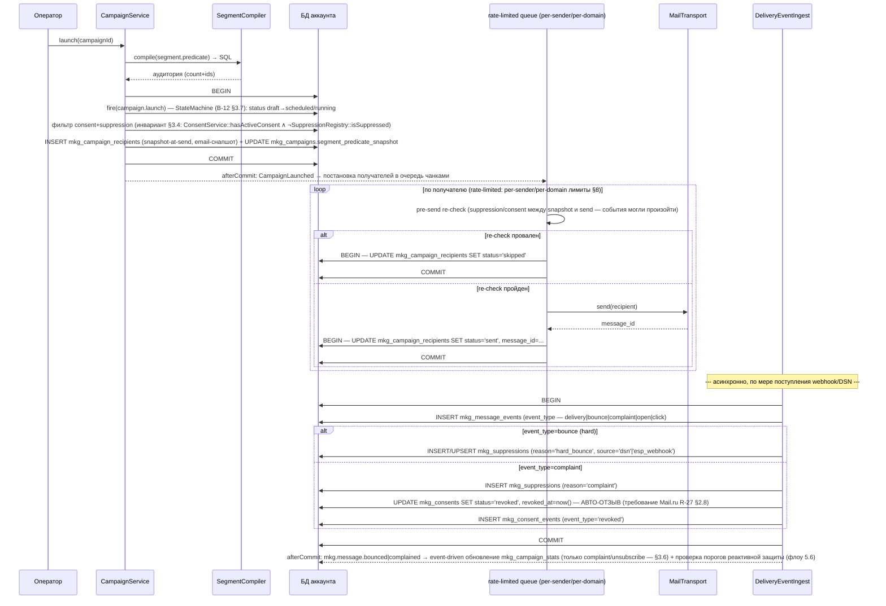
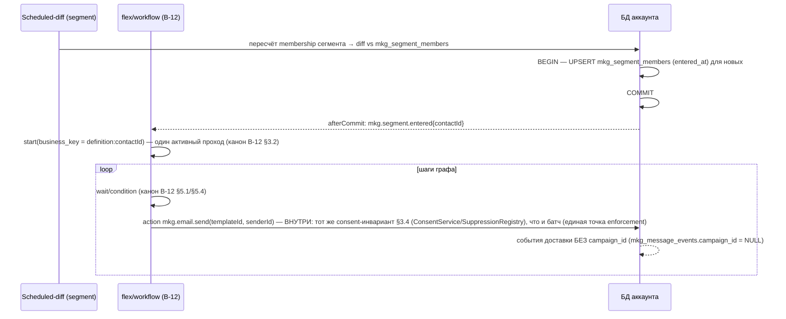
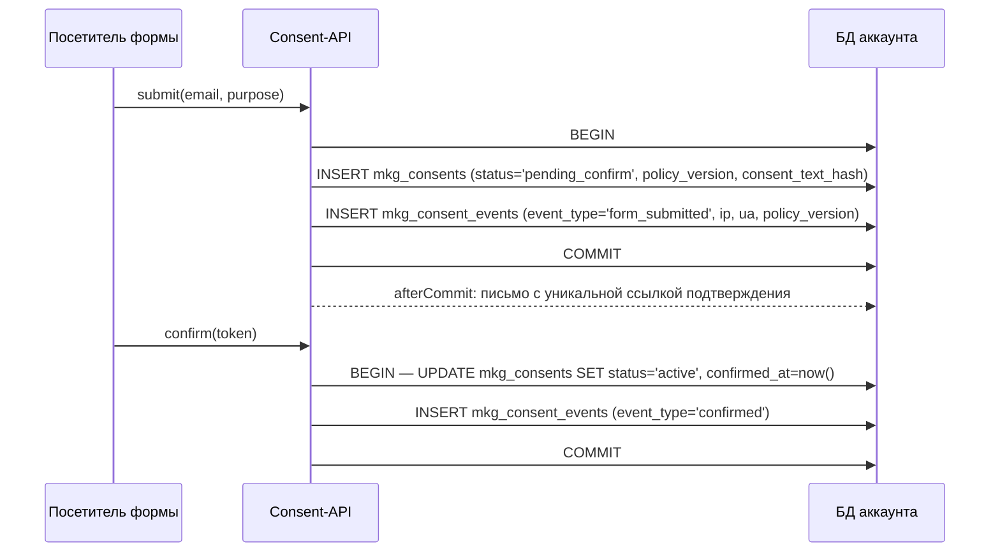
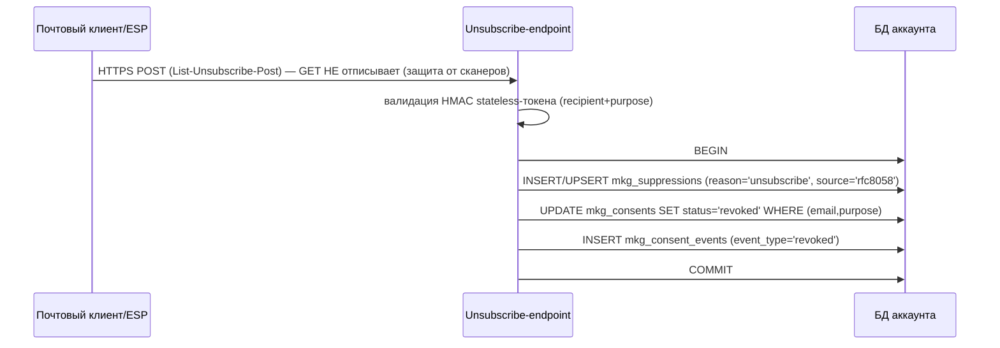
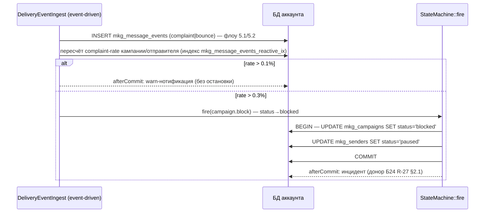

# B-30 — Маркетинг-домен FlexCRM: сегменты, кампании, цепочки, согласия (`mkg_`)

> **Статус: финал волны P3.1–P3.5** (FLEX-2 P2.4) — слой решений, глубина добрана срезами P3.1–P3.5.
> Входы: R-27 (P1.4, «→ входы B-30» — 10 входов), B-12 §5.5/§7 (массовые старты, лимиты Т7),
> B-11 §5.5 (permission keys + scope-компиляция), B-15 §1/§3.2/§4.1 (атрибуты, scopeFilter,
> Extend\EntityField), B-23 (edition-матрица, нотация B-22), D5 плана-предшественника
> (рантайм цепочек = flex/workflow), D10 (boxed-деградация).
> Конвенции: PK = UUIDv7 (D12 master); префикс `mkg_` (вход item'а P2.4, реестр префиксов
> DB_SCHEMA.md); `created_by` = jsonb ACTOR `{source, id, name}` — как в B-13; все таблицы несут
> `created_at/updated_at NOT NULL DEFAULT now()` (DB_SCHEMA.md §1), кроме явно помеченных
> append-only (только `created_at`/`occurred_at`).
> Нумерация разделов — формат волны B-27/B-28/B-29 (§7 MCP-тулзы, §8 НФТ-закладки, §9 реестр
> вопросов); от канон-нумерации B-13 отличается — consistency-сверку P4.1 вести по названиям
> разделов, не по номерам.
> Правовые утверждения — только со ссылкой на R-27 §2.7 (источники №16–19, №48).

---

## 1. Границы и состав

**Модуль маркетинга FlexCRM (домен `mkg_`)** — сегментация базы, email-кампании, триггерные
цепочки, реестр согласий и deliverability-контур. Монетизируемый pro-модуль (эскиз §3.9,
финализация edition-строк — Q52).

**В модуле:**
- динамические и статические сегменты по CRM-сущностям (стандартные поля + `fld_`-атрибуты B-15);
- батч-кампании email (собственный конвейер: snapshot → rate-limited отправка → события);
- триггерные цепочки — конфигурация поверх flex/workflow (D5), НЕ отдельный движок;
- consent-подконтур: реестр согласий, double opt-in, one-click отписка RFC 8058, suppression;
- транспортный слой: ESP-адаптеры (Unisender v1) + SMTP self-hosted (boxed-дефолт D10);
- метрики: сырые события доставки с MPP/bot-флагами + read-model статистики (правило B-24 §7);
- атрибуция: first/last-touch UTM + факт-таблица touchpoints.

**Вне модуля:** SMS/мессенджер-рассылки (v1.1 — канальная абстракция сегмента заложена,
R-27 §2.1); лендинги/формы (FlexCMS-домен — интеграционная точка = consent-API + touchpoint,
§6); рекламные кабинеты VK/Яндекс (v2); транзакционная почта (corex/notifications — граница
purpose, §3.4; общий ли транспортный контракт — §9 п.8); собственный MTA-контур (Q20, roadmap);
data-driven атрибуция (v2+, R-27 §2.10).

**Зависимости:** corex/core (EntityRegistry, TenantContext), flex/attributes (B-15: scopeFilter,
Extend\EntityField), corex/workflow (B-12: триггеры/ActionRegistry/business_key), corex/auth
(B-11: permission keys, scope), corex/crm (B-13: целевые сущности сегментов), corex/billing —
квоты cloud (boxed — config, D10).

**Граница OSS/проприетарное** — не решается здесь: продуктовый слой B-24/B-22, входит в повестку
Q52 (§9 п.5).

---

## 2. Схема БД

> Срез P3.1: полный DDL (индексы, партиции, CHECK/UNIQUE, COMMENT) — черновая пометка снята.
> Все таблицы — тенантская БД аккаунта.

**Добавки сверх списка R-27 §6.1 (зафиксировано как решение, обоснование §3.10):**
`mkg_message_templates` (шаблоны сообщений — прямое требование Scope Included P2.4, в списке
R-27 §6.1 отсутствовали) и `mkg_segment_members` (строки членства static-сегментов и
scheduled-материализация для триггеров — механика описана R-27 §4.1 текстом, таблица в §6.1
не поименована).

### 2.1 `mkg_segments` — сегмент (аудитория)

```sql
CREATE TABLE mkg_segments (
  id            uuid PRIMARY KEY,             -- UUIDv7
  workspace_id  uuid REFERENCES wsp_workspaces(id) ON DELETE CASCADE,  -- NULL = аккаунт-уровень; ось scope — P3.4
  entity_code   varchar(128) NOT NULL,        -- handle EntityRegistry формата {module_short}.{entity} (B-10 §3.4), НЕ имя таблицы: 'crm.contact'|'crm.lead'|'crm.company'
  name          varchar(255) NOT NULL,
  kind          varchar(16) NOT NULL DEFAULT 'dynamic' CHECK (kind IN ('dynamic','static')),
  status        varchar(16) NOT NULL DEFAULT 'active' CHECK (status IN ('active','archived')),
  predicate     jsonb,                        -- AND/OR-дерево предикатов (грамматика §3.2); NULL для static
  predicate_rev int NOT NULL DEFAULT 1,        -- счётчик правок предиката (полная история — v1.1, §9 п.9)
  created_by    jsonb NOT NULL,                -- ACTOR
  created_at timestamptz NOT NULL DEFAULT now(), updated_at timestamptz NOT NULL DEFAULT now(),
  CHECK ((kind = 'dynamic') = (predicate IS NOT NULL))
);
CREATE INDEX mkg_segments_ws_ix ON mkg_segments (workspace_id) WHERE status = 'active';  -- запрос: каталог активных сегментов
CREATE INDEX mkg_segments_entity_ix ON mkg_segments (entity_code) WHERE status = 'active';
```

### 2.2 `mkg_segment_members` — членство (static + материализация под триггеры)

```sql
CREATE TABLE mkg_segment_members (
  id         uuid PRIMARY KEY,                -- UUIDv7 surrogate: история входов/выходов не выражается натуральным PK без времени (§9 «натуральный ключ» решено здесь)
  segment_id uuid NOT NULL REFERENCES mkg_segments(id) ON DELETE CASCADE,
  entity_id  uuid NOT NULL,                    -- запись целевой сущности (entity_code сегмента)
  source     varchar(16) NOT NULL CHECK (source IN ('manual','csv_import','evaluation')),  -- evaluation = scheduled-diff (§3.2)
  entered_at timestamptz NOT NULL DEFAULT now(),
  exited_at  timestamptz,                      -- NULL = членство активно
  CHECK (exited_at IS NULL OR exited_at > entered_at)
);
CREATE UNIQUE INDEX mkg_segment_members_active_uq ON mkg_segment_members (segment_id, entity_id) WHERE exited_at IS NULL;  -- ровно одно активное членство на пару (натуральный ключ = "текущее", не история)
CREATE INDEX mkg_segment_members_entity_ix ON mkg_segment_members (entity_id) WHERE exited_at IS NULL;  -- запрос: «в каких сегментах сейчас эта сущность»
```

### 2.3 `mkg_campaigns` — батч-кампания

```sql
CREATE TABLE mkg_campaigns (
  id           uuid PRIMARY KEY,
  workspace_id uuid REFERENCES wsp_workspaces(id) ON DELETE CASCADE,
  name         varchar(255) NOT NULL,
  channel      varchar(16) NOT NULL DEFAULT 'email' CHECK (channel IN ('email')),  -- канальная абстракция v1 (R-27 §2.1)
  segment_id   uuid NOT NULL REFERENCES mkg_segments(id) ON DELETE RESTRICT,          -- нельзя снести сегмент, пока есть кампания-ссылка
  template_id  uuid NOT NULL REFERENCES mkg_message_templates(id) ON DELETE RESTRICT,
  sender_id    uuid NOT NULL REFERENCES mkg_senders(id) ON DELETE RESTRICT,
  status       varchar(16) NOT NULL DEFAULT 'draft'
               CHECK (status IN ('draft','scheduled','running','paused','completed','cancelled','blocked')),
               -- FSM statecraft; blocked = реактивная защита §3.5; переходы только через StateMachine::fire() (B-12 §7)
  scheduled_at timestamptz, started_at timestamptz, finished_at timestamptz,
  segment_predicate_snapshot jsonb,            -- копия предиката на момент запуска (воспроизводимость аудитории, §3.2)
  utm_defaults jsonb,                          -- utm_source/medium/campaign для ссылок письма (§3.7)
  created_by   jsonb NOT NULL,
  created_at timestamptz NOT NULL DEFAULT now(), updated_at timestamptz NOT NULL DEFAULT now()
);
CREATE INDEX mkg_campaigns_ws_ix     ON mkg_campaigns (workspace_id, status);      -- запрос: список кампаний аккаунта по статусу
CREATE INDEX mkg_campaigns_active_ix ON mkg_campaigns (status) WHERE status IN ('scheduled','running');  -- запрос: воркер запуска/троттлинга
```
Примечание: FK на `mkg_message_templates`/`mkg_senders` объявлены здесь до их `CREATE TABLE` ниже по файлу — миграционный порядок (S1 «migration order») ставит `mkg_message_templates`/`mkg_senders` ПЕРЕД `mkg_campaigns`; секции §2 идут в порядке чтения драфта, реальный порядок миграций — таблица в `slices/S1_db.md`.

### 2.4 `mkg_campaign_recipients` — snapshot-at-send (кто именно получил кампанию)

```sql
CREATE TABLE mkg_campaign_recipients (
  campaign_id   uuid NOT NULL REFERENCES mkg_campaigns(id) ON DELETE CASCADE,
  entity_id     uuid NOT NULL,
  email         varchar(255) NOT NULL,         -- снапшот адреса на момент запуска
  status        varchar(16) NOT NULL DEFAULT 'queued'
                CHECK (status IN ('queued','sent','delivered','bounced','complained','skipped')),
                -- FSM; skipped = не прошёл consent/suppression pre-send re-check (§3.4); opened/clicked — события §2.6, НЕ статусы
  message_id    text,                          -- id письма у транспорта (корреляция событий)
  last_event_at timestamptz,
  created_at timestamptz NOT NULL DEFAULT now(), updated_at timestamptz NOT NULL DEFAULT now(),
  PRIMARY KEY (campaign_id, entity_id)          -- натуральный ключ решён здесь (§9): одна кампания шлётся сущности ровно раз, re-entry не нужен
);
CREATE INDEX mkg_campaign_recipients_message_ix ON mkg_campaign_recipients (message_id) WHERE message_id IS NOT NULL;  -- запрос: корреляция webhook-события транспорта
CREATE INDEX mkg_campaign_recipients_status_ix  ON mkg_campaign_recipients (campaign_id, status);  -- запрос: dashboard статуса рассылки
```

> **Account-level by design (правка P4.2/B-99b §5 п.2).** `mkg_message_templates`,
> `mkg_senders`, `mkg_consents`, `mkg_suppressions`, `mkg_touchpoints` (§2.5, §2.7, §2.9,
> §2.10, §2.11) НЕ несут `workspace_id` — в отличие от `mkg_segments`/`mkg_campaigns`
> (§2.1/§2.2), которые несут. Это осознанное разграничение, не пропуск: consent/
> suppression/touchpoint — факт о email-адресе субъекта (не о workspace, ось видимости
> §3.4 — Consent НЕ выражается permission key'ем); sender — инфраструктурный ресурс
> отправки на аккаунт (`mkg_senders_default_uq` — ровно один дефолтный НА АККАУНТ, не на
> workspace); template переиспользуется кампаниями разных workspace одного аккаунта. Не
> унифицировать этот набор с workspace-скоупом `mkg_segments`/`mkg_campaigns`.

### 2.5 `mkg_message_templates` — шаблон сообщения

```sql
CREATE TABLE mkg_message_templates (
  id         uuid PRIMARY KEY,
  name       varchar(255) NOT NULL,
  channel    varchar(16) NOT NULL DEFAULT 'email' CHECK (channel IN ('email')),
  status     varchar(16) NOT NULL DEFAULT 'draft' CHECK (status IN ('draft','active','archived')),
  subject    varchar(998) NOT NULL,            -- RFC 5322 практический предел длины заголовка Subject
  preheader  varchar(255),
  body_html  text NOT NULL,
  body_text  text,
  variables  jsonb,                            -- декларация используемых подстановок (поля сущности + fld_-атрибуты); движок/санитизация HTML — P3.3 (§9 п.7)
  created_by jsonb NOT NULL,
  created_at timestamptz NOT NULL DEFAULT now(), updated_at timestamptz NOT NULL DEFAULT now()
);
CREATE INDEX mkg_message_templates_active_ix ON mkg_message_templates (status) WHERE status = 'active';  -- запрос: выбор шаблона при создании кампании
```

### 2.6 `mkg_message_events` — сырые события доставки (append-only; partition-ready — Q19)

```sql
CREATE TABLE mkg_message_events (
  id               uuid PRIMARY KEY,           -- UUIDv7 — time-sortable
  occurred_at      timestamptz NOT NULL,
  event_type       varchar(16) NOT NULL
                   CHECK (event_type IN ('send','delivery','bounce','complaint','open','click','unsubscribe')),
  campaign_id      uuid REFERENCES mkg_campaigns(id) ON DELETE CASCADE,   -- NULL = письмо цепочки (без campaign_id)
  recipient_id     uuid,                       -- НЕ FK: mkg_campaign_recipients PK составной (campaign_id,entity_id) — matching на пару колонок ниже
  entity_id        uuid,
  email            varchar(255) NOT NULL,
  is_mpp           boolean,                    -- open через Apple-прокси (R-27 §2.9)
  is_bot           boolean,                    -- click SEG-шлюза, ретроспективная переклассификация
  url              text,                       -- click
  user_agent       varchar(512),
  ip               inet,
  bounce_class     varchar(8) CHECK (bounce_class IN ('hard','soft')),
  provider         varchar(16) NOT NULL CHECK (provider IN ('unisender','smtp')),
  provider_payload jsonb,
  message_id       text,
  created_at       timestamptz NOT NULL DEFAULT now()   -- append-only: НЕТ updated_at (события неизменны после записи)
);
CREATE INDEX mkg_message_events_campaign_ix ON mkg_message_events (campaign_id, occurred_at) WHERE campaign_id IS NOT NULL;  -- запрос: агрегация статистики кампании (nightly batch §3.6)
CREATE INDEX mkg_message_events_message_ix  ON mkg_message_events (message_id) WHERE message_id IS NOT NULL;  -- запрос: webhook-корреляция по message_id транспорта
CREATE INDEX mkg_message_events_reactive_ix ON mkg_message_events (campaign_id, event_type, occurred_at) WHERE event_type IN ('complaint','bounce');  -- запрос: реактивная защита — event-driven счётчик порогов §3.1
CREATE INDEX mkg_message_events_brin_ix     ON mkg_message_events USING BRIN (occurred_at);
COMMENT ON TABLE mkg_message_events IS
  'Partition-ready с первого дня по occurred_at (объём: контакты×события, Q19 Resolved): FK ИЗ других таблиц НА mkg_message_events отсутствуют, паттерн crm_tml/cht_messages. v1 — single-table; opt-in помесячные партиции pg_partman при высоком объёме (B-26 §3). recipient_id НЕ несёт FK-constraint — natural join через (campaign_id, entity_id) на составной PK mkg_campaign_recipients';
```

### 2.7 `mkg_consents` — актуальное состояние согласия

```sql
CREATE TABLE mkg_consents (
  id                uuid PRIMARY KEY,
  email             varchar(255) NOT NULL,     -- согласие привязано к адресу (доказательная база, R-27 §2.7)
  entity_id         uuid,                       -- линк на CRM-контакт при наличии (NULL = адрес без карточки)
  channel           varchar(16) NOT NULL DEFAULT 'email' CHECK (channel IN ('email')),
  purpose           varchar(32) NOT NULL DEFAULT 'marketing',  -- purpose-мерность R-27 §4.4; без строгого CHECK — расширяемый словарь (не enum канона)
  status            varchar(16) NOT NULL DEFAULT 'pending_confirm'
                     CHECK (status IN ('pending_confirm','active','revoked')),
  policy_version    varchar(32) NOT NULL,
  consent_text_hash varchar(64) NOT NULL,       -- редакция текста согласия (R-27 §2.7)
  source            varchar(16) NOT NULL CHECK (source IN ('form','import','api','manual')),
  confirmed_at      timestamptz, revoked_at timestamptz,
  created_at timestamptz NOT NULL DEFAULT now(), updated_at timestamptz NOT NULL DEFAULT now(),
  UNIQUE (email, channel, purpose)              -- натуральный ключ решён здесь (§9): актуальное состояние per (email,channel,purpose); история — mkg_consent_events
);
CREATE INDEX mkg_consents_entity_ix ON mkg_consents (entity_id) WHERE entity_id IS NOT NULL;
CREATE INDEX mkg_consents_active_ix ON mkg_consents (email) WHERE status = 'active';  -- запрос: ConsentService::hasActiveConsent — hot path enforcement §3.4
```

### 2.8 `mkg_consent_events` — append-only лог согласий

```sql
CREATE TABLE mkg_consent_events (
  id                uuid PRIMARY KEY,
  consent_id        uuid NOT NULL REFERENCES mkg_consents(id) ON DELETE CASCADE,
  event_type        varchar(16) NOT NULL
                     CHECK (event_type IN ('form_submitted','confirm_sent','confirmed','revoked','imported')),
  occurred_at       timestamptz NOT NULL,
  ip                inet,
  ua                varchar(512),
  policy_version    varchar(32),
  consent_text_hash varchar(64),
  payload           jsonb,
  created_at        timestamptz NOT NULL DEFAULT now()   -- append-only: НЕТ updated_at
);
CREATE INDEX mkg_consent_events_consent_ix ON mkg_consent_events (consent_id, occurred_at);  -- запрос: доказательная история согласия (аудит/жалоба)
```

### 2.9 `mkg_suppressions` — глобальный stop-список

```sql
CREATE TABLE mkg_suppressions (
  id            uuid PRIMARY KEY,
  email         varchar(255) NOT NULL,
  purpose       varchar(32),                   -- NULL = глобальный stop; per-purpose отписка — R-27 §4.4
  reason        varchar(24) NOT NULL
                CHECK (reason IN ('unsubscribe','hard_bounce','soft_bounce_threshold','complaint','manual')),
  source        varchar(16) NOT NULL CHECK (source IN ('rfc8058','fbl','dsn','esp_webhook','manual')),
  campaign_id   uuid REFERENCES mkg_campaigns(id) ON DELETE SET NULL,  -- provenance; кампания может быть архивирована/снесена без потери stop-строки
  suppressed_at timestamptz NOT NULL DEFAULT now(),
  created_at timestamptz NOT NULL DEFAULT now(), updated_at timestamptz NOT NULL DEFAULT now(),
  UNIQUE NULLS NOT DISTINCT (email, purpose)    -- одна актуальная stop-строка на (email,purpose); реактивация — DELETE+re-check через reconfirmation (§3.3), не UPDATE-история
);
CREATE INDEX mkg_suppressions_email_ix ON mkg_suppressions (email);  -- запрос: SuppressionRegistry::isSuppressed — hot path enforcement §3.4
COMMENT ON TABLE mkg_suppressions IS 'Реактивация — только через reconfirmation (R-27 §2.4), автоистечения нет: строка живёт до явного удаления сервисом, не TTL';
```

### 2.10 `mkg_senders` — отправители (ящик/домен)

```sql
CREATE TABLE mkg_senders (
  id              uuid PRIMARY KEY,
  from_email      varchar(255) NOT NULL,
  from_name       varchar(255) NOT NULL,
  domain          varchar(255) NOT NULL,
  transport       varchar(16) NOT NULL CHECK (transport IN ('unisender','smtp')),
  credentials_ref varchar(255),                -- секреты НЕ в конфиге, по прецеденту B-18 §8 п.7 (Q53 → P3.3)
  daily_limit     int CHECK (daily_limit IS NULL OR daily_limit > 0),  -- суточный лимит ящика (донор Б24, R-27 §2.1)
  status          varchar(20) NOT NULL DEFAULT 'pending_verification'
                  CHECK (status IN ('pending_verification','active','paused','blocked')),
  auth_status     jsonb NOT NULL DEFAULT '{}',  -- health-check: SPF/DKIM/DMARC alignment, двойной DKIM Mail.ru, last_checked_at (§3.5)
  is_default      boolean NOT NULL DEFAULT false,
  created_by      jsonb NOT NULL,
  created_at timestamptz NOT NULL DEFAULT now(), updated_at timestamptz NOT NULL DEFAULT now(),
  UNIQUE (from_email)
);
CREATE UNIQUE INDEX mkg_senders_default_uq ON mkg_senders ((true)) WHERE is_default;  -- ровно один дефолтный отправитель на аккаунт
CREATE INDEX mkg_senders_domain_ix ON mkg_senders (domain);  -- запрос: health-check по домену (несколько ящиков одного домена)
```

### 2.11 `mkg_touchpoints` — факт-таблица касаний (append-only; partition-ready — Q19)

```sql
CREATE TABLE mkg_touchpoints (
  id          uuid PRIMARY KEY,                -- UUIDv7
  entity_id   uuid NOT NULL,                    -- контакт
  deal_id     uuid,
  occurred_at timestamptz NOT NULL,
  channel     varchar(32) NOT NULL,             -- нормализованный
  event_type  varchar(32) NOT NULL,
  utm         jsonb,                            -- raw utm_*
  campaign_id uuid REFERENCES mkg_campaigns(id) ON DELETE SET NULL,
  session_id  varchar(64),
  source      varchar(16) NOT NULL CHECK (source IN ('form','email_click','import','manual')),
  created_at  timestamptz NOT NULL DEFAULT now()  -- append-only: НЕТ updated_at
);
CREATE INDEX mkg_touchpoints_entity_ix ON mkg_touchpoints (entity_id, occurred_at);  -- запрос: AttributionRecorder — путь касаний контакта (first/last-touch)
CREATE INDEX mkg_touchpoints_deal_ix   ON mkg_touchpoints (deal_id) WHERE deal_id IS NOT NULL;
CREATE INDEX mkg_touchpoints_brin_ix   ON mkg_touchpoints USING BRIN (occurred_at);
COMMENT ON TABLE mkg_touchpoints IS
  'Partition-ready с первого дня по occurred_at (самая быстрорастущая таблица модуля — контакты×события, Q19 Resolved), паттерн crm_tml/cht_messages. Единственный источник правды multi-touch (R-27 §2.10); модели атрибуции (linear/U-shaped) — отчётный read-model слой v1.1 (§3.7), НЕ эта таблица';
```

### 2.12 `mkg_campaign_stats` — read-model (производный индекс, B-24 §7)

```sql
CREATE TABLE mkg_campaign_stats (
  campaign_id      uuid PRIMARY KEY REFERENCES mkg_campaigns(id) ON DELETE CASCADE,
  sent int NOT NULL DEFAULT 0, delivered int NOT NULL DEFAULT 0, bounced int NOT NULL DEFAULT 0,
  complained int NOT NULL DEFAULT 0, unsubscribed int NOT NULL DEFAULT 0,
  opens_raw int NOT NULL DEFAULT 0, opens_non_mpp int NOT NULL DEFAULT 0,
  clicks_raw int NOT NULL DEFAULT 0, clicks_human int NOT NULL DEFAULT 0,
  conversions int NOT NULL DEFAULT 0,
  computed_at timestamptz NOT NULL DEFAULT now()  -- nightly batch; event-driven — только complaint/unsubscribe (§3.6)
);
COMMENT ON TABLE mkg_campaign_stats IS 'Read-model/projection (B-26 §2): не партиционируется/не архивируется — пересчитывается детерминированно из mkg_message_events; повторный batch идемпотентен (UPSERT по campaign_id)';
```

### 2.13 First/last-touch поля на CRM-сущностях — НЕ таблица `mkg_`

First-touch UTM (замороженный) на контакте + last-touch на лиде/сделке — декларации
`Extend\EntityField` (B-15 §4.1) от модуля mkg, НЕ прямые колонки в канон-DDL B-13 (§3.7).

---

## 3. Ключевые архитектурные решения

> Детальные guard'ы/SQL/сигнатуры добраны срезами P3.2–P3.5.

### 3.1 Разделение конвейеров: батч-кампания ≠ триггерная цепочка (вход 3 — ПРИНЯТО)

**Батч-рассылка НЕ ходит через flex/workflow** — собственный конвейер `mkg_` (R-27 §4.2):
snapshot аудитории → rate-limited queue Laravel с per-sender/per-domain лимитами → события.
**Триггерные цепочки — ЧЕРЕЗ flex/workflow** (D5): триггер `entity_event`
(`mkg.segment.entered`, `crm.lead.created`…), `business_key = definition:contact_id` — «один
активный проход» из коробки (B-12 §3.2, HubSpot-семантика R-27 §2.5), шаг «отправить письмо» =
action `mkg.email.send` в ActionRegistry (B-12 §3.3).

**Проверка лимитов Т7 (требование Scope P2.4) — выполнена, она и разделила конвейеры:**
rate-limited queue B-12 §5.5 (60 стартов/мин на definition) для 10K-сегмента = ~2.8 ч только
стартов — приемлемо для дриповой цепочки, неприемлемо для разовой рассылки; месячные бюджеты
шагов B-12 §7 (10K/100K/1M) не рассчитаны на «шаг = письмо» — одна кампания 10K × 3–5 шагов
съедает бюджет тарифа (R-27 §4.2). Формулировка ТЗ «кампания = конфигурация над flex/workflow»
выполняется в части цепочек; для батча — обоснованное отступление по итогам той самой проверки.
Канон B-12 §7 НЕ правим (D11): требование квоты маркетинг-цепочек — **Q17** (предварительно:
отдельная ось квоты `mkg`-шагов; срез НФТ P3.5 → арбитраж P4.2).

**Реактивная защита** (донор Б24 R-27 §2.1 + пороги §2.8): complaint rate кампании/отправителя
> 0.1% — warn, > 0.3% — авто-пауза (`status=blocked`) + инцидент; hard bounce/complaint →
немедленный suppress (§3.4).

### 3.2 Сегменты: on-the-fly + snapshot-at-send; компилятор; реестр предикатов (входы 1–2 — ПРИНЯТО; Q18 решён здесь)

- Сегмент = сохранённое AND/OR-дерево предикатов (jsonb), `kind = dynamic | static` (R-27 §4.1).
- Вычисление — **on-the-fly компиляция в SQL** по тенантской БД (масштаб DB-per-account:
  10²–10⁵ контактов, R-27 §3.1) + **обязательный snapshot-at-send** в `mkg_campaign_recipients`
  (консенсус R-27 §2.3) + копия предиката в `mkg_campaigns.segment_predicate_snapshot`.
- **Компилятор**: AND/OR-дерево из вызовов `AttributeStore::scopeFilter(entityCode, code, op, value)`
  (B-15 §3.2 — та же грамматика op, что REST-фильтры B-15 §6.4) + системные предикаты
  (стандартные поля, воронка/стадия) + предикат-провайдеры модулей. Относительные даты
  («последние N дней») вычисляются в абсолютные значения в момент компиляции — не дело B-15
  (R-27 §4.1). Record-scope пользователя при preview/запуске — через `ScopeResolver::apply()`
  B-11 §5.5 (какой принципал «видит» сегмент — P3.4).
- **Q18 — решено здесь**: `SegmentPredicateProvider` — **внутренний реестр модуля mkg по образцу
  ActionRegistry B-12 §3.3** (модули регистрируют провайдеры событийных/агрегатных предикатов —
  «кликал за 90 дней» по `mkg_message_events`, «сумма сделок» от CRM — через свои
  ServiceProvider'ы); на уровень реестров B-10 НЕ поднимаем — потребитель один (сегменты),
  Rule of Three не набран. Форма контракта — срез P3.3.
- События `mkg.segment.entered/left` — v1 через **scheduled-diff** (пересчёт по расписанию /
  debounce; результат материализуется в `mkg_segment_members` с `entered_at/exited_at` — только
  для сегментов, привязанных к триггерам цепочек). Это не отменяет on-the-fly для send:
  материализация — под триггеры, не под отправку (R-27 §3.1/§4.1). Real-time инкрементальный
  membership — v1.1 (roadmap §3.9).
- Статические сегменты — v1: те же `mkg_segments` + явные строки `mkg_segment_members`
  (`source = manual | csv_import`).

### 3.3 Транспортный слой (вход 4 — ПРИНЯТО)

Контракты `MailTransport` (отправка) + `DeliveryEventIngest` (webhook/DSN → унифицированные
события `delivered/bounced/complained/opened/clicked/unsubscribed`) — кампании и цепочки
транспорта не знают (R-27 §2.4/§3.2). v1: адаптер **Unisender (+Go для писем цепочек)** и
**SMTP self-hosted — обязательный boxed-дефолт (D10)** с честной деградацией: bounce-классификация
по DSN-кодам, без FBL — документируется. DashaMail — v1.1; Sendsay — отказ v1 (конкурирующая CDP);
свой MTA-контур — v2/enterprise (Q20). Suppression-конвейер R-27 §2.4: hard bounce → немедленный
suppress; повторный soft bounce → suppress по порогу попыток; complaint → мгновенный suppress,
реактивация только через reconfirmation.

### 3.4 Consent-подконтур и инвариант отправки (вход 5 — ПРИНЯТО; юр-блокер)

Согласия — блокер запуска любых рассылок: отправка без доказуемого согласия = состав ч. 4.1
ст. 14.3 КоАП (R-27 §2.7, источники №16–18). Состав v1 — целиком (R-27 §4.4): реестр
`mkg_consents` + append-only `mkg_consent_events`; **double opt-in** — дефолт новых подписок
(выключаемо per-tenant с явным предупреждением об ответственности; импортированные из Б24/amo
базы с существующими согласиями — `source=import`, без принудительной reconfirmation);
**one-click unsubscribe RFC 8058** — заголовки `List-Unsubscribe` + `List-Unsubscribe-Post`,
HTTPS POST endpoint, обработка ≤48 ч, DKIM покрывает оба заголовка (R-27 §2.8); отписка
per-purpose + глобальный stop-список `mkg_suppressions`. Unsubscribe-ссылка — подписанный
stateless-токен (recipient + purpose, HMAC), отдельная таблица токенов не нужна — форма P3.3.

**Consent-инвариант (решение зафиксировано; входит в safety-инварианты среза P3.5):**

> Письмо `purpose=marketing` не может быть отправлено субъекту без активного согласия на этот
> purpose и при наличии его в `mkg_suppressions`. Enforcement — на уровне данных, не UI:
> (1) формирование `mkg_campaign_recipients` фильтрует аудиторию по активному consent +
> отсутствию suppression (R-27 §6.5); (2) pre-send re-check suppression непосредственно перед
> отправкой (события между snapshot и send) — нарушение → `status=skipped`;
> (3) action `mkg.email.send` в цепочках выполняет ту же проверку через единые
> `ConsentService`/`SuppressionRegistry` — точка enforcement одна на оба конвейера.

Стык R-16 §2.2.3: в ESP передаётся минимум полей (email + подстановки); передача базы ESP =
обработка по поручению (ст. 6 ч. 3 152-ФЗ) — пункт DPA/оферты, продуктовая дока, не код.

### 3.5 Deliverability-гейт (вход 6 — ПРИНЯТО)

**Health-check sender-домена перед включением рассылок** (R-27 §2.8/§4.3): SPF + DKIM + DMARC
alignment; для ESP-режима Mail.ru — двойной DKIM (домен ESP + домен клиента); результат — в
`mkg_senders.auth_status`, без прохождения — `status=pending_verification`, рассылки заблокированы.
Авто-пауза по complaint rate (пороги 0.1% warn / 0.3% hard — §3.1). FBL/Postmaster-интеграции
(Mail.ru, Google) — v1.1. Клик-трекинг — брендовый redirect-домен, не generic-трекер (R-27 §2.9;
механика — P3.3).

### 3.6 Метрики и read-models (вход 7 — ПРИНЯТО)

Сырьё `mkg_message_events` — с первого дня, с флагами `is_mpp` (open через Apple-прокси) и
`is_bot` (SEG-клики; UA/IP/ts хранятся для ретроспективной переклассификации) — задним числом
не восстановить (R-27 §4.5). `mkg_campaign_stats` — **nightly batch** + **event-driven только
complaint/unsubscribe** (питают реактивную защиту — критерий B-24 §7 «мгновенно значимое»).
**Open-триггеры в палитре цепочек v1 отсутствуют** — MPP сломал семантику (R-27 §2.9); триггеры —
клики и конверсии. UI: клики/конверсии первичны, opens — с бейджем «включая Apple MPP».

### 3.7 Атрибуция (вход 8 — ПРИНЯТО, механизм полей уточнён)

v1: first-touch UTM (замороженные поля — заполняются первым валидным касанием, не
перезаписываются) на контакте + last-touch на лиде/сделке + факт-таблица `mkg_touchpoints`
(R-27 §2.10/§4.6). **Уточнение механизма**: first/last-touch поля на CRM-сущностях — НЕ прямые
колонки канон-DDL B-13 (молчаливая дельта канона запрещена, D11), а **декларации
`Extend\EntityField` модуля mkg** (B-15 §4.1: ddl-драйвер → реальные колонки, тот же DSL, что
у вертикалей) — канон B-13 не трогается, механизм существующий. Если срез P3.1 найдёт
несовместимость — альтернатива (прямые колонки = дельта B-13) уходит в арбитраж (§9 п.6).
Захват: hidden-поля форм + cookie expiry 90 дней; self-reported source — обычное поле. Модели
отчётов (first/last/linear/U-shaped) — v1.1 read-models поверх touchpoints; data-driven — v2+.

### 3.8 Права AzGuard (формат B-11 §5.5)

Permission keys `{module}.{entity}.{action}`: `mkg.segment.view|create|edit|archive`,
`mkg.campaign.view|create|edit|launch|pause|cancel`, `mkg.template.view|create|edit`,
`mkg.consent.view|manage`, `mkg.sender.view|manage`, `mkg.report.view`. `launch` — отдельное
право (редактор ≠ запускающий, аналогия publish B-12 §5.6.5). Scope-ось v1 — workspace/account
(mkg-сущности не ownable, owner_id нет); матрица и guard'ы — срез P3.4 (§9 п.10).

### 3.9 Edition-гейтинг — эскиз (вход 9 — ПРИНЯТО; внесение в канон — Q52)

Эскиз R-27 §4.7 в нотации B-22 (`{module_slug}.{area}.{feature}`, boolean-гейт
`ModuleActivationGate::featureAvailable()`):

| Ключ | Edition | Что гейтит |
|---|---|---|
| `mkg.segments.basic` | pro | сегменты (dynamic + static) |
| `mkg.campaigns.email` | pro | батч-кампании + шаблоны + senders |
| `mkg.chains.workflow` | pro | триггерные цепочки (тулза поверх corex/workflow) |
| `mkg.reports.basic` | pro | campaign-stats read-model |
| `mkg.attribution.multi_touch` | enterprise-only (по образцу строк B-24 §2) | модели атрибуции v1.1 |
| `mkg.senders.multi_domain` | enterprise-only | несколько sender-доменов |

base-тир — без `mkg_` (только ручные письма CRM — вне модуля). Схема присутствует на любом
тире (инвариант B-22 §3.4 / B-23 §4 — «pro-фичи никогда не гейтятся схемой»). Количественные
лимиты (писем/месяц и т.п.) — ось `root_plans.limits` (класс A), мост `unlocks_feature`
(B-23 §3.2) — Q54. **Внесение mkg-строк в B-24 §2 = аддитивная дельта утверждённого канона —
НЕ вносится драфтом (D11), реестр → Q52 → арбитраж P4.2.**

### 3.10 Сводная таблица вердиктов по входам R-27 §6

| Вход R-27 §6 | Вердикт | Где |
|---|---|---|
| 1. Схема `mkg_` (каркас) | ПРИНЯТО + 2 добавки (`mkg_message_templates` — требование ТЗ P2.4; `mkg_segment_members` — механика R-27 §4.1, в списке §6.1 не поименована) | §2 |
| 2. Сегмент-компилятор | ПРИНЯТО; Q18 решён: внутренний реестр по образцу ActionRegistry | §3.2 |
| 3. Разделение конвейеров | ПРИНЯТО (батч ≠ workflow; цепочки = workflow, business_key; Q17 → P3.5/P4.2) | §3.1 |
| 4. Транспорт | ПРИНЯТО (MailTransport + DeliveryEventIngest; Unisender+Go, SMTP boxed) | §3.3 |
| 5. Consent-подконтур | ПРИНЯТО; consent-инвариант зафиксирован (двойной enforcement + единая точка для цепочек) | §3.4 |
| 6. Deliverability-гейт | ПРИНЯТО (health-check, авто-пауза 0.1/0.3%, FBL v1.1) | §3.5 |
| 7. Метрики | ПРИНЯТО (MPP/bot-флаги с первого дня; opens вне автоматизаций; nightly + event-driven) | §3.6 |
| 8. Атрибуция | ПРИНЯТО, механизм уточнён: поля через `Extend\EntityField` B-15 §4.1, не колонки B-13 | §3.7 |
| 9. Edition-гейтинг | ПРИНЯТО как эскиз; строки в B-24 §2 — дельта канона → Q52 (D11) | §3.9 |
| 10. Roadmap-записи | ПРИНЯТО (SMS v1.1, рекламные кабинеты v2, MTA = Q20, live-membership v1.1) | §1, §9 |

### 3.11 Права: подтверждение матрицы `mkg.*`, guard `launch`, агентские принципалы, consent — не право (срез P3.4)

> Срез P3.4: подтверждение permission keys/scope + guard'ы + разграничение consent/permission — черновая пометка снята для права-подраздела.

**Матрица permission keys** (полный список — уже §3.8, подтверждён без изменений этим срезом): `mkg.segment.view|create|edit|archive`, `mkg.campaign.view|create|edit|launch|pause|cancel`, `mkg.template.view|create|edit`, `mkg.consent.view|manage`, `mkg.sender.view|manage`, `mkg.report.view`. Scope-ось v1 — **только workspace/account** (не ownable — `mkg_segments`/`mkg_campaigns` не несут `owner_id`); SQL-компиляция — БЕЗ нового предиката, ровно канонная таблица B-11 §5.5 (workspace — уже наложенный global scope на `workspace_id`; account — предикат пуст). Ни один ключ волны не требует нового scope-значения или аддитивного резолвера (в отличие от B-28/B-29) — маркетинг-сущности видны/редактируются целиком в границах workspace/account, доменных «своих» записей (own) не бывает.

**Guard `mkg.campaign.launch`** — отдельное право от `mkg.campaign.edit` (редактор ≠ запускающий, §3.8): `CampaignService::launch()` вызывает `AccessChecker::allowed(principal, 'mkg.campaign', 'launch')` ДО `StateMachine::fire(campaign.launch)` (флоу 5.1) — обычная capability-проверка, без record-scope (кампания видна в любом случае в рамках account/workspace, право launch — булев гейт действия, не видимости).

**Агентские принципалы** (`ai.*` — B-32 §3.6): агент проверяется той же двухфазной моделью, что человек (capability + фактический вызов), эффективное право = **intersection**(права роли агента, capability самой тулзы). Для маркетинга практическое следствие уже зафиксировано B-32 §7.4: v1 агенту НЕ выдаются `mkg.create_segment`/`mkg.schedule_campaign`(irreversible)/`mkg.unsubscribe_contact`/`mkg.enroll_chain`/`stop_chain` — юр-риск, не AzGuard-ограничение; агент физически МОЖЕТ обладать ролью с `mkg.campaign.launch`, но тулза `mkg.pause_campaign` (не launch) — единственная мутационная, выданная агенту v1, поэтому даже с ролью «маркетолог» агент не запускает кампании (тулзы launch нет в каталоге агента, N7 capability-гейт каталога B-32 §3.10 не решает вопрос отдельно — вопрос решён на уровне ToolProvider-декларации B-32 §7.4, не на уровне AzGuard-роли).

**Consent НЕ выражается permission key'ем (Code Guidance).** `mkg_consents`/`mkg_suppressions` — данные СУБЪЕКТА (контакта), а не право сотрудника: `ConsentService::hasActiveConsent()`/`SuppressionRegistry::isSuppressed()` (§3.4) — это ФАКТ о email-адресе, проверяемый на каждой отправке независимо от того, кто (или какой агент) инициировал кампанию. Разграничение: `mkg.campaign.launch` отвечает на вопрос «может ли ЭТОТ сотрудник запустить кампанию», consent-инвариант отвечает на вопрос «можно ли отправить письмо ЭТОМУ адресату» — оба гейта проверяются последовательно и независимо (сотрудник с правом `launch` не может обойти consent; отсутствие consent не проверяется через AzGuard). Смешение этих двух осей в одну (например, «право слать письма конкретному сегменту») было бы категориальной ошибкой (полномочие ≠ согласие субъекта) — зафиксировано явно по требованию Code Guidance item'а.

---

## 4. Контракты

> Срез P3.3: полные PHP-интерфейсы (@api, PHPStan level 8, форма B-16 §3), решения по шаблонному
> движку (п.7), общему транспорту (п.8), credentials (Q53), реестр событий и MCP-карта —
> черновая пометка снята.

```php
namespace Corex\Marketing;

use Corex\Auth\Actor;

enum SegmentKind: string { case Dynamic = 'dynamic'; case Static = 'static'; }
enum ConsentStatus: string { case PendingConfirm = 'pending_confirm'; case Active = 'active'; case Revoked = 'revoked'; }
enum RecipientStatus: string { case Queued = 'queued'; case Sent = 'sent'; case Delivered = 'delivered'; case Bounced = 'bounced'; case Complained = 'complained'; case Skipped = 'skipped'; }

/** readonly, id+type+display — форма единая с B-16 §3 */
final readonly class SegmentRef
{
    public function __construct(public string $id, public string $type /* 'mkg.segment' */, public string $display) {}
}
final readonly class CampaignRef
{
    public function __construct(public string $id, public string $type /* 'mkg.campaign' */, public string $display, public string $status) {}
}

final readonly class SegmentPreview
{
    public function __construct(public int $count, /** @var list<string> */ public array $sampleEntityIds) {}
}
/** Компилируемое условие SQL Builder (поверх scopeFilter B-15 §3.2) — opaque для вызывающего, комбинируется AND/OR */
final readonly class SqlPredicate
{
    public function __construct(public string $sql, public array $bindings) {}
}
final readonly class MailMessage
{
    public function __construct(
        public string $toEmail, public string $fromEmail, public string $fromName,
        public string $subject, public string $bodyHtml, public ?string $bodyText,
        public ?string $campaignId = null, public ?string $recipientKey = null /* (campaign_id,entity_id) для корреляции */,
    ) {}
}
final readonly class SendResult
{
    public function __construct(public string $messageId, public string $provider) {}
}
final readonly class DeliveryEvent
{
    public function __construct(
        public string $eventType /* send|delivery|bounce|complaint|open|click|unsubscribe */,
        public ?string $messageId, public ?string $recipientId, public ?string $entityId,
        public string $email, public array $providerPayload,
    ) {}
}

/** Провайдер согласия/suppression re-check не удовлетворён на pre-send */
final class ConsentOrSuppressionViolationException extends \DomainException {}

interface MailTransport                       // унисендер/smtp (§3.3)
{
    public function send(MailMessage $message): SendResult;
}

interface DeliveryEventIngest                 // webhook/DSN → унифицированное событие
{
    public function ingest(array $rawWebhookPayload, string $provider): DeliveryEvent;
}

interface SegmentCompiler                     // предикат-дерево → SQL (поверх scopeFilter B-15 §3.2)
{
    public function compile(array $predicateTree, string $entityCode): SqlPredicate;   // AND/OR-дерево → компилируемое условие
    public function count(SegmentRef $segment): int;
    public function preview(SegmentRef $segment, int $sampleSize = 20): SegmentPreview;
}

/** Контракт провайдера событийных/агрегатных предикатов — внутренний реестр модуля (Q18 → Resolved, §3.2) */
interface SegmentPredicateProvider
{
    /** @return list<string> коды операторов, которые провайдер обслуживает ('mkg.clicked_within_days'...) */
    public function provides(): array;
    public function apply(string $operatorCode, array $args, string $entityCode): SqlPredicate;
}

interface CampaignService
{
    /** fire(campaign.launch) + snapshot аудитории — одна транзакция (флоу 5.1) */
    public function launch(string $campaignId, Actor $actor): void;
    public function pause(string $campaignId, Actor $actor): void;
    public function resume(string $campaignId, Actor $actor): void;
    public function cancel(string $campaignId, Actor $actor): void;
}

/** Единая точка enforcement consent-инварианта (§3.4) — вызывается конвейером И action'ом цепочки */
interface ConsentService
{
    public function recordForm(string $email, string $purpose, string $policyVersion, string $consentTextHash, array $meta): void;
    public function confirm(string $token): void;
    public function revoke(string $email, string $purpose, string $reason): void;
    public function hasActiveConsent(string $email, string $purpose): bool;   // hot path — mkg_consents_active_ix
}

interface SuppressionRegistry
{
    public function suppress(string $email, ?string $purpose, string $reason, string $source, ?string $campaignId = null): void;
    public function isSuppressed(string $email, ?string $purpose): bool;     // hot path — mkg_suppressions_email_ix
}

interface SenderHealthService
{
    /** SPF+DKIM+DMARC alignment → auth_status; двойной DKIM для ESP-режима Mail.ru (§3.5) */
    public function checkDomain(string $senderId): array /* auth_status jsonb-шейп */;
}

interface AttributionRecorder
{
    /** Запись касания (mkg_touchpoints) + first/last-touch поля через Extend\EntityField (§3.7) */
    public function recordTouchpoint(string $entityId, ?string $dealId, string $channel, string $eventType,
                                      array $utm, ?string $campaignId, string $source): void;
}
```

### 4.1 Движок подстановок шаблонов писем (п.7 реестра — решено здесь)

**Blade-подобный, НЕ Twig**: шаблоны писем компилируются тем же движком, что и остальной Laravel-стек
(единый инструмент для авторов шаблонов CRM), с суженным набором директив (только вывод переменных
`{{ $field }}`/`{{ $cf.slug }}` и условные блоки `@if`; циклы/include запрещены нормативом —
шаблон письма не должен превращаться в Blade-компонент). Плейсхолдеры — декларация `variables`
(jsonb §2.5) из полей сущности сегмента + `fld_`-атрибутов (та же грамматика, что REST-фильтры
B-15 §6.4). **Санитизация HTML — обязательна на save**: `body_html` прогоняется через allowlist-санитайзер
(`league/html-to-markdown`-класс тегов запрещён; разрешены `p/br/a/img/table/strong/em/ul/ol/li`)
до записи в БД — защита от XSS во ВСЕХ каналах рендера (превью автору, отправка получателю).
Реализация — не-SEL (в отличие от Q22 B-31/условных полей): подстановки — чистый вывод значения,
без выражений/арифметики. Item п.7 → закрыт.

### 4.2 `MailTransport`: внутренний контракт mkg vs общий с corex/notifications (п.8 — решено здесь)

**Раздельные контракты, общий НЕ вводится.** `corex/notifications` шлёт транзакционные письма
(пароль, приглашение) через собственный `NotificationChannelDriver` (B-16 §3.6) — синхронный,
без rate-limit/suppression-конвейера; `mkg.MailTransport` — батч/цепочки с per-sender/per-domain
троттлингом, consent-гейтом, DSN-классификацией (§3.3). Объединение усложнило бы оба контракта
условной веткой «это транзакционное или маркетинговое» внутри одного вызова — граница purpose
(§3.4) должна оставаться архитектурной, не флагом аргумента. Оба контракта МОГУТ использовать один
и тот же низкоуровневый SMTP/ESP-драйвер (общий адаптер `symfony/mailer`-транспорта — деталь
реализации), но интерфейсы разные. Item п.8 → закрыт.

### 4.3 Хранение credentials транспорта (Q53 — решено здесь, единый механизм с Q50 календаря)

`mkg_senders.credentials_ref` — тот же механизм, что `cal_sync_connections.credentials_ref`
(B-29 §4.3, Q50): ссылка на `sys_settings`-ключ класса `is_sensitive`, значение — Laravel
`encrypted` cast, ротация — перевыпуск ключа + `status='pending_verification'` до повторной
health-check (§3.5). Единый механизм across волны — не два разных секрет-паттерна. Q53 → Resolved.

### 4.4 Реестр доменных событий (полная карта — сверка уникальности §9 S3)

ActionRegistry (B-12 §3.3): action **`mkg.email.send`** (аргументы: template, sender;
идемпотентность по idempotencyKey шага — инвариант B-12 §7). Триггер-событие для цепочек:
`mkg.segment.entered`.

| Событие | `name()` | Payload (скаляры, норма B-12 §3.8) | Эмитент | Подписчики |
|---|---|---|---|---|
| `SegmentEntered` / `Left` | `mkg.segment.entered` / `.left` | segmentId, entityId | scheduled-diff (§3.2) | flex/workflow (business_key start) |
| `CampaignLaunched` | `mkg.campaign.launched` | campaignId | CampaignService::launch | rate-limited queue (постановка получателей) |
| `CampaignPaused` / `Completed` / `Blocked` | `mkg.campaign.paused` / `.completed` / `.blocked` | campaignId | CampaignService / реактивная защита (флоу 5.6) | notifications, инцидент (blocked) |
| `MessageBounced` / `Complained` / `Clicked` | `mkg.message.bounced` / `.complained` / `.clicked` | campaignId?, recipientId?, email | DeliveryEventIngest | mkg_campaign_stats (event-driven), реактивная защита |
| `ConsentConfirmed` / `Revoked` | `mkg.consent.confirmed` / `.revoked` | email, purpose | ConsentService | — |
| `SuppressionAdded` | `mkg.suppression.added` | email, purpose?, reason | SuppressionRegistry | — |

Уникальность имён (сверка §9 S3): все `mkg.*` — новые, коллизий с канонными `crm.*`/`tsk.*`
(B-13 §3.7), `pnl./cht./vlt./med./ntf.` (B-16 §3) и `cal.*` (B-29 §4.4) нет.

Все события несут `TenantContext` (B-10 §3.1).

---

## 5. Главные потоки

> Срез P3.2: детальные sequence-диаграммы + транзакционные границы (снята черновая пометка).
> afterCommit-события — стиль B-16 §5.2; переходы `mkg_campaigns.status` — ТОЛЬКО через
> `StateMachine::fire` (канон B-12 §3.7, статус — statecraft, §2.3).

### 5.1 + 5.2 Запуск батч-кампании → доставка → bounce → авто-отзыв согласия (кросс-модульный сценарий волны №3: B-30×B-12)

> Атрибуция: первичная спека — **B-30** (весь конвейер кампании — собственный, НЕ flex/workflow,
> §3.1); B-12 задействован ТОЛЬКО как источник statecraft-механики FSM кампании (`fire()`,
> §2.3/§2.10) — ссылка на канон, без дельты. Остальные спеки волны ссылаются сюда.



Транзакционные границы: launch — ОДНА транзакция (fire + snapshot атомарны — либо кампания перешла в running со снапшотом аудитории, либо откат целиком); отправка — per-recipient транзакция обновления статуса (не батчевая, чтобы частичный сбой очереди не терял прогресс); доставочные события — независимая транзакция per событие (append-only, `mkg_message_events`), consent-revoke на complaint — та же транзакция, что INSERT suppression (атомарность «suppress + revoke» — юридический инвариант §3.4 не допускает промежуточного состояния «suppressed, но consent ещё active»).

### 5.3 Триггерная цепочка



Квота цепочек — Q17, срез P3.5 → арбитраж P4.2 (не пересматривается здесь); механика самого workflow-прохода — канон B-12 §5.1/§5.5, дельты нет.

### 5.4 Double opt-in



Импортированные согласия (Б24/amo, `source=import`) минуют pending_confirm — INSERT сразу `status='active'` с `source='import'`, без принудительной reconfirmation (§3.4).

### 5.5 One-click unsubscribe (RFC 8058)



Норматив ≤48ч — фактическая обработка мгновенна (одна транзакция, синхронный HTTP-ответ).

### 5.6 Реактивная защита



---

## 6. Интеграции (матрица доменов)

| Домен | Что импортирует / экспортирует | Деградация boxed (D10) |
|---|---|---|
| **B-15 flex/attributes** | Импорт: `AttributeStore::scopeFilter` (предикаты сегментов §3.2); декларации `Extend\EntityField` — first/last-touch поля на crm-сущностях (§3.7) | идентично |
| **B-12 corex/workflow** | Цепочки: триггер `entity_event` на `mkg.segment.entered`, action `mkg.email.send` в ActionRegistry, `business_key`-дедуп; квоты цепочек — Q17 | идентично (wakeup = local_sweep — канон B-12) |
| **B-11 corex/auth** | Permission keys `mkg.*` (§3.8), scope workspace/account; агентские принципалы — только workspace/account (§5.5) | AzGuard локально |
| **B-13 corex/crm** | Целевые сущности сегментов (контакты/лиды/компании/сделки); события `crm.*` как триггеры цепочек; timeline-запись отправки в `crm_tml` — §9 п.11 (P3.2) | идентично |
| **B-24 read-models / editions** | `mkg_campaign_stats` по правилу B-24 §7; mkg-строки edition-матрицы — Q52 (дельта B-24 §2) | тарифов нет — фичи из config |
| **corex/billing (root)** | Квоты рассылок (`root_plans.limits`, Q54) + квота цепочек (Q17) | лимиты из config-файла |
| **corex/notifications** | Граница purpose: транзакционные письма — НЕ mkg (§3.4); общность транспортного контракта — §9 п.8 | идентично |
| **B-18 import/export** | Миграция Б24/amo: сегменты (статические — списками), согласия с `source=import` без принудительной reconfirmation (§3.4) | идентично |
| **FlexCMS (формы/лендинги)** | Точка интеграции: consent-API (double opt-in §5.4) + touchpoint-захват (hidden UTM-поля) — сами формы вне модуля | идентично |
| **Транспорт (внешний)** | Unisender/Go — cloud; SMTP self-hosted — boxed-дефолт: DSN-классификация вместо webhooks, без FBL/Postmaster (честная деградация §3.3) | SMTP + DSN; health-check DNS работает |

---

## 7. MCP-тулзы — финальная карта (byte-в-byte с B-32 §7.4)

> Срез P3.3: нейминг `module.verb_noun` — черновая пометка снята (список уже совпадал с
> консолидацией B-32 §7.4 буква в букву — 8 тулзов, дубль не потребовался).

| Тулза | side_effect | Примечание |
|---|---|---|
| `mkg.search_segments` | read | список/поиск сегментов |
| `mkg.preview_segment` | read | count + сэмпл аудитории по предикату |
| `mkg.draft_campaign` | **draft** | создать черновик кампании (первый практический кейс уровня draft, B-32 §3.4) |
| `mkg.get_campaign_stats` | read | статистика кампании из read-model |
| `mkg.pause_campaign` | write | пауза running-кампании (confirm) |
| `mkg.check_consent` | read | статус согласия по email/контакту |
| `mkg.check_suppression` | read | наличие в stop-списке |
| `mkg.list_sender_health` | read | auth_status доменов-отправителей |

Запуск кампании (`launch`) агентом v1 НЕ выдаётся — только draft + пауза (юр-риск §3.4);
`mkg.create_segment`/`mkg.test_send_campaign`/`mkg.unsubscribe_contact`/`mkg.schedule_campaign`
(irreversible)/`mkg.enroll_chain`/`stop_chain` — не выдаются v1 (B-32 §7.4).

JSON Schema (образец, `mkg.draft_campaign`):

```json
{
  "mkg.draft_campaign": {
    "type": "object",
    "properties": {
      "name":        { "type": "string" },
      "segment_id":  { "type": "string", "format": "uuid" },
      "template_id": { "type": "string", "format": "uuid" },
      "sender_id":   { "type": "string", "format": "uuid" }
    },
    "required": ["name", "segment_id", "template_id", "sender_id"],
    "additionalProperties": false
  }
}
```

---

## 8. НФТ, лимиты и Acceptance Criteria

> Срез P3.5: перфоманс-бюджеты, квоты `root_plans.limits`, edition-гейтинг (подтверждение §3.9),
> safety-инварианты и AC финализированы — черновая пометка снята.

### 8.1 Производительность

| Запрос | Бюджет | Механизм |
|---|---|---|
| `ConsentService::hasActiveConsent` (hot path enforcement) | p95 ≤ 20 мс | `mkg_consents_active_ix` |
| `SuppressionRegistry::isSuppressed` (hot path enforcement) | p95 ≤ 20 мс | `mkg_suppressions_email_ix` |
| Агрегация статистики кампании (nightly batch) | вне пиковых окон | `mkg_message_events_campaign_ix` |
| Реактивная защита (complaint/bounce-пороги, event-driven) | p95 ≤ 100 мс на событие | `mkg_message_events_reactive_ix` |
| `AttributionRecorder` путь касаний контакта | p95 ≤ 100 мс | `mkg_touchpoints_entity_ix` |

### 8.2 Квоты (`root_plans.limits`; Q17/Q54 закрыты числами)

| Ключ | Default | Enforcement | Класс |
|---|---|---|---|
| `mkg.emails_month` | 50 000 (pro) | rate-limited queue, per-account суточный срез | **A** — объём рассылок → апгрейд тарифа |
| `mkg.senders_max` | 3 | `SenderHealthService`/sender CRUD | **A** — мультибрендовая рассылка |
| `mkg.daily_send_limit` (per-account) | 5 000/сутки | rate-limited queue | **A** |
| `mkg_senders.daily_limit` (per-sender, уже в DDL §2.10) | конфигурируемо, дефолт 1 000 | queue троттлинг | **A** |
| `mkg.chain_steps_month` | pro: 200 000; enterprise: 1 000 000 | action `mkg.email.send` в ActionRegistry, отдельно от бюджетов B-12 §7 | **A** |

Фактическая скорость отправки = **min** из трёх (суточный per-account, `mkg_senders.daily_limit`, месячный тарифный) — донор Б24 R-27 §2.1. Q54 → **Resolved**.

Q17 → **Resolved**: квота цепочек — ОТДЕЛЬНАЯ ось `mkg.chain_steps_month` (не бюджет B-12 §7 10K/100K/1M), канон workflow не правится (D11 подтверждён); 10K-сегмент × 3–5 шагов (30–50K шагов) укладывается в pro-порог 200K с запасом на несколько параллельных цепочек.

**Ramp-up новых sender-доменов** (троттлинг, R-27 §2.4): суточный лимит нового домена нарастает по расписанию — день 1: 50 писем; день 2: 100; далее ×2/сутки до достижения полного `mkg_senders.daily_limit`, не более 14 дней разгона. Per-domain concurrency (Mail.ru/Яндекс/Gmail) — раздельные очереди, не общий пул.

### 8.3 Edition-гейтинг (подтверждение эскиза §3.9 — Q52 остаётся арбитражу)

Эскиз §3.9 подтверждён без изменений этим срезом: base-тир без `mkg_` вовсе (модуль скрыт `ModuleActivationGate`); pro = `mkg.segments.basic`+`mkg.campaigns.email`+`mkg.chains.workflow`+`mkg.reports.basic`; enterprise добавляет `mkg.attribution.multi_touch`+`mkg.senders.multi_domain`. Формальное внесение строк в канон B-24 §2 — Q52 (арбитраж P4.2, не меняется этим срезом).

### 8.4 Safety-инварианты (нарушение = блокер релиза)

1. **Consent-инвариант** (кандидат №1): письмо `purpose=marketing` не покидает конвейер (батч ИЛИ цепочка) ни одним путём без активного consent на этот purpose и при отсутствии его в `mkg_suppressions` — двойной enforcement (snapshot-фильтр + pre-send re-check), единая точка `ConsentService`/`SuppressionRegistry` для обоих конвейеров.
2. **Атомарность suppress+revoke**: complaint → INSERT `mkg_suppressions` И `UPDATE mkg_consents SET status='revoked'` — ОДНА транзакция, промежуточное состояние «suppressed, но consent ещё active» невозможно.
3. **Реактивная защита необратима автоматикой**: complaint rate >0.3% → `campaign.block`+`sender.paused` атомарно, требует ручного разблокирования (не авто-возврат).
4. **One-click unsubscribe только POST**: GET-запрос на unsubscribe-endpoint НЕ отписывает (защита от сканеров, RFC 8058).
5. **Агентский запуск кампании запрещён v1**: ни при какой роли/allowlist агент не вызывает `mkg.schedule_campaign`/`launch`-эквивалент (юр-риск — только draft+пауза выданы, B-32 §7.4).

### 8.5 Acceptance criteria

- AC-1. Миграция создаёт все `mkg_*`-таблицы §2 с точными CHECK/FK/UNIQUE/COMMENT; first/last-touch — `Extend\EntityField`, канон B-13 не меняется.
- AC-2. `mkg_campaign_recipients` при snapshot-at-send содержит ТОЛЬКО адресатов с активным consent и без suppression на момент снапшота (safety-инвариант §8.4 п.1).
- AC-3. Pre-send re-check ловит события между snapshot и send (новый suppress/revoke) → `status='skipped'`, письмо не уходит.
- AC-4. Hard bounce → немедленный `mkg_suppressions` insert; complaint → `mkg_suppressions` insert + `mkg_consents.status='revoked'` в ОДНОЙ транзакции (safety-инвариант §8.4 п.2).
- AC-5. Complaint rate кампании/отправителя >0.3% → `fire(campaign.block)`: `mkg_campaigns.status='blocked'` И `mkg_senders.status='paused'` атомарно (safety-инвариант §8.4 п.3).
- AC-6. One-click unsubscribe: HTTPS POST отписывает мгновенно (одна транзакция); GET-запрос на тот же endpoint НЕ меняет состояние (safety-инвариант §8.4 п.4).
- AC-7. `mkg.campaign.launch` — отдельная capability-проверка ДО `fire(campaign.launch)`, независимая от `mkg.campaign.edit`.
- AC-8. Каталог тулзов агента v1 НЕ содержит `mkg.schedule_campaign`/`mkg.create_segment`/`mkg.unsubscribe_contact`/`mkg.enroll_chain`/`stop_chain`; `mkg.draft_campaign` — только `draft`-уровень (safety-инвариант §8.4 п.5).
- AC-9. Кросс-модульный сценарий №3 (B-30×B-12, S2 §2): `launch` — одна атомарная транзакция (fire+snapshot); per-recipient отправка — отдельная транзакция статуса; доставочные события — независимая append-only транзакция.
- AC-10. Реестр событий `mkg.*` — 0 коллизий с `cal.*`/`soc.*`/`tsk.*`/`crm.*` (сверено P3.3/S3 §2).
- AC-11. Квота цепочек расходует `mkg.chain_steps_month` (§8.2), НЕ бюджеты `B-12 §7` (10K/100K/1M) — канон workflow не тронут.
- AC-12. Новый sender-домен наращивает суточный лимит по ramp-up-расписанию §8.2 (50→100→×2/сутки, ≤14 дней до полного лимита), не мгновенно на полный `daily_limit`.
- AC-13. `mkg_message_events`/`mkg_touchpoints` несут `COMMENT ON TABLE` partition-ready по `occurred_at`; переключение на партиции не требует изменения кода чтения/записи (Q19).
- AC-14. Полный сьют `corex/marketing` зелёный в boxed-конфигурации (D10) — SMTP self-hosted дефолт, DSN-классификация вместо webhook, без FBL.
- AC-15. Edition-гейт: base-тир не видит ни одной `mkg.*`-фичи в UI/API (модуль скрыт); pro получает segments+campaigns+chains+reports; enterprise добавляет multi-touch attribution+multi-sender (§8.3, эскиз §3.9 подтверждён).

---

## 9. Реестр открытых вопросов

Схема: вопрос → откуда → куда (решён здесь / срез P3.x / арбитраж / roadmap). Все 4 пункта
R-27 §5 покрыты (п.1–4).

| # | Вопрос | Откуда | Куда |
|---|---|---|---|
| 1 | Квота маркетинг-цепочек vs месячный бюджет шагов B-12 §7 (одна кампания-цепочка съедает бюджет тарифа) — отдельная ось квоты `mkg` vs пересмотр бюджетов (дельта канона) | R-27 §5.1 (Q17) | срез НФТ P3.5 → арбитраж P4.2; предварительно — отдельная квота, канон не трогаем (§3.1) | закрыт (срез **P3.5**, §8.2): `mkg.chain_steps_month` (pro 200K/enterprise 1M), отдельная ось от бюджетов B-12 §7, канон workflow НЕ тронут. Q17 → Resolved |
| 2 | `SegmentPredicateProvider`: уровень B-10-реестров vs внутренний механизм mkg | R-27 §5.2 (Q18) | **решён здесь** (§3.2: внутренний реестр по образцу ActionRegistry); форма контракта — P3.3 |
| 3 | `mkg_touchpoints` + `mkg_message_events`: partition-ready с первого дня | R-27 §5.3 (Q19) | срез БД **P3.1** | закрыт (Q19 → Resolved: `COMMENT ON TABLE` §2.6/§2.11 фиксирует partition-ready по `occurred_at`, BRIN-индекс добавлен, паттерн `crm_tml`/`cht_messages`; v1 — single-table) |
| 4 | Собственный MTA-контур (Postal-подобный) как enterprise/boxed-фича: строить/интегрировать/не предлагать | R-27 §5.4 (Q20) | roadmap B-30 (v2/enterprise, §3.3); Deferred |
| 5 | Внесение mkg-строк в edition-матрицу B-24 §2 + ключи `licensed_features` (§3.9) + граница OSS/проприетарного модуля — аддитивная дельта утверждённого канона B-24 | новый (§3.9, Q52) | арбитраж P4.2 (D11) |
| 6 | Механизм first/last-touch полей: принят `Extend\EntityField` B-15 §4.1; fallback (прямые колонки = дельта B-13) — только если P3.1 найдёт несовместимость ddl-драйвера на crm-сущностях | новый (§3.7) | срез БД **P3.1** | закрыт: несовместимости не найдено — `Extend\EntityField`/fld_-pipeline (B-15 §2.7/§4.1) уже применяется generically к любой EntityRegistry-сущности (тот же механизм, каким вертикали добавляют `cf_`-поля к `crm_deals`/`crm_contacts`); fallback (прямые колонки B-13) НЕ требуется, арбитраж не заводится |
| 7 | Движок подстановок шаблонов писем (плейсхолдеры полей + `fld_`; санитизация HTML; не-SEL) | новый (§2.5) | срез контрактов P3.3 | закрыт (срез **P3.3**, §4.1): Blade-подобный движок (суженный набор директив: вывод + `@if`, без циклов/include), allowlist-санитайзер HTML на save |
| 8 | `MailTransport`: внутренний контракт mkg (v1) vs общий транспортный слой с corex/notifications (у обоих — email-отправка) | новый (§1/§6) | срез контрактов P3.3 | закрыт (срез **P3.3**, §4.2): раздельные контракты (граница purpose §3.4 архитектурная, не флаг аргумента); общий низкоуровневый транспортный адаптер (symfony/mailer) — деталь реализации, не контракт |
| 9 | История версий предиката сегмента (v1 — только `predicate_rev` + снапшот в кампании; полная история — v1.1?) | новый (§2.1) | срез БД P3.1 (v1.1 — roadmap) |
| 10 | Матрица прав mkg: scope-ось (workspace/account, не ownable), guard `launch`, права агентских принципалов | новый (§3.8) | срез прав P3.4 | закрыт (срез **P3.4**, §3.11): матрица подтверждена без нового scope-предиката (канонная таблица B-11 §5.5); guard `launch` — отдельная capability-проверка перед `fire()`; агент — intersection(роль, тулза), v1-выдача уже ограничена B-32 §7.4; consent явно разграничен как НЕ-permission (данные субъекта) |
| 11 | Timeline-запись отправки кампании в `crm_tml` контакта (писать ли каждое письмо; объём) | новый (§6) | срез потоков P3.2 | закрыт (срез P3.2, §5.1/§5.2): per-письмо запись в `crm_tml` НЕ ведётся (объём — контакты×кампании, тот же аргумент, что вывел `mkg_message_events`/`mkg_touchpoints` в append-only с partition-ready, §2.6/§2.11) — доставочные события и атрибуция уже полностью покрыты `mkg_message_events`+`mkg_touchpoints` (§3.7); `TimelineWriter` (B-13 §5.3) кампанией НЕ вызывается — не дельта канона (просто неприменение синхронного класса), правка канона не требуется |
| 12 | Хранение credentials транспорта (`mkg_senders.credentials_ref`): по прецеденту B-18 §8 п.7 (secrets не в config, `credentials_ref` → sys_settings is_sensitive); ротация/ревокация | новый (§2.10, Q53) | срез контрактов P3.3 (вместе с Q50 календаря) | закрыт (срез **P3.3**, §4.3): единый механизм с Q50 (B-29 §4.3) — `sys_settings is_sensitive` + `encrypted` cast; ротация = перевыпуск + `status='pending_verification'`. Q53 → Resolved |
| 13 | Ключи количественных лимитов рассылок в `root_plans.limits` (emails/месяц, senders max) — класс A + мост `unlocks_feature` (B-23 §3.2) | новый (§8, Q54) | срез НФТ P3.5 | закрыт (срез **P3.5**, §8.2): `mkg.emails_month`=50K(pro)/`mkg.senders_max`=3/`mkg.daily_send_limit`=5K, все класс A; фактическая скорость = min(account, sender, тариф). Q54 → Resolved |

Ни один вопрос R-27 §5 не потерян: п.1–4 покрыты. Финальная зачистка P3.5: ни одной черновой пометки не осталось; §7/§8 дозаполнены полностью; открытых P3.5-адресованных строк не осталось — Q52 остаётся Decision pending → арбитраж P4.2 (D11, не в мандате P3.5), Q20 — deferred roadmap.

Зеркальные записи в 05-Projects/01-Products/FlexCRM/plans/FLEX-2/open-questions.md: Q17 → Resolved, Q54 → Resolved (оба этим срезом P3.5); Q18–Q20/Q52/Q53 — статусы без изменений этим срезом.
