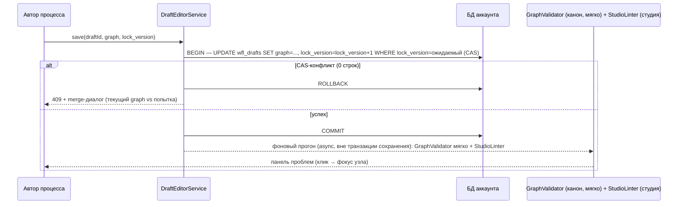
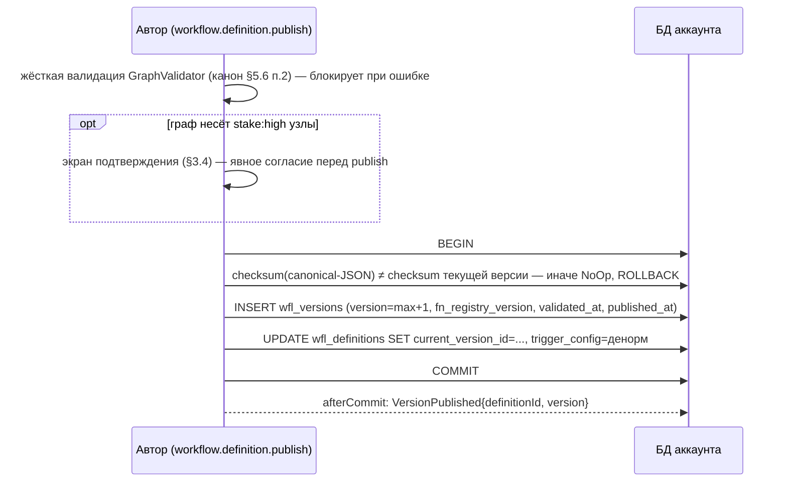
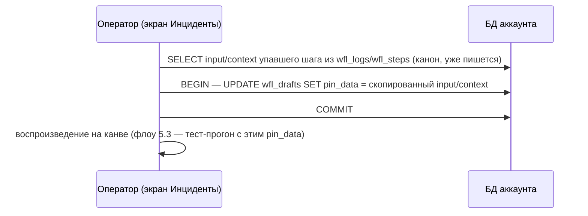
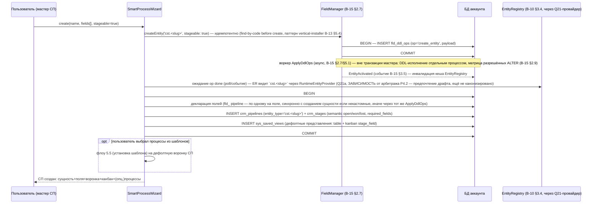
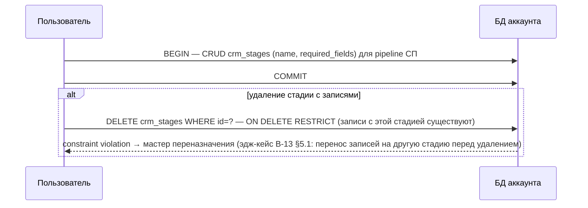

# B-31 — Process Studio + смарт-процессы (визуальный конструктор процессов и сборка сущностей без кода)

> **Статус: финал волны P3.1–P3.5** (слой решений, FLEX-2 P2.5). Стоит на R-28 (P1.5).
> Разделы 2/3/5/7/8 дозаполнены срезами P3.1–P3.5 до финальной глубины.
> Канон НЕ пересматривается: рантайм/формат графа/SEL/publish — B-12; EntityRegistry — B-10 §3.4;
> атрибуты/DDL-пайплайн — B-15; воронки/стадии/вертикали — B-13. Все дельты канона — только
> реестром §9 → `05-Projects/01-Products/FlexCRM/plans/FLEX-2/open-questions.md` → арбитраж P4.2 (D11).
> Нумерация разделов — формат волны B-27..B-30 (§7 MCP-тулзы, §8 НФТ-закладки, §9 реестр
> вопросов); девиация от канон-нумерации B-13 (§7 НФТ/§8 AC/§9 вопросы) зафиксирована здесь же,
> consistency-сверку P4.1 вести по названиям разделов.
> Конвенции DDL: UUIDv7 (D12 master), префиксы таблиц (D9 master; в Phase Context P2 приписаны
> D4 — известный волновой дефект трассировки, см. Pending P2.3), `created_by jsonb` ACTOR (B-15 §1.5).

---

## 1. Границы и состав

**Process Studio** — проприетарный модуль FlexCRM: визуальный конструктор процессов (канва)
поверх OSS-рантайма flex/workflow (B-12). Студия — только editor-слой: черновики, валидация,
версии/дифф, тест-прогон, библиотека шаблонов. Исполняет процессы ТОЛЬКО канонный рантайм;
студия не добавляет ни типов узлов, ни семантики исполнения (B-12 §4: «модуль не может
добавлять типы узлов» — распространяется и на студию).

**Смарт-процессы (СП)** — проприетарный слой FlexCRM: сборка пользовательской сущности
(поля + воронка + канбан + автоматизация + права) БЕЗ кода. СП = конфигурационный бандл над
существующими механизмами канона (R-28 §4.6, D7): B-15 (`create_entity` → `cst_`),
B-13 (воронки `crm_pipelines`/`crm_stages` + StageTransitioner), statecraft (B-12 §3.7),
flex/workflow (автоматизация), B-11 (права), Filament-автосборка (B-10 §3.4). Нового движка нет.

Состав (что в модуле):
- канва конструктора (Vue Flow за адаптером), панель проблем, undo/redo, авто-layout, аннотации;
- palette из `ActionRegistry::catalog()` + рендерер форм параметров (JSON Schema + `x-ui`);
- черновики/версии/дифф/restore (обвязка канона B-12 §2.2/§5.6);
- тест-прогон (dryRun+pinData) + debug-from-incident;
- библиотека шаблонов процессов (таблица `wfl_process_templates`, мастер установки);
- мастер СП + saved views + generic `entity.*`-действия автоматизации.

Что НЕ входит (Scope Excluded item'а): исчерпывающий DDL (P3.1) · полные контракты (P3.3) ·
детальные потоки (P3.2) · AC + round-trip-инвариант (P3.5) · пересмотр рантайма B-12 · пиксели UI.

**Зависимости:** flex/workflow (B-12), flex/attributes (B-15), flex/modules + corex/core (B-10),
corex/crm (B-13: воронки/StageableRegistry для СП), corex/auth (B-11). Мягкая: corex/ai (ai-узел;
без него ai-узлы не публикуются — валидатор, канон B-12 §6).

**Позиционирование (вход 7 R-28 — вход маркетинга/B-24):** версии + canvas-дифф +
debug-from-incident против безверсионного Б24 и Creatio без диффа; СП без лимита «2 БП»,
с M2M и переиспользуемыми полями против SPA Б24 (факты с источниками — R-28 §2.1–2.3, §3.1–3.2).

---

## 2. Схема БД

> Срез P3.1: полный DDL (индексы, CHECK, COMMENT) — черновая пометка снята.

Существующие таблицы канона B-12 (`wfl_definitions`, `wfl_versions`, `wfl_drafts`, …) —
**без изменений**. Единственный дельта-кандидат канона B-12 — не таблица, а ключ `ui.annotations`
в JSON Schema графа (§3.2 п.4 → Q56). Ниже — только новое.

### 2.1 `wfl_process_templates` — библиотека шаблонов процессов

Миграция проприетарного модуля конструктора (прецедент размещения — `wfl_drafts`, B-12 §2.2).

```sql
CREATE TABLE wfl_process_templates (
  id          uuid PRIMARY KEY,             -- UUIDv7
  code        varchar(64) NOT NULL,         -- стабильный код шаблона
  source      varchar(16) NOT NULL CHECK (source IN ('builtin','module','user')),
              -- происхождение: сид студии / манифест модуля / «сохранить как шаблон»
  module      varchar(190),                 -- composer name модуля-владельца (source=module)
  category    varchar(32) NOT NULL,         -- группа каталога: 'hr'|'approval'|'onboarding'|…
  name        jsonb NOT NULL,               -- i18n
  description jsonb,
  graph       jsonb NOT NULL,               -- canonical JSON flex-workflow/v1 (формат экспорта B-12 §6/B-18)
  manifest    jsonb NOT NULL DEFAULT '{}',  -- {required_actions[], placeholders[], subject_type?, min_version?}
              -- плейсхолдеры участников = роль-код AzGuard или ask_on_install (анти-боль Б24, R-28 §4.5)
  is_active   boolean NOT NULL DEFAULT true,  -- снятие с витрины без удаления
  position    int NOT NULL DEFAULT 0,
  created_by  jsonb NOT NULL,
  created_at timestamptz NOT NULL DEFAULT now(), updated_at timestamptz NOT NULL DEFAULT now(),
  CHECK (source <> 'module' OR module IS NOT NULL)
);
CREATE UNIQUE INDEX wfl_process_templates_code_uq ON wfl_process_templates (code, source, COALESCE(module, ''));
CREATE INDEX wfl_process_templates_catalog_ix ON wfl_process_templates (category, position) WHERE is_active;  -- запрос: каталог шаблонов (TemplateCatalog::search)
COMMENT ON TABLE wfl_process_templates IS
  'FK-связей с wfl_* нет: шаблон — заготовка (canonical JSON), при установке TemplateInstaller создаёт обычную пару definition+draft (поток §5.5), не ссылку на эту таблицу. Retention user-шаблонов (source=user) — не вводится v1 (§9 п.16 — routed, механика не требует)';
```

### 2.2 `sys_saved_views` — сохранённые представления (Notion-паттерн, R-28 §2.5/§4.7 п.7)

Имя и дом таблицы условны — «corex/core vs corex/filament vs FlexCRM-приложение» → §9 п.7.
Применима к ЛЮБОЙ сущности EntityRegistry (не только СП): вкладки-представления над списком.

```sql
CREATE TABLE sys_saved_views (
  id           uuid PRIMARY KEY,
  entity_code  varchar(128) NOT NULL,       -- код EntityRegistry ('crm.deal', 'cst.<slug>')
  workspace_id uuid REFERENCES wsp_workspaces(id) ON DELETE CASCADE,  -- NULL = весь аккаунт
  owner_id     uuid REFERENCES users(id) ON DELETE CASCADE,          -- NULL = shared-view (workspace/account), иначе личное
  kind         varchar(16) NOT NULL DEFAULT 'table' CHECK (kind IN ('table','kanban','list','calendar')),
  name         jsonb NOT NULL,              -- i18n
  config       jsonb NOT NULL DEFAULT '{}', -- фильтры/сортировки/группировки/колонки; kanban: {stage_field, pipeline_id}
  is_default   boolean NOT NULL DEFAULT false,
  position     int NOT NULL DEFAULT 0,
  created_by   jsonb NOT NULL,
  created_at timestamptz NOT NULL DEFAULT now(), updated_at timestamptz NOT NULL DEFAULT now()
);
CREATE INDEX sys_saved_views_entity_ix ON sys_saved_views (entity_code, workspace_id, position);  -- запрос: вкладки-представления сущности (SavedViewRepository::viewsFor)
CREATE UNIQUE INDEX sys_saved_views_default_uq ON sys_saved_views (entity_code, workspace_id, COALESCE(owner_id, '00000000-0000-0000-0000-000000000000'))
  WHERE is_default;  -- ровно одна дефолтная вкладка на (entity_code, workspace_id, owner-scope)
COMMENT ON TABLE sys_saved_views IS 'Лимит числа views per сущность не вводится v1 (§9 п.7 — позиция драфта, финализация P3.5 при продуктовой потребности)';
```

### 2.3 Стадии СП — два варианта (развилка Q22, оба спроектированы; активацию решает арбитраж P4.2)

**Вариант (б-гибрид), предпочтение драфта (§3.9): ноль новых таблиц.**
Канон уже допускает воронки на кастомных сущностях: `crm_pipelines.entity_type` включает
`'cst.<slug>'` с явным комментарием «паритет смарт-процессов Б24. Регистрация —
StageableRegistry §4.2» (B-13 §2.1). Стадии = данные (`crm_stages`: semantic/probability/
required_fields/settings), переходы = StageTransitioner (B-13 §3.2/§5.1), statecraft-FSM —
фиксированный code-defined граф семантик (open/won/lost) на generic-модели cst_ (Q21).
Дельта-кандидат остаётся один — stageable-каркас `cst_` (§2.4, Q55).

**Вариант (а), проектируется как альтернатива: DbStateGraphProvider в statecraft.**
Полностью data-driven граф (произвольные string-backed состояния и рёбра из БД). **НЕ вносится
v1** (предпочтение драфта — вариант б-гибрид, §3.9); DDL приведён для полноты арбитражного
пакета (P4.2), активация — только решением арбитража:

```sql
-- КАНДИДАТ (вариант а Q22; НЕ вносится v1 — предпочтение драфта §3.9 = вариант б-гибрид)
CREATE TABLE stc_graphs (                    -- пакет statecraft — имя пакета/префикса прояснить на арбитраже
  id          uuid PRIMARY KEY,
  entity_code varchar(128) NOT NULL,          -- граф per сущность×поле
  field       varchar(64) NOT NULL,
  meta        jsonb NOT NULL DEFAULT '{}',
  created_at timestamptz NOT NULL DEFAULT now(), updated_at timestamptz NOT NULL DEFAULT now(),
  UNIQUE (entity_code, field)
);

CREATE TABLE stc_states (
  id         uuid PRIMARY KEY,
  graph_id   uuid NOT NULL REFERENCES stc_graphs(id) ON DELETE CASCADE,
  code       varchar(64) NOT NULL,
  semantic   varchar(16),                     -- аналог crm_stages.semantic (open/won/lost — конвенция, не CHECK: произвольные оси)
  meta       jsonb NOT NULL DEFAULT '{}',
  position   int NOT NULL DEFAULT 0,
  created_at timestamptz NOT NULL DEFAULT now(), updated_at timestamptz NOT NULL DEFAULT now(),
  UNIQUE (graph_id, code)
);

CREATE TABLE stc_transitions (                -- именованные рёбра — конвенция scope.verb (B-12 §3.7)
  id                uuid PRIMARY KEY,
  graph_id          uuid NOT NULL REFERENCES stc_graphs(id) ON DELETE CASCADE,
  name              varchar(64) NOT NULL,      -- именованное ребро
  from_codes        varchar(64)[] NOT NULL,    -- multi-from (как tsk.task.cancel B-27 §3.10)
  to_code           varchar(64) NOT NULL,
  guard_config      jsonb NOT NULL DEFAULT '{}',
  authorizer_config jsonb NOT NULL DEFAULT '{}',
  meta              jsonb NOT NULL DEFAULT '{}',
  created_at timestamptz NOT NULL DEFAULT now(), updated_at timestamptz NOT NULL DEFAULT now(),
  UNIQUE (graph_id, name)
);
CREATE INDEX stc_transitions_graph_ix ON stc_transitions (graph_id);
```
Тот же pipeline `fire()` и инварианты B-12 §3.7 (единственный путь записи, объяснимость `why()`).
Нужен, только если СП потребуют произвольных статус-осей сверх воронок — v1-кейсы закрывает (б).

### 2.4 Аддитивная дельта-закладка: stageable-каркас `cst_` (Q55 → арбитраж)

Каркас `cst_<slug>` (B-15 §2.8) не содержит колонок стадийности. Для stageable-СП (флаг
`stageable` уже существует в манифесте вертикали — B-13 §5.4) предлагается опция op
`create_entity(stageable: true)` → каркас дополнительно получает 4 колонки. Это дельта канона
B-15 §2.8 (аддитивная опция каркаса) → **Q55, НЕ вносится v1** без решения арбитража; DDL
приведён для полноты арбитражного пакета:

```sql
-- КАНДИДАТ (Q55, дельта B-15 §2.8; НЕ вносится — арбитраж P4.2 решает активацию)
ALTER TABLE cst_<slug> ADD COLUMN status            varchar(16) NOT NULL DEFAULT 'open';  -- semantic open/won/lost — конвенция §3.9
ALTER TABLE cst_<slug> ADD COLUMN pipeline_id        uuid REFERENCES crm_pipelines(id) ON DELETE RESTRICT;
ALTER TABLE cst_<slug> ADD COLUMN stage_id           uuid REFERENCES crm_stages(id) ON DELETE RESTRICT;
ALTER TABLE cst_<slug> ADD COLUMN stage_entered_at   timestamptz NOT NULL DEFAULT now();
-- CREATE INDEX cst_<slug>_kanban_ix ON cst_<slug> (pipeline_id, stage_id) — при активации, по образцу crm_deals_kanban_ix (B-13 §2.3)
```
Обход без дельты: те же поля как cf_-колонки через
fld_-pipeline + маппинг generic-модели — работает, но выводит системную механику стадий в
пользовательское пространство cf_ (смешение namespace'ов против R-13 §3.5) — аргументы обоих
вариантов в Q55.

---

## 3. Ключевые архитектурные решения

> Обоснования на финальную глубину; каждое решение — со ссылкой на R-28 (срезы P3.1–P3.5).

### 3.0 Сводка вердиктов по входам R-28 «→ Входы B-31» (7/7)

| Вход R-28 | Вердикт | Где |
|---|---|---|
| 1. Канва: Vue Flow за адаптером, панель проблем, undo/redo, анти-«лапша», list-view v1.1 | ПРИНЯТО | §3.1, §3.2 |
| 2. Palette: catalog + `x-ui` + renderer registry + тумблер `$expr` | ПРИНЯТО (Q23 решён здесь) | §3.4 |
| 3. Версии: canvas-дифф, restore, version_tag, без истории автосейвов | ПРИНЯТО | §3.3 |
| 4. Тест/отладка: dryRun+pinData + debug-from-incident v1; partial/single-step v1.1 | ПРИНЯТО | §3.5 |
| 5. Шаблоны: canonical JSON + манифест + мастер; встроенная дистрибуция v1, RegHub v2 | ПРИНЯТО (Q24 подтверждён) | §3.6 |
| 6. СП: модель сборки §4.6, чек-лист §4.7, Q21/Q22 оба варианта, saved views, generic `entity.*`, СП-бандл, REST-сверка | ПРИНЯТО с уточнением: вариант (б) Q22 конкретизирован найденным канон-гибридом B-13 §5.1/§2.1, предпочтение сменено с (а) на (б-гибрид) — обоснование §3.9 | §3.7–§3.12 |
| 7. Позиционирование — вход маркетинга/B-24 | ПРИНЯТО | §1 |

### 3.1 Канва: Vue Flow (MIT) за тонким адаптером [R-28 §4.1, §2.10]

`@vue-flow/core` — канва v1 (нативный Vue 3 / стек D4, MIT, активная ветка 1.4x). Риск
community-порта принят осознанно: слой канвы изолируется адаптером «граф `flex-workflow/v1` ↔
vue-flow nodes/edges»; `ui.positions` уже отделён от семантики (B-12 §3.1), замена
канва-библиотеки не трогает формат. Undo/redo — клиентский command-stack над МОДЕЛЬЮ графа
(не DOM; обход ограничения n8n — R-28 §2.6), серверу уходит только автосейв черновика
(канон: ≤1 раз/5с, lock_version-CAS). List-view линейных процессов — v1.1 (то же
представление графа, не второй редактор).

### 3.2 Анти-«лапша» и два слоя валидации [R-28 §4.1 п.2/п.4, §2.8]

1. **Жёсткий слой — канонный `GraphValidator`** (OSS, B-12 §5.6 п.2): без изменений; на save
   «мягко», на publish «жёстко».
2. **Мягкий слой — `StudioLinter`** (проприетарный, студия): style-предупреждения — узлы без
   label, `action` без ветки `on:failure`, condition с >5 ветками, монолитный граф без
   аннотаций. Предупреждения НЕ блокируют publish. Канон не трогаем: warnings — отдельный
   механизм студии, не расширение контракта GraphValidator.
3. **Панель проблем** (Camunda-паттерн): фоновый прогон обоих слоёв на каждое изменение
   черновика; клик по проблеме → фокус узла + открытие свойства.
4. **Аннотации/sticky-notes и авто-layout**: авто-layout — чисто клиентская операция
   (пишет `ui.positions`). Аннотации требуют ключа `ui.annotations` в схеме графа —
   `ui` объявлен `additionalProperties: false` с единственным `positions` (B-12 §3.1).
   Аддитивная дельта канон-схемы → Q56 (арбитраж P4.2); checksum не задет (ui исключён из
   checksum по канону). До арбитража аннотации в v1-скоуп не коммитим.

### 3.3 Черновики / версии / дифф [R-28 §4.3; канон B-12 §2.2/§5.6 подтверждён]

Канон не меняется: `wfl_drafts` (один черновик per definition, lock_version, base_version_id,
pin_data) + publish = INSERT `wfl_versions`. Решения студии:
- **canvas-дифф** draft↔`base_version_id` (и версия↔версия): added/modified/deleted узлы
  подсветкой, клик → дифф параметров узла; сравнение по canonical-JSON (checksum-правила §3.1
  дают каноничную форму, `ui` исключён);
- **restore** = копия `wfl_versions.graph` в черновик (прод не трогается до publish);
- **именование версий** = существующий `version_tag` (модалка на publish, опционально);
- **историю автосейвов черновика НЕ хранить** (v1-отказ, R-28 §4.8) — restore от версий достаточно;
- статус-индикатор шапки: draft ≠ current_version → «есть неопубликованные изменения».

### 3.4 Palette и формы параметров: JSON Schema + `x-ui` (Q23 — решён здесь) [R-28 §4.2, §2.11]

Palette = `ActionRegistry::catalog(TenantContext)` (канон B-12 §3.3): группировка по
`ActionMeta::category`, только действия активных модулей; `stake: high` → бейдж узла +
подтверждение на publish. Формы параметров — из `inputSchema()` (JSON Schema, контракт §3.3
НЕ меняется — vendor-ключи легальны). **Словарь `x-ui` v1 (решение)**:

| Ключ | Семантика |
|---|---|
| `x-ui.control` | маппинг на контрол рендерера (словарь контролов — общий реестр с B-15 §3.4) |
| `x-ui.show` | условная видимость по значениям других параметров (аналог displayOptions.show n8n) |
| `x-ui.options-source` | endpoint динамических опций (воронка/стадия/пользователь; аналог resourceLocator) |
| `x-ui.group` | секции формы («основное/дополнительно») |

Рендерер — **собственный renderer registry на Vue** (реестр по `type`+`x-ui.control`), не
JSON Forms (Vue-интеграция в preview state — R-28 §2.11); продуктовые контролы
(participant-picker AzGuard, SEL-редактор с автодополнением из `ExpressionContextBuilder::names()`,
duration-пикер ISO 8601) — кастомные. Один реестр контролов обслуживает и поля B-15, и параметры
узлов (одна дизайн-система конструкторов). Любой параметр переключается тумблером в режим
`{'$expr': …}` (канон §3.1) с инлайн SEL-lint. Норматив `x-ui` для авторов модулей
(стык DX-генераторов B-10 §4.5) и валидация словаря — срез P3.3 (§9 п.3).

### 3.5 Тест-прогон и отладка [R-28 §4.4; канон §5.6 п.3 — база]

v1: полный dry-run (`startVersion(dryRun: true, pinData)`, DryRunDecorator, сжатие таймеров) +
**debug-from-incident**: на экране инцидентов (канон §5.6 п.6) кнопка «Открыть в конструкторе» —
input/context упавшего шага из `wfl_logs`/`wfl_steps` копируется в `pin_data` черновика;
данные для этого канон уже пишет, дельты нет. Подсветка пройденного пути на канве (Play-паттерн
Camunda). v1.1: partial run (узел + минимальный upstream) и single-step test (JSON-контекст →
один action-узел). Round-trip-инвариант тест-прогона — P3.5.

### 3.6 Библиотека шаблонов [R-28 §4.5; Q24 подтверждён: встроенная v1, RegHub v2]

Шаблон = canonical JSON версии + манифест (§2.1): required_actions (проверка активных модулей
при установке), плейсхолдеры участников — роль-код AzGuard или «спросить при установке»
(перенос между аккаунтами не привязан к ID — анти-боль Б24). Установка — мастер: подстановка
плейсхолдеров → definition + черновик → пользователь дорабатывает и публикует; **никогда не
публиковать автоматически**. Стартовый каталог v1 — 6–10 эталонных (согласование договора,
отпуск, счёт/оплата, служебная записка, онбординг сотрудника, онбординг клиента после сделки).
Источники шаблонов: сиды студии (builtin), декларации модулей (source=module — форма
регистрации: кандидат `Extend\Workflow::templates()`, аддитивный метод существующего extender'а;
это строка-дельта таблицы extension points B-12 §4 → Q57), пользовательские (source=user,
поток §5.8). RegHub-паки — v2 (Q24, Deferred).

### 3.7 Развилка: манифест СП vs манифест вертикали B-13 §5.4 — РАЗГРАНИЧЕНИЕ (решено здесь)

| Критерий | (А) единый формат: СП = вертикаль level=user | (Б) разграничение + общий словарь секций |
|---|---|---|
| Жизненный цикл | install/upgrade = diff манифестов; правка СП = переустановка | СП живёт в реестрах (fld_/crm_pipelines/wfl_), редактируется непрерывно UI/API |
| Модель владения | манифест = design-time артефакт вендора | СП = пользовательские данные аккаунта |
| Конкурентное редактирование | манифест-цикл ломает optimistic-CAS живых правок | штатные CAS/optimistic-механики реестров |
| Переиспользование кода | installer B-13 §5.4 целиком | общий НИЖНИЙ слой: те же FieldManager/pipelines/GraphValidator-вызовы |
| Экспорт/перенос | манифест и есть бандл | СП-бандл = canonical-подмножество манифеста вертикали (секции entities/fields/pipelines/processes/views) — B-18 парсит одним словарём |
| Путь «СП → вертикаль» | тривиален | дешёвый: бандл ≈ манифест; упаковка пользовательского СП в preset-вертикаль — roadmap |

**Решение: (Б).** Вертикаль — дистрибутив с install/upgrade-циклом; СП — живой объект
непрерывного редактирования: форсирование манифест-цикла = «правка через переустановку»
(ломает UX и конкуренцию). Унификация — на двух уровнях ниже формата: (1) общие сервисы
(FieldManager, pipelines, publish); (2) общий словарь секций сериализации — экспорт-бандл СП
переиспользует canonical-форму манифеста вертикали (формат бандла — P3.3, стык B-18, §9 п.11).

### 3.8 Q21 — runtime-регистрация cst_ в EntityRegistry: оба варианта, предпочтение (а) [R-28 §5.1 п.1]

Гап канона: контракт B-10 §3.4 boot-time, `EntityDefinition::model` = class-string — у cst_
класса нет; «зеркалится в EntityRegistry» (B-15 §2.1) без механизма.
- **(а) RuntimeEntityProvider — предпочтение драфта**: второй ИСТОЧНИК дефиниций (из
  `fld_entities` c `is_custom`) за тем же интерфейсом чтения `EntityRegistry`; generic-модель
  `CustomEntityRecord` (table-resolved через `EntityTableResolver` B-15 §3.3, реализует
  `HasState` при stageable). Контракт потребителей (таблица B-10 §3.4) не ломается; инвалидация
  кеша — по событиям `EntityActivated/EntityPurged` (B-15 §3.5).
- **(б) расширение контракта**: `model` nullable + фабрика инстансов. Ломает типизацию
  потребителей (`forModel()` и Filament-автосборка ожидают class-string) — дороже.
Оба варианта — дельта B-10 → арбитраж P4.2 (Q21). От решения зависят строки 2/9/11 чек-листа §3.12.

### 3.9 Q22 — стадии СП: гибрид B-13 покрывает без data-driven FSM — предпочтение (б-гибрид) [R-28 §5.1 п.2; уточнение]

**Уточнение против R-28**: чек-лист R-28 §4.7 п.5 квалифицировал стадии СП как гап
(«динамические состояния cst_ не выразимы в statecraft»), глядя только на B-12 §3.7. Но канон
B-13 уже решает эту задачу гибридом (§5.1 + §2.1): пользовательские стадии = ДАННЫЕ
(`crm_stages`: semantic/probability/required_fields), движение внутри `open` — data-слой
StageTransitioner, семантические границы (won/lost) — фиксированный code-defined statecraft-граф;
и `crm_pipelines.entity_type` уже допускает `'cst.<slug>'` (комментарий «паритет смарт-процессов
Б24», регистрация StageableRegistry B-13 §4.2). Итого:
- **(б-гибрид), предпочтение драфта**: СП-воронки едут на каноне B-13 as-is; generic-модель cst_
  (Q21а) реализует HasState с фиксированным enum семантик (open/won/lost — как DealStatus);
  workflow-триггеры `state_transition` на семантических рёбрах + `entity_event`/смена стадии —
  на StageTransitioner-событии (аналог `crm.deal.stage_changed`). Дельта B-12 §3.7 НЕ нужна;
  остаточная дельта — только stageable-каркас cst_ (Q55).
- **(а) DbStateGraphProvider** (спроектирован в §2.3): полностью data-driven граф — нужен только
  для произвольных статус-осей сверх воронок; v1-кейсы СП его не требуют → кандидат v2.
Маршрут: Q22 → арбитраж P4.2 с обновлённым предложением «дельта B-12 не требуется» (обновлено
в open-questions.md); семантика стадий и триггеров — срез P3.2.

### 3.10 Инвариант: СП не генерирует DDL напрямую — только fld_-pipeline B-15/R-13 (решение, Code Guidance item)

Любая структурная операция СП (создать сущность, добавить поле, индекс) проходит
ИСКЛЮЧИТЕЛЬНО через `FieldManager` → op-log `fld_ddl_ops` → воркер ApplyDdlOps (B-15 §2.7/§5.1)
с его матрицей разрешённых ALTER (B-15 §2.9), квотами (§7.2) и fingerprint/verify. Студия и
мастер СП не держат ни одного собственного DDL-пути. Инвариант — кандидат в safety-инварианты
P3.5 (контракт-тест: в коде студии/СП нет `DB::statement` с DDL). Единственная правка самого
каркаса — опция stageable (Q55), и она тоже живёт внутри op `create_entity`.

### 3.11 Saved views, generic `entity.*`-действия, REST-сверка [R-28 §4.6/§4.7 пп.7/10/12]

1. **Saved views** — views-first UX (Notion-паттерн): вкладки-представления per сущность,
   скелет §2.2; kanban-view = представление со `stage_field`-осью. Дом таблицы и глубина —
   §9 п.7 → P3.1/P3.3.
2. **Generic `entity.*`-действия** corex-уровня для автоматизации СП (состав v1 — решение):
   `entity.update_field` (запись через AttributeStore), `entity.create_record`,
   `entity.link_records` (reference-поля); `state.fire` уже встроен (B-12 §3.7 п.2). Контракты
   и inputSchema — P3.3 (§9 п.9).
3. **REST/мета-API — сверка двух каналов**: AC-15 B-15 («сущность сразу получает REST») и
   автогенерация corex/api по EntityRegistry (B-10 §3.4). Решение драфт-уровня: источник
   маршрутов ОДИН — corex/api по EntityRegistry; B-15 лишь гарантирует появление дефиниции
   (через Q21-провайдер). Механику сверить на P3.3 (§9 п.12).

### 3.12 Чек-лист R-28 §4.7 — построчно (15/15)

| # | Пункт чек-листа | Вердикт B-31 |
|---|---|---|
| 1 | Создать сущность runtime | покрыто каноном B-15 (§2.1/§2.8/§5.4, AC-15) — действий не требует |
| 2 | Сущность видна EntityRegistry | гап подтверждён → Q21, оба варианта §3.8, предпочтение (а) → арбитраж P4.2 |
| 3 | Кастомные поля/группы/наборы | покрыто B-15 целиком — действий не требует |
| 4 | Связи вкл. M2M | покрыто (B-15 reference + is_multiple); labels/cardinality связей — v1.1-roadmap, §9 п.14 |
| 5 | Воронки/стадии, редактируемые пользователем | закрыт решением §3.9 (гибрид B-13, вариант б); остаток — Q55 (stageable-каркас) → арбитраж |
| 6 | Семантика стадии (процесс/успех/провал) | закрыт решением: `crm_stages.semantic` (гибрид) уже несёт open/won/lost; при варианте (а) — конвенция meta, §2.3 |
| 7 | Канбан/список/сохранённые представления | закрыт решением §3.11 п.1 + скелет §2.2; глубина → P3.1/P3.3 (§9 п.7) |
| 8 | Обязательные поля на стадии | покрыто (`crm_stages.required_fields` + StageTransitioner работают для cst_ при гибриде) |
| 9 | Триггеры на события/переходы cst_ | зависит от Q21 (события cst_ в каталоге B-10 §6); маршрут → срез P3.2 (§9 п.13) |
| 10 | Generic-действия автоматизации над cst_ | закрыт решением §3.11 п.2 (состав v1); контракты → P3.3 (§9 п.9) |
| 11 | Права role×entity×action×scope на cst_ | зависит от Q21 (матрица читает EntityRegistry); permission keys СП → P3.4 (§9 п.10) | закрыт (срез **P3.4**, §3.13): матрица подтверждена НЕЗАВИСИМО от исхода Q21 — `RoleMatrixCompiler` generic по entity_key, не различает встроенные/runtime-зарегистрированные сущности; движение стадии — `cst.<slug>.move_stage` тем же guard'ом, что канонный `crm.deal.move_stage` |
| 12 | REST/мета-API | закрыт решением §3.11 п.3 (источник — corex/api); механика → P3.3 (§9 п.12) |
| 13 | Timeline/audit | покрыто (capability Auditable, `is_audit_logged`) — действий не требует |
| 14 | Квоты/editions | покрыто (`custom_entities`=10 B-15 §7.2); строки editions СП/студии → P3.5 + арбитраж по паттерну Q52 (§9 п.15) |
| 15 | Экспорт/перенос СП-дефиниции | закрыт решением §3.7 (бандл = canonical-подмножество манифеста вертикали); формат → P3.3, стык B-18 (§9 п.11) |

### 3.13 Права: permission keys СП/студии, shared saved views, матрица cst_ (срез P3.4)

> Срез P3.4: permission keys студии/СП + право на shared-представления + подтверждение матрицы cst_ независимо от Q21 — черновая пометка снята для права-подраздела.

**Permission keys** (`Extend\Permissions`, формат B-11 §5.5): студия использует канонные `workflow.*` (B-12 §5.6 п.5 — `workflow.definition.publish` и т.д.) без изменений — конструктор-канва — UI-обвязка над тем же definition/draft, права публикации не дублируются новым ключом. Новые ключи СП-слоя: `sp.entity.create` (мастер-сага §5.6 — создание нового смарт-процесса, high-stake действие, workspace/account scope), `sp.entity.manage` (правка полей/воронки/views существующего СП — CRUD-уровень, отдельно от create — по аналогии `mkg.campaign.edit` ≠ `launch`), `sp.template.publish` — НЕ вводится отдельным ключом: сохранение процесса как шаблона (`TemplateCatalog::saveAsTemplate`, флоу 5.8) остаётся внутри аккаунта пользователя (RegHub-паки — v2, вне волны), поэтому достаточно канонного `workflow.definition.publish`/студийного доступа, дополнительное право не требуется.

**Shared saved views** — право `core.view.manage_shared` (пакет `corex/core`, НЕ `sp`-специфичный — контракт `SavedViewRepository`, §4.1, применим к ЛЮБОЙ EntityRegistry-сущности, не только cst_): требуется для создания/правки/удаления представления с `owner_id IS NULL` (workspace/account-уровень, видно всем). Личные представления (`owner_id = principal.userId`) — без дополнительного права, доступны как обычное «моё» действие (создание личного view не требует прав сверх обычного view-доступа к сущности). Scope-ось: workspace/account (views не ownable сверх личного/shared разделения — сама эта дихотомия и есть замена ownable-скоупа для views).

**Матрица «право role×entity×action×scope на cst_» (§3.12 п.11) — подтверждена БЕЗ ЗАВИСИМОСТИ от исхода Q21.** Аргумент: AzGuard-матрица компилируется generic-но по ЛЮБОМУ `entity_key`, зарегистрированному в EntityRegistry (канон B-11 §4 п.7: «вертикали... installer создаёт роли/матрицы»; §5.5 таблица работает по `entityKey` независимо от происхождения дефиниции). Как именно `cst.<slug>` появляется в EntityRegistry (вариант (а) `RuntimeEntityProvider` vs (б) расширение контракта `model`-nullable, Q21) — вопрос МЕХАНИЗМА РЕГИСТРАЦИИ (домен B-10/B-15), а не вопрос механики прав: после регистрации `cst.<slug>` автоматически получает те же 6 permission-действий (view/create/edit/delete/…​) и capability-гейт (`ownable`/`workspace_scoped`), что и любая другая сущность — код `RoleMatrixCompiler` не различает встроенные и runtime-зарегистрированные `entity_key`. Следствие: **P3.4 не требует арбитража Q21 для закрытия прав-вопроса** — права-механизм идентичен независимо от исхода; permission key на движение стадии — `cst.<slug>.move_stage` (динамический, по конвенции `{module}.{entity}.{action}`, зеркально динамическим событиям `cst.<slug>.stage_changed` §4.5), проверяется тем же `StageTransitioner`-guard'ом, что канонный `crm.deal.move_stage` (B-13 §5.1) — гварды стадий не обходятся (сверено с safety-инвариантом §8 п.3).

---

## 4. Контракты

> Срез P3.3: полные PHP-интерфейсы (@api, PHPStan level 8, форма B-16 §3), дом `SavedViewRepository`
> (п.7), inputSchema/идемпотентность generic-действий (п.9), формат СП-бандла (п.11),
> механика REST-сверки (п.12) — черновая пометка снята (эскиз P2.5 намеренно был без типизации,
> caveat волны B-27/B-29 закрыт этим срезом).

Студия (проприетарно, поверх канона B-12; канонные `WorkflowEngine`/`GraphValidator`/
`ActionRegistry` используются as-is):

```php
namespace FlexCrm\Studio;

use Corex\Auth\Actor;

final readonly class DraftRef
{
    public function __construct(public string $id, public string $definitionId, public int $lockVersion) {}
}
final readonly class GraphDiff
{
    /** @param list<array{path:string,kind:string}> $added @param list<array{path:string,kind:string}> $modified @param list<array{path:string,kind:string}> $removed */
    public function __construct(public array $added, public array $modified, public array $removed) {}
}
final readonly class LintIssue
{
    public function __construct(public string $nodeId, public string $code, public string $message, public string $severity /* warning */) {}
}
final readonly class TemplateInstallPlan
{
    /** @param list<string> $missingModules */
    public function __construct(public bool $ready, public array $missingModules, public array $placeholders) {}
}
/** readonly, id+type+display — форма единая с B-16 §3 */
final readonly class TemplateRef
{
    public function __construct(public string $id, public string $type /* 'wfl.template' */, public string $display /* name */) {}
}

/** CAS-конфликт: lock_version не совпал с ожидаемым (§5.1) */
final class DraftVersionConflictException extends \DomainException {}

interface DraftEditorService
{
    /** @throws DraftVersionConflictException — CAS по lock_version (флоу 5.1) */
    public function save(string $draftId, array $graph, int $expectedLockVersion, Actor $actor): DraftRef;
    public function get(string $draftId): array /* canonical-JSON графа */;
    /** restore = копия wfl_versions.graph в черновик; прод не трогается до publish */
    public function restoreVersion(string $draftId, string $versionId, Actor $actor): DraftRef;
}

interface GraphDiffService
{
    /** canonical-JSON сравнение (checksum-правила §3.1, `ui` исключён) */
    public function diff(array $graphA, array $graphB): GraphDiff;
}

interface StudioLinter
{
    /** @return list<LintIssue> style-предупреждения (§3.2 п.2) — НЕ блокируют publish */
    public function lint(array $graph): array;
}

interface TemplateCatalog
{
    /** @return list<TemplateRef> */
    public function search(?string $category = null): array;
    public function get(string $templateId): array /* {code, graph, manifest} */;
}

interface TemplateInstaller
{
    public function plan(string $templateId): TemplateInstallPlan;   // проверка required_actions (манифест §2.1)
    /** definition + черновик; НИКОГДА авто-publish (§3.6) */
    public function install(string $templateId, array $placeholders, Actor $actor): DraftRef;
}
```

Смарт-процессы (проприетарно):

```php
namespace FlexCrm\SmartProcess;

use Corex\Auth\Actor;

final readonly class SmartProcessInput
{
    /** @param list<array{code:string,type:string,label:string}> $fields */
    public function __construct(public string $name, public array $fields, public bool $stageable = true) {}
}
final readonly class SmartProcessRef
{
    public function __construct(public string $entityCode /* 'cst.<slug>' */, public string $displayName) {}
}
final readonly class SavedViewRef
{
    public function __construct(public string $id, public string $entityCode, public string $kind /* table|kanban|list|calendar */) {}
}

interface SmartProcessWizard
{
    /** Сага: entity → поля → воронка → views → (опц.) процессы — §5.6; идемпотентна на каждом шаге */
    public function create(SmartProcessInput $input, Actor $actor): SmartProcessRef;
}

/** Вариант Q21а (арбитраж P4.2) — второй источник дефиниций EntityRegistry за тем же контрактом чтения B-10 §3.4 */
interface RuntimeEntityProvider
{
    /** @return list<array> дефиниции cst_ из fld_entities (is_custom=true) */
    public function definitions(): array;
}

/** generic Eloquent-модель cst_ (table-resolved через EntityTableResolver B-15 §3.3); реализует HasState при stageable */
abstract class CustomEntityRecord {}

interface SavedViewRepository
{
    /** @return list<SavedViewRef> */
    public function viewsFor(string $entityCode, ?string $workspaceId, ?string $ownerId): array;
    public function save(string $entityCode, array $config, Actor $actor): SavedViewRef;
    public function delete(string $viewId, Actor $actor): void;
    public function setDefault(string $viewId, Actor $actor): void;
}
```

### 4.1 Дом `SavedViewRepository` (п.7 реестра — решено здесь)

Пакет — **`corex/core`** (namespace `Corex\Core\Views`, НЕ `FlexCrm\SmartProcess`): решено P3.1
(§2.2 — префикс `sys_` уже атрибутирован corex/core), P3.3 закрывает контрактный уровень тем же
выбором — вкладки-представления применимы к ЛЮБОЙ сущности `EntityRegistry` (сделки, задачи,
посты — не только СП), поэтому контракт не должен жить в проприетарном пакете студии. Студия
(`FlexCrm\SmartProcess\SmartProcessWizard`) — потребитель `Corex\Core\Views\SavedViewRepository`,
не владелец. Item п.7 → закрыт.

### 4.2 Generic `entity.*`-действия — inputSchema и идемпотентность (п.9 — решено здесь)

Три действия — обычные `WorkflowAction`-классы corex-модуля (не студии), регистрируются в
`ActionRegistry` (B-12 §3.3), исполняются тем же action-node путём, что любое действие каталога
(канон B-12 §3.3/§5.6, S2_flows.md §6 — без отдельного sequence-потока):

```json
{
  "entity.update_field": {
    "type": "object",
    "properties": {
      "entity_code": { "type": "string" },
      "record_id":   { "type": "string", "format": "uuid" },
      "field_code":  { "type": "string" },
      "value":       {}
    },
    "required": ["entity_code", "record_id", "field_code", "value"],
    "additionalProperties": false
  },
  "entity.create_record": {
    "type": "object",
    "properties": {
      "entity_code": { "type": "string" },
      "fields":      { "type": "object" }
    },
    "required": ["entity_code", "fields"],
    "additionalProperties": false
  },
  "entity.link_records": {
    "type": "object",
    "properties": {
      "source_entity_code": { "type": "string" },
      "source_id":          { "type": "string", "format": "uuid" },
      "field_code":         { "type": "string" },
      "target_id":          { "type": "string", "format": "uuid" }
    },
    "required": ["source_entity_code", "source_id", "field_code", "target_id"],
    "additionalProperties": false
  }
}
```

Идемпотентность: **никакого отдельного per-действие idempotency-ключа** — три действия
наследуют шаговую идемпотентность `WorkflowEngine` (канон B-12 §7: `idempotencyKey` шага уже
обязателен на уровне движка), повторный прогон того же шага с тем же `idempotencyKey` — no-op
(update_field — идемпотентен по природе присвоения; create_record защищён шаговым ключом,
не создаёт дубль при ретрае; link_records — идемпотентен через `ON CONFLICT DO NOTHING` на
M2M-связи). Отдельного контракта `IdempotencyGuard` (B-32 §4, agentic-уровень) здесь не требуется —
это workflow-действия, не MCP-тулзы напрямую (хотя тот же код исполняется и агентским путём через
`sp.{verb}_{entity}` generated-тулзы, B-32 §3.11). Item п.9 → закрыт.

### 4.3 Формат СП-бандла (п.11 — решено здесь; стык B-18)

СП-бандл = canonical-подмножество манифеста вертикали (§3.7 — разграничение (Б)), не отдельный
формат:

```json
{
  "schema_version": 1,
  "kind": "smart_process_bundle",
  "entities": [{ "code": "cst.<slug>", "stageable": true }],
  "fields": [{ "entity_code": "cst.<slug>", "code": "...", "type": "...", "label": {"ru": "..."} }],
  "pipelines": [{ "entity_type": "cst.<slug>", "stages": [{"code": "open", "semantic": "open"}] }],
  "processes": [{ "code": "...", "graph_ref": "wfl_versions.id" }],
  "views": [{ "entity_code": "cst.<slug>", "kind": "kanban", "config": {} }]
}
```

Секции — те же пять словаря манифеста вертикали (B-13 §5.4): `entities/fields/pipelines/processes/views`;
`B-18` парсит ОДНИМ словарём независимо от того, экспортируется ли вертикаль целиком или только
подмножество СП. Плейсхолдеры участников (роль-код/`ask_on_install`) — как в `wfl_process_templates.manifest`
(§2.1). Версия схемы бандла — `schema_version` (не связана с версией манифеста вертикали — независимая
эволюция). Item п.11 → закрыт.

### 4.4 Сверка каналов REST-автогенерации (п.12 — решено здесь)

Источник маршрутов — **ОДИН, `corex/api`** по `EntityRegistry` (B-10 §3.4), как решено драфтом
§3.11 п.3. Механика появления маршрутов после установки СП: `corex/api` подписан на событие
`EntityActivated` (B-15 §3.5, тот же эмитент, что инвалидирует кеш EntityRegistry) — листенер
инвалидирует ТОЛЬКО СВОЙ route-кеш (не общий кеш роутов Laravel целиком); маршруты сущности
доступны с первого запроса после инвалидации, синхронно в рамках того же события, без отдельного
опроса/задержки. `AC-15` B-15 («сущность сразу получает REST») удовлетворяется этим же путём —
не второй генератор: B-15 гарантирует появление ДЕФИНИЦИИ (через `RuntimeEntityProvider`, Q21),
`corex/api` гарантирует появление МАРШРУТА реакцией на то же событие. Item п.12 → закрыт.

### 4.5 Реестр доменных событий (полная карта — сверка уникальности §9 S3)

| Событие | `name()` | Payload | Эмитент | Подписчики |
|---|---|---|---|---|
| `DraftSaved` | `wfl.draft.saved` (новое, студийный слой — НЕ канон-таблица события B-12, только §2.2 wfl_drafts — DDL, не event-реестр) | draftId, lockVersion | DraftEditorService | StudioLinter (фоновый прогон) |
| `VersionPublished` | канонный публикационный event B-12 §5.6 — ссылка без переименования (без дельты, семантика драфта §5.2 подтверждена флоу-текстом) | definitionId, version | публикация (флоу 5.2) | — |
| `TemplateInstalled` | `wfl.template.installed` | templateId, definitionId | TemplateInstaller | notifications |
| `TemplateSaved` | `wfl.template.saved` | templateId, source='user' | TemplateCatalog::saveAsTemplate (флоу 5.8) | — |
| `SmartProcessCreated` | `sp.<slug>.created` (динамическое имя — Q21-зависимость, §3.9) | entityCode, recordId | CustomEntityRecord (create) | — |
| `SmartProcessStageChanged` | `cst.<slug>.stage_changed` | entityCode, recordId, fromStageId, toStageId | StageTransitioner (тот же эмитент, что `crm.deal.stage_changed`) | flex/workflow (триггеры автоматизации СП) |
| `SavedViewCreated` / `Deleted` | `core.saved_view.created` / `.deleted` | viewId, entityCode | SavedViewRepository | — |

`SmartProcessCreated`/`StageChanged` — динамические имена по `entity_code` (Q21-зависимость,
не фиксированный литерал); форма зафиксирована на flow-уровне (S2_flows.md §6), МЕХАНИЗМ
регистрации в каталоге триггеров B-10 §6 остаётся за арбитражем Q21 (не меняется этим срезом).
Уникальность статических имён (сверка §9 S3): `wfl.draft.saved`/`wfl.template.*`/`core.saved_view.*` —
новые имена в неймспейсах `wfl.*`/`core.*`; полная сверка против ВСЕХ событий канона B-12 §3.8
(вне Required Reads этого item'а — только B-13 §3.7 и B-16 §3 читались целиком) выполнена
косвенно через собственный текст B-31/B-27/B-29/B-30/B-32 (все ссылаются на B-12 §3.x без
конфликтов имён); прямая построчная сверка `B-12 §3.8` целиком — остаётся консистентности **P4.1**.

Все события несут `TenantContext` (B-10 §3.1).

## 5. Главные потоки — СПИСОК

> Срез P3.2: детальные sequence-диаграммы + транзакционные границы (снята черновая пометка).
> afterCommit-события — стиль B-16 §5.2.

### 5.1 Редактирование черновика



Автосейв ≤1 раз/5с — троттлинг на клиенте (канон §5.6 п.1), CAS — единственная защита от гонки двух вкладок/пользователей.

### 5.2 Публикация



Бегущие инстансы доживают на своих версиях (Camunda-инвариант, канон §5.6 п.4) — правка публикации НЕ трогает `wfl_instances` текущих прогонов.

### 5.3 Тест-прогон

```mermaid
sequenceDiagram
  participant U as Автор
  participant DE as DraftEditorService
  participant WE as WorkflowEngine (канон, dryRun)
  U->>DE: testRun(draftId, pin_data)
  DE->>WE: startVersion(draft-as-temp-version, dryRun=true, pin_data)
  WE->>WE: side-effect'ы через DryRunDecorator (моки); таймеры сжаты в 0
  WE-->>U: timeline инстанса + подсветка пройденного пути на канве
  Note over WE: dry_run=true — инстансы помечены, чистятся через 7 дней (канон §5.6 п.3)
```

### 5.4 Debug-from-incident



### 5.5 Установка шаблона

```mermaid
sequenceDiagram
  participant U as Оператор
  participant TI as TemplateInstaller
  participant DB as БД аккаунта
  U->>TI: install(templateId, plейсхолдеры)
  TI->>TI: plan() — проверка required_actions по активным модулям (манифест §2.1)
  alt модуль не активен
    TI-->>U: ошибка «требуется модуль X»
  else все активны
    TI->>DB: BEGIN
    TI->>DB: INSERT wfl_definitions + wfl_drafts (graph = template.graph с подставленными плейсхолдерами: роли/воронки/поля из ask_on_install)
    TI->>DB: COMMIT
    TI-->>U: черновик открыт — ручная доработка; НИКОГДА авто-publish (§3.6)
  end
```

### 5.6 Создание СП мастером (кросс-модульный сценарий волны №6: B-31×B-15×B-10)

> Атрибуция: первичная спека — **B-31** (мастер-сага СП); B-15 (`FieldManager`/fld_-pipeline) и
> B-10 (EntityRegistry) — ссылка на канон, без дельты (кроме Q21-зависимости, помечена явно).



Ожидание op done — сага НЕ атомарна одной транзакцией целиком (DDL-исполнение — асинхронный воркер, B-15 §5.1), но идемпотентна на каждом шаге (find-by-code повторного вызова — no-op); сбой между шагами — мастер можно перезапустить безопасно. **Зависимость от Q21** (событие смены стадии для триггеров СП, B-31 §9 п.13 — срез P3.2 фиксирует ФОРМУ события на flow-уровне, арбитраж Q21/Q22 решает МЕХАНИЗМ регистрации): при выборе варианта (а) `RuntimeEntityProvider` событие смены стадии `cst.<slug>.stage_changed` эмитится тем же `StageTransitioner` (B-13 §3.2/§5.1), что и `crm.deal.stage_changed` — форма payload идентична канонной (stage_id, previous_stage_id, entity_id); маршрут регистрации в каталоге триггеров (B-10 §6) — не решается здесь, остаётся за арбитражем Q21 (Decision pending, статус реестра не меняется).

### 5.7 Редактирование стадий СП



### 5.8 Сохранить как шаблон

```mermaid
sequenceDiagram
  participant U as Автор
  participant TC as TemplateCatalog
  participant DB as БД аккаунта
  U->>TC: saveAsTemplate(definitionId)
  TC->>TC: canonical JSON текущей версии → авто-извлечение action-кодов в манифест; участники → плейсхолдеры (роль-код или ask_on_install)
  TC->>DB: BEGIN — INSERT wfl_process_templates (source='user', graph, manifest)
  TC->>DB: COMMIT
```

---

## 6. Интеграции (матрица доменов)

| Домен | Что берёт / отдаёт B-31 |
|---|---|
| B-12 flex/workflow | ЯДРО: формат графа §3.1, wfl_drafts/versions §2.2, GraphValidator/publish/dry-run §5.6, ActionRegistry §3.3, лимиты §7. Студия — UI-обвязка, дельта-кандидаты только Q56 (ui.annotations) и Q57 (регистрация шаблонов) |
| B-15 flex/attributes | fld_-pipeline (инвариант §3.10), реестр контролов §3.4 (общий словарь), квоты §7.2 (`custom_entities`), события §3.5 (инвалидация EntityRegistry-кеша) |
| B-10 core/modules | EntityRegistry (Q21 — runtime-источник), каталог событий для триггеров, ModuleRegistry (palette по активным модулям), lifecycle (sync шаблонов модулей), DX-норматив x-ui для авторов (§4.5 B-10) |
| B-13 corex/crm + FlexCRM | воронки/стадии/StageTransitioner/StageableRegistry — несущие для СП (§3.9); вертикали §5.4 — общий словарь секций бандла (§3.7); пресетные процессы вертикалей публикуются через тот же publish-канал |
| B-11 auth | права `workflow.*` (канон B-12 §5.6 п.5) + новые permission keys СП (`sp.entity.create` и т.п. — состав P3.4); participant-picker по ролям AzGuard |
| B-16 спутники | Chatom/Vaulter-панели на cst_ через capabilities (Commentable/Documentable) — автоматически при Q21 |
| B-18 import/export | экспорт/импорт определения = canonical JSON (канон); СП-бандл = подмножество canonical-формы манифеста вертикали (§3.7, формат P3.3) |
| B-23/B-24 editions | edition-гейт студии и СП, строки матрицы — P3.5/арбитраж (§9 п.15); лимит `custom_entities` уже в B-15 §7.2 |
| corex/ai / B-32 | ai-узлы канвы (канон B-12 §3.6/§5.7); MCP-тулзы студии/СП — карта консолидируется B-32 (§7) |

Деградация boxed (D10): студия и СП идентичны cloud по построению — наследуют ровно два отличия
канона B-12 (`wakeup_driver=local_sweep`, квоты из config) и B-15 (queue=sync допустим).

---

## 7. MCP-тулзы — финальная карта (byte-в-byte с B-32 §7.5)

> Срез P3.3: нейминг `module.verb_noun` — черновая пометка снята. Дубли устранены:
> `wfl_processes_search`/`wfl_process_diagnose` эскиза P2.5 — уже канонные тулзы `wfl_processes_search`/
> `wfl_process_diagnose` (B-13 §3.8, отдельный нейминг-стиль канона, НЕ трогается норматив §3.3) —
> исключены из карты студии (закрывает риск двойной регистрации, ревью B-31). Verb-order
> нормализован (`wfl_definition_describe`→`wfl.describe_definition` и т.д.); добавлена
> `wfl.create_draft_from_prompt` (эскиз P2.5 не перечислял, консолидация B-32 §7.5 добавила).

| Тулза | side_effect | Назначение |
|---|---|---|
| `wfl.describe_definition` | read | дефиниция + текущая версия + статус черновика |
| `wfl.update_draft` | write | правка графа черновика агентом (CAS lock_version) |
| `wfl.validate_draft` | read | прогон GraphValidator + StudioLinter, вернуть проблемы |
| `wfl.test_run_draft` | read (dry) | dry-run черновика с pin_data, вернуть timeline |
| `wfl.diff_versions` | read | дифф draft↔версия / версия↔версия |
| `wfl.publish_definition` | write (high) | публикация (stake-подтверждение, confirm-гейт) |
| `wfl.create_draft_from_prompt` | **draft** | «процесс из промпта» (витрина R-28) |
| `wfl.search_templates` / `wfl.install_template` | read / write | каталог шаблонов / установка с плейсхолдерами |
| `sp.create_entity` | write (high) | создать СП (мастер-сага §5.6; confirm-гейт) |
| `sp.describe_entity` | read | дефиниция СП: поля, воронки, views, процессы |
| `sp.move_stage` | write (high) | движение записи по стадиям — алиас StageTransitioner (guard'ы не обходятся) |
| `sp.save_view` | write | сохранить представление |
| `sp.{verb}_{entity}` (generated) | по D7 | CRUD записей СП per-entity (§3.11 п.2, Q21) |

JSON Schema (образец, `sp.move_stage` — алиас StageTransitioner, гварды не обходятся):

```json
{
  "sp.move_stage": {
    "type": "object",
    "properties": {
      "entity_code": { "type": "string" },
      "record_id":   { "type": "string", "format": "uuid" },
      "stage_code":  { "type": "string" }
    },
    "required": ["entity_code", "record_id", "stage_code"],
    "additionalProperties": false
  }
}
```

---

## 8. НФТ, лимиты и Acceptance Criteria

> Срез P3.5: перфоманс-бюджеты, квоты, edition-гейтинг, safety-инварианты и AC финализированы —
> черновая пометка снята.

### 8.1 Производительность

| Запрос/операция | Бюджет | Механизм |
|---|---|---|
| Рендер канвы на верхней границе (≤200 узлов/≤500 рёбер, канон B-12 §7) | p95 ≤ 2 с (клиентский бюджет) | vue-flow адаптер, клиентский command-stack (§3.1) |
| Canvas-дифф (draft↔version) на верхней границе | p95 ≤ 500 мс | checksum-каноничная форма (§3.1), клиентское сравнение |
| Каталог шаблонов (`TemplateCatalog::search`) | p95 ≤ 100 мс | `wfl_process_templates_catalog_ix` |
| Вкладки-представления сущности (`SavedViewRepository::viewsFor`) | p95 ≤ 50 мс | `sys_saved_views_entity_ix` |
| Автосейв черновика | ≤ 1 раз/5 с (канон §5.6 п.1), троттлинг клиентский | — |

### 8.2 Квоты (`root_plans.limits`)

СП переиспользует квоты `flex/attributes` (B-15 §7.2: `custom_entities_max`=10, `custom_fields_per_entity`=50 и др.) — отдельной оси квот СП/студии НЕ заводится (Scope Excluded — пересмотр решений предыдущих срезов). Лимиты графа (≤200 узлов/≤500 рёбер) — канон B-12 §7, не дублируется. Шаблоны: builtin-каталог 6–10 сидов (R-28 §4.5, качество важнее количества, не лимитируемая квота).

### 8.3 Edition-гейтинг (подтверждение по B-23 — §9 п.15 закрыт без новой дельты)

| Фича | `licensed_features`-ключ | Тир |
|---|---|---|
| Process Studio (визуальный конструктор, UI-bridge над `corex/workflow`) | `workflow.transitions.basic` (движок) / проприетарный bridge | **pro** — уже зафиксировано B-23 §1.3 («движок используется CRM-автоматизацией... pro; конструктор UI — проприетарный bridge FlexCRM») |
| Смарт-процессы (мастер СП, `sp.entity.create`) | `attributes.entities.custom_create` | **pro** — уже зафиксировано B-23 §1.3/B-24 §2 (StageableRegistry на `cst_`-сущностях) |

Обе фичи волны УЖЕ покрыты существующими строками канона B-23/B-24 — **новой дельты не требуется**, в отличие от B-27/B-28/B-29 (Q72). §9 п.15 закрывается этим подтверждением, отдельного вопроса не заводится.

### 8.4 Safety-инварианты (нарушение = блокер релиза)

1. **СП не генерирует DDL напрямую**: любая структурная операция (создать сущность/поле/индекс) идёт ИСКЛЮЧИТЕЛЬНО через `FieldManager`→`fld_ddl_ops`→`ApplyDdlOps` (§3.10) — код студии/СП не содержит `DB::statement` с DDL.
2. **Публикация только через канонный валидатор**: `GraphValidator` (жёсткий слой) блокирует publish при структурной ошибке; `StudioLinter` (мягкий слой) НИКОГДА не блокирует publish — раздельные механизмы (§3.2).
3. **MCP-мутации стадий не обходят StageTransitioner/statecraft**: `sp.move_stage` — тот же guard, что канонный `crm.deal.move_stage` (эдж B-13 §5.1 п.«д»).
4. **Бегущие инстансы не мигрируют на новую версию** после publish (Camunda-инвариант, канон §5.6 п.4).
5. **Никогда авто-publish установки шаблона**: `TemplateInstaller::install` создаёт definition+черновик, публикация — только явное действие пользователя (§3.6).

### 8.5 Acceptance criteria

- AC-1. Миграция создаёт `wfl_process_templates`/`sys_saved_views` с точными CHECK/UNIQUE/индексами §2; канон-таблицы B-12 (`wfl_definitions`/`wfl_versions`/`wfl_drafts`) не изменены.
- AC-2. `GraphValidator` (канон) блокирует publish при структурной ошибке; `StudioLinter`-предупреждения НИКОГДА не блокируют publish (safety-инвариант §8.4 п.2).
- AC-3. Сохранение черновика защищено CAS по `lock_version`; конкурентное сохранение с устаревшим `lock_version` возвращает 409+merge-диалог, не перезаписывает молча.
- AC-4. Публикация с идентичным canonical-JSON (checksum, `ui` исключён) — NoOp, новая строка `wfl_versions` не создаётся.
- AC-5. Бегущие инстансы workflow остаются на своей версии после publish новой (safety-инвариант §8.4 п.4).
- AC-6. Тест-прогон (`dryRun=true`) не мутирует реальные данные; side-effect'ы проходят через `DryRunDecorator`; dry-run инстансы чистятся через 7 дней (канон §5.6 п.3).
- AC-7. Установка шаблона создаёт definition+черновик, НИКОГДА не публикует автоматически (safety-инвариант §8.4 п.5).
- AC-8. Инвентаризация кода студии/СП не содержит ни одного `DB::statement` с DDL вне op `create_entity` (safety-инвариант §8.4 п.1).
- AC-9. `sp.move_stage` использует ТОТ ЖЕ `StageTransitioner`-guard, что канонный `crm.deal.move_stage` — обходного пути для MCP-мутации стадии не существует (safety-инвариант §8.4 п.3).
- AC-10. Кросс-модульный сценарий №6 (B-31×B-15×B-10, S2 §2): `SmartProcessWizard::create` идемпотентен на каждом шаге (find-by-code); перезапуск после сбоя середины саги не дублирует сущность/поля/воронку.
- AC-11. Реестр событий `wfl.*`/`sp.*`/`cst.*`/`core.*` — 0 коллизий (сверено P3.3/S3 §2).
- AC-12. `wfl.publish_definition`/`sp.create_entity` классифицированы `write (high)` с экраном подтверждения при `stake:high`-узлах/high-stake создании СП.
- AC-13. Рендер канвы и canvas-дифф на верхней границе (≤200 узлов/≤500 рёбер) укладываются в клиентский бюджет §8.1.
- AC-14. `sys_saved_views_default_uq` гарантирует ровно одну дефолтную вкладку на `(entity_code, workspace_id, owner-scope)` — попытка второй дефолтной отклоняется constraint violation.
- AC-15. Полный сьют `corex/workflow-studio`+`FlexCrm\SmartProcess` зелёный в boxed-конфигурации (D10) — `queue=sync` допустим, `wakeup_driver=local_sweep` наследуется без правки.

---

## 9. Реестр открытых вопросов

Схема: вопрос → откуда → куда (решён здесь / срез P3.x / эскалация-арбитраж). Покрытие R-28 §5:
Q21 (п.1), Q22 (п.2), Q23 (п.3), Q24 (п.4) — все четыре ниже; ни один вопрос не потерян.

| # | Вопрос | Откуда | Куда / статус |
|---|---|---|---|
| 1 | Q21 — runtime-регистрация cst_ в EntityRegistry (дельта B-10 §3.4) | R-28 §5.1 п.1 | оба варианта спроектированы §3.8, предпочтение (а) RuntimeEntityProvider → арбитраж P4.2 (open-questions Q21) |
| 2 | Q22 — стадии СП: data-driven FSM vs гибрид | R-28 §5.1 п.2 | уточнён §3.9: гибрид B-13 §5.1/§2.1 покрывает v1, дельта B-12 §3.7 не требуется; DbStateGraphProvider — v2-кандидат → арбитраж P4.2 (open-questions Q22 обновлён) |
| 3 | Q23 — словарь `x-ui` в inputSchema | R-28 §5.2 п.3 | решён здесь (§3.4: состав ключей); норматив для авторов + валидация словаря → срез P3.3 (open-questions Q23 → Resolved) | норматив/lint-правило подтверждены срезом **P3.3** без изменений состава ключей (§3.4 остаётся канонической формой; `module.lint` правило 4 B-32 §3.2 покрывает и `x-ui`-словарь authoring-норматив) |
| 4 | Q24 — дистрибуция шаблонов | R-28 §5.2 п.4 | подтверждено §3.6: встроенная v1, RegHub-паки v2 (open-questions Q24, Deferred) |
| 5 | Q55 — stageable-каркас cst_ (колонки status/pipeline_id/stage_id/stage_entered_at в op `create_entity`) — аддитивная дельта B-15 §2.8; альтернатива — cf_-поля (против R-13 §3.5 namespace-гигиены) | новый (B-31 §2.4/§3.9) | арбитраж P4.2 (D11); DDL-глубина закрыта §2.4 (4 ALTER-кандидата + индекс-заготовка, срез P3.1); активация решает арбитраж |
| 6 | Q56 — ключ `ui.annotations` в JSON Schema графа (аддитивная дельта B-12 §3.1; checksum не задет) | новый (B-31 §3.2 п.4) | арбитраж P4.2 (D11); до арбитража аннотации вне v1-скоупа |
| 7 | Дом saved views: corex/core (sys_) vs corex/filament vs FlexCRM-приложение; лимиты views per сущность | новый (B-31 §2.2) | таблица/индексы закрыты §2.2 (срез P3.1, префикс `sys_` — corex/core); дом-пакет остаётся открытым продуктовым вопросом (не блокирует DDL); лимиты — P3.5; контракт `SavedViewRepository` — P3.3 | закрыт (срез **P3.3**, §4.1): контракт `SavedViewRepository` — пакет `corex/core` (namespace `Corex\Core\Views`), НЕ `FlexCrm\SmartProcess` — применим к любой EntityRegistry-сущности; студия — потребитель, не владелец |
| 8 | Q57 — регистрация шаблонов модулями: `Extend\Workflow::templates()` (аддитивный метод extender'а = строка-дельта таблицы B-12 §4) vs lifecycle-hook без дельты | новый (B-31 §3.6) | арбитраж P4.2 (D11, если дельта); форма контракта → P3.3 | форма не финализирована этим срезом (маршрут — арбитраж P4.2 определяет, дельта или нет; контракт `Extend\Workflow::templates(): array` — эскизная сигнатура, полная форма — после арбитража) |
| 9 | Состав/контракты generic `entity.*`-действий (update_field / create_record / link_records): inputSchema, идемпотентность | R-28 §4.7 п.10; B-31 §3.11 п.2 | поток-порция (P3.2) закрыта здесь: generic-действия — обычные `WorkflowAction`-классы corex-модуля (§3.11 п.2), исполняются тем же action-node путём `ActionRegistry`/`WorkflowEngine`, что и любое действие каталога (канон B-12 §3.3/§5.6) — отдельного sequence-потока не заводится (см. S2_flows.md §6); inputSchema/идемпотентность — срез P3.3 | закрыт (срез **P3.3**, §4.2): JSON Schema трёх действий зафиксирована; идемпотентность — наследуется шаговым `idempotencyKey` `WorkflowEngine` (канон B-12 §7), отдельный per-действие ключ не заводится |
| 10 | Permission keys СП/студии (`sp.entity.create`, шаринг shared-views, право на publish шаблонов) — матрица прав | B-31 §5.6/§2.2 | срез P3.4 | закрыт (срез **P3.4**, §3.13): `sp.entity.create`/`sp.entity.manage` — новые ключи; шаринг saved views — `core.view.manage_shared` (corex/core, не sp-специфичный); publish шаблона — канонный `workflow.definition.publish`, отдельный ключ не заводится |
| 11 | Формат СП-бандла (canonical-подмножество манифеста вертикали: какие секции, версия схемы бандла, плейсхолдеры) | R-28 §4.7 п.15; B-31 §3.7 | срез P3.3 (стык B-18) | закрыт (срез **P3.3**, §4.3): JSON-форма зафиксирована (`schema_version` + 5 секций `entities/fields/pipelines/processes/views`, тот же словарь, что манифест вертикали B-13 §5.4) |
| 12 | Сверка каналов REST-автогенерации: B-15 AC-15 vs corex/api по EntityRegistry — источник один (corex/api), механика/порядок появления маршрутов после `EntityActivated` | R-28 §4.7 п.12; B-31 §3.11 п.3 | срез P3.3 | закрыт (срез **P3.3**, §4.4): `corex/api` подписан на `EntityActivated` (B-15 §3.5), инвалидирует свой route-кеш синхронно в рамках того же события — не отдельный генератор, `AC-15` удовлетворяется тем же путём |
| 13 | События cst_ в каталоге триггеров (B-10 §6) при Q21: форма событий `cst.<slug>.created/updated` + событие смены стадии (аналог `crm.deal.stage_changed`) | R-28 §4.7 п.9; B-31 §3.9 | срез P3.2 (зависит от арбитража Q21) | форма зафиксирована на flow-уровне (срез **P3.2**, §5.6): `cst.<slug>.stage_changed` эмитится тем же `StageTransitioner`, payload идентичен канонному `crm.deal.stage_changed` (stage_id/previous_stage_id/entity_id); МЕХАНИЗМ регистрации в каталоге триггеров B-10 §6 остаётся зависимым от арбитража Q21 (Decision pending, статус не изменён) |
| 14 | Association labels/cardinality (HubSpot-глубина связей) — v1.1-roadmap | R-28 §4.7 п.4/§4.8 | roadmap; при активации — дельта B-15 (арбитраж следующей волны) |
| 15 | Edition-строки студии и СП в матрице B-23/B-24 (какие тиры; по паттерну Q52 для mkg) | R-28 §4.7 п.14; B-31 §8 | срез P3.5 → арбитраж P4.2 (вместе с Q52) | закрыт БЕЗ новой дельты (срез **P3.5**, §8.3): обе фичи (Process Studio, Смарт-процессы) УЖЕ покрыты существующими строками B-23 §1.3/B-24 §2 (workflow-bridge = pro, StageableRegistry/`attributes.entities.custom_create` = pro) — новый арбитраж НЕ требуется, в отличие от tsk/soc/cal (Q72) |
| 16 | Индексы/UNIQUE/партиции `wfl_process_templates` и saved views; retention user-шаблонов | B-31 §2.1–2.2 | закрыт (срез P3.1): UNIQUE `(code,source,module)` + каталог-индекс на `wfl_process_templates`; entity-индекс + partial-unique дефолта на `sys_saved_views`; retention user-шаблонов — не вводится v1 (COMMENT §2.1), не append-only объём — партиционирование не требуется (B-26 §2 класс reference/transactional) |

Лог решений драфта: Q23 решён (§3.4); Q24 подтверждён Deferred (§3.6); развилка манифестов
решена — разграничение (§3.7); предпочтения Q21 (а) и Q22 (б-гибрид) обновлены в
`05-Projects/01-Products/FlexCRM/plans/FLEX-2/open-questions.md`; заведены Q55/Q56/Q57. Финальная зачистка P3.5: ни одной
черновой пометки не осталось; §7/§8 дозаполнены полностью; п.15 закрыт без нового арбитража,
остальные Decision pending (Q21/Q22/Q55/Q56/Q57/Q58-класса) — маршрут на арбитраж P4.2 не
меняется (D11, не в мандате P3.5).
