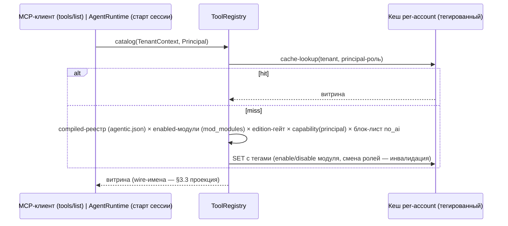
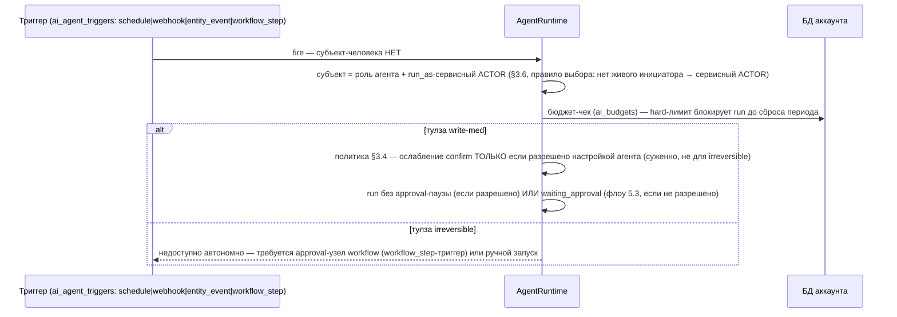
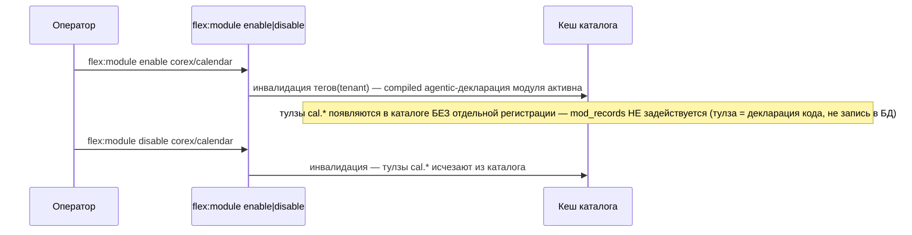

# B-32 — Agentic surface + corex/ai (норматив агентной поверхности модулей, карта тулзов волны, скелет runtime-DDL)

> **Статус: финал волны P3.1–P3.5** (слой решений, FLEX-2 P2.6). Стоит на R-29 (P1.6).
> Разделы 2/3/4/5/7/8 дозаполнены срезами P3.1–P3.5 до финальной глубины.
> Канон НЕ пересматривается: определяющие таблицы агентов (`ai_agents`/`ai_agent_versions`/
> `ai_agent_triggers`) — B-13 §2.7, ссылаемся и дополняем; 24 канонных тулзы CRM и общие правила
> ответов — B-13 §3.8; пресетные агенты — B-13 §5.7; права агента — R-06 §4.4. Все дельты канона —
> только реестром §9 → `05-Projects/01-Products/FlexCRM/plans/FLEX-2/open-questions.md` → арбитраж P4.2 (D11).
> Противоречия с AgenTools в одиночку в пользу изменения AgenTools НЕ решаются (D6 плана FLEX-2);
> все П1–П7 R-29 разобраны в §3.8 — эскалаций не потребовалось, AgenTools не меняется.
> Нумерация разделов — формат волны B-27..B-31 (§7 MCP-тулзы, §8 НФТ-закладки, §9 реестр
> вопросов); девиация от канон-нумерации B-13 зафиксирована здесь же, consistency-сверку P4.1
> вести по названиям разделов.
> Конвенции DDL: UUIDv7 (D12 master), префиксы таблиц (D9 master; в Phase Context P2 приписаны
> D4 — известный волновой дефект трассировки, см. Pending P2.3), `created_by jsonb` ACTOR (B-13).

---

## 1. Границы и состав

### 1.1 Что нормирует B-32

1. **Норматив агентной поверхности** — правила N1–N12 (R-29 §4.1, приняты с уточнениями §3.1): как ЛЮБОЙ модуль экосистемы (включая сторонние RegHub-модули) декларирует и экспонирует тулзы. B-13 §3.8 канонизировал MCP v1 только для CRM-домена; B-32 генерализует норматив на все модули, не переопределяя канонный список.
2. **Формат манифеста тулзов** (§3.2): статичная декларация в манифесте модуля (B-10 §3.2) + ToolProvider-рантайм + компилируемый JSON-вид для lint/RegHub-ревью.
3. **Правило выбора субъекта** (§3.6): агент от пользователя (имперсонация-пересечение) vs сервисный субъект `run_as` — генерализация R-06 §4.4 без новых механизмов.
4. **Скелет runtime-DDL corex/ai** (§2): полный список 10 таблиц B-13 §9 п.2 + добавка `ai_tool_dedupe`; ключевые колонки и FK; глубина (индексы/партиции) — срез P3.1.
5. **Консолидированная карта тулзов модулей волны** (§7): эскизы B-27..B-31 §7 + черновики R-29 §4.5, нормализованные под единый нейминг (§3.3).
6. **Стык AgenTools ↔ corex/ai** (§3.8): решение по каждому противоречию П1–П7 R-29 §5.1; таблица соответствия терминов R-29 §3.2 принята нормативной (§3.5).
7. **Confirm-гейт мутационных тулзов** (§3.7) — как решение; safety-инвариант — срез P3.5.
8. **Эскиз доменных событий corex/ai** (§5.1).

### 1.2 Что НЕ входит (Scope Excluded)

- Исчерпывающий DDL (индексы, партиции, edge-cases) — срез P3.1.
- Полные сигнатуры контрактов — срез P3.3.
- AC — срез P3.5.
- Промпты и состав пресетных агентов — канон B-13 §5.7, не трогаем.
- Реализация AgenTools PHP SDK — программная зависимость P6 (Q28).
- MCP tasks (experimental) — v1.1-кандидат для тяжёлых операций (N12).
- OAuth 2.1 authorization server — v1.1 по канону B-13 §3.8 (v1 = Sanctum PAT).
- Маркетплейс сторонних MCP-серверов (паттерн AgentExchange, R-29 §2.2) — v2, после RegHub.

### 1.3 Зависимости

`corex/ai` (дом норматива и runtime) → AzGuard/B-11 (principal, capability, ScopeResolver) ·
B-10 (манифест, RegistryCompiler, lifecycle, module.lint) · AgenTools spec 2026-07-draft
(протокольные контракты TCP/LC/CP/SC/AU/IE — нормативная ссылка, НЕ кодовая зависимость v1, Q28) ·
laravel/ai + laravel/mcp (R-16 — деталь реализации за контрактами corex/ai) ·
B-12 (workflow AI-шаг, wakeup) · модули волны B-27..B-31 (поставщики ToolProvider'ов).

---

## 2. Схема БД

> Срез P3.1: полный DDL (индексы/партиции/edge-cases — Q27 закрыт).

### 2.1 Определяющие таблицы — канон, не переопределяются

`ai_agents`, `ai_agent_versions`, `ai_agent_triggers` — полный DDL в **B-13 §2.7**, здесь не
дублируется. Единственная точка касания B-32: `ai_agent_versions.tools` (jsonb
`[{code, stake_override?}]`) — коды тулзов в этом поле следуют нормативу нейминга §3.3;
семантика `stake_override` подчиняется политике гейта §3.4 (ослабление ниже норматива
side_effect запрещено — деталь политики уходит в Q25/арбитраж).

### 2.2 Runtime-таблицы (10 из B-13 §9 п.2 + добавка) — полный DDL

Колоночный норматив — R-06 §4.1; ниже — полный DDL, FK и дельты, привнесённые
AgenTools-стыком (П4/П5 → Q27). Все таблицы: `id uuid` (UUIDv7), `created_at`/
`updated_at timestamptz NOT NULL DEFAULT now()` по конвенции DB_SCHEMA.md §1, кроме
append-only ledger'ов (`ai_messages`, `ai_usage`) — без `updated_at` (правило B-27/B-30 P3.1:
append-only без легитимного post-insert поля не несёт `updated_at`).

```sql
CREATE TABLE ai_threads (                    -- сессия диалога/запуска агента
  id                  uuid PRIMARY KEY,
  workspace_id        uuid REFERENCES wsp_workspaces(id) ON DELETE CASCADE,   -- NULL = весь аккаунт
  agent_id            uuid NOT NULL REFERENCES ai_agents(id) ON DELETE RESTRICT,
  agent_version_id    uuid NOT NULL REFERENCES ai_agent_versions(id) ON DELETE RESTRICT,
  source              varchar(16) NOT NULL CHECK (source IN ('chat','voice','trigger','workflow','mcp')),
  context_entity_type varchar(64),
  context_entity_id   uuid,
  status              varchar(16) NOT NULL DEFAULT 'open' CHECK (status IN ('open','closed','expired')),
  created_by          jsonb NOT NULL,          -- ACTOR
  created_at timestamptz NOT NULL DEFAULT now(), updated_at timestamptz NOT NULL DEFAULT now()
);
CREATE INDEX ai_threads_agent_ix   ON ai_threads (agent_id, status);
CREATE INDEX ai_threads_context_ix ON ai_threads (context_entity_type, context_entity_id) WHERE context_entity_type IS NOT NULL;  -- запрос: «треды по этой записи» (карточка сущности)
CREATE INDEX ai_threads_open_ix    ON ai_threads (workspace_id) WHERE status = 'open';  -- запрос: активные диалоги

CREATE TABLE ai_turns (                      -- один ход агента (usage-денорм)
  id          uuid PRIMARY KEY,
  thread_id   uuid NOT NULL REFERENCES ai_threads(id) ON DELETE CASCADE,
  status      varchar(24) NOT NULL DEFAULT 'running'
              CHECK (status IN ('running','waiting_input','waiting_approval','ok','failed','cancelled','expired')),
              -- свёртка FSM LC AgenTools (§3.9); дельта против канонного списка R-06 — Q27 закрыт
  model_ref   varchar(64) NOT NULL,
  tokens_in   int NOT NULL DEFAULT 0,
  tokens_out  int NOT NULL DEFAULT 0,
  cost_micros bigint NOT NULL DEFAULT 0,
  started_at  timestamptz NOT NULL DEFAULT now(),
  finished_at timestamptz,
  created_at timestamptz NOT NULL DEFAULT now(), updated_at timestamptz NOT NULL DEFAULT now(),
  CHECK (status NOT IN ('ok','failed','cancelled','expired') OR finished_at IS NOT NULL)
);
CREATE INDEX ai_turns_thread_ix          ON ai_turns (thread_id, started_at);
CREATE INDEX ai_turns_waiting_approval_ix ON ai_turns (thread_id) WHERE status = 'waiting_approval';  -- запрос: очередь HITL-подтверждений (§3.7 поток 3)

CREATE TABLE ai_messages (                   -- сообщения хода (append-only)
  id         uuid PRIMARY KEY,               -- UUIDv7 — time-sortable курсор
  turn_id    uuid NOT NULL REFERENCES ai_turns(id) ON DELETE CASCADE,
  role       varchar(16) NOT NULL CHECK (role IN ('user','assistant','tool','system')),
  parts      jsonb NOT NULL,
  created_at timestamptz NOT NULL DEFAULT now()   -- append-only: НЕТ updated_at (сообщения неизменны)
);
CREATE INDEX ai_messages_turn_ix ON ai_messages (turn_id, id);  -- запрос: рендер хода по порядку (UUIDv7-курсор)

CREATE TABLE ai_tool_calls (                 -- аудит + HITL, ledger вызовов (вкл. внешние MCP-вызовы)
  id                        uuid PRIMARY KEY,
  turn_id                   uuid REFERENCES ai_turns(id) ON DELETE CASCADE,  -- NULL = внешний MCP-клиент без LLM-турна (N9)
  tool_code                 varchar(128) NOT NULL,
  args                      jsonb NOT NULL,      -- ПДн-маскированные (AiGateway, R-16 §2.2.3)
  side_effect               varchar(16) NOT NULL CHECK (side_effect IN ('read','draft','write','irreversible')),  -- D7 AgenTools — источник §3.4
  stake                     varchar(8),          -- алиас-проекция side_effect (§3.4); не GENERATED — вычисляется приложением при записи, менять напрямую нельзя (lint-кандидат P3.5)
  status                    varchar(24) NOT NULL DEFAULT 'prepared'
                            CHECK (status IN ('prepared','waiting_approval','approved','committed','rejected','failed','expired')),
  approved_by               uuid,
  idempotency_key           varchar(80),         -- 'at1:'+sha256hex (IE-модель D5 AgenTools)
  confirmation_token_digest varchar(64),
  prepared_at               timestamptz,
  committed_at              timestamptz,
  entity_type               varchar(64),
  entity_id                 uuid,
  error                     jsonb,
  principal                 jsonb NOT NULL,      -- ACTOR фактического субъекта (user/agent/run_as) — AU-состав R-29 §4.4
  created_at timestamptz NOT NULL DEFAULT now(), updated_at timestamptz NOT NULL DEFAULT now(),
  CHECK (side_effect NOT IN ('write','irreversible') OR idempotency_key IS NOT NULL)  -- N6: write/irreversible обязаны нести idempotency key
);
CREATE INDEX ai_tool_calls_turn_ix     ON ai_tool_calls (turn_id) WHERE turn_id IS NOT NULL;
CREATE UNIQUE INDEX ai_tool_calls_idem_uq ON ai_tool_calls (idempotency_key) WHERE idempotency_key IS NOT NULL;
CREATE INDEX ai_tool_calls_pending_ix   ON ai_tool_calls (status) WHERE status IN ('prepared','waiting_approval');  -- запрос: HITL/two-phase очередь
CREATE INDEX ai_tool_calls_entity_ix    ON ai_tool_calls (entity_type, entity_id) WHERE entity_type IS NOT NULL;    -- запрос: «какие тулзы трогали эту запись» (аудит)
CREATE INDEX ai_tool_calls_brin_ix      ON ai_tool_calls USING BRIN (created_at);
COMMENT ON TABLE ai_tool_calls IS
  'Partition-ready с первого дня по created_at (самая быстрорастущая таблица агентного слоя, §8), паттерн crm_tml/cht_messages: created_at NOT NULL, партиционирование по нему не задевается последующими UPDATE статуса (status/approved_by/committed_at мутируют, партиционный ключ — нет). v1 — single-table; opt-in партиции — B-26 §3';

CREATE TABLE ai_tool_dedupe (                 -- добавка (П4/Q27): dedupe идемпотентности на границе tool (AgenTools D10)
  key        varchar(80) PRIMARY KEY,         -- 'at1:'+формула D5 AgenTools — натуральный ключ, surrogate id не нужен
  tool_code  varchar(128) NOT NULL,
  result_ref uuid REFERENCES ai_tool_calls(id) ON DELETE SET NULL,
  expires_at timestamptz NOT NULL,
  created_at timestamptz NOT NULL DEFAULT now()
);
CREATE INDEX ai_tool_dedupe_expiry_ix ON ai_tool_dedupe (expires_at);  -- запрос: TTL-свип истёкших dedupe-ключей

-- Порядок чтения секции сохранён по исходному драфту; фактический порядок миграций (ai_models
-- ПЕРЕД ai_usage/ai_chunks — оба ссылаются на неё) — таблица `slices/S1_db.md` §5, паттерн
-- forward-reference-в-документации уже прецедентен канону (crm_leads.converted_deal_id → crm_deals, B-13 §2.3).
CREATE TABLE ai_usage (                       -- ledger LLM-потребления (append-only)
  id          uuid PRIMARY KEY,
  workspace_id uuid REFERENCES wsp_workspaces(id) ON DELETE CASCADE,
  agent_id    uuid REFERENCES ai_agents(id) ON DELETE SET NULL,
  model_id    uuid NOT NULL REFERENCES ai_models(id) ON DELETE RESTRICT,
  turn_id     uuid REFERENCES ai_turns(id) ON DELETE SET NULL,
  tokens_in   int NOT NULL DEFAULT 0,
  tokens_out  int NOT NULL DEFAULT 0,
  cost_micros bigint NOT NULL DEFAULT 0,
  occurred_at timestamptz NOT NULL DEFAULT now(),
  created_at  timestamptz NOT NULL DEFAULT now()   -- append-only: НЕТ updated_at
);
CREATE INDEX ai_usage_scope_ix ON ai_usage (workspace_id, occurred_at);   -- запрос: бюджет-чек per workspace/период (ai_budgets)
CREATE INDEX ai_usage_agent_ix ON ai_usage (agent_id, occurred_at) WHERE agent_id IS NOT NULL;
CREATE INDEX ai_usage_brin_ix  ON ai_usage USING BRIN (occurred_at);
COMMENT ON TABLE ai_usage IS 'Partition-ready с первого дня по occurred_at (ledger, §8), паттерн crm_tml. v1 — single-table; opt-in партиции — B-26 §3';

CREATE TABLE ai_budgets (
  id                uuid PRIMARY KEY,
  scope             varchar(16) NOT NULL CHECK (scope IN ('account','workspace','agent')),
  scope_ref         uuid,                      -- NULL для scope=account
  period            varchar(8) NOT NULL DEFAULT 'month' CHECK (period IN ('month')),
  limit_tokens      bigint,
  limit_cost_micros bigint,
  created_at timestamptz NOT NULL DEFAULT now(), updated_at timestamptz NOT NULL DEFAULT now(),
  UNIQUE NULLS NOT DISTINCT (scope, scope_ref, period),
  CHECK ((scope = 'account') = (scope_ref IS NULL))
);

CREATE TABLE ai_models (
  id              uuid PRIMARY KEY,
  code            varchar(64) NOT NULL UNIQUE,
  driver          varchar(32) NOT NULL,        -- openai-compat/gigachat/tei — матрица R-16 §3
  capabilities    jsonb NOT NULL DEFAULT '{}', -- structured-retry параметры R-16
  embedding_dim   int,
  is_active       boolean NOT NULL DEFAULT true,
  created_at timestamptz NOT NULL DEFAULT now(), updated_at timestamptz NOT NULL DEFAULT now()
);
CREATE INDEX ai_models_active_ix ON ai_models (is_active) WHERE is_active;

CREATE TABLE ai_knowledge_sources (
  id         uuid PRIMARY KEY,
  code       varchar(64) NOT NULL UNIQUE,
  type       varchar(24) NOT NULL CHECK (type IN ('entity_corpus','vaulter_docs','url','manual')),
  config     jsonb NOT NULL DEFAULT '{}',
  status     varchar(16) NOT NULL DEFAULT 'active',
  created_at timestamptz NOT NULL DEFAULT now(), updated_at timestamptz NOT NULL DEFAULT now()
);

CREATE TABLE ai_chunks (                      -- вектора RAG
  id                 uuid PRIMARY KEY,
  source_id          uuid NOT NULL REFERENCES ai_knowledge_sources(id) ON DELETE CASCADE,
  entity_type        varchar(64),
  entity_id          uuid,
  content            text NOT NULL,
  embedding          vector(1024) NOT NULL,     -- R-16: USER-bge-m3
  embedding_model_id uuid NOT NULL REFERENCES ai_models(id) ON DELETE RESTRICT,  -- переиндексация при смене — одна активная embedding-модель на тенантскую БД
  created_at timestamptz NOT NULL DEFAULT now(), updated_at timestamptz NOT NULL DEFAULT now()
);
CREATE INDEX ai_chunks_entity_ix    ON ai_chunks (entity_type, entity_id) WHERE entity_type IS NOT NULL;  -- запрос: чанки конкретной записи (переиндексация при её изменении)
CREATE INDEX ai_chunks_source_ix    ON ai_chunks (source_id);
CREATE INDEX ai_chunks_stale_ix     ON ai_chunks (embedding_model_id);  -- запрос: воркер переиндексации — «чанки НЕ текущей активной модели» (§5 поток 6)
CREATE INDEX ai_chunks_embedding_ix ON ai_chunks USING hnsw (embedding vector_cosine_ops);  -- R-16: HNSW cosine — решено здесь (P3.1)

CREATE TABLE ai_pii_map (                     -- таблица соответствия псевдонимизации
  token             varchar(64) PRIMARY KEY,   -- стабильный HMAC — натуральный ключ, surrogate id не нужен
  original_encrypted bytea NOT NULL,
  kind              varchar(24) NOT NULL CHECK (kind IN ('person','phone','email','address','inn')),
  first_seen_at     timestamptz NOT NULL DEFAULT now()
);
CREATE INDEX ai_pii_map_kind_ix ON ai_pii_map (kind);
COMMENT ON TABLE ai_pii_map IS
 'Псевдонимизация ПДн для LLM-вызовов (R-16 §2.2.3, 233-ФЗ ст.13.1 152-ФЗ):
  стабильные HMAC-токены + локальная таблица соответствия = ПСЕВДОНИМИЗАЦИЯ, НЕ обезличивание —
  данные остаются ПДн, пока существует ключ восстановления. Таблица соответствия НИКОГДА
  не покидает контур тенантской БД и не передаётся третьим лицам (запрет передачи таблиц
  соответствия — 233-ФЗ). Маска обязательна для всех исходящих LLM-вызовов (AiGateway),
  но НЕ является правовым основанием передачи текста в облако — основание = договорная база
  (обработка по поручению, ст.6 ч.3 152-ФЗ) на уровне оферты/DPA.';
```

### 2.3 Что НЕ в схеме

- Отдельной таблицы «реестра тулзов» нет — каталог компилируется из манифестов (§3.2) и
  фильтруется per-tenant в кеше (enabled-модули × edition × capability), паттерн
  ModuleRegistry B-10 §3.3. Витрина в БД не хранится (0 сканов на hot path).
- Таблицы сценариев AgenTools (SC) в v1 нет: сценарии-как-данные — контракт спеки, продуктовая
  персистентность появится с PHP SDK (Q28); закладка отмечена в §9 п.9.

---

## 3. Ключевые архитектурные решения

> Решения зафиксированы, глубина (протоколы, SQL-механика гейтов, полная JSON Schema) добрана срезами P3.1–P3.5; каждое решение — со ссылкой на R-29 §.

### 3.0 Вердикты по входам R-29 §6 (все 8 — явно)

| # | Вход R-29 §6 | Вердикт | Где |
|---|---|---|---|
| 1 | Норматив N1–N12 (§4.1) как скелет блюпринта; расширения канона — через Q25/Q26 | **ПРИНЯТО с уточнениями** (N2 — носитель декларации приведён к канону B-10 §3.2: PHP-манифест, не файл module.json; N3 — нейминг заменён нормативом ТЗ волны `module.verb_noun`, см. §3.3) | §3.1 |
| 2 | Формат манифеста — секция `agentic` module.json + ToolProvider + блок `generated`; JSON Schema — артефакт B-32; lint-правило | **ПРИНЯТО с изменением носителя**: декларация живёт в PHP-манифесте B-10 §3.2 (новый first-class метод, прецедент `components()` D14), компилятор экспортирует канонический JSON-вид под JSON Schema — двухслойность, `generated` и lint-правило сохранены | §3.2 |
| 3 | Таблица соответствия §3.2 R-29 — нормативная (термины трёх слоёв, алиасы D7) | **ПРИНЯТО** | §3.5 |
| 4 | Черновые списки тулзов §4.5 (41 кандидат) — стартовый каталог, выверка по B-27..B-31 | **ПРИНЯТО с изменениями**: карта консолидирована с §7-эскизами блюпринтов; при конфликте авторитет — блюпринт модуля (пример: mkg-выдача агенту урезана по B-30 §7, юр-риск); имена нормализованы по §3.3 | §7 |
| 5 | Права — генерализовать R-06 §4.4 на все модули (N8), без новых механизмов | **ПРИНЯТО** | §3.6 |
| 6 | Аудит/DDL — входы R-29 §4.4 в task-card corex/ai через Q27 | **ПРИНЯТО**: скелет §2.2 уже несёт AU-поля, dedupe-таблицу и расширенные статусы; финализация DDL — P3.1/Q27 | §2.2, §3.9 |
| 7 | Дифференциатор позиционирования: серверный confirm-слой + MCP-аудит — рынок не даёт | **ПРИНЯТО** (формулировать аккуратно, паттерн R-18b) | §3.12 |
| 8 | Не проектировать: MCP tasks, OAuth 2.1 AS, маркетплейс MCP-серверов | **ПРИНЯТО** | §1.2 |

### 3.1 Норматив N1–N12 — принят с двумя уточнениями

Правила N1–N12 R-29 §4.1 принимаются как норматив агентной поверхности **всех** модулей
экосистемы. Уточнения:

- **N2 (носитель декларации)**: R-29 (вслед за Т8/Intent item'а) называет носитель
  «секция agentic в module.json». В каноне B-10 §3.2 манифест модуля — **PHP-класс
  `Manifest`** (fluent builder), файла module.json не существует (в composer.json — только
  `extra.corex.module`). Решение: декларация — в PHP-манифесте (§3.2 ниже); канонический
  JSON-вид генерируется компилятором (`flex:modules:compile`) и валидируется JSON Schema —
  так сохраняются все выгоды server.json-паттерна R-29 §2.4 (schema-валидируемая витрина,
  единый source of truth автор↔ревьюер B-10 §4.6) без противоречия канону. Терминологическая
  развилка «module.json» R-29/ТЗ читается как «манифест модуля». Носитель = дельта B-10 → Q59.
- **N3 (нейминг)**: R-29 рекомендовал `{prefix}_{resource}_{verb}` (по канону §3.8);
  норматив волны (ТЗ P2.6, эскизы B-27..B-30 §7) — `module.verb_noun`. Принят
  `module.verb_noun` — обоснование и последствия в §3.3; это отступление от рекомендации
  R-29 с обоснованием.

Остальные правила (N1, N4–N12) — без изменений. Ключевые: N1 — один ToolRegistry, второго
реестра/транспорта нет (= AgenTools D8); N4 — `side_effect` источник истины, annotations —
проекция (§3.4); N5 — two-phase на MCP-границе (§3.7); N6 — идемпотентность write-тулзов
(ключ `at1:`); N7 — capability-гейт каталога + ScopeResolver + record-check (норматив B-13
§3.8 распространяется на все модули без изменений); N8 — субъект (§3.6); N9 — ledger
`ai_tool_calls` для каждого вызова; N10 — общие правила ответов B-13 §3.8; N11 — generic-
опасные тулзы не экспонируются; N12 — таргет MCP 2025-11-25 = AgenTools D3, tasks в v1 нет.

### 3.2 Формат манифеста тулзов (двухслойная декларация)

**Слой 1 — статичная витрина в манифесте модуля** (B-10 §3.2). Новый first-class метод
`Manifest::agentic()` — по прецеденту `components()` (D14: first-class, НЕ extender; девятый
extender потребовал бы RFC B-10 §4.3 при том, что agentic-поверхность — свойство самого
модуля, а не расширение чужой подсистемы). Аддитивная дельта канона B-10 §3.2 → Q59
(арбитраж P4.2, D11 — до арбитража альтернатива «extender `Extend\Tools`» остаётся живой).

```php
// Манифест модуля (фрагмент), эскиз — полные сигнатуры P3.3
public function manifest(): Manifest
{
    return Manifest::make('corex/calendar')
        // ...
        ->agentic(
            Agentic::make()
                ->toolProviders([CalendarToolProvider::class])
                ->tools([
                    Tool::make('cal.create_event')
                        ->title('Создать событие календаря')
                        ->sideEffect(SideEffect::Write)          // read|draft|write|irreversible (D7)
                        ->capability('app.cal_event.create')     // AzGuard-право: без него тулзы нет в каталоге (N7)
                        ->idempotent()                           // write ⇒ обязан принимать idempotency key (N6)
                        ->editions(['team', 'pro', 'enterprise']), // per-tenant tool manifest (R-06 §2.6)
                ])
                ->generated([                                    // runtime-генерация (twenty-паттерн, R-06 §2.3)
                    GeneratedTools::provider(CstEntityToolProvider::class)
                        ->pattern('sp.{verb}_{entity}'),         // закладка под смарт-процессы (Q21/B-31)
                ])
        );
}
```

Поля декларации тулзы (ровно состав ТЗ): **имя** (code, норматив §3.3) · **JSON Schema
аргументов** — живёт в ToolProvider (рантайм-слой), в витрине только ссылка-инвариант ·
**права** (capability) · **mutation/confirm-флаг** — производные от `side_effect` (§3.4),
руками не пишутся · **идемпотентность** (флаг `idempotent`; для `write`/`irreversible`
обязателен — валидируется lint'ом).

**Слой 2 — ToolProvider (рантайм)**: контракт corex/ai (§4); отдаёт полные дескрипторы
(inputSchema/outputSchema JSON Schema 2020-12, execute, prepare/commit для two-phase).

**Компилируемый JSON-вид + JSON Schema**: `flex:modules:compile` (B-10 §5.2) сериализует
agentic-декларацию в канонический JSON (`agentic.json` внутри compiled-реестра); JSON Schema
секции — артефакт репо ядра; RegHub-ревью и `module.lint` валидируют тем же файлом схемы
(паттерн server.json / MCP Registry, R-29 §2.4). Полная схема — срез P3.3.

**Lint-правила** (`module.lint`, B-10 §4.6): (1) расхождение витрины с фактическим
`descriptors()` провайдера = ошибка; (2) `write`/`irreversible` без `idempotent` = ошибка;
(3) имя вне норматива §3.3 = ошибка; (4) capability не объявлена в `Extend\Permissions`
модуля = ошибка.

**Регистрация через lifecycle B-10**: тулзы попадают в каталог автоматически при
`enable` модуля (компилированный реестр × `mod_modules` тенанта × edition-гейт
ModuleActivationGate × capability-гейт при построении каталога); при `disable` — исчезают
из каталога без ручных действий; `mod_records` не задействуется (тулза — не запись в БД
аккаунта, а декларация кода). Отдельного «реестра тулзов в БД» нет (§2.3).

**Решение «модуль без секции tools валиден»** (Code Guidance): agentic-поверхность —
**опциональна**. Отсутствие `->agentic()` в манифесте — норма, модуль полноценен
(lint не ругается). Норматив обязывает лишь: ЕСЛИ модуль экспонирует тулзы — то только
описанным здесь способом (N1/N2).

### 3.3 Норматив нейминга: `module.verb_noun`

**Правило**: имя тулзы = `{module_short}.{verb}_{noun}`, где `module_short` — короткий код
модуля, совпадающий с namespace прочих реестров экосистемы: handle EntityRegistry
`{module_short}.{entity}` (B-10 §3.4), permission keys `{module}.{entity}.{action}`
(B-11, прецедент Q1: `tsk.task.accept`). Примеры: `tsk.accept_task`, `cal.create_event`,
`soc.publish_post`, `mkg.draft_campaign`, `wfl.publish_definition`, `sp.move_stage`.
Один словарь namespace'ов на все реестры — тулзы, права, сущности резолвятся по одному
`module_short` (D9-префикс без подчёркивания).

Обоснование отступления от R-29 N3 (`{prefix}_{resource}_{verb}`): (а) норматив ТЗ волны
(P2.6 Scope) прямо фиксирует `module.verb_noun`; (б) четыре из пяти блюпринтов волны
(B-27..B-30 §7) уже написаны в этой форме; (в) точечная сегментация `module.` даёт
машинно-надёжный парс namespace'а (split по первой точке) для edition-гейтинга и
policy-allowlist per agent (паттерн Salesforce R-29 §2.2); (г) verb_noun — консистентно
доменным событиям (`crm.lead.created` — B-13 §3.7) и MCP-практике иерархических имён.

**Совместимость с MCP-клиентами (внешний факт, RAG)**: точка в имени тулзы легальна по
спеке MCP 2025-11-25 (SEP-986, Final: допустимы `A-Za-z0-9_-./`, канонический пример
`admin.tools.list`) [RAG:✅ — https://modelcontextprotocol.io/specification/2025-11-25/server/tools ,
https://modelcontextprotocol.io/seps/986-specify-format-for-tool-names]. Однако часть
хост-клиентов пробрасывает имена в LLM-API как есть, а валидация имён некоторых LLM-API
уже (`^[a-zA-Z0-9_-]{1,64}$`, без точки) — дотированные имена дают 400 у таких клиентов
[UNVERIFIED — точный regex Anthropic API первоисточником не подтверждён; community-репорты
и практика переименований `x.y`→`x_y`]. **Решение**: канонический код тулзы —
`module.verb_noun` (реестры, манифест, `ai_agent_versions.tools`, `ai_tool_calls.tool_code`,
аудит); на MCP-границе ToolRegistry публикует **wire-проекцию** `module_verb_noun`
(точка → `_`, детерминированная и обратимая — коллизии исключены lint'ом), маппинг
canonical↔wire ведёт сам реестр. Механика проекции — срез P3.3.

**Канонные 24 тулзы B-13 §3.8** (`crm_deals_search`…) остаются как есть — их переименование
= дельта канона → **Q58** (арбитраж P4.2). Позиция драфта: v1 — канонные имена сохраняются
(они и так wire-safe), норматив `module.verb_noun` действует для всех НОВЫХ тулзов;
гармонизация канонного списка (алиасы или переименование) — решение арбитража.

### 3.4 Модель эффекта: `side_effect` — источник истины (Q25)

Каждая тулза несёт `side_effect: read | draft | write | irreversible` (AgenTools D7) как
единственный источник классификации эффекта (N4). Производные (руками не пишутся):

| side_effect | stake (алиас канона) | confirm-политика | MCP-annotations (проекция) |
|---|---|---|---|
| `read` | low | none | `readOnlyHint=true` |
| `draft` | low (Tier1) | none (артефакт неактивен по определению) | `readOnlyHint=false, destructiveHint=false` |
| `write` | med/high | confirm (two-phase на MCP / HITL-пауза в runtime) | `destructiveHint=false, idempotentHint=по флагу` |
| `irreversible` | high | double_confirm | `destructiveHint=true` |

`openWorldHint=false` для всех доменных тулзов. Полагаться на MCP-annotations как на
enforcement запрещено (недоверяемые hints — R-29 §2.3); enforcement всегда серверный.

**Политика гейта** (П2): выводится из `side_effect`, а не из настройки агента. Канонная
формула «med — подтверждение отключаемо настройкой агента» (B-13 §3.8) сохраняется в
суженном виде: `stake_override`/настройка агента может ослаблять confirm **только** для
внутреннего AgentRuntime и только в пределах `write`-med (напр., доверенный автономный
агент с узкой ролью); на MCP-границе для внешних клиентов two-phase непробиваем никакой
настройкой; `irreversible` не ослабляется нигде. Это дельта формулировки канона B-13 §3.8
(3-уровневый stake без draft/irreversible + семантика med) → **Q25, арбитраж P4.2** —
канон здесь не правится, B-32 фиксирует позицию драфта. Потребность волны в 4 уровнях
уже материальна: `mkg.draft_campaign` (draft), `mkg.schedule_campaign` (irreversible,
v1 агенту не выдаётся — §7.4).

### 3.5 Таблица соответствия терминов — нормативная

Таблица R-29 §3.2 «AgenTools ↔ corex/ai ↔ MCP» (13 понятий: инструмент, классификация
эффекта, гейт подтверждения, уточнение, сессия, идемпотентность, ошибки, аудит, цепочки,
права, бюджеты, реестр) **включается в норматив по ссылке** — термины трёх слоёв закреплены,
рантаймы сохраняют свои термины как алиасы (D7 AgenTools). Дублирование таблицы здесь
не делается (канон волны — R-29; сверка P4.1 по якорю R-29 §3.2). Дельта к таблице от
B-32: строка «Сессия/состояние» получает расширенные статусы `ai_turns` (§3.9).

### 3.6 Субъект вызова: имперсонация vs сервисный ACTOR (правило выбора)

Канон R-06 §4.4 принят без ревизии и генерализован на все модули (N8):

1. **Интерактивные каналы** (chat, voice, UI-кнопка, внешний MCP-клиент по Sanctum PAT):
   субъект = пользователь-инициатор; эффективные права = **intersection(права пользователя,
   роль агента)** — пользовательский потолок непробиваем. Внешний MCP-клиент — частный
   случай: контекст владельца токена, зеркально UI (abilities `mcp:read`/`mcp:write`).
2. **Автономные запуски** (`schedule`, `webhook`, `entity_event`, `workflow_step` —
   типы `ai_agent_triggers`): субъекта-человека нет → роль агента + обязательный
   **`run_as`-сервисный субъект** (участник workspace), чтобы `created_by jsonb` ACTOR
   всегда имел субъекта. Правило выбора: **есть живой инициатор в цепочке вызова →
   имперсонация-пересечение; нет → сервисный ACTOR, никогда не «система без субъекта»**.
3. Права применяются дважды: при генерации каталога (недоступная тулза не существует)
   и повторно при execute (record-check ScopeResolver).
4. `principal jsonb` в `ai_tool_calls` (§2.2) фиксирует фактического субъекта каждого
   вызова — включая пару (инициатор, агент) при имперсонации.

AzGuard-тип принципала `agent` — существующий открытый пункт R-06 §5.2, новых механизмов
B-32 не заводит; матрица прав по модулям — срез P3.4.

### 3.7 Confirm-гейт мутационных тулзов — решение

**Решение**: всякий вызов тулзы с `side_effect ∈ {write, irreversible}` проходит
подтверждение; политика едина, транспорт различен (N5):

- **MCP-граница (внешние клиенты)** — two-phase prepare/commit ОДНИМ тулом (AgenTools D4,
  CP-1..31): вызов без `confirmation_token` → prepare (preview в `structuredContent`;
  token + `expires_at` + `preview_digest` в `_meta["agentools/v1"]`); повторный вызов
  с token → commit. `irreversible` — double_confirm (второй токен, CP-уровень L3).
  Ключевое следствие: **two-phase не требует elicitation** — подтверждение выражается
  повторным tools/call, совместимо с любым MCP-клиентом (мотив D4 AgenTools). Это
  расширение канона B-13 §3.8 (не правка) — трасса Q26.
- **Внутренний AgentRuntime** — та же семантика паузой турна: `ai_turns.status =
  waiting_approval`, `ai_tool_calls.status = waiting_approval`, подтверждение фиксируется
  `approved_by`; в workflow — approval-узел (канон B-13 §3.8 сохраняется).
- Единая точка enforcement — ToolRegistry/execute-конвейер corex/ai; обход гейта прямым
  вызовом провайдера невозможен (провайдер получает управление только от реестра).

**Инвариант** (кандидат в safety-инварианты релиза, финализация — срез P3.5):
«мутационная тулза не исполняется без подтверждённого confirmation_token (MCP) или
approved_by (runtime), кроме явно разрешённого политикой §3.4 ослабления write-med
во внутреннем runtime; для irreversible исключений нет».

### 3.8 Стык AgenTools: решения по противоречиям П1–П7 (все — без эскалации)

Ни одно противоречие не решается изменением AgenTools (D6 плана); все разрешены на стороне
Flex (дельты канона — маршрутом D11) — зеркальных правок для 05-Projects/03-Packages/AgenTools/plans/AGENTOOLS не требуется,
пометка ниже в колонке «Зеркало AgenTools».

| П# | Суть (R-29 §5.1) | Решение B-32 | Зеркало AgenTools |
|---|---|---|---|
| П1 | stake 3 уровня (канон) vs side_effect 4 уровня (D7) | side_effect — источник, stake — алиас (§3.4); дельта канона B-13 §3.8 → Q25 (арбитраж P4.2) | не требуется (D7 уже спроектирован надмножеством) |
| П2 | Источник политики гейта: настройка агента vs side_effect | политика из side_effect; настройка — только суживающее ослабление write-med во внутреннем runtime (§3.4); в Q25 вместе с П1 | не требуется |
| П3 | HITL для внешних MCP-клиентов: канон молчит | two-phase prepare/commit по D4 — расширение канона, принято (§3.7); детальный протокол — P3.3 (Q26) | не требуется (используем D4 как есть) |
| П4 | dedupe-таблицы нет в канонном перечне corex/ai | добавлена `ai_tool_dedupe` в скелет §2.2; DDL — P3.1 (Q27) | не требуется (D13: персистентность — дело потребителя) |
| П5 | FSM: LC-статусы WAITING_INPUT/WAITING_APPROVAL/EXPIRED отсутствуют в канонных `ai_turns` | статусы расширены свёрткой LC (§2.2/§3.9); DDL — P3.1 (Q27) | не требуется |
| П6 | laravel/mcp v0.8.2 без elicitation — ClarificationRequest внешним клиентам не работает | v1: канонный пин laravel/mcp сохраняется — two-phase работает без elicitation (§3.7); ClarificationRequest внешним MCP-клиентам = v1.1 (URL-mode elicitation или mcp/sdk — решится по факту зрелости laravel/mcp); своим UI — Reverb (D12 AgenTools). Q26 закрыт этим решением | не требуется (D12 транспорт-агностичен — ровно под этот случай) |
| П7 | Ревизия MCP: R-06 §4.2 = «июнь 2025» vs D3 = 2025-11-25 | синхронизировано: таргет 2025-11-25, stateless-ready под 2026-07-28 (N12); отдельный Q не нужен (закрыто здесь) | не требуется |

Программная зависимость (не противоречие): B-32 ссылается на спеку 2026-07-draft
(P0 закрыт, аудит GREEN), но SDK нет — corex/ai в v1 либо ждёт agentools-SDK (P2 плана
AGENTOOLS), либо реализует контракты сам с миграцией; порядок майлстоунов — P6 (**Q28**,
Deferred). Норматив B-32 от этого не зависит: контракты спеки самодостаточны как текст.

### 3.9 DDL-решения стыка (вход task-card corex/ai, B-13 §9 п.2 / Q27)

1. `ai_tool_calls` расширяется AU-полями: `idempotency_key`, `confirmation_token_digest`,
   `prepared_at`/`committed_at`, `side_effect`, `principal` (§2.2) — колоночный состав
   сверить с AU-1..21 при написании DDL (P3.1).
2. Новая `ai_tool_dedupe` (key `at1:` UNIQUE, result_ref, expires_at) — граница tool (D10).
3. Статусы `ai_turns`: + `waiting_input`, `waiting_approval`, `expired` (свёртка LC);
   `ai_threads.status`: + `expired`. Event-log-first модель LC в v1 НЕ переносится в БД
   (канонные таблицы — состояние, не event source); соответствие «состояние = свёртка
   событий» обеспечивается на уровне контракта EventLog при появлении SDK — закладка §9 п.9.
4. Внешние MCP-вызовы: `ai_tool_calls.turn_id` nullable — ledger един для LLM-порождённых
   и внешних вызовов (N9); rate-limit per-PAT — §8.

### 3.10 Каталог per-tenant и editions

Каталог тулзов тенанта = compiled-реестр (§3.2) × enabled-модули (`mod_modules`) ×
edition-гейт (`editions` декларации × ModuleActivationGate B-10 §3.3) × capability-гейт
пользователя/агента (N7) × блок-лист `no_ai` (флаг сущности — R-06/R-29 §2.1: единственный
серверный enforce, который делает и рынок). Паттерн «scopes из набора тулзов» HubSpot
(R-29 §2.1) подтверждает: пер-тенантная витрина, а не глобальный список. Кеш — per-account
с тегами (паттерн ModuleRegistry::active B-10 §3.3); инвалидация — события enable/disable
модуля и смена ролей.

### 3.11 Генерируемые тулзы (`generated`)

Блок `generated` декларации (§3.2) — для тулзов, которые нельзя перечислить кодами на
этапе манифеста: смарт-процессы (`sp.{verb}_{entity}` per-entity из EntityRegistry —
B-31/Q21, twenty-паттерн R-06 §2.3). Генерирующий провайдер обязан: (а) выдавать имена
по нормативу §3.3; (б) наследовать side_effect-модель §3.4; (в) проходить тот же
execute-конвейер (гейты не обходятся — `sp.move_stage` = алиас StageTransitioner,
guard'ы стадий сохраняются, B-31 §7). Lint витрины для generated — по pattern-декларации.

### 3.12 Дифференциатор (позиционирование, вход 7)

Серверный confirm-слой (two-phase + double_confirm) и единый MCP-аудит `ai_tool_calls` —
то, что HubSpot/Salesforce-прочие SaaS на сервере не дают (подтверждено R-29 §2.1/§2.5,
[RAG:✅ R-29 №1–2, №15]): рынок делегирует подтверждение хосту и не ведёт unified-лог
tool-calls. Формулировка для маркетинга — аккуратная (паттерн R-18b): «серверные
подтверждения и сквозной аудит агентных действий — независимо от того, каким MCP-клиентом
пользуется сотрудник», НЕ «единственные в мире». Маршрут в маркетинг-канон — вне волны.

### 3.13 Права: матрица `ai.*`, HITL-approval = capability тулзы, принципал `agent` (срез P3.4)

> Срез P3.4: permission keys управления агентами + правило approval + подтверждение принципала agent — черновая пометка снята для права-подраздела.

**Матрица permission keys** (`Extend\Permissions`, формат B-11 §5.5, scope v1 — workspace/account, `ai_agents` не ownable сверх `workspace_id`-скоупа): `ai.agent.view` (просмотр конфигурации/промпта агента), `ai.agent.manage` (create/edit черновик агента), `ai.agent.publish` (публикация версии — отдельно от `manage`, паттерн `mkg.campaign.launch`/`workflow.definition.publish`: редактор ≠ публикующий), `ai.ledger.view` (просмотр `ai_tool_calls`/`ai_usage` — аудит/compliance, отдельно от оперативного использования агента).

**HITL-approval — решающее правило: НЕ отдельный `ai.*`-супер-permission.** Подтверждение `waiting_approval`-хода (флоу 5.3) требует у принципала-подтверждающего РОВНО ТОЙ capability, которую декларирует сама тулза (`ToolDescriptor.capability`, B-32 §3.2) — например, подтвердить `cal.book_resource` может тот, у кого есть `cal.resource.manage`/доступ `edit` на календарь (B-29 §3.12), а не держатель гипотетического `ai.tool_call.approve`. Обоснование: отдельный «супер-permission на approve» создал бы бэкдор в обход доменных прав (сотрудник без права бронировать ресурсы мог бы подтверждать чужие agent-инициированные брони) — нарушает принцип наименьших полномочий и правило единой точки enforcement (§3.7: обход гейта провайдера невозможен, а отдельный approval-permission именно такой обход и был бы). `approved_by` (`ai_tool_calls`) фиксирует ACTOR подтвердившего для аудита, но авторизация подтверждения — доменная capability тулзы, не новый AzGuard-ключ.

**Принципал `agent` в AzGuard — подтверждение без дельты (закрытие «открытого пункта R-06 §5.2»).** `PrincipalType::Agent` уже объявлен в каноне (B-11 §3.3, наравне с `User`/`ApiKey`); назначение роли агенту — ТОТ ЖЕ механизм `aut_role_assignments(principal_type, principal_id, role_id)`, что и у любого другого принципала (canon generic по `principal_type`, не требует нового пути). `principal_id` агента = `ai_agents.id`. Открытость R-06 §5.2 закрывается здесь как подтверждение: специального провизионирования агента как принципала не требуется — роль назначается администратором через тот же UI/API, что назначение роли сотруднику. Q11-класса дельты канона B-11 НЕ возникает.

**Сведение агентских прав с ACTOR-моделью B-13**: эффективное право агентского вызова = **intersection**(права инициатора-пользователя при имперсонации, права роли агента) — канон §3.6 без изменений; для автономных запусков (`run_as`, §3.6 п.2) — права РОЛИ агента напрямую (нет пользователя для intersection). Mutation-allowlist агента — двойное сужение: (1) роль агента (AzGuard capability, как у сотрудника) ограничивает МАКСИМУМ доступных action'ов; (2) `ai_agent_versions.tools` (jsonb-список кодов тулзов на конкретной версии агента, B-13 §2.7) сужает каталог ЕЩЁ УЖЕ — агент не может звать тулзу вне своего `tools`-списка, даже если роль формально позволяет действие (два независимых сужения, ANDed, не одно заменяет другое). Confirm-гейт (§3.7) — поверх обоих сужений, для write/irreversible независимо от роли/allowlist.

---

## 4. Контракты

> Срез P3.3: полные PHP-интерфейсы (@api, PHPStan level 8), wire-проекция имён (п.7),
> полная JSON Schema agentic-секции + lint-правила (п.8) — черновая пометка снята.

```php
namespace Corex\Ai;

use Corex\Auth\Actor;
use Corex\Auth\Principal;
use Corex\Core\TenantContext;

enum SideEffect: string { case Read = 'read'; case Draft = 'draft'; case Write = 'write'; case Irreversible = 'irreversible'; }

/** readonly, id+type+display — форма единая с B-16 §3 */
final readonly class ToolCallRef
{
    public function __construct(public string $id, public string $type /* 'ai.tool_call' */, public string $display /* tool_code */) {}
}

final readonly class ToolDescriptor           // TCP-совместим (AgenTools 01)
{
    public function __construct(
        public string $code,                  // module.verb_noun (§3.3)
        public string $title,
        public SideEffect $sideEffect,
        public string $capability,             // permission key — без неё тулзы нет в каталоге (N7)
        public array $inputSchema,             // JSON Schema 2020-12
        public array $outputSchema,
        public bool $idempotent = false,       // write/irreversible ⇒ обязан быть true (lint-правило 2, §3.2)
        /** @var list<string> */
        public array $editions = ['team', 'pro', 'enterprise'],
    ) {}
}

final readonly class ToolPreview
{
    public function __construct(public array $structuredContent, public string $confirmationToken,
                                 public \DateTimeImmutable $expiresAt, public string $previewDigest) {}
}
final readonly class ToolExecutionResult
{
    public function __construct(public array $result, public ?string $entityType = null, public ?string $entityId = null) {}
}

/** confirmation_token истёк или digest не совпал (args подменены между prepare/commit) */
final class ConfirmationExpiredOrTamperedException extends \DomainException {}
/** side_effect ∈ {write,irreversible} без idempotency_key на записи (N6, DB CHECK §2.2) */
final class MissingIdempotencyKeyException extends \DomainException {}
/** тулза не capability-гейтована для текущего Principal (N7) — не попадает в каталог, а не 403 на вызове */
final class ToolNotInCatalogException extends \DomainException {}

interface ToolProvider                        // поставщик тулзов модуля
{
    /** @return list<ToolDescriptor> */
    public function descriptors(): array;
    /** preview БЕЗ мутации — обязателен для write/irreversible (two-phase, §3.7) */
    public function prepare(string $toolCode, array $args, Principal $principal): array /* preview payload */;
    public function execute(string $toolCode, array $args, Actor $actor): ToolExecutionResult;
}

interface ToolRegistry                        // единый реестр MCP+AgentRuntime (N1)
{
    /** @return list<ToolDescriptor> — compiled-реестр × enabled-модули × edition-гейт × capability (§3.10) */
    public function catalog(TenantContext $tenant, Principal $principal): array;
    /** @throws ToolNotInCatalogException|MissingIdempotencyKeyException */
    public function call(string $wireOrCanonicalCode, array $args, Principal $principal, ?string $confirmationToken = null): ToolExecutionResult|ToolPreview;
    public function wireName(string $canonicalCode): string;      // module.verb_noun → module_verb_noun (§4.1)
    public function canonicalName(string $wireCode): string;
}

interface ConfirmationGate                    // two-phase по CP AgenTools (§3.7)
{
    public function prepare(string $toolCode, array $args, Principal $principal): ToolPreview;
    /** @throws ConfirmationExpiredOrTamperedException */
    public function commit(string $confirmationToken, array $args): ToolExecutionResult;
    public function verifyDigest(string $confirmationToken, array $args): bool;
}

interface IdempotencyGuard                    // формула at1: (AgenTools D5)
{
    public function keyFor(string $tenantId, string $sessionId, string $stepId, string $toolCode, array $args): string /* 'at1:'+sha256hex(JCS) */;
    /** @return bool true если новый ключ (claimed), false если уже существует (см. resolve) */
    public function claim(string $key, string $toolCode): bool;
    public function resolve(string $key): ?ToolExecutionResult;   // сохранённый результат — БЕЗ повторной мутации
}

interface AgentRuntime                        // внутренний loop; пауза waiting_approval (§3.7)
{
    public function run(string $threadId, string $userMessage, Actor $actor): void;
    public function resume(string $turnId, bool $approved, Actor $actor): void;
}

interface AiGateway                           // единственная точка LLM (R-06 §4.5, без изменений)
{
    public function chat(array $messages, string $modelRef): array;   // маска ПДн (ai_pii_map) → бюджет-чек (ai_budgets) → LLM
    public function embed(string $text, string $modelRef): array;     // vector(1024)
}

/** builder §3.2 — first-class метод Manifest::agentic() (Q59, арбитраж P4.2) */
final class Agentic
{
    public static function make(): self { return new self(); }
    /** @param list<class-string> $providers */
    public function toolProviders(array $providers): self { return $this; }
    /** @param list<Tool> $tools */
    public function tools(array $tools): self { return $this; }
    /** @param list<GeneratedTools> $generated */
    public function generated(array $generated): self { return $this; }
}
final class Tool
{
    public static function make(string $code): self { return new self(); }
    public function title(string $title): self { return $this; }
    public function sideEffect(SideEffect $sideEffect): self { return $this; }
    public function capability(string $key): self { return $this; }
    public function idempotent(): self { return $this; }
    /** @param list<string> $editions */
    public function editions(array $editions): self { return $this; }
}
final class GeneratedTools
{
    public static function provider(string $providerClass): self { return new self(); }
    public function pattern(string $pattern): self { return $this; }   // 'sp.{verb}_{entity}'
}
```

Стык с AzGuard — существующие `AccessChecker::allowed` / `ScopeResolver::apply` (B-11 §5.5),
новых контрактов прав нет. Стык с workflow — AI-шаг B-12 зовёт `AgentRuntime` (R-06 §4.3);
сценарии AgenTools (SC) могут звать `wfl_process_start` как обычную тулзу — граница
рантаймов по R-29 §2.7 п.7, дублирования нет.

### 4.1 Wire-проекция имён (п.7 реестра — решено здесь)

Механика маппинга `module.verb_noun` (canonical) ↔ `module_verb_noun` (wire, MCP-граница §3.3):
детерминированная, обратимая, без реестра исключений — **первая точка `.` заменяется на `_`,
остальные точки (если появятся во вложенном коде — норматив их не допускает) запрещены lint'ом**.
`ToolRegistry::wireName()`/`canonicalName()` — единственная точка перевода (не дублируется в
провайдерах/MCP-серверном коде). Коллизии исключены статически: lint (`module.lint`) отклоняет
регистрацию тулзы, чья wire-проекция совпадает с wire-проекцией уже существующей канонической
тулзы (нейминг `module.verb_noun` уникален по построению — namespace `module` + `verb_noun` без
внутренних точек делает коллизию проекции эквивалентной коллизии исходного имени). Документация
для внешних MCP-клиентов: `tools/list` отдаёт wire-имена (проекция уже применена, §5.1), клиент
не обязан знать о canonical-форме; ledger (`ai_tool_calls.tool_code`) и манифест хранят
**canonical**-форму (аудит/полиси читаются в одной системе имён). Item п.7 → закрыт.

### 4.2 Полная JSON Schema agentic-секции + lint-правила в терминах `module.lint` (п.8 — решено здесь)

Канонический вид (`agentic.json`, компилируется `flex:modules:compile`, B-10 §5.2):

```json
{
  "$schema": "https://json-schema.org/draft/2020-12/schema",
  "$id": "https://flexcrm.ru/schemas/agentic.json",
  "type": "object",
  "properties": {
    "module": { "type": "string" },
    "tool_providers": { "type": "array", "items": { "type": "string" } },
    "tools": {
      "type": "array",
      "items": {
        "type": "object",
        "properties": {
          "code":        { "type": "string", "pattern": "^[a-z][a-z0-9_]*\\.[a-z][a-z0-9_]*$" },
          "title":       { "type": "string" },
          "side_effect": { "type": "string", "enum": ["read", "draft", "write", "irreversible"] },
          "capability":  { "type": "string" },
          "idempotent":  { "type": "boolean", "default": false },
          "editions":    { "type": "array", "items": { "type": "string", "enum": ["team", "pro", "enterprise"] } }
        },
        "required": ["code", "title", "side_effect", "capability"],
        "additionalProperties": false
      }
    },
    "generated": {
      "type": "array",
      "items": {
        "type": "object",
        "properties": {
          "provider": { "type": "string" },
          "pattern":  { "type": "string" }
        },
        "required": ["provider", "pattern"],
        "additionalProperties": false
      }
    }
  },
  "required": ["module"],
  "additionalProperties": false
}
```

Lint-правила (`module.lint`, B-10 §4.6 — формализация 4 правил §3.2 в терминах схемы выше):

| # | Правило | Проверка |
|---|---|---|
| 1 | Витрина = рантайм | `agentic.json.tools[].code` — множество совпадает с `ToolProvider::descriptors()[].code` реализации; расхождение — ошибка |
| 2 | Идемпотентность обязательна | `side_effect ∈ {write, irreversible}` ⇒ `idempotent = true`; иначе — ошибка |
| 3 | Нейминг | `code` матчит `^[a-z][a-z0-9_]*\.[a-z][a-z0-9_]*$` (module_short без подчёркивания, verb_noun без второй точки) — иначе ошибка |
| 4 | Capability объявлена | `capability` присутствует в `Extend\Permissions` того же модуля — иначе ошибка |

Item п.8 → закрыт.

---

## 5. Главные потоки

> Срез P3.2: детальные sequence-диаграммы + транзакционные границы (снята черновая пометка).
> afterCommit-события — стиль B-16 §5.2.

### 5.1 Построение per-tenant каталога



### 5.2 Write-тулза от внешнего MCP-клиента: two-phase (кросс-модульный сценарий волны №5: B-32×модуль)

> Атрибуция: первичная спека — **B-32** (единый confirm-гейт/ledger); домен-модуль (пример ниже —
> `cal.book_resource`, B-29) — конкретизация ЛЮБОГО write/irreversible-тулза волны (tsk/cal/soc/mkg/
> wfl/sp — та же механика, разный ToolProvider). Остальные спеки волны ссылаются на этот флоу
> вместо повторения two-phase у себя.

```mermaid
sequenceDiagram
  participant MC as Внешний MCP-клиент
  participant TR as ToolRegistry / execute-конвейер
  participant TP as ToolProvider (пример: CalendarToolProvider — cal.book_resource)
  participant DB as БД аккаунта
  MC->>TR: tools/call cal.book_resource(args) — БЕЗ confirmation_token
  TR->>TR: execute-re-check прав (capability + record-check ScopeResolver, N7)
  TR->>DB: BEGIN — INSERT ai_tool_calls (status='prepared', side_effect='write', args маскированы AiGateway)
  TR->>TP: prepare(args) — preview БЕЗ мутации (held-бронь предварительно НЕ создаётся)
  TP-->>TR: preview{resourceId, range, alternativesIfBusy}
  TR->>DB: UPDATE ai_tool_calls SET prepared_at=now()
  TR->>DB: COMMIT
  TR-->>MC: structuredContent(preview) + confirmation_token/expires_at/preview_digest в _meta["agentools/v1"]
  Note over MC: клиент показывает preview человеку — пауза до явного подтверждения
  MC->>TR: tools/call cal.book_resource(args) + confirmation_token
  TR->>TR: verifyDigest(token, args) — args не подменены между prepare/commit
  alt digest не совпал ИЛИ token истёк
    TR->>DB: BEGIN — UPDATE ai_tool_calls SET status='expired'
    TR->>DB: COMMIT
    TR-->>MC: обучающая ошибка (повторный prepare)
  else успех
    TR->>TR: IdempotencyGuard.claim(at1:key)
    alt ключ уже закоммичен (ai_tool_dedupe)
      TR-->>MC: сохранённый результат (result_ref) — БЕЗ повторной мутации
    else новый ключ
      TR->>TP: execute(args) — cal.book_resource → ResourceBookingService::hold+confirm (B-29 §5.3)
      TP->>DB: (транзакция ДОМЕННОГО модуля — B-29 §5.3, своя BEGIN/COMMIT)
      TP-->>TR: BookingRef | BookingConflictException
      TR->>DB: BEGIN — UPDATE ai_tool_calls SET status='committed', committed_at=now(), entity_type/id; INSERT ai_tool_dedupe(key, result_ref)
      TR->>DB: COMMIT
      TR-->>MC: результат
    end
  end
```

Ключевой инвариант (§3.7): обход гейта прямым вызовом `CalendarToolProvider` невозможен — провайдер получает управление ТОЛЬКО от `ToolRegistry`; `irreversible`-тулзы (напр. `mkg.schedule_campaign`, не выдаётся v1) проходят тот же цикл с `double_confirm` (второй токен, CP L3) — здесь не показан, механика идентична с удвоением confirm-шага.

### 5.3 Внутренний агент-ран с HITL

```mermaid
sequenceDiagram
  participant U as Пользователь (chat)
  participant AR as AgentRuntime
  participant AG as AiGateway
  participant DB as БД аккаунта
  U->>AR: сообщение (триггер source='chat')
  AR->>DB: BEGIN — INSERT ai_threads/ai_turns(status='running')
  AR->>DB: COMMIT
  AR->>AG: chat() — маска ПДн (ai_pii_map) → бюджет-чек (ai_budgets) → LLM
  AG-->>AR: tool_use write-тулзы
  AR->>DB: BEGIN — INSERT ai_tool_calls(status='waiting_approval'); UPDATE ai_turns SET status='waiting_approval'
  AR->>DB: COMMIT
  AR-->>U: UI/Reverb — запрос подтверждения
  U->>AR: approve(toolCallId)
  AR->>DB: BEGIN — UPDATE ai_tool_calls SET status='approved', approved_by=user.id
  AR->>DB: COMMIT
  AR->>AR: execute(args) через ToolProvider (та же точка входа, что §5.2, без two-phase — approved_by уже есть)
  AR->>DB: BEGIN — UPDATE ai_tool_calls SET status='committed'; UPDATE ai_turns SET status='running'
  AR->>DB: COMMIT
  AR->>AG: продолжение лупа (следующий LLM-вызов с результатом тулзы)
  AR->>DB: BEGIN — UPDATE ai_turns SET status='ok', finished_at=now()
  AR->>DB: COMMIT
```

### 5.4 Автономный запуск (schedule/webhook/workflow_step)



### 5.5 Enable/disable модуля



### 5.6 Переиндексация RAG при смене embedding-модели

```mermaid
sequenceDiagram
  participant Op as Оператор
  participant DB as БД аккаунта
  participant W as ReindexWorker
  Op->>DB: BEGIN — UPDATE ai_models SET is_active=false WHERE id=старая; UPDATE ai_models SET is_active=true WHERE id=новая
  Op->>DB: COMMIT
  W->>DB: SELECT ai_chunks WHERE embedding_model_id != (SELECT id FROM ai_models WHERE is_active) — индекс ai_chunks_stale_ix
  loop по чанку
    W->>W: пересчёт embedding через новую модель
    W->>DB: BEGIN — UPDATE ai_chunks SET embedding=..., embedding_model_id=новая
    W->>DB: COMMIT
  end
```

Контракт «одна активная embedding-модель на тенантскую БД» (R-16) — переключение атомарно на уровне `ai_models.is_active`, переиндексация — фоновая, не блокирует RAG-поиск (старые чанки продолжают участвовать до пересчёта).

### 5.1 Эскиз доменных событий (`ai.*`, стиль B-13 §3.7 — все несут TenantContext)

| Событие | Payload (эскиз) |
|---|---|
| `ai.thread.started` | thread_id, agent_id, source, context_entity |
| `ai.turn.completed` | turn_id, status, usage{tokens, cost} |
| `ai.turn.waiting_approval` | turn_id, tool_call_id, tool_code, preview_ref |
| `ai.tool_call.prepared` | tool_call_id, tool_code, side_effect, principal |
| `ai.tool_call.committed` | tool_call_id, tool_code, entity_type/id, idempotency_key |
| `ai.tool_call.rejected` | tool_call_id, rejected_by, reason |
| `ai.budget.soft_exceeded` / `ai.budget.hard_exceeded` | scope, scope_ref, period, usage_pct |
| `ai.agent.version_published` | agent_id, version |

Потребители: corex/notifications (approval-запросы), B-24 read-models (метрики агентов),
Audit Log corex/core (AU-проекция). Полные payload'ы — срез P3.3.

---

## 6. Интеграции (матрица доменов)

| Домен | Стык | Направление |
|---|---|---|
| B-10 (ядро/модули) | agentic-декларация в манифесте (Q59), RegistryCompiler → agentic.json, `module.lint`-правила §3.2, lifecycle enable/disable → каталог | B-32 расширяет манифест (дельта → арбитраж) |
| B-11 (AzGuard/tenancy) | capability-гейт каталога + ScopeResolver + record-check (N7); principal `agent` (открытый пункт R-06 §5.2); Sanctum PAT `mcp:read/write` | использует, не меняет |
| B-12 (workflow) | AI-шаг зовёт AgentRuntime; `wfl_process_start` — канонная тулза; approval-узел = HITL-транспорт workflow; сценарии SC ↔ workflow — граница R-29 §2.7 п.7 | взаимно, канон не тронут |
| B-13 (CRM) | определяющие таблицы §2.7 — ссылка; 24 тулзы §3.8 — канон, имена не тронуты (Q58); пресетные агенты §5.7 — потребители норматива | дополняет |
| B-27..B-31 | §7-эскизы блюпринтов консолидированы в §7 (нормализация имён §3.3); mkg-выдача — по B-30; wfl_processes_search/diagnose — уже канонные, из карты студии исключены как дубли | B-32 — консолидирующий норматив |
| B-16 (Chatom/Vaulter) | `no_ai`-флаг сущностей в блок-листе каталога; Vaulter-документы — источник ai_knowledge_sources | использует |
| B-24 (read-models/editions) | edition-гейтинг тулзов (`editions` в декларации); метрики агентов — read-models | использует |
| AgenTools (спека) | нормативная ссылка на TCP/LC/CP/SC/AU/IE; SDK — зависимость P6 (Q28) | реализует (D8 AgenTools) |
| RegHub | ревью agentic.json по JSON Schema — тот же артефакт, что lint (§3.2) | использует |
| R-16 (AI-runtime) | laravel/ai+laravel/mcp за контрактами; TEI-embeddings; ai_chunks/ai_pii_map | канон, без изменений |

---

## 7. MCP-тулзы — консолидированная финальная карта волны

> Срез P3.3: черновая пометка снята — доменные блюпринты B-27/B-28/B-29/B-31 §7 нормализованы
> byte-в-byte с этой картой (`slices/S3_contracts.md` §3), имена по §3.3 (`module.verb_noun`,
> module_short) подтверждены финальными. Полные права/JSON Schema per-тулза — образцы даны в
> доменных блюпринтах §7 (по шаблону, не для всех ~90 тулзов построчно — S3 §6 Pending).
> Канонные 24 тулзы B-13 §3.8 в карту НЕ входят (не дублируются); side_effect — по §3.4.

### 7.1 corex/tasks (`tsk.`) — дельта к канонным tsk_-тулзам §3.8

| Тулза | side_effect | Суть (источник) |
|---|---|---|
| `tsk.add_coassignee` | write | соисполнитель (B-27 §7) |
| `tsk.add_checklist_item` / `tsk.toggle_checklist_item` | write | чек-лист (B-27 §7) |
| `tsk.get_checklist` | read | чтение чек-листа (R-29 §4.5) |
| `tsk.apply_template` / `tsk.create_from_template` | write | развернуть шаблон/дерево (B-27 §7, R-24 §4) |
| `tsk.set_recurrence` | write | RRULE повторения (B-27 §7) |
| `tsk.link_dependency` | write | ребро зависимости (DAG-инвариант — обучающая ошибка при цикле) |
| `tsk.get_dependencies` | read | рёбра + critical path (R-29 §4.5, Q4) |
| `tsk.submit_for_review` | write | сдача на приёмку (B-27 §7) |
| `tsk.accept_task` / `tsk.reject_task` | write (high) | приёмка/возврат постановщиком (право — Q1: `tsk.task.accept`) |
| `tsk.delegate_task` | write | смена исполнителя с уведомлением (R-29 §4.5) |
| `tsk.list_performance` | read | КПД-read-model (B-27 §7) |
| `tsk.get_workload_snapshot` | read | сводка загрузки исполнителей (R-29 §4.5) |

### 7.2 corex/calendar (`cal.`)

| Тулза | side_effect | Суть |
|---|---|---|
| `cal.list_events` / `cal.get_event` | read | события с фильтрами / карточка+участники+RSVP |
| `cal.find_free_slots` | read | free-busy + подбор слота (FreeBusyService, B-29 §7) |
| `cal.create_event` | write | событие + участники (idempotency обязателен) |
| `cal.update_event` / `cal.cancel_event` | write | правка/отмена (EditScope серии — P3.3) |
| `cal.add_attendee` / `cal.respond_rsvp` | write | участники/ответ |
| `cal.book_resource` / `cal.release_booking` | write | бронь ресурса; конфликт → структурированная ошибка с альтернативными слотами (B-29 §7) |
| `cal.set_reminder` | write | напоминание (wakeup B-12 §3.5) |
| `cal.create_meeting_from_crm` | write | пара встреча↔crm_activity (B-29 §3.1) |

### 7.3 Соц-контур (`soc.`)

| Тулза | side_effect | Суть |
|---|---|---|
| `soc.list_feed` / `soc.get_post` | read | лента / пост+комментарии+реакции |
| `soc.publish_post` | write | пост в ленту/группу (B-28 §7) |
| `soc.publish_announcement` | write (high) | объявление с requires_ack (compliance R-25; отдельная тулза — иной stake, R-29 §4.5) |
| `soc.acknowledge_post` | write | подтверждение прочтения (B-28 §7) |
| `soc.get_ack_report` | read | кто не подтвердил (B-28 §7) |
| `soc.create_poll` / `soc.vote_poll` / `soc.get_poll_results` | write / write / read | опросы |
| `soc.add_comment` | write | комментарий (Chatom PanelHost, R-29 §4.5) |
| `soc.create_group` / `soc.join_group` | write | группы (заявка в closed — поток B-28 §5) |
| `soc.list_groups` / `soc.list_group_members` | read | группы + membership (ACL B-11 уважается N7) |

### 7.4 Маркетинг (`mkg.`) — агентская выдача v1 по B-30 §7 (авторитет блюпринта)

| Тулза | side_effect | Суть |
|---|---|---|
| `mkg.search_segments` / `mkg.preview_segment` | read | сегменты / count+сэмпл по предикату |
| `mkg.draft_campaign` | **draft** | черновик кампании — первый практический кейс уровня draft D7 |
| `mkg.get_campaign_stats` | read | статистика из read-model |
| `mkg.pause_campaign` | write | пауза running-кампании (confirm) |
| `mkg.check_consent` / `mkg.check_suppression` | read | согласие 152-ФЗ/38-ФЗ / stop-лист |
| `mkg.list_sender_health` | read | auth_status доменов-отправителей |

**Не выдаются агенту в v1** (юр-риск B-30 §3.4; кандидаты R-29 §4.5 после арбитража Q25 и
пересмотра политики): `mkg.create_segment`, `mkg.test_send_campaign`, `mkg.unsubscribe_contact`,
`mkg.schedule_campaign` (**irreversible/double_confirm** — материальная потребность 4-го
уровня), `mkg.enroll_chain`/`mkg.stop_chain`. Запуск кампании — только человеком.

### 7.5 Process Studio + смарт-процессы (`wfl.` / `sp.`) — нормализация B-31 §7

| Тулза | side_effect | Суть |
|---|---|---|
| `wfl.describe_definition` | read | дефиниция + версия + статус черновика |
| `wfl.update_draft` | write | правка графа черновика (CAS lock_version) |
| `wfl.validate_draft` | read | GraphValidator + StudioLinter |
| `wfl.test_run_draft` | read (dry) | dry-run с pin_data → timeline |
| `wfl.diff_versions` | read | дифф draft↔версия |
| `wfl.publish_definition` | write (high) | публикация версии |
| `wfl.create_draft_from_prompt` | **draft** | «процесс из промпта» (витрина R-28; R-29 §4.5 `wfl_definition_draft_create`) |
| `wfl.search_templates` / `wfl.install_template` | read / write | библиотека шаблонов |
| `sp.create_entity` | write (high) | мастер-сага СП (B-31 §5.6) |
| `sp.describe_entity` | read | дефиниция СП: поля, воронки, views |
| `sp.move_stage` | write (high) | переход стадии (guard'ы не обходятся; = `cst_record_update_stage` R-29) |
| `sp.save_view` | write | сохранить представление |
| `sp.{verb}_{entity}` (generated) | по D7 | CRUD записей СП per-entity (§3.11, Q21) |

**Дубли устранены**: `wfl_processes_search` и `wfl_process_diagnose` из эскиза B-31 §7 —
уже канонные тулзы B-13 §3.8 (`wfl_processes_search`, `wfl_process_diagnose`); в карту
студии не включаются (закрывает риск двойной регистрации, отмеченный ревью B-31).

### 7.6 Учёт рабочего времени (`att.`) — синк B-36 §7 (FLEX-2 P7.4, Q79 → Resolved)

> Аддитивная синхронизация: модуль добавлен волной P7 (D13) после закрытия P2.6 этой карты —
> точное литеральное подмножество B-36 §7 (13 тулз), не переопределение.

| Тулза | side_effect | Суть |
|---|---|---|
| `att.start_day` / `att.pause_day` / `att.resume_day` / `att.stop_day` | write | фиксация дня (B-36 §5 поток 1) |
| `att.get_day_status` | read | текущий статус дня сотрудника |
| `att.request_correction` | write | правка задним числом (B-36 §5 поток 2) |
| `att.approve_correction` / `att.reject_correction` | write (high) | approval правки |
| `att.confirm_day` / `att.reject_day` | write (high) | подтверждение дня руководителем |
| `att.assign_schedule` | write | назначение графика (B-36 §5 поток 3) |
| `att.get_schedule` | read | текущий график сотрудника |
| `att.request_absence` | write | заявка на отсутствие (B-36 §5 поток 4) |
| `att.approve_absence` / `att.reject_absence` | write (high) | approval отсутствия |
| `att.get_timesheet` | read | табель за период (агрегат) |
| `att.export_timesheet` | read | Т-13-совместимый экспорт |

**Итого по волне**: tsk — 15, cal — 12, soc — 14, mkg — 8 (v1), wfl/sp — 13 (+generated),
att — 13; каждый модуль ≥5. Финальная выверка сигнатур волны 2 — срез P3.3; att — срез P7.3.
(Правка P4.2/B-99b §5 п.1: 12 строк §7.1, 3 из них несут по 2 тулзы через «/» → 6+9=15, было
ошибочно «14». Правка P7.4/B-99b §P7 (Q79): +13 att-тулз синхронизированы из B-36 §7.)

---

## 8. НФТ, лимиты и Acceptance Criteria

> Срез P3.5: перфоманс-бюджеты, квоты `root_plans.limits`, edition-гейтинг, safety-инварианты
> и AC финализированы — черновая пометка снята.

### 8.1 Производительность

| Операция | Бюджет | Механизм |
|---|---|---|
| Построение per-tenant каталога (cache hit) | ≤ 1 мс (наследует «право ≤1мс» B-11 §7.1) | кеш per-account, тегированный (§3.10) |
| Построение каталога (cache miss) | p95 ≤ 50 мс | compiled-реестр × enabled-модули × edition × capability |
| HITL-очередь (`waiting_approval`) | p95 ≤ 50 мс | `ai_tool_calls_pending_ix` |
| Векторный поиск RAG (HNSW) | p95 ≤ 100 мс при типовом top-k | `ai_chunks_embedding_ix` (HNSW cosine) |
| Бюджет-чек per workspace/период | p95 ≤ 20 мс | `ai_usage_scope_ix` |

### 8.2 Квоты (`root_plans.limits`; числа для confirm-TTL/rate-limit/dedupe-TTL)

| Ключ | Default | Enforcement | Класс |
|---|---|---|---|
| `ai.mcp_calls_per_hour` | 1000 (per PAT) | `ToolRegistry::call` (внешний MCP-клиент) | **A** — интеграционная нагрузка → Enterprise API-паттерн (D-005 §3 `api_rps`) |
| `ai.tool_calls_per_day` | 5000 (per PAT) | `ToolRegistry::call` | **A** |
| `ai.agents_max` | 5 (v1); `ai_agents_custom_max`=10 (v1.1, D-005 §2.2) | `AgentRuntime`/конструктор агентов | **A** |
| `ai.confirm_token_ttl_minutes` (ops-конфиг, не тариф) | 5 мин | `ConfirmationGate::prepare` — `expires_at` | — инженерный параметр, класс **C** |
| `ai.tool_dedupe_ttl_hours` (ops-конфиг) | 24 ч | `ai_tool_dedupe.expires_at` sweep | — класс **C** |

Rate-limit per-PAT считается НЕЗАВИСИМО от LLM-бюджета (`ai_budgets`) — внешний MCP-клиент не тратит LLM-токены (LLM на стороне клиента), но пишется в ledger и лимитируется этими ключами (N9). Бюджеты LLM — канон без изменений (R-06 §4.5): soft 80% → tier-downgrade модели, hard 100% → `LLM_QUOTA_EXCEEDED`.

### 8.3 Edition-гейтинг (per-tool деклараций, §3.2/§3.10 — подтверждение, без новой дельты)

Гейтинг агентной поверхности УЖЕ per-tool декларативен (`Tool::editions([...])`, §3.2) — не module-level строка B-23, а атрибут каждой тулзы манифеста. Норматив тиров: read/draft-тулзы — доступны с `team` (base); write/irreversible-тулзы — `pro`+; кастомный конструктор агентов (`ai_agents_custom_max`, v1.1) — `enterprise`. Формальной новой дельты B-23/B-24 не требуется (механизм уже канонизирован per-tool); численные ключи §8.2 — часть общего root_plans.limits реестра.

### 8.4 Safety-инварианты (нарушение = блокер релиза)

1. **Confirm-гейт**: мутационная тулза (`side_effect ∈ {write, irreversible}`) не исполняется без подтверждённого `confirmation_token` (MCP) или `approved_by` (runtime), кроме явно разрешённого политикой §3.4 ослабления write-med во внутреннем runtime; для `irreversible` исключений нет.
2. **Идемпотентность**: повторный commit с тем же `at1:`-ключом возвращает сохранённый результат (`ai_tool_dedupe.result_ref`), НЕ повторяет мутацию.
3. **ПДн-маска обязательна**: маска `AiGateway` применяется ко ВСЕМ LLM-вызовам без исключения; `ai_pii_map` (таблица соответствия) НИКОГДА не покидает контур тенантской БД.
4. **HITL-approval = capability тулзы**: подтверждение НЕ авторизуется отдельным `ai.*`-супер-правом — только доменной capability самой тулзы (исключает обход доменных прав через агентский слой).
5. **Обход гейта провайдера невозможен**: `ToolProvider::execute` получает управление ТОЛЬКО от `ToolRegistry` — прямой вызов провайдера в обход confirm-гейта/аудита архитектурно недостижим.

### 8.5 Acceptance criteria

- AC-1. Миграция создаёт все 11 runtime-таблиц §2.2 с точными CHECK/FK/индексами/partition-ready COMMENT/HNSW-индексом на `ai_chunks`.
- AC-2. Мутационная тулза (`write`/`irreversible`) не исполняется без подтверждённого `confirmation_token`/`approved_by` (safety-инвариант §8.4 п.1); для `irreversible` — двойное подтверждение без исключений.
- AC-3. Повторный commit с тем же `at1:`-ключом возвращает сохранённый результат без повторной мутации (safety-инвариант §8.4 п.2).
- AC-4. Протухший `confirmation_token` (после `ai.confirm_token_ttl_minutes`) требует нового `prepare`, не тихий commit; `preview_digest`-несовпадение (подмена args между prepare/commit) отклоняется.
- AC-5. Маска `AiGateway` применяется ко всем LLM-вызовам без исключения (контракт-тест/eval-набор ПДн-маски, safety-инвариант §8.4 п.3).
- AC-6. `ai_pii_map` не покидает контур тенантской БД ни при каком экспортном/интеграционном пути (архитектурный тест, safety-инвариант §8.4 п.3).
- AC-7. Каталог тулзов тенанта = compiled-реестр × enabled-модули (`mod_modules`) × edition-гейт × capability-гейт × блок-лист `no_ai`; инвалидация — по событиям enable/disable модуля и смене ролей.
- AC-8. HITL-approval авторизуется РОВНО capability самой тулзы, не отдельным `ai.*`-супер-правом (safety-инвариант §8.4 п.4).
- AC-9. Принципал `agent` использует ТОТ ЖЕ механизм `aut_role_assignments`, что user/api_key — без отдельного провизионирования.
- AC-10. Эффективное право агента = intersection(права роли, capability тулзы) для интерактивных каналов; для автономных (`run_as`) — права роли напрямую.
- AC-11. Кросс-модульный сценарий №5 (B-32×домен, S2 §2): внешний MCP-клиент вызывает write-тулзу (пример `cal.book_resource`) — `prepare` не мутирует; `commit` исполняется только после верификации токена И claim идемпотентности.
- AC-12. Wire-проекция `module.verb_noun`→`module_verb_noun` детерминирована и обратима; lint (`module.lint`) отклоняет коллизию проекций.
- AC-13. Rate-limit per-PAT (`ai.mcp_calls_per_hour`/`ai.tool_calls_per_day`) считается независимо от LLM-бюджета `ai_budgets`.
- AC-14. Sweep `ai_tool_dedupe_expiry_ix` удаляет записи старше `ai.tool_dedupe_ttl_hours` без нарушения гарантии идемпотентности для вызовов внутри окна.
- AC-15. Полный сьют `corex/ai` зелёный в boxed-конфигурации (D10) — `ai.enabled=false` не блокирует базовые CRM-тесты (канон AC-40 B-13).

---

## 9. Реестр открытых вопросов

Схема таблицы — P2.1: вопрос → откуда → куда (решён здесь / срез P3.x / арбитраж / эскалация).

| # | Вопрос | Откуда | Куда / статус |
|---|---|---|---|
| 1 | Модель эффекта: side_effect 4 уровня как источник vs stake 3 уровня канона; политика гейта из side_effect (П1+П2) | R-29 §5.2 п.1 (Q25) | позиция драфта §3.4 (side_effect источник, stake алиас); **дельта канона B-13 §3.8 → арбитраж P4.2** (Q25, D11) |
| 2 | Two-phase на MCP-границе + транспорт elicitation (П3+П6) | R-29 §5.2 п.2 (Q26) | **решён здесь** §3.5/§3.7: two-phase обязателен для write/irreversible, elicitation внешним клиентам v1 не нужен (v1.1), пин laravel/mcp сохранён, свои UI — Reverb; детальный протокол — срез P3.3 (Q26 → Resolved) |
| 3 | corex/ai DDL: dedupe-таблица + FSM-статусы + AU-поля (П4+П5) | R-29 §5.2 п.3 (Q27) | закрыт (Q27 → Resolved, **срез P3.1**): полный DDL всех 11 runtime-таблиц §2.2 (индексы, CHECK, FK, partition-ready COMMENT на `ai_tool_calls`/`ai_usage`, HNSW cosine-индекс на `ai_chunks`); task-card B-13 §9 п.2 закрыт |
| 4 | Зависимость от AgenTools SDK: порядок майлстоунов P6 (agentools-SDK раньше corex/ai vs самореализация контрактов) | R-29 §5.2 п.4 (Q28) | **P6** (Deferred); норматив B-32 самодостаточен — спека как текст |
| 5 | Гармонизация канонных 24 тулзов B-13 §3.8 (`crm_deals_search`…) с нормативом `module.verb_noun`: переименование/алиасы vs сосуществование двух стилей | §3.3 (новый) | **арбитраж P4.2** (дельта канона B-13 §3.8 — **Q58**, D11); позиция драфта: v1 — канонные имена как есть, норматив для новых |
| 6 | Носитель agentic-декларации: first-class `Manifest::agentic()` (прецедент components D14) vs девятый extender `Extend\Tools` (RFC B-10 §4.3) — аддитивная дельта канона B-10 §3.2 | §3.2 (новый) | **арбитраж P4.2** (**Q59**, D11); позиция драфта: Manifest-метод |
| 7 | Wire-проекция имён (`module.verb_noun` → `module_verb_noun` на MCP-границе): механика маппинга, коллизии, документация для внешних клиентов; узкий regex части LLM-API [UNVERIFIED] | §3.3 | **срез P3.3** (вместе с полной JSON Schema agentic-секции) | закрыт (срез **P3.3**, §4.1): первая точка → `_`, единственная точка запрещена lint'ом (правило 3), маппинг — единственная точка в `ToolRegistry::wireName()/canonicalName()`; ledger/манифест хранят canonical, `tools/list` отдаёт wire |
| 8 | Полная JSON Schema agentic-секции (компилируемый agentic.json) + lint-правила §3.2 в терминах module.lint | §3.2 | **срез P3.3** | закрыт (срез **P3.3**, §4.2): JSON Schema 2020-12 полная (`code`/`title`/`side_effect`/`capability`/`idempotent`/`editions`/`generated`), 4 lint-правила формализованы в терминах схемы |
| 9 | Персистентность сценариев AgenTools (SC) и event-log-first модель LC: продуктовые таблицы при появлении PHP SDK (v1 — нет) | §2.3/§3.9 п.3 | закладка; вернуться при P6/Q28 (task-card corex/ai) |
| 10 | Партиции `ai_tool_calls`/`ai_usage` (partition-ready с первого дня — позиция драфта §8) + TTL `ai_tool_dedupe` | §8 | закрыт (**срез P3.1**): COMMENT ON TABLE фиксирует partition-ready по `created_at`/`occurred_at` (§2.2); TTL `ai_tool_dedupe` — индекс `ai_tool_dedupe_expiry_ix` (свип-запрос), численный порог TTL — P3.5 |
| 11 | Матрица прав `ai.*` (управление агентами: кто публикует версии, кто подтверждает HITL, кто видит ledger) + принципал-тип `agent` в AzGuard (открытый пункт R-06 §5.2) | §3.6 | **срез P3.4** | закрыт (срез **P3.4**, §3.13): `ai.agent.view/manage/publish` + `ai.ledger.view`; HITL-approval = capability самой тулзы (не отдельный ai.*-супер-permission — исключает обход доменных прав); принципал `agent` подтверждён без дельты канона (PrincipalType::Agent уже в B-11 §3.3, тот же механизм aut_role_assignments) |
| 12 | Значения confirm-token TTL, rate-limit per-PAT, ключи `root_plans.limits` (`ai.*`) | §8 | **срез P3.5** | закрыт (срез **P3.5**, §8.2): `ai.confirm_token_ttl_minutes`=5, `ai.mcp_calls_per_hour`=1000, `ai.tool_calls_per_day`=5000, `ai.agents_max`=5, `ai.tool_dedupe_ttl_hours`=24 |

Ни один вопрос R-29 §5 не потерян: П1–П7 разобраны §3.8 (решение/маршрут у каждого,
эскалаций нет), Q25–Q28 — строки 1–4 реестра; сквозной реестр `05-Projects/01-Products/FlexCRM/plans/FLEX-2/open-questions.md`
обновлён (Q26 → Resolved, Q25/Q27 аннотированы, новые Q58/Q59). Финальная зачистка P3.5: ни
одной черновой пометки не осталось; §7/§8 дозаполнены полностью; Q25/Q27(частично)/Q58/Q59
остаются Decision pending → арбитраж P4.2 (D11, не в мандате P3.5); Q28 — Deferred (P6).
