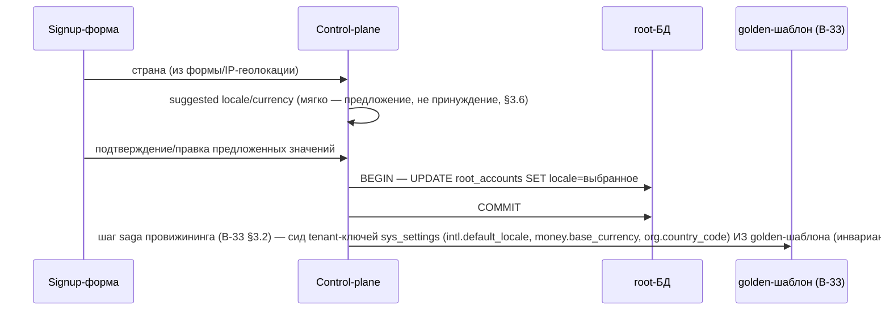
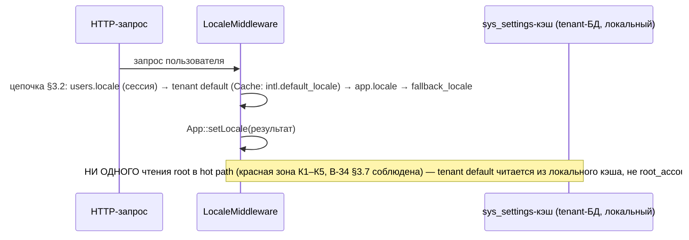
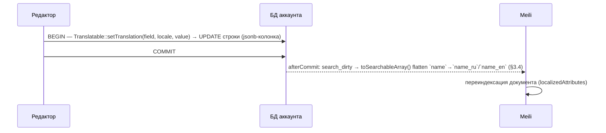
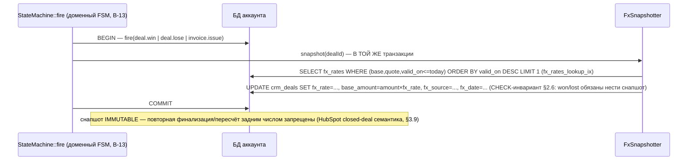
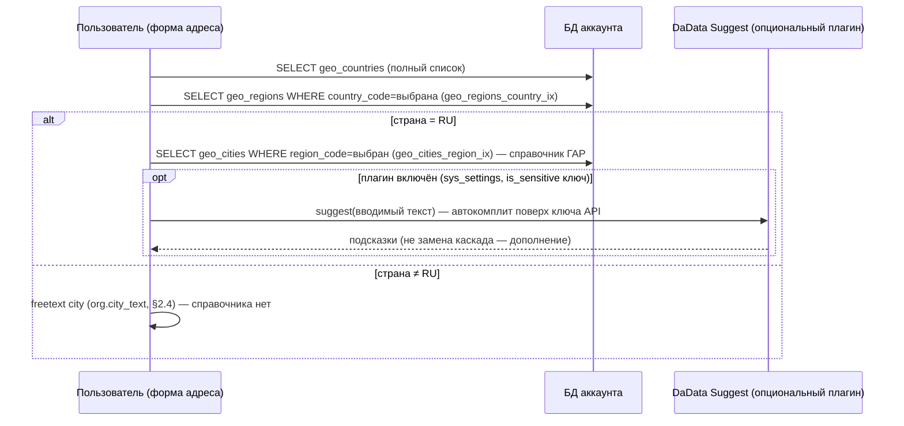
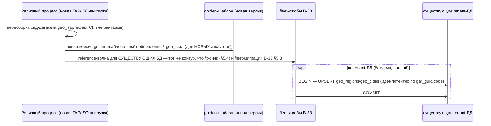

# B-35 — i18n + локации + валюты (сквозной контур: UI-переводы, jsonb-контент, гео-справочник, fx-курсы, мультивалютность CRM)

> **Blueprint-ДРАФТ волны FLEX-2 (P2.9).** Статус: draft. Дата: 2026-07-12.
> Входы: R-33 (§8 — 12 входов, §7 — дельта-кандидаты Δ1–Δ3, вопросы Q38–Q41), B-14 §2/§2.7/§5.6
> (деньги-инвариант ADR-005, `name jsonb`, поисковый слой), B-11 §2.1/§2.2 (root-схема; users —
> носители locale), B-33 (multi-DB контур: golden-шаблон/сиды/fan-out), B-03.
> Конвенции: PK UUIDv7 (D12; отступления для ISO-справочников — §3.5 с обоснованием), префиксы
> таблиц ≤3 симв. (B-03 §2; атрибуция D4/D9 master — известный волновой дефект трассировки,
> см. ревью B-29), `created_at/updated_at timestamptz NOT NULL DEFAULT now()` на всех таблицах,
> ACTOR-поля jsonb как в B-13. Русский текст, идентификаторы англ.
> Нумерация разделов — формат волны B-27..B-34 (§7 MCP-тулзы, §8 НФТ, §9 реестр вопросов);
> consistency-сверку P4.1 вести по названиям разделов, не по номерам.
> Финал волны — глубина разделов 2/3/5/7/8 добрана срезами P3.1–P3.5.

---

## 1. Границы и состав

### 1.1 Что нормирует B-35

Сквозной (не модульный) контур для всех продуктов Flex — FlexCRM сейчас, FlexCMS/FlexStore
по дельта-принципу:

| Контур | Состав | Дом |
|---|---|---|
| i18n интерфейса | файловые переводы `ru`(+`en` каркас), locale-резолюция, tenant-override слой (v1.1) | corex-пакет (Q70, предварительно `corex/intl`) |
| i18n контента | норматив jsonb-колонок (spatie-паттерн), правило «переводимость решает модуль», Meili-flatten | норматив для всех модулей |
| Гео-справочник | `geo_countries` + `geo_regions` (ISO), `geo_cities` (РФ/ГАР), DaData-плагин ввода адресов | corex-пакет (Q70) |
| Валюты | инвариант денег B-14, brick/money + symfony/intl, `fx_rates` + синк ЦБ РФ, мультивалютность CRM-денег | corex-пакет (Q70) + дельта-нормативы B-13 (Q68) |
| RTL | дисциплина logical-утилит design-system; полный RTL — roadmap | норматив design-system |

### 1.2 Что НЕ входит (Scope Excluded)

Исчерпывающий DDL (индексы/партиции — P3.1) · полные сигнатуры контрактов (P3.3) · детальные
потоки и Meili-индексация (P3.2) · матрица прав (P3.4) · AC (P3.5) · пересмотр инварианта денег
B-14 (только подтверждение — §3.7) · полный RTL (roadmap) · workflow переводов контента
(статусы/переводчики — волна FlexCMS, R-33 §3.4) · выбор конкретного мирового гео-датасета
сверх решения Q38 (эксплуатационное) · налоговые режимы стран и переводы маркетинговых
сайтов (рамка R-33) · полная проработка модуля оплаты (только стык Q40).

### 1.3 Зависимости

- **corex/core (B-10)**: `sys_settings` (носители base_currency/локации аккаунта — §3.2), EntityRegistry (переводимые поля деклараций).
- **corex/tenancy (B-11/B-33)**: golden-шаблон (инвариантный сид geo_ — §3.5), TenantContext, fan-out контур fleet-джобов (fx-синк — §3.8); root-схема НЕ меняется (§2.1).
- **corex/commerce (B-14)**: инвариант денег + `name jsonb` уже в каноне — B-35 подтверждает и опирается; каталожная мультивалютность (per-price-list/канал) не трогается.
- **corex/search (B-14 §5.6)**: Meili-норматив flatten переводимых полей (Δ3 — §3.4).
- Библиотеки (reuse, R-33 §2.1/§3.1/§5.2): `spatie/laravel-translatable` (jsonb-переводы, 100%-fit), паттерн `spatie/laravel-translation-loader` (override-слой v1.1), `brick/money` (деньги), `symfony/intl` + NumberFormatter (CLDR/ICU названия и форматирование).
- Внешние источники: ЦБ РФ XML daily (курсы), ГАР/ФИАС-выгрузки (города РФ), DaData Suggest (опциональный плагин, НЕ зависимость ядра — §3.6).

---

## 2. Схема БД

> Срез P3.1: полный DDL (индексы, CHECK, COMMENT) — черновая пометка снята. Новые префиксы
> `geo_`/`fx_` — регистрация в DB_SCHEMA.md §2 остаётся за арбитражем Q70 (дом-пакет
> `corex/intl` не решён); DDL ниже самодостаточен независимо от исхода Q70.

### 2.1 Root-схема канона — не переопределяется

Носители locale **уже в каноне B-11** и дельты не требуют: `root_accounts.locale varchar(8)`
(default аккаунта), `root_identities.locale varchar(8)` (личный выбор в IdP),
`users.locale varchar(8)` (проекция в tenant-БД, B-11 §2.2). `root_plans.currency char(3)
DEFAULT 'RUB'` уже поддерживает валюту тарифа. **Дельта Δ1 root-схемы НЕ активирована** —
подробно §3.2; реестр §9 п.5.

### 2.2 Справочники geo_ (в каждой БД: tenant + root-копия для портала; без кросс-БД FK)

```sql
-- geo_countries — страны ISO 3166-1; PK = натуральный код (обоснование отступления от D12 — §3.5)
CREATE TABLE geo_countries (
  code        char(2) PRIMARY KEY,          -- ISO 3166-1 alpha-2 ('RU')
  alpha3      char(3) NOT NULL UNIQUE,      -- ISO 3166-1 alpha-3 ('RUS')
  name        jsonb NOT NULL,               -- переводы из CLDR: {"ru": "Россия", "en": "Russia"}
  is_active   boolean NOT NULL DEFAULT true,
  created_at  timestamptz NOT NULL DEFAULT now(),
  updated_at  timestamptz NOT NULL DEFAULT now()
);

-- geo_regions — регионы ISO 3166-2 (субъекты первого уровня); для РФ — связка с ГАР
CREATE TABLE geo_regions (
  code         varchar(6) PRIMARY KEY,      -- ISO 3166-2 ('RU-MOW')
  country_code char(2) NOT NULL REFERENCES geo_countries(code) ON DELETE RESTRICT,
  name         jsonb NOT NULL,
  gar_guid     uuid,                        -- связка с ГАР-объектом (только РФ)
  is_active    boolean NOT NULL DEFAULT true,
  created_at   timestamptz NOT NULL DEFAULT now(),
  updated_at   timestamptz NOT NULL DEFAULT now()
);
CREATE INDEX geo_regions_country_ix ON geo_regions (country_code) WHERE is_active;  -- запрос: гео-каскад страна→регионы (§5 поток 6)
CREATE UNIQUE INDEX geo_regions_gar_uq ON geo_regions (gar_guid) WHERE gar_guid IS NOT NULL;

-- geo_cities — города/нас.пункты; v1 наполнение ТОЛЬКО РФ из ГАР (верхние уровни), мир — freetext (Q38)
CREATE TABLE geo_cities (
  id           uuid PRIMARY KEY,            -- UUIDv7 (D12); стабильность между БД — сид из golden-шаблона
  region_code  varchar(6) NOT NULL REFERENCES geo_regions(code) ON DELETE RESTRICT,
  name         jsonb NOT NULL,
  kind         varchar(16) NOT NULL DEFAULT 'city' CHECK (kind IN ('city','town','settlement')),
              -- состав уровней ГАР решён здесь (P3.1): 3 верхних уровня иерархии (город/пгт/сельское поселение),
              -- без улиц/домов (§3.5 v1-рамка); точный маппинг ГАР-кодов на 3 значения — механика ETL, вне DDL
  gar_guid     uuid,                        -- canonical key ГАР
  is_active    boolean NOT NULL DEFAULT true,
  created_at   timestamptz NOT NULL DEFAULT now(),
  updated_at   timestamptz NOT NULL DEFAULT now()
);
CREATE UNIQUE INDEX geo_cities_gar_uq  ON geo_cities (gar_guid) WHERE gar_guid IS NOT NULL;  -- уникальность решена здесь (P3.1)
CREATE INDEX geo_cities_region_ix     ON geo_cities (region_code) WHERE is_active;           -- запрос: гео-каскад регион→города
CREATE INDEX geo_cities_name_trgm_ix  ON geo_cities USING GIN ((name->>'ru') gin_trgm_ops);  -- запрос: GeoResolver::cities — поиск по вводу пользователя (адресный автокомплит §3.6); требует CREATE EXTENSION pg_trgm
COMMENT ON TABLE geo_cities IS 'Объём верхних уровней ГАР — [UNVERIFIED, замер на реальной выгрузке при сборке golden-шаблона, §8 п.3]; влияет на размер шаблона и время клона БД — проверяется на PoC-гейте B-11 Приложение A';
```

### 2.3 Курсы валют fx_ (в каждой БД: tenant + root; носитель — решение §3.8)

```sql
-- fx_rates — daily-курсы; схема — по R-33 §5.3
CREATE TABLE fx_rates (
  id             uuid PRIMARY KEY,          -- UUIDv7
  source         varchar(16) NOT NULL CHECK (source IN ('cbr','manual')),  -- 'ecb'|'oxr' — roadmap (расширение CHECK при активации)
  base_currency  char(3) NOT NULL,          -- ISO 4217
  quote_currency char(3) NOT NULL,
  rate           numeric(20,8) NOT NULL CHECK (rate > 0),
  valid_on       date NOT NULL,
  retrieved_at   timestamptz NOT NULL,
  created_at     timestamptz NOT NULL DEFAULT now(),
  updated_at     timestamptz NOT NULL DEFAULT now(),
  UNIQUE (source, base_currency, quote_currency, valid_on),  -- ключевое ограничение (R-33 §5.3) — идемпотентный upsert fan-out'а (Q69)
  CHECK (base_currency <> quote_currency)
);
CREATE INDEX fx_rates_lookup_ix ON fx_rates (base_currency, quote_currency, valid_on DESC);  -- запрос: CurrencyConverter::rateFor — «последний известный курс на дату» (§3.9 revalued-отчёты)
COMMENT ON TABLE fx_rates IS 'НЕ append-only в смысле B-26 §2 (объём — daily-строки по используемым парам, не событийный поток): класс transactional/reference, партиционирование не требуется (retention-горизонт — Q69/P3.5)';
```

### 2.4 Носители настроек — без DDL (sys_settings, канон B-10)

Ключи tenant-БД `sys_settings` (v1, DDL не требуется):

| Ключ | Назначение | Default |
|---|---|---|
| `intl.default_locale` | default-локаль аккаунта для runtime (проекция root_accounts.locale — §3.2) | `ru` |
| `money.base_currency` | базовая валюта tenant-CRM (char(3)) | `RUB` |
| `money.multicurrency_enabled` | флаг мультивалютности (выключено = fx_rate 1, §3.9) | `false` |
| `org.country_code` / `org.region_code` / `org.city_id` / `org.city_text` | локация аккаунта (city_id — РФ/справочник; city_text — freetext мир, Q38) | — |

Локация пользователя — `users.settings jsonb` (колонка канона B-11 §2.2, ключи `location.*`);
дельта схемы users не требуется.

### 2.5 Закладка v1.1: tenant-override UI-переводов (Q41 — НЕ в v1)

```sql
-- i18n_overrides (tenant-БД; АКТИВАЦИЯ v1.1) — паттерн spatie/laravel-translation-loader, allowlist ключей
CREATE TABLE i18n_overrides (
  id         uuid PRIMARY KEY,
  "group"    varchar(64) NOT NULL,          -- lang-группа ('crm', 'validation'…)
  key        varchar(128) NOT NULL,
  text       jsonb NOT NULL,                -- {"ru": "Заявка", "en": "Request"}
  updated_by jsonb NOT NULL,                -- ACTOR (как в B-13)
  created_at timestamptz NOT NULL DEFAULT now(),
  updated_at timestamptz NOT NULL DEFAULT now(),
  UNIQUE ("group", key)
);
CREATE INDEX i18n_overrides_group_ix ON i18n_overrides ("group");  -- запрос: загрузка override-слоя группы при boot локали (candidate, v1.1)
```

### 2.6 Дельта-кандидат Q68: мультивалютные колонки на деньгах CRM — НЕ вносится

Норматив-триплет per-record денег CRM (§3.9): `currency char(3)` + `fx_rate numeric(20,8)` +
`base_amount bigint` (+ `fx_source varchar(16)`, `fx_date date` — метаданные снапшота).
Носитель — `crm_deals` (и счета CRM-контура): **аддитивная дельта канона B-13** — здесь НЕ
вносится (D11); фактический состав решён здесь (P3.1, §9 п.8) — DDL-кандидат приведён для
арбитража P4.2. Commerce-контур (B-14) уже несёт per-record `currency` на заказах/прайсах —
не трогается.

```sql
-- КАНДИДАТ (дельта B-13 §2.3 crm_deals; НЕ вносится — арбитраж P4.2, D11)
-- crm_deals.currency char(3) NOT NULL DEFAULT 'RUB' УЖЕ в каноне B-13 §2.3 — фактическая дельта = 4 колонки, не 5:
ALTER TABLE crm_deals ADD COLUMN fx_rate    numeric(20,8) NOT NULL DEFAULT 1;   -- immutable snapshot при финализации (§3.9 п.3); 1 = мультивалютность выключена (нулевой оверхед)
ALTER TABLE crm_deals ADD COLUMN base_amount bigint;                            -- amount × fx_rate в money.base_currency на момент снапшота; NULL до финализации
ALTER TABLE crm_deals ADD COLUMN fx_source  varchar(16);                        -- 'cbr'|'manual' — provenance курса (ссылка на fx_rates.source)
ALTER TABLE crm_deals ADD COLUMN fx_date    date;                               -- дата курса, использованного в снапшоте (= fx_rates.valid_on)
ALTER TABLE crm_deals ADD CONSTRAINT crm_deals_fx_snapshot_ck
  CHECK ((status = 'open') OR (base_amount IS NOT NULL AND fx_date IS NOT NULL));  -- инвариант §3.9 п.3: won/lost обязаны нести снапшот
-- Аналогичный триплет — на счетах CRM-контура (носитель счёта в волне не спроектирован; при появлении — тот же паттерн)
```
Индексы при активации — не требуются сверх канонных (`fx_rate`/`base_amount` не участвуют в фильтрации/сортировке списков, только в отчётах join с `fx_rates`).

---

## 3. Ключевые архитектурные решения

> Решения зафиксированы, глубина (полный DDL, протоколы, сигнатуры) добрана срезами P3.1–P3.5.
> P3.1–P3.5; каждое решение — со ссылкой на R-33 §.

### 3.0 Вердикты по 12 входам R-33 §8 — все явно

| # | Вход R-33 §8 | Вердикт | Где детализировано |
|---|---|---|---|
| 1 | UI-переводы: файлы = SoT; v1 `ru`(+`en` каркас); tenant-override v1.1 (Q41) | **принято** (R-33 §2.3) | §3.1 |
| 2 | Locale-резолюция: user → tenant default → app default → fallback; выбор за пользователем | **принято + детализировано** — носители уже в каноне B-11, Δ1 без дельты (R-33 §2.1) | §3.2 |
| 3 | Контент-переводы: jsonb-колонки (spatie), таблицы переводов не вводить, переводимость решает модуль | **принято** (R-33 §3.4) | §3.3 |
| 4 | Поиск: flatten `*_ru`/`*_en` + `localizedAttributes` (Meili ≥1.10), один индекс на сущность | **принято** — аддитивное уточнение B-14 §5.6 (Δ3) (R-33 §3.3) | §3.4 |
| 5 | Гео: geo_countries + geo_regions сид в каждую БД; города РФ из ГАР, мир freetext (Q38); ODbL запрещён | **принято + детализировано** — сид через golden-шаблон B-33 §3.3 (R-33 §4.3) | §3.5 |
| 6 | Привязка локации: country/region/city на аккаунте и пользователе; suggested defaults без жёсткой связи | **принято + детализировано** — носители без DDL (§2.4) (R-33 §4.2) | §3.6 |
| 7 | Деньги: инвариант B-14 подтверждён; brick/money; symfony/intl + NumberFormatter; exponent из ISO 4217 | **принято** (R-33 §5.1/§5.2) | §3.7 |
| 8 | Курсы: fx_rates (schema R-33 §5.3); ЦБ РФ XML daily v1; носитель root vs tenant — решить в B-35 | **принято + решено** — носитель: таблица в каждой БД, синк fan-out'ом (отступление от «реплику не вести» R-33 §5.3 — обосновано) | §3.8 |
| 9 | Мультивалютность CRM: per-tenant base + per-record currency + immutable FX snapshot; колонки с первого дня | **принято** — носитель колонок = дельта B-13 → Q68, арбитраж (R-33 §5.4) | §3.9 |
| 10 | Тариф платформы: RUB-only v1 (Q40); контур биллинга независим от валют tenant-CRM | **принято** (R-33 §5.5) | §3.10 |
| 11 | RTL: полный — нет v1; logical-утилиты Tailwind — норматив design-system с первого компонента | **принято** (R-33 §6) | §3.11 |
| 12 | FlexCMS-прицел: те же механизмы; workflow переводов — волна CMS | **принято** (R-33 §2.3/§3.4) | §3.12 |

Отступление от рекомендации R-33 одно (вход 8 — носитель fx_rates), обосновано в §3.8;
остальные 11 входов приняты как есть (4 — с детализацией B-35).

### 3.1 UI-переводы: файлы = source of truth (вход 1; Q41 решён)

- **v1**: файловые переводы в git (PHP short-keys + JSON), полный `ru` + каркас `en`;
  `App::setLocale()` per-request; переводы модулей — в их пакетах (`lang/`-паблиш по конвенции
  Laravel). Перенос интерфейса в БД — антипаттерн (дрейф, потеря review — R-33 §2.1).
- **v1.1**: tenant-override слой `i18n_overrides` (скелет §2.5) по паттерну
  spatie/laravel-translation-loader: строка БД перекрывает файловую, **allowlist ключей**
  (только терминология/onboarding, не весь интерфейс), таблица живёт в tenant-БД — tenant_id
  не нужен (D1). На схему других модулей не влияет — безопасно откладывается (R-33 §2.3).
- Для FlexCMS слоёная модель обязательна с старта её волны — закладка совместима, конфликтов
  нет (вход 12, §3.12). **Q41 решён здесь**: v1.1; реестр §9 п.4.

### 3.2 Locale-резолюция и носители (вход 2; Δ1 — без дельты канона)

Цепочка: **`users.locale` → tenant default (`sys_settings intl.default_locale`) →
`app.locale` → `fallback_locale`**. Выбор языка — всегда за пользователем (inbox §F).

Носители — **уже в каноне B-11, дельта Δ1 root-схемы НЕ нужна**:

| Носитель | Канон | Роль |
|---|---|---|
| `root_identities.locale` | B-11 §2.1 | личный выбор в IdP (истина identity-уровня) |
| `users.locale` | B-11 §2.2 | проекция в tenant-БД (писатель — IdentitySyncer, канон B-11/B-34) |
| `root_accounts.locale` | B-11 §2.1 | default аккаунта на control-plane (портал, письма биллинга, провижининг) |
| `sys_settings intl.default_locale` | B-10 (ключ, §2.4) | runtime-копия default'а в tenant-БД — hot path без чтения root (красная зона К1–К5, B-34 §3.7) |

Правило единственного писателя: смена default-локали в настройках аккаунта (tenant-UI) →
`SettingsService` пишет tenant-ключ + через central-API обновляет `root_accounts.locale`
(паттерн направления записи B-34 §3.3); провижининг сидирует tenant-ключ из root при создании
БД. Протокол синка — срез P3.2. Остаток Δ1 (base_currency, локация) закрыт ключами
`sys_settings` и `users.settings` (§2.4) — **DDL и дельты канона не требуются**; реестр §9 п.5.

### 3.3 Контент-переводы: jsonb-норматив (вход 3)

- **Норматив всех модулей Flex**: переводимые поля контента — jsonb-колонка той же строки
  (`{"ru": …, "en": …}`), spatie-паттерн; пакет `spatie/laravel-translatable` — reuse как есть
  (100%-fit). Подтверждает уже сделанный выбор канона B-14 (`name jsonb` в
  com_price_lists/com_promotions) и D4 master (PG-first/jsonb).
- **Таблицы переводов (astrotomic-паттерн) НЕ вводить** — SQL-оси по переводам не нужны
  (поиск уходит в Meili, §3.4), workflow переводов — не v1 (волна FlexCMS).
- **Переводимость решает модуль**: конфигурационные строки (названия воронок, справочников,
  лейблы деклараций) — кандидаты на jsonb; **пользовательские CRM-записи (имя контакта,
  название сделки) НЕ переводятся** — одноязычны по природе (R-33 §3.4). Перечень переводимых
  полей per модуль — срез P3.1 построчно.

### 3.4 Поиск переводимых полей: flatten + localizedAttributes (вход 4; Δ3)

Норматив индексации: jsonb-поле → flatten в `toSearchableArray()` (`name` →
`name_ru`/`name_en`); настройки индекса — `localizedAttributes` c привязкой `*_ru`/`*_en`
паттернов к ISO-639 locale (Meili ≥1.10, кириллица+латиница в одном индексе штатно —
R-33 §3.3). **Один индекс на сущность** — канон B-14 §5.6 сохраняется. Статус Δ3:
аддитивное уточнение контракта поискового документа B-14 §5.6, не противоречие — форма
контракта и PG-only-деградация (boxed D10: tsvector 'russian' уже в каноне) — срез P3.3;
реестр §9 п.7.

### 3.5 Гео-справочник: ISO-слой + города РФ из ГАР (вход 5; Q38 решён)

- **v1-состав**: `geo_countries` (ISO 3166-1) + `geo_regions` (ISO 3166-2) — полный мир;
  `geo_cities` — **только РФ** из ГАР-выгрузки (верхние уровни иерархии: город/нас.пункт, без
  улиц/домов; точный состав уровней и объём — P3.1 [UNVERIFIED: объём верхних уровней ГАР —
  проверить на выгрузке]). **Мировые города — freetext** (`org.city_text`, §2.4). GeoNames
  (CC BY, атрибуция) — резерв при потребности FlexCMS/Store, v2. **ODbL-датасеты (dr5hn)
  запрещены** — share-alike заражает проприетарную БД (R-33 §4.1). **Q38 решён здесь**;
  реестр §9 п.1.
- **Схемное место**: сид в каждую БД (tenant + root-копия для портала), **без кросс-БД FK** —
  связи по значениям кодов, канон изоляции B-11 (R-33 §4.2). Механизм сида — **инвариантный
  сид в golden-шаблон** (одинаково для всех аккаунтов → в шаблон, критерий B-33 §3.3);
  обновления справочника — периодические reference-волны по контуру fleet-джобов B-33
  (механика — P3.2).
- **PK — натуральные ключи ISO** (`code char(2)`, `varchar(6)`): осознанное отступление от
  конвенции D12 (UUIDv7) для стандартизованных справочников — коды стабильны, одинаковы во
  всех БД без координации, сиды идемпотентны по коду, читаемы в связях-значениях между БД
  (рекомендация R-33 §4.2 «alpha-2 код = PK»). `geo_cities` — UUIDv7 (натурального
  короткого ключа нет; canonical ref — `gar_guid`). Подтверждение отступления — P3.1/P4.1.

### 3.6 Привязка локации + DaData-плагин (вход 6; Q39 решён)

- Локация аккаунта — ключи `sys_settings org.*`; локация пользователя — `users.settings
  location.*` (§2.4). Адреса CRM-записей — тема B-13, не здесь (рамка R-33 §4.2).
- **Локация → suggested defaults**: страна из signup-формы даёт предложенные locale/currency
  при регистрации; связь **мягкая** — предложение, не принуждение; выбор пользователя всегда
  выше (inbox §F, R-33 §4.2).
- **DaData Suggest — опциональный UX-плагин** ввода адресов за контрактом
  `AddressSuggestProvider`: ядро работает без него (каскад справочника + freetext), плагин
  включается настройкой с ключом API в `sys_settings` (is_sensitive, прецедент B-18 §8 п.7);
  vendor cost — решение tenant'а/тарифа; **не зависимость ядра** (R-33 §4.3). Собственная
  полная реплика ГАР (с улицами/домами) — НЕ строится v1 (тяжёлый ETL). **Q39 решён здесь**;
  реестр §9 п.2.

### 3.7 Деньги: инвариант подтверждён + библиотеки (вход 7)

**Инвариант денег B-14 подтверждён и НЕ меняется: `bigint` minor units + `currency char(3)`
(ISO 4217, ADR-005).** Расхождений R-33 с каноном нет (R-33 §5.1) — B-35 опирается на
инвариант во всех решениях §3.8–§3.10; float на деньгах запрещён (B-03 §2).

- **brick/money — норматив** денежной арифметики (BigDecimal, явные rounding modes,
  RationalMoney для цепочек) — moneyphp не брать (R-33 §5.2).
- Число знаков minor units — **из ISO 4217 exponent** (JPY=0, RUB/USD=2, KWD=3), метаданные
  валюты, не хардкод «÷100» (R-33 §5.1).
- Локализованные названия валют/стран и форматирование сумм — `symfony/intl` (CLDR) +
  `NumberFormatter` (ICU) per locale; собственные таблицы названий не вести (R-33 §5.2).

### 3.8 Курсы валют: fx_rates в каждой БД + fan-out синк (вход 8; носитель решён)

Схема таблицы — по R-33 §5.3 (скелет §2.3): `source/base/quote/rate numeric(20,8)/valid_on`,
UNIQUE-четвёрка; правило «курс на дату документа фиксируется и задним числом не
пересчитывается» — принято (снапшоты §3.9).

**Носитель (решение B-35): таблица `fx_rates` в КАЖДОЙ БД (tenant + root-копия для
портала/биллинга)** — единое схемное место с geo_ (reference-паттерн волны). Это отступление
от предварительной рекомендации R-33 §5.3 («справочник общесистемный, сплошную реплику
per-tenant не вести») — обоснование:

1. **Красная зона К1–К5 (B-34 §3.7)**: tenant-плоскость не читает root-БД; центральный
   fx-сервис = сетевая зависимость в hot path отображения/пересчёта денег.
2. **Отчёты «current revalued» (§3.9 п.4) — это SQL**: переоценка требует JOIN денежных
   записей с курсами внутри tenant-БД; с центральным API это невыразимо.
3. **D10-симметрия**: boxed не имеет root-плоскости — локальная таблица нужна в любом случае;
   одна миграция, один код (cloud/boxed различаются только источником наполнения).
4. **Объём тривиален**: daily-строки по используемым парам — это не «сплошная реплика
   истории»; retention-политика (горизонт хранения) — срез P3.5.

Наполнение: **cloud** — control-plane `FxSyncWorker` забирает ЦБ РФ XML daily 1×/раб. день
(cron ~11:00–12:00 MSK после публикации, R-33 §5.3), пишет root-копию и fan-out'ом
(идемпотентный upsert по UNIQUE-четвёрке, контур fleet-джобов B-33) — в tenant-БД;
**boxed** — локальный scheduled fetch с ЦБ + источник `manual` для офлайн-контуров.
ECB/OXR — roadmap для не-RU. Расписание/ретраи/деградация при недоступности ЦБ — **Q69**,
срез P3.2 (поток) + P3.5 (retention/пороги); реестр §9 п.9.

### 3.9 Мультивалютность CRM-денег (вход 9; Q68 — дельта B-13)

Норматив (HubSpot/Salesforce-паттерн, R-33 §5.4):

1. **Per-tenant base currency** — `sys_settings money.base_currency` (default `RUB`);
   участвует во всех сводных отчётах.
2. **Per-record currency**: финансово-значимые записи CRM (сделка, счёт) несут
   `currency char(3)` + `amount bigint` в СВОЕЙ валюте.
3. **Immutable FX snapshot**: при финализации (закрытие сделки, выставление счёта)
   фиксируются `fx_rate` + `base_amount` + `fx_source`/`fx_date`; после — НЕ пересчитываются
   (HubSpot closed-deal семантика).
4. Отчётность различает **historical booked** (снапшот) и **current revalued** (по текущему
   курсу из fx_rates, §3.8) — разные меры, не одно поле.
5. **Колонки в схеме с первого дня**; мультивалютность выключена
   (`money.multicurrency_enabled=false`) → все записи в base currency, `fx_rate=1` — нулевой
   оверхед, переделка задним числом дорога (R-33 §5.4 п.5).

Носитель колонок (`crm_deals`, счета CRM-контура) — **аддитивная дельта канона B-13**: здесь
НЕ вносится (D11), скелет-триплет §2.6 → **Q68, арбитраж P4.2**; фактический состав денежных
колонок crm_deals сверяется на P3.1. Commerce-контур (B-14: заказы/прайсы) уже per-record —
не трогается. Edition-гейтинг мультивалютности (ключ `licensed_features`) — закладка §8 п.4,
срез P3.5. Реестр §9 п.8.

### 3.10 Тариф платформы: RUB-only v1 (вход 10; Q40 решён)

Валюта тарифа (root-биллинг, стык B-24 editions) **независима** от валют tenant-CRM — контуры
не пересекаются (R-33 §5.5). **v1 — RUB-only** (рынок РФ): канон `root_plans.currency char(3)
DEFAULT 'RUB'` уже это поддерживает — **изменений схемы и канона B-24 не требуется**,
мультивалютные тарифы — expansion-roadmap (вместе с не-RU источниками курсов §3.8).
**Q40 решён здесь**; реестр §9 п.3.

### 3.11 RTL-вердикт (вход 11)

**Полного RTL в v1 НЕТ** (рынок РФ/СНГ — спроса нет); **RTL-совместимая дисциплина
design-system — ДА, с первого компонента**: только logical-утилиты Tailwind
(`ms-*/me-*/ps-*/pe-*/start-*/end-*` вместо `ml/mr/pl/pr/left/right`), `dir` — first-class
state, запрет физических направлений в code review (норматив — кандидат в правила
review P3.5). Стоимость дисциплины ≈ 0, ретрофит — большой рефакторинг (R-33 §6). Полный
RTL — expansion-фича roadmap.

### 3.12 FlexCMS-прицел (вход 12)

Те же механизмы без CMS-специфичных решений сейчас: jsonb-контент (§3.3) совместим с
blueprint-payload CMS (B-03 §11: origin_id-локализация уже в канон-эскизе CMS), слоёные
UI-переводы (§3.1 — override-слой для CMS обязателен с её волны), geo/fx — общие справочники.
**Workflow переводов контента (статусы/переводчики/QA) — волна FlexCMS**, там же решение о
дельте astrotomic-паттерна, если понадобится (R-33 §3.4). Дельта-принцип D4 FLEX-2 соблюдён.

### 3.13 Права: справочный контур вне AzGuard-матрицы (срез P3.4 — подтверждение отсутствия дельты)

> Срез P3.4: подтверждение отсутствия permission keys для справочного контура — черновая пометка снята для права-подраздела.

Весь контур B-35 (`geo_`/`fx_`/UI-переводы) — **read-only справочные данные**, видимые любому аутентифицированному пользователю аккаунта без ограничения по роли (страны/регионы/города/курсы валют — не персональные и не коммерчески чувствительные внутри тенанта); все MCP-тулзы §7 объявлены `side_effect=read`, мутационных тулзов v1 нет. Правка НАСТРОЕК (`sys_settings intl.default_locale`/`money.base_currency`/`org.*` — §2.4) — не новый permission key: используется существующий канонический механизм управления настройками аккаунта (corex/core `sys_settings`-CRUD, обычно ограничен ролью admin/owner через уже существующие права управления настройками, вне Scope этого blueprint'а — B-35 не вводит отдельной таблицы настроек). Обновление справочника (fx-синк, гео-волны, §5.4/§5.7) — control-plane/fleet-джобы (B-33 §3.5 плоскость), не tenant-принципал — вне AzGuard tenant-матрицы по той же причине, что B-33 §3.12. **Вывод: дозаполнение прав-подраздела для B-35 = явное подтверждение отсутствия дельты**, консистентно B-33 (§3.12) — контур структурно не нуждается в новых permission keys.

---

## 4. Контракты

> Срез P3.3: полные PHP-интерфейсы (@api, PHPStan level 8, форма B-16 §3), форма Meili-контракта
> (Δ3), реестр событий — черновая пометка снята (волновой caveat B-27/B-29/B-33 закрыт).

Namespace `Corex\Intl\Contracts` (дом пакета `corex/intl` — Q70, арбитраж P4.2; контракты
самодостаточны независимо от исхода):

```php
namespace Corex\Intl\Contracts;

/** readonly, id+type+display — форма единая с B-16 §3 */
final readonly class CountryRef
{
    public function __construct(public string $code /* ISO 3166-1 alpha-2 */, public string $type /* 'geo.country' */, public string $display) {}
}
final readonly class RegionRef
{
    public function __construct(public string $code, public string $countryCode, public string $display) {}
}
final readonly class CityRef
{
    public function __construct(public string $id, public string $regionCode, public string $display, public ?string $garGuid = null) {}
}
final readonly class AddressSuggestion
{
    public function __construct(public string $text, public ?string $regionCode, public ?string $cityId) {}
}
final readonly class FxRate
{
    public function __construct(public string $baseCurrency, public string $quoteCurrency, public string $rate /* numeric(20,8) как string */, public \DateTimeImmutable $validOn) {}
}
final readonly class MoneySnapshot
{
    public function __construct(public string $fxRate, public int $baseAmount, public string $fxSource, public \DateTimeImmutable $fxDate) {}
}

interface LocaleResolver
{
    /** Цепочка §3.2: users.locale → tenant default → app.locale → fallback_locale */
    public function resolve(?string $userLocale, ?string $tenantDefaultLocale): string;
    /** @return list<string> вся цепочка кандидатов (для диагностики) */
    public function chain(?string $userLocale, ?string $tenantDefaultLocale): array;
}

/** trait-норматив (spatie/laravel-translatable) — jsonb-переводы контента модулей (§3.3) */
interface Translatable
{
    public function getTranslation(string $field, string $locale, bool $withFallback = true): ?string;
    public function setTranslation(string $field, string $locale, string $value): void;
}

interface GeoResolver
{
    /** @return list<CountryRef> */
    public function countries(): array;
    /** @return list<RegionRef> */
    public function regions(string $countryCode): array;
    /** @return list<CityRef> — только РФ из ГАР (§3.5); мир — freetext (не через этот метод) */
    public function cities(string $regionCode): array;
    public function resolveByCodes(string $countryCode, ?string $regionCode = null, ?string $cityId = null): array;
}

/** Плагин-порт (§3.6) — ядро работает без реализации (freetext-фоллбэк) */
interface AddressSuggestProvider
{
    /** @return list<AddressSuggestion> */
    public function suggest(string $query, ?string $countryCode = null): array;
}

interface CurrencyRegistry
{
    /** @return array{name:string,exponent:int} — ISO 4217 (exponent из метаданных, не хардкод «÷100», §3.7) */
    public function currency(string $code): array;
    public function exponent(string $code): int;
}

interface MoneyFormatter
{
    /** symfony/intl + NumberFormatter (ICU) per locale (§3.7) */
    public function format(int $minorUnits, string $currencyCode, string $locale): string;
}

interface CurrencyConverter
{
    public function convert(int $minorUnits, string $fromCurrency, string $toCurrency, ?\DateTimeImmutable $onDate = null): int;
    /** «последний известный курс на дату» — fx_rates_lookup_ix (§3.8) */
    public function rateFor(string $baseCurrency, string $quoteCurrency, \DateTimeImmutable $onDate): ?FxRate;
}

interface FxSnapshotter
{
    /** Immutable-снапшот при финализации (§3.9) — вызывается доменными FSM-действиями (deal.win/lose, invoice.issue) */
    public function snapshot(string $dealOrInvoiceId, string $currency, int $amount): MoneySnapshot;
}
```

### 4.1 Форма Meili-контракта переводимых полей (Δ3 — решено здесь)

Аддитивное уточнение контракта поискового документа (B-14 §5.6, канон НЕ меняется — Δ3
подтверждена аддитивом): каждая `Translatable`-модель обязана реализовать метод, дописывающий
flatten-поля в `toSearchableArray()`:

```php
interface LocalizedSearchable   // расширение контракта B-14 §5.6, аддитивный extension point
{
    /** @return array<string,mixed> — 'name' → ['name_ru' => ..., 'name_en' => ...] поверх стандартного toSearchableArray() */
    public function localizedSearchableAttributes(): array;
}
```

`localizedAttributes`-настройка индекса (Meili ≥1.10) конфигурируется декларативно per-модуль
(`*_ru`/`*_en` → ISO-639 `ru`/`en`) — один индекс на сущность (канон подтверждён). Boxed-деградация
(D10): PG `tsvector 'russian'` уже в каноне B-14 §5.6, `localizedSearchableAttributes()` не
вызывается (полнотекстовый поиск PG работает по обычным колонкам, flatten не нужен). Δ3 → аддитив
подтверждён P3.3 (не требует ревизии B-14 §5.6, классификация из §3.4 драфта окончательна).

### 4.2 Реестр доменных событий (полная карта — сверка уникальности §9 S3)

| Событие | `name()` | Payload | Эмитент | Подписчики |
|---|---|---|---|---|
| `FxRatesUpdated` | `intl.fx_rates.updated` | pairsUpdated[] (base,quote,valid_on) | FxSyncWorker fan-out (флоу 5.4) | инвалидация кэшей конвертации, пересчёт revalued-проекций |

Уникальность имён (сверка §9 S3): `intl.*` — новый неймспейс, коллизий с `crm./tsk./cal./soc./
mkg./cst./tenancy./identity./storage./tls.` нет. Все события несут `TenantContext` (B-10 §3.1).

---

## 5. Главные потоки — список

> Срез P3.2: детальные sequence-диаграммы + транзакционные границы (снята черновая пометка).
> afterCommit-события — стиль B-16 §5.2; root/tenant — физически разные БД (D1).

### 5.1 Регистрация → suggested defaults



### 5.2 Locale-резолюция запроса



### 5.3 Перевод контента



### 5.4 Ежедневный fx-синк (Q69 — механика fan-out, срез P3.2)

```mermaid
sequenceDiagram
  participant CP as Control-plane FxSyncWorker (cron ~11:00–12:00 MSK)
  participant CBR as ЦБ РФ (XML daily)
  participant ROOT as root-копия fx_rates
  participant Cell as Ячейка (fleet-джобы B-33)
  participant Ten as Tenant-БД
  CP->>CBR: fetch XML daily
  alt ЦБ доступен
    CBR-->>CP: курсы дня
    CP->>ROOT: BEGIN — UPSERT fx_rates (source='cbr', ON CONFLICT (source,base,quote,valid_on) DO NOTHING/UPDATE — идемпотентно)
    CP->>ROOT: COMMIT
    CP-->>Cell: fan-out идемпотентных upsert'ов по всем tenant-БД парка (тот же контур, что fleet-миграции B-33 §5.3, батчами)
    loop по tenant-БД
      Cell->>Ten: BEGIN — UPSERT fx_rates (та же UNIQUE-четвёрка)
      Cell->>Ten: COMMIT
      Cell-->>Ten: afterCommit: FxRatesUpdated → инвалидация кэшей конвертации/пересчёт revalued-проекций (P3.3)
    end
  else ЦБ недоступен (деградация)
    CP->>CP: работаем на последнем valid_on существующих строк + алерт ops (ретрай на следующем тике; расписание/backoff — P3.5)
  end
  Note over Ten: boxed — локальный scheduled fetch (тот же код FxSyncWorker, без root-плоскости) ИЛИ source='manual' для офлайн-контуров
```

Retention-горизонт daily-строк per БД — срез **P3.5** (Q69 частично закрыт: механика fan-out/деградации задокументирована здесь; численные retention/SLA-пороги остаются P3.5).

### 5.5 Финализация сделки/счёта



Отчётность: **historical booked** читает снапшот (`base_amount`/`fx_rate` записи); **current
revalued** — JOIN денежных записей с `fx_rates` по актуальному курсу (SQL внутри tenant-БД,
обоснование носителя fx_rates §3.8 п.2).

### 5.6 Гео-каскад ввода адреса



### 5.7 Обновление гео-справочника



Замер объёма верхних уровней ГАР — [UNVERIFIED, проверка на PoC-гейте B-11 Приложение A, §8 п.3].

---

## 6. Интеграции (матрица доменов)

| Домен | Стык с B-35 |
|---|---|
| B-10 corex/core | sys_settings — носители ключей §2.4 (is_sensitive для DaData-ключа); EntityRegistry — декларация переводимых полей (форма — P3.3) |
| B-11 auth/tenancy | носители locale — канон без изменений (§3.2); root_plans.currency — RUB-only v1 (§3.10); красная зона К1–К5 соблюдена (fx/geo локальны в каждой БД) |
| B-33 provisioning | geo-сид → golden-шаблон (инвариантный, §3.3 B-33); fx-синк и reference-волны → контур fleet-джобов; сид intl-ключей — шаг провижининг-saga |
| B-13 CRM | мультивалютные колонки сделок/счетов — дельта-кандидат Q68 (арбитраж P4.2); финализация = FSM-действия зовут FxSnapshotter; адреса CRM-записей — тема B-13 |
| B-14 commerce | инвариант денег подтверждён (§3.7); `name jsonb` — прецедент норматива §3.3; каталожная мультивалютность (per-price-list/канал) не трогается; Meili-норматив Δ3 — аддитив к §5.6 |
| B-15 attributes | лейблы кастомных полей — конфигурационные строки, кандидаты jsonb-переводов; пользовательские значения полей НЕ переводятся (§3.3); стык — P3.1 |
| B-18 import-export | миграция мультивалютных сделок Б24 (валюта/курс источника → триплет §3.9) — механика мигратора P3.2, канон B-18 не трогается |
| B-24/B-23 editions | тариф RUB-only (§3.10); edition-ключ мультивалютности — закладка §8 п.4 → P3.5 |
| corex/search | flatten-норматив + localizedAttributes (§3.4); boxed-деградация PG tsvector — канон B-14 §5.6 |
| design-system | RTL-дисциплина logical-утилит (§3.11) — норматив с первого компонента |
| FlexCMS (волна CMS) | те же механизмы (§3.12); workflow переводов — там |

---

## 7. MCP-тулзы — финальная карта

> Срез P3.3: перечень имён уже в форме `module.verb_noun` — черновая пометка снята; все
> side_effect = `read` (справочный контур, мутационных тулзов v1 нет, §7 ниже).

`intl.list_locales` · `intl.list_currencies` · `intl.get_fx_rate` · `intl.convert_amount` ·
`intl.list_countries` · `intl.list_regions` · `intl.search_cities` · `intl.suggest_address`
(доступен при включённом плагине §3.6).

Все — read-плоскость; мутационных тулзов у справочного контура v1 нет (переводы контента
идут тулзами владеющих модулей). Module-short `intl` — вместе с домом пакета Q70 (арбитраж);
словарь module_short B-32 §3.3 пополняется там же.

---

## 8. НФТ, лимиты и Acceptance Criteria

> Срез P3.5: перфоманс-бюджеты, квоты, edition-гейтинг, safety-инварианты и AC финализированы —
> черновая пометка снята.

### 8.1 Производительность

| Операция | Бюджет | Механизм |
|---|---|---|
| Резолюция locale (per-запрос) | 0 запросов к root; чтение из локального кэша/сессии | `LocaleMiddleware` (§5.2), красная зона К1–К5 соблюдена |
| `CurrencyConverter::rateFor` («последний курс на дату») | p95 ≤ 20 мс | `fx_rates_lookup_ix` |
| Гео-каскад страна→регион→город | p95 ≤ 50 мс на уровень | `geo_regions_country_ix`/`geo_cities_region_ix` |
| Адресный автокомплит (`geo_cities` trigram) | p95 ≤ 100 мс | `geo_cities_name_trgm_ix` (GIN pg_trgm) |
| Переиндексация Meili при правке перевода | лаг ≤ 5 с (образец B-13 §7.1) | afterCommit `search_dirty` (§5.3) |

### 8.2 Квоты и пороги (`root_plans.limits`; Q69/geo-объём числами)

| Ключ/параметр | Default | Enforcement | Класс |
|---|---|---|---|
| `fx_rates` retention-горизонт (per БД) | ≥ 3 года (аудит/revalued-отчёты) | ops-политика, purge-джоб — roadmap v1.1 (v1: не автоматизирован, только retention-цель зафиксирована) | — reference-класс, не тариф |
| fx-синк SLA | «в течение дня публикации ЦБ» (~11:00–12:00 MSK) | `FxSyncWorker` cron | — |
| fx-синк ретраи при недоступности ЦБ | 3 попытки, backoff 5/15/60 мин, затем алерт + работа на последнем `valid_on` | `FxSyncWorker` | — |
| `geo_cities` объём (РФ/ГАР верхних уровней) — влияние на golden-шаблон | целевой потолок ≤ 200 000 строк без превышения бюджета клонирования p95 < 3с (канон B-11 §7.1) | замер — PoC-гейт B-11 Приложение A | **[UNVERIFIED до PoC]** — не блокирует closure P3.5, порог — целевой, не подтверждённый факт |
| `intl.dadata_requests_per_day` (per-tenant, зеркалит free-тир провайдера) | 10 000 (R-33 §4.1) | троттлинг на стороне `AddressSuggestProvider`-плагина | **C** — anti-abuse/vendor-лимит, не тариф |

Q69 → **Resolved** (числа): retention ≥3 года, SLA «в течение дня публикации», ретраи 3× с backoff 5/15/60 мин.

### 8.3 Edition-гейтинг (Q52-паттерн; кандидат-ключ)

| Фича | `licensed_features`-ключ | Тир |
|---|---|---|
| Мультивалютность CRM-денег (Q68-триплет активен, `money.multicurrency_enabled=true`) | `intl.multicurrency` | **pro** — продвинутая финансовая фича (HubSpot/Salesforce-паритет) |
| Гео-справочник/локали/курсы (read-only контур) | — не гейтится | **обязателен** на любом тире (справочные данные, §3.13: read-only, без ограничения по роли) |
| DaData-плагин адресного автокомплита | — не гейтится `FeatureRegistry` (bring-your-own-key: включение настройкой + собственный API-ключ тенанта) | доступен на любом тире, стоимость — вне тарифа Flex |

Формальное внесение `intl.multicurrency` в канон B-24 §2 — аддитивная дельта (паттерн Q52 mkg) → часть умбрелла-вопроса, но НЕ Q72 (та умбрелла — только tsk/soc/cal): заводится отдельно как продолжение уже открытого **Q68/Q70** (мультивалютность — прямое следствие того же триплета, канонизация вместе).

### 8.4 Safety-инварианты (нарушение = блокер релиза)

1. **Immutable FX snapshot**: после финализации сделки/счёта (won/lost/issued) `fx_rate`/`base_amount`/`fx_source`/`fx_date` НИКОГДА не пересчитываются задним числом (CHECK-инвариант §2.6, historical booked ≠ current revalued).
2. **Красная зона К1–К5 соблюдена**: резолюция locale — 0 запросов к root в hot path (§3.2/§5.2).
3. **Инвариант денег B-14 не нарушен**: `bigint` minor units + `currency char(3)` — без float на деньгах ни в одном новом контракте (§3.7).
4. **Идемпотентность fx-синка**: upsert по `UNIQUE(source, base_currency, quote_currency, valid_on)` — повторный fan-out не дублирует строки.
5. **ODbL-датасеты запрещены**: гео-справочник не заимствует share-alike источники (dr5hn) — только ГАР (гос. данные) + freetext.

### 8.5 Acceptance criteria

- AC-1. Миграция создаёт `geo_countries`/`geo_regions`/`geo_cities`/`fx_rates`/`i18n_overrides`(закладка v1.1) с точными CHECK/UNIQUE/индексами §2; root-схема канона (B-11 §2.1) не изменена (Δ1).
- AC-2. Резолюция locale за запрос делает 0 обращений к root — `tenant default` читается из локального кэша `sys_settings`, не `root_accounts.locale` (safety-инвариант §8.4 п.2).
- AC-3. Повторный fan-out fx-синка (тот же `(source,base,quote,valid_on)`) — идемпотентный upsert, дублей не создаёт (safety-инвариант §8.4 п.4).
- AC-4. Финализация сделки (won/lost) фиксирует `fx_rate`/`base_amount`/`fx_source`/`fx_date`; повторная финализация/пересчёт задним числом невозможны (CHECK-инвариант, safety-инвариант §8.4 п.1).
- AC-5. `LocalizedSearchable::localizedSearchableAttributes()` вызывается только при активном Meili; boxed PG `tsvector` не вызывает этот метод (чистая деградация D10).
- AC-6. Гео-каскад страна→регион→город укладывается в перф-бюджет §8.1; поиск города по вводу использует `geo_cities_name_trgm_ix` без Seq Scan.
- AC-7. Инвентаризация: новые переводимые `jsonb`-колонки волны — ровно `wfl_process_templates.name`/`sys_saved_views.name`/`geo_*.name` (§9 п.11); ни одна пользовательская CRM-запись (имя контакта/название сделки) не переведена.
- AC-8. Весь контур B-35 (`geo_`/`fx_`/переводы) — read-only для любого аутентифицированного пользователя аккаунта; MCP-тулзы §7 несут `side_effect=read` без исключений.
- AC-9. Деградация fx-синка при недоступности ЦБ: работаем на последнем `valid_on` + алерт; 3 ретрая с backoff 5/15/60 мин до алерта (§8.2).
- AC-10. Code review новых компонентов wave не пропускает физические direction-утилиты (`ml-*`/`mr-*`/`pl-*`/`pr-*`/`left`/`right`) — только logical (`ms-*`/`me-*`/`start-*`/`end-*`), RTL-дисциплина §3.11.
- AC-11. Реестр событий `intl.*` — 0 коллизий с `crm./tsk./cal./soc./mkg./cst./tenancy./identity./storage./tls.` (сверено P3.3/S3 §2).
- AC-12. Экспонента валюты (`CurrencyRegistry::exponent`) берётся из метаданных ISO 4217, не хардкода «÷100» — тест на JPY (exponent=0) проходит.
- AC-13. `money.multicurrency_enabled=false` (дефолт) → все записи в base currency, `fx_rate=1` на всех сделках — нулевой оверхед; включение флага не требует backfill существующих закрытых сделок (документированное ограничение, не ретроактивно).
- AC-14. Retention-цель `fx_rates` ≥3 года зафиксирована как ops-политика; автоматизированный purge-джоб — вне v1 (roadmap v1.1), не блокирует closure.
- AC-15. Полный сьют `corex/intl` зелёный в boxed-конфигурации (D10) — локальный scheduled fetch/`source='manual'` работает без control-plane.

## 9. Реестр открытых вопросов

Схема P2.1: вопрос → откуда → куда → статус/решение.

| # | Вопрос | Откуда | Куда | Статус / решение |
|---|---|---|---|---|
| 1 | Города мира: freetext vs датасет (GeoNames CC BY) | R-33 §4.3 (Q38) | **решён здесь** §3.5; DDL-глубина geo_ → P3.1 | **Resolved → B-35 §3.5**: v1 — РФ из ГАР + мир freetext; GeoNames — v2 при потребности CMS/Store; ODbL запрещён |
| 2 | DaData: плагин vs зависимость ядра vs своя реплика ГАР | R-33 §4.1/§4.3 (Q39) | **решён здесь** §3.6; форма порта → P3.3 | **Resolved → B-35 §3.6**: опциональный UX-плагин за `AddressSuggestProvider`, не зависимость ядра; полная реплика ГАР не строится v1 |
| 3 | Валюта тарифа платформы: RUB-only vs мультивалютные тарифы | R-33 §5.5 (Q40) | **решён здесь** §3.10 | **Resolved → B-35 §3.10**: RUB-only v1; канон root_plans.currency уже поддерживает — изменений B-24/схемы нет; мультивалюта тарифов — roadmap |
| 4 | Tenant-override UI-переводов: v1 vs v1.1 | R-33 §2.3 (Q41) | **решён здесь** §3.1; скелет §2.5 | **Resolved → B-35 §3.1**: v1.1 (на схему других модулей не влияет); для волны FlexCMS — обязателен |
| 5 | Δ1 — носитель locale/base_currency/локации (root-схема vs tenant) | R-33 §7 Δ1 | **решён здесь** §3.2/§2.4; подтверждение классификации — P4.1 | **Решён без дельты канона**: locale-носители уже в B-11 (§2.1/§2.2); base_currency/локация — ключи sys_settings + users.settings; root-схема НЕ меняется |
| 6 | Δ2 — geo_/fx_ как новые таблицы (аддитив) + новые префиксы + владелец-пакет | R-33 §7 Δ2 | DDL-глубина закрыта §2.2/§2.3 (срез P3.1: индексы, UNIQUE-ограничение fx_rates, gin_trgm для geo_cities); дом пакета и формальная регистрация DB_SCHEMA.md §2 остаются за арбитражем Q70 (не блокирует DDL — самодостаточен независимо от исхода) | Открыт частично: DDL-глубина закрыта, регистрация — после Q70 |
| 7 | Δ3 — Meili-норматив flatten + localizedAttributes (уточнение B-14 §5.6) | R-33 §7 Δ3 | срез контрактов P3.3 (форма контракта документа); классификация «аддитив» — подтвердить P4.1 | закрыта форма контракта (срез **P3.3**, §4.1): `LocalizedSearchable::localizedSearchableAttributes()` — аддитивный extension point B-14 §5.6; классификация «аддитив, не ревизия канона» подтверждена этим срезом, финальная сверка — P4.1 |
| 8 | **Q68 (нов.)** — мультивалютный триплет на деньгах CRM (crm_deals/счета: currency + fx_rate + base_amount + fx_source/fx_date) — аддитивная дельта канона B-13 | §3.9/§2.6 (R-33 §5.4) | **арбитраж P4.2** (D11) | Фактический состав закрыт §2.6 (срез P3.1): `crm_deals.currency` УЖЕ в каноне B-13 §2.3 — фактическая дельта = 4 колонки (`fx_rate`/`base_amount`/`fx_source`/`fx_date`), не 5; CHECK-инвариант снапшота на won/lost добавлен; DDL-кандидат готов к арбитражу |
| 9 | **Q69 (нов.)** — механика fx-синка по парку: расписание/ретраи/деградация ЦБ/manual-источник boxed-офлайн + retention fx_rates | §3.8 | срез потоков P3.2 (поток fan-out) + срез НФТ P3.5 (retention/пороги/SLA) | закрыт полностью (срез **P3.5**, §8.2): retention ≥3 года, ретраи 3× backoff 5/15/60 мин → алерт, деградация на последнем valid_on. Q69 → Resolved |
| 10 | **Q70 (нов.)** — дом контура: новый пакет `corex/intl` (переводы+geo+fx+money-форматирование) — аддитивная дельта реестра пакетов (B-01/B-10); module_short `intl`; регистрация префиксов geo_/fx_ | §1.1/§7 | **арбитраж P4.2** (D11 — новый corex-пакет); формальная регистрация префиксов в `DB_SCHEMA.md` §2 — после арбитража (вне Files этого среза) | Decision pending (предварительно: corex/intl одним пакетом — контуры связаны через locale/CLDR; дробление geo/fx по-отдельности — преждевременно; DDL §2.2/§2.3 самодостаточен и не зависит от исхода) |
| 11 | Перечень переводимых полей per модуль (конфигурационные строки: воронки, справочники, лейблы fld_) | §3.3/§6 (B-15-стык) | срез БД **P3.1** | закрыт (построчно по модулям волны, правило §3.3 «решает модуль»): единственные каталожные/конфигурационные добавки волны — `wfl_process_templates.name/description` (B-31 §2.1) и `sys_saved_views.name` (B-31 §2.2), обе УЖЕ `jsonb` в проектном решении P2.5; `geo_countries/geo_regions/geo_cities.name` (B-35 §2.2) — тоже `jsonb`. Остальные новые таблицы волны (tsk_/soc_/cal_/mkg_/ai_) несут только пользовательские записи (названия задач/постов/событий/сегментов) — по правилу §3.3 НЕ переводятся, дополнительных jsonb-полей не требуют |
| 12 | Механика reference-волн обновления geo_ (ГАР/ISO-дельты) + замер объёма ГАР верхних уровней | §3.5/§5 п.7/§8 п.3 | срез потоков P3.2 (волна) + P3.5/PoC (объём/время клона) | закрыт целевым порогом (срез **P3.5**, §8.2): целевой потолок ≤200 000 строк без превышения бюджета клонирования p95<3с — **[UNVERIFIED до PoC-гейта B-11 Приложение A]**, не блокирует closure (замер — эксплуатационный шаг реализации, не бумажная спека) |
| 13 | Edition-строки мультивалютности (`intl.multicurrency`) в консолидированную матрицу B-23/B-24 — аддитивная дельта канона (паттерн Q52) | новый (§8.3, срез P3.5) | арбитраж P4.2 (совместно с Q68/Q70 — тот же триплет-носитель) | Decision pending (эскиз §8.3 дан: `intl.multicurrency` = pro) |

Сноска: Q38–Q41 закрыты решениями драфта (зеркально обновлены в
`05-Projects/01-Products/FlexCRM/plans/FLEX-2/open-questions.md` + лог решений); новые сквозные вопросы волны — Q68–Q70
(зеркально заведены там же); строки 11–13 — локальные вопросы среза, трекаются этим реестром.
Ни один вопрос R-33 (§7 Δ1–Δ3, Q38–Q41) не потерян. Финальная зачистка P3.5: ни одной черновой
пометки не осталось; §7/§8 дозаполнены полностью; Q69 → Resolved этим срезом; Q68/Q70 остаются
Decision pending → арбитраж P4.2 (D11, не в мандате P3.5).
