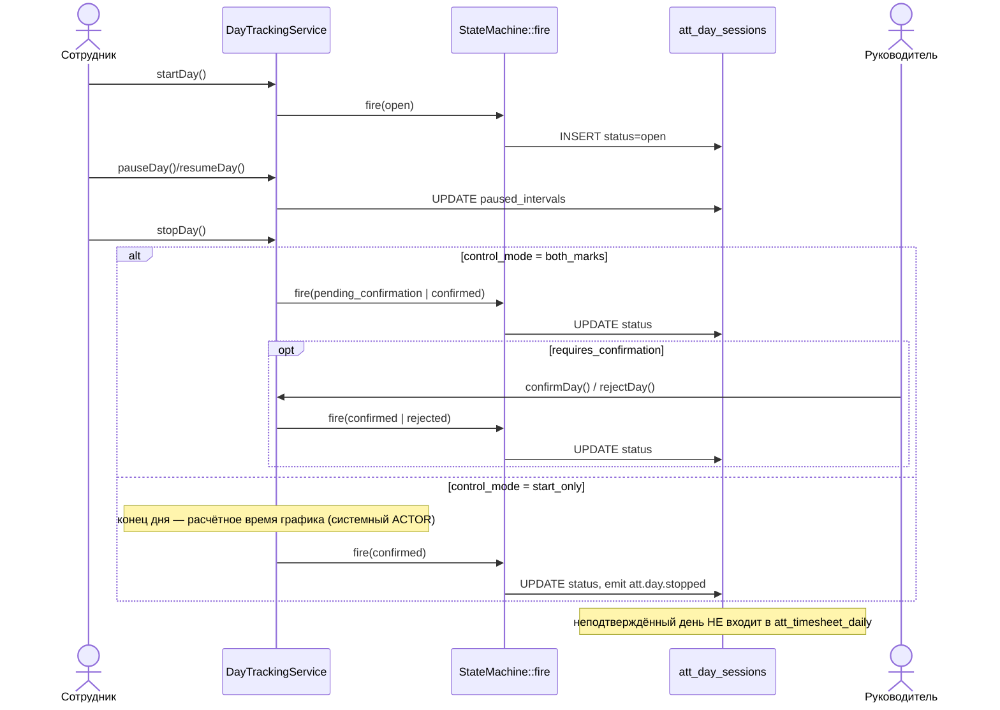
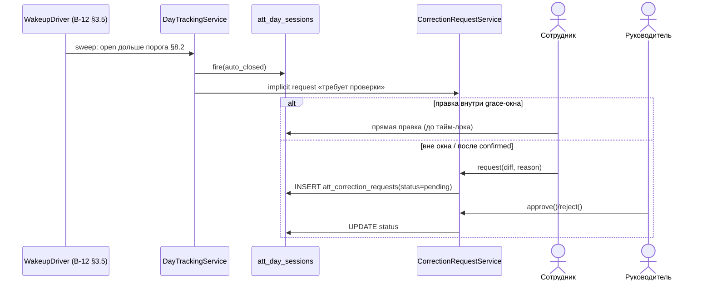
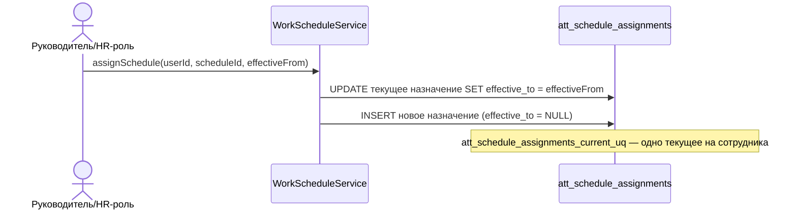
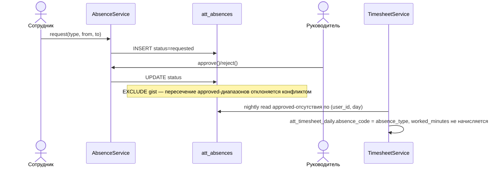
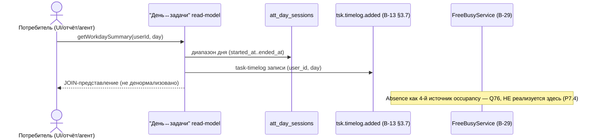

# B-36 — flex/attendance: учёт рабочего времени (attendance-контур)

> **Глубина среза волны** (FLEX-2 P7.2 драфт → P7.3 срезы-дельта, 2026-07-12) — эквивалент
> B-27..B-35 после P3.1–P3.5: полный DDL (§2), полные PHPStan-сигнатуры контрактов + реестр
> событий (§4), права-подраздел §3.13, НФТ/AC §8.1–8.5 (≥12 AC). Дельта-регистрация P7.3 —
> `05-Projects/01-Products/FlexCRM/plans/FLEX-2/slices/S1_db.md`..`S5_nft-ac.md` (секции «Дельта P7: B-36»).
> Вход: `05-Projects/01-Products/FlexCRM/plans/flex/20_research/R-34_time-tracking.md` (§10 «→ входы B-36», все 12).
> Канон-базис: B-13 §2.5/§3.7 (`tsk_`, `tsk.timelog.added` — НЕ переизобретается, §1), B-27 §2/§4
> (`corex/tasks`, КПД read-model паттерн), B-29 §2/§4 (`corex/calendar`, `FreeBusyService`,
> wakeup-регистрация), B-23 (edition-матрица), B-32 §7 (MCP-нейминг `module.verb_noun`).
> Конвенции: PK = UUIDv7 (D12), префикс `att_` (новый, 0 коллизий — проверено против
> `05-Projects/01-Products/FlexCRM/plans/flex/60_contracts/DB_SCHEMA.md` §2), `created_by` jsonb ACTOR — как в B-27/B-29/B-13.
> Нумерация разделов — формат Phase Context P7.2 (§1 обзор → §10 связи), не байт-в-байт с
> нумерацией B-27/B-29 (§1–§7 + §9/§8/§3.x) — сверка по названиям, не номерам (паттерн B-29 header).

---

## 1. Обзор (границы и состав)

**Вердикт домена (R-34 §6.1, вход 1, обязателен):** `flex/attendance` = **ТОЛЬКО attendance-контур**
(график/присутствие/табель). Task-level тайм-логирование на задачу — уже канон `tsk.timelog.added`
(B-13 §3.7, зафиксировано в реестре событий B-27 §4.2) — этот модуль его **не переизобретает и не
трогает**. Интеграция двух контуров — агрегатное read-model представление «что делал сотрудник
в рабочий день» JOIN'ом периода дня (`att_day_sessions`) с существующими task-timelog записями по
`(user_id, day)`, симметрично паттерну `tsk_user_performance_daily` (B-27 §2), НЕ денормализация
одного в другое.

**В модуле:**
- Производственный календарь РФ — нормативный слой (`att_production_calendar_years`), версионируемый
  по постановлению года (вход 2, вход 6).
- Графики работы — операционный слой поверх календаря, employer-defined per-сотрудник/per-отдел
  (`att_work_schedules` + `att_schedule_assignments`), типы: фиксированный/сменный/суммированный/
  неполное время (вход 2, вход 7).
- Фиксация дня — start/pause/resume/stop widget (`att_day_sessions`), режим контроля из графика
  (обе отметки vs авто-конец из графика), guard подтверждения руководителем (вход 3).
- Retroactive-правка — `att_correction_requests` (не прямой UPDATE), тайм-лок периода после approve
  (вход 4).
- Absence — `att_absences` как модификатор нормы (не отдельная запись табеля), approval-цепочка
  (вход 5).
- Табель — производная read-model проекция (`att_timesheet_daily`, паттерн B-27 §2 nightly batch),
  Т-13-совместимый экспорт, не единственная форма (вход 6).
- Гео/IP-контроль — opt-in per-tenant флаг на графике, default OFF (вход 9).

**Вне модуля (явное архитектурное исключение, не «пока не сделали»):**
- Task-level time-tracking (`tsk.timelog.added`, B-13/B-27) — канон, не гап (вход 1, §обзор выше).
- Зарплата/начисления — вне скоупа FlexCRM v1, roadmap-шов (R-34 §8).
- Биометрия/СКУД (турникеты, распознавание лиц) — roadmap (вход 9, R-34 §8).
- Мониторинг (скриншоты/кейлог активности) — НЕ проектируется в v1, анти-донор (вход 10,
  RU 152-ФЗ + EU GDPR регуляторная конвергенция, R-34 §2.3/§4/§7).
- ГПХ-исполнители — вне скоупа v1, юридический анти-паттерн (не техническое ограничение), модуль
  строго про сотрудников на трудовом договоре (вход 8, R-34 §7/§8).
- Публичные booking-страницы отсутствия — roadmap, не встречено ни у одного донора как часть
  attendance-контура (R-34 §8, в отличие от `cal_booking_types` B-29 §3.6 — другой продуктовый
  контур).

**Зависимости модуля:** corex/workflow (wakeup B-12 §3.5 — auto-close сессии, напоминания, §5);
AzGuard/B-11 (permission keys, approval-guard'ы — §9 п.13); corex/notifications (события подтверждения/
approval); B-29 calendar (`FreeBusyService` четвёртый источник — Q76, маршрутизирован P7.4, НЕ решается
здесь); B-27 tasks (агрегатное read-model представление день↔задачи, `tsk_user_performance_daily`
паттерн); B-23 (edition-гейтинг — предложение строки для B-24 §2, финализация P7.5).

---

## 2. Модель данных

> Срез P7.3: полный DDL (индексы, CHECK/COMMENT, anti-double-booking constraint) — черновая
> пометка снята.

Префикс `att_` — новый, 0 коллизий с индексом `DB_SCHEMA.md` §2 (проверено grep по `05-Projects/01-Products/FlexCRM/plans/flex/`
и `05-Projects/01-Products/FlexCRM/plans/FLEX-2/`: ни один блюпринт/срез не использует `att_`). Полная дедуп-проверка против
всех пяти реестров срезов волны — `slices/S1_db.md` (дельта-секция P7).

| Таблица | Назначение | Ключевые поля (не исчерпывающе) |
|---|---|---|
| `att_production_calendar_years` | Версионируемый производственный календарь РФ (нормативный слой, вход 6) | `year`, `source_document`, `source_effective_date`, `days` (jsonb: дата→тип рабочий/выходной/предпраздничный/перенос) |
| `att_work_schedules` | Employer-defined график, per-сотрудник/per-отдел (вход 2) | `id`, `workspace_id`, `owner_type` (`user`\|`department`), `owner_id`, `schedule_type` (`fixed`\|`shift`\|`summed`\|`part_time`), `control_mode` (`both_marks`\|`start_only`), `params` (jsonb: часы/дни/ночной интервал/допустимая недоработка/gео-флаг — §обзор), `timezone`, `is_active` |
| `att_schedule_assignments` | Привязка графика к сотруднику с датой действия (сменяемость) | `id`, `user_id`, `schedule_id`, `effective_from`, `effective_to` (NULL = текущий) |
| `att_day_sessions` | Фиксация рабочего дня (старт/пауза/стоп) | `id`, `user_id`, `work_date`, `started_at`, `paused_intervals` (jsonb: `[{from,to}]`), `ended_at`, `status` (`open`\|`auto_closed`\|`pending_confirmation`\|`confirmed`\|`rejected`), `confirmed_by` (jsonb ACTOR), `confirmed_at` |
| `att_correction_requests` | Retroactive-правка (вход 4) — НЕ прямой UPDATE `att_day_sessions` | `id`, `day_session_id`, `requested_by` (jsonb ACTOR), `reason`, `diff` (jsonb: было/стало), `status` (`pending`\|`approved`\|`rejected`), `resolved_by`, `resolved_at` |
| `att_absences` | Отклонения (отпуск/больничный/отгул/командировка) — модификатор нормы, НЕ строка табеля (вход 5) | `id`, `user_id`, `absence_type` (`vacation`\|`sick_leave`\|`day_off`\|`business_trip`), `starts_on`, `ends_on`, `status` (`requested`\|`approved`\|`rejected`), `approved_by`, `approved_at` |
| `att_timesheet_daily` | Read-model/проекция табеля (nightly batch, паттерн `tsk_user_performance_daily` B-27 §2) | `id` (UUIDv7), `workspace_id` (nullable), `user_id`, `day`, `worked_minutes`, `late_minutes`, `overtime_minutes`, `undertime_minutes`, `absence_code` (nullable), `computed_at`; UNIQUE `(workspace_id, user_id, day)` — идемпотентный upsert |

**Изменения существующих таблиц: НЕТ** — модуль полностью аддитивен, не трогает `tsk_`/`cal_`/`crm_`
DDL (сверено с §9 дедуп-проверкой ниже).

**Дедуп-проверка имён:** ни одно имя таблицы `att_*` — 0 коллизий против всех пяти реестров срезов
волны (`slices/S1_db.md`..`S5_nft-ac.md`) и `DB_SCHEMA.md` §2 (grep по `05-Projects/01-Products/FlexCRM/plans/flex/` и
`05-Projects/01-Products/FlexCRM/plans/FLEX-2/`, полный прогон — дельта-секция `slices/S1_db.md`).

```sql
-- ============================================================
-- att_production_calendar_years — производственный календарь РФ,
-- версионируемый по постановлению года (вход 6)
-- ============================================================
CREATE TABLE att_production_calendar_years (
  id                    uuid PRIMARY KEY,             -- UUIDv7
  year                  smallint NOT NULL,
  source_document       text NOT NULL,                 -- реквизиты постановления Правительства РФ
  source_effective_date date NOT NULL,
  days                  jsonb NOT NULL,                 -- {"2026-01-01": "holiday", "2026-02-23": "pre_holiday", ...}
  created_by            jsonb NOT NULL,                 -- ACTOR (импорт вручную/скриптом)
  created_at            timestamptz NOT NULL DEFAULT now(),
  updated_at            timestamptz NOT NULL DEFAULT now(),
  UNIQUE (year)
);
COMMENT ON TABLE att_production_calendar_years IS 'Нормативный слой (вход 6) — версионируется по году, НЕ автосинк с гос-API (ProductionCalendarService::importYear, §4)';

-- ============================================================
-- att_work_schedules — employer-defined график, per-сотрудник/per-отдел (вход 2)
-- ============================================================
CREATE TABLE att_work_schedules (
  id               uuid PRIMARY KEY,                   -- UUIDv7
  workspace_id     uuid NULL REFERENCES wsp_workspaces(id) ON DELETE CASCADE,  -- NULL = уровень аккаунта
  owner_type       text NOT NULL CHECK (owner_type IN ('user','department')),  -- полиморф, БЕЗ FK (B-11 §7.3)
  owner_id         uuid NOT NULL,
  schedule_type    text NOT NULL CHECK (schedule_type IN ('fixed','shift','summed','part_time')),
  control_mode     text NOT NULL CHECK (control_mode IN ('both_marks','start_only')),
  params           jsonb NOT NULL DEFAULT '{}'::jsonb,  -- часы/дни/ночной интервал/geo_control_enabled(default false, §8)/допустимая недоработка
  timezone         text NOT NULL,                        -- IANA, единая зона графика (§3 уточнение мультитаймзонности)
  is_active        boolean NOT NULL DEFAULT true,
  deleted_at       timestamptz NULL,                     -- конфигурационная сущность с ЖЦ (S1 §9 правило)
  created_by       jsonb NOT NULL,
  created_at       timestamptz NOT NULL DEFAULT now(),
  updated_at       timestamptz NOT NULL DEFAULT now()
);
CREATE INDEX att_work_schedules_owner_ix ON att_work_schedules (owner_type, owner_id) WHERE deleted_at IS NULL;  -- запрос: график отдела/сотрудника
COMMENT ON TABLE att_work_schedules IS 'geo_control_enabled default false — safety-инвариант §8.4; owner полиморфен (user|department), без FK по конвенции B-11 §7.3';

-- ============================================================
-- att_schedule_assignments — привязка графика к сотруднику с датой действия (сменяемость)
-- ============================================================
CREATE TABLE att_schedule_assignments (
  id              uuid PRIMARY KEY,                    -- UUIDv7
  user_id         uuid NOT NULL REFERENCES users(id) ON DELETE CASCADE,
  schedule_id     uuid NOT NULL REFERENCES att_work_schedules(id) ON DELETE RESTRICT,  -- справочная FK — не удалить график с живыми назначениями
  effective_from  date NOT NULL,
  effective_to    date NULL,                            -- NULL = текущее назначение
  created_by      jsonb NOT NULL,
  created_at      timestamptz NOT NULL DEFAULT now()
);
CREATE UNIQUE INDEX att_schedule_assignments_current_uq ON att_schedule_assignments (user_id) WHERE effective_to IS NULL;  -- инвариант: одно текущее назначение на сотрудника (поток 3)
CREATE INDEX att_schedule_assignments_user_history_ix ON att_schedule_assignments (user_id, effective_from DESC);  -- история назначений сотрудника

-- ============================================================
-- att_day_sessions — фиксация рабочего дня (старт/пауза/стоп)
-- ============================================================
CREATE TABLE att_day_sessions (
  id                uuid PRIMARY KEY,                  -- UUIDv7
  user_id           uuid NOT NULL REFERENCES users(id) ON DELETE CASCADE,
  work_date         date NOT NULL,
  started_at        timestamptz NOT NULL,
  paused_intervals  jsonb NOT NULL DEFAULT '[]'::jsonb,  -- [{"from": "...", "to": "..."}]
  ended_at          timestamptz NULL,
  status            text NOT NULL DEFAULT 'open'
                     CHECK (status IN ('open','auto_closed','pending_confirmation','confirmed','rejected')),
  confirmed_by      jsonb NULL,                          -- ACTOR
  confirmed_at      timestamptz NULL,
  created_at        timestamptz NOT NULL DEFAULT now(),
  updated_at        timestamptz NOT NULL DEFAULT now(),
  UNIQUE (user_id, work_date)                              -- один day-session на сотрудника на дату (не anti-double-booking gist — не интервальная гонка, дата дискретна)
);
CREATE INDEX att_day_sessions_open_sweep_ix ON att_day_sessions (started_at) WHERE status = 'open';  -- wakeup auto-close sweep (§4.1)
CREATE INDEX att_day_sessions_pending_confirmation_ix ON att_day_sessions (user_id) WHERE status = 'pending_confirmation';  -- очередь подтверждения руководителя
COMMENT ON TABLE att_day_sessions IS 'Единственный путь записи статуса — DayTrackingService (safety-инвариант §8.4); неподтверждённый день не входит в att_timesheet_daily';

-- ============================================================
-- att_correction_requests — retroactive-правка (НЕ прямой UPDATE att_day_sessions)
-- ============================================================
CREATE TABLE att_correction_requests (
  id              uuid PRIMARY KEY,                    -- UUIDv7
  day_session_id  uuid NOT NULL REFERENCES att_day_sessions(id) ON DELETE CASCADE,  -- строгая принадлежность (B-13 паттерн)
  requested_by    jsonb NOT NULL,                        -- ACTOR
  reason          text NOT NULL,
  diff            jsonb NOT NULL,                        -- {"before": {...}, "after": {...}}
  status          text NOT NULL DEFAULT 'pending' CHECK (status IN ('pending','approved','rejected')),
  resolved_by     jsonb NULL,
  resolved_at     timestamptz NULL,
  created_at      timestamptz NOT NULL DEFAULT now()
);
CREATE INDEX att_correction_requests_pending_ix ON att_correction_requests (day_session_id) WHERE status = 'pending';  -- очередь approval

-- ============================================================
-- att_absences — отклонения (отпуск/больничный/отгул/командировка), модификатор нормы
-- ============================================================
CREATE EXTENSION IF NOT EXISTS btree_gist;  -- идемпотентно; уже включено канон-миграцией cal_resource_bookings (B-29 §2)
CREATE TABLE att_absences (
  id            uuid PRIMARY KEY,                      -- UUIDv7
  user_id       uuid NOT NULL REFERENCES users(id) ON DELETE CASCADE,
  absence_type  text NOT NULL CHECK (absence_type IN ('vacation','sick_leave','day_off','business_trip')),
  starts_on     date NOT NULL,
  ends_on       date NOT NULL,
  status        text NOT NULL DEFAULT 'requested' CHECK (status IN ('requested','approved','rejected')),
  approved_by   jsonb NULL,
  approved_at   timestamptz NULL,
  created_at    timestamptz NOT NULL DEFAULT now(),
  updated_at    timestamptz NOT NULL DEFAULT now(),
  CHECK (ends_on >= starts_on),
  EXCLUDE USING gist (user_id WITH =, daterange(starts_on, ends_on, '[]') WITH &&) WHERE (status = 'approved')  -- anti-overlap: два approved-отсутствия сотрудника не пересекаются (safety-инвариант §8.4, паттерн cal_resource_bookings B-29 §3.5)
);
CREATE INDEX att_absences_pending_ix ON att_absences (user_id) WHERE status = 'requested';  -- очередь approval

-- ============================================================
-- att_timesheet_daily — read-model/проекция табеля (nightly batch,
-- паттерн tsk_user_performance_daily B-27 §2)
-- ============================================================
CREATE TABLE att_timesheet_daily (
  id                 uuid PRIMARY KEY,                 -- UUIDv7; surrogate — workspace_id nullable делает составной PK невозможным (см. tsk_user_performance_daily §9 п.8, тот же приём)
  workspace_id       uuid NULL REFERENCES wsp_workspaces(id) ON DELETE CASCADE,
  user_id            uuid NOT NULL REFERENCES users(id) ON DELETE CASCADE,
  day                date NOT NULL,
  worked_minutes     int NOT NULL DEFAULT 0,
  late_minutes       int NOT NULL DEFAULT 0,
  overtime_minutes   int NOT NULL DEFAULT 0,
  undertime_minutes  int NOT NULL DEFAULT 0,
  absence_code       text NULL,                         -- att_absences.absence_type снапшот дня (поток 4)
  computed_at        timestamptz NOT NULL DEFAULT now(),  -- отметка nightly-batch прогона (паттерн mkg_campaign_stats.computed_at)
  UNIQUE NULLS NOT DISTINCT (workspace_id, user_id, day)  -- идемпотентный upsert nightly-batch
);
CREATE INDEX att_timesheet_daily_user_period_ix ON att_timesheet_daily (user_id, day DESC);  -- запрос: табель-карточка сотрудника за период
COMMENT ON TABLE att_timesheet_daily IS 'Read-model/projection (B-26 §2) — не партиционируется и не архивируется append-only-механизмом; пересчитывается детерминированно nightly-batch''ем, повторный прогон идемпотентен по UNIQUE-ключу';
```

---

## 3. Ключевые архитектурные решения

### 3.0 Reuse-вердикт (обязательная секция по `ecosystem-reuse-gate`)

Прогон 7 if-then правил гейта (`.ai/skills/architect/ecosystem-reuse-gate.md`), предварительная
позиция R-34 §10 п.12 подтверждается:

1. **Правило 1** (зрелый вендор/OSS с совместимой лицензией, self-host, покрывающий применение) —
   **не сработало**. Доноры R-34 §2 — либо закрытый SaaS без self-host OSS-ядра (Toggl/Clockify/
   Hubstaff/Time Doctor/Deputy/When I Work — коммерческие продукты, не библиотеки), либо встроенные
   модули закрытых платформ (Б24, 1С:ЗУП, СБИС — не переиспользуемый код). Ни один — не
   лицензионно-совместимая (не-AGPL/не-SaaS-only) библиотека «график+табель».
2. **Правило 2** (функционал уже покрыт пакетом экосистемы) — **не сработало**. `corex/tasks`
   покрывает task-level time-tracking (§1, вход 1), НЕ attendance; ни один пакет корневого
   реестра `05-Projects/01-Products/FlexCRM/plans/flex/` не несёт графиков/табеля/присутствия.
3. **Правило 3** (дублирование подтверждено, подходящего вендора нет — комплаенс/локализация/
   домен-специфичность) → **СРАБОТАЛО**. RU-специфика (ст. 91/104 ТК РФ, Т-12/Т-13, производственный
   календарь с постановлениями, граница ГПХ, 152-ФЗ гео-контроль — R-34 §7) — прямая
   локализационная/комплаенс-причина: ни один западный донор её не несёт, RU-доноры (СБИС/1С:ЗУП)
   не переиспользуемы как код (закрытые продукты).

**Вердикт: `build-new` — свой модуль `flex/attendance`** (продукта, НЕ пакет-обёртка `corex/*`:
единственный потребитель — FlexCRM v1, Rule of Three по числу потребителей не набран, правило 7
гейта не срабатывает). Reuse-отчёт: *«готовое график+табель+РФ-специфика решение → build-new
(правило 3) — комплаенс/локализация не покрыты ни одним зрелым OSS-донором R-34 §2»*. Q76 (участие
absence в `FreeBusyService`) — НЕ входит в reuse-вердикт, отдельный вопрос контракта (§9).

### 3.1–3.12 Табличный проход по всем 12 входам R-34 §10 — вердикт каждому

| # | Вход R-34 §10 | Вердикт | Где в B-36 |
|---|---|---|---|
| 1 | Вердикт домена: только attendance-контур, task-timelog не переизобретается | **ПРИНЯТО** | §1 |
| 2 | Двухслойная модель графика: производственный календарь (нормативный слой) + операционный график поверх | **ПРИНЯТО** | §2 (`att_production_calendar_years` + `att_work_schedules`) |
| 3 | Фиксация дня — Б24-паттерн (start/pause/stop, конфигурируемый control_mode, guard подтверждения руководителем) | **ПРИНЯТО** | §2 (`att_day_sessions.status`), §5 (поток 1) |
| 4 | Забыл закрыть день / retroactive edit — авто-остановка по порогу + `correction_request` отдельной сущностью, тайм-лок периода | **ПРИНЯТО** | §2 (`att_correction_requests`), §5 (поток 2) |
| 5 | Absence — модификатор нормы, не отдельная запись табеля (образец «учёт по отклонениям» 1С) | **ПРИНЯТО** | §2 (`att_absences`), §5 (поток 4) |
| 6 | Т-13-совместимый экспорт (не единственная форма); производственный календарь — версионируемая сущность с `source_document`/`source_effective_date` | **ПРИНЯТО** | §2 (`att_production_calendar_years`), §7 (`att.export_timesheet`) |
| 7 | Суммированный учёт — тип графика `summed` в словаре, схема не блокирует; полная механика учётного периода — v1.1 | **ПРИНЯТО** | §2 (`att_work_schedules.schedule_type='summed'`), §9 (роадмап-пометка v1.1) |
| 8 | ГПХ — явное архитектурное исключение из скоупа (не «не сделали») | **ПРИНЯТО** | §1 |
| 9 | Гео/IP-контроль — opt-in per-tenant флаг, default OFF | **ПРИНЯТО** | §2 (`att_work_schedules.params.geo_control_enabled`, default false), §8 (safety-инвариант) |
| 10 | Мониторинг (скриншоты/кейлог) — НЕ проектировать в v1 | **ПРИНЯТО** | §1 |
| 11 | Q76 — участие absence в `FreeBusyService::busyIntervals` четвёртым источником | **МАРШРУТИЗИРОВАН** — не решается здесь (Code Guidance P7.1/P7.2: контракт B-29, требует явного вердикта на срезе P7.4) | §9 |
| 12 | Reuse-вердикт — предварительная позиция «свой модуль, не пакет-обёртка», финал — за B-36 | **ПОДТВЕРЖДЕНО** | §3.0 |

**Уточнение по мультитаймзонности (R-34 §3, не пронумерованный вход, но требующий явного решения
драфта):** график хранит `timezone` на самом графике (`att_work_schedules.timezone`) — единая зона
организации/подразделения, паттерн всех исследованных доноров (ни один не делает
per-employee-таймзону фичей первого класса, R-34 §3). Per-employee override — v1.1 закладка,
не полная проработка v1 (консистентно решению R-34 §8 таблица). Решение симметрично паттерну
`event_tz` на мастере события B-29 §3.9 (зона на сущности-контейнере, не на пользователе).

### 3.13 Права: permission keys, scope-предикаты, FSM-guard (срез P7.3)

> Срез P7.3: permission-матрица + guard-механика статуса дня (Q77) — черновая пометка снята.

**Q77 (FSM `StateMachine::fire` vs доменный сервис-guard) — решено здесь.** `att_day_sessions.status`
переводится **через `StateMachine::fire`** (канон B-12 §3.7), НЕ доменным сервис-guard'ом без
statecraft-интеграции. Обоснование: волна зафиксировала «единственный путь записи статуса —
`StateMachine::fire`» как safety-инвариант (S5 §3 п.2, применён ко ВСЕМ FSM-модулям волны —
B-27/B-28/B-29/B-30/B-31), и B-36 §8 сам декларирует этот инвариант эскизом (P7.2). Третий вариант
не изобретается (Code Guidance P7.2/P7.3) при отсутствии контраргумента: `DaySessionStatus`
(`open→auto_closed|pending_confirmation→confirmed|rejected`) — топология переходов проще
`tsk_tasks`/`cst_<slug>`, но простота топологии не аргумент против конвенции волны (единообразие
реализации P6 важнее локальной экономии). `DayTrackingService` — единственный вызывающий
`StateMachine::fire` для `att_day_sessions`, прямой `UPDATE status` запрещён (§8.4 safety-инвариант).

**Матрица: permission key → scope-опции (B-11 §5.5) → где проверяется → кто декларирует**

| Permission key | Scope-опции | Где проверяется | Кто декларирует |
|---|---|---|---|
| `att.day_session.confirm` | workspace/account (не self — подтверждает НЕ сам сотрудник) | `DayTrackingService::confirmDay/rejectDay` guard | `flex/attendance`, `Extend\Permissions` |
| `att.correction.approve` | workspace/account | `CorrectionRequestService::approve/reject` (тот же authorizer, что confirm — §9 п.13 драфта) | `flex/attendance` |
| `att.absence.approve` | workspace/account | `AbsenceService::approve/reject` | `flex/attendance` |
| `att.schedule.manage` | workspace/account | `WorkScheduleService::createSchedule/assignSchedule` (руководитель/HR-роль, поток 3) | `flex/attendance` |
| `att.timesheet.view_others` | workspace/account (self — своя история без права; чужая — этот ключ) | `TimesheetService::getPeriod` при `userId ≠ principal.userId` | `flex/attendance` |
| `att.timesheet.export` | workspace/account | `TimesheetService::exportT13` | `flex/attendance` |

**Self-service без отдельного ключа**: `DayTrackingService::startDay/pauseDay/resumeDay/stopDay`,
`CorrectionRequestService::request`, `AbsenceService::request`, `TimesheetService::getPeriod` (своя
история) — не требуют permission key, авторизация = `principal.userId = target.userId` (паттерн
`cal.calendar.share` self-service, B-29 §3.12). Approval-действия (`confirm`/`approve`/`reject`) —
**всегда** отдельный permission key, никогда self-authorized (сотрудник не подтверждает свой день).

**FSM-guard (control_mode из графика, §5 поток 1):** переход `open → pending_confirmation` или
`open → confirmed` управляется `att_work_schedules.control_mode` конкретного назначенного графика
сотрудника (не глобальной константой) — guard читает текущее назначение через
`att_schedule_assignments` (`effective_to IS NULL`). Guard-предикат — часть `DayTrackingService`,
не отдельная scope-таблица (control_mode не ось видимости, а бизнес-правило перехода).

**HITL-agentic:** approval-тулзы (`att.confirm_day`/`att.reject_day`/`att.approve_correction`/
`att.approve_absence`) — `write (high)`, confirm-гейт по side_effect (B-32 §3.4), НЕ отдельный
`ai.*`-супер-ключ (консистентно волне S4 §1 «HITL = capability тулзы»).

---

## 4. Контракты (сервисный контур — полные PHPStan-сигнатуры срез P7.3)

> Срез P7.3: полные PHP-интерфейсы (@api, PHPStan level 8, форма B-16 §3/B-29 §4), реестр
> доменных событий — черновая пометка снята.

```php
namespace Flex\Attendance;

use Corex\Auth\Actor;

enum ScheduleType: string { case Fixed = 'fixed'; case Shift = 'shift'; case Summed = 'summed'; case PartTime = 'part_time'; }
enum ControlMode: string { case BothMarks = 'both_marks'; case StartOnly = 'start_only'; }
enum DaySessionStatus: string { case Open = 'open'; case AutoClosed = 'auto_closed'; case PendingConfirmation = 'pending_confirmation'; case Confirmed = 'confirmed'; case Rejected = 'rejected'; }
enum AbsenceType: string { case Vacation = 'vacation'; case SickLeave = 'sick_leave'; case DayOff = 'day_off'; case BusinessTrip = 'business_trip'; }

/** readonly, id+type+display — единая форма волны (§4 B-27/B-29) */
final readonly class ScheduleRef
{
    public function __construct(public string $id, public string $type /* 'att.schedule' */, public string $display) {}
}
final readonly class DaySessionRef
{
    public function __construct(public string $id, public string $userId, public DaySessionStatus $status) {}
}

/** Переход не разрешён guard'ом control_mode/подтверждения (детали guard — P7.3) */
final class DaySessionTransitionNotAllowedException extends \DomainException {}
/** Правка задним числом вне grace-окна без correction_request (§5 поток 2) */
final class RetroactiveEditRequiresCorrectionException extends \DomainException {}

interface WorkScheduleService
{
    public function createSchedule(string $ownerType /* user|department */, string $ownerId,
        ScheduleType $type, ControlMode $controlMode, array $params, string $timezone, Actor $actor): ScheduleRef;
    /** Привязка с датой действия (§2 att_schedule_assignments) — сменяемость графика, не перезапись */
    public function assignSchedule(string $userId, string $scheduleId, \DateTimeImmutable $effectiveFrom, Actor $actor): void;
}

interface DayTrackingService
{
    /** Guard: control_mode графика определяет, требуется ли явный stop или конец берётся из графика (§5 поток 1) */
    public function startDay(string $userId, Actor $actor): DaySessionRef;
    public function pauseDay(string $sessionId, Actor $actor): void;
    public function resumeDay(string $sessionId, Actor $actor): void;
    public function stopDay(string $sessionId, Actor $actor): void;
    /** authorizer: руководитель/permission att.day_session.confirm (§9 п.13) — неподтверждённый день не входит в табель (вход 3) */
    public function confirmDay(string $sessionId, Actor $actor): void;
    public function rejectDay(string $sessionId, string $reason, Actor $actor): void;
}

interface CorrectionRequestService
{
    /** @throws RetroactiveEditRequiresCorrectionException внутри DayTrackingService при правке вне grace-окна */
    public function request(string $daySessionId, array $diff, string $reason, Actor $actor): string /* requestId */;
    /** authorizer: тот же, что confirmDay (§9 п.13) */
    public function approve(string $requestId, Actor $actor): void;
    public function reject(string $requestId, string $reason, Actor $actor): void;
}

interface AbsenceService
{
    public function request(string $userId, AbsenceType $type, \DateTimeImmutable $from, \DateTimeImmutable $to, Actor $actor): string /* absenceId */;
    /** authorizer: руководитель/permission att.absence.approve (§9 п.13) */
    public function approve(string $absenceId, Actor $actor): void;
    public function reject(string $absenceId, string $reason, Actor $actor): void;
}

interface TimesheetService
{
    /** Read-model att_timesheet_daily (nightly batch, §2); паттерн crm_activity_rollups/tsk_user_performance_daily (B-24 §7) */
    public function getPeriod(string $userId, \DateTimeImmutable $from, \DateTimeImmutable $to): array;
    /** Т-13-совместимый вывод (вход 6) — вычисляемая проекция по запросу, не хранимая сущность */
    public function exportT13(string $workspaceId, \DateTimeImmutable $periodMonth): string /* file ref */;
}

interface ProductionCalendarService
{
    /** Ежегодное обновление вручную/скриптом при выходе нового постановления (вход 6) — НЕ автосинк с гос-API */
    public function importYear(int $year, string $sourceDocument, \DateTimeImmutable $sourceEffectiveDate, array $days, Actor $actor): void;
    public function isWorkingDay(\DateTimeImmutable $date): bool;
}
```

### 4.1 wakeup-регистрация (auto-close сессии, паттерн B-29 §4.1 `WakeupHook`)

`DayTrackingService` регистрирует `WakeupHook` (`Corex\Workflow\Wakeup\WakeupHook`, канон B-29 §4.1,
код домена `att.auto_close`) — sweep-обработчик сканирует `att_day_sessions` со статусом `open` дольше
порога (N часов, конфиг §8) и переводит их в `auto_closed` + создаёт `att_correction_requests`
implicit-пометкой «требует проверки» (вход 4). Свой шедулер НЕ вводится — тот же `WakeupDriver`,
что у `corex/calendar`/`corex/tasks` (B-29 §3.8/§4.1), третий потребитель одного контракта.

### 4.2 Реестр доменных событий

| Событие | `name()` | Эмитент |
|---|---|---|
| `DayStarted` / `DayPaused` / `DayResumed` / `DayStopped` | `att.day.started` / `.paused` / `.resumed` / `.stopped` | DayTrackingService |
| `DayAutoClosed` | `att.day.auto_closed` | wakeup-обработчик (§4.1) |
| `DayConfirmed` / `DayRejected` | `att.day.confirmed` / `.rejected` | DayTrackingService::confirmDay/rejectDay |
| `CorrectionRequested` / `CorrectionApproved` / `CorrectionRejected` | `att.correction.requested` / `.approved` / `.rejected` | CorrectionRequestService |
| `AbsenceRequested` / `AbsenceApproved` / `AbsenceRejected` | `att.absence.requested` / `.approved` / `.rejected` | AbsenceService |
| `ScheduleAssigned` | `att.schedule.assigned` | WorkScheduleService::assignSchedule |

**Проверка уникальности (0 коллизий, срез P7.3):** все `att.*` — новый неймспейс, structurally
непересекаемый по построению namespace-разделения волны (S3 §2 п.1 — коллизия невозможна, пока
первый сегмент уникален); сверено против `tsk.*` (B-27 §4.2), `cal.*` (B-29 §4.4), `soc.*`/`mkg.*`
(B-30 §4), `wfl.*`/`cst.*`/`core.*` (B-31 §4), `ai.*` (B-32 §4.2), `crm.*`/`vrt.*` (B-13 §3.7),
control-plane `tenancy.*`/`identity.*`/`intl.*` (B-33/B-34/B-35) — 0 совпадений литералов `name()`.
Полная построчная запись реестра волны — дельта-секция `slices/S3_contracts.md` (P7).

---

## 5. Главные потоки (sequence-диаграммы + транзакционные границы, срез P7.3)

**Поток 1 — старт/стоп рабочего дня.** Сотрудник жмёт «Начать день» → `att_day_sessions` INSERT
(`status=open`). Пауза/возобновление — обновление `paused_intervals`. Стоп: если график
`control_mode=both_marks` — явный stop сотрудником переводит в `pending_confirmation` (если
`requires_confirmation` — конфиг графика) либо сразу `confirmed`; если `control_mode=start_only` —
конец дня берётся автоматически из параметров графика при достижении расчётного времени (событие
`att.day.stopped` эмитится системным ACTOR). Руководитель подтверждает/отклоняет
(`att.day_session.confirm`, вход 3) — неподтверждённый день не входит в `att_timesheet_daily`.
Переход статуса — ТОЛЬКО через `StateMachine::fire` (Q77 → Resolved, §3.13).



**Поток 2 — забыл закрыть день / retroactive edit.** Wakeup-sweep (§4.1) детектит сессию `open`
дольше порога (§8.2, Q78 → Resolved) → `auto_closed` + implicit `att_correction_requests`
«требует проверки». Правка задним числом ВНУТРИ grace-окна — сотрудник правит сам напрямую; ВНЕ
окна или после `confirmed` (тайм-лок периода) — только через `CorrectionRequestService::request`
(audit-trail было/стало, вход 4), approval — тот же authorizer, что подтверждение дня.



**Поток 3 — назначение графика.** Руководитель/HR-роль вызывает `assignSchedule` с датой действия;
предыдущее назначение получает `effective_to` = новая дата (история сохраняется, не перезаписывается).



**Поток 4 — absence-заявка.** Сотрудник подаёт заявку (`AbsenceService::request`) → approval-цепочка
(руководитель) → `approved`/`rejected`. Absence НЕ создаёт запись `att_day_sessions` — модификатор
нормы читается `TimesheetService` при построении `att_timesheet_daily` (день с активным absence
получает `absence_code`, не `worked_minutes`, вход 5). Пересекающиеся `approved`-отсутствия одного
сотрудника отклоняются БД-инвариантом (`EXCLUDE USING gist`, §2, §8.4).



**Поток 5 — межмодульный сценарий: рабочий день ↔ задачи ↔ календарь.** Агрегатное представление
«что делал сотрудник в рабочий день» — READ-запрос, JOIN `att_day_sessions` (диапазон дня) с
task-timelog записями `tsk.timelog.added` (B-13 §3.7) по `(user_id, day)`, симметрично паттерну
read-model `tsk_user_performance_daily` (B-27 §2) — вычисляется на чтение или в том же nightly-batch,
что `att_timesheet_daily`, НЕ денормализуется в общую таблицу (§1). Absence ↔ `FreeBusyService`
(B-29 §3.6/§4) — Q76, контрактное решение маршрутизировано в арбитраж P7.4, здесь только фиксируется
точка стыка (не реализуется).



---

## 6. UI-эскиз словами

Виджет «Рабочий день» (панель/шапка приложения, Б24-паттерн): кнопки Начать/Пауза/Продолжить/
Завершить, таймер текущей сессии. Конструктор графиков (форма: тип, часы/дни, control_mode,
допуски, гео-флаг) — доступен руководителю/HR-роли. Очередь подтверждения (список дней/absence-
заявок «на рассмотрении» — карточка сотрудник+дата+длительность+кнопки принять/отклонить). Табель-
отчёт — таблица период×сотрудник с итогами (опоздания/переработки/недоработки/absence), кнопка
экспорта Т-13. Личный кабинет сотрудника — своя история дней + статус активных correction-заявок.

---

## 7. MCP-тулзы (`att.*`, нейминг `module.verb_noun` — B-32 §3.3, module_short=`att`)

| Тулза | side_effect (B-32 §3.4) | Суть |
|---|---|---|
| `att.start_day` / `att.pause_day` / `att.resume_day` / `att.stop_day` | write | фиксация дня (поток 1) |
| `att.get_day_status` | read | текущий статус дня сотрудника |
| `att.request_correction` | write | правка задним числом (поток 2) |
| `att.approve_correction` / `att.reject_correction` | write (high) | approval правки |
| `att.confirm_day` / `att.reject_day` | write (high) | подтверждение дня руководителем (вход 3) |
| `att.assign_schedule` | write | назначение графика (поток 3) |
| `att.get_schedule` | read | текущий график сотрудника |
| `att.request_absence` | write | заявка на отсутствие (поток 4) |
| `att.approve_absence` / `att.reject_absence` | write (high) | approval отсутствия |
| `att.get_timesheet` | read | табель за период (агрегат) |
| `att.export_timesheet` | read | Т-13-совместимый экспорт (вход 6) |

Подтверждающие/approval-тулзы — `write (high)`, консистентно `tsk.accept_task`/`tsk.reject_task`
(B-32 §7.1) и `mkg.pause_campaign` (confirm-гейт норматив B-32 §3.7).

JSON Schema (образец, `att.confirm_day` — write high, паттерн B-29 §7):

```json
{
  "att.confirm_day": {
    "type": "object",
    "properties": {
      "day_session_id": { "type": "string", "format": "uuid" }
    },
    "required": ["day_session_id"],
    "additionalProperties": false
  }
}
```

JSON Schema (образец, `att.request_absence` — write, вход-форма пользователя):

```json
{
  "att.request_absence": {
    "type": "object",
    "properties": {
      "absence_type": { "type": "string", "enum": ["vacation", "sick_leave", "day_off", "business_trip"] },
      "starts_on":    { "type": "string", "format": "date" },
      "ends_on":      { "type": "string", "format": "date" }
    },
    "required": ["absence_type", "starts_on", "ends_on"],
    "additionalProperties": false
  }
}
```

---

## 8. НФТ, лимиты и Acceptance Criteria

> Срез P7.3: перфоманс-бюджеты, квоты `root_plans.limits`, edition-гейтинг, safety-инварианты
> и AC финализированы — черновая пометка снята.

### 8.1 Производительность

| Запрос | Бюджет | Механизм |
|---|---|---|
| `getWorkdaySummary` (день↔задачи, поток 5) | p95 ≤ 200 мс | `att_day_sessions` PK-диапазон + `tsk.timelog.added` индекс (B-27) |
| Wakeup sweep auto-close | p95 ≤ 100 мс на батч | `att_day_sessions_open_sweep_ix` |
| `TimesheetService::getPeriod` (период×сотрудник) | p95 ≤ 150 мс | `att_timesheet_daily_user_period_ix`, read-model — не пересчитывается на запрос |
| `exportT13` (Т-13 за месяц) | p95 ≤ 500 мс | та же проекция, вычисляемый вывод (не хранится, вход 6) |
| Approval-очередь (дни/корректировки/absence) | p95 ≤ 100 мс | `att_day_sessions_pending_confirmation_ix` / `att_correction_requests_pending_ix` / `att_absences_pending_ix` |
| Проверка пересечения absence при `request()` | p95 ≤ 50 мс | `EXCLUDE USING gist` — constraint, не доп. SELECT-проверка |

### 8.2 Квоты (`root_plans.limits`; классы — D-005 §3)

| Ключ | Default | Enforcement | Класс |
|---|---|---|---|
| `att.work_schedules_max` | 20 | `WorkScheduleService::createSchedule` | **C** — технический потолок, не апсейл-триггер |
| `att.timesheet_history_months` | standard: 12 / pro: 36 / enterprise: unlim | `TimesheetService::getPeriod` (глубина видимой истории) | **A** — tier-триггер |
| `att.auto_close_threshold_hours` (Q78 → Resolved) | **16 часов** (ops-конфиг, не тарифный лимит — глобальная константа, не параметр графика: индустриальный ориентир R-34 §4 «>12ч» скорректирован под РФ-практику удлинённых смен/командировок без переусложнения per-графика; пересмотр — по эксплуатационным данным P6, не архитектурное решение) | wakeup-sweep (§4.1, `DayTrackingService`) | — (ops, не `root_plans.limits`) |
| `att.correction_grace_hours` (ops-конфиг) | 72 часа | `CorrectionRequestService`/`DayTrackingService` (grace-окно правки напрямую, поток 2) | — (ops) |

**Q78 (порог auto-close) — решено здесь**: глобальная ops-константа `att.auto_close_threshold_hours =
16`, НЕ параметр графика — единообразие проще эксплуатационно (один порог, не N вариантов на
тенант), консистентно тому, что `mkg.daily_send_limit`/`ai.confirm_token_ttl_minutes` (S5 §1) —
тоже ops-числа, не per-график настройки; source — «индустриальный пример R-34 §4 >12ч» +
поправка на РФ-практику (командировки/ненормированные смены дают ложные `auto_closed` при 12ч).

### 8.3 Edition-гейтинг (эскиз по B-23 §1.2–1.3)

| Фича | `licensed_features`-ключ | Тир |
|---|---|---|
| Графики, фиксация дня, табель, absence (базовый attendance-контур) | `attendance.core` | **pro** — attendance-функционал ценностно близок к compliance/автоматизации среднего+ тира (§1 R-34 §10 вход 12), не входит в Free/Start |
| Т-13-экспорт | `attendance.timesheet_export` | **pro** (часть `attendance.core`, отдельного гейта нет) |

Эскиз волны; формальное внесение строки в B-23/B-24 матрицы — **P7.5** (Scope Excluded этого
item'а: только предложение позиции, не правка канона B-23/B-24 in-place — тот же паттерн, что
умбрелла-вопрос **Q72** волны для B-27/B-28/B-29).

### 8.4 Safety-инварианты (нарушение = блокер релиза)

1. **Единственный путь записи статуса дня** — `StateMachine::fire` внутри `DayTrackingService`,
   прямой `UPDATE att_day_sessions.status` запрещён (Q77 → Resolved, §3.13).
2. **Гео/IP-контроль** — `att_work_schedules.params.geo_control_enabled` default `false`;
   включение per-tenant требует явного ЛНА-дисклеймера (вход 9, R-34 §4/§7).
3. **Мониторинг-функции** (скриншоты/кейлог активности) — НЕ реализуются в v1 в принципе, не
   просто выключены по умолчанию (вход 10, анти-донор).
4. **Анти-overlap absence**: два `approved`-отсутствия одного сотрудника не пересекаются на
   уровне БД (`EXCLUDE USING gist`, §2) — гонка = constraint violation, не интерфейсная проверка
   (паттерн `cal_resource_bookings` B-29 §3.5).
5. **Tenant-isolation**: графики/сессии/табель — строго в рамках DB-per-account (D1), без
   кросс-tenant утечек — тот же паттерн, что `tsk_`/`cal_` таблицы; полиморфные `owner_type`/
   `owner_id` (§2) — без FK по конвенции B-11 §7.3 (проверка — линза P7.4).
6. **Неподтверждённый день не входит в табель**: `att_timesheet_daily` агрегирует только
   `att_day_sessions.status='confirmed'` — `open`/`pending_confirmation`/`rejected` не начисляют
   `worked_minutes` (вход 3).
7. **Absence не создаёт запись `att_day_sessions`** — модификатор нормы читается отдельно
   (§1, поток 4), два домена не смешиваются в одной таблице.

### 8.5 Acceptance criteria

- AC-1. Миграция создаёт все `att_*`-таблицы §2 с точными CHECK/FK ON DELETE/индексами/COMMENT;
  `tsk_`/`cal_`/`crm_` DDL канона не меняется (§1 «изменения: НЕТ»).
- AC-2. Старт дня создаёт `att_day_sessions` со `status='open'` через `StateMachine::fire`, не
  прямой INSERT-без-guard'а (safety-инвариант §8.4 п.1).
- AC-3. Стоп без подтверждения (`pending_confirmation`) не входит в `att_timesheet_daily`
  (safety-инвариант §8.4 п.6).
- AC-4. Wakeup-sweep переводит сессию `open` дольше `att.auto_close_threshold_hours=16`
  (Q78) в `auto_closed` и создаёт `att_correction_requests` implicit-пометкой, не теряя
  открытую сессию молча (поток 2).
- AC-5. Правка вне grace-окна (`att.correction_grace_hours=72`) отклоняется без
  `CorrectionRequestService::request` (`RetroactiveEditRequiresCorrectionException`, §4).
- AC-6. Вставка второго `approved`-отсутствия того же сотрудника с пересекающимся диапазоном
  отклоняется constraint violation (safety-инвариант §8.4 п.4).
- AC-7. Табель — идемпотентный upsert по `(workspace_id, user_id, day)`, повторный ночной прогон
  не создаёт дублей (`UNIQUE NULLS NOT DISTINCT`, §2).
- AC-8. `exportT13` не хранится как сущность — вычисляется по запросу из `att_timesheet_daily`
  (вход 6).
- AC-9. `geo_control_enabled` — `false` на новом графике по умолчанию (safety-инвариант §8.4 п.2).
- AC-10. Переключение графика (`assignSchedule`) не удаляет историю прежних назначений —
  `effective_to` проставляется, строка не удаляется (поток 3).
- AC-11. Tenant-isolation — 0 кросс-account утечек по всем семи `att_*` таблицам (safety-инвариант
  §8.4 п.5, сверка линза P7.4).
- AC-12. Reject correction/absence не мутирует исходные данные `att_day_sessions`/факт отсутствия
  — только `status='rejected'` на запросе.
- AC-13. Реестр событий `att.*` — 0 коллизий с `tsk.*`/`cal.*`/`crm.*`/`soc.*`/`mkg.*`/`wfl.*`/
  `cst.*`/`ai.*`/control-plane неймспейсами (сверено §4.2/S3 §2 delta).
- AC-14. Approval-действия (`confirm`/`approve`) требуют permission key, self-authorization
  отклоняется (`att.day_session.confirm`/`att.correction.approve`/`att.absence.approve`, §3.13).
- AC-15. Guard control_mode переходов читает АКТУАЛЬНОЕ назначение графика через
  `att_schedule_assignments (effective_to IS NULL)`, не кэш/устаревшее значение (§3.13).
- AC-16. Мониторинг-функции (скриншоты/кейлог) отсутствуют в кодовой базе v1 — не флаг-выключены,
  а не реализованы (safety-инвариант §8.4 п.3).

---

## 9. Открытые вопросы

- **Q76 → Resolved (P7.4, D-007).** Attendance-absence НЕ добавляется четвёртым источником в
  `FreeBusyService::busyIntervals` (B-29 §3.6 не меняется, 0 diff) — жёсткий SQL-source на
  `att_absences` внутри переиспользуемого `corex/calendar` инвертирует зависимость пакет→продукт
  (`flex/attendance` — build-new продуктовый модуль, edition-гейтинг `att.core`=pro, таблица не
  существует у тенантов без лицензии). Roadmap v1.1: `OccupancySourceProvider`-точка расширения
  в `corex/calendar` (паттерн `WakeupHook` B-29 §4.1) — продукт регистрируется, пакет остаётся
  слепым к продуктовым таблицам. До v1.1 точка стыка зафиксирована, не реализована.
- **Q77 → Resolved (P7.3, §3.13).** Механика записи статуса дня — `StateMachine::fire` (канон
  B-12 §3.7), консистентно конвенции волны «единственный путь записи статуса»; доменный
  сервис-guard-без-statecraft отклонён (третий вариант не изобретался, следует конвенции волны).
- **Q78 → Resolved (P7.3, §8.2).** Порог auto-close — глобальная ops-константа
  `att.auto_close_threshold_hours = 16`, не параметр графика (обоснование — §8.2).
- Роадмап-пометки (не блокируют, не Decision pending): суммированный учёт полная механика (вход
  7, v1.1); per-employee override таймзоны (§3.1–3.12 уточнение, v1.1); интеграция 1С:ЗУП
  экспорт/синк, биометрия/СКУД, публичные booking-страницы отсутствия — все R-34 §8, roadmap-строки
  без дальнейшей проработки в волне.

---

## 10. Связи (матрица доменов)

| Домен / спека | Стык | Направление |
|---|---|---|
| B-12 §3.5 wakeup | auto-close открытых сессий, напоминания о незакрытом дне — третий потребитель `WakeupHook` (§4.1) | attendance → workflow |
| B-27 tasks | агрегатное read-model «день ↔ задачи» по `(user_id, day)`, НЕ денормализация; task-timelog не трогается (§1/§5 поток 5) | attendance → tasks (read-only join) |
| B-29 calendar | absence как потенциальный четвёртый источник `FreeBusyService` — Q76 → Resolved D-007, НЕ реализуется в v1 (roadmap v1.1 `OccupancySourceProvider`), контракт §3.6 не меняется | attendance → calendar (roadmap v1.1, не блокирует) |
| B-11 / AzGuard | permission keys `att.day_session.confirm`, `att.correction.approve`, `att.absence.approve` (`{module}.{entity}.{action}`, формат B-11 §5.5) — детальные guard'ы/scope — P7.3 | attendance → auth |
| B-24 §7 read-models | `att_timesheet_daily` — nightly batch по паттерну `crm_activity_rollups`/`tsk_user_performance_daily` | attendance → analytics |
| corex/notifications | события §4.2 (подтверждение/отклонение дня, approval correction/absence) | attendance → notifications |
| B-23 edition-матрица | предложение строки `flex/attendance` = pro (§8) — финализация в B-24 §2 на P7.5 | attendance → product-matrix (P7.5) |

---

## 11. Источники

Вход целиком — `05-Projects/01-Products/FlexCRM/plans/flex/20_research/R-34_time-tracking.md` (§10 «→ входы B-36», 42 URL §11).
Новых внешних фактов на уровне B-36 не привлекается (драфт синтезирует research, не RAG-грунтует
заново).
