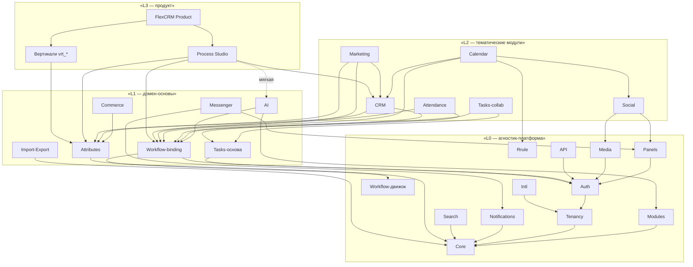

# B-38 — Карта кодовых модулей FlexCRM: реестр × слой D29 × владение префиксами × DAG

> **Дополнение 2026-09-10 (D37/ADR-002):** D29 и владельцы доменов сохраняются. К L3 добавлены самостоятельные composition roots solutions/<industry>; общие пакеты не зависят от них. Composition root выбирает packages и Nuxt layers; отдельная account DB в каждом deployment. Межрешенческие общие данные только через owner API. По D38 первый состав solutions — пустые каркасы с общей базой (P10–P12); cns_ и отраслевые таблицы не создаются и не резервируются. До реализации — утверждение всей БД в FLEX-2 P9.3.

> Blueprint (FLEX-2 P8.3, директива владельца D30). Форма-прецедент —
> `Edufy/plans/EDUFY-2/root/10_design/19_MODULE_MAP.md` (реестр + владение таблицами + DAG +
> правило роста; форма, не содержание — R-36 §9.1). Входы: R-36 §9.1 (5 входов — все с вердиктом,
> §1.2), B-01 §10 (состав продукта) + §2.2–2.3 (карта пакетов, extension model), D29 (доктрина
> слоёв), `60_contracts/DB_SCHEMA.md` **FROZEN v1.2** §2 (реестр префиксов — источник истины по
> владению), B-23 §1.3 + B-24 §2 (editions), B-27..B-36 (модули волны 2, блоки «Зависимости»),
> B-37 §4.3–§4.4/§5.5 (классы модульных экранов, CI-состав, API-ресурсы), C-02 §1 (границы
> модуля-пакета), C-06 §2/§7 (app-скелет, ui-kit), `phases/P6.md` (трассировка майлстоунов),
> `package-contribution-protocol` (Rule of Three). Дата: 2026-07-27. Статус: актуален
> (consistency-сверка — P8.5).
>
> **Имена пакетов** — по мэппингу **D29** (`corex/*` = агностик-платформа L0 + домен-основы L1;
> `flex/*` = тематические модули L2; продукт = композиция L3). Тексты блюпринтов волны и ячейки
> FROZEN §2 несут до-D29 имена — в карте даётся ЦЕЛЕВОЕ имя, старое — сноской «(бывш. X)» при
> первом упоминании; физическая правка текстов — на scaffold-item'ах (D29).

---

## 1. Как читать карту

### 1.1 Определения

- **Пакет** — composer-единица дистрибуции (`type: corex-module`, C-02 §1); **модуль** — единица
  активации в аккаунте (один пакет = один модуль, state-машина `mod_modules`); **компонент** —
  UI-примитив внутри модуля с 3-уровневым переопределением (терминология B-01 §2.3/D14, не
  переоткрывается).
- **Слой D29:** `L0` — агностик-платформа (не знает ни одного домена Flex); `L1` — домен-основа
  без продуктовой семантики (аналог iblock D7); `L2` — тематический модуль экосистемы Flex;
  `L3` — продуктовая композиция (app-слой FlexCRM). Cross-ecosystem пакеты (AzGuard, chatom/core,
  vaulter/core, statecraft) — **standalone**, вне D29-нумерации (радар §4.7); в DAG входят через
  owner-модуль (§2.3).
- **Владение таблицей = владение префиксом**: писать в таблицу может ТОЛЬКО модуль-владелец;
  один префикс — ровно один владелец. Источник истины — `DB_SCHEMA.md` FROZEN v1.2 §2; карта
  подстраивается под FROZEN, не наоборот. Пере-приписки на уровне отдельных таблиц (внутри
  чужого префикса) — только те, что ЯВНО названы ячейкой FROZEN (§5: `crm_`), прецедент формы —
  Edufy §1 («исторический префикс ≠ владелец»).
- **Зависит от (Contracts)** — рёбра DAG §3: обращение исключительно через публичную поверхность
  модуля-владельца (фасады/DTO/события, C-02 §1). Импорт внутренних классов чужого модуля и
  прямой доступ к чужим таблицам (Eloquent/Query Builder/raw SQL) — запрещены в обе стороны
  (R-36 §9.1 вход 1/3). FK между модулями на уровне БД допустимы (один PostgreSQL), но FK ≠
  право доступа из кода.
- **CI-состав** — членство в множестве модулей, чьи Inertia-страницы агрегируются в общий
  Vite-граф дистрибутива на этапе CI-сборки (третий класс экранов B-37 §4.4). Границу владеет
  ЭТА карта (колонка `CI` §2.1): `CI` — first-party, страницы в общей сборке; `панель` — UI
  только Filament-ресурсами/панелями/бандл-виджетами (классы (а)/(б) B-37 §4.3);
  `post-install` — устанавливается через RegHub после сборки, Inertia-страницы декларировать
  НЕ может (правило-кандидат `module.lint`, B-37 §4.3); `—` — UI нет.
- **P6.x** — трассировка карта→майлстоун (`phases/P6.md`); «вне волны» — явная пометка, что
  реализация модуля не покрыта майлстоунами FLEX-2 (реестр таких случаев — §8).

### 1.2 Входы R-36 §9.1 — вердикты (5/5)

| № | Вход R-36 §9.1 | Вердикт |
|:-:|:--|:--|
| 1 | DAG — только через Contracts; циклы разрешаются введением контракта | **Принят** — §1.1/§3; правила стыков §3.3 |
| 2 | Shared kernel — закрытый список + правило пополнения; папки-свалки запрещены как класс | **Принят** — §7 |
| 3 | Владение таблицами = владение префиксом; сверка с FROZEN построчно | **Принят** — §1.1/§5 |
| 4 | Слои D29 → Deptrac-слои: карта даёт каждому модулю слой, конфиг C-07 — проекция | **Принят** — колонка «Слой» §2.1; ruleset — C-07 §5 |
| 5 | Трассировка модуль↔майлстоун + пометка «дом: пакет / app-слой» по вердикту Q-кандидата №1 | **Принят** — колонка «P6.x» §2.1; вердикт дома app-модулей — §4.2 |

---

## 2. Реестр модулей

### 2.1 Основной реестр

Покрытие: 100% состава FlexCRM B-01 §10 (core, tenancy, auth, crm, tasks, workflow(+конструктор),
ai(+агенты), messenger, media, api, search, notifications, attributes(ddl), Vaulter, вертикали)
+ всё, что добавила волна 2 (attendance, маркетинг, календарь, social, tasks-collab, process
studio, commerce-DB, intl, provisioning/tenancy, workflow, import-export, поиск/уведомления/
media — сверены, мессенджер, вертикали). Самопроверка покрытия — §2.4.

Колонка «Edition» — по B-24 §2 (FlexCRM) / B-23 §1.3 (кросс-продукт); «обязателен» = engine-ядро
продукта, `FeatureRegistry` не гейтится. Колонка «Опц.» — обязателен/опционален для FlexCRM;
для каждого «опционален» §2.2 называет деградацию (иначе он не опционален).

| Модуль | Ответственность | Слой | Пакет (vendor/name) | Владение префиксами/таблицами | Зависит от (Contracts) | Edition | Опц. | CI | P6.x |
|:--|:--|:-:|:--|:--|:--|:--|:--|:--|:--|
| Core | DI/Contracts, EntityRegistry, Settings, Audit, Feature Flags, департаменты (ltree) | L0 | `corex/core` | `sys_` (6) | — | обязателен | обяз. | панель | P6.3 |
| Modules | модульная система: манифест, lifecycle state-машина, реестр владения, RegistryCompiler | L0 | `corex/modules` (бывш. `flex/modules`) | `mod_` (3) | Core | обязателен | обяз. | — | P6.3 |
| Tenancy | multi-DB tenancy поверх stancl v4: root-реестр парка, провижининг, TenantContext, workspaces | L0 | `corex/tenancy` | `wsp_` (3, +`users`); `root_` (18, схема root-реестра; эксплуатация — control-plane, P6.25) | Core | обязателен (cloud) | обяз. | — | P6.4/P6.5 |
| Auth | RBAC-надстройка AzGuard: матрица role×entity×action×scope, permission keys | L0 | `corex/auth` | `aut_` (3) | Core, Tenancy | обязателен | обяз. | — | P6.4 |
| UI Kit | бездоменные Filament/Vue-компоненты, design-токены продуктового UI (C-06 §7) | L0 | `corex/ui-kit` | — | — | — (foundation) | обяз. | — | вне волны (§8 п.4) |
| Rrule | RRULE-обвяз (обёртка `rlanvin/php-rrule`) для recurrence календаря/задач | L0 | `corex/rrule` | — (библиотека, таблиц нет; §5 `cal_`) | — | — (foundation) | обяз.¹ | — | P6.13 |
| Media | файлы/конверсии/связи | L0 | `corex/media` | `med_` (3) | Core, Auth | обязателен | обяз. | панель | P6.9 |
| Search | полнотекст/фасеты (Meilisearch за абстракцией) | L0 | `corex/search` | — (индексы вне PG; dirty-флаги у владельцев данных) | Core | не задокументирован (B-23 §9-Q2) | обяз. (состав B-01 §10) | — | вне волны (§8 п.3) |
| Notifications | уведомления/доставки/настройки/дайджесты | L0 | `corex/notifications` | `ntf_` (4) | Core | обязателен | обяз. | панель | P6.9 |
| API | REST-слой: авто-ресурсы из EntityRegistry, носитель `/api/v1` (B-37 §5) | L0 | `corex/api` | — | Core, Auth | обязателен (мобильная дверь A2) | обяз. | — | вне волны (§8 п.3) |
| Panels | реестр типов панелей спутников («панель на сущности», B-16 §2.1) | L0 | `corex/panels` | `pnl_` (1) | Core, Auth | обязателен | обяз. | — | P6.9 |
| Intl | i18n UI-переводов, locale-резолюция, гео-справочник, fx-курсы, money-форматирование | L0 | `corex/intl` | `geo_` (3), `fx_` (1) | Core, Tenancy | обязателен (деньги/локали) | обяз. | — | P6.14 |
| DB-Ops | maintenance/архивация/integrity-sweep/tenant-health (B-26) | L0 | `corex/db-ops` | `ops_`/`archive_`/`integrity_`/`tenant_health_` (5) | Core, Tenancy | — (эксплуатация) | обяз. (cloud-ops) | — | вне волны (§8 п.3) |
| Workflow-движок | durable-интерпретатор JSON-графа, версии, wakeup, ASL-ретраи (B-12) | L0² | `flex/workflow` | `wfl_` (13) | — (агностик; statecraft — §2.3) | pro (движок — B-24 §2 строка workflow) | обяз.¹ | — | P6.6 |
| Workflow-binding | binding движка → CoreX: EntityRegistry-триггеры, AzGuard-скоупы, общий wakeup-канал (B-12 §1.1, B-29 §3.8) | L1 | `corex/workflow` | — | Core, Auth, Workflow-движок | см. движок | обяз.¹ | — | P6.6 |
| Attributes | кастомные поля: реестр `fld_*`, `Extend\EntityField`, драйверы ddl/eav/jsonb, `cst_<slug>` | L1² | `flex/attributes` | `fld_` (9, +`cst_<slug>`) | Core | pro (`attributes.entities.custom_create`, B-23) | обяз. (движок; фичи pro) | — | P6.7 |
| Import-Export | универсальный импорт/экспорт, идемпотентный upsert, миграторы Б24/amoCRM | L1² | `flex/import-export` | префикс не зарегистрирован в FROZEN §2 (§8 п.2) | Core | standard (базовые миграторы OSS) | обяз. (онбординг) | — | P6.8 |
| Tasks-основа | задачи/проекты/спринты/тайм-логи — примитивы (B-13 §2.5) | L1 | `corex/tasks` (расщепление D29) | `tsk_` (8 базовых; collab-дельта — строка Tasks-collab) | Core, Modules, Auth, Workflow-binding (FSM статусов через statecraft — §2.3; B-13 §1.2) | обязателен | обяз. | CI³ | P6.10 |
| AI / Agentic | agentic surface: агенты/threads/turns/tool-calls, AiGateway, ToolRegistry → runtime + MCP | L1 | `corex/ai` | `ai_` (11) | Core, Modules, Auth, Workflow-binding | пресетные агенты по edition (B-24 §2); квоты — отдельная ось | обяз. (B-01 §10) | CI³ | P6.15 (+app P6.22) |
| Messenger-binding | драйвер `local` chatom/core (таблицы `cht_` в БД аккаунта), ChatomIo = opt-in remote | L1 | `corex/messenger` | — (владелец `cht_` — chatom/core, §2.3) | Core, Panels, Notifications; chatom/core (§2.3) | обязателен | обяз. | панель | P6.24 |
| Commerce | commerce-DB: каталог/склад/цены/заказы (B-14) | L1 | `corex/commerce` | `com_` (50; FROZEN-ячейка: продукт FlexStore — §5) | Core, Attributes (eav) | вне FlexCRM (B-23: «не входит») | не входит | — | P6.19 (экосистемный) |
| CRM | воронки/сделки/лиды/контакты/активности/timeline — тематическое ядро CRM | L2 | `flex/crm` (бывш. `corex/crm`) | `crm_` базовые ~24 (продуктовые read-models — пере-приписка app, §5) | Core, Modules, Auth, Attributes (ddl), Workflow-binding (StageTransitioner/statecraft — §2.3; B-13 §1.2) | обязателен (ядро) | обяз. | CI | P6.10 |
| Tasks-collab | коллаборация задач: соисполнители, чек-листы, шаблоны, recurrence, зависимости, КПД (B-27) | L2 | `flex/tasks` (расщепление D29) | `tsk_` collab-таблицы B-27 §2 (6; пере-приписка при расщеплении — на scaffold, §5/§8 п.6) | Tasks-основа, Workflow-binding, Auth, Notifications | обязателен (в составе tasks) | обяз. | CI | P6.11 |
| Social | соц-контур: посты/реакции/упоминания/группы/опросы (B-28) | L2 | `flex/social` (бывш. `corex/social`) | `soc_` (11) | Core, Auth, Panels, Notifications, Media | строки в B-24 §2 нет (§8 п.5) | опц. | CI | P6.12 |
| Calendar | события/повторы/ресурсы/бронирования/напоминания/синк (B-29) | L2 | `flex/calendar` (бывш. `corex/calendar`) | `cal_` (12; единственный владелец таблиц — §5) | Rrule, Workflow-binding, CRM, Social, Auth, Notifications, Panels (capability-панели комментариев — B-29 «Зависимости модуля») | строки в B-24 §2 нет (§8 п.5) | опц. | CI | P6.13 |
| Marketing | кампании/сегменты/шаблоны/consent/suppression (B-30) | L2 | `flex/marketing` (бывш. `corex/marketing`; OSS + edition-гейтинг, D22) | `mkg_` (12) | Core, Attributes, Workflow-binding, CRM, Auth (+`corex/billing` — квоты cloud, B-30 «Зависимости»: контур control-plane P6.25, в реестре продукта §2.1 не значится и модулем FlexCRM не является; boxed — config, B-30 D10) | pro/enterprise (D22: base без mkg) | опц. | CI | P6.16 |
| Attendance | учёт рабочего времени: графики/фиксация дня/correction/absence/табель (B-36) | L2 | `flex/attendance` | `att_` (7) | Workflow-binding, Tasks-основа, Auth, Notifications | pro (`attendance.core`, D-лог P6.1) | опц. | CI | P6.21 |
| Process Studio | конструктор процессов + SmartProcess (СП) поверх движка; проприетарный | L3 | app-модуль `FlexCrm\Studio` (path-пакет app-репы, §4.2) | — (движок `wfl_`, СП-сущности `cst_<slug>` через Attributes; своего префикса нет) | Workflow-binding, Attributes, Modules, CRM, Auth; мягкая — AI (ai-узел) | pro (конструктор — проприетарный bridge, B-24 §2) | опц. | CI | P6.20 |
| FlexCRM Product | продуктовая композиция: Bridges (онбординг/брендинг), продуктовые read-models B-24 §7, inbox `crm_conversations`, `vrt_installs` | L3 | app-репа `flexcrm-app` | пере-приписанные `crm_`-таблицы B-24 §6–§7 (§5); `vrt_installs` (префикс не в FROZEN — §8 п.1) | все установленные модули | n/a (сам продукт) | обяз. | CI | P6.17/P6.18/P6.22 |

¹ «обязателен транзитивно»: сам модуль пользователю не виден, но обязателен в составе, потому что
от него зависят обязательные модули (Rrule ← Calendar/recurrence задач; Workflow-движок/binding ←
CRM-автоматизация, cadence, wakeup-канал задач/календаря — B-29 §3.8).
² Слой присвоен по СОДЕРЖАНИЮ (агностик-движок / домен-основа); vendor-имя `flex/*` — до-scaffold
(D29: дом `flex/workflow`/`flex/attributes`/`flex/import-export` пересматривается на
scaffold-item'ах — кандидаты `corex/*` или standalone). Смена вендора ≠ смена строки карты (D18).
³ CI-членство означает право на Inertia-страницы в общей сборке; для Tasks-основы/AI поверхность
v1 — экраны приносит L2/app-слой (flex/tasks, agentic-чат app P6.22), пакеты сами страниц не несут
— членство закреплено за их UI-носителем.

### 2.2 Опциональные модули — что деградирует при отсутствии

Опциональность обязана быть реальной (Code Guidance P8.3): для каждого «опц.» — что теряется и
что НЕ ломается. Механизм — модуль не enabled ⇒ его роуты/классы не зарегистрированы (C-06 §2.3
шаг 4), capability-discovery `/api/v1/meta/capabilities` отражает отсутствие (B-37 §5.2).

| Модуль | Деградация при отсутствии | Что не ломается |
|:--|:--|:--|
| Social | нет ленты/групп/опросов; `group_id` задач не назначаем; календарь без `owner_type='group'` | задачи/CRM/календарь личный — полностью |
| Calendar | нет календарного представления/бронирований/напоминаний-RSVP | `crm_activities` (timeline) живут своей таблицей в CRM |
| Marketing | нет сегментов/кампаний/цепочек | CRM-ядро, формы → lead напрямую |
| Attendance | нет графиков/табеля/фиксации дня | тайм-логи задач (`tsk_`, B-13) не зависят — B-36 §10: read-only join |
| Process Studio | нет конструктора/СП; workflow-движок доступен только пресетам продукта | сам движок и FSM статусов |
| Commerce | не входит в FlexCRM v1 (состав FlexStore) | — |

### 2.3 Стыки внешних пакетов — owner-модули (правило one-owner)

Адаптер внешнего/standalone пакета живёт РОВНО в одном модуле-владельце, остальные потребляют
через его фасад (форма — Edufy §3.2; размазывать SDK-вызовы по модулям запрещено):

| Пакет | Owner-модуль | Потребители через фасад owner'а |
|:--|:--|:--|
| **AzGuard** | Auth | все модули (через Gate/permission keys `{module}.{entity}.{action}`) |
| **stancl/tenancy v4** (пин `dev-master#<sha> as 4.0.0`, D12) | Tenancy | никто напрямую (TenantContext — контракт Core) |
| **chatom/core** (standalone) | Messenger-binding | панели-каналы для чужих сценариев — фасад Messenger |
| **vaulter/core** (standalone; C1: ≡ `axioma-studio/vaulter-core`) | Panels (панельный контракт B-16 §2.4) | файлы/документы сущностей — через capability-панель |
| **statecraft** | Workflow-binding (B-12 §3.7) | Tasks (FSM статусов), CRM (StageTransitioner) |
| **rlanvin/php-rrule** | Rrule | Calendar, Tasks-collab (recurrence) |
| **spatie/laravel-translatable · brick/money · symfony/intl** | Intl (B-35 §1.3) | все, кто форматирует деньги/переводы |
| **laravel/ai · laravel/mcp** | AI (за контрактами corex/ai, B-32 §1.3) | никто напрямую |
| **Meilisearch** | Search (за абстракцией) | владельцы данных ставят dirty-флаги, не зовут индекс |

### 2.4 Самопроверка покрытия

- Состав B-01 §10 (FlexCRM, 15 позиций): core ✅ tenancy ✅ auth ✅ crm ✅ tasks ✅
  workflow(+конструктор) ✅ (движок+binding+Studio) ai(+агенты) ✅ messenger ✅ media ✅ api ✅
  search ✅ notifications ✅ attributes(ddl) ✅ Vaulter ✅ (§2.3, панельный стык) вертикали ✅ (§2.5).
- Волна 2 (перечень ТЗ P8.3): attendance ✅ маркетинг ✅ календарь ✅ social ✅ tasks-collab ✅
  process studio ✅ commerce-DB ✅ intl ✅ provisioning/tenancy ✅ attributes ✅ workflow ✅
  import-export ✅ agentic/ai ✅ поиск ✅ уведомления ✅ media/Vaulter ✅ мессенджер ✅ вертикали ✅.
- Каждая строка §2.1 несёт слой, владение (или явное «—»), рёбра, edition-факт или ссылку на
  пробел (§8), пометку P6.x или «вне волны».

### 2.5 Вертикали `vrt_*` — НЕ строки общего реестра

Вертикаль — не модуль реестра §2.1 (Code Guidance P8.3), а отдельный класс расширения app-слоя
(B-13 §2.6, B-24 §5): двухуровневая — YAML-пресет-манифест (сущности/поля/воронки/процессы/роли/
агенты/сиды, идемпотентный installer) либо composer-приложение с кодом. Правила:

- Устанавливаются/деактивируются per-account через `VerticalInstaller` (B-13), реестр установок —
  `vrt_installs` (B-24 §5), отдельный механизм гейтинга (не `licensed_features` — B-23 §1.2
  «vertical-only»); лимит — `vrt_installs_max` тарифа (B-24 §2).
- Поля расширяют ТОЛЬКО через `flex/attributes` (`Extend\EntityField`); прямой `ALTER TABLE`
  доменных таблиц запрещён (D27).
- Собственные таблицы вертикали — префикс `vrt_*` (конвенция B-01 §3); в FROZEN §2 префикс не
  зарегистрирован — §8 п.1.
- UI-класс: **post-install** (B-37 §4.3 — server-rendered/бандлы); Inertia-страницы вертикалям
  недоступны (они не в CI-составе по определению — ставятся из RegHub в готовую инсталляцию).
- В DAG вертикаль всегда лист: зависит от модулей состава, на неё не зависит никто.

---

## 3. DAG зависимостей

### 3.1 Топологический порядок (доказательство ацикличности перечислением)

Каждый модуль зависит только от стоящих ЛЕВЕЕ (по колонке «Зависит от (Contracts)» §2.1):

`Core` → `Modules` → `Tenancy` → `Auth` → `UI Kit` → `Rrule` → `Workflow-движок` → `Media` →
`Search` → `Notifications` → `API` → `Panels` → `Intl` → `DB-Ops` → `Workflow-binding` →
`Attributes` → `Import-Export` → `Tasks-основа` → `AI` → `Messenger-binding` → `Commerce` →
`CRM` → `Tasks-collab` → `Social` → `Calendar` → `Marketing` → `Attendance` → `Process Studio` →
`Вертикали vrt_*` → `FlexCRM Product`.

Проверено по каждой строке §2.1: ни одно ребро не указывает вправо — **циклов нет
(ацикличность: ✅)**. Потенциальный цикл `AI ↔ Workflow` (AI-шаг workflow vs wakeup) снят
канонической инверсией: AI-шаг регистрируется через `ActionRegistry` движка (B-12 §6 —
регистрация, не импорт), жёсткое ребро одно — `AI → Workflow-binding` (wakeup/шаг-регистрация);
у движка кодовой зависимости от AI нет (B-31: «мягкая: corex/ai… без него ai-узлы не
публикуются — валидатор»).

### 3.2 Граф несущих связей

Для читаемости опущены: рёбра `* → Core`/`* → Auth` (зависимость почти всех), рёбра
`* → Notifications` (событийные подписки) и рёбра `App → *` (композиция зависит от всех
установленных модулей). Полный источник истины рёбер — колонка «Зависит от (Contracts)» §2.1;
ацикличность доказывается порядком §3.1, не картинкой.

### 3.3 Правила стыков

1. **Только Contracts** (§1.1) — фасады/DTO/события; импорт внутренностей соседа — дефект.
2. **Чужие таблицы неприкосновенны** — чтение через фасад/read-model владельца, запись только
   владельцем; два модуля, обменивающиеся Eloquent-моделями напрямую, — нарушение, разрешается
   контрактом (R-36 §9.1 вход 1), не «ну они друг друга зовут».
3. **Восходящие связи — событиями**: реестр доменных событий волны — `slices/S3_contracts.md` §2;
   подписчик исполняет свою судьбу идемпотентным обработчиком, эмиттер подписчиков не знает.
4. **Цикл = дефект карты**: разрешается введением контракта (инверсия через Registry/событие) или
   переносом владения; решение фиксируется здесь (append) + D#-запись плана.
5. **Deptrac-слои = проекция колонки «Слой»** (R-36 §9.1 вход 4): запрет рёбер L0→L1+, L1→L2+,
   L2→L3 и запрет обратных рёбер DAG §3.1 — механический ruleset выводит C-07 §5, карта — источник.
6. **Замороженные контракты read-only**: дыра стыка → contribution-proposal по
   `package-contribution-protocol`, не самоправка пакета из потребителя.

---

## 4. Границы app↔пакет

### 4.1 Правило границы

Обязано жить в **app-репе FlexCRM** (L3): продуктовая композиция и bootstrap-порядок (C-06 §2.3),
Bridges (онбординг/брендинг/тонкие контроллеры — C-06 §2.2: единственное место непереиспользуемой
логики), продуктовые read-models B-24 §7, inbox `crm_conversations` (B-24 §6), вертикали и их
инсталлятор, edition-конфиг. Обязано быть **пакетом** (L0–L2): всё доменное и переиспользуемое —
«ничего доменного в `app/` не живёт» (C-06 §2.2, канон).

Критерии для нового кода:
- **Вынос проект → пакет** — `package-contribution-protocol`: Rule of Three (≥3 реальных
  потребителя), минимальный контракт, без обратной связи на продукт; сомнение → остаётся в app
  (дешевле поднять потом, чем выпилить из публичного контракта).
- **Вендор/слой** — D29: агностик → `corex/*` (L0/L1), тематика Flex → `flex/*` (L2),
  продуктовое → app (L3); финальный packagist-vendor — на scaffold-item'е (D18).

### 4.2 Вердикт: дом продуктовых модулей app-слоя (Q-кандидат №1 R-36 §7)

**Продуктовые модули FlexCRM (Process Studio, будущие проприетарные модули продукта) — path-пакеты
`packages/flexcrm/*` ВНУТРИ app-репы, не `app/Modules/*`.** Основания: (а) канон E1–E5 —
path-репозитории + симлинки, вся экосистема уже на этой механике; (б) C-06 §2.2 — в `app/` живут
только Bridges, доменное — всегда пакет; (в) единая анатомия C-02 §2 для first-party и
RegHub-модулей — один формат манифеста/lifecycle вместо двух; (г) CI-состав B-37 §4.4 собирается
Vite-glob'ом по пакетам одинаково для path- и composer-установленных. Альтернатива nwidart-стиля
(`app/Modules/*`) отклонена: второй формат модуля рядом с C-02 = два источника истины анатомии.
Физическая раскладка (`packages/` в дереве репы, симлинки, два режима dev/CI) — C-07.

---

## 5. Владение таблицами — сверка с FROZEN v1.2 §2 построчно

Правило: расхождение с FROZEN правится в карте, никогда в FROZEN. Статусы: **OK** — совпадение
байт-в-байт (с учётом D29-переименования пакета — это смена имени, не владельца);
**уточнение** — карта конкретизирует ячейку FROZEN, не противореча ей (реестр уточнений — §8).

| Префикс | FROZEN §2 (ячейка «Пакет/БД») | Владелец по карте | Статус |
|:--|:--|:--|:--|
| `root_` | корневая БД (control-plane) — пакет не назван | Tenancy (`corex/tenancy` — схема/миграции root-реестра, B-33 §1.3); эксплуатация — control-plane P6.25 | уточнение (§8 п.7) |
| `sys_` | corex/core | Core | OK |
| `mod_` | flex/modules | Modules (`corex/modules`, D29-rename) | OK |
| `wsp_` (+`users`) | corex/tenancy | Tenancy | OK |
| `aut_` | corex/auth | Auth | OK |
| `crm_` | corex/crm + flex FlexCRM | CRM (`flex/crm`, D29) — базовые ~24; продуктовые таблицы B-24 §6–§7 (`crm_conversations`, `crm_forecast_rollup`, `crm_activity_rollups`, health-override) — FlexCRM Product (пере-приписка на уровне таблиц, названная самой ячейкой) | OK (двух владельцев ОДНОЙ таблицы нет) |
| `tsk_` | corex/tasks (8) | Tasks-основа — 8 базовых; collab-таблицы B-27 §2 (6) — Tasks-collab после расщепления D29 (пере-приписка — на scaffold; до него владелец префикса един — corex/tasks) | уточнение (§8 п.6) |
| `com_` | flex FlexStore | Commerce (`corex/commerce` — пакет-носитель B-14); продукт-потребитель FlexStore; FlexCRM не устанавливает | уточнение (пакет ↔ продукт) |
| `fld_` (+`cst_<slug>`) | flex/attributes | Attributes | OK |
| `cms_` | flex FlexCMS | вне состава FlexCRM (карта не приписывает) | OK (вне карты) |
| `mkt_` | flex/marketplace | вне v1-состава FlexCRM (маркетплейс-инфраструктура экосистемы, B-20) | OK (вне карты) |
| `pnl_` | corex/panels | Panels | OK |
| `cht_` | chatom/core | chatom/core (standalone; owner-стык — Messenger-binding §2.3) | OK |
| `vlt_` | vaulter/core | vaulter/core (standalone; C1: ≡ axioma-studio/vaulter-core; owner-стык — Panels §2.3) | OK |
| `med_` | corex/media | Media | OK |
| `ntf_` | corex/notifications | Notifications | OK |
| `ops_`/`archive_`/`integrity_`/`tenant_health_` | corex/db-ops | DB-Ops | OK |
| `soc_` | corex/social | Social (`flex/social`, D29-rename) | OK |
| `cal_` | corex/calendar + corex/rrule | Calendar (`flex/calendar`, D29) — единственный владелец всех 12 таблиц; Rrule — вычислительная библиотека, таблиц не владеет | уточнение (§8 п.7) |
| `mkg_` | corex/marketing (OSS, edition-гейтинг D22) | Marketing (`flex/marketing`, D29-rename; D22 в силе) | OK |
| `att_` | flex/attendance (**app-модуль FlexCRM**, build-new, тенантская) | Attendance — пакет L2 `flex/attendance` (своя репа, C-07 §4.1 п.1), НЕ app-модуль репы продукта | уточнение (§8 п.10): имя пакета-владельца совпадает, расходится ДЕСКРИПТОР ячейки («app-модуль») — до-D29/до-B-38 формулировка из B-36 §3.0 «продуктовый модуль» в смысле «не `corex/*`» |
| `ai_` | corex/ai | AI | OK |
| `geo_` | corex/intl | Intl | OK |
| `fx_` | corex/intl | Intl | OK |
| `wfl_` | OSS-репа flex/workflow (vendor — scaffold) | Workflow-движок | OK |

**Сверено повторно на P8.5** (адверсариальная поколоночная перепроверка, C-99b §4.1): расхождений
владения не найдено; изменены два статуса — `att_` (OK → уточнение, дескриптор ячейки, §8 п.10) и
метка версии контракта (`v1.0` → `v1.2`: правки v1.1/v1.2 внесены делегатом COREX-CORE
(D94/D137/D138) и §2-индекса не касались — §8 п.9).

**Итог сверки:** 25/25 строк FROZEN §2 покрыты; **0 префиксов без владельца, 0 префиксов с двумя
владельцами** (пере-приписки `crm_`/`tsk_` — на уровне непересекающихся списков таблиц, у каждой
таблицы ровно один пишущий модуль). Обратное направление: таблицы карты, НЕ зарегистрированные в
FROZEN §2 — `vrt_installs`/`vrt_*` и таблицы `flex/import-export` (`ie_`) — зафиксированы как
пробелы РЕГИСТРАЦИИ (не владения) в §8 п.1–2; владельца они имеют здесь.

---

## 6. Правило роста — как добавляется N+1-й модуль

Чек-лист (все пункты обязательны, порядок значим; enforcement-механика — C-07 §5):

1. **Префикс зарегистрирован** в `DB_SCHEMA.md` §2 (владелец = ровно этот модуль) — ДО первой
   миграции; незарегистрированный префикс = блокер ревью (pre-mortem B1, D17).
2. **Слой определён** (L0/L1/L2/L3 по D29) и вендор выбран по критерию §4.1; спорный дом —
   вопрос scaffold-item'а (D18), не повод начать «где удобно».
3. **Место в DAG**: строка в §2.1 + позиция в §3.1; все рёбра — только влево; новое ребро вправо
   = редизайн зависимости (контракт/событие), не исключение.
4. **Contracts-only**: публичная поверхность (фасады/DTO/события) объявлена в `Contracts/` ДО
   реализации; потребители пишутся против неё.
5. **Edition-строка**: B-24 §2 (FlexCRM) / B-23 §1.3 (кросс-продукт) — статус
   обязателен/standard/pro/vertical-only; модуль без строки не попадает в дистрибутив.
6. **Lifecycle-хуки**: манифест C-02 §3, enable/disable/uninstall идемпотентны, uninstall без
   осиротевших таблиц/ассетов (донор-урок R-36 §6; порядок — C-02 §5.6).
7. **UI-класс объявлен**: CI (только first-party, решением в ЭТОЙ карте) / панель / post-install
   (B-37 §4.3–§4.4); post-install модуль, декларирующий Inertia-страницы, отклоняется lint'ом.
8. **Arch-тест**: Deptrac-слой + Pest `arch()` на границы (C-07 §5) — зелёные ДО merge.

**Что делает автора модуля неправым** (закрытый список дефектов, а не «особых случаев»): запись
в чужую таблицу; два владельца одного префикса; ребро DAG вправо; импорт внутренних классов
соседа; расширение доменной таблицы прямым `ALTER` вместо `flex/attributes` (D27); Inertia-страницы
в post-install модуле; пополнение shared kernel в обход §7; правка замороженного контракта
(FROZEN/B-канон) вместо proposal.

---

## 7. Shared kernel

**Закрытый список** (R-36 §9.1 вход 2 — Platform-аналог Edufy; всё, чего нет в списке, в ядро не
входит по умолчанию):

| Составляющая | Носитель | Содержимое |
|:--|:--|:--|
| Контракты платформы | `corex/core` | Contracts (TenantContext, Registry/morph-map), EntityRegistry, Settings, Audit Log, Feature Flags, департаменты (ltree), конвенции доменных событий |
| Extension-ярус | `corex/core` (реестр `Extend\*`) | ~8 типизированных extenders (B-01 §2.3): Entity, EntityField, Api, Filament, Menu, Permissions, Routes, Workflow |
| Бездоменный UI | `corex/ui-kit` (C-06 §7) | статус-бейджи, form-обёртки, design-токены продуктового UI |

**Правило пополнения:** (а) новый extender — только через RFC (вечный контракт ядра, B-01 §2.3);
(б) новый общий код — `package-contribution-protocol`: ≥3 реальных потребителя, минимальный
контракт, поведение вместо конфигурации; два потребителя — терпим дубль, ждём третьего;
(в) доменное знание (имя сущности продукта, бизнес-правило) в ядре запрещено — это признак, что
код принадлежит L1/L2-модулю. **Папки-свалки `Shared/`/`Support/`/`Common/` запрещены как класс**
(R-36 §6 — «общий Support-модуль-помойка» — главный описанный канал деградации shared kernel):
общий код либо проходит правило пополнения и получает имя по роли, либо остаётся дублем у
потребителей.

---

## 8. Открытые вопросы (зарегистрированы арбитражем P8.5)

> Регистрация выполнена: пп. 1–8 внесены в `FLEX-2/open-questions.md` как **Q86–Q93**
> соответственно; пп. 9–10 добавлены самим аудитом P8.5 → **Q98, Q99**.

1. **Префикс `vrt_` не зарегистрирован в FROZEN §2**, при этом канон B-01 §3 включает его в
   список префиксов, а B-24 §5 вводит `vrt_installs`. Кандидат-резолюция: регистрация строки
   `vrt_` (владелец — FlexCRM Product app-слой) аддитивной правкой §2 по approval-gate FROZEN;
   владение по карте уже однозначно (§2.5).
2. **Префикс `ie_` (flex/import-export) не зарегистрирован в FROZEN §2** (упомянут B-01 §3);
   состав служебных таблиц импорта (jobs/mappings) в DDL волны не заведён. Резолюция — на
   майлстоуне P6.8 (регистрация до первой миграции — §6 п.1).
3. **Модули состава без майлстоуна волны**: API (`corex/api` — носитель `/api/v1`, обязателен
   для мобильной двери B-37 §5/§6), Search, DB-Ops. Либо пробел P6 (нужен майлстоун/явное «в
   составе P6.17–P6.18»), либо явное «вне волны» решением владельца — арбитраж P8.5, проверка (з).
4. **`corex/ui-kit` без майлстоуна**: заводится фактически на P6.17 (scaffold) — зафиксировать
   принадлежность явно (сейчас «вне волны» в §2.1 — по букве P6); governance-вопрос владельца
   пакета уже открыт (C-06 §9 п.4).
5. **Edition-строки B-24 §2 отсутствуют** для Social, Calendar, Process Studio (маркетинг — D22
   принял решение, но строка в таблицу B-24 §2 не внесена; attendance — D-лог P6.1 внёс).
   Кандидат-резолюция: аддитивные строки B-24 §2 на P8.6 (vault-исполнение), решения по тирам —
   владелец.
6. **Индекс FROZEN §2 `tsk_` = 8** не отражает collab-дельту B-27 (6 таблиц тем же префиксом;
   field-level FROZEN «зеркалит блюпринт §2» — B-27 покрыт по этому правилу, но счётчик индекса
   не пересчитан). Уточнение-кандидат аддитивной правки счётчика; владение однозначно (§5).
7. **Две ячейки FROZEN §2 требуют уточняющей правки** (не владения): `root_` — пакет-владелец
   схемы не назван (карта: Tenancy); `cal_` — названы два пакета (карта: владелец таблиц —
   Calendar, Rrule таблиц не имеет). Аддитивные уточнения по approval-gate FROZEN.
8. **Расщепление `corex/tasks`/`flex/tasks` (D29)** — пере-приписка collab-таблиц `tsk_`
   новому владельцу выполняется на scaffold-item'е расщепления; до него владелец префикса един.
   Проверить на P8.5, что P6.10/P6.11 Scope не противоречат расщеплению. — *Проверено P8.5
   (C-99b §4.8): P6.10/P6.11 расщеплению не противоречат (текстов `corex/tasks`/`flex/tasks`
   как ДВУХ реп в их Scope нет), но и не называют его — правка Scope на P8.6.*
9. **Метка версии FROZEN-контракта.** Карта (и вся фаза P8) писалась против метки `FROZEN v1.0`;
   действующий `DB_SCHEMA.md` — **v1.2** (v1.1 2026-07-26 `root_account_products.product`
   product-agnostic, D94; v1.2 2026-07-27 `actor_type` + `support`, D137/D138 — обе правки внёс
   делегат COREX-CORE под владельческим approval-gate). Ни одна не касалась §2-индекса, поэтому
   сверка §5 остаётся валидной. Вопрос процесса: **дельты замороженного контракта, вносимые
   делегатом, в FLEX-2 (доме контракта, D17/D20) не регистрируются ничем** — ни D-логом, ни
   Update Log. Кандидат-резолюция: строка-зеркало в D-логе FLEX-2 на каждую правку FROZEN.
10. **Дескриптор ячейки `att_` в FROZEN §2** — «flex/attendance (**app-модуль FlexCRM**,
    build-new, тенантская)»: имя пакета-владельца совпадает с картой, но дескриптор «app-модуль»
    противоречит слою L2 и вердикту дома (C-07 §4.1 п.1: L2 → своя репа пакета). Источник
    формулировки — B-36 §3.0, где «продуктовый модуль» означало «НЕ пакет-обёртка `corex/*`»
    (до D29, когда `flex/*` ещё не было слоем). Кандидат-резолюция: аддитивное уточнение ячейки
    по approval-gate FROZEN (владения не меняет).

---

## 9. Связи

- **Входы карты:** B-01 §10/§2.2–2.3 (состав, пакеты, extension model) · D29 (слои, renames) ·
  `DB_SCHEMA.md` FROZEN v1.2 §2 (владение — источник истины) · B-23 §1.3 + B-24 §2 (editions) ·
  B-27..B-36 §«Зависимости» (рёбра DAG) · B-37 §4.3–§4.4/§5.5 (классы экранов, CI-состав,
  API-ресурсы = проекции Action'ов модулей карты) · C-02 §1 (границы модуля) · C-06 §2/§7
  (app-скелет, ui-kit) · `phases/P6.md` (майлстоуны) · R-36 §9.1 (входы — §1.2).
- **Выходы карты:** C-07 (P8.4) — дерево app-репы раскладывает СПИСОК ЭТОЙ карты; Deptrac-ruleset
  C-07 §5 — проекция колонки «Слой» и рёбер §3 (R-36 §9.1 вход 4); B-37 §4.4 — финальный список
  CI-состава = колонка `CI` §2.1; B-37 §5.5 — состав ресурсов `/api/v1` определяется модулями
  карты; P6.17–P6.22 — Required Reads (приземление на P8.6).
- **Не переоткрывается здесь:** DDL (FROZEN), анатомия модуля-пакета (C-02 §2), топологии реп
  (C-06 §2.1), механизм editions (B-22/B-23), lifecycle (C-02 §5), дистрибуция (C-05).
- **Consistency-сверка:** P8.5 — проверки (а) владение vs FROZEN, (б) DAG vs §контракты
  блюпринтов, (ж) слои D29, (з) P6.17–P6.22 vs эта карта; реестр §8 → Q81+.
