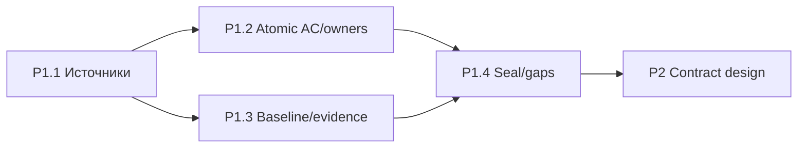

# P1 — Freeze требований, provenance и владельцев

## Phase Context

**Обязательный design gate (D4):** до принятия детализации этой фазы — Perplexity RAG с ≥2
независимыми первоисточниками для ключевых решений, research/P1-design-rag.md и фактический
response artifact/digest; alternatives и cross-phase impact в единой research/05-integrated-design.md.
До исполнения любого item должны быть детализированы все P1–P11 и пройти общий design-finish.
При дизайне future producer artifacts описываются как contracts; их actual GREEN нужен при
исполнении. До product mutation — scripts/task-check.py --check design.

RAG:— Верхний scope принят D2: 52 строки R01–R52, 365 исходных AC/criteria и A01–A09.
P1 превращает proposal catalogue в проверяемый requirements-lock: сохраняет source bytes,
разделяет mixed criteria на механизм и policy, проверяет эквивалентное поведение в текущем
коде и назначает каждому непокрытому условию владельца, required receipt и resume predicate.
Фаза выпускает основание для P2; точные сигнатуры и выбор новых dependencies принадлежат P2.
Прочитанный тест не считается выполненным, local installed candidate не считается release,
а известный external gap не превращается в CoreX runtime feature.
Рабочие FlexCRM/vault sources сохраняют исходную provenance даже после коммита копии в CoreX.

> **Контракт фазы (contract-first).** Потребляет: owner brief, D1/D2, 100 source-inventory records, R/AC catalogue и baseline receipts · Производит: sealed requirements-lock, classified atomic AC map, evidence ledger, conflicts и bounded downstream gaps · Границы: плановые evidence artifacts; runtime/API/DDL/dependencies/releases и чужие originals вне записи.

> **Phase Assurance | v1.**
> Impact: internal-integration
> Integration Seams: source-blob-to-snapshot · mixed-ac-to-domain-owner · equivalent-code-to-bounded-receipt · qualified-gap-to-downstream-phase
> Live or Irreversible: no
> Audit Intent: direct-close-eligible
> Rationale: каждый seam имеет digest/coverage check и отдельную содержательную сверку по item contract. Нет runtime, authority или deployment mutation; GREEN относится только к freeze. Phase audit требует отдельного owner-bound admission.

## Scope Included

- Все R01–R52, включая APP/EXTERNAL/EXCLUDED и cross-cutting R52; все 365 parent criteria без утраты исходного текста.
- Committed/working/archive reconciliation 100 источников; каждый working claim — bound source либо явный proposal.
- Наблюдаемое поведение, доступные tests/receipts, A01–A09, E1–E5 и cohort boundaries.
- Все G-* obligations, 34 DI и 13 AP с owner/required receipt/resume; уточнение известной строки сохраняет её R-ID.
- Decision-ready conflicts, минимальные qualified gaps/no-delta и независимый non-CRM consumer scenario для CoreX delta.

## Scope Excluded

Runtime, Contracts, DDL, Composer/SDK updates, package publication, CI dispatch, live/private credential access;
запись в Brain/FlexCRM/AzGuard/central/cloud, закрытие FLEX-2 milestones, новый product scope.
Новые signatures/DTOs/packages и фактическая external acceptance проектируются/исполняются в последующих фазах.

## Dependencies

Нет executable predecessors. D1/D2 и source snapshots доступны; P1.1 производит source reconciliation.
P1.2 и P1.3 потребляют P1.1 независимо; P1.4 потребляет оба результата.

## Required Reads

1. plan.md; brief/00-owner-request.md; decisions/D1.md; decisions/D2.md; decisions/D3.md.
2. docs/dev-doctrine.md; research/04-architecture.md.
3. research/00-sources.md; artifacts/source-inventory.json; research/01-traceability.md; research/01a-acceptance-index.md; research/02-baseline.md; research/03-gates.md.
4. scripts/validate-p1.py; phases/P1/P1.1.md–P1.4.md; exact source/receipt reads и predecessor outputs указанного item.

## Files

Design artifacts: research/P1-design-rag.md; artifacts/P1-design/perplexity-response.json; affected rows research/05-integrated-design.md; own phase contracts/routing/views.

P1.1: findings/P1-source-reconciliation.md.
P1.2: findings/P1-acceptance-map.md.
P1.3: findings/P1-evidence-ledger.md.
P1.4: findings/P1-requirements-lock.md; findings/P1-conflicts.md; findings/P1-downstream-gaps.md.
Это конечные allowlists item-продукта. Journal/state/status/bundle/handoff/closure — owned bookkeeping;
отдельная consequential decision оформляется новым D-record в этом плане через обычный decision carrier.
Исходные research, source inventory, snapshots, delivery receipts и старые планы не переписываются.

## Validation

Из repository cwd: `python3 plans/2026.09.15-№1-COREX-FLEXCRM-REMAINING/scripts/validate-p1.py --stage <inputs|sources|criteria|evidence|seal>`
(PLAN-DIR заменяется точным ID текущего плана). Реальные copyable commands указаны в карточках.
Checker read-only, stdlib + git; каждый этап проверяет fixed inputs, а seal — оба квалификационных этапа
и hashes 11 frozen inputs. Он доказывает структуру/полноту, semantic coverage проверяется исполнителем
отдельно по контракту и фиксируется в Completion Notes. Последний item выполняет downstream/lint gates
после однократной регенерации views. Нет DB/product test run в P1: receipt reuse ограничен точным anchor;
непокрытая current quality остаётся именованным gap последующих фаз, D34/D98 сохраняются для code items.

## Deliverables

Шесть Markdown findings: source reconciliation, acceptance map, evidence ledger, requirements-lock,
conflicts и downstream gaps. Schema таблиц — scripts/validate-p1.py. Markdown владеет фактами;
JSON stdout — validation report. Lock не включает свой SHA и volatile journal/status/handoff.

## Routing

| Batch | Items | Model class/effort | Exec | Review | Почему |
|:--|:--|:--|:--|:--|:--|
| solo | P1.1 | implementation/medium | plan-exec | light | recommended: детерминированная provenance сверка; законченный source carrier необходим до раскрытия двух qualification inputs |
| B-P1-QUALIFY | P1.2 | frontier/high | plan-exec | light | recommended: общий frozen source/context; mixed ownership и эквивалентное поведение требуют Sol/high; ready subset допускается, parallel agents не требуются |
| B-P1-QUALIFY | P1.3 | frontier/high | plan-exec | light | recommended: общий frozen source/context; mixed ownership и эквивалентное поведение требуют Sol/high; ready subset допускается, parallel agents не требуются |
| solo | P1.4 | frontier/high | plan-exec | light | recommended: seal использует готовые AC и evidence carriers; содержательный freeze/check выполняется после обоих producers |

Root plan.md owns dispatch routing; эта таблица повторяет выбранные маршруты для чтения фазы.
Review light = executor semantic/self-check и механические gates; automatic audit/child не назначается.

## GREEN

**Единый измеримый критерий:** sealed lock содержит ровно 52 уникальных R; 0 R без
owner/disposition/evidence-or-named-gap/resume/destination; все 365 parent criteria имеют ≥1
classified atom либо явно сохранённый excluded atom; 0 потерянных source IDs/G-*/DI/AP,
0 необъяснённых mapping/cohort conflicts; seal hashes свежие, все четыре item Validation GREEN.
Named external/proposal gaps допускаются в freeze и сохраняются открытыми до owning acceptance.
Это GREEN P1, а не runtime/release/production acceptance и не разрешение реализовать неутверждённый branch.

## DoR

- [x] Созданы 4 stable item contracts, exact Files/Validation/Deliverables и R/AC coverage.
- [x] Scope/alternatives закреплены D3; inherited Q1–Q6 не существуют как decision records, эту prose-ссылку сняли.
- [x] Required fixed sources доступны и hash-qualified; RAG:— для repository facts.
- [x] D4/D5: successful Perplexity RAG P1 record, raw response/digest и primary verification сохранены.
- [ ] D4: все P1–P11 detailed и общий design-finish; P1.1 ещё не execution-admitted.
- [x] Routing покрывает 4 items; P1.1 technical bundle проверен; execution admission закрыта D4.

## Item Index

| Item | Specification | Coverage | Dependencies |
|:--|:--|:--|:--|
| P1.1 | [Source reconciliation](P1.1.md) | 100 sources; R01–R52/365 parent inputs | — |
| P1.2 | [Atomic AC и ownership](P1.2.md) | 365 parent criteria; R01–R52/non-AC sources | P1.1 |
| P1.3 | [Baseline/evidence qualification](P1.3.md) | R01–R52; A01–A09; E1–E5; G-*/34 DI/13 AP | P1.1 |
| P1.4 | [Lock/conflicts/downstream gaps](P1.4.md) | R01–R52 и все P1 outputs | P1.2, P1.3 |

## Phase Handoff

Execution state принадлежит generated status/state, closure — P1.closed.md. Design completion не закрывает
фазу. После GREEN P1.4 следующая рекомендация — plan-exec P2.1 (P2 уже detailed; общий D4 finish обязателен); эта карточка не запускает successor.
