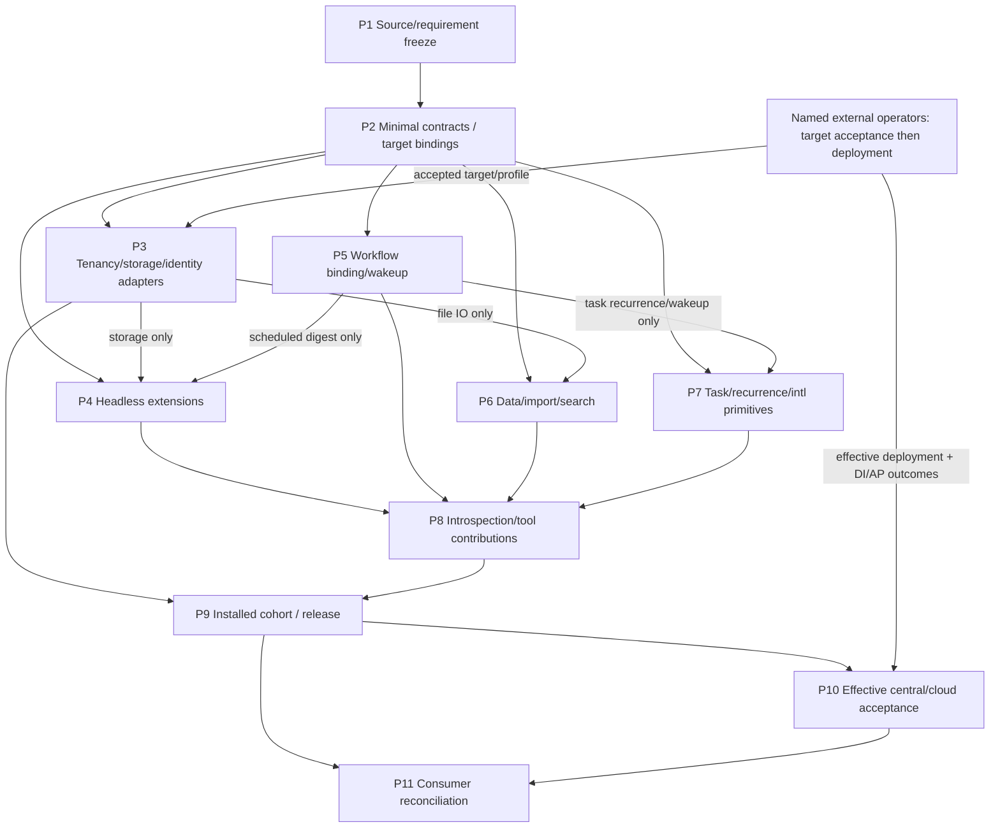

# Порядок по зависимостям

Номер — навигация, а не permission на выполнение. Gate inputs применяются к affected subgraph.

Сначала P1→P2. Затем Sol выделяет независимые subsets P3–P7. P8 принимает только contributions
из frozen requirements-lock; отсутствие будущего product module не блокирует generic SPI.
Pure recurrence/locale/money не зависят от live central; media ждёт storage, а не membership AP.
P5 standalone engine proof не требует CoreX: это ломает ложный dependency cycle.
P2 target-contract approval предшествует P3 adoption; effective deployment использует P9 release
и предшествует P10 AP. Подготовка внешних операторов может идти раньше; execution authority
выдаётся в их owning scope. Никакое такое упоминание не запускает стороннего агента/оператора.

P9 замыкает **все included** local results P3–P8 (транзитивные связи на схеме). P10 сохраняет
полный набор DI/AP. P11 не может быть GREEN при unresolved R или missing G-CONSUMER.

## Итог финальной фазы

Future owning FlexCRM handoff должен содержать точную инструкцию:

> Для frozen requirements-lock PLAN1 все CoreX-зависимости приняты на перечисленных immutable
> pins и закрытых acceptance receipts. Дальнейшая разработка выполняется только в FlexCRM.
> Возврат за доработками CoreX допускается лишь для будущих отдельно согласованных требований.

Это **целевой deliverable P11**, не текущее заключение. App/flex modules/standalone integrations
могут оставаться незавершёнными. Если текущий R всё ещё требует CoreX, P11 остаётся открытой:
его нельзя переименовать в «будущее требование» или объявить out of scope ради этой команды.

## P3 execution subsets (D8; execution only after D4 finish)

P2.4→P3.1/P3.2/P3.3; P3.3→P3.4→P3.5 and P3.3→P3.6; all six→P3.7→P9.
P4/P6 file IO may consume accepted findings/P3-storage-context.md after P3.1; no dependency on
membership target deployment. B-P3-LOCAL and B-P3-IDENTITY are recommendations, not atomic groups.
Each affected gate respected; no successor/child launched during design. All P1–P11 contracts are detailed; D17 governs whole-plan corrections.

## P4 execution subsets (D9; after full design-finish only)

P2.4→P4.1/P4.2/P4.4/P4.7 core-only; P3.1 supported storage→P4.2→P4.3.
P4.1→P4.7 modules schema adapter; P4.4→P4.5→P4.6; accepted P5 local_sweep wakeup→P4.6 only.
All seven→P4.8 installed neutral receipts/seal→P8/P9; P9/P10→P11 immutable acceptance.
B-P4-MEDIA and B-P4-NOTIFICATIONS are recommended reusable context groups,
ready dependency-safe subsets allowed, no agent orchestration implied. Core-only view branch,
pure notify/channel and panels don't wait central/membership deployment. Current finish readiness is checked by task-check.py --check design.

## P6 execution subsets (PLAN1.D11; after full design-finish only)

P2→P6.1→P6.2→P6.3; P2→P6.4→P6.5; P2→P6.6→P6.7; all seven→P6.8→P8/P9.
P3.1 supported storage only file IO; stream/static PG independent. Dynamic-field and P4.7 saved-view
grammar integration conditional; no P3.2/P4/P5 runtime reverse edge. Missing required external
engine ABI/source gates only engine subset, no source-qualified NO-GO completes R11. Groups
B-P6-FIELDS/B-P6-TRANSFER/B-P6-SEARCH recommended context reuse, safe ready subsets admitted.
All product items remain Not started; D17 and current finish seal govern execution admission.

## P7 execution subsets (PLAN1.D12; after full design-finish only)

P2→P7.1→P7.2/P7.3/P7.5/P7.6; P7.1+P7.5→P7.7; P7.2+P7.3+P5.2→P7.4, optional P5.4current binding gates onlyFSM. P7.5+P7.7→P7.8 selected P6/P4/consumer-driver capabilities; all8reports→P7.9 installed5Rseal→P8/P9/P10/P11. Pure recurrence/money/locale/reference do not await central membership/Meili/engine. B-P7-INTL shared setup recommended, Files overlaps sequential same-root writes and commonDTO frozen, no child agents. Source/driver/import/install conformance70actual cases,45mixed original parents retained; D17 whole-plan corrections apply; no runtime execution in authoring.

## P8 execution subsets (PLAN1.D13; after D4 finish)

P1/P2→P8.1source→P8.2declarations→P8.3catalogue→P8.4guard; P8.1→P8.5modules-onlydiagnosticindependent; P8.4+onlyactuallyselectedP3–P7contributions→P8.6; all6→P8.7coldinstalled3Rseal→P9/P10/P11. BatchB-P8-TOOLSrecommendedreadyorderedsubset,nosiblingengine/productmodule/centralwaitforgenericread.7specs/56cases/49parents/19externalnames,currentpolicy/finaldomainauthority/typedoutcomes/offlineschemabudgets; no automaticendpoint. All runtime items Not started; actual full design-finish is required before execution.

## P10 execution subsets (PLAN1.D15; after full D4 finish)

P10.1 actual source/released intake + prepared verifier → independent recommended B-P10-TARGETS P10.2/3 and P10.8 actual ops. Accepted/effective central+cloud targets → recommended B-P10-AP P10.4/5, independent P10.6 FE and P10.7 current closed-month census. All8 → P10.9 effective same-cohort seal → P11. Monthly/external receipt wait does not delay independent ready subsets. All imports/read-only, no remote operation/foreign/private grant. Missing required receipt nonterminal owning wait/repair; no preparation-only GREEN or redundant discovery. Every branch still exact local item receipts, no audit consent from grouping/review.

## P11 execution subsets (PLAN1.D16; after full D4 finish)

P1/P2 actual selected atoms + included P3–P8 seals + P9 released vector + P10 effective complete seal → P11.1 intake/verifier → recommended B-P11-QUALIFY P11.2 pins → P11.3 actual consumer tests → P11.4 complete52R/365parents/positive selected atom ledger → P11.5 ready three-file packet → authenticated G-CONSUMER-RECONCILE manual P11.6 owning write/consumer commit → P11.7 final seal. R47 final result no prerequisite self-edge; R52 invariant checked here. Foreign only immutable acceptance/progress append/handoff, no source/lock/schema/state/milestone writes.46cases; D17 whole-plan review/current finish seal applies, all execution Not started.

## D17 shared foundation and release edges

Shared core DTOs have finite serial first-consumer ownership P6.2/4/6 or P7.4/6/7;
findings/shared-data-foundation.md is produced once and hash-checked by later consumers.
No forced engine edge or concurrent shared writes. Exact protocol is in P6 stable design.
P4.4 NotificationChannelDriver precedes P4.5; P5.2+P4.4/5→P5.5→P4.6 DueSource/digest FK.
P9.1 intake intent→P9.2 build attestation→P9.3/4 recipe/installed→P9.5/6 hosted/private
→P9.7 packet→P9.8 publication→P9.9 released install; no backward hash into intake.

**Единственный рекомендуемый следующий scope после actual finish:** B-P1-QUALIFY,
frontier/high = gpt-5.6-sol/high; первый runnable carrier P1.1, затем P1.2–P1.4
в том же root по per-item readiness. Подробная карта35 envelopes и порядок при
P4/P5 interleave/P10 window — research/08-execution-batches.md (D18).
